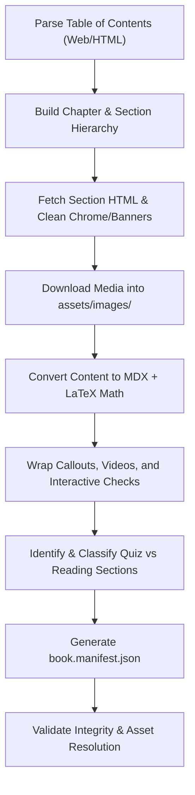

# Siyavula Content Extraction & Conversion Skill

This skill governs the end-to-end extraction and transformation of Siyavula textbooks into the **Anaise Book Repository** format defined in `anaise authoring guideline.md`.

## Workflow Overview



## 1. Extraction Specifications

### Content Sanitization
- Remove extraneous Siyavula navigation bars, banners (`sv-book-banner`), marketing blocks, breadcrumbs, and footer links.
- Retain all core pedagogical content:
  - Theoretical prose and definitions (`<dl class="definition">` converted to semantic definitions or `<Callout type="info">`).
  - Bulleted and enumerated lists (preserve multiline text items without premature line jumping).
  - Worked examples with problems, work steps, and solutions.
  - End-of-chapter exercises and solutions (`problemset`, `entry`, `problem`, `solution`).

### Interactive Components & Knowledge Checks
- **Interactive Practice Problems & Solutions**:
  - Exercises, textbook problems, and end-of-chapter questions are structured with explicit problem and solution blocks:
    ```markdown
    **Problem:**
    Find the values of \(x\) for which the expression is undefined.

    **Solution:**
    Set the denominator equal to zero: \(x^2 - 4 = 0 \implies x = \pm 2\).
    ```
  - The Anaise rendering platform automatically wraps `**Solution:**` blocks in an interactive `SolutionToggle` component, **collapsing and hiding answers by default** until the student clicks *"Show Answer & Explanation"*.
- **Callouts**:
  ```mdx
  <Callout type="note" title="Decimal Notation">
    You may see a full stop instead of a comma used to indicate a decimal number.
  </Callout>
  ```
- **Videos**:
  ```mdx
  <VideoPlayer
    src="https://www.youtube.com/watch?v=..."
    title="Video Walkthrough"
  />
  ```

### Mathematical Notation
- Inline LaTeX math formatted as `\(...\)` or `$...$`.
- Display / block equations formatted as `\[...\]` or `$$...$$`, or `\begin{align*} ... \end{align*}`.
- Ensure escaped characters and fractions (`\frac{...}{...}`) are cleanly preserved.

### List Formatting Rules
- Siyavula lists containing equations, fractions, or multi-sentence descriptions must be continuous.
- Do not split sentences across separate bullet points; preserve list continuation indentation so the reader engine treats each bullet as a single cohesive item.

### Section Classification & Manifest Generation
- `book.manifest.json` conforms to `https://anaise.org/schemas/book.v1.json`.
- **Dedicated Quiz Units**: Sections containing end-of-chapter exercises or standalone problem sets (`End of chapter exercises`, `Textbook Exercise`) are identified and mapped as `type: 'quiz'` in the course orchestrator/manifest, separating conceptual readings from interactive exercise checkpoints.
- Each chapter lists all sections, paths to `.mdx` files, and realistic reading/practice time estimates (`estimatedMinutes`).
