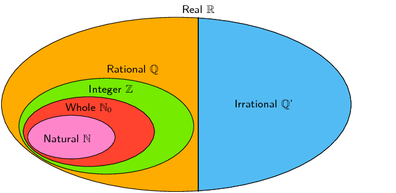

## 1.2 The real number system (EMA3)

We use the following definitions:

- \(\mathbb{N}\): natural numbers are \(\left\{1; 2; 3; \ldots\right\}\)
- \(\mathbb{N}_0\): whole numbers are \(\left\{0; 1; 2; 3; \ldots\right\}\)
- \(\mathbb{Z}\): integers are \(\left\{\ldots; -3; -2; -1; 0; 1; 2; 3; \ldots\right\}\)

<Callout type="tip" title="Multimedia & Video">
The following video shows an example of determining which of the above sets of numbers a particular number is
        in.

<VideoPlayer src="https://www.youtube.com/embed/aqsIWLqlDhE" title="Video: 2DBH" />
</Callout>

<Callout type="note" title="Note">
Not all numbers are real numbers. The square root of a negative number is called a non-real or imaginary
        number. For example \(\sqrt{-1}\), \(\sqrt{-28}\) and \(\sqrt{-5}\) are all non-real numbers.
</Callout>
