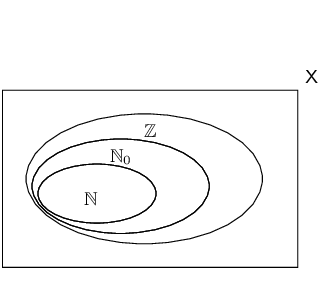

## 1.3 Rational and irrational numbers (EMA4)

<Callout type="info" title="Definition: Rational number">
A rational number (\(\mathbb{Q}\)) is any number which can be written as:

                \[\frac{a}{b}\]

where \(a\) and \(b\) are integers and \(b \ne 0\).
</Callout>

The following numbers are all rational numbers:

        \[\frac{10}{1} \; ; \; \frac{21}{7} \; ; \; \frac{-1}{-3} \; ; \; \frac{10}{20} \; ; \; \frac{-3}{6}\]

We see that all numerators and all denominators are integers.

This means that all integers are rational numbers, because they can be written with a denominator of
            \(\text{1}\).

<Callout type="info" title="Definition: Irrational numbers">
Irrational numbers (\(\mathbb{Q}'\)) are numbers that cannot be written as a fraction with the
                    numerator and denominator as integers.
</Callout>

Examples of irrational numbers:

        \[\sqrt{2} \; ; \; \sqrt{3} \; ; \; \sqrt[3]{4} \; ; \; \pi \; ; \; \frac{1 + \sqrt{5}}{2}\]

These are not rational numbers, because either the numerator or the denominator is not an integer.

### Decimal numbers (EMA5)

All integers and fractions with integer numerators and non-zero integer denominators are rational
                numbers. Remember that when the denominator of a fraction is zero then the fraction is undefined.

You can write any rational number as a decimal number but not all decimal numbers are rational numbers.
                These types of decimal numbers are rational numbers:

- Decimal numbers that end (or terminate). For example, the fraction \(\frac{4}{10}\) can be
                        written as \(\text{0,4}\).
- Decimal numbers that have a repeating single digit. For example, the fraction \(\frac{1}{3}\) can
                        be written as \(\text{0,}\dot{3}\) or \(\text{0,}\overline{3}\). The dot and bar notations are
                        equivalent and both represent recurring \(\text{3}\)'s, i.e. \(\text{0,}\dot{3} =
                        \text{0,}\overline{3} = \text{0,333...}\).
- Decimal numbers that have a recurring pattern of multiple digits. For example, the fraction
                        \(\frac{2}{11}\) can also be written as \(\text{0,}\overline{18}\). The bar represents a
                        recurring pattern of \(\text{1}\)'s and \(\text{8}\)'s, i.e. \(\text{0,}\overline{18} =
                        \text{0,181818...}\).

<Callout type="note" title="Note">
You may see a full stop instead of a comma used to indicate a decimal number. So the number
                    \(\text{0,4}\) can also be written as 0.4
</Callout>

Notation: You can use a dot or a bar over the repeated digits to indicate that the
                decimal is a recurring decimal. If the bar covers more than one digit, then all numbers beneath the bar
                are recurring.

If you are asked to identify whether a number is rational or irrational, first write the number in
                decimal form. If the number terminates then it is rational. If it goes on forever, then look for a
                repeated pattern of digits. If there is no repeated pattern, then the number is irrational.

When you write irrational numbers in decimal form, you may continue writing them for many, many decimal
                places. However, this is not convenient and it is often necessary to round off.

<Callout type="note" title="Note">
Rounding off an irrational number makes the number a rational number that approximates the irrational
                    number.
</Callout>

<Callout type="tip" title="Worked example 1: Rational and irrational numbers">
**Question:**
Which of the following are not rational numbers?

1. \(\pi =\text{3,14159265358979323846264338327950288419716939937510...}\)
2. \(\text{1,4}\)
3. \(\text{1,618033989...}\)
4. \(\text{100}\)
5. \(\text{1,7373737373...}\)
6. \(\text{0,}\overline{02}\)

1. Irrational, decimal does not terminate and has no repeated pattern.
2. Rational, decimal terminates.
3. Irrational, decimal does not terminate and has no repeated pattern.
4. Rational, all integers are rational.
5. Rational, decimal has repeated pattern.
6. Rational, decimal has repeated pattern.
</Callout>

### Converting terminating decimals into rational numbers (EMA6)

A decimal number has an integer part and a fractional part. For example, \(\text{10,589}\) has an integer
                part of \(\text{10}\) and a fractional part of \(\text{0,589}\) because \(10 + \text{0,589} =
                \text{10,589}\).

Each digit after the decimal point is a fraction with a denominator in increasing powers of
                \(\text{10}\).

For example:

- \(\text{0,1}\) is \(\frac{1}{\text{10}}\)
- \(\text{0,01}\) is \(\frac{1}{\text{100}}\)
- \(\text{0,001}\) is \(\frac{1}{\text{1 000}}\)

This means that

            \begin{align*}
            \text{10,589} & = 10 + \frac{5}{10} + \frac{8}{100} + \frac{9}{\text{1 000}}\\
            & = \frac{\text{10 000}}{\text{1 000}} + \frac{\text{500}}{\text{1 000}} +
            \frac{80}{\text{1 000}} + \frac{9}{\text{1 000}}\\
            & = \frac{\text{10 589}}{\text{1 000}}
            \end{align*}

<Callout type="tip" title="Multimedia & Video">
The following two videos explain how to convert decimals into rational numbers.

Part 1

<VideoPlayer src="https://www.youtube.com/embed/_jcW-ZgpRbM" title="Video: 2DBJ" />

Part 2

<VideoPlayer src="https://www.youtube.com/embed/Tceuvg9vjyc" title="Video: 2DBK" />
</Callout>

### Converting recurring decimals into rational numbers (EMA7)

When the decimal is a recurring decimal, a bit more work is needed to write the fractional part of the
                decimal number as a fraction.

<Callout type="tip" title="Worked example 2: Converting decimal numbers to fractions">
**Question:**
Write \(\text{0,}\dot{3}\) in the form \(\frac{a}{b}\) (where \(a\) and \(b\) are integers).

**Define an equation:**
\[\text{Let } x = \text{0,33333...}\]

**Multiply by \(\text{10}\) on both sides:**
\[10x = \text{3,33333...}\]

**Subtract the first equation from the second equation:**
\[9x = 3\]

**Simplify:**
\[x = \frac{3}{9} = \frac{1}{3}\]
</Callout>

<Callout type="tip" title="Worked example 3: Converting decimal numbers to fractions">
**Question:**
Write \(\text{5,}\dot{4}\dot{3}\dot{2}\) as a rational fraction.

**Define an equation:**
\[x=\text{5,432432432...}\]

**Multiply by \(\text{1 000}\) on both sides:**
\[\text{1 000}x=\text{5 432,432432432...}\]

**Subtract the first equation from the second equation:**
\[\text{999}x = \text{5 427}\]

**Simplify:**
\[x = \frac{\text{5 427}}{\text{999}} = \frac{\text{201}}{\text{37}} =
                    \text{5}\frac{\text{16}}{\text{37}}\]
</Callout>

In the first example, the decimal was multiplied by \(\text{10}\) and in the second example, the decimal
                was multiplied by \(\text{1 000}\). This is because there was only one digit recurring (i.e.
                \(\text{3}\)) in the first example, while there were three digits recurring (i.e. \(\text{432}\)) in the
                second example.

In general, if you have one digit recurring, then multiply by \(\text{10}\). If you have two digits
                recurring, then multiply by \(\text{100}\). If you have three digits recurring, then multiply by
                \(\text{1 000}\) and so on.

Not all decimal numbers can be written as rational numbers. Why? Irrational decimal numbers like
                \(\sqrt{2}=\text{1,4142135...}\) cannot be written with an integer numerator and denominator, because
                they do not have a pattern of recurring digits and they do not terminate.

### Textbook Exercise 1.1

The figure here shows the Venn diagram for the special sets \(\mathbb{N}, \mathbb{N}_0\)
                                and \(\mathbb{Z}\).

**Problem:**
Where does the number \(-\frac{12}{3}\) belong in the diagram?

**Solution:**
First simplify the fraction: \(-\frac{12}{3} = -4\)

\(-\text{4}\) is an integer, so it falls into the set \(\mathbb{Z}\).

**Problem:**
In the following list, there are two false statements and one true statement. Which
                                    of the statements is true?

1. Every integer is a natural number.
2. Every natural number is a whole number.
3. There are no decimals in the whole numbers.

**Solution:**
Consider each option carefully:

1. There are integers which do not fall into the natural numbers (all negative
                                        numbers), so this is false.
2. The natural numbers are \(\left\{1; 2; 3; \ldots\right\}\) and whole numbers are
                                        \(\left\{0; 1; 2; 3; \ldots\right\}\) (the circle \(\mathbb{N}\) is inside
                                        \(\mathbb{N}_{0}\)) so if a number is a natural number it must be a whole
                                        number. This is true.
3. Whole numbers \(\left\{0; 1; 2; 3; \ldots\right\}\) only go up in steps of 1, so
                                        there cannot be any decimal numbers in the whole numbers, making this false.

So only (ii) is true.

The figure here shows the Venn diagram for the special sets \(\mathbb{N}, \mathbb{N}_0\)
                                and \(\mathbb{Z}\).

**Problem:**
Where does the number \(- \frac{1}{2}\) belong in the diagram?

**Solution:**
\(- \frac{1}{2}\) is in its simplest form, therefore it is not in \(\mathbb{N}\),
                                    \(\mathbb{N}_0\) or \(\mathbb{Z}\). It is in the space between the rectangle and
                                    \(\mathbb{Z}\).

**Problem:**
In the following list, there are two false statements and one true statement. Which
                                    of the statements is true?

1. Every integer is a natural number.
2. Every whole number is an integer.
3. There are no decimals in the whole numbers.

**Solution:**
Consider each option carefully:

1. There are integers which do not fall into the natural numbers (all negative
                                        numbers), so this is false.
2. The integers are \(\left\{\ldots; -3; -2; -1; 0; 1; 2; 3; \ldots\right\}\) and
                                        the whole numbers are \(\left\{0; 1; 2; 3; \ldots\right\}\) (the circle
                                        \(\mathbb{Z}\) is inside \(\mathbb{N}_{0}\)) so if a number is an integer it
                                        must be a whole number. This is true.
3. Whole numbers \(\left\{0; 1; 2; 3; 4; \ldots \right\}\) only go up in steps of
                                        1, so there cannot be any decimal numbers in the whole numbers, making this
                                        false.

So only (ii) is true.

State whether the following numbers are real, non-real or undefined.

**Problem:**
\(-\sqrt{3}\)

**Solution:**
\(-\sqrt{3}\) has no minus sign under the square root (the minus is outside the root)
                                    and is not divided by zero, so it is real.

**Problem:**
\(\dfrac{0}{\sqrt{2}}\)

**Solution:**
\(\dfrac{0}{\sqrt{2}}\) has no minus sign under the square root (the minus is outside
                                    the root) and is not divided by zero, so it is real.

**Problem:**
\(\sqrt{-9}\)

**Solution:**
\(\sqrt{-9}\) has a minus sign under the square root so it is non-real.

**Problem:**
\(\dfrac{-\sqrt{7}}{0}\)

**Solution:**
\(\dfrac{-\sqrt{7}}{0}\) has division by zero so it is undefined.

**Problem:**
\(-\sqrt{-16}\)

**Solution:**
\(-\sqrt{-16}\) has a negative number under the square root so it is non-real.

**Problem:**
\(\sqrt{2}\)

**Solution:**
\(\sqrt{2}\) has no minus under the square root (the minus is outside the root), is
                                    not divided by zero, so it is real.

State whether the following numbers are rational or irrational. If the number is
                                rational, state whether it is a natural number, whole number or an integer.

**Problem:**
\(-\frac{1}{3}\)

**Solution:**
\(-\frac{1}{3}\) is rational. A fraction of integers is a rational number.

**Problem:**
\(\text{0,651268962154862...}\)

**Solution:**
\(\text{0,651268962154862...}\) is irrational. It cannot be simplified to a fraction
                                    of integers.

**Problem:**
\(\dfrac{\sqrt{9}}{3}\)

**Solution:**
\(\dfrac{\sqrt{9}}{3}\) is rational, an integer, a whole number and a natural number.
                                    An integer is a rational number.

**Problem:**
\(\pi^{2}\)

**Solution:**
\(\pi^{2}\) is irrational. It cannot be simplified to a fraction of integers.

**Problem:**
\(\pi^4\)

**Solution:**
\(\pi^4\) is irrational. It cannot be simplified to a fraction of integers.

**Problem:**
\(\sqrt[3]{19}\)

**Solution:**
\(\sqrt[3]{19}\) is irrational. It cannot be simplified to a fraction of integers.

**Problem:**
\(\left( \sqrt[3]{1} \right)^7\)

**Solution:**
\(\left( \sqrt[3]{1} \right)^7\) is rational, an integer, a whole number and a
                                    natural number. It can be written as an integer.

**Problem:**
\(\pi + 3\)

**Solution:**
\(\pi\) is irrational. \(\text{3}\) is rational (it is an integer). Any rational
                                    number added to any irrational number is irrational.

Therefore \(\pi + 3\) is irrational.

**Problem:**
\(\pi + \text{0,858408346}\)

**Solution:**
\(\pi\) is irrational. \(\text{0,858408346}\) is rational (it is a terminating
                                    decimal). Any rational number added to any irrational number is irrational.

Therefore \(\pi + \text{0,858408346}\) is irrational.

If \(a\) is an integer, \(b\) is an integer and \(c\) is irrational, which of the
                                following are rational numbers?

**Problem:**
\(\dfrac{5}{6}\)

**Solution:**
\(\frac{5}{6}\) is rational.

**Problem:**
\(\dfrac{a}{3}\)

**Solution:**
Since \(a\) is an integer, \(\frac{a}{3}\) is rational.

**Problem:**
\(\dfrac{-2}{b}\)

**Solution:**
Since \(b\) is an integer, \(\frac{-2}{b}\) is rational.

Note that \(b\) cannot be \(\text{0}\) as that makes the fraction undefined.

**Problem:**
\(\dfrac{1}{c}\)

**Solution:**
Since \(c\) is irrational, \(\frac{1}{c}\) is irrational.

For each of the following values of \(a\) state whether \(\frac{a}{14}\) is rational or
                                irrational.

**Problem:**
\(\text{1}\)

**Solution:**
\(\frac{a}{14} = \frac{1}{14}\) is rational.

**Problem:**
\(-\text{10}\)

**Solution:**
\(\frac{a}{14} = \frac{-10}{14}\) is rational.

**Problem:**
\(\sqrt{2}\)

**Solution:**
\(\frac{a}{14} = \frac{\sqrt{2}}{14}\) is irrational.

**Problem:**
\(\text{2,1}\)

**Solution:**
\(\frac{a}{14} = \frac{\text{2,1}}{14}\) is rational.

Consider the following list of numbers:

                            \[-3 \; ; \; 0 \; ; \; \sqrt{-1} \; ; \; -8\frac{4}{5} \; ; \; -\sqrt{8} \; ; \;
                            \frac{22}{7} \; ; \; \frac{14}{0} \; ; \; 7 \; ; \; \text{1,}\overline{34} \; ; \;
                            \text{3,3231089...} \; ; \; 3+\sqrt{2} \; ; \; 9\frac{7}{10} \; ; \; \pi \; ; \; 11\]

Which of the numbers are:

**Problem:**
natural numbers

**Solution:**
Check which of the numbers are in the set \(\left\{1; 2; 3; 4;\ldots\right\}\).
                                    Therefore \(\text{7}\) and \(\text{11}\) are natural numbers.

**Problem:**
irrational numbers

**Solution:**
Remember that rational numbers can be written as \(\frac{a}{b}\) where \(a\) and
                                    \(b\) are integers. Also remember that rational numbers include terminating decimal
                                    numbers. Therefore \(-\sqrt{8} \; ; \; \text{3,3231089...} \; ; \; 3+\sqrt{2} \; ;
                                    \; \pi\) are all irrational.

**Problem:**
non-real numbers

**Solution:**
Any number that is a square root of a negative number is non-real. Therefore only
                                    \(\sqrt{-1}\) is non-real.

**Problem:**
rational numbers

**Solution:**
Remember that rational numbers can be written as \(\frac{a}{b}\) where \(a\) and
                                    \(b\) are integers. Also remember that rational numbers include terminating decimal
                                    numbers. Therefore \(-3 \; ; \; 0 \; ; \; -8\frac{4}{5} \; ; \; \frac{22}{7} \; ; \;
                                    7 \; ; \; \text{1,}\overline{34} \; ; \; 9\frac{7}{10} \; ; \; 11\) are all rational
                                    numbers.

**Problem:**
integers

**Solution:**
Check which of the numbers are in the set \(\left\{\ldots; -3; -2; -1; 0; 1; 2;
                                    3;\ldots\right\}\). Therefore \(-3 \; ; \; 7 \; ; \; 11\) are integers.

**Problem:**
undefined

**Solution:**
Any fraction divided by \(\text{0}\) is undefined. Therefore only \(\frac{14}{0}\) is
                                    undefined.

For each of the following numbers:

- write the next three digits and
- state whether the number is rational or irrational.

**Problem:**
\(\text{1,1}\dot{5}\)

**Solution:**
- Since there is a dot over the 5 we know that the 5 repeats. The next three
                                        digits are: \(555\)
- Rational, there is a repeating pattern of digits.

**Problem:**
\(\text{2,121314...}\)

**Solution:**
- The number does not terminate (this is shown by the \(\ldots\)). There is
                                            also no indication of a repeating pattern of digits since there is not dot
                                            or bar over any of the numbers. The next three digits could be any numbers.

Note that while it looks like there is a pattern in the digits we do not know
                                            if this pattern continues on.
- Irrational, there is no repeating pattern.

**Problem:**
\(\text{1,242244246...}\)

**Solution:**
- The number does not terminate (this is shown by the \(\ldots\)). There is
                                            also no indication of a repeating pattern of digits since there is not dot
                                            or bar over any of the numbers. The next three digits could be any numbers.

Note that while it looks like there is a pattern in the digits we do not know
                                            if this pattern continues on.
- Irrational, there is no repeating pattern.

**Problem:**
\(\text{3,324354...}\)

**Solution:**
- The number does not terminate (this is shown by the \(\ldots\)). There is
                                            also no indication of a repeating pattern of digits since there is not dot
                                            or bar over any of the numbers. The next three digits could be any numbers.

Note that while it looks like there is a pattern in the digits we do not know
                                            if this pattern continues on.
- Irrational, there is no repeating pattern.

**Problem:**
\(\text{3,3243}\dot{5}\dot{4}\)

**Solution:**
- Since there is a dot over both the 5 and the 4 we know that the pattern 54
                                        repeats. The next three digits are: \(545\)
- Rational, there is a repeating pattern.

Write the following as fractions:

**Problem:**
\(\text{0,1}\)

**Solution:**
\(\text{0,1}=\frac{1}{10}\)

**Problem:**
\(\text{0,12}\)

**Solution:**
\begin{align*}
                                \text{0,12} & = \frac{1}{10} + \frac{2}{100} \\
                                & = \frac{10}{100} + \frac{2}{100} \\
                                & = \frac{12}{100} \\
                                & = \frac{3}{25}
                                \end{align*}

**Problem:**
\(\text{0,58}\)

**Solution:**
\begin{align*}
                                \text{0,58} & = \frac{5}{10} + \frac{8}{100} \\
                                & = \frac{50}{100} + \frac{8}{100} \\
                                & = \frac{58}{100} \\
                                & = \frac{29}{50}
                                \end{align*}

**Problem:**
\(\text{0,2589}\)

**Solution:**
\begin{align*}
                                \text{0,2589} & = \frac{2}{10} + \frac{5}{100} + \frac{8}{\text{1 000}} +
                                \frac{9}{\text{10 000}} \\
                                & = \frac{\text{2 000}}{\text{10 000}} + \frac{500}{\text{10 000}} +
                                \frac{80}{\text{10 000}} + \frac{9}{\text{10 000}} \\
                                & = \frac{\text{2 589}}{\text{10 000}}
                                \end{align*}

Write the following using the recurring decimal notation:

**Problem:**
\(\text{0,1111111...}\)

**Solution:**
We see that only the digit \(\text{1}\) is repeated and so we can write this as:
                                    \(\text{0,}\dot{1}\).

**Problem:**
\(\text{0,1212121212...}\)

**Solution:**
There is a repeating pattern of \(\text{12}\) and so we can write this number as:
                                    \(\text{0,}\overline{12}\)

**Problem:**
\(\text{0,123123123123...}\)

**Solution:**
There is a repeating pattern of \(\text{123}\) and so we can write this number as:
                                    \(\text{0,}\overline{123}\)

**Problem:**
\(\text{0,11414541454145...}\)

**Solution:**
The pattern 4145 repeats and so we can write this number as:
                                    \(\text{0,11}\overline{4145}\).

Write the following in decimal form, using the recurring decimal notation:

**Problem:**
\(\dfrac{\text{25}}{\text{45}}\)

**Solution:**
\begin{align*}
                                \text{45}|\overline{\text{25,}\text{0 000}} &= \text{0} \text{ remainder }
                                \text{25}
                                \\
                                \text{45}|\overline{\text{25,}^{25}\text{0 000}} &= \text{5} \text{ remainder }
                                \text{25}
                                \\
                                \text{45}|\overline{\text{25,}^{25}\text{0}^{25}\text{000}} &= \text{5} \text{
                                remainder } \text{25}
                                \\
                                \text{45}|\overline{\text{25,}^{25}\text{0}^{25}\text{0}^{25}\text{00}} &= \text{5}
                                \text{ remainder } \text{25}
                                \\
                                \frac{\text{25}}{\text{45}} &= \text{0,}\text{5 555} \ldots \\
                                &= \text{0,}\dot{\text{5}}
                                \end{align*}

**Problem:**
\(\dfrac{\text{10}}{\text{18}}\)

**Solution:**
\begin{align*}
                                \text{18}|\overline{\text{10,0000}} &= \text{0} \text{ remainder } \text{10}
                                \\
                                \text{18}|\overline{\text{10,}^{10}\text{0 000}} &= \text{5} \text{ remainder }
                                \text{10}
                                \\
                                \text{18}|\overline{\text{10,}^{10}\text{0}^{10}\text{000}} &= \text{5} \text{
                                remainder } \text{10}
                                \\
                                \text{18}|\overline{\text{10,}^{10}\text{0}^{10}\text{0}^{10}\text{00}} &= \text{5}
                                \text{ remainder } \text{10}
                                \\
                                \frac{\text{10}}{\text{18}} &= \text{0,}\text{5 555} \ldots \\
                                &= \text{0,}\dot{\text{5}}
                                \end{align*}

**Problem:**
\(\dfrac{\text{7}}{\text{33}}\)

**Solution:**
\begin{align*}
                                \text{33}|\overline{\text{7,0000}} &= \text{0} \text{ remainder } \text{7}
                                \\
                                \text{33}|\overline{\text{7,}^7\text{0 000}} &= \text{2} \text{ remainder }
                                \text{4}
                                \\
                                \text{33}|\overline{\text{7,}^4\text{0}^4\text{000}} &= \text{1} \text{ remainder }
                                \text{7}
                                \\
                                \text{33}|\overline{\text{7,}^7\text{0}^4\text{0}^7\text{00}} &= \text{2} \text{
                                remainder } \text{4}
                                \\
                                \frac{\text{7}}{\text{33}} &= \text{0,}\text{2 121} \ldots \\
                                &= \text{0,}\dot{\text{2}}\dot{\text{1}}
                                \end{align*}

**Problem:**
\(\dfrac{2}{3}\)

**Solution:**
\begin{align*}
                                \frac{2}{3} &= 2\left(\frac{1}{3}\right) \\
                                &= 2(\text{0,333333...}) \\
                                &= \text{0,666666...} \\
                                &= \text{0,}\dot{6}
                                \end{align*}

**Problem:**
\(1\dfrac{3}{11}\)

**Solution:**
\begin{align*}
                                1\frac{3}{11} &= 1 + 3\left(\frac{1}{11}\right) \\
                                &= 1 + 3(\text{0,090909...})\\
                                &= 1 + \text{0,27272727...} \\
                                &= \text{1,}\overline{27}
                                \end{align*}

**Problem:**
\(4\dfrac{5}{6}\)

**Solution:**
\begin{align*}
                                4\frac{5}{6} &= 4 + 5\left(\frac{1}{6}\right) \\
                                &= 4+ 5(\text{0,1666666...}) \\
                                &= 4 + \text{0,833333...} \\
                                & = \text{4,8}\dot{3}
                                \end{align*}

**Problem:**
\(2\dfrac{1}{9}\)

**Solution:**
\begin{align*}
                                2\frac{1}{9} &= 2 + \text{0,1111111...} \\
                                & = \text{2,}\dot{1}
                                \end{align*}

Write the following decimals in fractional form:

**Problem:**
\(\text{0,}\dot{5}\)

**Solution:**
\begin{align*}
                                x&=\text{0,55555...} \text{ and} \\
                                10x &= \text{5,55555...} \\
                                10x - x &= (\text{5,55555...}) - (\text{0,55555...}) \\
                                \text{9}x &= \text{5} \\
                                \therefore x&=\frac{5}{9}
                                \end{align*}

**Problem:**
\(\text{0,6}\dot{3}\)

**Solution:**
\begin{align*}
                                10x &= \text{6,3333...} \text{ and}\\
                                100x &= \text{63,3333...} \\
                                100x - 10x &= (\text{63,3333...}) - (\text{6,3333...}) \\
                                \text{99}x &= \text{57} \\
                                \therefore x&=\frac{57}{90}
                                \end{align*}

**Problem:**
\(\text{0,}\dot{4}\)

**Solution:**
\begin{align*}
                                x & = \text{0,4444...} \text{ and} \\
                                \text{10}x & = \text{4,4444...} \\
                                10x - x &= (\text{4,4444...}) - (\text{0,4444...}) \\
                                \text{9}x &= \text{4} \\
                                \therefore x & = \frac{\text{4}}{\text{9}}
                                \end{align*}

**Problem:**
\(\text{5,}\overline{31}\)

**Solution:**
\begin{align*}
                                x &= \text{5,313131...} \text{ and} \\
                                100x & = \text{531,313131...}\\
                                100x - x &= (\text{531,313131...}) - (\text{5,313131...}) \\
                                \text{99}x &= \text{526} \\
                                \therefore x&=\frac{526}{99}
                                \end{align*}

**Problem:**
\(\text{4,}\overline{\text{93}}\)

**Solution:**
\begin{align*}
                                x &= \text{4,939393...} \text{ and} \\
                                100x &= \text{493,939393...} \\
                                100x - x &= (\text{493,939393...}) - (\text{4,939393...}) \\
                                \text{99}x &= \text{489} \\
                                \therefore x &= \frac{\text{163}}{\text{33}}
                                \end{align*}

**Problem:**
\(\text{3,}\overline{\text{93}}\)

**Solution:**
\begin{align*}
                                x &= \text{3,939393...} \text{ and} \\
                                100x &= \text{393,939393...} \\
                                100x - x &= (\text{393,939393...}) - (\text{3,939393...}) \\
                                \text{99}x &= \text{390} \\
                                \therefore x &= \frac{\text{130}}{\text{33}}
                                \end{align*}
