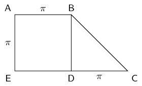

## 1.4 Rounding off (EMA8)

Rounding off a decimal number to a given number of decimal places is the quickest way to approximate
                        a number. For example, if you wanted to round off \(\text{2,6525272}\) to three decimal places,
                        you would:

- count three places after the decimal and place a \(|\) between the third and fourth numbers;
- round up the third digit if the fourth digit is greater than or equal to \(\text{5}\);
- leave the third digit unchanged if the fourth digit is less than \(\text{5}\);
- if the third digit is \(\text{9}\) and needs to be rounded up, then the \(\text{9}\) becomes a \(\text{0}\) and the second digit is rounded up.

So, since the first digit after the \(|\) is a \(\text{5,}\) we must round up the digit in the third
                        decimal place to a \(\text{3}\) and the final answer of \(\text{2,6525272}\) rounded to three
                        decimal places is \(\text{2,653}\).

<Callout type="tip" title="Multimedia & Video">
The following video explains how to round off.

<VideoPlayer src="https://www.youtube.com/embed/2-UyjyU7s_Q" title="Video: 2DD8" />
</Callout>

<Callout type="tip" title="Worked example 4: Rounding off">
**Question:**
Round off the following numbers to the indicated number of decimal places:

1. \(\dfrac{120}{99}=\text{1,}\dot{2}\dot{1}\) to \(\text{3}\) decimal places.
2. \(\pi =\text{3,141592653...}\) to \(\text{4}\) decimal places.
3. \(\sqrt{3}=\text{1,7320508...}\) to \(\text{4}\) decimal places.
4. \(\text{2,78974526}\) to \(\text{3}\) decimal places.

**Mark off the required number of decimal places:**
If the number is not a decimal you first need to write the number as a decimal.

1. \(\dfrac{120}{99} = \text{1,212}|121212\ldots\)
2. \(\pi =\text{3,1415}|92653\ldots\)
3. \(\sqrt{3}=\text{1,7320}|508\ldots\)
4. \(\text{2,789}|74526\)

**Check the next digit to see if you must round up or round down:**
1. The last digit of \(\frac{120}{99}=\text{1,212}|121212\dot{1}\dot{2}\) must be rounded down.
2. The last digit of \(\pi =\text{3,1415}|92653\ldots\) must be rounded up.
3. The last digit of \(\sqrt{3}=\text{1,7320}|508\ldots\) must be rounded up.
4. The last digit of \(\text{2,789}|74526\) must be rounded up. Since this is a \(\text{9}\) we replace it with a \(\text{0}\) and round up the second last digit.

**Write the final answer:**
1. \(\dfrac{120}{99}=\text{1,212}\) rounded to \(\text{3}\) decimal places.
2. \(\pi =\text{3,1416}\) rounded to \(\text{4}\) decimal places.
3. \(\sqrt{3}=\text{1,7321}\) rounded to \(\text{4}\) decimal places.
4. \(\text{2,790}\)
</Callout>

<QuizCard id="m10-01-04a" title="Interactive Exercise 1.5" question="Round off the number \(\text{252,4392857}\) to \(\text{5}\) decimal places." options=[] answer="252.43929" hint="You should enter a number here. If you want to, you can use a space to separate thousands.                Example: 12 800,25 For scientific notation you need to use the multiply symbol                ( ∗ ) and the exponent symbol ( ^ ). For example 6,673 × 10 −11 should be written as: 6,673 ∗ 10^−11" explanation="Round off When you are rounding off to \(\text{5}\) decimal                     places, look at the value of the sixth decimal; if it is                     less than \(\text{5}\) , then round the fifth decimal down , and if it is greater than or equal to \(\text{5}\) ,                     round the fifth decimal up . \[\begin{array}{c}\text{252,4392857}\,\, \approx \text{252,43929}\end{array}\] Submit your answer as:" />

### Textbook Exercise 1.2

Round off the following to \(\text{3}\) decimal places:

**Problem:**
\(\text{12,56637061...}\)

**Solution:**
Mark off the required number of decimal places:
                                                                \(\text{12,566}|37061\ldots\). The next digit is a
                                                                \(\text{3}\) and so we round down: \(\text{12,566}\).

**Problem:**
\(\text{3,31662479...}\)

**Solution:**
Mark off the required number of decimal places:
                                                                \(\text{3,316}|62479\ldots\). The next digit is a
                                                                \(\text{6}\) and so we round up: \(\text{3,317}\).

**Problem:**
\(\text{0,2666666...}\)

**Solution:**
Mark off the required number of decimal places:
                                                                \(\text{0,266}|6666\ldots\). The next digit is a
                                                                \(\text{6}\) and so we round up: \(\text{0,267}\).

**Problem:**
\(\text{1,912931183...}\)

**Solution:**
Mark off the required number of decimal places:
                                                                \(\text{1,912}|931183\ldots\). The next digit is a
                                                                \(\text{9}\) and so we round up: \(\text{1,913}\).

**Problem:**
\(\text{6,32455532...}\)

**Solution:**
Mark off the required number of decimal places:
                                                                \(\text{6,324}|55532\ldots\). The next digit is a
                                                                \(\text{5}\) and so we round up: \(\text{6,325}\).

**Problem:**
\(\text{0,05555555...}\)

**Solution:**
Mark off the required number of decimal places:
                                                                \(\text{0,055}|55555\ldots\). The next digit is a
                                                                \(\text{5}\) and so we round up: \(\text{0,056}\).

Round off each of the following to the indicated number of decimal
                                                        places:

**Problem:**
\(\text{345,04399906}\) to \(\text{4}\) decimal places.

**Solution:**
\[\text{345,04399906} \approx \text{345,0440}\]

**Problem:**
\(\text{1 361,72980445}\) to \(\text{2}\) decimal
                                                                places.

**Solution:**
\[\text{1 361,72980445} \approx \text{1 361,73}\]

**Problem:**
\(\text{728,00905239}\) to \(\text{6}\) decimal places.

**Solution:**
\[\text{728,00905239} \approx \text{728,009052}\]

**Problem:**
\(\dfrac{1}{27}\) to \(\text{4}\) decimal places.

**Solution:**
We first write the fraction as a decimal and then we can
                                                                round off.

                                                        \begin{align*}
                                                        \frac{1}{27} &= \text{0,037037...} \\
                                                        & \approx \text{0,0370}
                                                        \end{align*}

**Problem:**
\(\dfrac{45}{99}\) to \(\text{5}\) decimal places.

**Solution:**
We first write the fraction as a decimal and then we can
                                                                round off.

                                                        \begin{align*}
                                                        \frac{45}{99} &= \text{0,45454545...} \\
                                                        & \approx \text{0,45455}
                                                        \end{align*}

**Problem:**
\(\dfrac{1}{12}\) to \(\text{2}\) decimal places.

**Solution:**
We first write the fraction as a decimal and then we can
                                                                round off.

                                                        \begin{align*}
                                                        \frac{1}{12} &= \text{0,08333...} \\
                                                        & \approx \text{0,08}
                                                        \end{align*}

Study the diagram below

**Problem:**
Calculate the area of \(ABDE\) to \(\text{2}\) decimal
                                                                places.

**Solution:**
\(ABDE\) is a square and so the area is just the length
                                                                squared.

                                                        \begin{align*}
                                                        A &= l^{2} \\
                                                        &= \pi^2 \\
                                                        & = \text{9,86904...} \\
                                                        & \approx \text{9,87}
                                                        \end{align*}

**Problem:**
Calculate the area of \(BCD\) to \(\text{2}\) decimal places.

**Solution:**
\(BCD\) is a right-angled triangle and so we have the
                                                                perpendicular height. The area is:

                                                        \begin{align*}
                                                        A & = \frac{1}{2} b h\\
                                                        & = \frac{1}{2} \pi^2 \\
                                                        & = \text{4,934802...} \\
                                                        & \approx \text{4,93}
                                                        \end{align*}

**Problem:**
Using you answers in (a) and (b) calculate the area of
                                                                \(ABCDE\).

**Solution:**
The area of \(ABCDE\) is the sum of the areas of \(ABDE\) and
                                                                \(BCD\).

                                                        \begin{align*}
                                                        A & = \text{9,87} + \text{4,93} \\
                                                        & \approx \text{14,80}
                                                        \end{align*}

**Problem:**
Without rounding off, what is the area of \(ABCDE\)?

**Solution:**
\begin{align*}
                                                        A_{ABCDE} & = A_{ABDE} + A_{BCD} \\
                                                        & = l^{2} + \frac{1}{2}bh \\
                                                        &= \pi ^2 + \frac{1}{2} \pi^2 \\
                                                        &= \text{14,8044...}
                                                        \end{align*}

Given \(i = \dfrac{r}{600}\); \(r = \text{7,4}\); \(n = 96\); \(P =
                                                        \text{200 000}\).

**Problem:**
Calculate \(i\) correct to \(\text{2}\) decimal places.

**Solution:**
\begin{align*}
                                                        i & = \frac{r}{600} \\
                                                        & = \frac{\text{7,4}}{600} \\
                                                        & = \text{0,01233} \\
                                                        & \approx \text{0,01}
                                                        \end{align*}

**Problem:**
Using you answer from (a), calculate \(A\) in \(A = P(1+
                                                                i)^n\).

**Solution:**
\begin{align*}
                                                        A &= P(1+ i)^n \\
                                                        &= \text{200 000}\left(1+ \text{0,01}\right)^{96} \\
                                                        &= \text{519 854,59}
                                                        \end{align*}

**Problem:**
Calculate \(A\) without rounding off your answer in (a),
                                                                compare this answer with your answer in (b).

**Solution:**
\begin{align*}
                                                        A &= P(1+ i)^n \\
                                                        A &= \text{200 000}\left(1+
                                                        \frac{\text{7,4}}{600}\right)^{96} \\
                                                        &= \text{648 768,22}
                                                        \end{align*}

There is a \(\text{128 913,63}\) difference between the
                                                                answer in (b) and the one calculated without rounding
                                                                until the final step.

**Problem:**
If it takes \(\text{1}\) person to carry \(\text{3}\) boxes, how many
                                                        people are needed to carry \(\text{31}\) boxes?

**Solution:**
Each person can carry 3 boxes. So we need to divide 31 by 3 to find
                                                        out how many people are needed to carry 31 boxes.

                                                \[\frac{31}{3} = \text{10,3333...}\]

Therefore \(\text{11}\) people are needed to carry \(\text{31}\)
                                                        boxes. We cannot have \(\text{0,333}\) of a person so we round
                                                        up to the nearest whole number.

**Problem:**
If \(\text{7}\) tickets cost \(\text{R}\,\text{35,20}\), how much
                                                        does one ticket cost?

**Solution:**
Since 7 tickets cost \(\text{R}\,\text{35,20}\), 1 ticket must cost
                                                        \(\text{R}\,\text{35,20}\) divided by 7.

                                                \[\frac{\text{35,20}}{7} =\text{5,028571429}\\\]

Therefore one ticket costs \(\text{R}\,\text{5,03}\). Money should be
                                                        rounded off to \(\text{2}\) decimal places.
