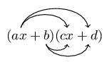

## 1.6 Products (EMAB)

Mathematical expressions are just like sentences and their parts have special names. You should be familiar
            with the words used to describe the parts of mathematical expressions. These words are given in the table
            below, using the following expression as an example:

        \[3{x}^{2} + (7xy)^{3} - {125}\]

| Name | Examples |
| --- | --- |
| term | \(3{x}^{2} \; ; \; (7xy)^{3} \; ; \; -125\) |
| expression | \(3{x}^{2} + (7xy)^{3} - {5}^{3}\) |
| coefficient | \(3 \; ; \; 7\) |
| exponent | \(2 \; ; \; 3\) |
| base | \(x \; ; \; 7xy \) |
| constant | \(-125\) |
| variable | \(x \; ; \; y\) |
| equation | \(3{x}^{2} + (7xy)^{3} - 125 = 0\) |

### Multiplying a monomial and a binomial (EMAC)

A monomial is an expression with one term, for example, \(3x\) or \({y}^{2}\). A binomial is an
                expression with two terms, for example, \(ax+b\) or \(cx+d\).

<Callout type="tip" title="Worked example 7: Simplifying brackets">
**Question:**
Simplify: \[2a\left(a - 1\right) - 3\left({a}^{2} - 1\right)\]

\begin{align*} 2a\left(a - 1\right) - 3\left({a}^{2}-1\right) & = 2a\left(a\right) +
                2a\left(-1\right) + \left(-3\right)\left({a}^{2}\right) + \left(-3\right)\left(-1\right)\\
                & = 2{a}^{2} - 2a - 3{a}^{2} + 3\\
                & = -{a}^{2} - 2a + 3
                \end{align*}
</Callout>

### Multiplying two binomials (EMAD)

Here we multiply (or expand) two linear binomials:

<Callout type="tip" title="Worked example 8: Multiplying two binomials">
**Question:**
Find the product: \(\left(3x-2\right)\left(5x+8\right)\)

\begin{align*}
                \left(3x - 2\right)\left(5x + 8\right) & = \left(3x\right)\left(5x\right) +
                \left(3x\right)\left(8\right) + \left(-2\right)\left(5x\right) + \left(-2\right)\left(8\right) \\
                & = 15{x}^{2} + 24x - 10x - 16 \\
                & = 15{x}^{2} + 14x - 16
                \end{align*}
</Callout>

The product of two identical binomials is known as the square of the binomial and is written as:

            \[{\left(ax + b\right)}^{2} = {a}^{2}{x}^{2} + 2abx + {b}^{2}\]

If the two terms are of the form \(ax + b\) and \(ax - b\) then their product is:

            \[\left(ax + b\right)\left(ax - b\right) = {a}^{2}{x}^{2} - {b}^{2}\]

This product yields the difference of two squares.

### Multiplying a binomial and a trinomial (EMAF)

A trinomial is an expression with three terms, for example, \(a{x}^{2} + bx + c\). Now we can learn how
                to multiply a binomial and a trinomial.

To find the product of a binomial and a trinomial, multiply out the brackets:

            \[\left(A + B\right)\left(C + D + E\right) = A\left(C + D + E\right) + B\left(C + D + E\right)\]

<Callout type="tip" title="Multimedia & Video">
This video shows some examples of multiplying a binomial and a trinomial.

<VideoPlayer src="https://www.youtube.com/embed/cwldONEmzNk" title="Video: 2DFF" />
</Callout>

<Callout type="tip" title="Worked example 9: Multiplying a binomial and a trinomial">
**Question:**
Find the product: \(\left(x - 1\right)\left({x}^{2} - 2x + 1\right)\)

**Expand the bracket:**
\[\left(x - 1\right)\left({x}^{2} - 2x + 1\right) = x\left({x}^{2} - 2x + 1\right) - 1\left({x}^{2}
                    - 2x + 1\right) = {x}^{3} - 2{x}^{2} + x - {x}^{2} + 2x - 1\]

**Simplify:**
\[{\left(x - 1\right)\left({x}^{2} - 2x + 1\right)} = {x}^{3} - 3{x}^{2} + 3x - 1\]
</Callout>

### Textbook Exercise 1.4

Expand the following products:

**Problem:**
\(2y(y+4)\)

**Solution:**
\[2y(y+4) = 2y^{2} + 8y\]

**Problem:**
\((y+5)(y+2)\)

**Solution:**
\begin{align*}
                                (y+5)(y+2) & = y^2 + 2y + 5y + 10\\
                                & = y^{2} + 7y + 10
                                \end{align*}

**Problem:**
\((2 - t)(1 - 2t)\)

**Solution:**
\begin{align*}
                                (2 - t)(1 - 2t) & = 2 - 4t - t + 2t^{2}\\
                                & = 2t^{2} - 5t + 2
                                \end{align*}

**Problem:**
\((x - 4)(x + 4)\)

**Solution:**
\begin{align*}
                                (x - 4)(x + 4) & = x^{2} + 4x - 4x - 16\\
                                & = x^{2} - 16
                                \end{align*}

**Problem:**
\(-(4 - x)(x + 4)\)

**Solution:**
\begin{align*}
                                -(4 - x)(x + 4) &= -(4x + 16 - x^{2} - 4x) \\
                                & = -(16 - x^{2}) \\
                                & = -16 + x^{2} \\
                                & = x^{2} - 16
                                \end{align*}

**Problem:**
\(-(a + b)(b - a)\)

**Solution:**
\begin{align*}
                                -(a + b)(b - a) &=(a + b)(a - b) \\
                                & = a^{2} + ba - ba - 16\\
                                & = a^{2} - b^{2}
                                \end{align*}

**Problem:**
\((2p + 9)(3p + 1)\)

**Solution:**
\begin{align*}
                                (2p + 9)(3p + 1) & = 6p^{2} + 2p + 27p + 9\\
                                & = 6p^{2} + 29p + 9
                                \end{align*}

**Problem:**
\((3k - 2)(k + 6)\)

**Solution:**
\begin{align*}
                                (3k - 2)(k + 6) & = 3k^{2} + 18k - 2k - 12\\
                                & = 3k^{2} + 16k - 12
                                \end{align*}

**Problem:**
\((s + 6)^{2}\)

**Solution:**
\begin{align*}
                                (s + 6)^{2} & = (s + 6)(s + 6) \\
                                & = s^{2} + 6s + 6s + 36\\
                                & = s^{2} + 12s + 36
                                \end{align*}

**Problem:**
\(-(7 - x)(7 + x)\)

**Solution:**
\begin{align*}
                                -(7 - x)(7 + x) & = -(49 + 7x - 7x - x^{2}) \\
                                & = -(49 - x^{2})\\
                                & = x^{2} - 49
                                \end{align*}

**Problem:**
\((3x - 1)(3x + 1)\)

**Solution:**
\begin{align*}
                                (3x - 1)(3x + 1) & = 9x^{2} + 3x - 3x - 1\\
                                & = 9x^{2} - 1
                                \end{align*}

**Problem:**
\((7k + 2)(3 - 2k)\)

**Solution:**
\begin{align*}
                                (7k + 2)(3 - 2k) & = 21k - 14k^{2} + 6 - 4k\\
                                & = -14k^{2} + 17k + 6
                                \end{align*}

**Problem:**
\((1 - 4x)^{2}\)

**Solution:**
\begin{align*}
                                (1 - 4x)^{2} & = (1 - 4x)(1 - 4x) \\
                                & = 1 - 4x - 4x + 16x^{2}\\
                                & = 16x^{2} - 8x + 1
                                \end{align*}

**Problem:**
\((-3 - y)(5 - y)\)

**Solution:**
\begin{align*}
                                (-3 - y)(5 - y) & = -15 + 3y - 5y + y^{2}\\
                                & = y^{2} - 2y - 15
                                \end{align*}

**Problem:**
\((8 - x)(8 + x)\)

**Solution:**
\begin{align*}
                                (8 - x)(8 + x) & = 64 + 8x - 8x - x^{2}\\
                                & = -x^{2} + 64
                                \end{align*}

**Problem:**
\((9 + x)^{2}\)

**Solution:**
\begin{align*}
                                (9 + x)^{2} & = (9 + x)(9 + x)\\
                                & 81 + 9x + 9x + x^{2}\\
                                & = x^{2} + 18x + 81
                                \end{align*}

**Problem:**
\((-7y + 11)(-12y + 3)\)

**Solution:**
\begin{align*}
                                (-7y + 11)(-12y + 3) & = 84y^{7} - 21y - 132y + 33\\
                                & = 84y^{2} - 153y + 33
                                \end{align*}

**Problem:**
\((g - 5)^2\)

**Solution:**
\begin{align*}
                                    (g - 5)^2 & = (g - 5)(g - 5) \\
                                    & = g^2 - 5g - 5g + 25 \\
                                    & = g^2 - 10g + 25
                                    \end{align*}

**Problem:**
\((d + 9)^2\)

**Solution:**
\begin{align*}
                                    (d + 9)^2 & = (d + 9)(d + 9) \\
                                    & = d^2 + 9d + 9d + 81\\
                                    & = d^2 + 18d + 81
                                    \end{align*}

**Problem:**
\((6d + 7)(6d - 7)\)

**Solution:**
\begin{align*}
                                    (6d + 7)(6d - 7) & = 36d^{2} - 42d +
                                    42d - 49\\
                                    &= 36d^{2} - 49
                                    \end{align*}

**Problem:**
\((5z + 1)(5z - 1)\)

**Solution:**
\begin{align*}
                                    (5z + 1)(5z - 1) &= 25z^2 - 5z + 5z -1 \\
                                    & = 25z^{2} - 1
                                    \end{align*}

**Problem:**
\((1 - 3h)(1 + 3h)\)

**Solution:**
\begin{align*}
                                    (1 - 3h)(1 + 3h) &= 1 + 3h - 3h -9h^{2}\\
                                    &= 1 - 9h^{2}
                                    \end{align*}

**Problem:**
\((2p + 3)(2p + 2)\)

**Solution:**
\begin{align*}
                                    (2p + 3)(2p + 2) &= 4p^2 + 4p + 6p + 6 \\
                                    &= 4p^2 + 10p + 6
                                    \end{align*}

**Problem:**
\((8a + 4)(a + 7)\)

**Solution:**
\begin{align*}
                                    (8a + 4)(a + 7) &= 8a^2 + 56a + 4a + 28 \\
                                    &= 8a^{2} + 60a + 28
                                    \end{align*}

**Problem:**
\((5r + 4)(2r + 4)\)

**Solution:**
\begin{align*}
                                    (5r + 4)(2r + 4) &= 10r^{2} + 20r + 8r + 16 \\
                                    &= 10r^{2} + 28r + 16
                                    \end{align*}

**Problem:**
\((w + 1)(w - 1)\)

**Solution:**
\begin{align*}
                                    (w + 1)(w - 1) &= w^2 + w - w - 1\\
                                    &= {w}^2 - 1
                                    \end{align*}

Expand the following products:

**Problem:**
\((g + 11)(g - 11)\)

**Solution:**
\begin{align*}
                                    (g + 11)(g - 11) & = g^2 + 11g - 11g - 121\\
                                    & = g^2 - \text{121}
                                    \end{align*}

**Problem:**
\((4b - 2)(2b - 4)\)

**Solution:**
\begin{align*}
                                    (4b - 2)(2b - 4) & = 8b^{2} - 16b - 4b + 8 \\
                                    &= 8b^{2} - 20b + 8
                                    \end{align*}

**Problem:**
\((4b - 3)(2b - 1)\)

**Solution:**
\begin{align*}
                                    (4b - 3)(2b - 1) &= 8b^{2} - 4b - 6b + 3 \\
                                    &= 8b^{2} - 10b + 3
                                    \end{align*}

**Problem:**
\((6x - 4)(3x + 6)\)

**Solution:**
\begin{align*}
                                    (6x - 4)(3x + 6) &= 18x^{2} + 36x - 12x -24 \\
                                    &= 18x^{2} + 24x - 24
                                    \end{align*}

**Problem:**
\((3w - 2)(2w + 7)\)

**Solution:**
\begin{align*}
                                    (3w - 2)(2w + 7) &= 6w^{2} + 21w - 4 w - 14 \\
                                    &= 6w^{2} + 17w - 14
                                    \end{align*}

**Problem:**
\((2t - 3)^2\)

**Solution:**
\begin{align*}
                                    (2t - 3)^2 & = (2t - 3)(2t - 3) \\
                                    & = 4t^{2} - 6t - 6t + 9 \\
                                    &= 4t^{2} - 12t + 9
                                    \end{align*}

**Problem:**
\((5p - 8)^2\)

**Solution:**
\begin{align*}
                                    (5p - 8)^2 & = (5p - 8)(5p - 8) \\
                                    & = 25p^{2} - 40p - 40p + 64 \\
                                    &= 25p^{2} - 80p + 64
                                    \end{align*}

**Problem:**
\((4y + 5)^2\)

**Solution:**
\begin{align*}
                                    (4y + 5)^2 & = (4y + 5)(4y + 5) \\
                                    & = 16 y^{2} + 20 y + 20 y + 25 \\
                                    &= 16 y^{2} + 40y + 25
                                    \end{align*}

**Problem:**
\((2y^{6} + 3y^{5})(-5y - 12)\)

**Solution:**
\begin{align*}
                                (2y^{6} + 3y^{5})(-5y - 12) & = -10y^{7} - 24y^{6} - 15y^{6} - 36y^{5}\\
                                & = -10y^{7} - 39y^{6} - 36y^{5}
                                \end{align*}

**Problem:**
\(9(8y^{2} - 2y + 3)\)

**Solution:**
\begin{align*}
                                9(8y^{2} - 2y + 3) & = 72y^{2} - 18y + 27
                                \end{align*}

**Problem:**
\((-2y^{2} - 4y + 11)(5y - 12)\)

**Solution:**
\begin{align*}
                                (-2y^{2} - 4y + 11)(5y - 12) & = -10y^{3} - 20y^{2} + 55y + 24y^{2} + 48y - 132\\
                                & = -10y^{3} + 4y^{2} + 103y - 132
                                \end{align*}

**Problem:**
\((7y^{2} - 6y - 8)(-2y + 2)\)

**Solution:**
\begin{align*}
                                (7y^{2} - 6y - 8)(-2y + 2) & = -14y^{3} + 12y^{2} + 16y + 14y^{2} - 12y - 16\\
                                & = -14y^{3} + 26y^{2} + 4y - 16
                                \end{align*}

**Problem:**
\((10y + 3)(-2y^{2} - 11y + 2)\)

**Solution:**
\begin{align*}
                                (10y + 3)(-2y^{2} - 11y + 2) & = -20y^{3} - 110y^{2} + 20y - 6y^{2} - 33y + 6\\
                                & = -20y^{3} - 116y^{2} - 13y + 6
                                \end{align*}

**Problem:**
\((-12y - 3)(2y^{2} - 11y + 3)\)

**Solution:**
\begin{align*}
                                (-12y - 3)(2y^{2} - 11y + 3) & = -24y^{3} + 132y^{2} - 36y - 6y^{2} + 33y - 9\\
                                & = -24y^{3} + 126y^{2} - 3y - 9
                                \end{align*}

**Problem:**
\((-10)(2y^{2} + 8y + 3)\)

**Solution:**
\begin{align*}
                                (-10)(2y^{2} + 8y + 3) & = -20y^{2} - 80y - 30
                                \end{align*}

**Problem:**
\((7y + 3)(7y^{2} + 3y + 10)\)

**Solution:**
\begin{align*}
                                (7y + 3)(7y^{2} + 3y + 10) & = 49y^{3} + 21y^{2} + 70y + 21y^{2} + 9y + 30\\
                                & = 49y^{3} + 42y^{2} + 79y + 30
                                \end{align*}

**Problem:**
\((a+ 2b)(a^2 + b^2 + 2ab)\)

**Solution:**
\begin{align*}
                                (a+ 2b)(a^2 + b^2 + 2ab) &= a^3 + ab^2 + 2a^2b + 2a^2b + 2b^3 + 4ab^2 \\
                                &= a^3 + 4a^2b + 5ab^2 + 2b^3
                                \end{align*}

**Problem:**
\((x+y)(x^2 - xy + y^2)\)

**Solution:**
\begin{align*}
                                (x+y)(x^2 - xy + y^2) &= x^3 - x^2y + xy^2 + x^2y - xy^2 + y^3 \\
                                &= x^3 + y^3
                                \end{align*}

**Problem:**
\(3m(9m^2 + 2) + 5m^2(5m + 6)\)

**Solution:**
\begin{align*}
                                    3m(9m^2 + 2) + 5m^2(5m + 6) &= 27m^3 + 6m + 25m^3 + 30m^2\\
                                    &= 52m^3 + 6m + 30m^2
                                    \end{align*}

**Problem:**
\(4x^2(10x^3 + 4) + 4x^3(2x^2 + 6)\)

**Solution:**
\begin{align*}
                                    4x^2(10x^3 + 4) + 4x^3(2x^2 + 6)
                                    &= 40x^5 + 16x^2 + 8x^5 + 24x^3\\
                                    &= 48x^5 + 16x^2 + 24x^3
                                    \end{align*}

**Problem:**
\(\text{3}{k}^3({k}^2 + \text{3}) + \text{2}{k}^2(\text{6}{k}^3 + \text{7})\)

**Solution:**
\begin{align*}
                                    \text{3}{k}^3({k}^2 + \text{3}) + \text{2}{k}^2(\text{6}{k}^3 + \text{7}) & =
                                    \text{3}{k}^5 + \text{9}{k}^3 + \text{12}{k}^5 + \text{14}{k}^2\\
                                    &= \text{15}{k}^5 + \text{9}{k}^3 + \text{14}{k}^2
                                    \end{align*}

**Problem:**
\((3x + 2)(3x - 2)(9x^2 - 4)\)

**Solution:**
\begin{align*}
                                (3x + 2)(3x - 2)(9x^2 - 4) &= (9x^2- 4 )(9x^2 - 4) \\
                                & = 81x^4 -36x - 36x + 16 \\
                                & = 81x^4 -72x + 16
                                \end{align*}

**Problem:**
\((-6y^{4} + 11y^{2} + 3y)(y + 4)(y - 4)\)

**Solution:**
\begin{align*}
                                (-6y^{4} + 11y^{2} + 3y)(y + 4)(y - 4) & = (-6y^{4} + 11y^{2} + 3y)(y^{2} - 16)\\
                                & = -6y^{6} + 96y^{4} + 11y^{4} - 176y^{2} + 3y^{3} - 48y\\
                                & = -6y^{6} + 107y^{4} + 3y^{3} - 176y^{2} - 48y
                                \end{align*}

**Problem:**
\((x + 2)(x - 3)(x^2 + 2x - 3)\)

**Solution:**
\begin{align*}
                                (x + 2)(x - 3)(x^2 + 2x - 3) &= (x^2 -x -6)(x^2 + 2x - 3) \\
                                & = x^4 + 2x^3 - 3x^2 - x^3 - 2x^2 + 3x - 6x^2 - 12x + 18 \\
                                & = x^4 + x^3 - 11x^2 - 9x + 18
                                \end{align*}

**Problem:**
\((a + 2)^2 - (2a - 4)^2\)

**Solution:**
\begin{align*}
                                (a + 2)^2 - (2a - 4)^2 &= a^2 + 4a + 4 - (4a^2 - 16a + 16) \\
                                &= a^2 + 4a + 4 - 4a^2 + 16a - 16 \\
                                &= -3a^2 + 20a - 12
                                \end{align*}

Expand the following products:

**Problem:**
\((2x + 3)^2 - (x-2)^2\)

**Solution:**
\begin{align*}
                                (2x + 3)^2 - (x-2)^2 &= 4x^2 + 12x + 9 - (x^2 - 4x + 4) \\
                                &= 4x^2 + 12x + 9 - x^2 + 4x - 4 \\
                                &= 3x^2 + 16x + 5
                                \end{align*}

**Problem:**
\((2a^2 - a - 1 )(a^2 + 3a + 2)\)

**Solution:**
\begin{align*}
                                (2a^2 - a - 1 )(a^2 + 3a + 2) &= 2a^4 + 6a^3 + 4a^2 - a^3 - 3a^2 - 2a - a^2 - 3a - 2
                                \\
                                &= 2a^4 + 5a^3 - 5a - 2
                                \end{align*}

**Problem:**
\((y^2 + 4y - 1)(1 - 4y - y^2)\)

**Solution:**
\begin{align*}
                                (y^2 + 4y - 1)(1 - 4y - y^2) &= y^2 - 4y^3 - y^4 + 4y - 16y^2 - 4y^3 - 1 + 4y + y^2
                                \\
                                &= -y^4 - 8y^3 - 14y^2 + 8y - 1
                                \end{align*}

**Problem:**
\(2(x- 2y)(x^2 + xy + y^2)\)

**Solution:**
\begin{align*}
                                2(x- 2y)(x^2 + xy + y^2) &= 2(x^3 + x^2y + xy^2 - 2x^2y - 2xy^2 - y^3) \\
                                &= 2(x^3 - x^2y - xy^2 - y^3) \\
                                &=2x^3 - 2x^2y - 2xy^2 - 2y^3
                                \end{align*}

**Problem:**
\(3(a-3b)(a^2 + 3ab - b^2)\)

**Solution:**
\begin{align*}
                                3(a-3b)(a^2 + 3ab - b^2) &= 3(a^3 + 3a^2b - ab^2 - 3a^2b - 9ab^2 + 3b^3) \\
                                &=3(a^3 - 10ab^{2} + 3b^3) \\
                                &= 3a^3- 30ab^{2} + 9b^3
                                \end{align*}

**Problem:**
\((2a- b)(2a + b)(2a^2 - 3ab + b^2)\)

**Solution:**
\begin{align*}
                                (2a- b)(2a + b)(2a^2 - 3ab + b^2) &= (4a^2 - b^2)(2a^2 - 3ab + b^2) \\
                                &= 8a^4 - 12a^3b + 4a^2b^2 - 2a^2b^2 + 3ab^3 - b^4 \\
                                &= 8a^4 - 12a^3b + 2a^2b^2 + 3ab^3 - b^4
                                \end{align*}

**Problem:**
\(2(3x + y)(3x - y) - (3x -y)^2\)

**Solution:**
\begin{align*}
                                2(3x + y)(3x - y) - (3x -y)^2 &= 2(9x^2 - y^2) - 9x^2 + 6xy - y^2 \\
                                &= 18x^2 - 2y^2 - 9x^2 + 6xy - y^2 \\
                                &= 9x^2 + 6xy - 3y^2
                                \end{align*}

**Problem:**
\((x+y)(x-3y) + (2x - y)^2\)

**Solution:**
\begin{align*}
                                (x+y)(x-3y) + (2x - y)^2 &= x^2 - 3xy +xy - 3y^2 + 4x^2 - 4xy + y^2 \\
                                &=5x^2 - 6xy - 2y^2
                                \end{align*}

**Problem:**
\(\left(\dfrac{x}{3} - \dfrac{3}{x}\right)\left(\dfrac{x}{4} + \dfrac{4}{x}\right)\)

**Solution:**
\begin{align*}
                                \left(\frac{x}{3} - \frac{3}{x}\right)\left(\frac{x}{4} + \frac{4}{x}\right) &=
                                \frac{x^2}{12} + \frac{4}{3} - \frac{3}{4} + \frac{12}{x^2} \\
                                & = \frac{x^2}{12} + \frac{16}{12} - \frac{9}{12} + \frac{12}{x^2} \\
                                &= \frac{x^2}{12} + \frac{7}{12} + \frac{3}{x^2}
                                \end{align*}

**Problem:**
\(\left(x - \dfrac{2}{x}\right)\left(\dfrac{x}{3} + \dfrac{4}{x}\right)\)

**Solution:**
\begin{align*}
                                \left(x - \frac{2}{x}\right)\left(\frac{x}{3} + \frac{4}{x}\right) &= \frac{x^2}{3}
                                + 4 - \frac{2}{3} - \frac{8}{x^2} \\
                                & = \frac{x^2}{3} + \frac{12}{3} - \frac{2}{3} - \frac{8}{x^2} \\
                                &= \frac{x^2}{3} + \frac{10}{3} - \frac{8}{x^2}
                                \end{align*}

**Problem:**
\(\dfrac{1}{2}(10x -12y) + \frac{1}{3}(15x - 18y)\)

**Solution:**
\begin{align*}
                                \frac{1}{2}(10x - 12y) + \frac{1}{3}(15x - 18y) &= 5x - 6y + 5x - 6y \\
                                &= 10x - 12y
                                \end{align*}

**Problem:**
\(\dfrac{1}{2}a (4a + 6b) + \dfrac{1}{4}(8a + 12b)\)

**Solution:**
\[\frac{1}{2}a (4a + 6b) + \frac{1}{4}(8a + 12b) = 2a^2 + 3ab + 2a + 3b\]

**Problem:**
What is the value of \(b\), in \((x+b)(x-1)=x^2 + 3x - 4\)

**Solution:**
\[(x + b)(x - 1) = x^{2} - x + bx - b\]

From the constant term we see that \(b = 4\). We can check the \(x\) term: \(-x + 4x =
                                3x\).

**Problem:**
What is the value of \(g\), in \((x-2)(x+g)=x^2 - 6x + 8\)

**Solution:**
\[(x - 2)(x + g) = x^{2} + gx - 2x - 2g\]

From the constant term we see that \(-2g = 8\), therefore \(g = -4\). We can check the
                                \(x\) term: \(-4x - 2x = -6x\).

In \((x-4)(x+k) = x^2 + bx + c\):

**Problem:**
For which of these values of \(k\) will \(b\) be positive?

                                \({-3 ; -1 ; 0 ; 3; 5}\)

**Solution:**
\[(x - 4)(x + k) = x^{2} + kx - 4x - 4k\]

The \(x\) term is \(kx - 4x\) so for \(b\) to be positive \(k > 4\). Therefore \(k
                                    = 5\).

**Problem:**
For which of these values of \(k\) will \(c\) be positive?

                                \({-3 ; -1 ; 0 ; 3; 5}\)

**Solution:**
\[(x - 4)(x + k) = x^{2} + kx - 4x - 4k\]

The constant term is \(-4k\) so for \(c\) to be positive \(k < 0\). Therefore \(k
                                    = -3\) or \(k = -1\).

**Problem:**
For what real values of \(k\) will \(c\) be positive?

**Solution:**
From the previous question we see that \(k < 0\) will make \(c\) positive.

**Problem:**
For what real values of \(k\) will \(b\) be positive?

**Solution:**
From earlier we see that \(k > 4\) will make \(b\) positive.

Answer the following:

**Problem:**
Expand \(\left(x + \dfrac{4}{x}\right)^2\).

**Solution:**
\begin{align*}
                                \left(x + \frac{4}{x}\right)^2 & = \left(x + \frac{4}{x}\right)\left(x +
                                \frac{4}{x}\right) \\
                                & = x^2 + 8 + \frac{16}{x^2}
                                \end{align*}

**Problem:**
Given that \(\left(x+ \dfrac{4}{x}\right)^2 = 14\), determine the value of \(x^2 +
                                    \dfrac{16}{x^2}\) without solving for \(x\).

**Solution:**
\[\left(x+ \frac{4}{x}\right)^2 = x^2 + 8 + \frac{16}{x^2}\]

Now we note that the above expression can also be written as \(x^2 + \dfrac{16}{x^2}
                                    + 8\). Since \(\left(x+ \dfrac{4}{x}\right)^2 = 14\) we get:

                                \begin{align*}
                                14 &= x^2 + 8 + \frac{16}{x^2} \\
                                14 - 8 & = x^2 + \frac{16}{x^2} \\
                                6 &= x^2 + \frac{16}{x^2}
                                \end{align*}

Answer the following:

**Problem:**
Expand: \(\left(a+ \dfrac{1}{a}\right)^2\)

**Solution:**
\[\left(a+ \frac{1}{a}\right)^2 = a^2 + 2 + \frac{1}{a^2}\]

**Problem:**
Given that \(\left(a+ \dfrac{1}{a}\right) = 3\), determine the value of \(\left(a+
                                    \dfrac{1}{a}\right)^2\) without solving for \(a\).

**Solution:**
\begin{align*}
                                \left(a+ \frac{1}{a}\right)^2 &= 3^2 \\
                                &=9
                                \end{align*}

**Problem:**
Given that \(\left(a - \dfrac{1}{a}\right) = 3\), determine the value of \(\left(a+
                                    \dfrac{1}{a}\right)^2\) without solving for \(a\).

**Solution:**
We note that:

                                \[\left(a + \frac{1}{a}\right)^2 = a^2 + 2 + \frac{1}{a^2}\]

                                \[\left(a - \frac{1}{a}\right)^2 = a^2 - 2 + \frac{1}{a^2}\]

Next we note that if we add 4 to \(\left(a - \dfrac{1}{a}\right)^2\) we get \(\left(a
                                    + \dfrac{1}{a}\right)^2\). Therefore:

                                \begin{align*}
                                \left(a + \frac{1}{a}\right)^2 &= a^2 - 2 + \frac{1}{a^2} + 4 \\
                                & = 3^{2} + 4 \\
                                &= 9 + 4 \\
                                &= 13
                                \end{align*}

Answer the following:

**Problem:**
Expand: \(\left(3y+ \dfrac{1}{2y}\right)^2\)

**Solution:**
\[\left(3y+ \frac{1}{2y}\right)^2 = 9y^2 + 3 + \frac{1}{4y^2}\]

**Problem:**
Given that \(3y+ \dfrac{1}{2y} =4\), determine the value of \(\left(3y+
                                    \dfrac{1}{2y}\right)^2\) without solving for \(y\).

**Solution:**
\begin{align*}
                                \left(3y+ \frac{1}{2y}\right)^2 &= 4^2 \\
                                &=16
                                \end{align*}

Answer the following:

**Problem:**
Expand: \(\left(a + \dfrac{1}{3a}\right)^2\)

**Solution:**
\[\left(a + \frac{1}{3a}\right)^2 = a^2 + \frac{2}{3} + \frac{1}{9a^2}\]

**Problem:**
Expand: \(\left(a + \dfrac{1}{3a}\right)\left(a^2 - \dfrac{1}{3} +
                                    \dfrac{1}{9a^2}\right)\)

**Solution:**
\begin{align*}
                                \left(a + \frac{1}{3a}\right)\left(a^2 - \frac{1}{3} + \frac{1}{9a^2}\right) &= a^3
                                - \frac{1}{3}a + \frac{1}{9a} + \frac{1}{3}a - \frac{1}{9a} + \frac{1}{27a^3} \\
                                &=a^3 + \frac{1}{27a^3}
                                \end{align*}

**Problem:**
Given that \(a + \dfrac{1}{3a} = 2\), determine the value of \(a^3 +
                                    \dfrac{1}{27a^3}\) without solving for \(a\).

**Solution:**
\begin{align*}
                                a^3 + \frac{1}{27a^3} &= \left(a + \frac{1}{3a}\right)\left(a^2 - \frac{1}{3} +
                                \frac{1}{9a^2}\right) \\
                                &= 2\left(a^2 - \frac{1}{3} + \frac{1}{9a^2}\right) \\ \\
                                a^2 - \frac{1}{3} + \frac{1}{9a^2} &= \left(a + \frac{1}{3a}\right)^2 - 1 \\
                                &= 4 - 1 \\
                                & = 3 \\ \\
                                a^3 + \frac{1}{27a^3} &= 2(3) \\
                                &= 6
                                \end{align*}
