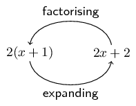

## 1.7 Factorisation (EMAG)

Factorisation is the opposite process of expanding brackets. For example, expanding brackets would require
            \(2(x + 1)\) to be written as \(2x + 2\). Factorisation would be to start with \(2x + 2\) and end up with
            \(2(x + 1)\).

The two expressions \(2(x + 1)\) and \(2x+2\) are equivalent; they have the same value for all values of
            \(x\).

In previous grades, we factorised by taking out a common factor and using difference of squares.

### Common factors (EMAH)

Factorising based on common factors relies on there being factors common to all the terms.

For example, \(2x - 6{x}^{2}\) can be factorised as follows:

            \[2x - 6{x}^{2} = 2x(1 - 3x)\]

And \(2(x - 1) - a(x - 1)\) can be factorised as follows:

            \[(x - 1)(2 - a)\]

<Callout type="tip" title="Multimedia & Video">
The following video shows an example of factorising by taking out a common factor.

<VideoPlayer src="https://www.youtube.com/embed/MZl6Mna0leQ" title="Video: 2DHZ" />
</Callout>

<Callout type="tip" title="Worked example 10: Factorising using a switch around in brackets">
**Question:**
Factorise:
                        \[5(a - 2) - b(2 - a)\]

Use a “switch around” strategy to find the common factor.

Notice that \(2-a=-(a-2)\)

                \begin{align*}
                5(a - 2)-b(2 - a) & = 5(a - 2) - [-b(a - 2)] \\
                & =5(a - 2) + b(a - 2) \\
                & =(a - 2)(5 + b)
                \end{align*}
</Callout>

### Textbook Exercise 1.5

Factorise:

**Problem:**
\(12x + 32y\)

**Solution:**
\[12x + 32y = 4(3x + 8y)\]

**Problem:**
\(-2ab^{2} - 4a^{2}b\)

**Solution:**
\[-2ab^{2} - 4a^{2}b = -2ab(b + 2a)\]

**Problem:**
\(18ab - 3bc\)

**Solution:**
\[18ab - 3bc = 3b(6a - c)\]

**Problem:**
\(12kj + 18kq\)

**Solution:**
\[12kj + 18kq = 6k(2j + 3q)\]

**Problem:**
\(-12a + 24a^{3}\)

**Solution:**
\[-12a + 24a^{3} = 12a(-1 + 2a^{2})\]

**Problem:**
\(-2ab - 8a\)

**Solution:**
\[-2ab - 8a = -2a(b + 4)\]

**Problem:**
\(24kj - 16k^{2}j\)

**Solution:**
\[24kj - 16k^{2}j = 8kj(3 - 2k)\]

**Problem:**
\(-a^{2}b - b^{2}a\)

**Solution:**
\[-a^{2}b - b^{2}a = -ab(a + b)\]

**Problem:**
\(72b^{2}q - 18b^{3}q^{2}\)

**Solution:**
\[72b^{2}q - 18b^{3}q^{2} = 18b^{2}q(4 - bq)\]

**Problem:**
\(125x^6 - 5y^2\)

**Solution:**
\begin{align*}
                            125x^6 - 5y^2 &= 5(25x^6 - y^2) \\
                            &= 5(5x^3 - y)(5x^3 + y)
                            \end{align*}

**Problem:**
\(6x^{2} + 2x + 10x^{3}\)

**Solution:**
\[6x^{2} + 2x + 10x^{3} = 2x(3x + 1 + 5x^{2})\]

**Problem:**
\(2xy^{2} + xy^{2}z + 3xy\)

**Solution:**
\[2xy^{2} + xy^{2}z + 3xy = xy(2y + yz + 3)\]

**Problem:**
\(12k^{2}j + 24k^{2}j^{2}\)

**Solution:**
\[12k^{2}j + 24k^{2}j^{2} = 12k^{2}j(1 + 2j)\]

**Problem:**
\(3a^{2} + 6a - 18\)

**Solution:**
\[3a^{2} + 6a - 18 = 3(a^{2} + 2a - 6)\]

**Problem:**
\(7a + 4\)

**Solution:**
\[7a + 4\]

### Difference of two squares (EMAJ)

We have seen that \((ax + b)(ax - b)\) can be expanded to \({a}^{2}{x}^{2} - {b}^{2}\).

Therefore \({a}^{2}{x}^{2} - {b}^{2}\) can be factorised as \((ax + b)(ax - b)\).

For example, \({x}^{2} - 16\) can be written as \({x}^{2} - {4}^{2}\) which is a difference of two
                squares. Therefore, the factors of \({x}^{2} - 16\) are \((x - 4)\) and \((x + 4)\).

To spot a difference of two squares, look for expressions:

- consisting of two terms;
- with terms that have different signs (one positive, one negative);
- with each term a perfect square.

For example: \({a}^{2} - 1\); \(4{x}^{2} - {y}^{2}\); \(-49 + {p}^{4}\).

<Callout type="tip" title="Multimedia & Video">
The following video explains factorising the difference of two squares.

<VideoPlayer src="https://www.youtube.com/embed/5mtjOuSoZSc" title="Video: 2DJK" />
</Callout>

<Callout type="tip" title="Worked example 11: The difference of two squares">
**Question:**
Factorise: \(3a({a}^{2} - 4) - 7({a}^{2} - 4)\).

**Take out the common factor \(({a}^{2} - 4)\):**
\[3a({a}^{2} - 4) - 7({a}^{2} - 4) = ({a}^{2} - 4)(3a - 7)\]

**Factorise the difference of two squares \(({a}^{2} - 4)\):**
\[({a}^{2} - 4)(3a - 7) = (a - 2)(a + 2)(3a - 7)\]
</Callout>

### Textbook Exercise 1.6

Factorise:

**Problem:**
\(4(y - 3) + k(3 - y)\)

**Solution:**
\begin{align*}
                            4(y - 3) + k(3 - y) & = 4(y - 3) - k(y - 3)\\
                            & = (y- 3)(4 - k)
                            \end{align*}

**Problem:**
\(a^{2}(a - 1) - 25(a - 1)\)

**Solution:**
\begin{align*}
                            a^{2}(a - 1) - 25(a - 1) & = (a - 1)(a^{2} - 25)\\
                            & = (a - 1)(a - 5)(a + 5)
                            \end{align*}

**Problem:**
\(bm(b + 4) - 6m(b + 4)\)

**Solution:**
\begin{align*}
                            bm(b + 4) - 6m(b + 4) & = (b + 4)(bm - 6m)\\
                            & = (b+ 4)(m)(b - 6)
                            \end{align*}

**Problem:**
\(a^{2}(a + 7) + 9(a + 7)\)

**Solution:**
\[a^{2}(a + 7) + 9(a + 7) = (a + 7)(a^{2} + 9)\]

**Problem:**
\(3b(b - 4) - 7(4 -b)\)

**Solution:**
\begin{align*}
                            3b(b - 4) - 7(4 - b) & = 3b(b - 4) + 7(b - 4)\\
                            & = (b - 4)(3b + 7)
                            \end{align*}

**Problem:**
\(3g(z+6)+2(6 + z)\)

**Solution:**
\begin{align*}
                                3 g (z+6) +2 (6 + z) & = 3 g (z+6) +2 (z+6) \\
                                & = (z+6)(3g+2)
                                \end{align*}

**Problem:**
\(4b(y+2)+5(2 + y)\)

**Solution:**
\begin{align*}
                                4 b (y+2) +5 (2 + y) & = 4 b (y+2) +5 (y+2) \\
                                & = (y+2)(4b+5)
                                \end{align*}

**Problem:**
\(3d(r+5)+14(5 + r)\)

**Solution:**
\begin{align*}
                                3d(r + 5) + 14(5 + r) & = 3d(r + 5) + 14 (r + 5) \\
                                & = (r + 5)(3d + 14)
                                \end{align*}

**Problem:**
\((6x + y)^2 - 9\)

**Solution:**
\[(6x + y)^2 - 9 =(6x + y - 3)(6x + y + 3)\]

**Problem:**
\(4x^2 - (4x - 3y)^2\)

**Solution:**
\begin{align*}
                            4x^2 - (4x - 3y)^2 &= (2x + 4x - 3y)(2x - (4x - 3y)) \\
                            &= (6x - 3y)(3y - 2x) \\
                            &=3(2x - y)(3y - 2x)
                            \end{align*}

**Problem:**
\(16a^2 - (3b + 4c)^2\)

**Solution:**
\begin{align*}
                            16a^2 - (3b + 4c)^2 &= (4a + 3b + 4c)(4a - (3b + 4c)) \\
                            &= (4a + 3b + 4c)(4a - 3b - 4c)
                            \end{align*}

**Problem:**
\((b -4)^2 - 9(b - 5)^2\)

**Solution:**
\begin{align*}
                            (b -4)^2 - 9(b - 5)^2 &= (b - 4 - 3(b-5))(b - 4 + 3(b-5)) \\
                            &= (-2b + 11)(4b - 19)
                            \end{align*}

**Problem:**
\(4(a -3)^2 - 49(4a - 5)\)

**Solution:**
\begin{align*}
                            4(a -3)^2 - 49(4a - 5)^2 &= (2(a - 3) - 7(4a - 5))(2(a - 3) + 7(4a - 5)) \\
                            &= (2a - 6 - 28a + 35)(2a - 6 + 28a -35) \\
                            &= (29 -26a)(30a - 41)
                            \end{align*}

**Problem:**
\(16k^{2} - 4\)

**Solution:**
\[16k^{2} - 4 = 4(4k^{2} - 1) = 4(2k - 1)(2k + 1)\]

**Problem:**
\(a^{2}b^{2}c^{2} - 1\)

**Solution:**
\[a^{2}b^{2}c^{2} - 1 = (abc - 1)(abc + 1)\]

**Problem:**
\(\dfrac{1}{9}a^2 - 4b^2\)

**Solution:**
\begin{align*}
                            \frac{1}{9}a^2 - 4b^2 &= \left( \frac{1}{3}a - 2b \right)\left( \frac{1}{3}a + 2b\right)
                            \end{align*}

**Problem:**
\(\dfrac{1}{2}x^2 - 2\)

**Solution:**
\begin{align*}
                            \frac{1}{2}x^2 - 2 &= 2\left(\frac{1}{4}x^{2} - 1 \right) \\
                            &= 2\left(\frac{1}{2}x + 1 \right)\left(\frac{1}{2}x - 1 \right)
                            \end{align*}

**Problem:**
\(y^2 - 8\)

**Solution:**
Note that \(\left(\sqrt{8}\right)^{2} = 8\)

                            \[y^2 - 8 =(y - \sqrt{8})(y + \sqrt{8})\]

**Problem:**
\(y^2 - 13\)

**Solution:**
Note that \(\left(\sqrt{13}\right)^{2} = 13\)

                            \[y^2 - 13 =(y - \sqrt{13})(y + \sqrt{13})\]

**Problem:**
\(a^2(a - 2ab - 15b^2) - 9b^2(a^2 -2ab -15b^2)\)

**Solution:**
\begin{align*}
                            a^2(a - 2ab - 15b^2) - 9b^2(a^2 -2ab -15b^2) &= (a^2 -2ab -15b^2)(a^2 - 9b^2) \\
                            &=(a - 5b)(a + 3b)(a-3b)(a +3b) \\
                            &=(a-3b)(a - 5b)(a+3b)^2
                            \end{align*}

### Factorising by grouping in pairs (EMAK)

The taking out of common factors is the starting point in all factorisation problems. We know that the
                factors of \(3x+3\) are \(\text{3}\) and \(\left(x+1\right)\). Similarly, the factors of \(2{x}^{2}+2x\)
                are \(2x\) and \(\left(x+1\right)\). Therefore, if we have an expression:

            \[2{x}^{2} + 2x + 3x + 3\]

there is no common factor to all four terms, but we can factorise as follows:

            \[\left(2{x}^{2} + 2x\right) + \left(3x + 3\right) = 2x\left(x + 1\right) + 3\left(x + 1\right)\]

We can see that there is another common factor \(\left(x+1\right)\). Therefore, we can write:

            \[\left(x + 1\right)\left(2x + 3\right)\]

We get this by taking out the \(\left(x+1\right)\) and seeing what is left over. We have \(2x\) from the
                first group and \(\text{+3}\) from the second group. This is called factorising by grouping.

<Callout type="tip" title="Worked example 12: Factorising by grouping in pairs">
**Question:**
Find the factors of \(7x + 14y + bx + 2by\).

**There are no factors common to all terms:**

**Group terms with common factors together:**
\(\text{7}\) is a common factor of the first two terms and \(b\) is a common factor of the second
                        two terms. We see that the ratio of the coefficients \(7:14\) is the same as \(b:2b\).

                    \begin{align*}
                    7x + 14y + bx + 2by & = \left(7x + 14y\right) + \left(bx + 2by\right)\\
                    & = 7\left(x + 2y\right) + b\left(x + 2y\right)
                    \end{align*}

**Take out the common factor \(\left(x+2y\right)\):**
\[7\left(x + 2y\right) + b\left(x + 2y\right) = \left(x + 2y\right)\left(7 + b\right)\]

OR

**Group terms with common factors together:**
\(x\) is a common factor of the first and third terms and \(2y\) is a common factor of the second
                        and fourth terms \(\left(7:b = 14:2b\right)\).

**Rearrange the equation with grouped terms together:**
\begin{align*}
                    7x + 14y + bx + 2by & = \left(7x + bx\right) + \left(14y + 2by\right) \\
                    & = x\left(7 + b\right) + 2y\left(7 + b\right)
                    \end{align*}

**Take out the common factor \(\left(7+b\right)\):**
\[x\left(7 + b\right) + 2y\left(7 + b\right) = \left(7 + b\right)\left(x + 2y\right)\]

**Write the final answer:**
The factors of \(7x + 14y + bx + 2by\) are \(\left(7 + b\right)\) and \(\left(x + 2y\right)\).
</Callout>

### Textbook Exercise 1.7

Factorise the following:

**Problem:**
\(6d -9r +2t^{5}d -3t^{5}r\)

**Solution:**
\begin{align*}
                                6d -9r +2t^{5}d -3t^{5}r
                                &= 3 (2d -3r) +t^{5} (2d -3r) \\
                                &= (2d -3r) (3 +t^{5})
                                \end{align*}

**Problem:**
\(9z -18m +b^{3}z -2b^{3}m\)

**Solution:**
\begin{align*}
                                9z -18m +b^{3}z -2b^{3}m
                                &= 9 (z -2m) +b^{3} (z -2m) \\
                                &= (z -2m) (9 +b^{3})
                                \end{align*}

**Problem:**
\(35z -10y +7c^{5}z -2c^{5}y\)

**Solution:**
\begin{align*}
                                35z -10y +7c^{5}z -2c^{5}y
                                &= 5 (7z -2y) +c^{5} (7z -2y) \\
                                &= (7z -2y) (5 +c^{5})
                                \end{align*}

**Problem:**
\(6x + a + 2ax + 3\)

**Solution:**
\begin{align*}
                            6x + a + 2ax + 3 & = 6x + 3 + a + 2ax\\
                            & = 3(2x + 1) + a(2x + 1)\\
                            & = (3 + a)(2x + 1)
                            \end{align*}

**Problem:**
\(x^{2} - 6x + 5x - 30\)

**Solution:**
\begin{align*}
                            x^{2} - 6x + 5x - 30 & = x(x - 6) + 5(x - 6)\\
                            & = (x + 5)(x - 6)
                            \end{align*}

**Problem:**
\(5x + 10y - ax - 2ay\)

**Solution:**
\begin{align*}
                            5x + 10y - ax - 2ay & = 5(x + 2y) - a(x + 2y)\\
                            & = (5 - a)(x + 2y)
                            \end{align*}

**Problem:**
\(a^{2} - 2a - ax + 2x\)

**Solution:**
\begin{align*}
                            a^{2} - 2a - ax + 2x & = a(a - 2) - x(a - 2)\\
                            & = (a - x)(a - 2)
                            \end{align*}

**Problem:**
\(5xy - 3y + 10x - 6\)

**Solution:**
\begin{align*}
                            5xy - 3y + 10x - 6 & = y(5x - 3) + 2(5x - 3)\\
                            & = (y + 2)(5x - 3)
                            \end{align*}

**Problem:**
\(ab - a^{2} - a + b\)

**Solution:**
\begin{align*}
                            ab - a^{2} - a + b & = -a^{2} - a + ab + b\\
                            & = -a(a + 1) + b(a + 1)\\
                            & = (-a + b)(a + 1)
                            \end{align*}

**Problem:**
\(14m-4n+7jm-2jn\)

**Solution:**
\begin{align*}
                                14m-4n+7jm-2jn
                                &= 2(7m-2n)+j(7m-2n)\\
                                &= (7m-2n)(2+j)
                                \end{align*}

**Problem:**
\(28r-20x+7gr-5gx\)

**Solution:**
\begin{align*}
                                28r-20x+7gr-5gx
                                &= 4(7r-5x)+g(7r-5x)\\
                                &= (7r-5x)(4+g)
                                \end{align*}

**Problem:**
\(25d-15m+5yd-3ym\)

**Solution:**
\begin{align*}
                                25d-15m+5yd-3ym
                                &= 5(5d-3m)+y(5d-3m)\\
                                &= (5d-3m)(5+y)
                                \end{align*}

**Problem:**
\(45q-18z+5cq-2cz\)

**Solution:**
\begin{align*}
                                45q-18z+5cq-2cz
                                &= 9(5q-2z)+c(5q-2z)\\
                                &= (5q-2z)(9+c)
                                \end{align*}

**Problem:**
\(6j-15v+2yj-5yv\)

**Solution:**
\begin{align*}
                                6j-15v+2yj-5yv
                                &= 3(2j-5v)+y(2j-5v)\\
                                &= (2j-5v)(3+y)
                                \end{align*}

**Problem:**
\(16a-40k+2za-5zk\)

**Solution:**
\begin{align*}
                                16a-40k+2za-5zk
                                &= 8(2a-5k)+z(2a-5k)\\
                                &= (2a-5k)(8+z)
                                \end{align*}

**Problem:**
\(ax - bx + ay - by + 2a - 2b\)

**Solution:**
\begin{align*}
                            ax - bx + ay - by + 2a - 2b & = x(a - b) + y(a - b) + 2(a - b) \\
                            & = (a - b)(x + y + 2)
                            \end{align*}

**Problem:**
\(3ax + bx - 3ay - by - 9a - 3b\)

**Solution:**
\begin{align*}
                            3ax + bx - 3ay - by - 9a - 3b & = x(3a + b) - y(3a + b) - 3(3a + b) \\
                            & = (3a + b)(x - y - 3)
                            \end{align*}

### Factorising a quadratic trinomial (EMAM)

Factorising is the reverse of calculating the product of factors. In order to factorise a quadratic, we
                need to find the factors which, when multiplied together, equal the original quadratic.

Consider a quadratic expression of the form \(a{x}^{2} + bx\). We see here that \(x\) is a common factor
                in both terms. Therefore \(a{x}^{2} + bx\) factorises as \(x\left(ax + b\right)\). For example,
                \(8{y}^{2} + 4y\) factorises as \(4y\left(2y + 1\right)\).

Another type of quadratic is made up of the difference of squares. We know that:

            \[\left(a + b\right)\left(a - b\right) = {a}^{2} - {b}^{2}\]

So \({a}^{2} - {b}^{2}\) can be written in factorised form as \(\left(a + b\right)\left(a - b\right)\).

This means that if we ever come across a quadratic that is made up of a difference of squares, we can
                immediately write down the factors. These types of quadratics are very simple to factorise. However,
                many quadratics do not fall into these categories and we need a more general method to factorise
                quadratics.

We can learn about factorising quadratics by looking at the opposite process, where two binomials are
                multiplied to get a quadratic. For example:

            \begin{align*}
            \left(x + 2\right)\left(x + 3\right) & = {x}^{2} + 3x + 2x + 6 \\
            & = {x}^{2} + 5x + 6
            \end{align*}

We see that the \({x}^{2}\) term in the quadratic is the product of the \(x\)-terms in each bracket.
                Similarly, the \(\text{6}\) in the quadratic is the product of the \(\text{2}\) and \(\text{3}\) in the
                brackets. Finally, the middle term is the sum of two terms.

So, how do we use this information to factorise the quadratic?

Let us start with factorising \({x}^{2} + 5x + 6\) and see if we can decide upon some general rules.
                Firstly, write down the two brackets with an \(x\) in each bracket and space for the remaining terms.

            \[\left(x \qquad \right)\left(x \qquad\right)\]

Next, decide upon the factors of \(\text{6}\). Since the \(\text{6}\) is positive, possible combinations
                are: 1 and 6, 2 and 3, \(-\text{1}\) and \(-\text{6}\) or \(-\text{2}\) and \(-\text{3}\).

Therefore, we have four possibilities:

| Option 1 | Option 2 | Option 3 | Option 4 |
| --- | --- | --- | --- |
| \(\left(x+1\right)\left(x+6\right)\) | \(\left(x-1\right)\left(x-6\right)\) | \(\left(x+2\right)\left(x+3\right)\) | \(\left(x-2\right)\left(x-3\right)\) |

Next, we expand each set of brackets to see which option gives us the correct middle term.

| Option 1 | Option 2 | Option 3 | Option 4 |
| --- | --- | --- | --- |
| \(\left(x+1\right)\left(x+6\right)\) | \(\left(x-1\right)\left(x-6\right)\) | \(\left(x+2\right)\left(x+3\right)\) | \(\left(x-2\right)\left(x-3\right)\) |
| \({x}^{2}+7x+6\) | \({x}^{2}-7x+6\) | \({x}^{2}+5x+6\) | \({x}^{2}-5x+6\) |

We see that Option 3, \(\left(x+2\right)\left(x+3\right)\), is the correct solution.

The process of factorising a quadratic is mostly trial and error but there are some strategies that can
                be used to ease the process.

### General procedure for factorising a trinomial (EMAN)

1. Take out any common factor in the coefficients of the terms of the expression to obtain an
                        expression of the form \(a{x}^{2} + bx + c\) where \(a\), \(b\) and \(c\) have no common factors
                        and \(a\) is positive.
2. Write down two brackets with an \(x\) in each bracket and space for the remaining terms:

                    \[\left(x \qquad \right)\left(x \qquad\right)\]
3. Write down a set of factors for \(a\) and \(c\).
4. Write down a set of options for the possible factors for the quadratic using the factors of \(a\)
                        and \(c\).
5. Expand all options to see which one gives you the correct middle term \(bx\).

<Callout type="note" title="Note">
If \(c\) is positive, then the factors of \(c\) must be either both positive or both negative. If
                    \(c\) is negative, it means only one of the factors of \(c\) is negative, the other one being
                    positive. Once you get an answer, always multiply out your brackets again just to make sure it
                    really works.
</Callout>

<Callout type="tip" title="Multimedia & Video">
The following video summarises how to factorise expressions and shows some examples.

<VideoPlayer src="https://www.youtube.com/embed/WCil25yH_qA" title="Video: 2DKX" />
</Callout>

<Callout type="tip" title="Worked example 13: Factorising a quadratic trinomial">
**Question:**
Factorise: \(3x^2 + 2x - 1\).

**Check that the quadratic is in required form \(a{x}^{2} + bx + c\):**

**Write down a set of factors for \(a\) and \(c\):**
\[\left(x \qquad \right)\left(x \qquad \right)\]

The possible factors for \(a\) are: 1 and 3

The possible factors for \(c\) are: \(-\text{1}\) and 1

Write down a set of options for the possible factors of the quadratic using the factors of \(a\)
                        and \(c\). Therefore, there are two possible options.

| Option 1 | Option 2 |
| --- | --- |
| \(\left(x-1\right)\left(3x+1\right)\) | \(\left(x+1\right)\left(3x-1\right)\) |
| \(3{x}^{2}-2x-1\) | \(3{x}^{2}+2x-1\) |

**Check that the solution is correct by multiplying the factors:**
\begin{align*}
                    \left(x + 1\right)\left(3x - 1\right) & = 3{x}^{2} - x + 3x - 1\\
                    & = 3{x}^{2} + 2x - 1
                    \end{align*}

**Write the final answer:**
\(3{x}^{2} + 2x - 1 = \left(x + 1\right)\left(3x - 1\right)\)
</Callout>

### Textbook Exercise 1.8

Factorise the following:

**Problem:**
\(x^{2} + 8x + 15\)

**Solution:**
\[x^{2} + 8x + 15 = (x + 5)(x + 3)\]

**Problem:**
\(x^{2} + 9x + 8\)

**Solution:**
\[x^{2} + 9x + 8 = (x + 8)(x + 1)\]

**Problem:**
\(x^{2} + 12x + 36\)

**Solution:**
\begin{align*}
                            x^{2} + 12x + 36 & = (x + 6)(x + 6) \\
                            & = (x + 6)^{2}
                            \end{align*}

**Problem:**
\(2h^{2}+5h-3\)

**Solution:**
\[2h^{2}+5h-3 = (h+3)(2h-1)\]

**Problem:**
\(3x^{2}+4x+1\)

**Solution:**
\[3x^{2}+4x+1 = (x+1)(3x+1)\]

**Problem:**
\(3s^{2}+s-10\)

**Solution:**
\[3s^{2}+s-10 = (s+2)(3s-5)\]

**Problem:**
\(x^{2} - 2x - 15\)

**Solution:**
\[x^{2} - 2x - 15 = (x + 3)(x - 5)\]

**Problem:**
\(x^{2} + 2x - 3\)

**Solution:**
\[x^{2} + 2x - 3 = (x + 3)(x - 1)\]

**Problem:**
\(x^{2} + x - 20\)

**Solution:**
\[x^{2} + x - 20 = (x + 5)(x - 4)\]

**Problem:**
\(x^{2} - x - 20\)

**Solution:**
\[x^{2} - x - 20 = (x - 5)(x + 4)\]

**Problem:**
\(2x^{2} - 22x + 20\)

**Solution:**
\begin{align*}
                            2x^{2} + 22x + 20 & = 2(x^{2} + 11x + 10)\\
                            & = 2(x + 1)(x + 10)
                            \end{align*}

**Problem:**
\(6 a^{2} + 14 a + 8\)

**Solution:**
\begin{align*}
                                6 a^{2} + 14 a + 8 & = \text{2}
                                (3 a^{2} + 7 a + 4)\\
                                & = \text{2} \left(a + 1 \right) \left( 3 a + 4 \right)
                                \end{align*}

**Problem:**
\(6 v^{2} - 27 v + 27\)

**Solution:**
\begin{align*}
                                6 v^{2} - 27 v + 27 & = \text{3}
                                (2 v^{2} - 9 v + 9)\\
                                & = \text{3} \left(2 v - 3 \right) \left( v - 3 \right)
                                \end{align*}

**Problem:**
\(6 g^{2} - 15 g - 9\)

**Solution:**
\begin{align*}
                                6 g^{2} - 15 g - 9 & = \text{3}
                                (2 g^{2} - 5 g - 3)\\
                                & = \text{3} \left(g - 3 \right) \left( 2 g + 1 \right)
                                \end{align*}

**Problem:**
\(3x^{2} + 19x + 6\)

**Solution:**
\[3x^{2} + 19x + 6 = (3x + 1)(x + 6)\]

**Problem:**
\(3x^{2} + 17x - 6\)

**Solution:**
\[3x^{2} + 17x - 6 = (3x - 1)(x + 6)\]

**Problem:**
\(7x^{2} - 6x - 1\)

**Solution:**
\[7x^{2} - 6x - 1 = (7x + 1)(x - 1)\]

**Problem:**
\(6x^{2} - 15x - 9\)

**Solution:**
\begin{align*}
                            6x^{2} - 15x - 9 & = 3(2x^{2} - 5x - 3)\\
                            & = 3(2x + 1)(x - 3)
                            \end{align*}

**Problem:**
\(a^2 - 7ab + 12b\)

**Solution:**
\[a^2 - 7ab + 12b^2 = (a - 4b)(a -3b)\]

**Problem:**
\(3a^2 + 5ab - 12b^2\)

**Solution:**
\[3a^2 + 5ab - 12b^2 = (3a - 4b )(a + 3b)\]

**Problem:**
\(98x^{4} + 14x^{2} - 4\)

**Solution:**
\begin{align*}
                            98x^4 + 14x^2 - 4 &= 2(49x^4 - 7x^2 - 2) \\
                            &=2((7x+2)(7x-1))
                            \end{align*}

**Problem:**
\((x-2)^2 - 7(x-2) + 12\)

**Solution:**
\begin{align*}
                            (x-2)^2 - 7(x-2) + 12 &=((x-2)-4)((x-2)-3) \\
                            &=(x-6)(x-5)
                            \end{align*}

**Problem:**
\((a-2)^2 - 4(a-2) -5\)

**Solution:**
\begin{align*}
                            (a-2)^2 - 4(a-2) -5 &= ((a-2)-5)((a-2)+1) \\
                            =&(a-7)(a-1)
                            \end{align*}

**Problem:**
\((y+3)^2 - 3(y+3) - 18\)

**Solution:**
\begin{align*}
                            (y + 3)^2 - 3(y + 3) - 18 &= ((y + 3) - 6)((y + 3) + 3) \\
                            &=(y - 3)(y + 6)
                            \end{align*}

**Problem:**
\(3(b^2 + 5b) +12\)

**Solution:**
\begin{align*}
                            3(b^2 + 5b) +12 &= 3(b^2 + 5b) +3(4) \\
                            &=3(b^2 + 5b + 4) \\
                            &= 3(b + 4)(b+1)
                            \end{align*}

**Problem:**
\(6(a^2 +3a) -168\)

**Solution:**
\begin{align*}
                            6(a^2 +3a) -168 &= 6(a^2 + 3a) - 6(28) \\
                            &= 6(a^2 + 3a - 28) \\
                            &=6(a + 7)(a -4)
                            \end{align*}

### Sum and difference of two cubes (EMAP)

We now look at two special results obtained from multiplying a binomial and a trinomial:

Sum of two cubes:

            \begin{align*}
            \left(x + y\right)\left({x}^{2} - xy + {y}^{2}\right) & = x\left({x}^{2} - xy + {y}^{2}\right) +
            y\left({x}^{2} - xy + {y}^{2}\right) \\
            & = \left[x\left({x}^{2}\right) + x\left(-xy\right) + x\left({y}^{2}\right)\right] +
            \left[y\left({x}^{2}\right) + y\left(-xy\right) + y\left({y}^{2}\right)\right]\\
            & = {x}^{3} - {x}^{2}y + x{y}^{2} + {x}^{2}y -x{y}^{2} + {y}^{3}\\
            & = {x}^{3} + {y}^{3}
            \end{align*}

Difference of two cubes:

            \begin{align*}
            \left(x - y\right)\left({x}^{2} + xy + {y}^{2}\right) & = x\left({x}^{2} + xy + {y}^{2}\right) -
            y\left({x}^{2} + xy + {y}^{2}\right)\\
            & = \left[x\left({x}^{2}\right) + x\left(xy\right) + x\left({y}^{2}\right)\right] -
            \left[y\left({x}^{2}\right) + y\left(xy\right) + y\left({y}^{2}\right)\right]\\
            & = {x}^{3} + {x}^{2}y + x{y}^{2} - {x}^{2}y - x{y}^{2} - {y}^{3}\\
            & = {x}^{3} - {y}^{3}
            \end{align*}

So we have seen that:

            \begin{align*}
            {x}^{3} + {y}^{3} & = \left(x + y\right)\left({x}^{2} - xy + {y}^{2}\right) \\
            {x}^{3} - {y}^{3} & = \left(x - y\right)\left({x}^{2} + xy + {y}^{2}\right)
            \end{align*}

We use these two basic identities to factorise more complex examples.

<Callout type="tip" title="Worked example 14: Factorising a difference of two cubes">
**Question:**
Factorise: \({a}^{3}-1\).

**Take the cube root of terms that are perfect cubes:**
We are working with the difference of two cubes. We know that \({x}^{3} - {y}^{3} = \left(x -
                        y\right)\left({x}^{2} + xy + {y}^{2}\right)\), so we need to identify \(x\) and \(y\).

We start by noting that \(\sqrt[3]{{a}^{3}}=a\) and \(\sqrt[3]{1}=1\). These give the terms in
                        the first bracket. This also tells us that \(x = a\) and \(y = 1\).

**Find the three terms in the second bracket:**
We can replace \(x\) and \(y\) in the factorised form of the expression for the difference of two
                        cubes with \(a\) and \(\text{1}\). Doing so we get the second bracket:

                    \[\left({a}^{3} - 1\right) = \left(a - 1\right)\left({a}^{2} + a + 1\right)\]

**Expand the brackets to check that the expression has been correctly factorised:**
\begin{align*}
                    \left(a - 1\right)\left({a}^{2} + a + 1\right) & = a\left({a}^{2} + a + 1\right) -
                    1\left({a}^{2} + a + 1\right) \\
                    & = {a}^{3} + {a}^{2} + a - {a}^{2} - a - 1 \\
                    & = {a}^{3} - 1
                    \end{align*}
</Callout>

<Callout type="tip" title="Worked example 15: Factorising a sum of two cubes">
**Question:**
Factorise: \({x}^{3}+8\).

**Take the cube root of terms that are perfect cubes:**
We are working with the sum of two cubes. We know that \({x}^{3} + {y}^{3} = \left(x +
                        y\right)\left({x}^{2} - xy + {y}^{2}\right)\), so we need to identify \(x\) and \(y\).

We start by noting that \(\sqrt[3]{{x}^{3}}=x\) and \(\sqrt[3]{8}=2\). These give the terms in
                        the first bracket. This also tells us that \(x = x\) and \(y = 2\).

**Find the three terms in the second bracket:**
We can replace \(x\) and \(y\) in the factorised form of the expression for the sum of two cubes
                        with \(x\) and \(\text{2}\). Doing so we get the second bracket:

                    \[\left({x}^{3} + 8\right) = \left(x + 2\right)\left({x}^{2} - 2x + 4\right)\]

**Expand the brackets to check that the expression has been correctly factorised:**
\begin{align*}
                    \left(x + 2\right)\left({x}^{2} - 2x + 4\right) & = x\left({x}^{2} - 2x + 4\right) +
                    2\left({x}^{2} - 2x + 4\right) \\
                    & = {x}^{3} - 2{x}^{2} + 4x + 2{x}^{2} - 4x + 8 \\
                    & = {x}^{3} + 8
                    \end{align*}
</Callout>

<Callout type="tip" title="Worked example 16: Factorising a difference of two cubes">
**Question:**
Factorise: \(16{y}^{3}-432\).

**Take out the common factor 16:**
\[16{y}^{3} - 432 = 16\left({y}^{3} - 27\right)\]

**Take the cube root of terms that are perfect cubes:**
We are working with the difference of two cubes. We know that \({x}^{3} - {y}^{3} = \left(x -
                        y\right)\left({x}^{2} + xy + {y}^{2}\right)\), so we need to identify \(x\) and \(y\).

We start by noting that \(\sqrt[3]{{y}^{3}}=y\) and \(\sqrt[3]{27}=3\). These give the terms in
                        the first bracket. This also tells us that \(x = y\) and \(y = 3\).

**Find the three terms in the second bracket:**
We can replace \(x\) and \(y\) in the factorised form of the expression for the difference of two
                        cubes with \(y\) and \(\text{3}\). Doing so we get the second bracket:

                    \[16\left({y}^{3} - 27\right) = 16\left(y - 3\right)\left({y}^{2} + 3y + 9\right)\]

**Expand the brackets to check that the expression has been correctly factorised:**
\begin{align*}
                    16(y - 3)({y}^{2} + 3y + 9) & = 16[(y({y}^{2} + 3y + 9) - 3({y}^{2} + 3y + 9)] \\
                    & = 16[{y}^{3} + 3{y}^{2} + 9y - 3{y}^{2} - 9y - 27] \\
                    & = 16{y}^{3} - 432
                    \end{align*}
</Callout>

<Callout type="tip" title="Worked example 17: Factorising a sum of two cubes">
**Question:**
Factorise: \(8{t}^{3}+125{p}^{3}\).

**Take the cube root of terms that are perfect cubes:**
We are working with the sum of two cubes. We know that \({x}^{3} + {y}^{3} = \left(x +
                        y\right)\left({x}^{2} - xy + {y}^{2}\right)\), so we need to identify \(x\) and \(y\).

We start by noting that \(\sqrt[3]{{8t}^{3}}=2t\) and \(\sqrt[3]{125p^{3}}=5p\). These give the
                        terms in the first bracket. This also tells us that \(x = 2t\) and \(y = 5p\).

**Find the three terms in the second bracket:**
We can replace \(x\) and \(y\) in the factorised form of the expression for the difference of two
                        cubes with \(2t\) and \(5p\). Doing so we get the second bracket:

                    \begin{align*}
                    \left(8{t}^{3} + 125{p}^{3}\right) & = \left(2t + 5p\right)\left[{\left(2t\right)}^{2} -
                    \left(2t\right)\left(5p\right) + {\left(5p\right)}^{2}\right] \\
                    & = \left(2t + 5p\right)\left(4{t}^{2} - 10tp + 25{p}^{2}\right)
                    \end{align*}

**Expand the brackets to check that the expression has been correctly factorised:**
\begin{align*}
                    \left(2t + 5p\right)\left(4{t}^{2} - 10tp + 25{p}^{2}\right) & = 2t\left(4{t}^{2} - 10tp +
                    25{p}^{2}\right) + 5p\left(4{t}^{2} - 10tp + 25{p}^{2}\right) \\
                    & = 8{t}^{3} - 20p{t}^{2} + 50{p}^{2}t + 20p{t}^{2} - 50{p}^{2}t + 125{p}^{3} \\
                    & =8{t}^{3} + 125{p}^{3}
                    \end{align*}
</Callout>

### Textbook Exercise 1.9

Factorise:

**Problem:**
\(w^\text{3} - \text{8}\)

**Solution:**
\begin{align*}
                                w^\text{3}-\text{8}
                                &= (w - \text{2})(w^\text{2}+ \text{2}w + 4)
                                \end{align*}

**Problem:**
\(g^\text{3} + \text{64}\)

**Solution:**
\begin{align*}
                                g^\text{3} + \text{64}
                                &= (g + \text{4})(g^\text{2} - \text{4}g + 16)
                                \end{align*}

**Problem:**
\(h^\text{3} + \text{1}\)

**Solution:**
\[h^\text{3} + \text{1} = (h + \text{1})(h^\text{2} - h + 1)\]

**Problem:**
\(x^{3} + 8\)

**Solution:**
\begin{align*}
                            x^{3} + 8 & = (x + 2)[(x)^{2} - (x)(2) + (2)^{2}] \\
                            & = (x + 2)(x^{2} - 2x + 4)
                            \end{align*}

**Problem:**
\(27 - m^{3}\)

**Solution:**
\begin{align*}
                            27 - m^{3} & = (3 - m)[(3)^{2} + (3)(m) + (m)^{2}] \\
                            & = (3 - m)(9 + 3m + m^{2})
                            \end{align*}

**Problem:**
\(2x^{3} - 2y^{3}\)

**Solution:**
\begin{align*}
                            2x^{3} - 2y^{3} & = 2(x^{3} - y^{3}) \\
                            & = 2(x - y)[(x)^{2} + (x)(y) + y^{2}] \\
                            & = 2(x - y)(x^{2} + xy + y^{2})
                            \end{align*}

**Problem:**
\(3k^{3} + 81q^{3}\)

**Solution:**
\begin{align*}
                            3k^{3} + 81q^{3} & = 3(k^{3} + 27q^{3})\\
                            & = 3(k + 3q)[(k)^{2} - (k)(3q) + (3q)^{2}] \\
                            & = 3(k + 3q)(k^{2} - 3kq + 9q^{2})
                            \end{align*}

**Problem:**
\(64t^{3} - 1\)

**Solution:**
\begin{align*}
                            64t^{3} - 1 & = (4t - 1)[(4t)^{2} + (4t)(1) + (1)^{2}] \\
                            & = (4t - 1)(16t^{2} + 4t + 1)
                            \end{align*}

**Problem:**
\(64x^{2} - 1\)

**Solution:**
\begin{align*}
                            64x^{2} - 1 & = (8x - 1)(8x + 1)
                            \end{align*}

**Problem:**
\(125x^{3} + 1\)

**Solution:**
\begin{align*}
                            125x^{3} + 1 & = (5x + 1)[(5x)^{2} - (5x)(1) + (1)^{2}] \\
                            & = (5x + 1)(25x^{2} - 5x + 1)
                            \end{align*}

**Problem:**
\(25x^{3} + 1\)

**Solution:**
Note that \(\left(\sqrt[3]{25}\right)^{3} = 25\).

                            \begin{align*}
                            25x^{3} + 1 & = (\sqrt[3]{25}x + 1)[(\sqrt[3]{25}x)^{2} - (\sqrt[3]{25}x)(1) + (1)^{2}]
                            \\
                            & = (\sqrt[3]{25}x + 1)((\sqrt[3]{25})^{2}x^{2} - \sqrt[3]{25}x + 1)
                            \end{align*}

**Problem:**
\(z - 125z^{4}\)

**Solution:**
\begin{align*}
                            z - 125z^{4} & = (z)(1 - 125z^{3})\\
                            & = (z)(1 - 5z)[(1)^{2} + (1)(5z) + (5z)^{2}] \\
                            & = (z)(1 - 5z)(1 + 5z + 25z^{2})
                            \end{align*}

**Problem:**
\(8m^{6} + n^{9}\)

**Solution:**
\begin{align*}
                            8m^{6} + n^{9} & = (2m^{2})^{3} + (n^{3})^{3}\\
                            & = (2m^{2} + n^{3})[(2m^{2})^{2} - (2m^{2})(n^{3}) + (n^{3})^{2}] \\
                            & = (2m^{2} + n^{3})(4m^{4} - 2m^{2}n^{3} + n^{6})
                            \end{align*}

**Problem:**
\(216n^3 - k^3\)

**Solution:**
\[216n^3 - k^3 = (6n -k)(36n^2 +6nk + k^2)\]

**Problem:**
\(125s^3 + d^3\)

**Solution:**
\[125s^3 + d^3 = (5s +d)(25s^2 -5sd + d^2)\]

**Problem:**
\(8k^3 + r^3\)

**Solution:**
\[8k^3 + r^3 = (2k +r)(4k^2 -2kr + r^2)\]

**Problem:**
\(8j^{3}k^{3}l^{3} - b^{3}\)

**Solution:**
\begin{align*}
                            8j^3k^3l^3 - b^3 &= (2jkl -b)(4j^2k^2l^2 +2jklabc + b^2)
                            \end{align*}

**Problem:**
\(27x^3y^3 + w^3\)

**Solution:**
\begin{align*}
                            27x^3y^3 + w^3 &= (3xy +w)(9x^2y^2 -3xyw + w^2)
                            \end{align*}

**Problem:**
\(128m^3 + 2f^3\)

**Solution:**
\begin{align*}
                            128m^3 + 2f^3 &= 2(64m^3 + f^3) \\
                            &= 2(4m +f)(16m^2 -4mf + f^2)
                            \end{align*}

**Problem:**
\(p^{15} - \dfrac{1}{8}y^{12}\)

**Solution:**
\begin{align*}
                            p^{15} - \frac{1}{8}y^{12} & = (p^{5})^{3} - \left(\frac{1}{2} y^{4}\right)^{3}\\
                            & = \left(p^{5} - \frac{1}{2}y^{4}\right)\left[\left(p^{5}\right)^{2} +
                            \left(p^{5}\right)\left(\frac{1}{2}y^{4}\right) + \left(\frac{1}{2}y^{4}\right)^{2} \right]
                            \\
                            & = \left(p^{5} - \frac{1}{2}y^{4}\right)\left(p^{10} + \frac{1}{2}p^{5}y^{4} +
                            \frac{1}{4}y^{8}\right)
                            \end{align*}

**Problem:**
\(\dfrac{27}{t^3} - s^3\)

**Solution:**
\begin{align*}
                            \frac{27}{t^3} - s^3 &= (\frac{3}{t} -s)(\frac{9}{t^2} +\frac{3s}{t} + s^2)
                            \end{align*}

**Problem:**
\(\dfrac{1}{64q^3} - h^3\)

**Solution:**
\begin{align*}
                            \frac{1}{64q^3} - h^3 &= (\frac{1}{4q} -h)(\frac{1}{16q^2} +\frac{h}{4q} + h^2)
                            \end{align*}

**Problem:**
\(72g^3 + \dfrac{1}{3}v^3\)

**Solution:**
\begin{align*}
                            72g^3 + \frac{1}{3}v^3 &= \frac{1}{3}(216 g^3 + v^3)\\
                            &= \frac{1}{3}(6g +v)(36g^2 -6gv + v^2)
                            \end{align*}

**Problem:**
\(1 - (x - y)^{3}\)

**Solution:**
\begin{align*}
                            1 - (x - y)^{3} & = (1 - (x - y))[(1)^{2} - (1)(x - y) + (x - y)^{2}] \\
                            & = (1 - x + y)(1 - x + y + x^{2} - 2xy + y^{2})
                            \end{align*}

**Problem:**
\(h^4(8g^6 + h^3) - (8g^6 + h^3)\)

**Solution:**
\begin{align*}
                            h^4(8g^6 + h^3) - (8g^6 + h^3) &= (h^4 - 1)(8g^6 + h^3) \\
                            &=(h^2 - 1)(h^2 + 1)(2g^2 +h)(4g^4 -2g^2h + h^2) \\
                            &= (h - 1)(h+1)(h^2 + 1)(2g^2 +h)(4g^4 -2g^2h + h^2)
                            \end{align*}

**Problem:**
\(x(125w^3 - h^3) + y(125w^3 - h^3)\)

**Solution:**
\begin{align*}
                            x(125w^3 - h^3) + y(125w^3 - h^3) &= (x+y)(125w^3 - h^3) \\
                            &= (x+y)(5w -h)(25w^2 +5wh + h^2)
                            \end{align*}

**Problem:**
\(x^2(27p^3 + w^3) - 5x(27p^3 + w^3) - 6(27p^3 + w^3)\)

**Solution:**
\begin{align*}
                            x^2(27p^3 + w^3) - 5x(27p^3 + w^3) - 6(27p^3 + w^3) = (x^2 - 5x - 6)(27p^3 + w^3)\\
                            = (x - 6)(x+1)(3p +w)(9p^2 -3pw + w^2)
                            \end{align*}
