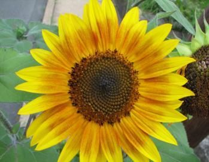

# Chapter 3: Number patterns

- This chapter covers investigating number patterns that involve a common difference and the general term is linear.
- Arithmetic sequences are only covered in grade 12 so do not use \(T_{n} = a + (n - 1)d\) here.
- The focus of this chapter is more about investigating patterns in numbers and diagrams rather than on formulae.

## 3.1 Introduction (EMAX)

In earlier grades you saw patterns in the form of pictures and numbers. In this chapter, we learn more
                  about the mathematics of patterns. Patterns are repetitive sequences and can be found in nature,
                  shapes, events, sets of numbers and almost everywhere you care to look. For example, seeds in a
                  sunflower, snowflakes, geometric designs on quilts or tiles, or the number sequence \(0; 4; 8; 12; 16;
                  \ldots\).

The pattern of seeds within a sunflower follows the Fibonacci sequence, or
                        \(1; 2; 3; 5; 8; 13; 21; 34; 55; 89; 144; \ldots\)

<Callout type="tip" title="Multimedia & Video">
Interested in learning more about the relationship between Fibonacci sequences and sunflowers?

<VideoPlayer src="https://www.youtube.com/embed/DRjFV_DETKQ" title="Video: 2F6Y" />
</Callout>

Try spot any patterns in the following sequences on your own:

1. \(2; 4; 6; 8; 10;\ldots\)
2. \(1; 2; 4; 7; 11; \ldots\)
3. \(1; 4; 9; 16; 25; \ldots\)
4. \(5; 10; 20; 40; 80; \ldots\)

<QuizCard id="m10-03-01a" title="Interactive Exercise 3.1" question="Consider these three numbers: \[\begin{array}{c}\text{1} \, ; \text{15} \, ; \text{45}\end{array}\] To which special set of numbers do these belong?" options=["cube numbers", "prime numbers", "square numbers", "triangular numbers", "none of the above"] answer="triangular numbers" hint="" explanation="It is very important to be able to recognise the types of numbers in these special groups, especially the square numbers and prime numbers.  If you do not remember these numbers easily, you will be very happy later if you make an effort to memorise them now! Prime numbers are natural numbers which have exactly two different factors: \( \{2 \, ; 3 \, ; 5 \, ; 7 \, ; 11 \, ; 13 \, ; \ldots \}\) . You need to remember that \(\text{1}\) is not a prime number (because it does not have two different factors!). The square numbers come from squaring the counting (whole) numbers, (like \( 3^{2} = 9\) ) \( \Longrightarrow \{0 \, ; 1 \, ; 4 \, ; 9 \, ; 16 \, ; 25 \, ; 36 \, ; 49 \, ; 64 \, ; 81 \, ; 100 \, ; \ldots \}\) The cube numbers come from taking the cubes of the counting (whole) numbers, (like \( 2^{3} = 8\) ) \( \Longrightarrow \{0\, ; 1\, ; 8\, ; 27\, ; 64\, ; 125\, ; \ldots \}\) The triangular numbers are \(\{1 \, ; 3\, ; 6\, ; 10\, ; 15\, ; 21\, ; 28\, ; 36\, ; 45 \ldots \}\) . The figure here shows you why they have the name that they do: In this case the three numbers shown, \(\text{1}\) , \(\text{15}\) and \(\text{45}\) , belong to the set of triangular numbers . Submit your answer as: triangular numbers" />

<QuizCard id="m10-03-01a" title="Interactive Exercise 3.1" question="Consider these three numbers: \[\begin{array}{c}\text{1} \, ; \text{10} \, ; \text{60}\end{array}\] To which special group of numbers do these belong?" options=["cube numbers", "prime numbers", "square numbers", "triangular numbers", "none of the above"] answer="" hint="" explanation="It is very important to be able to recognise the types of numbers in these special groups, especially the square numbers and prime numbers.  If you do not remember these numbers easily, you will be very happy later if you make an effort to memorise them now! Prime numbers are natural numbers which have exactly two different factors: \( \{2 \, ; 3 \, ; 5 \, ; 7 \, ; 11 \, ; 13 \, ; \ldots \}\) . You need to remember that \(\text{1}\) is not a prime number (because it does not have two different factors!). The square numbers come from squaring the counting (whole) numbers, (like \( 3^{2} = 9\) ) \( \Longrightarrow \{0 \, ; 1 \, ; 4 \, ; 9 \, ; 16 \, ; 25 \, ; 36 \, ; 49 \, ; 64 \, ; 81 \, ; 100 \, ; \ldots \}\) The cube numbers come from taking the cubes of the counting (whole) numbers, (like \( 2^{3} = 8\) ) \( \Longrightarrow \{0\, ; 1\, ; 8\, ; 27\, ; 64\, ; 125\, ; \ldots \}\) The triangular numbers are \(\{1 \, ; 3\, ; 6\, ; 10\, ; 15\, ; 21\, ; 28\, ; 36\, ; 45 \ldots \}\) . The figure here shows you why they have the name that they do: The numbers in this question, \(\text{1}\) , \(\text{10}\) and \(\text{60}\) , are not in any of the special groups listed in the question. Submit your answer as: none of the above" />

<QuizCard id="m10-03-01a" title="Interactive Exercise 3.1" question="Consider these three numbers: \[\begin{array}{c}\text{11} \, ; \text{20} \, ; \text{26}\end{array}\] To which special sequence of numbers do these belong?" options=["cube numbers", "prime numbers", "square numbers", "triangular numbers", "none of the above"] answer="" hint="" explanation="It is very important to be able to recognise the types of numbers in these special groups, especially the square numbers and prime numbers.  If you do not remember these numbers easily, you will be very happy later if you make an effort to memorise them now! Prime numbers are natural numbers which have exactly two different factors: \( \{2 \, ; 3 \, ; 5 \, ; 7 \, ; 11 \, ; 13 \, ; \ldots \}\) . You need to remember that \(\text{1}\) is not a prime number (because it does not have two different factors!). The square numbers come from squaring the counting (whole) numbers, (like \( 3^{2} = 9\) ) \( \Longrightarrow \{0 \, ; 1 \, ; 4 \, ; 9 \, ; 16 \, ; 25 \, ; 36 \, ; 49 \, ; 64 \, ; 81 \, ; 100 \, ; \ldots \}\) The cube numbers come from taking the cubes of the counting (whole) numbers, (like \( 2^{3} = 8\) ) \( \Longrightarrow \{0\, ; 1\, ; 8\, ; 27\, ; 64\, ; 125\, ; \ldots \}\) The triangular numbers are \(\{1 \, ; 3\, ; 6\, ; 10\, ; 15\, ; 21\, ; 28\, ; 36\, ; 45 \ldots \}\) . The figure here shows you why they have the name that they do: The numbers in this question, \(\text{11}\) , \(\text{20}\) and \(\text{26}\) , are not in any of the special groups listed in the question. Submit your answer as: none of the above" />

<Callout type="tip" title="Multimedia & Video">
Identifying patterns in sequences.

<VideoPlayer src="https://youtu.be/Odo-ebtx_wg" title="Video: 2F6Z" />
</Callout>
