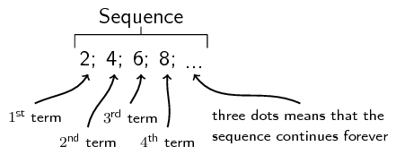
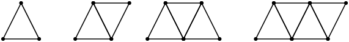
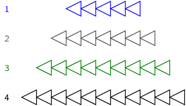

## 3.2 Describing sequences (EMAY)

A sequence is an ordered list of items, usually numbers. Each item which makes up a sequence is called a
      “term”.

Sequences can have interesting patterns. Here we examine some types of patterns and how they are formed.

Examples:

1. \(1; 4; 7; 10; 13; 16; 19; 22; 25; \ldots\) There is difference of \(\text{3}\) between successive terms. The pattern is continued by adding \(\text{3}\) to the previous term.
2. \(13; 8; 3; -2; -7; -12; -17; -22; \ldots\) There is a difference of \(-\text{5}\) between successive terms. The pattern is continued by adding \(-\text{5}\) to (i.e. subtracting \(\text{5}\) from) the previous term.
3. \(2; 4; 8; 16; 32; 64; 128; 256; \ldots\) This sequence has a factor of \(\text{2}\) between successive terms. The pattern is continued by multiplying the previous term by 2.
4. \(3; -9; 27; -81; 243; -729; 2187; \ldots\) This sequence has a factor of \(-\text{3}\) between successive terms. The pattern is continued by multiplying the previous term by \(-\text{3}\).
5. \(9; 3; 1; \frac{1}{3}; \frac{1}{9}; \frac{1}{27}; \ldots\) This sequence has a factor of \(\frac{1}{3}\) between successive terms. The pattern is continued by multiplying the previous term by \(\frac{1}{3}\) which is equivalent to dividing the previous term by 3.

Some learners may see example 3 as \(2^{1}; 2^{2}; 2^{3}; \ldots\) and see a pattern with the powers. You may
        choose to discuss this in class as a precursor to geometric series which will be introduced in Grade 12.

<QuizCard id="m10-03-02a" title="Interactive Exercise 3.2" question="Given a sequence of numbers: \[ 				\begin{array}{c} 					-2\, ;2\, ;-11\, ;-8\, ;-13\, ;\ldots 				\end{array} 			\] Determine the common difference for the sequence (if there is one)." options=["4", "-6", "-5", "-3", "No common difference"] explanation="Refer to the section rules and worked examples to verify." />

<QuizCard id="m10-03-02a" title="Interactive Exercise 3.2" question="Given a sequence of numbers: \[ 				\begin{array}{c} 					2\, ;-7\, ;-16\, ;-25\, ;-34\, ;\ldots 				\end{array} 			\] Determine the common difference for the sequence (if there is one)." options=["-13", "-12", "-9", "-6", "No common difference"] explanation="Refer to the section rules and worked examples to verify." />

<QuizCard id="m10-03-02a" title="Interactive Exercise 3.2" question="Given a sequence of numbers: \[ 				\begin{array}{c} 					6\, ;16\, ;26\, ;36\, ;46\, ;\ldots 				\end{array} 			\] Determine the common difference for the sequence (if there is one)." options=["8", "10", "11", "13", "No common difference"] explanation="Refer to the section rules and worked examples to verify." />

<Callout type="tip" title="Worked example 1: Study table">
**Question:**
You and \(\text{3}\) friends decide to study for Maths and are sitting together at a square table. A few
          minutes later, \(\text{2}\) other friends arrive and would like to sit at your table. You move another table
          next to yours so that \(\text{6}\) people can sit at the table. Another \(\text{2}\) friends also want to join
          your group, so you take a third table and add it to the existing tables. Now \(\text{8}\) people can sit
          together.

Examine how the number of people sitting is related to the number of tables. Is there a pattern?

Figure 3.1: Two more people can be seated for each table added.

**Make a table to see if a pattern forms:**
| Number of tables , n | Number of people seated |
| --- | --- |
| \(\text{1}\) | \(4=4\) |
| \(\text{2}\) | \(4+2=6\) |
| \(\text{3}\) | \(4+2+2=8\) |
| \(\text{4}\) | \(4+2+2+2=10\) |
| \(\vdots\) | \(\vdots\) |
| n | \(4+2+2+2+\cdots +2\) |

**Describe the pattern:**
We can see that for \(\text{3}\) tables we can seat \(\text{8}\) people, for \(\text{4}\) tables we can seat
          \(\text{10}\) people and so on. We started out with \(\text{4}\) people and added two each time. So for each
          table added, the number of people increased by \(\text{2}\).

So the pattern formed is \(4; 6; 8; 10; \ldots\).
</Callout>

<QuizCard id="m10-03-02b" title="Interactive Exercise 3.3" question="Find the common difference of the following sequence: \[\begin{array}{c}-\text{1,14}\, ;-\text{2,56}\, ;-\text{3,98}\, ;-\text{5,4}\, ;\ldots\end{array}\]" options=[] explanation="Refer to the section rules and worked examples to verify." />

<QuizCard id="m10-03-02b" title="Interactive Exercise 3.3" question="Consider the following sequence: \[\begin{array}{c}- 5 x - 1\, ; - 8 x\, ; - 11 x + 1\, ; - 14 x + 2\, ; - 17 x + 3\, ; \ldots\end{array}\] Determine the common difference for the terms of the sequence." options=[] explanation="Refer to the section rules and worked examples to verify." />

<QuizCard id="m10-03-02b" title="Interactive Exercise 3.3" question="If the following terms make a linear sequence: \[\begin{array}{c}- x + 4\, ;- 3 x + 5\, ;- 8 x + 5\, ;\ldots\end{array}\] compute the value of \( x \) . If the answer is a non-integer, write the answer as a simplified fraction." options=[] explanation="Refer to the section rules and worked examples to verify." />

<QuizCard id="m10-03-02b" title="Interactive Exercise 3.3" question="Given a sequence which starts with the numbers: \[\begin{array}{c}6\, ; 10\, ; 14\, ; 18\, ; \ldots\end{array}\] Determine the values of \(T_{6}\) and \(T_{9}\) ." options=[] explanation="Refer to the section rules and worked examples to verify." />

To describe terms in a number pattern we use the following notation:

The first term of a sequence is \({T}_{1}\).

The fourth term of a sequence is \({T}_{4}\).

The tenth term of a sequence is \({T}_{10}\).

The general term is often expressed as the \(n^{\text{th}}\) term and is written as \({T}_{n}\).

A sequence does not have to follow a pattern but, when it does, we can write down the general formula to
      calculate any term. For example, consider the following linear sequence:

    \(1; 3; 5; 7; 9; \ldots\)

The \(n^{\text{th}}\) term is given by the general formula:

    \({T}_{n}=2n-1\)

You can check this by substituting values into the formula:

    \begin{align*}
    {T}_{1}& = 2\left(1\right)-1=1 \\
    {T}_{2}& = 2\left(2\right)-1=3 \\
    {T}_{3}& = 2\left(3\right)-1=5 \\
    {T}_{4}& = 2\left(4\right)-1=7 \\
    {T}_{5}& = 2\left(5\right)-1=9
    \end{align*}

If we find the relationship between the position of a term and its value, we can find a general formula which
      matches the pattern and find any term in the sequence.

### Common difference (EMAZ)

Consider the following sequence:

      \[6; 1; -4; -9; ...\]

We can see that each term is decreasing by 5 but how would we determine the general formula for the
        \(n^{\text{th}}\) term? Let us try to do this with a table.

| Term number | \(T_{1}\) | \(T_{2}\) | \(T_{3}\) | \(T_{4}\) | \({T}_{n}\) |
| --- | --- | --- | --- | --- | --- |
| Term | \(\text{6}\) | \(\text{1}\) | \(-\text{4}\) | \(-\text{9}\) | \({T}_{n}\) |
| Formula | \(6 - 0 \times 5\) | \(6 - 1 \times 5\) | \(6-2 \times 5\) | \(6-3 \times 5\) | \(6 - (n-1) \times 5\) |

You can see that the difference between the successive terms is always the coefficient of \(n\) in the formula.
        This is called a common difference.

Therefore, for sequences with a common difference, the general formula will always be of the form:
        \(T_{n}=dn+c\) where \(d\) is the difference between each term and \(c\) is some constant.

<Callout type="note" title="Note">
Sequences with a common difference are called linear sequences.
</Callout>

<Callout type="info" title="Definition: Common difference">
The common difference is the difference between any term and the term before it. The common difference is
            denoted by \(d\).
</Callout>

For example, consider the sequence \(10; 7; 4; 1; \ldots\)

To calculate the common difference, we find the difference between any term and the previous term.

Let us find the common difference between the first two terms.

      \begin{align*}
      d& = {T}_{2}-{T}_{1} \\
      & = 7-10 \\
      & = -3
      \end{align*}

Let us check another two terms:

      \begin{align*}
      d& = {T}_{4}-{T}_{3} \\
      & = 1-4 \\
      & = -3
      \end{align*}

We see that \(d\) is constant.

In general, \(d=T_{n}-T_{n-1}\)

<Callout type="note" title="Note">
\(d \ne T_{n-1}-T_{n}\) for example, \(d={T}_{2}-{T}_{1}\), not \({T}_{1}-{T}_{2}\).
</Callout>

<Callout type="tip" title="Worked example 2: Study table, continued">
**Question:**
As before, you and \(\text{3}\) friends are studying for Maths and are sitting together at a square table.
            A few minutes later \(\text{2}\) other friends arrive so you move another table next to yours. Now
            \(\text{6}\) people can sit at the table. Another \(\text{2}\) friends also join your group, so you take a
            third table and add it to the existing tables. Now \(\text{8}\) people can sit together as shown below.

1. Find an expression for the number of people seated at \(n\) tables.
2. Use the general formula to determine how many people can sit around \(\text{12}\) tables.
3. How many tables are needed to seat \(\text{20}\) people?

Figure 3.2: Two more people can be seated for each table added.

**Make a table to see the pattern:**
| Number of Tables , \(n\) | Number of people seated | Pattern |
| --- | --- | --- |
| \(\text{1}\) | \(4=4\) | \(=4+2\left(0\right)\) |
| \(\text{2}\) | \(4+2=6\) | \(=4+2\left(1\right)\) |
| \(\text{3}\) | \(4+2+2=8\) | \(=4+2\left(2\right)\) |
| \(\text{4}\) | \(4+2+2+2=10\) | \(=4+2\left(3\right)\) |
| \(\vdots\) | \(\vdots\) | \(\vdots\) |
| n | \(4+2+2+2+\cdots +2\) | \(=4+2\left(n-1\right)\) |

Note: There may be variations in how you think of the pattern in this problem. For
            example, you may view this problem as the person on one end fixed, two people seated opposite each other per
            table and one person at the other end fixed. This results in \(1 + 2n + 1 = 2n + 2\). Your formula for
            \(T_n\) will still be correct.

**Describe the pattern:**
The number of people seated at \(n\) tables is \({T}_{n}=4+2\left(n-1\right)\)

**Calculate the \(12^{\text{th}}\) term, in other words, find \({T}_{n}\) if \(n=12\):**
\begin{align*}
          {T}_{12}& = 4+2\left(12-1\right) \\
          & = 4+2\left(11\right) \\
          & = 4 + 22 \\
          & = 26
          \end{align*}

Therefore \(\text{26}\) people can be seated at \(\text{12}\) tables.

**Calculate the number of tables needed to seat \(\text{20}\) people, in other words, find
            \(n\) if \({T}_{n}=20\):**
\begin{align*}
          {T}_{n}& = 4+2\left(n-1\right) \\
          20& = 4+2\left(n-1\right) \\
          20& = 4+2n-2 \\
          20-4+2& = 2n \\
          18 & = 2n \\
          \frac{18}{2} & = n \\
          n& = 9
          \end{align*}

Therefore \(\text{9}\) tables are needed to seat \(\text{20}\) people.
</Callout>

<QuizCard id="m10-03-02c" title="Interactive Exercise 3.4" question="Calculate the missing term. \[                     \begin{array}{c}                         \{\text{5}\, ;\text{14}\, ;\text{23}\, ;\ldots\, ;                         \text{41}\}                     \end{array}                 \] \[                     \begin{array}{c}                         T_n = 9 n - 4                     \end{array}                 \]" options=[] explanation="Refer to the section rules and worked examples to verify." />

<QuizCard id="m10-03-02c" title="Interactive Exercise 3.4" question="Consider the sequence shown here: \( 12\, ;18\, ;24\, ;30\, ;36\, ;42\, ;48\, ;54\, ;\ldots \) If \(T_{n} = 24\) what is the value of \(T_{n-2}\) ?" options=[] explanation="Refer to the section rules and worked examples to verify." />

<QuizCard id="m10-03-02c" title="Interactive Exercise 3.4" question="For each definition shown below, select the correct word or phrase:" options=["Common difference", "Consecutive", "Rank", "T\u2099", "Common difference", "Consecutive", "Rank", "T\u2099", "Common difference", "Consecutive", "Rank", "T\u2099", "Common difference", "Consecutive", "Rank", "T\u2099"] explanation="Refer to the section rules and worked examples to verify." />

It is important to note the difference between \(n\) and \({T}_{n}\). \(n\) can be compared to a place holder
        indicating the position of the term in the sequence, while \({T}_{n}\) is the value of the place held by \(n\).
        From our example above, the first table holds \(\text{4}\) people. So for \(n=1\), the value of \({T}_{1}=4\)
        and so on:

| \(n\) | \(\text{1}\) | \(\text{2}\) | \(\text{3}\) | \(\text{4}\) | \(\ldots\) |
| --- | --- | --- | --- | --- | --- |
| \({T}_{n}\) | \(\text{4}\) | \(\text{6}\) | \(\text{8}\) | \(\text{10}\) | \(\ldots\) |

<Callout type="tip" title="Worked example 3: Data plans">
**Question:**
Raymond subscribes to a limited data plan from Vodacell. The limited data plans cost
            \(\text{R}\,\text{120}\) for \(\text{1}\) gigabyte (GB) per month, \(\text{R}\,\text{135}\) for \(\text{2}\)
            \(\text{GB}\) per month and \(\text{R}\,\text{150}\) for \(\text{3}\) \(\text{GB}\) per month. Assume this
            pattern continues indefinitely.

1. Use a table to set up the pattern of the cost of the data plans.
2. Find the general formula for the sequence.
3. Use the general formula to determine the cost for a \(\text{30}\) \(\text{GB}\) data plan.
4. The cost of an unlimited data plan is \(\text{R}\,\text{510}\) per month. Determine the amount of data Raymond would have to use for it to be cheaper for him to sign up for the unlimited plan.

**Make a table to see the pattern:**
| Number of GB \((n)\) | \(\text{1}\) | \(\text{2}\) | \(\text{3}\) | \(\text{4}\) |
| --- | --- | --- | --- | --- |
| Cost (in Rands) | \(\text{120}\) | \(\text{135}\) | \(\text{150}\) | \(\text{165}\) |
| Pattern | \(\text{120}\) | \(120+(1)(15)=135\) | \(120+(2)(15)=150\) | \(120+(3)(15)=165\) |

**Use the observed pattern to determine the general formula.:**
The price of \(n\) GB of data is \({T}_{n}=120+15\left(n-1\right)\)

**Determine the cost of \(\text{30}\) \(\text{GB}\) of data.:**
This question requires us to determine the value of the \(30^{\text{th}}\) term, in other words, find
            \({T}_{n}\) if \(n=30\). Using the general formula, we get:

          \begin{align*}
          {T}_{n}& = 120+15\left(n-1\right) \\
          \therefore {T}_{30}& = 120+15\left(30-1\right) \\
          & = 120+15\left(29\right) \\
          & = 120 + 435 \\
          & = 555
          \end{align*}

Therefore the cost of a \(\text{30}\) \(\text{GB}\) data package is \(\text{R}\,\text{555}\).

**Determine when it is cheaper to purchase the unlimited data plan:**
The final question of this worked example requires us to determine when it would be cheaper for Raymond to
            purchase an unlimited data plan instead of a limited plan. In other words, we need to find \(n\) where
            \(T_n\) is less than \(\text{R}\,\text{510}\).

We know that:

          \[{T}_{n} = 120+15\left(n-1\right)\]

Therefore, if \(T_n=510= 120+15\left(n-1\right)\)

Solving for \(n\), we get:

          \begin{align*}
          510& = 120+15\left(n-1\right) \\
          510& = 120+15n-15 \\
          510& = 105+15n \\
          405& = 15n \\
          \frac{405}{15} & = n \\
          n& = 27
          \end{align*}

Therefore it is cheaper for Raymond to purchase the unlimited data plan if he uses more than \(\text{27}\)
            \(\text{GB}\) per month.
</Callout>

<QuizCard id="m10-03-02d" title="Interactive Exercise 3.5" question="Consider the following list: \[\begin{array}{c}2 y + 3\, ; y + 5\, ; 7\, ; - y + 9\, ; - 2 y + 11\, ; \ldots\end{array}\] Determine the common difference for the terms of the list." options=[] explanation="Refer to the section rules and worked examples to verify." />

<QuizCard id="m10-03-02d" title="Interactive Exercise 3.5" question="Consider these three numbers: \[\begin{array}{c}\text{0} \, ; \text{8} \, ; \text{27}\end{array}\] To which special group of numbers do these belong?" options=["cube numbers", "prime numbers", "square numbers", "triangular numbers", "none of the above"] explanation="Refer to the section rules and worked examples to verify." />

<QuizCard id="m10-03-02d" title="Interactive Exercise 3.5" question="How many balls will there be in the 7 th picture?" options=[] explanation="Refer to the section rules and worked examples to verify." />

<QuizCard id="m10-03-02d" title="Interactive Exercise 3.5" question="\(\{\text{7}\, ;\text{11}\, ;\text{15}\, ;\text{19}\, ;\text{23}\, ;\ldots\} 	 \)" options=[] explanation="Refer to the section rules and worked examples to verify." />

<QuizCard id="m10-03-02d" title="Interactive Exercise 3.5" question="The cushions in a library are arranged so that the first row has \(\text{18}\) cushions, the second row has \(\text{20}\) cushions, the third row has \(\text{22}\) cushions and so on. Calculate how many cushions are in the ninth row." options=[] explanation="Refer to the section rules and worked examples to verify." />

<QuizCard id="m10-03-02d" title="Interactive Exercise 3.5" question="In which week will you save \(\text{R}\,\text{114}\) ? (From your business only; ignore your friend's business for now.)" options=[] explanation="Refer to the section rules and worked examples to verify." />

<Callout type="tip" title="Multimedia & Video">
Learn more about number patterns.

<VideoPlayer src="https://www.youtube.com/embed/zIcxrhyJs6M" title="Video: 2F72" />
</Callout>

### Textbook Exercise 3.1

**Problem:**
Use the given pattern to complete the table below.

| Figure number | \(\text{1}\) | \(\text{2}\) | \(\text{3}\) | \(\text{4}\) | \(n\) |
| --- | --- | --- | --- | --- | --- |
| Number of dots |  |  |  |  |  |
| Number of lines |  |  |  |  |  |
| Total |  |  |  |  |  |

**Solution:**
| Figure number | \(\text{1}\) | \(\text{2}\) | \(\text{3}\) | \(\text{4}\) | \(n\) |
| --- | --- | --- | --- | --- | --- |
| Number of dots | \(\text{3}\) | \(\text{4}\) | \(\text{5}\) | \(\text{6}\) | \(n + 2\) |
| Number of lines | \(\text{3}\) | \(\text{5}\) | \(\text{7}\) | \(\text{9}\) | \(2n + 1\) |
| Total | \(\text{6}\) | \(\text{9}\) | \(\text{12}\) | \(\text{15}\) | \(3(n + 1)\) |

**Problem:**
Consider the sequence shown here: \(-4 \; ; \; -1 \; ; \; 2 \; ; \; 5 \; ; \; 8 \; ; \; 11 \; ; \; 14
                \; ; \;17 \; ; \; \ldots\)

If \(T_{n} = \text{2}\) what is the value of \(T_{n-1}\)?

**Solution:**
\begin{align*}
              T_{3} & = \text{2} \\
              \therefore T_{n-1} & = -1
              \end{align*}

**Problem:**
Consider the sequence shown here: \(C \; ; \; D \; ; \; E \; ; \; F \; ; \; G \; ; \; H \; ; \; I \; ;
                \; J \; ; \; \ldots\)

If \(T_{n} = G\) what is the value of \(T_{n-4}\)?

**Solution:**
\begin{align*}
              T_{5} & = G \\
              \therefore T_{n-4} & = C
              \end{align*}

For each of the following sequences determine the common difference. If the sequence is not linear,
                write “no common difference”.

**Problem:**
\(9 \; ; \; -7 \; ; \; -8 \; ; \; -25 \; ; \; -34 \; ; \; \ldots\)

**Solution:**
\begin{align*}
                d & = T_{2} - T_{1} = (-7) - (9) = -16 \\
                d & = T_{3} - T_{2} = (-8) - (-7) = -1 \\
                d & = T_{4} - T_{3} = (-25) - (-8) = -17
                \end{align*}

You can see that the results are not the same - the difference is not 'common.' That means that this
                  sequence of numbers in not linear, and it has no common difference.

**Problem:**
\(5 \; ; \; 12 \; ; \; 19 \; ; \; 26 \; ; \; 33 \; ; \; \ldots\)

**Solution:**
\begin{align*}
                d & = T_{2} - T_{1} = (12) - (5) = 7 \\
                d & = T_{3} - T_{2} = (19) - (12) = 7 \\
                d & = T_{4} - T_{3} = (26) - (19) = 7
                \end{align*}

All of the results are the same, which means we have found the common difference for
                  these numbers: \(d = 7\).

**Problem:**
\(\text{2,93} \; ; \; \text{1,99} \; ; \; \text{1,14} \; ; \; \text{0,35} \; ; \; \ldots\)

**Solution:**
\begin{align*}
                d & = T_{2} - T_{1} = \left(\text{1,99}\right) - \left(\text{2,93}\right) = -\text{0,94} \\
                d & = T_{3} - T_{2} = \left(\text{1,14}\right) - \left(\text{1,99}\right) = -\text{0,85}
                \end{align*}

In this case the sequence is not linear. Therefore the final answer is that there is no common
                  difference.

**Problem:**
\(\text{2,53} \; ; \; \text{1,88} \; ; \; \text{1,23} \; ; \; \text{0,58} \; ; \; \ldots\)

**Solution:**
\begin{align*}
                d & = T_{2} - T_{1} = \left(\text{1,88}\right) - \left(\text{2,53}\right) = -\text{0,65} \\
                d & = T_{3} - T_{2} = \left(\text{1,23}\right) - \left(\text{1,88}\right) = -\text{0,65}
                \end{align*}

The common difference is \(d = -\text{0,65}\).

Write down the next three terms in each of the following sequences:

**Problem:**
\(5 \; ; \; 15 \; ; \; 25 \; ; \; \ldots\)

**Solution:**
The common difference is:

                \begin{align*}
                d & = T_{2} - T_{1} \\
                & = 15 - 5 \\
                & = 10
                \end{align*}

Therefore we add \(\text{10}\) each time to get the next term in the sequence. The next three numbers
                  are:

\(\text{35}\), \(\text{45}\) and \(\text{55}\)

and the sequence becomes:

\(5 \; ; \; 15 \; ; \; 25 \; ; \; 35 \; ; \; 45 \; ; \; 55 \; ; \; \ldots\)

**Problem:**
\(-8 \; ; \; -3 \; ; \; 2 \; ; \; \ldots\)

**Solution:**
The common difference is:

                \begin{align*}
                d & = T_{2} - T_{1} \\
                & = -3 - (-8) \\
                & = 5
                \end{align*}

Therefore we add \(\text{5}\) each time to get the next term in the sequence. The next three numbers
                  are:

\(\text{7}\), \(\text{12}\) and \(\text{17}\)

and the sequence becomes:

\(-8 \; ; \; -3 \; ; \; 2 \; ; \; 7 \; ; \; 12 \; ; \; 17 \; ; \; \ldots\)

**Problem:**
\(30 \; ; \; 27 \; ; \; 24 \; ; \; \ldots\)

**Solution:**
The common difference is:

                \begin{align*}
                d & = T_{2} - T_{1} \\
                & = 27 - 30 \\
                & = -3
                \end{align*}

Therefore we subtract \(\text{3}\) each time to get the next term in the sequence. The next three
                  numbers are:

\(\text{21}\), \(\text{18}\) and \(\text{15}\)

and the sequence becomes:

\(30 \; ; \; 27 \; ; \; 24 \; ; \; 21 \; ; \; 18 \; ; \; 15 \; ; \; \ldots\)

**Problem:**
\(-\text{13,1}\; ; \;-\text{18,1}\; ; \;-\text{23,1}\; ;\ldots\)

**Solution:**
\begin{align*}
                  d &= T_{2}-T_{1} \text{ or } T_{3}-T_{2}\\
                  &= (-\text{18,1}) - (-\text{13,1}) \text{ or } (-\text{23,1}) - (-\text{18,1}) \\
                  &= -\text{5} \\
                  \text{Therefore } T_4 &= -\text{28,1} \\
                  T_5 &= -\text{33,1} \\
                  T_6 &= -\text{38,1}
                  \end{align*}

**Problem:**
\(- 9 x\; ;- 19 x\; ;- 29 x\; ;\ldots\)

**Solution:**
\begin{align*}
                  d &= T_{2}-T_{1} \text{ or } T_{3}-T_{2}\\
                  &= (- 19 x) - (- 9 x) \text{ or } (- 29 x) - (- 19 x) \\
                  &= -10 x \\
                  \text{Therefore } T_4 &= - 39 x \\
                  T_5 &= - 49 x \\
                  T_6 &= - 59 x
                  \end{align*}

**Problem:**
\(-\text{15,8}\; ; \;\text{4,2}\; ; \;\text{24,2}\; ;\ldots\)

**Solution:**
\begin{align*}
                  d &= T_{2}-T_{1} \text{ or } T_{3}-T_{2}\\
                  &= (\text{4,2}) - (-\text{15,8}) \text{ or } (\text{24,2}) - (\text{4,2}) \\
                  &= \text{20} \\
                  \text{Therefore } T_4 &= \text{44,2} \\
                  T_5 &= \text{64,2} \\
                  T_6 &= \text{84,2}
                  \end{align*}

**Problem:**
\(30 b\; ;34 b\; ;38 b\; ;\ldots\)

**Solution:**
\begin{align*}
                  d &= T_{2}-T_{1} \text{ or } T_{3}-T_{2}\\
                  &= (34 b) - (30 b) \text{ or } (38 b) - (34 b) \\
                  &= 4 b \\
                  \text{Therefore } T_4 &= 42 b \\
                  T_5 &= 46 b \\
                  T_6 &= 50 b
                  \end{align*}

**Problem:**
Given a pattern which starts with the numbers: \(3 \; ; \; 8 \; ; \; 13 \; ; \; 18 \; ; \; \ldots\)
                determine the values of \(T_{6}\) and \(T_{9}\).

**Solution:**
\[3 \; ; \; 8 \; ; \; 13 \; ; \; 18 \; ; \; 23 \; ; \; \underline{28} \; ; \;33 \; ; \; 38 \; ; \;
              \underline{43} \; ; \; \ldots\]

              \(T_{6} = 28 \text{ and } T_{9} = 43\)

**Problem:**
Given a sequence which starts with the letters: \(C \; ; \; D \; ; \; E \; ; \; F \; ; \; \ldots\)
                determine the values of \(T_{5}\) and \(T_{8}\).

**Solution:**
\[C \; ; \; D \; ; \; E \; ; \; F \; ; \; \underline{G} \; ; \; H \; ; \; I \; ; \; \underline{J} \; ; \;
              \ldots\]

              \(T_{5} = G \text{ and } T_{8} = J\)

**Problem:**
Given a pattern which starts with the numbers: \(7 \; ; \; 11 \; ; \; 15 \; ; \; 19 \; ; \; \ldots\)
                determine the values of \(T_{5}\) and \(T_{8}\).

**Solution:**
\[7 \; ; \; 11 \; ; \; 15 \; ; \; 19 \; ; \; \underline{23} \; ; \;27 \; ; \; 31 \; ; \; \underline{35} \;
              ; \;\ldots\]

              \(T_{5} = 23 \text{ and } T_{8} = 35\)

The general term is given for each sequence below. Calculate the missing terms (each missing term is
                represented by \(\ldots\)).

**Problem:**
\(0 \; ; \; 3 \; ; \; \ldots \; ; \; 15 \; ; \; 24 \; \qquad T_n = n^2 - 1\)

**Solution:**
The third term is:

                \begin{align*}
                T_n & = n^{2} - 1 \\
                T_{3} & = (3)^{2} - 1 \\
                & = 9 - 1 \\
                & = 8
                \end{align*}

The fourth term is:

                \begin{align*}
                T_n & = n^{2} - 1 \\
                T_{4} & = (4)^{2} - 1 \\
                & = 16 - 1 \\
                & = 15
                \end{align*}

Therefore the only missing term is the third one, which is \(\text{8}\). The full sequence is:

                \(0 \; ; \; 8 \; ; \; 15 \; ; \; 24\)

**Problem:**
\(3 \; ; \; 2 \; ; \; 1 \; ; \; 0 \; ; \; \ldots; -2 \qquad T_{n} = -n + 4\)

**Solution:**
The fifth term is:

                \begin{align*}
                T_n & = -n + 4 \\
                T_{5} & = -(5) + 4 \\
                & = -1
                \end{align*}

The sixth term is:

                \begin{align*}
                T_n & = -n + 4 \\
                T_{6} & = -(6) + 4 \\
                & = -2
                \end{align*}

Therefore the only missing term is the fifth one, which is \(-\text{1}\). The full sequence is:

                \(3 \; ; \; 2 \; ; \; 1 \; ; \; 0 \; ; \; -1 \; ; \; -2\)

**Problem:**
\(-11 \; ; \; \ldots \; ; \; -7 \; ; \; \ldots \; ; \; -3 \qquad T_{n} = -13 + 2n\)

**Solution:**
The second term is:

                \begin{align*}
                T_n & = -13 + 2n \\
                T_{2} & = -13 + 2(2) \\
                & = -13 + 4 \\
                & = -9
                \end{align*}

The third term is:

                \begin{align*}
                T_n & = -13 + 2n \\
                T_{3} & = -13 + 2(3) \\
                & = -13 + 6 \\
                & = -7
                \end{align*}

The fourth term is:

                \begin{align*}
                T_n & = -13 + 2n \\
                T_{4} & = -13 + 2(4) \\
                & = -13 + 8 \\
                & = -5
                \end{align*}

The fifth term is:

                \begin{align*}
                T_n & = -13 + 2n \\
                T_{5} & = -13 + 2(5) \\
                & = -13 + 10 \\
                & = -3
                \end{align*}

Therefore the two missing terms are the second and fourth ones, which are \(-\text{9}\) and
                  \(-\text{5}\). The full sequence is:

                \(-11 \; ; \; -9 \; ; \; -7 \; ; \; -5 \; ; \; -3\)

**Problem:**
\(\text{1} \; ; \; \text{10} \; ; \; \text{19} \; ; \; \ldots \; ; \; \text{37} \qquad T_n = 9 n -
                  8\)

**Solution:**
\begin{align*}
                  T_n & = 9 n - 8\\
                  T_4 & = \text{9} (\text{4}) -\text{8}\\
                  &= \text{28}
                  \end{align*}

**Problem:**
\(\text{9} \; ; \; \ldots \; ; \; \text{21} \; ; \; \ldots \; ; \; \text{33} \qquad T_n = 6 n + 3\)

**Solution:**
To find the two missing terms, we use the equation for the general term:
                  \begin{align*}
                  T_n & = \text{6}n\text{+3} \\
                  T_2 & = \text{6}(\text{2})\text{+3} \\
                  &= \text{15} \\
                  T_4 & = \text{6}(\text{4})\text{+3} \\
                  &= \text{27}
                  \end{align*}

Find the general formula for the following sequences and then find \(T_{10}\), \(T_{50}\) and
                \(T_{100}\)

**Problem:**
\(2; 5; 8; 11; 14; \ldots\)

**Solution:**
We first need to find \(d\):

                \begin{align*}
                d & = T_{2} - T_{1} \\
                & = 5 - 2 \\
                & = 3
                \end{align*}

Next we note that for each successive term we add \(d\) to the last term. We can express this as:

                \begin{align*}
                T_{1} & = a = 2 \\
                T_{2} & = a + d = 2 + 3 \\
                & = 2 + 1(3)\\
                T_{3} & = T_{2} + d = 2 + 3 + 3 \\
                & = 2 + 2(3) \\
                T_{4} & = T_{3} + d = 2 + 3 + 3 + 3 \\
                & = 2 + 3(3)\\
                T_{n} & = T_{n-1} + d = 2 + 3(n-1) \\
                & = 3n - 1
                \end{align*}

The general formula is \(T_n = 3n - 1\).

\(T_{10}\), \(T_{50}\) and \(T_{100}\) are:

                \begin{align*}
                T_{10} & = 3(10) - 1 \\
                & = 29 \\
                T_{50} & = 3(50) - 1 \\
                & = 149 \\
                T_{100} & = 3(100) - 1 \\
                & = 299
                \end{align*}

**Problem:**
\(0; 4; 8; 12; 16; \ldots\)

**Solution:**
We first need to find \(d\):

                \begin{align*}
                d & = T_{2} - T_{1} \\
                & = 4 - 0 \\
                & = 4
                \end{align*}

Next we note that for each successive term we add \(d\) to the last term. We can express this as:

                \begin{align*}
                T_{1} & = a = 0 \\
                T_{2} & = a + d = 0 + 4 \\
                & = 4(1)\\
                T_{3} & = T_{2} + d = 0 + 4 + 4 \\
                & = 4(2)\\
                T_{4} & = T_{3} + d = 0 + 4 + 4 + 4 \\
                & = 4(3)\\
                T_{n} & = T_{n-1} + d = 0 + 4(n-1) \\
                & = 4n - 4
                \end{align*}

The general formula is \(T_n = 4n - 4\).

\(T_{10}\), \(T_{50}\) and \(T_{100}\) are:

                \begin{align*}
                T_{10} & = 4(10) - 4 \\
                & = 36 \\
                T_{50} & = 4(50) - 4 \\
                & = 196 \\
                T_{100} & = 4(100) - 4 \\
                & = 396
                \end{align*}

**Problem:**
\(2; -1; -4; -7; -10; \ldots\)

**Solution:**
We first need to find \(d\):

                \begin{align*}
                d & = T_{2} - T_{1} \\
                & = -1 - 2 \\
                & = -3
                \end{align*}

Next we note that for each successive term we add \(d\) to the last term. We can express this as:

                \begin{align*}
                T_{1} & = a = 2 \\
                T_{2} & = a + d = 2 + (-3) \\
                & = 2 + (-3)(1)\\
                T_{3} & = T_{2} + d = 2 + (-3) + (-3) \\
                & = 2 + (-3)(2)\\
                T_{4} & = T_{3} + d = 2 + (-3) + (-3) + (-3) \\
                & = 2 + (-3)(3)\\
                T_{n} & = T_{n-1} + d = 2 + (-3)(n-1) \\
                & = 5 - 3n
                \end{align*}

The general formula is \(T_n = 5 - 3n\).

\(T_{10}\), \(T_{50}\) and \(T_{100}\) are:

                \begin{align*}
                T_{10} & = 5 - 3(10) \\
                & = -25 \\
                T_{50} & = 5 - 3(50) \\
                & = -145 \\
                T_{100} & = 5 - 3(100) \\
                & = -295
                \end{align*}

The diagram below shows pictures which follow a pattern.

**Problem:**
How many triangles will there be in the \(5^{\text{th}}\) picture?

**Solution:**
\(5 \; ; \; 7 \; ; \; 9 \; ; \; 11 \; ; \; \ldots\)

Therefore two triangles are added each time and the fifth picture will have \(\text{13}\) triangles.

**Problem:**
Determine the formula for the \(n^{\text{th}}\) term.

**Solution:**
The general term of the pattern is:

                \begin{align*}
                T_{n} & = T_{1} + d = 5 + (2)(n-1) \\
                & = 2n + 3
                \end{align*}

**Problem:**
Use the formula to find how many triangles are in the \(25^{\text{th}}\) picture of the diagram.

**Solution:**
\begin{align*}
                  T_{n} & = 2n + 3 \\
                  T_{25} & = 2(25) + 3 \longleftarrow \text{substitute n } = 25 \\
                  & = 53
                  \end{align*}

Study the following sequence:

              \(15 \; ; \; 23 \; ; \; 31 \; ; \; 39 \; ; \; \ldots\)

**Problem:**
Write down the next \(\text{3}\) terms.

**Solution:**
We note that we add 8 to each term to get the next term. Therefore the next three terms are \(47 \; ;
                  \; 55 \; ; \; 63\).

**Problem:**
Find the general formula for the sequence

**Solution:**
\begin{align*}
                T_n & = T_1 + d(n - 1) \\
                & = 15 + 8(n-1) \\
                & = 8n + 7
                \end{align*}

**Problem:**
Find the value of \(n\) if \(T_n\) is \(\text{191}\).

**Solution:**
\begin{align*}
                191 &= 8n + 7 \\
                184 &= 8n \\
                n &= 23
                \end{align*}

Study the following sequence:

              \(-44 \; ; \; -14 \; ; \; 16 \; ; \; 46 \; ; \; \ldots\)

**Problem:**
Write down the next \(\text{3}\) terms.

**Solution:**
We note that we add 30 to each term to get the next term. Therefore the next three terms are \(76 \;
                  ; \; 106 \; ; \; 136\).

**Problem:**
Find the general formula for the sequence

**Solution:**
\begin{align*}
                T_n & = T_1 + d(n - 1) \\
                & = -44 + 30(n - 1) \\
                & = 30n -74
                \end{align*}

**Problem:**
Find the value of \(n\) if \(T_n\) is \(\text{406}\).

**Solution:**
\begin{align*}
                406 &= 30n - 74 \\
                480 &= 30n \\
                n &= 16
                \end{align*}

Consider the following list:
                \[- z - 5 \; ; \; - 4 z - 5 \; ; \; - 6 z - 2 \; ; \; - 8 z - 5 \; ; \; - 10 z - 5 \; ; \; \ldots\]

**Problem:**
Find the common difference for the terms of the list. If the sequence is not linear (if it does not
                  have a common difference), write “no common difference”.

**Solution:**
\begin{align*}
                  d & = T_{2} - T_{1} = (- 4 z - 5) - (- z - 5) = - 3 z \\
                  & = T_{3} - T_{2} = (- 6 z - 2) - (- 4 z - 5) = - 2 z + 3 \\
                  & = T_{4} - T_{3} = (- 8 z - 5) - (- 6 z - 2) = - 2 z - 3
                  \end{align*}
                  No common difference.

**Problem:**
If you are now told that \(z = -2\), determine the values of \(T_{1}\) and \(T_{2}\).

**Solution:**
\begin{align*}
                  T_{1} & = - z - 5 \\
                  & = - (-2)-5 \\
                  & = -3 \\
                  T_{2} & = - 4 z - 5 \\
                  & = - 4 (-2)-5 \\
                  & = 3
                  \end{align*}

Consider the following pattern:
                \[2n + 4 \; ; \; 1 \; ; \; - 2n - 2 \; ; \; - 4n - 5 \; ; \; - 6n - 8 \; ; \;\ldots\]

**Problem:**
Find the common difference for the terms of the pattern. If the sequence is not linear (if it does
                  not have a common difference), write “no common difference”.

**Solution:**
\begin{align*}
                  d & = T_{2} - T_{1} = (1) - (2n + 4) = - 2n - 3 \\
                  & = T_{3} - T_{2} = (- 2n - 2) - (1) = - 2n - 3 \\
                  & = T_{4} - T_{3} = (- 4n - 5) - (- 2n - 2) = - 2n - 3
                  \end{align*}
                  The common difference for these numbers: \(d = - 2n - 3\).

**Problem:**
If you are now told that \(n = -1\), determine the values of \(T_{1}\) and \(T_{3}\).

**Solution:**
\begin{align*}
                  T_{1} & = 2 n + 4 \\
                  & = 2 (-1)+4 \\
                  & = 2 \\
                  T_{3} & = - 2 n - 2 \\
                  & = - 2 (-1)-2 \\
                  & = 0
                  \end{align*}

**Problem:**
If the following terms make a linear sequence:
                  \[\frac{k}{3} - 1 \; ; \;- \frac{5k}{3} + 2 \; ; \;- \frac{2k}{3} + 10 \; ; \;\ldots\]

                  Determine the value of \(k\). If the answer is a non-integer, write the answer as a simplified
                  fraction.

**Solution:**
\begin{align*}
                  T_{2} - T_{1} & = T_{3} - T_{2} \\
                  \left(- \frac{5k}{3} + 2\right) - \left(\frac{k}{3} - 1\right) & = \left(- \frac{2k}{3} +
                  10\right) - \left(- \frac{5k}{3} + 2\right) \\ \\
                  3\left(- \frac{5k}{3} + 2\right) - 3\left(\frac{k}{3} - 1\right) & = 3\left(- \frac{2k}{3} +
                  10\right) - 3\left(- \frac{5k}{3} + 2\right) \\
                  - 5k + 6 - \left(k - 3\right) & = - 2k + 30 - \left(- 5k + 6\right) \\
                  - 6k + 9 & = 3k + 24 \\
                  -15 & = 9k \\
                  k & = - \frac{5}{3}
                  \end{align*}

**Problem:**
Now determine the numeric value of the first three terms. If the answers are not integers, write your
                  answers as fractions.

**Solution:**
\begin{align*}
                  \text{First term: } T_{1} & = \frac{k}{3} - 1 \\
                  & = \frac{\left(- \frac{5}{3}\right)}{3}-1 \\
                  & = - \frac{14}{9} \\
                  \text{Second term: }T_{2} & = - \frac{5 k}{3} + 2 \\
                  & = - \frac{5 \left(- \frac{5}{3}\right)}{3}+2 \\
                  & = \frac{43}{9} \\
                  \text{Third term: }T_{3} & = - \frac{2 k}{3} + 10 \\
                  & = - \frac{2 \left(- \frac{5}{3}\right)}{3}+10 \\
                  & = \frac{100}{9}
                  \end{align*}
                  The first three terms of this sequence are: \(- \frac{14}{9} , \frac{43}{9}\) and \(\frac{100}{9}\).

**Problem:**
If the following terms make a linear sequence:
                  \[y - \frac{3}{2} \; ; \; - y - \frac{7}{2} \; ; \; - 7 y - \frac{15}{2} \; ; \; \ldots\]

                  find \(y\). If the answer is a non-integer, write the answer as a simplified fraction.

**Solution:**
\begin{align*}
                  T_{2} - T_{1} & = T_{3} - T_{2} \\
                  \left(- y - \frac{7}{2}\right) - \left(y - \frac{3}{2}\right) & = \left(- 7 y -
                  \frac{15}{2}\right) - \left(- y - \frac{7}{2}\right) \\ \\
                  2\left(- y - \frac{7}{2}\right) - 2\left(y - \frac{3}{2}\right) & = 2\left(- 7y -
                  \frac{15}{2}\right) - 2\left(- y - \frac{7}{2}\right) \\
                  - 2y - 7 - \left(2y - 3\right) & = - 14y - 15 - \left(- 2y - 7\right) \\
                  - 4y - 4 & = - 12y - 8 \\
                  8y & = -4 \\
                  y & = - \frac{1}{2}
                  \end{align*}

**Problem:**
Now determine the numeric value of the first three terms. If the answers are not integers, write your
                  answers as fractions.

**Solution:**
\begin{align*}
                  \text{First term: } T_{1} & = y - \frac{3}{2} \\
                  & = \left(- \frac{1}{2}\right)- \frac{3}{2} \\
                  & = -2 \\
                  \text{Second term: }T_{2} & = - y - \frac{7}{2} \\
                  & = - \left(- \frac{1}{2}\right)- \frac{7}{2} \\
                  & = -3 \\
                  \text{Third term: }T_{3} & = - 7 y - \frac{15}{2} \\
                  & = - 7 \left(- \frac{1}{2}\right)- \frac{15}{2} \\
                  & = -4
                  \end{align*}
                  The first three terms of this sequence are: \(-2 , -3 \text{ and } -4\).

**Problem:**
What is the \(649^{\text{th}}\) letter of the sequence:

PATTERNPATTERNPATTERNPATTERNPATTERNPATTERNPATTE.............?

**Solution:**
The word “PATTERN” is 7 letters long, so:

              \[\frac{649}{7} = 92\text{ r } 5\]

The remainder of 5 shows us that the \(649^{\text{th}}\) letter is the \(5^{\text{th}}\) letter in the
                word, which is E
