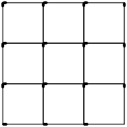
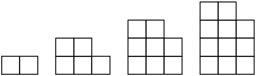
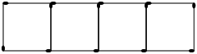
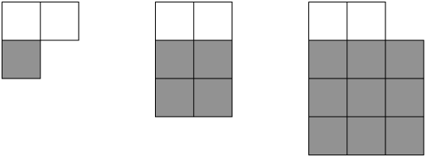
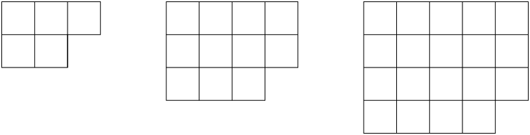
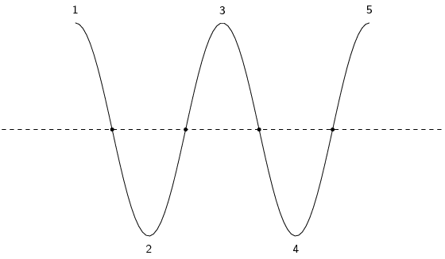
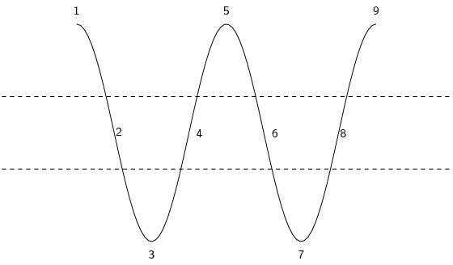
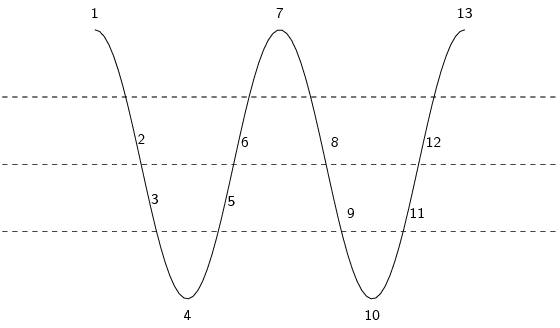
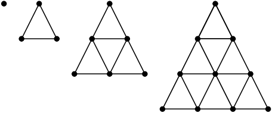

### Textbook Exercise 3.2

**Problem:**
Analyse the diagram and complete the table.

| Figure number (\(n \times n\)) | \(1 \times 1\) | \(2 \times 2\) | \(3 \times 3\) | \(4 \times 4\) | \(n \times n\) |
| --- | --- | --- | --- | --- | --- |
| Number of horizontal matches |  |  |  |  |  |
| Number of vertical matches |  |  |  |  |  |
| Total number of matches |  |  |  |  |  |

**Solution:**
| Figure number (\(n \times n\)) | \(1 \times 1\) | \(2 \times 2\) | \(3 \times 3\) | \(4 \times 4\) | \(n \times n\) |
| --- | --- | --- | --- | --- | --- |
| Number of horizontal matches | \(\text{2}\) | \(\text{6}\) | \(\text{12}\) | \(\text{20}\) | \(n(n + 1)\) |
| Number of vertical matches | \(\text{2}\) | \(\text{6}\) | \(\text{12}\) | \(\text{20}\) | \(n(n + 1)\) |
| Total number of matches | \(\text{4}\) | \(\text{12}\) | \(\text{24}\) | \(\text{40}\) | \(2n(n + 1)\) |

**Problem:**
Given a list of numbers: \(7 \; ; \; 4 \; ; \; 1 \; ; \; -2 \; ; \; -5 \; ; \; \ldots\) determine the
            common difference for the list (if there is one).

**Solution:**
\begin{align*}
            d & = T_{2} - T_{1} = (4) - (7) = -3 \\
            & = T_{3} - T_{2} = (1) - (4) = -3 \\
            & = T_{4} - T_{3} = (-2) - (1) = -3
            \end{align*}
            All of the results are the same, which means we have found the common difference for these
            numbers: \(d = -3\).

**Problem:**
For the pattern here: \(-\text{0,55} \; ; \; \text{0,99} \; ; \; \text{2,49} \; ; \; \text{3,91} \; ; \;
            \ldots\) calculate the common difference.

If the pattern is not linear, write “no common difference”. Otherwise, give your answer as a
            decimal.

**Solution:**
\begin{align*}
          d & = T_{2} - T_{1} = \left(\text{0,99}\right) - \left(-\text{0,55}\right) = \text{1,54} \\
          d & = T_{3} - T_{2} = \left(\text{2,49}\right) - \left(\text{0,99}\right) = \text{1,5}
          \end{align*}

In this case the sequence is not linear. Therefore the final answer is that there is no common difference.

**Problem:**
Consider the list shown here: \(2 \; ; \; 7 \; ; \; 12 \; ; \; 17 \; ; \; 22 \; ; \; 27 \; ; \; 32 \; ; \;
            37 \; ; \; \ldots\)

If \(T_{5} = \text{22}\) what is the value of \(T_{n-3}\)?

**Solution:**
\begin{align*}
          T_{5} & = \text{22} \\
          \therefore T_{n-3} & = 7
          \end{align*}

Write down the next three terms in each of the following linear sequences:

**Problem:**
\(-\text{10,2} \; ; \; -\text{29,2} \; ; \; -\text{48,2} \; ; \; \ldots\)

**Solution:**
\begin{align*}
              d &= T_{2}-T_{1} \text{ or } T_{3}-T_{2}\\
              &= (-\text{29,2}) - (-\text{10,2}) \text{ or } (-\text{48,2}) - (-\text{29,2}) \\
              &= -\text{19} \\
              \text{Therefore } T_4 &= -\text{67,2} \\
              T_5 &= -\text{86,2} \\
              T_6 &= -\text{105,2}
              \end{align*}

**Problem:**
\(50r \; ; \; 46r \; ; \; 42r \; ; \; \ldots\)

**Solution:**
\begin{align*}
              d &= T_{2}-T_{1} \text{ or } T_{3}-T_{2}\\
              &= (46r) - (50r) \text{ or } (42r) - (46r) \\
              &= -4r \\
              \text{Therefore } T_4 &= 38r \\
              T_5 &= 34r \\
              T_6 &= 30r
              \end{align*}

**Problem:**
Given a sequence which starts with the numbers: \(6 \; ; \; 11 \; ; \; 16 \; ; \; 21 \; ; \; \ldots\)
            determine the values of \(T_{6} \;\) and \(\; T_{8}\).

**Solution:**
\[6; \; 11; \; 16; \; 21; \; 26; \; \underline{31}; \;36; \; \underline{41}; \;\ldots\]

          \(T_{6} = 31 \text{ and } T_{8} = 41\)

**Problem:**
Given a list which starts with the letters: \(A \; ; \; B \; ; \; C \; ; \; D \; ; \; \ldots\) determine
            the values of \(T_{6}\) and \(T_{10}\).

**Solution:**
\[A \; ; \; B \; ; \; C \; ; \; D \; ; \; E \; ; \; \underline{F} \; ; \;G \; ; \; H \; ; \; I \; ; \;
          \underline{J} \; ; \; \ldots\]

          \(T_{6} = F \text{ and } T_{10} = J\)

Find the sixth term in each of the following sequences:

**Problem:**
\(4 \; ; \; 13 \; ; \; 22 \; ; \; 31 \; ; \; \ldots\)

**Solution:**
We first need to find \(d\):

            \begin{align*}
            d & = T_{2} - T_{1} \\
            & = 13 - 4 \\
            & = 9
            \end{align*}

Next we note that for each successive term we add \(d\) to the last term. We can express this as:

            \begin{align*}
            T_{1} & = a = 4 \\
            T_{2} & = a + d = 4 + 9 \\
            & = 4 + 9(1)\\
            T_{3} & = T_{2} + d = 4 + 9 + 9 \\
            & = 4 + 9(2) \\
            T_{n} & = T_{n-1} + d = 4 + 9(n-1) \\
            & = 9n - 5
            \end{align*}

The general formula is \(T_n = 9n - 5\).

\(T_{6}\) is:

            \begin{align*}
            T_{6} & = 9(6) - 5 \\
            & = 49
            \end{align*}
            \(T_{6} = \text{49}\)

**Problem:**
\(5 \; ; \; 2 \; ; \; -1 \; ; \; -4 \; ; \; \ldots\)

**Solution:**
We first need to find \(d\):

            \begin{align*}
            d & = T_{2} - T_{1} \\
            & = 2 - 5 \\
            & = -3
            \end{align*}

Next we note that for each successive term we add \(d\) to the last term. We can express this as:

            \begin{align*}
            T_{1} & = a = 5 \\
            T_{2} & = a + d = 5 + (-3) \\
            & = 5 + (-3)(1)\\
            T_{3} & = T_{2} + d = 5 + (-3) + (-3) \\
            & = 5 + (-3)(2) \\
            T_{n} & = T_{n-1} + d = 5 + (-3)(n-1) \\
            & = 7 - 3n
            \end{align*}

The general formula is \(T_n = 7 - 3n\).

\(T_{6}\) is:

            \begin{align*}
            T_{6} & = 7 - 3(6) \\
            & = -11
            \end{align*}
            \(T_{6} = -\text{11}\)

**Problem:**
\(\text{7,4} \; ; \; \text{9,7} \; ; \; \text{12} \; ; \; \text{14,3} \; ; \; \ldots\)

**Solution:**
We first need to find \(d\):

            \begin{align*}
            d & = T_{2} - T_{1} \\
            & = \text{9,7} - \text{7,4} \\
            & = \text{2,3}
            \end{align*}

Next we note that for each successive term we add \(d\) to the last term. We can express this as:

            \begin{align*}
            T_{1} & = a = \text{7,4} \\
            T_{2} & = a + d = \text{7,4} + \text{2,3} \\
            & = \text{7,4} + \text{2,3}(1)\\
            T_{3} & = T_{2} + d = \text{7,4} + \text{2,3} + \text{2,3} \\
            & = \text{7,4} + \text{2,3}(2) \\
            T_{n} & = T_{n-1} + d = \text{7,4} + \text{2,3}(n-1) \\
            & = \text{7,4} + \text{2,3}n - \text{2,3} = \text{2,3}n + \text{5,1}
            \end{align*}

The general formula is \(T_n = \text{2,3}n + \text{5,1}\).

\(T_{6}\) is:

            \begin{align*}
            T_{6} & = \text{2,3}(6) + \text{5,1} \\
            & = \text{18,9}
            \end{align*}
            \(T_{6} = \text{18,9}\)

Find the general formula for the following sequences and then find T10, T15 and
            T30

**Problem:**
\(-\text{18} \; ; \; -\text{22} \; ; \; -\text{26} \; ; \; -\text{30} \; ; \; -\text{34} \; ; \; \ldots\)

**Solution:**
\begin{align*}
              d & = T_{2}-T_{1}\\
              & = (-\text{22}) - (-\text{18})\\
              & = -\text{4}
              \end{align*}

Next we note that for each successive term we add \(d\) to the last term. We can express this as:

            \begin{align*}
            T_{1} & = a = -18 \\
            T_{2} & = a + d = -18 + (-4) \\
            & = -18 + (-4)(1)\\
            T_{3} & = T_{2} + d = -18 + (-4) + (-4) \\
            & = -18 + (-4)(2) \\
            T_{n} & = T_{n-1} + d = -18 + (-4)(n-1) \\
            & = -4n - 14
            \end{align*}

The general formula is \(T_n = -4n - 14\).

\begin{align*}
              T_{10} &= -\text{4} (\text{10}) -14\\
              &= -\text{54} \\
              T_{15} &= -\text{4} (\text{15}) -14\\
              &= -\text{74} \\
              T_{30} &= -\text{4}(\text{30}) -14\\
              &= -\text{134}
              \end{align*}

**Problem:**
\(\text{1};-\text{6};-\text{13};-\text{20};-\text{27};\ldots\)

**Solution:**
\begin{align*}
              d &= T_{2}-T_{1}\\
              &= (-\text{6}) - (\text{1})\\
              &= -\text{7}
              \end{align*}

Next we note that for each successive term we add \(d\) to the last term. We can express this as:

            \begin{align*}
            T_{1} & = a = 1 \\
            T_{2} & = a + d = 1 + (-7) \\
            & = 1 + (-7)(1)\\
            T_{3} & = T_{2} + d = 1 + (-7) + (-7) \\
            & = 1 + (-7)(2) \\
            T_{n} & = T_{n-1} + d = 1 + (-7)(n-1) \\
            & = -7n + 8
            \end{align*}

The general formula is \(T_n = -7n + 8\).

\begin{align*}
              T_{10} &= -\text{7}(\text{10}) +8\\
              &= -\text{62} \\
              T_{15} &= -\text{7}(\text{15}) +8\\
              &= -\text{97} \\
              T_{30} &= -\text{7}(\text{30}) +8\\
              &= -\text{202}
              \end{align*}

The general term is given for each sequence below. Calculate the missing terms (each missing term is
            represented by \(\ldots\)).

**Problem:**
\(\text{10} \; ; \; \ldots \; ; \; \text{14} \; ; \;\ldots \; ; \; \text{18} \qquad T_n = 2 n + 8\)

**Solution:**
\begin{align*}
              T_n & = \text{2}n\text{+8} \\
              T_2 & = \text{2}(\text{2})\text{+8} \\
              &= \text{12} \\
              T_4 & = \text{2}(\text{4})\text{+8} \\
              &=\text{16}
              \end{align*}

The missing terms are \(\text{12}\) and \(\text{16}\)

**Problem:**
\(\text{2} \; ; \;-\text{2} \; ; \;-\text{6} \; ;\; \ldots \; ; \;-\text{14} \qquad T_n = - 4n + 6\)

**Solution:**
\begin{align*}
              T_n & = - 4 n + 6\\
              T_4 & = -\text{4} (\text{4}) \text{+6}\\
              &= -\text{10}
              \end{align*}

**Problem:**
\(\text{8} \; ; \; \ldots \; ; \; \text{38} \; ; \; \ldots \; ; \; \text{68} \qquad T_n = 15 n - 7\)

**Solution:**
\begin{align*}
              T_n & = \text{15}n-\text{7} \\
              T_2 & = \text{15}(\text{2})-\text{7} \\
              &= \text{23} \\
              T_4 & = \text{15}(\text{4})-\text{7} \\
              &= \text{53}
              \end{align*}

Find the general term in each of the following sequences:

**Problem:**
\(3 \; ; \; 7 \; ; \; 11 \; ; \; 15 \; ; \; \ldots\)

**Solution:**
We first need to find \(d\):

            \begin{align*}
            d & = T_{2} - T_{1} \\
            & = 7 - 3 \\
            & = 4
            \end{align*}

Next we note that for each successive term we add \(d\) to the last term. We can express this as:

            \begin{align*}
            T_{1} & = a = 3 \\
            T_{2} & = a + d = 3 + 4 \\
            & = 3 + 4(1)\\
            T_{3} & = T_{2} + d = 3 + 4 + 4 \\
            & = 3 + 4(2) \\
            T_{n} & = T_{n-1} + d = 3 + 4(n-1) \\
            & = 4n - 1
            \end{align*}

The general formula is \(T_n = 4n - 1\).

**Problem:**
\(-2 \; ; \; 1 \; ; \; 4 \; ; \; 7 \; ; \; \ldots\)

**Solution:**
We first need to find \(d\):

            \begin{align*}
            d & = T_{2} - T_{1} \\
            & = 1 - (-2) \\
            & = 3
            \end{align*}

Next we note that for each successive term we add \(d\) to the last term. We can express this as:

            \begin{align*}
            T_{1} & = a = -2 \\
            T_{2} & = a + d = -2 + 3 \\
            & = -2 + 3(1)\\
            T_{3} & = T_{2} + d = -2 + 3 + 3 \\
            & = -2 + 3(2) \\
            T_{n} & = T_{n-1} + d = -2 + 3(n-1) \\
            & = 3n - 5
            \end{align*}

The general formula is \(T_n = 3n - 5\).

**Problem:**
\(11 \; ; \; 15 \; ; \; 19 \; ; \; 23 \; ; \; \ldots\)

**Solution:**
We first need to find \(d\):

            \begin{align*}
            d & = T_{2} - T_{1} \\
            & = 15 - 11 \\
            & = 4
            \end{align*}

Next we note that for each successive term we add \(d\) to the last term. We can express this as:

            \begin{align*}
            T_{1} & = a = 11 \\
            T_{2} & = a + d = 11 + 4 \\
            & = 11 + 4(1)\\
            T_{3} & = T_{2} + d = 11 + 4 + 4 \\
            & = 11 + 4(2) \\
            T_{n} & = T_{n-1} + d = 11 + 4(n-1) \\
            & = 4n + 7
            \end{align*}

The general formula is \(T_n = 4n + 7\).

**Problem:**
\(\frac{1}{3} \; ; \; \frac{2}{3} \; ; \; 1 \; ; \; 1\frac{1}{3} \; ; \; \ldots\)

**Solution:**
We first need to find \(d\):

            \begin{align*}
            d & = T_{2} - T_{1} \\
            & = \frac{2}{3} - \frac{1}{3} \\
            & = \frac{1}{3}
            \end{align*}

Next we note that for each successive term we add \(d\) to the last term. We can express this as:

            \begin{align*}
            T_{1} & = a = \frac{1}{3} \\
            T_{2} & = a + d = \frac{1}{3} + \frac{1}{3} \\
            & = \frac{1}{3} + \frac{1}{3}(1)\\
            T_{3} & = T_{2} + d = \frac{1}{3} + \frac{1}{3} + \frac{1}{3} \\
            & = \frac{1}{3} + \frac{1}{3}(2) \\
            T_{n} & = T_{n-1} + d = \frac{1}{3} + \frac{1}{3}(n-1) \\
            & = \frac{1}{3} + \frac{1}{3}n - \frac{1}{3} \\
            & = \frac{1}{3}n
            \end{align*}

The general formula is \(T_n = \frac{1}{3}n\).

Study the following sequence

          \(-7 \; ; \; -21 \; ; \; -35 \; ; \; \ldots\)

**Problem:**
Write down the next \(\text{3}\) terms:

**Solution:**
\(-49 \; ; \; -63 \; ; \; 77\)

**Problem:**
Find the general formula for the sequence.

**Solution:**
\begin{align*}
            T_n &= -7 - 14(n - 1) \\
            T_n &= -7 - 14n + 14\\
            T_n &= -14n + 7
            \end{align*}

**Problem:**
Find the value of \(n\) if \(T_n\) is \(-\text{917}\).

**Solution:**
\begin{align*}
            -917 &= 7 - 14n \\
            -924 &= -14n \\
            n &= 66
            \end{align*}

**Problem:**
What is the \(346^{\text{th}}\) letter of the sequence:

COMMONCOMMON.............?

**Solution:**
The word “COMMON” is 6 letters long, so:

          \[\frac{346}{6} = 57\text{ r } 4\]

The remainder of 4 shows us that the \(346^{\text{th}}\) letter is the \(4th^{\text{th}}\) letter in the
            word, which is M

**Problem:**
What is the \(1000^{\text{th}}\) letter of the sequence:

MATHEMATICSMATHEMATICSMATHEMATICSMATHE .............?

**Solution:**
The word “MATHEMATICS” is 11 letters long, so:

          \[\frac{1000}{11} = 90\text{ r }10\]

The remainder of 10 shows us that the \(1000^{\text{th}}\) letter is the tenth letter in the word, which is
            C

**Problem:**
The seating of a sports stadium is arranged so that the first row has \(\text{15}\) seats, the second row
            has \(\text{19}\) seats, the third row has \(\text{23}\) seats and so on. Calculate how many seats are in
            the \(25^{\text{th}}\) row.

**Solution:**
We start by writing the given information as a sequence:

          \[15; 19; 23; \ldots\]

Now we can calculate \(d\):

          \begin{align*}
          d & = T_{2} - T_{1} \\
          & = 19 - 15 \\
          & = 4
          \end{align*}

Next we note that for each successive term we add \(d\) to the last term. We can express this as:

          \begin{align*}
          T_{1} & = a = 15 \\
          T_{2} & = a + d = 15 + 4 \\
          & = 15 + 4(1)\\
          T_{3} & = T_{2} + d = 15 + 4 + 4 \\
          & = 15 + 4(2)\\
          T_{n} & = T_{n-1} + d = 15 + 4(n-1) \\
          & = 4n + 11
          \end{align*}

The general formula is \(T_n = 4n + 11\).

The \(25^{\text{th}}\) row is represented by \(T_{25}\). The number of seats in this row is:

          \begin{align*}
          T_{25} & = 4(25) + 11 \\
          & = 111
          \end{align*}

There are 111 seats in the \(25^{\text{th}}\) row.

The diagram below shows pictures which follow a pattern.

**Problem:**
How many boxes will there be in the sixth picture?

**Solution:**
\(2 \; ; \; 5 \; ; \; 8 \; ; \; 11 \; ; \; \ldots\)

Therefore three boxes are added each time and the sixth picture will have \(\text{17}\) boxes

**Problem:**
Determine the formula for the \(n^{\text{th}}\) term.

**Solution:**
The general term of the pattern is: \(T_{n} = 3 n - 1\).

**Problem:**
Use the formula to find how many boxes are in the \(30^{\text{th}}\) picture of the diagram.

**Solution:**
\begin{align*}
              T_{n} & = 3 n - 1 \\
              T_{30} & = 3(30) - 1 \longleftarrow \text{ substitute n } = 30 \\
              & = 89
              \end{align*}

A single square is made from \(\text{4}\) matchsticks. Two squares in a row need \(\text{7}\) matchsticks
            and three squares need \(\text{10}\) matchsticks.

Answer the following questions for this sequence.

**Problem:**
Determine the first term.

**Solution:**
We begin by writing a sequence to represent this:

            \[4 \; ; \; 7 \; ; \; 10 \; ; \; \ldots\]

We see from this that the first term is \(\text{4}\).

            \(T_{1}=4\)

**Problem:**
Determine the common difference.

**Solution:**
The common difference (\(d\)) is:

            \begin{align*}
            d & = T_{2} - T_{1} \\
            & = 7 - 4 \\
            & = 3
            \end{align*}

**Problem:**
Determine the general formula.

**Solution:**
To determine the general formula we note that for each successive term we add \(d\) to the last term. We
              can express this as:

            \begin{align*}
            T_{1} & = a = 4 \\
            T_{2} & = a + d = 4 + 3 \\
            & = 4 + 3(1)\\
            T_{3} & = T_{2} + d = 4 + 3 + 3 \\
            & = 4 + 3(2)\\
            T_{n} & = T_{n-1} + d = 4 + 3(n-1) \\
            & = 3n + 1
            \end{align*}

The general formula is \(T_n = 3n + 1\).

**Problem:**
A row has twenty-five squares. How many matchsticks are there in this row?

**Solution:**
We note that a row with twenty-five squares is represented by \(T_{25}\). The number of matchsticks in
              this row is:

            \begin{align*}
            T_{25} & = 3(25) + 1 \\
            & = 76
            \end{align*}

There are 76 matchsticks in the row with twenty-five squares.

**Problem:**
You would like to start saving some money, but because you have never tried to save money before, you
            decide to start slowly. At the end of the first week you deposit \(\text{R}\,\text{5}\) into your bank
            account. Then at the end of the second week you deposit \(\text{R}\,\text{10}\) and at the end of the third
            week, \(\text{R}\,\text{15}\). After how many weeks will you deposit \(\text{R}\,\text{50}\) into your bank
            account?

**Solution:**
We begin by writing down a sequence to represent this:

          \[5 \; ; \; 10 \; ; \; 15 \; ; \; \ldots\]

Next we need to find \(d\):

          \begin{align*}
          d & = T_{2} - T_{1} \\
          & = 10 - 5 \\
          & = 5
          \end{align*}

Now we note that for each successive term we add \(d\) to the last term. We can express this as:

          \begin{align*}
          T_{1} & = a = 5 \\
          T_{2} & = a + d = 5 + 5 \\
          & = 5 + 5(1)\\
          T_{3} & = T_{2} + d = 5 + 5 + 5 \\
          & = 5 + 5(2) \\
          T_{n} & = T_{n-1} + d = 5 + 5(n-1) \\
          & = 5n
          \end{align*}

The general formula is \(T_n = 5n\).

Now we need to find \(n\) such that \(T_{n}=50\):

          \begin{align*}
          T_{n} & = 5n \\
          50 & = 5n \\
          \therefore n & = 10
          \end{align*}

After the tenth week you will deposit \(\text{R}\,\text{50}\) into your bank account.

Consider the following list:
            \[- 4y - 3 \; ; \;- y \; ; \; 2y + 3 \; ; \; 5y + 6 \; ; \; 8y + 9 \; ; \; \ldots\]

**Problem:**
Find the common difference for the terms of the list. If the sequence is not linear (if it does not have
              a common difference), write “no common difference”.

**Solution:**
\begin{align*}
              d & = T_{2} - T_{1} = (- y) - (- 4 y - 3) = 3 y + 3 \\
              d & = T_{3} - T_{2} = (2 y + 3) - (- y) = 3 y + 3 \\
              d & = T_{4} - T_{3} = (5 y + 6) - (2 y + 3) = 3 y + 3
              \end{align*}
              The common difference for these numbers: \(d = 3 y + 3\).

**Problem:**
If you are now told that \(y = 1\), determine the values of \(T_{1}\) and \(T_{2}\).

**Solution:**
\begin{align*}
              T_{1} & = - 4 y - 3 \\
              & = - 4 (1)-3 \\
              & = -7 \\
              T_{2} & = - y \\
              & = - (1) \\
              & = -1
              \end{align*}

**Problem:**
If the following terms make a linear sequence:
              \[2 n + \frac{1}{2} \; ; \; 3 n + \frac{5}{2} \; ; \; 7 n + \frac{11}{2} \; ; \; \ldots\]

              Determine the value of \(n\). If the answer is a non-integer, write the answer as a simplified fraction.

**Solution:**
\begin{align*}
              T_{2} - T_{1} & = T_{3} - T_{2} \\
              \left(3 n + \frac{5}{2}\right) - \left(2 n + \frac{1}{2}\right) & = \left(7 n + \frac{11}{2}\right) -
              \left(3 n + \frac{5}{2}\right) \\
              2\left(3 n + \frac{5}{2}\right) - 2\left(2 n + \frac{1}{2}\right) & = 2\left(7 n + \frac{11}{2}\right)
              - 2\left(3 n + \frac{5}{2}\right) \\
              6 n + 5 - \left(4 n + 1\right) & = 14 n + 11 - \left(6 n + 5\right) \\
              2 n + 4 & = 8 n + 6 \\
              -2 & = 6 n \\
              n & = - \frac{1}{3}
              \end{align*}

**Problem:**
Now determine the numeric value of the first three terms. If the answers are not integers, write your
              answers as fractions.

**Solution:**
\begin{align*}
              \text{First term: } T_{1} & = 2 n + \frac{1}{2} \\
              & = 2 \left(- \frac{1}{3}\right)+\frac{1}{2} \\
              & = - \frac{1}{6} \\
              \text{Second term: }T_{2} & = 3 n + \frac{5}{2} \\
              & = 3 \left(- \frac{1}{3}\right)+\frac{5}{2} \\
              & = \frac{3}{2} \\
              \text{Third term: }T_{3} & = 7 n + \frac{11}{2} \\
              & = 7 \left(- \frac{1}{3}\right)+\frac{11}{2} \\
              & = \frac{19}{6}
              \end{align*}
              The first three terms of this sequence are: \(- \frac{1}{6} , \frac{3}{2}\) and \(\frac{19}{6}\).

**Problem:**
How many blocks will there be in the \(85^{\text{th}}\) picture?

Hint: Use the grey blocks to help.

**Solution:**
The grey blocks can be represented by \(n^2\) and there are always \(\text{2}\) white blocks.

          \begin{align*}
          T_{n} &= n^2 + 2 \\
          T_{85} &= 85^2 + 2 \\
          T_{85} &= \text{7 227} \text{ blocks}
          \end{align*}

Analyse the picture below:

**Problem:**
How many blocks are there in the next picture?

**Solution:**
Picture 1: \(2^2 + 1\)

Picture 2: \(3^2 + 2\)

Picture 3: \(4^2 + 3\)

Picture 4: \(5^2 + 4 = 29\) blocks

**Problem:**
Write down the general formula for this pattern.

**Solution:**
Look at:

Picture 1: \(2^2 + 1 \qquad (n = 1)\)

            \[T_n = (n+1)^2 + n\]

**Problem:**
How many blocks will there be in the 14th picture?

**Solution:**
\begin{align*}
            T_n &= (n+1)^2 + n \\
            T_{14} &= (14+1)^2 + 14 \\
            T_{14} &= 239 \text{ blocks}
            \end{align*}

**Problem:**
A horizontal line intersects a piece of string at \(\text{4}\) points and divides it into five parts, as
            shown below.

If the piece of string is intersected in this way by \(\text{19}\) parallel lines, each of which intersects
            it at \(\text{4}\) points, determine the number of parts into which the string will be divided.

**Solution:**
We need to determine a pattern for this scenario.

The first line divides the string into five parts. We can redraw the diagram to show the string with
            \(\text{2}\) and \(\text{3}\) lines:

From this we see that the two lines cut the string into \(\text{9}\) pieces. Three lines cut the string
            into \(\text{13}\) pieces. So for each line added we cut the line into \(\text{4}\) more pieces.

So we can write the following sequence:

          \[5 \; ; \; 9 \; ; \; 13 \; ; \; \ldots\]

The common difference is \(\text{4}\).

Next we note that for each successive term we add \(d\) to the last term. We can express this as:

          \begin{align*}
          T_{1} & = a = 5 \\
          T_{2} & = a + d = 5 + 4 \\
          & = 5 + 4(1)\\
          T_{3} & = T_{2} + d = 5 + 4 + 4 \\
          & = 5 + 4(2) \\
          T_{n} & = T_{n-1} + d = 5 + 4(n-1) \\
          & = 4n + 1
          \end{align*}

The general formula is \(T_n = 4n + 1\).

When there are \(\text{19}\) lines we are working with \(T_{19}\):

          \begin{align*}
          T_{19} & = 4(19) + 1 \\
          & = 77
          \end{align*}

Therefore the string will be cut into \(\text{77}\) parts.

Use a calculator to explore and then generalise your findings to determine the:

**Problem:**
units digit of \(3^{2007}\)

**Solution:**
\[\begin{array}{|l | l | l | l}
            3^1 = 3 &
            3^5= 243 &
            3^9 = 19683 \\
            3^2 = 9 &
            3^6 = 729 &
            3^{10} = 59049 \\
            3^3 = 27 &
            3^7 = 2187 &
            3^{11} = 177147 \\
            3^4 = 81 &
            3^8 = 6561 &
            3^{12} = 531441
            \end{array}\]

            \(\frac{2007}{4} = 501 \text{ r } 3\)

Therefore \(3^{2007}\) will follow the same pattern as the third row

therefore the units digit is \(\text{7}\)

**Problem:**
tens digit of \(7^{2008}\)

**Solution:**
\[\begin{array}{|l | l | l | l}
            7^1 = 07 &
            7^5= 16807 &
            7^9 = 40353607 \\
            7^2 = 49 &
            7^6 = 117649 &
            7^{10} = 282475249 \\
            7^3 = 343 &
            7^7 = 823543 &
            7^{11} = 1977326743 \\
            7^4 = 2401 &
            7^8 = 576801 &
            \end{array}\]

            \(\frac{2008}{4} = 502 \text{ r } 0\)

Therefore \(7^{2008}\) will follow the same pattern as the fourth row

therefore the tens digit is \(\text{0}\)

**Problem:**
remainder when \(7^{250}\) is divided by \(\text{5}\)

**Solution:**
\[\begin{array}{|l | l | l | l}
            \frac{7^1}{5}: \text{Remainder} = 2 &
            \frac{7^5}{5}: \text{Remainder} = 2 \\ \\
            \frac{7^2}{5}: \text{Remainder} = 4 &
            \frac{7^6}{5}: \text{Remainder} = 4 \\ \\
            \frac{7^3}{5}: \text{Remainder} = 3 &
            \frac{7^7}{5}: \text{Remainder} = 3 \\ \\
            \frac{7^4}{5}: \text{Remainder} = 1 &
            \frac{7^8}{5}: \text{Remainder} = 1
            \end{array}\]

            \(\frac{250}{4} = 62 \text{ r } 0\)

Therefore \(2^{250}\) will follow the same pattern as the second row

therefore the remainder is \(\text{4}\)

**Problem:**
Analyse the diagram and complete the table.

The dots follow a triangular pattern and the formula is \(T_n = \frac{n(n + 1)}{2}\).

The general formula for the lines is \(T_n = \frac{3n(n - 1)}{2}\).

| Figure number | \(\text{1}\) | \(\text{2}\) | \(\text{3}\) | \(\text{4}\) | \(\text{5}\) | \(\text{20}\) | \(n\) |
| --- | --- | --- | --- | --- | --- | --- | --- |
| Number of dots |  |  |  |  |  |  |  |
| Number of lines |  |  |  |  |  |  |  |
| Total |  |  |  |  |  |  |  |

**Solution:**
We are given the general formula for both the lines and the dots. We can determine the general formula for
            the sum of the lines and dots by adding the general formula for the lines to the general formula for the
            dots.

          \begin{align*}
          T_n &= \frac{n(n+1)}{2} + \frac{3n(n-1)}{2} \\
          &= \frac{n^2 + n + 3n^2 - 3n}{2} \\
          &= \frac{4n^2 - 2n}{2} \\
          &= 2n^2 - n
          \end{align*}

| Figure number | \(\text{1}\) | \(\text{2}\) | \(\text{3}\) | \(\text{4}\) | \(\text{5}\) | \(\text{20}\) | \(n\) |
| --- | --- | --- | --- | --- | --- | --- | --- |
| Number of dots | \(\text{1}\) | \(\text{3}\) | \(\text{6}\) | \(\text{10}\) | \(\text{15}\) | \(\text{210}\) | \(\frac{n(n + 1)}{2}\) |
| Number of lines | \(\text{0}\) | \(\text{3}\) | \(\text{9}\) | \(\text{18}\) | \(\text{30}\) | \(\text{570}\) | \(\frac{3n(n - 1)}{2}\) |
| Total | \(\text{1}\) | \(\text{6}\) | \(\text{15}\) | \(\text{28}\) | \(\text{45}\) | \(\text{780}\) | \(2n^{2} - n\) |
