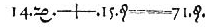

# Chapter 4: Equations and inequalities

## 4.1 Introduction (EMA33)

- This chapter covers linear, quadratic and simultaneous linear equations as well as word problems, literal
          equations and linear inequalities.
- Linear equations were covered in earlier grades and are revised here.
- Word problems can include any of linear, quadratic and simultaneous equations.
- For linear inequalities learners must know interval notation and be able to represent the solution
          graphically.

Equations are widely used to describe the world around us. In science equations are used to describe everything
      from how a ball rolls down a slope to how the planets move around the sun.

In this chapter we will explore different types of equations as well as looking at how these can be used to solve
      problems in the real world. We will also look at linear inequalities.

<Callout type="note" title="Note">

The first use of an “equals” sign from The Whetstone of Witte by Robert Recorde \(1557\).
        This equation represents \(14x + 15 = 71\). Recorde is also responsible for introducing the pre-existing
        “plus” sign (+) to the English-speaking world.
</Callout>
