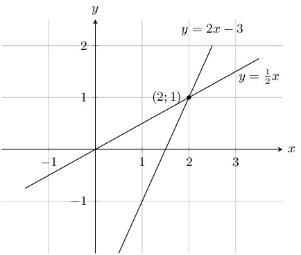
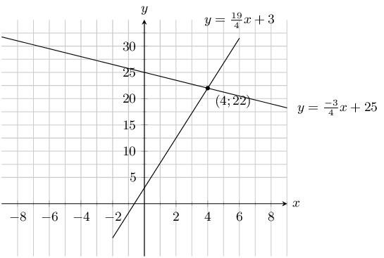
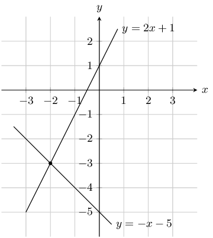
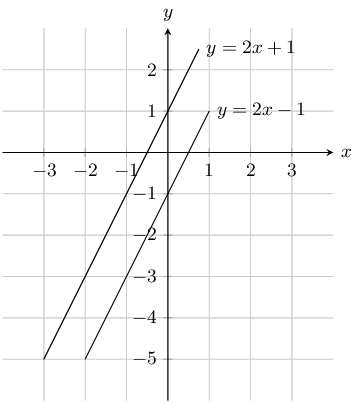
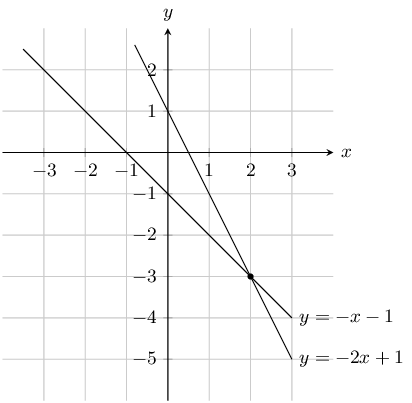
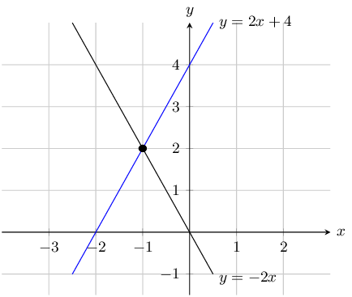
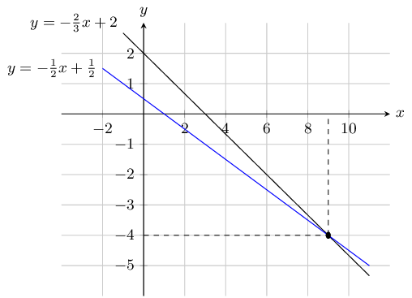
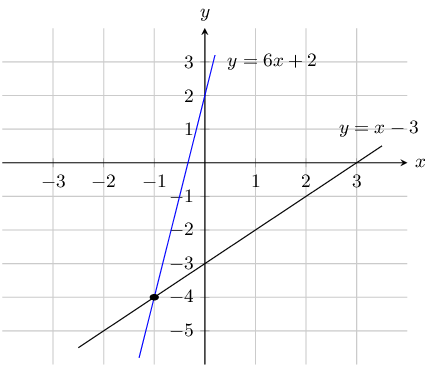
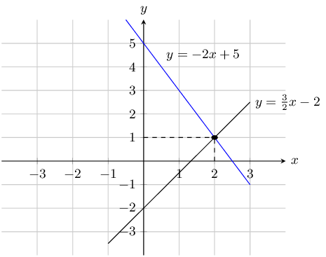
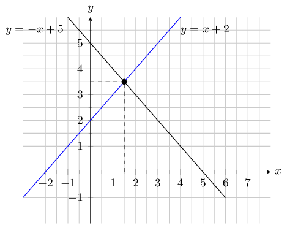

## 4.4 Solving simultaneous equations (EMA38)

Up to now we have solved equations with only one unknown variable. When solving for two unknown variables,
            two equations are required and these equations are known as simultaneous equations. The solutions are the
            values of the unknown variables which satisfy both equations simultaneously. In general, if there are \(n\)
            unknown variables, then \(n\) independent equations are required to obtain a value for each of the \(n\)
            variables.

An example of a system of simultaneous equations is:

        \begin{align*}
        x + y & = -1 \\
        3 & = y - 2x
        \end{align*}

We have two independent equations to solve for two unknown variables. We can solve simultaneous equations
            algebraically using substitution and elimination methods. We will also show that a system of simultaneous
            equations can be solved graphically.

### Solving by substitution (EMA39)

- Use the simplest of the two given equations to express one of the variables in terms of the
                        other.
- Substitute into the second equation. By doing this we reduce the number of equations and the
                        number of variables by one.
- We now have one equation with one unknown variable which can be solved.
- Use the solution to substitute back into the first equation to find the value of the other
                        unknown variable.

<Callout type="tip" title="Multimedia & Video">
The following video shows how to solve simultaneous equations using substitution.

<VideoPlayer src="https://www.youtube.com/embed/V7H1oUHXPkg" title="Video: 2FD5" />
</Callout>

<Callout type="tip" title="Worked example 6: Simultaneous equations">
**Question:**
Solve for \(x\) and \(y\):

                    \begin{align*}
                    x - y & =1 \qquad \ldots\left(1\right) \\
                    3 & = y - 2x \qquad \ldots\left(2\right)
                    \end{align*}

**Use equation \(\left(1\right)\) to express \(x\) in terms of \(y\):**
\[x=y+1\]

**Substitute \(x\) into equation \(\left(2\right)\) and solve for \(y\):**
\begin{align*}
                    3 & = y - 2\left(y + 1\right) \\
                    3 & = y - 2y - 2 \\
                    5 & = -y \\
                    \therefore y & = -5
                    \end{align*}

**Substitute \(y\) back into equation \(\left(1\right)\) and solve for \(x\):**
\begin{align*}
                    x & = \left(-5\right) + 1 \\
                    \therefore x & = -4
                    \end{align*}

**Check the solution by substituting the answers back into both original equations:**

**Write the final answer:**
\begin{align*}
                    x & = -4 \\
                    y & = -5
                    \end{align*}
</Callout>

<Callout type="tip" title="Worked example 7: Simultaneous equations">
**Question:**
Solve the following system of equations:

                    \begin{align*}
                    4y + 3x & = 100 \qquad \ldots\left(1\right) \\
                    4y - 19x & = 12 \qquad \ldots \left(2\right)
                    \end{align*}

**Use either equation to express \(x\) in terms of \(y\):**
\begin{align*}
                    4y + 3x & = 100 \\
                    3x & = 100 - 4y \\
                    x & = \frac{100 - 4y}{3}
                    \end{align*}

**Substitute \(x\) into equation \(\left(2\right)\) and solve for \(y\):**
\begin{align*}
                    4y - 19\left(\frac{100 - 4y}{3}\right) & = 12 \\
                    12y - 19\left(100 - 4y\right) & = 36 \\ 12y - \text{1 900} + 76y & = 36 \\
                    88y & = \text{1 936} \\
                    \therefore y & =22
                    \end{align*}

**Substitute \(y\) back into equation \(\left(1\right)\) and solve for \(x\):**
\begin{align*}
                    x & = \frac{100 - 4\left(22\right)}{3} \\
                    & = \frac{100 - 88}{3} \\
                    & = \frac{12}{3} \\
                    \therefore x & = 4
                    \end{align*}

**Check the solution by substituting the answers back into both original equations:**

**Write the final answer:**
\begin{align*}
                    x & = 4 \\
                    y & = 22
                    \end{align*}
</Callout>

### Solving by elimination (EMA3B)

<Callout type="tip" title="Worked example 8: Simultaneous equations">
**Question:**
Solve the following system of equations:

                    \begin{align*}
                    3x + y & = 2 \qquad \ldots \left(1\right) \\
                    6x - y & = 25 \quad \ldots \left(2\right)
                    \end{align*}

**Make the coefficients of one of the variables the same in both equations:**
The coefficients of \(y\) in the given equations are \(\text{1}\) and \(-\text{1}\). Eliminate
                        the variable \(y\) by adding equation \(\left(1\right)\) and equation \(\left(2\right)\)
                        together:

                    \[\begin{array}{cccc}
                    & 3x + y & = & 2 \\
                    + & 6x - y & = & 25 \\ \hline
                    & 9x + 0 & = & 27
                    \end{array}\]

**Simplify and solve for \(x\):**
\begin{align*}
                    9x & = 27 \\
                    \therefore x & = 3
                    \end{align*}

**Substitute \(x\) back into either original equation and solve for \(y\):**
\begin{align*}
                    3\left(3\right) + y & = 2 \\
                    y & = 2 - 9 \\
                    \therefore y & = -7
                    \end{align*}

**Check that the solution \(x=3\) and \(y=-7\) satisfies both original equations:**

**Write the final answer:**
\begin{align*}
                    x & =3 \\
                    y & =-7
                    \end{align*}
</Callout>

<Callout type="tip" title="Worked example 9: Simultaneous equations">
**Question:**
Solve the following system of equations:

                    \begin{align*}
                    2a - 3b & = 5 \qquad \ldots \left(1\right) \\
                    3a - 2b & = 20 \qquad \ldots\left(2\right)
                    \end{align*}

**Make the coefficients of one of the variables the same in both equations:**
By multiplying equation \(\left(1\right)\) by \(\text{3}\) and equation \(\left(2\right)\) by
                        \(\text{2}\), both coefficients of \(a\) will be \(\text{6}\).

                    \[\begin{array}{cccc}
                    & 6a - 9b & = & 15 \\
                    - & (6a - 4b & = & 40) \\ \hline
                    & 0 - 5b & = & -25
                    \end{array}\]

(When subtracting two equations, be careful of the signs.)

**Simplify and solve for \(b\):**
\begin{align*}
                    b & = \frac{-25}{-5} \\
                    \therefore b & = 5
                    \end{align*}

**Substitute value of \(b\) back into either original equation and solve for \(a\):**
\begin{align*}
                    2a - 3\left(5\right) & = 5 \\
                    2a - 15 & = 5 \\
                    2a & = 20 \\
                    \therefore a & = 10
                    \end{align*}

**Check that the solution \(a=10\) and \(b=5\) satisfies both original equations:**

**Write the final answer:**
\begin{align*}
                    a & = 10 \\
                    b & = 5
                    \end{align*}
</Callout>

### Solving graphically (EMA3C)

This section can be included in the chapter on functions and graphs with graphs of linear equations.
                    Before beginning this section it may be necessary to revise plotting graphs of linear equations with
                    your learners.

It is also important that learners are either given the graphs or are encouraged to draw accurate
                    graphs on graph paper to help them solve simultaneous equations graphically. Graph sketching
                    software can be used in this section to ensure that graphs are accurate.

Simultaneous equations can also be solved graphically. If the graphs of each linear equation are drawn,
                then the solution to the system of simultaneous equations is the coordinates of the point at which the
                two graphs intersect.

For example:

            \begin{align*}
            x & = 2y \qquad \ldots \left(1\right) \\
            y & = 2x - 3 \qquad \ldots \left(2\right)
            \end{align*}

The graphs of the two equations are shown below.

The intersection of the two graphs is \((2;1)\). So the solution to the system of simultaneous equations
                is \(x=2\) and \(y=1\). We can also check the solution using algebraic methods.

Substitute equation \((1)\) into \((2)\):

            \begin{align*}
            x & = 2y \\
            \therefore y & = 2(2y) - 3
            \end{align*}

Then solve for \(y\):

            \begin{align*}
            y - 4y & = -3 \\
            -3y & = -3 \\
            \therefore y & = 1
            \end{align*}

Substitute the value of \(y\) back into equation \((1)\):

            \begin{align*}
            x & = 2(1) \\
            \therefore x & = 2
            \end{align*}

Notice that both methods give the same solution.

<Callout type="tip" title="Multimedia & Video">
You can use an online tool such as graphsketch to draw the graphs and check your solution.
</Callout>

<Callout type="tip" title="Worked example 10: Simultaneous equations">
**Question:**
Solve the following system of simultaneous equations graphically:

                    \begin{align*}
                    4y + 3x & = 100 \qquad \ldots \left(1\right) \\
                    4y - 19x & = 12 \qquad \ldots \left(2\right)
                    \end{align*}

**Write both equations in form \(y=mx + c\):**
\begin{align*}
                    4y + 3x & = 100 \\
                    4y & = 100 - 3x \\
                    y & = -\frac{3}{4}x + 25
                    \end{align*}\begin{align*} 4y - 19x & = 12 \\
                    4y & = 19x + 12 \\
                    y & = \frac{19}{4}x + 3
                    \end{align*}

**Sketch the graphs on the same set of axes:**

**Find the coordinates of the point of intersection:**
The two graphs intersect at \(\left(4;22\right)\)

**Write the final answer:**
\begin{align*}
                    x & = 4 \\
                    y & = 22
                    \end{align*}
</Callout>

### Textbook Exercise 4.3

**Problem:**
Look at the graph below

Solve the equations \(y = 2x + 1\) and \(y = -x - 5\) simultaneously

**Solution:**
From the graph we can see that the lines intersect at \(x = -2\) and \(y = -3\)

**Problem:**
Look at the graph below

Solve the equations \(y = 2x - 1\) and \(y = 2x + 1\) simultaneously

**Solution:**
The lines are parallel. Therefore there is no solution to \(x\) and \(y\).

**Problem:**
Look at the graph below

Solve the equations \(y = -2x + 1\) and \(y = -x - 1\) simultaneously

**Solution:**
From the graph we can see that the lines intersect at \(x = 2\) and \(y = -3\)

Solve for \(x\) and \(y\):

**Problem:**
\(- 10 x = -1\) and
                                    \(- 4 x + 10 y = -9\).

**Solution:**
Solve for \(x\):

                                \begin{align*}
                                - 10x = -1\\
                                \therefore x = \frac{1}{10}
                                \end{align*}

Substitute the value of \(x\) into the second equation and solve for \(y\):

                                \begin{align*}
                                -4x + 10y & = -9 \\
                                -4\left(\frac{1}{10}\right) + 10y & = -9 \\
                                \frac{-4}{10} + 10y & = -9 \\
                                100y & = -90 + 4 \\
                                y & = \frac{-86}{100} \\
                                & = \frac{-43}{50}
                                \end{align*}

Therefore \(x = \frac{1}{10} \text{ and } y = - \frac{43}{50}\).

**Problem:**
\(3x - 14y = 0\) and \(x - 4y + 1 = 0\)

**Solution:**
Write \(x\) in terms of \(y\):

                                \begin{align*}
                                3x - 14y & = 0 \\
                                3x & = 14y \\
                                x & = \frac{14}{3}y
                                \end{align*}

Substitute value of \(x\) into second equation:

                                \begin{align*}
                                x - 4y + 1 & = 0 \\
                                \frac{14}{3}y - 4y + 1 & = 0 \\
                                14y - 12y + 3 & = 0 \\
                                2y & = -3 \\
                                y & = -\frac{3}{2}
                                \end{align*}

Substitute value of \(y\) back into first equation:

                                \begin{align*}
                                x & = \frac{14\left(-\frac{3}{2}\right)}{3} \\
                                & = -7
                                \end{align*}

Therefore \(x = -7 \text{ and } y = -\frac{3}{2}\).

**Problem:**
\(x + y = 8\) and \(3x + 2y = 21\)

**Solution:**
Write \(x\) in terms of \(y\):

                                \begin{align*}
                                x + y & = 8 \\
                                x & = 8 - y
                                \end{align*}

Substitute value of \(x\) into second equation:

                                \begin{align*}
                                3x + 2y & = 21 \\
                                3(8 - y) + 2y & = 21 \\
                                24 - 3y + 2y & = 21 \\
                                y & = 3
                                \end{align*}

Substitute value of \(y\) back into first equation:

                                \[x = 5\]

Therefore \(x = 5 \text{ and } y = 3\).

**Problem:**
\(y = 2x + 1\) and \(x + 2y + 3 = 0\)

**Solution:**
Write \(y\) in terms of \(x\):

                                \[y = 2x + 1\]

Substitute value of \(y\) into second equation:

                                \begin{align*}
                                x + 2y + 3 & = 0 \\
                                x + 2(2x + 1) + 3 & = 0 \\
                                x + 4x + 2 + 3 & = 0 \\
                                5x & = -5 \\
                                x & = -1
                                \end{align*}

Substitute value of \(x\) back into first equation:

                                \begin{align*}
                                y & = 2(-1) + 1 \\
                                & = -1
                                \end{align*}

Therefore \(x = -1 \text{ and } y = -1\).

**Problem:**
\(5x-4y = 69\) and \(2x+3y = 23\)

**Solution:**
Make \(x\) the subject of the first equation:

                                \begin{align*}
                                5x-4y &= 69 \\
                                5x &= 69+4y \\
                                x &= \frac{69+4y}{5}
                                \end{align*}

Substitute value of \(x\) into second equation:

                                \begin{align*}
                                2x+3y &= 23 \\
                                2 \left(\frac{69+4y}{5} \right) +3y &= 23 \\
                                2(69+4y) +3(5)y &= 23(5) \\
                                138+8y+15y &= 115\\
                                23y &= -23 \\
                                \therefore y &= -1
                                \end{align*}

Substitute value of \(y\) back into first equation:

                                \begin{align*}
                                x &= \frac{69+4y}{5} \\
                                &= \frac{69+4(-1)}{5} \\
                                &= 13
                                \end{align*}

Therefore \(x =13 \text{ and } y = -1\).

**Problem:**
\(x + 3y = 26\) and \(5x + 4y = 75\)

**Solution:**
Make \(x\) the subject of the first equation:

                                \begin{align*}
                                x + 3y &= 26 \\
                                x &= 26 - 3y
                                \end{align*}

Substitute value of \(x\) into second equation:

                                \begin{align*}
                                5x+4y &= 75 \\
                                5(26 - 3y) + 4y &= 75 \\
                                130 - 15y + 4y &= 75 \\
                                -11y &= -55 \\
                                \therefore y &= 5
                                \end{align*}

Substitute value of \(y\) back into first equation:

                                \begin{align*}
                                x &= 26 - 3y \\
                                &= 26 - 3(5) \\
                                &= 11
                                \end{align*}

Therefore \(x =11 \text{ and } y = 5\).

**Problem:**
\(3x - 4y = 19\) and \(2x - 8y = 2\)

**Solution:**
If we multiply the first equation by 2 then the coefficient of \(y\) will be the same
                                    in both equations:

                                \begin{align*}
                                3x - 4y &= 19 \\
                                3(2)x - 4(2)y & = 19(2) \\
                                6x - 8y & = 38
                                \end{align*}

Now we can subtract the second equation from the first:

                                \[\begin{array}{cccc}
                                & 6x - 8y & = & 38 \\
                                - & (2x - 8y & = & 2) \\ \hline
                                & 4x + 0 & = & 36
                                \end{array}\]

Solve for \(x\):

                                \begin{align*}
                                \therefore x &= \frac{36}{4} \\
                                & = 9
                                \end{align*}

Substitute the value of \(x\) into the first equation and solve for \(y\):

                                \begin{align*}
                                3x-4y &= 19 \\
                                3(9)-4y &= 19\\
                                \therefore y &= \frac{19-3(9)}{-4} \\
                                &= 2
                                \end{align*}

Therefore \(x = 9 \text{ and } y = 2\).

**Problem:**
\(\dfrac{a}{2} + b = 4\) and \(\dfrac{a}{4} - \dfrac{b}{4} = 1\)

**Solution:**
Make \(a\) the subject of the first equation:

                                \begin{align*}
                                \frac{a}{2} + b & = 4 \\
                                a + 2b & = 8 \\
                                a & = 8 - 2b
                                \end{align*}

Substitute value of \(a\) into second equation:

                                \begin{align*}
                                \frac{a}{4} - \frac{b}{4} & = 1 \\
                                a - b & = 4 \\
                                8 - 2b - b & = 4 \\
                                3b & = 4 \\
                                b & = \frac{4}{3}
                                \end{align*}

Substitute value of \(b\) back into first equation:

                                \begin{align*}
                                a & = 8 - 2\left(\frac{4}{3}\right) \\
                                & = \frac{16}{3}
                                \end{align*}

Therefore \(a = \frac{16}{3} \text{ and } b = \frac{4}{3}\).

**Problem:**
\(-10x + y = -1\) and
                                    \(-10x - 2y = 5\)

**Solution:**
If we subtract the second equation from the first then we can solve for \(y\):

                                \[\begin{array}{cccc}
                                & -10x + y & = & -1 \\
                                - & (-10x - 2y & = & 5) \\ \hline
                                & 0 + 3y & = & -6
                                \end{array}\]

Solve for \(y\):

                                \begin{align*}
                                3y & = -6 \\
                                \therefore y &= -2
                                \end{align*}

Substitute the value of \(y\) into the first equation and solve for \(x\):

                                \begin{align*}
                                -10x + y &= -1 \\
                                -10x - 2 &= -1\\
                                -10x &= 1 \\
                                x &= \frac{1}{-10}
                                \end{align*}

Therefore \(x = \frac{-1}{10} \text{ and } y = -2\).

**Problem:**
\(- 10 x - 10 y = -2\) and \(2 x + 3 y = 2\)

**Solution:**
Make \(x\) the subject of the first equation:

                                \begin{align*}
                                - 10 x - 10 y = -2\\
                                5x + 5y & = 1 \\
                                5x & = 1 - 5y \\
                                \therefore x = -y + \frac{1}{5}
                                \end{align*}

Substitute the value of \(x\) into the second equation and solve for \(y\):

                                \begin{align*}
                                2x + 3y & = 2 \\
                                2\left(-y + \frac{1}{5}\right) + 3y & = 2 \\
                                -2y + \frac{2}{5} + 3y & = 2 \\
                                y & = \frac{8}{5}
                                \end{align*}

Substitute the value of \(y\) in the first equation:

                                \begin{align*}
                                5x + 5y & = 1 \\
                                5x + 5\left(\frac{8}{5}\right) & = 1 \\
                                5x + 8 & = 1 \\
                                5x & = -7 \\
                                x &= \frac{-7}{5}
                                \end{align*}

Therefore \(x = - \frac{7}{5} \text{ and } y = \frac{8}{5}\).

**Problem:**
\(\dfrac{1}{x} + \dfrac{1}{y} = 3\) and \(\dfrac{1}{x} - \dfrac{1}{y} = 11\)

**Solution:**
Rearrange both equations by multiplying by \(xy\):

                                \begin{align*}
                                \frac{1}{x} + \frac{1}{y} & = 3 \\
                                y + x & = 3xy \\\\
                                \frac{1}{x} - \frac{1}{y} & = 11 \\
                                y - x & = 11xy
                                \end{align*}

Add the two equations together:

                                \[\begin{array}{cccc}
                                & y + x & = & 3xy \\
                                + & (y - x & = & 11xy) \\ \hline
                                & 2y + 0 & = & 14xy
                                \end{array}\]

Solve for \(x\):

                                \begin{align*}
                                2y & = 14xy \\
                                y & = 7xy \\
                                1 & = 7x \\
                                x & = \frac{1}{7}
                                \end{align*}

Substitute value of \(x\) back into first equation:

                                \begin{align*}
                                y + \frac{1}{7} & = 3\left(\frac{1}{7}\right)y \\
                                7y + 1 & = 3y \\
                                4y & = -1 \\
                                y & = -\frac{1}{4}
                                \end{align*}

Therefore \(x = \frac{1}{7} \text{ and } y = -\frac{1}{4}\).

**Problem:**
\(y = \dfrac{2(x^2 + 2) - 3}{x^2 + 2}\) and \(y = 2 - \dfrac{3}{x^2 + 2}\)

**Solution:**
Let

                                \begin{align*}
                                \frac{2(x^2 + 2) - 3}{x^2 + 2} &= 2 - \frac{3}{x^2 + 2} \\
                                2x^2 + 4 - 3 &= 2(x^2 + 2) - 3 \\
                                2x^2 + 1 &= 2x^2 + 1 \\
                                0 &= 0
                                \end{align*}

Since this is true for all \(x\) in the real numbers, \(x\) can be any real number.

Look at what happens to \(y\) when \(x\) is very small or very large:

The smallest \(x\) can be is 0. When \(x=0\), \(y=2-\frac{3}{2}=\frac{1}{2}\).

If \(x\) gets very large, then the fraction \(\dfrac{3}{x^{2}+2}\) becomes very small
                                    (think about what happens when you divide a small number by a very large number).
                                    Then \(y = 2 - 0 = 2\).

From this we can see that \(\frac{1}{2}\leq y \leq 2\).

Therefore \(x\) can be any real number, \(\frac{1}{2} \leq y < 2\).

**Problem:**
\(3a + b=\dfrac{6}{2a}\) and \(3a^2 = 3 - ab\)

**Solution:**
Note \(a \neq 0\)

Look at the first equation

                                \begin{align*}
                                3a + b&=\frac{6}{2a} \\
                                6a^2 + 2ab&=6 \\
                                6a^2 &= 6 - 2ab \\
                                3a^2 &= 3 - ab
                                \end{align*}

Note that this is the same as the second equation

\(a\) and \(b\) can be any real number except for \(\text{0}\).

Solve graphically and check your answer algebraically:

**Problem:**
\(y + 2x = 0\) and \(y - 2x - 4 = 0\)

**Solution:**
First write the equations in standard form:

                                \begin{align*}
                                y + 2x & = 0 \\
                                y & = -2x \\\\
                                y - 2x - 4 & = 0 \\
                                y & = 2x + 4
                                \end{align*}

Draw the graph:

The graphs intersect at \((-1;2)\) so \(x = -1\) and \(y=2\).

Checking algebraically we get:

                                \[y = -2x\]

Substitute value of \(y\) into second equation:

                                \begin{align*}
                                y - 2x - 4 & = 0 \\
                                -2x - 2x - 4 & = 0 \\
                                -4x & = 4 \\
                                x & = -1
                                \end{align*}

Substitute the value of \(x\) back into the first equation:

                                \begin{align*}
                                y & = -2(-1) \\
                                y & = 2
                                \end{align*}

**Problem:**
\(x + 2y = 1\) and \(\dfrac{x}{3} + \dfrac{y}{2} = 1\)

**Solution:**
First write the equations in standard form:

                                \begin{align*}
                                x + 2y & = 1 \\
                                2y & = -x + 1\\
                                y & = -\frac{1}{2}x + \frac{1}{2} \\ \\
                                \frac{x}{3} + \frac{y}{2} & = 1 \\
                                y & = -\frac{2}{3}{x} + 2
                                \end{align*}

Draw the graph:

The graphs intersect at \((9;-4)\) so \(x = 9\) and \(y=-4\).

Checking algebraically we get:

                                \[x = -2y + 1\]

Substitute value of \(x\) into first equation:

                                \begin{align*}
                                \frac{-2y + 1}{3} + \frac{y}{2} & = 1 \\
                                -4y + 2 + 3y & = 6 \\
                                y & = -4
                                \end{align*}

Substitute the value of \(y\) back into the first equation:

                                \begin{align*}
                                x + 2(-4) & = 1 \\
                                x - 8 & = 1 \\
                                x & = 9
                                \end{align*}

**Problem:**
\(y - 2 = 6x\) and \(y - x = -3\)

**Solution:**
First write the equations in standard form:

                                \begin{align*}
                                y - 2 & = 6x \\
                                y & = 6x + 2\\\\
                                y - x & = -3 \\
                                y & = x - 3
                                \end{align*}

Draw the graph:

The graphs intersect at \((-1;-4)\) so \(x = -1\) and \(y=-4\).

Checking algebraically we get:

                                \[y = 6x + 2\]

Substitute value of \(y\) into first equation:

                                \begin{align*}
                                6x + 2 & = x - 3 \\
                                5x & = -5 \\
                                x & = -1
                                \end{align*}

Substitute the value of \(x\) back into the first equation:

                                \begin{align*}
                                y & = 6(-1) + 2 \\
                                y & = -4
                                \end{align*}

**Problem:**
\(2x + y = 5\) and \(3x - 2y = 4\)

**Solution:**
First write the equations in standard form:

                                \begin{align*}
                                2x + y & = 5 \\
                                y & = -2x + 5\\ \\
                                3x - 2y & = 4 \\
                                2y & = 3x - 4 \\
                                y & = \frac{3}{2}x - 2
                                \end{align*}

Draw the graph:

The graphs intersect at \((2;1)\) so \(x = 2\) and \(y=1\).

Checking algebraically we get:

                                \[y = -2x + 5\]

Substitute value of \(y\) into first equation:

                                \begin{align*}
                                -2x + 5 & = \frac{3}{2}x - 2 \\
                                -4x + 10 & = 3x - 4 \\
                                7x & = 14 \\
                                x & = 2
                                \end{align*}

Substitute the value of \(x\) back into the first equation:

                                \begin{align*}
                                x & = -2(2) + 5 \\
                                y & = 1
                                \end{align*}

**Problem:**
\(5 = x + y\) and \(x = y - 2\)

**Solution:**
First write the equations in standard form:

                                \begin{align*}
                                5 & = x + y \\
                                y & = -x + 5\\ \\
                                x & = y - 2 \\
                                y & = x + 2
                                \end{align*}

Draw the graph:

The graphs intersect at \((\text{1,5};\text{3,5})\) so \(x = \text{1,5}\) and
                                    \(y=\text{3,5}\).

Checking algebraically we get:

                                \[y = -x + 5\]

Substitute value of \(y\) into second equation:

                                \begin{align*}
                                x & = -x + 5 - 2 \\
                                2x & = 3 \\
                                x & = \frac{3}{2}
                                \end{align*}

Substitute the value of \(x\) back into the first equation:

                                \begin{align*}
                                5 & = \frac{3}{2} + y \\
                                y & = \frac{7}{2}
                                \end{align*}
