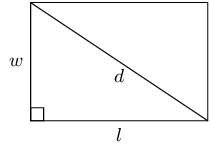

## 4.5 Word problems (EMA3D)

To solve word problems we need to write a set of equations that represent the problem mathematically. The
            solution of the equations is then the solution to the problem.

### Problem solving strategy (EMA3F)

1. Read the whole question.
2. What are we asked to solve for?
3. Assign a variable to the unknown quantity, for example, \(x\).
4. Translate the words into algebraic expressions by rewriting the given information in terms of the
                        variable.
5. Set up an equation or system of equations to solve for the variable.
6. Solve the equation algebraically using substitution.
7. Check the solution.

<Callout type="tip" title="Multimedia & Video">
The following video shows two examples of working with word problems.

<VideoPlayer src="https://www.youtube.com/embed/bO6Ox_W2-gw" title="Video: 2FDX" />
</Callout>

<Callout type="tip" title="Worked example 11: Solving word problems">
**Question:**
A shop sells bicycles and tricycles. In total there are \(\text{7}\) cycles (cycles include both
                        bicycles and tricycles) and \(\text{19}\) wheels. Determine how many of each there are, if a
                        bicycle has two wheels and a tricycle has three wheels.

**Assign variables to the unknown quantities:**
Let \(b\) be the number of bicycles and let \(t\) be the number of tricycles.

**Set up the equations:**
\begin{align*}
                    b + t & = 7 \qquad \ldots \left(1\right) \\
                    2b + 3t & = 19 \qquad \ldots \left(2\right)
                    \end{align*}

**Rearrange equation \(\left(1\right)\) and substitute into equation
                        \(\left(2\right)\):**
\begin{align*}
                    t & = 7 - b \\
                    \therefore 2b + 21 - 3b & = 19 \\
                    -b & = -2 \\
                    \therefore b & = 2
                    \end{align*}

**Calculate the number of tricycles \(t\):**
\begin{align*}
                    t & = 7 - b \\
                    & = 7 - 2 \\
                    & = 5
                    \end{align*}

**Write the final answer:**
There are \(\text{5}\) tricycles and \(\text{2}\) bicycles.
</Callout>

<Callout type="tip" title="Worked example 12: Solving word problems">
**Question:**
Bongani and Jane are friends. Bongani takes Jane's maths test paper and will not tell her what
                        her mark is. He knows that Jane dislikes word problems so he decides to tease her. Bongani says:
                        “I have \(\text{2}\) marks more than you do and the sum of both our marks is equal to
                        \(\text{14}\). What are our marks?”

**Assign variables to the unknown quantities:**
We have two unknown quantities, Bongani's mark and Jane's mark. Let Bongani's mark be \(b\) and
                        Jane's mark be \(j\).

**Set up a system of equations:**
Bongani has \(\text{2}\) more marks than Jane.

                    \[b = j + 2 \qquad \ldots \left(1\right)\]

Both marks add up to \(\text{14}\).

                    \[b + j = 14 \qquad \ldots \left(2\right)\]

**Use equation \(\left(1\right)\) to express \(b\) in terms of \(j\):**
\[b = j + 2\]

**Substitute into equation \(\left(2\right)\):**
\begin{align*}
                    b + j & = 14 \\
                    \left(j + 2\right) + j & = 14
                    \end{align*}

**Rearrange and solve for \(j\):**
\begin{align*}
                    2j & = 14 - 2 \\
                    & = 12 \\
                    \therefore j & =6
                    \end{align*}

**Substitute the value for \(j\) back into equation \(\left(1\right)\) and solve for
                        \(b\):**
\begin{align*}
                    b & = j + 2 \\
                    & = 6 + 2 \\
                    & = 8
                    \end{align*}

**Check that the solution satisfies both original equations:**

**Write the final answer:**
Bongani got \(\text{8}\) for his test and Jane got \(\text{6}\).
</Callout>

<Callout type="tip" title="Worked example 13: Solving word problems">
**Question:**
A fruitshake costs \(\text{R}\,\text{2,00}\) more than a chocolate milkshake. If \(\text{3}\)
                        fruitshakes and \(\text{5}\) chocolate milkshakes cost \(\text{R}\,\text{78,00}\), determine the
                        individual prices.

**Assign variables to the unknown quantities:**
Let the price of a chocolate milkshake be \(x\) and let the price of a fruitshake be \(y\).

**Set up a system of equations:**
\begin{align*}
                    y & = x + 2 \qquad \ldots \left(1\right) \\
                    3y + 5x & = 78 \qquad \ldots \left(2\right)
                    \end{align*}

**Substitute equation \(\left(1\right)\) into \(\left(2\right)\):**
\[3\left(x + 2\right) + 5x = 78\]

**Rearrange and solve for \(x\):**
\begin{align*}
                    3x + 6 + 5x & = 78 \\
                    8x & = 72 \\
                    \therefore x & = 9
                    \end{align*}

**Substitute the value of \(x\) back into equation \(\left(1\right)\) and solve for
                        \(y\):**
\begin{align*}
                    y & = x + 2 \\
                    & = 9 + 2 \\
                    & = 11
                    \end{align*}

**Check that the solution satisfies both original equations:**

**Write final answer:**
One chocolate milkshake costs \(\text{R}\,\text{9,00}\) and one fruitshake costs
                        \(\text{R}\,\text{11,00}\).
</Callout>

<Callout type="tip" title="Worked example 14: Solving word problems">
**Question:**
The product of two consecutive negative integers is \(\text{1 122}\). Find the two integers.

**Assign variables to the unknown quantities:**
Let the first integer be \(n\) and let the second integer be \(n + 1\)

**Set up an equation:**
\[n\left(n + 1\right) = \text{1 122}\]

**Expand and solve for \(n\):**
\begin{align*}
                    {n}^{2} + n & = \text{1 122} \\
                    {n}^{2} + n - \text{1 122}& =0 \\
                    \left(n + 34\right)\left(n - 33\right) & =0 \\
                    \therefore n & = -34 \\
                    \text{ or } n& = 33
                    \end{align*}

**Find the sign of the integers:**
It is given that both integers must be negative.

                    \begin{align*}
                    \therefore n & =-34 \\
                    n + 1 & = -34 + 1 \\
                    & = -33
                    \end{align*}

**Write the final answer:**
The two consecutive negative integers are \(-\text{34}\) and \(-\text{33}\).
</Callout>

### Textbook Exercise 4.4

**Problem:**
Two jets are flying towards each other from airports that are \(\text{1 200}\)
                                \(\text{km}\) apart. One jet is flying at \(\text{250}\) \(\text{km·h$^{-1}$}\) and
                                the other jet at \(\text{350}\) \(\text{km·h$^{-1}$}\). If they took off at the
                                same time, how long will it take for the jets to pass each other?

**Solution:**
Let distance \(d_{1} = \text{1 200} - x\text{ km}\) and distance \(d_{2} = x\text{
                                km}\).

Speed \(s_{1}= \text{250}\text{ km·h$^{-1}$}\) and speed \(s_{2}= \text{350}\text{
                                km·h$^{-1}$}\).

Time is found by dividing distance by speed.

                            \[\text{time }(t) = \frac{\text{distance}}{\text{speed}}\]

When the jets pass each other:

                            \begin{align*}
                            \frac{\text{1 200} - x}{\text{250}} & = \frac{x}{\text{350}} \\
                            \text{350}(\text{1 200} - x) & = \text{250}x \\
                            \text{420 000} - \text{350}x & = \text{250}x \\
                            \text{600}x & = \text{420 000} \\
                            x & = \text{700}\text{ km}
                            \end{align*}

Now we know the distance travelled by the second jet when it passes the first jet, we can
                                find the time:

                            \begin{align*}
                            t & = \frac{\text{700}\text{ km}}{\text{350}\text{ km·h$^{-1}$}} \\
                            & = \text{2}\text{ h}
                            \end{align*}

It will take take the jets 2 hours to pass each other.

**Problem:**
Two boats are moving towards each other from harbours that are \(\text{144}\)
                                \(\text{km}\) apart. One boat is moving at \(\text{63}\) \(\text{km·h$^{-1}$}\) and
                                the other boat at \(\text{81}\) \(\text{km·h$^{-1}$}\). If both boats started their
                                journey at the same time, how long will they take to pass each other?

**Solution:**
Notice that the sum of the distances for the two boats must be equal to the total
                                distance when the boats meet: \(d_{1} + d_{2} = d_{\text{total}} \longrightarrow d_{1} +
                                d_{2} = \text{144}\text{ km}\).

This question is about distances, speeds, and times. The equation connecting these values
                                is
                                \[\text{speed } = \frac{\text{distance }}{\text{time}} \quad \text{- or -} \quad
                                \text{distance } = \text{speed } \times \text{time}\]

You want to know the amount of time needed for the boats to meet - let the time taken be
                                \(t\). Then you can write an expression for the distance each of the boats travels:
                                \begin{align*}
                                \text{For boat 1:} \quad d_{1} &= s_{1} t \\
                                &= \text{63}t \\
                                \text{For boat 2:} \quad d_{2} &= s_{2} t \\
                                &= \text{81}t
                                \end{align*}

Now we can substitute the two expressions for the distances into the expression for the
                                total distance:

                            \begin{align*}
                            d_{1} + d_{2} &= \text{144} \\
                            (\text{63}t) + (\text{81}t) &= \text{144} \\
                            \text{144}t &= \text{144} \\
                            \therefore t &= \frac{\text{144}}{\text{144}} \\
                            &= \text{1}
                            \end{align*}

The boats will meet after \(\text{1}\) hour.

**Problem:**
Zwelibanzi and Jessica are friends. Zwelibanzi takes Jessica's civil technology test
                                paper and will not tell her what her mark is. He knows that Jessica dislikes word
                                problems so he decides to tease her. Zwelibanzi says: “I have \(\text{12}\) marks
                                more than you do and the sum of both our marks is equal to \(\text{148}\). What are our
                                marks?”

**Solution:**
Let Zwelibanzi's mark be \(z\) and let Jessica's mark be \(j\). Then
                                \begin{align*}
                                z &= j+\text{12} \\
                                z+j &= \text{148}
                                \end{align*}

Substitute the first equation into the second equation and solve:
                                \begin{align*}
                                z+j &= \text{148} \\
                                (j+\text{12})+j &= \text{148} \\
                                2j &= 148 - \text{12}\\
                                \therefore j &= \frac{\text{136}}{\text{2}}\\
                                &= \text{68}
                                \end{align*}

Substituting this value back into the first equation gives:
                                \begin{align*}
                                z &= j+\text{12} \\
                                &= \text{68}+\text{12} \\
                                &= \text{80}
                                \end{align*}
                                Zwelibanzi achieved \(\text{80}\) marks and Jessica achieved \(\text{68}\) marks.

**Problem:**
Kadesh bought \(\text{20}\) shirts at a total cost of \(\text{R}\,\text{980}\). If the
                                large shirts cost \(\text{R}\,\text{50}\) and the small shirts cost
                                \(\text{R}\,\text{40}\), how many of each size did he buy?

**Solution:**
Let \(x\) be the number of large shirts and \(20 − x\) the number of small shirts.

Next we note the following:

- He bought \(x\) large shirts for \(\text{R}\,\text{50}\)
- He bought \(20 - x\) small shirts for \(\text{R}\,\text{40}\)
- He spent \(\text{R}\,\text{980}\) in total

We can represent the cost as:

                            \begin{align*}
                            50x + 40(20 − x) & = 980 \\
                            50x + 800 − 40x = & 980 \\
                            10x & = 180 \\
                            x & = 18
                            \end{align*}

Therefore Kadesh buys \(\text{18}\) large shirts and \(\text{2}\) small shirts.

**Problem:**
The diagonal of a rectangle is \(\text{25}\) \(\text{cm}\) more than its width. The
                                length of the rectangle is \(\text{17}\) \(\text{cm}\) more than its width. What are the
                                dimensions of the rectangle?

**Solution:**
Let length \(= l\), width \(= w\) and diagonal \(= d\). \(\therefore d = w + 25\) and \(l
                                = w + 17\).

By the theorem of Pythagoras:

                            \begin{align*}
                            d^{2} & = l^{2} + w^{2} \\
                            \therefore w^{2} &= d^{2} − l^{2} \\
                            & = (w + 25)^{2} − (w + 17)^{2} \\
                            & = w^{2} + 50w + 625 − w^{2} − 34w − 289 \\
                            \therefore w^{2} − 16w − 336 & = 0 \\
                            (w + 12)(w − 28) & = 0 \\
                            w = −12 & \text{ or } w = 28
                            \end{align*}

The width must be positive, therefore: width \(w = \text{28}\text{ cm}\) length \(l = (w
                                + 17) = \text{45}\text{ cm}\) and diagonal \(d = (w + 25) = \text{53}\text{ cm}\).

**Problem:**
The sum of \(\text{27}\) and \(\text{12}\) is equal to \(\text{73}\) more than an unknown
                                number. Find the unknown number.

**Solution:**
Let the unknown number \(= x\).

                            \begin{align*}
                            27 + 12 & = x + 73 \\
                            39 & = x + 73 \\
                            x & = -34
                            \end{align*}

The unknown number is \(-\text{34}\).

**Problem:**
A group of friends is buying lunch. Here are some facts about their lunch:

- a milkshake costs \(\text{R}\,\text{7}\) more than a wrap
- the group buys 8 milkshakes
                                    and 2 wraps
- the total cost for the lunch is \(\text{R}\,\text{326}\)

                            Determine the individual prices for the lunch items.

**Solution:**
Let a milkshake be \(m\) and a wrap be \(w\). From the given information we get the
                                following equations:

                            \begin{align*}
                            m & = w + 7 \\
                            8m + 2w &= 326
                            \end{align*}

Substitute the first equation into the second equation and solve for \(w\):

                            \begin{align*}
                            8m + 2w &= 326 \\
                            8(w + 7) + 2w &= 326 \\
                            8w + 56 + 2w &= 326 \\
                            10w &= 326 - 56 \\
                            \therefore w &= \frac{270} {10} \\
                            &= 27
                            \end{align*}

Substitute the value of \(w\) into the first equation and solve for \(m\):

                            \begin{align*}
                            m &= w+7 \\
                            &= 27+7 \\
                            &= 34
                            \end{align*}

Therefore a milkshake costs \(\text{R}\,\text{34}\) and a wrap costs
                                \(\text{R}\,\text{27}\).

**Problem:**
The two smaller angles in a right-angled triangle are in the ratio of \(1:2\). What are
                                the sizes of the two angles?

**Solution:**
Let \(x =\) the smallest angle. Therefore the other angle \(= 2x\).

We are given the third angle \(=90°\).

                            \begin{align*}
                            x + 2x + 90° & =180° \text{ (sum of angles in a triangle)} \\
                            3x &= 90° \\
                            x & =30°
                            \end{align*}

The sizes of the angles are \(30°\) and \(60°\).

**Problem:**
The length of a rectangle is twice the breadth. If the area is \(\text{128}\)
                                \(\text{cm$^{2}$}\), determine the length and the breadth.

**Solution:**
We are given length \(l = 2b\) and \(A = l \times b = 128\).

Substitute the first equation into the second equation and solve for \(b\):

                            \begin{align*}
                            2b \times b & = 128 \\
                            2b^{2} & = 128 \\
                            b^{2} & = 64 \\
                            b & = \pm 8
                            \end{align*}

But breadth must be positive, therefore \(b = 8\).

Substitute this value into the first equation to solve for \(l\):

                            \begin{align*}
                            l & = 2b \\
                            & = 2(8) \\
                            & = 16
                            \end{align*}

Therefore \(b = \text{8}\text{ cm}\) and \(l = 2b = \text{16}\text{ cm}\).

**Problem:**
If \(\text{4}\) times a number is increased by \(\text{6}\), the result is \(\text{15}\)
                                less than the square of the number. Find the number.

**Solution:**
Let the number \(= x\). The equation that expresses the given information is:

                            \begin{align*}
                            4x + 6 & = x^{2} − 15 \\
                            x^{2} − 4x − 21 & = 0 \\
                            (x − 7)(x + 3) & = 0 \\
                            x = 7 & \text{ or } x = −3
                            \end{align*}

We are not told if the number is positive or negative. Therefore the number is
                                \(\text{7}\) or \(-\text{3}\).

**Problem:**
The length of a rectangle is \(\text{2}\) \(\text{cm}\) more than the width of the
                                rectangle. The perimeter of the rectangle is \(\text{20}\) \(\text{cm}\). Find the
                                length and the width of the rectangle.

**Solution:**
Let length \(l = x\), width \(w = x - 2\) and perimeter \(= p\).

                            \begin{align*}
                            p & = 2l + 2w \\
                            & = 2x + 2(x - 2) \\
                            20 &= 2x + 2x - 4 \\
                            4x & = 24 \\
                            x & = 6
                            \end{align*}

\(l = \text{6}\text{ cm}\) and \(w = l - 2 = \text{4}\text{ cm}\).

                            length: \(\text{6}\) \(\text{cm}\), width: \(\text{4}\) \(\text{cm}\)

**Problem:**
Stephen has 1 litre of a mixture containing \(\text{69}\%\) salt. How much water must
                                Stephen add to make the mixture \(\text{50}\%\) salt? Write your answer as a fraction of
                                a litre.

**Solution:**
The new volume (\(x\)) of mixture must contain \(\text{50}\%\) salt, therefore:

                            \begin{align*}
                            \text{0,69} & = \text{0,5}x \\
                            \therefore x & = \frac{\text{0,69}}{\text{0,5}} \\
                            x & = 2(\text{0,69}) \\
                            & = \text{1,38}
                            \end{align*}

The volume of the new mixture is \(\text{1,38}\) litre The amount of water (\(y\)) to be
                                added is:

                            \begin{align*}
                            y & = x − \text{1,00} \\
                            & = \text{1,38}−\text{1,00} \\
                            & = \text{0,38}
                            \end{align*}

Therefore \(\text{0,38}\) litres of water must be added. To write this as a fraction of a
                                litre: \(\text{0,38} = \frac{38}{100} = \frac{19}{50} \text{ litres}\)

Therefore \(\frac{19}{50} \text{ litres}\) must be added.

**Problem:**
The sum of two consecutive odd numbers is \(\text{20}\) and their difference is
                                \(\text{2}\). Find the two numbers.

**Solution:**
Let the numbers be \(x\) and \(y\).

Then the two equations describing the constraints are:

                            \begin{align*}
                            x + y & = 20 \\
                            x - y & = 2
                            \end{align*}

Add the first equation to the second equation:

                            \begin{align*}
                            2x & = 22 \\
                            x & = 11
                            \end{align*}

Substitute into first equation:

                            \begin{align*}
                            11 - y & = 2 \\
                            y & = 9
                            \end{align*}

Therefore the two numbers are 9 and 11.

**Problem:**
The denominator of a fraction is \(\text{1}\) more than the numerator. The sum of the
                                fraction and its reciprocal is \(\frac{5}{2}\). Find the fraction.

**Solution:**
Let the numerator be \(x\). So the denominator is \(x + 1\).

                            \begin{align*}
                            \frac{x}{x + 1} + \frac{x + 1}{x} = \frac{5}{2}
                            \end{align*}

Solve for \(x\):

                            \begin{align*}
                            \frac{x}{x + 1} + \frac{x + 1}{x} & = \frac{5}{2} \\
                            2x^{2} + 2(x + 1)^{2} & = 5x(x + 1) \\
                            2x^{2} + 2(x^{2} + 2x + 1) &= 5x^{2} + 5x \\
                            2x^{2} + 2x^{2} + 4x + 2 & = 5x^{2} + 5x \\
                            x^{2} + x − 2 & = 0 \\
                            (x − 1)(x + 2) & = 0 \\
                            x = 1 & \text{ of } x = −2
                            \end{align*}

From this the fraction could be \(\frac{1}{2}\) or \(\frac{-2}{-1}\). For the second
                                solution we can simplify the fraction to \(\text{2}\) and in this case the denominator
                                is not 1 less than the numerator.

So the fraction is \(\frac{1}{2}\).

**Problem:**
Masindi is \(\text{21}\) years older than her daughter, Mulivhu. The sum of their ages is
                                \(\text{37}\). How old is Mulivhu?

**Solution:**
Let Mulivhu be \(x\) years old. So Masindi is \(x + 21\) years old.

                            \begin{align*}
                            x + x + 21 & = 37 \\
                            2x & = 16 \\
                            x & = 8
                            \end{align*}

Mulivhu is \(\text{8}\) years old.

**Problem:**
Tshamano is now five times as old as his son Murunwa. Seven years from now, Tshamano will
                                be three times as old as his son. Find their ages now.

**Solution:**
Let Murunwa be \(x\) years old. So Tshamano is \(5x\) years old.

In \(\text{7}\) years time Murunwa's age will be \(x + 7\). Tshamano's age will be \(5x +
                                7\).

                            \begin{align*}
                            5x + 7 & = 3(x + 7) \\
                            5x + 7 & = 3x + 21 \\
                            2x & = 14 \\
                            x & = 7
                            \end{align*}

So Murunwa is 7 years old and Tshamano is 35 years old.

                            \(\text{7}\) and \(\text{35}\) years old.

**Problem:**
If adding one to three times a number is the same as the number, what is the number equal
                                to?

**Solution:**
Let the number be \(x\). Then:

                            \begin{align*}
                            3x + 1 &= x \\
                            2x &= - 1 \\
                            x &= -\frac{1}{2}
                            \end{align*}

**Problem:**
If a third of the sum of a number and one is equivalent to a fraction whose denominator
                                is the number and numerator is two, what is the number?

**Solution:**
Let the number be \(x\). Then:

                            \[\frac{1}{3}(x+1) = \frac{2}{x}\]

Rearrange until we get a trinomial and solve for \(x\):

                            \begin{align*}
                            \frac{1}{3}(x+1)& = \frac{2}{x} \\
                            x+1 &= \frac{6}{x} \\
                            x^2+x &= 6 \\
                            x^2+x - 6 & = 0 \\
                            (x-2)(x+3) &= 0 \\
                            \therefore x = 2 &\text{ or } x =-3
                            \end{align*}

**Problem:**
A shop owner buys 40 sacks of rice and mealie meal worth \(\text{R}\,\text{5 250}\) in
                                total. If the rice costs \(\text{R}\,\text{150}\) per sack and mealie meal costs
                                \(\text{R}\,\text{100}\) per sack, how many sacks of mealie meal did he buy?

**Solution:**
\begin{align*}
                            x + y &= 40 ~(1)\\
                            150x + 100y &= \text{5 250} ~(2)\\ \\
                            &\text{look at }(1) \\
                            x &= 40 - y ~(3)\\
                            (3) &\text{ into } (2) \\
                            150(40 - y) + 100y &= \text{5 250} \\
                            -150y + 100y &= \text{5 250} - \text{6 000}\\
                            -50y &= -750 \\
                            y &= 15 \\
                            \therefore 15 &\text{ sacks of melie meal were bought}
                            \end{align*}

**Problem:**
There are 100 bars of blue and green soap in a box. The blue bars weigh \(\text{50}\)
                                \(\text{g}\) per bar and the green bars \(\text{40}\) \(\text{g}\) per bar. The total
                                mass of the soap in the box is \(\text{4,66}\) \(\text{kg}\). How many bars of green
                                soap are in the box?

**Solution:**
\begin{align*}
                            x + y &= 100 ~(1)\\
                            50x + 40y &= 4660 ~(2)\\ \\
                            &\text{look at }(1) \\
                            x &= 100 - y ~(3)\\
                            (3) &\text{ into } (2) \\
                            50(100 - y) &+ 40y = \text{4 660} \\
                            -50y &+ 40y = \text{4 660} - \text{5 000} \\
                            -10y &= -340 \\
                            y &= 34 \\
                            \therefore 34 &\text{ sacks of melie meal were bought}
                            \end{align*}

**Problem:**
Lisa has 170 beads. She has blue, red and purple beads each weighing \(\text{13}\)
                                \(\text{g}\), \(\text{4}\) \(\text{g}\) and \(\text{8}\) \(\text{g}\) respectively. If
                                there are twice as many red beads as there are blue beads and all the beads weigh
                                \(\text{1,216}\) \(\text{kg}\), how many beads of each type does Lisa have?

**Solution:**
\begin{align*}
                            x + y + z &= 170 \qquad(1)\\
                            13x + 4y + 8z &= \text{1 216} \qquad(2)\\
                            y &= 2x \qquad(3) \\ \\
                            (3) &\text{ into } (1) \\
                            x + (2x) + z &= 170 \\
                            3x + z &= 170\\
                            z &= 170 - 3x \qquad(4)\\
                            (3) &\text{ into } \qquad(2) \\
                            13x + 4(2x) + 8z&= \text{1 216} \\
                            21x + 8z &= \text{1 216} \qquad(5)\\
                            (4) &\text{ into } (5) \\
                            21x + 8(170 - 3x) &= \text{1 216} \\
                            21x + \text{1 360} - 24x &= \text{1 216} \\
                            -3x &= -144 \\
                            x &= 48 \\
                            y &= 2x = 96 \\
                            z &= 170 - 3x = 26\\ \\
                            \therefore \text{Lisa has }& 48 \text{ blue beads, } 96 \text{ red beads and } 36 \text{
                            purple beads, }
                            \end{align*}
