## 4.7 Solving linear inequalities (EMA3H)

A linear inequality is similar to a linear equation in that the largest exponent of a variable is
            \(\text{1}\). The following are examples of linear inequalities.

        \begin{align*}
        2x + 2 & \le 1 \\
        \frac{2 - x}{3x + 1} & \ge 2 \\
        \frac{4}{3}x - 6 & < 7x + 2
        \end{align*}

The methods used to solve linear inequalities are similar to those used to solve linear equations. The only
            difference occurs when there is a multiplication or a division that involves a minus sign. For example, we
            know that \(8>6\). If both sides of the inequality are divided by \(-\text{2}\), then we get
            \(-4>-3\), which is not true. Therefore, the inequality sign must be switched around, giving
            \(-4<-3\).

In order to compare an inequality to a normal equation, we shall solve an equation first.

Solve \(2x + 2 = 1\):

        \begin{align*}
        2x + 2 & = 1 \\
        2x & = 1 - 2 \\
        2x & = -1 \\
        x & = -\frac{1}{2}
        \end{align*}

If we represent this answer on a number line, we get:

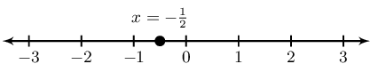

Now let us solve for \(x\) in the inequality \(2x + 2 \le 1\):

        \begin{align*}
        2x + 2 & \le 1 \\
        2x & \le 1 - 2 \\
        2x & \le -1 \\
        x & \le -\frac{1}{2}
        \end{align*}

If we represent this answer on a number line, we get:

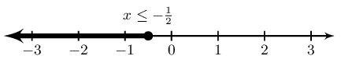

We see that for the equation there is only a single value of \(x\) for which the equation is true. However,
            for the inequality, there is a range of values for which the inequality is true. This is the main difference
            between an equation and an inequality.

Remember: when we divide or multiply both sides of an inequality by a negative number, the
            direction of the inequality changes. For example, if \(x<1\), then \(-x>-1\). Also note that we cannot
            divide or multiply by a variable.

<Callout type="note" title="Note">
The following video provides an introduction to linear inequalities.

<VideoPlayer src="https://www.youtube.com/embed/VgDe_D8ojxw" title="Video: 2FGH" />
</Callout>

### Interval notation (EMA3J)

Examples:

| \(\left(4;12\right)\) | Round brackets indicate that the number is not included. This interval includes all real
                                numbers greater than but not equal to \(\text{4}\) and less than but not equal to
                                \(\text{12}\). |
| --- | --- |
| \(\left(-\infty ;-1\right)\) | Round brackets are always used for positive and negative infinity. This interval includes
                                all real numbers less than, but not equal to \(-\text{1}\). |
| \(\left[1;13\right)\) | A square bracket indicates that the number is included. This interval includes all real
                                numbers greater than or equal to \(\text{1}\) and less than but not equal to
                                \(\text{13}\). |

It is important to note that this notation can only be used to represent an interval of real numbers.

We represent the above answer in interval notation as \(\left(-\infty ; -\frac{1}{2}\right]\)

<Callout type="tip" title="Worked example 17: Solving linear inequalities">
**Question:**
Solve for \(r\):

                    \[6 - r > 2\]

Represent the answer on a number line and in interval notation.

**Rearrange and solve for \(r\):**
\begin{align*}
                    -r & > 2 - 6 \\
                    -r & > -4
                    \end{align*}

**Multiply by \(-\text{1}\) and reverse inequality sign:**
\[r < 4\]

**Represent the answer on a number line:**
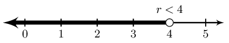

**Represent the answer in interval notation:**
\[\left(-\infty ; 4\right)\]
</Callout>

<Callout type="tip" title="Worked example 18: Solving linear inequalities">
**Question:**
Solve for \(q\):

                    \[4q + 3 < 2(q + 3)\]

Represent the answer on a number line and in interval notation.

**Expand the bracket:**
\begin{align*}
                    4q + 3 & < 2(q + 3) \\
                    4q + 3 & < 2q + 6
                    \end{align*}

**Rearrange and solve for \(q\):**
\begin{align*}
                    4q + 3 & < 2q + 6 \\
                    4q - 2q & < 6 - 3 \\
                    2q & < 3
                    \end{align*}

**Divide both sides by \(\text{2}\):**
\begin{align*}
                    2q & < 3 \\
                    q & < \frac{3}{2}
                    \end{align*}

**Represent the answer on a number line:**
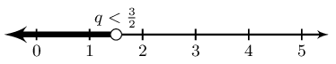

**Represent the answer in interval notation:**
\(\left(-\infty ; \frac{3}{2}\right)\)
</Callout>

<QuizCard id="m10-04-07a" title="Interactive Exercise 4.22" question="Solve for \(x\) : \[\begin{array}{c}-2x +1 > 4(x-3)\end{array}\] INSTRUCTION: Your answer should be a complete inequality statement. For example: x > 5 or x <= 3/10 ." options=[] explanation="Refer to the section rules and worked examples to verify." />

<QuizCard id="m10-04-07a" title="Interactive Exercise 4.22" question="Solve for \(x\) : \[\begin{array}{c}3 \left( x -8 \right) -2 \leq 2x+2\end{array}\] INSTRUCTION: Your answer should be a complete inequality statement. For example: x > 5 or x <= 3/10 ." options=[] explanation="Refer to the section rules and worked examples to verify." />

<QuizCard id="m10-04-07a" title="Interactive Exercise 4.22" question="Solve for \(x\) . INSTRUCTION: Use simplified fractions in your answer." options=["\u2264", "\u2265", "<", ">"] explanation="Refer to the section rules and worked examples to verify." />

<QuizCard id="m10-04-07a" title="Interactive Exercise 4.22" question="Solve for \(x\) : \[\begin{array}{c}\dfrac{x+5}{6} \leq \dfrac{4(x+6)}{7}\end{array}\] INSTRUCTION: Your answer should be a complete inequality statement. For example: x > 5 or x <= 3/10 ." options=[] explanation="Refer to the section rules and worked examples to verify." />

<Callout type="tip" title="Worked example 19: Solving compound linear inequalities">
**Question:**
Solve for \(x\):

                    \[5 \le x + 3 < 8\]

Represent the answer on a number line and in interval notation.

**Subtract \(\text{3}\) from all the parts of the inequality:**
\[\begin{array}{ccccc}
                    5 - 3 & \le & x + 3 - 3 & < & 8 - 3 \\
                    2 & \le & x & < & 5
                    \end{array}\]

**Represent the answer on a number line:**
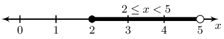

**Represent the answer in interval notation:**
\(\left[2 ; 5\right)\)
</Callout>

<QuizCard id="m10-04-07b" title="Interactive Exercise 4.23" question="Solve for \(g\) : \[\begin{array}{c}-3 < g +1 \le 4\end{array}\] INSTRUCTION: Your answer will be a complete inequality statement. For example, it might look like one of these: -2 <= x < 5 (x <= 3/10) or (x >= 11)" options=[] explanation="Refer to the section rules and worked examples to verify." />

<QuizCard id="m10-04-07b" title="Interactive Exercise 4.23" question="Solve for \(r\) : \[\begin{array}{c}r +2 < -8 \quad\text{or}\quad r +2 \ge -7\end{array}\] INSTRUCTION: Your answer will be a complete inequality statement. For example, it might look like one of these: -2 <= x < 5 (x <= 3/10) or (x >= 11)" options=[] explanation="Refer to the section rules and worked examples to verify." />

<QuizCard id="m10-04-07b" title="Interactive Exercise 4.23" question="Solve for \(k\) : \[\begin{array}{c}3 > k +1 > 0\end{array}\] INSTRUCTION: Your answer will be a complete inequality statement. For example, it might look like one of these: -2 <= x < 5 (x <= 3/10) or (x >= 11)" options=[] explanation="Refer to the section rules and worked examples to verify." />

<QuizCard id="m10-04-07b" title="Interactive Exercise 4.23" question="Solve for \(g\) : \[\begin{array}{c}-6 < g -4 < 15\end{array}\] INSTRUCTION: Your answer will be a complete inequality statement. For example, it might look like one of these: -2 <= x < 5 (x <= 3/10) or (x >= 11)" options=[] explanation="Refer to the section rules and worked examples to verify." />

### Textbook Exercise 4.6

Look at the number line and write down the inequality it represents.

**Problem:**

**Solution:**
\(x < -1 \text{ and } x \ge 6 ; x \in \mathbb{R}\)

**Problem:**
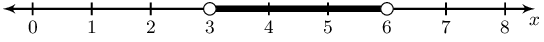

**Solution:**
\(3 < x < 6 ; x \in \mathbb{R}\)

**Problem:**

**Solution:**
\(x \neq 3 ; x \neq 6 ; x \in \mathbb{R}\)

**Problem:**
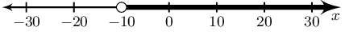

**Solution:**
\(x > -10 ; x \in \mathbb{R}\)

Solve for \(x\) and represent the answer on a number line and in interval notation.

**Problem:**
\(3x + 4 > 5x + 8\)

**Solution:**
\begin{align*}
                                3x + 4 & > 5x + 8 \\
                                3x - 5x & > 8 - 4 \\
                                -2x > 4 \\
                                2x < -4 \\
                                x < -2
                                \end{align*}

Represented on a number line:

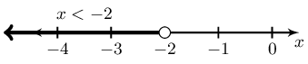

In interval notation: \((-\infty; -2)\)

**Problem:**
\(3(x - 1) - 2 \le 6x + 4\)

**Solution:**
\begin{align*}
                                3(x - 1) - 2 & \le 6x + 4 \\
                                3x - 5 & \le 6x + 4 \\
                                3x - 6x & \le 4 + 5 \\
                                -3x \le 9 \\
                                x \ge -\frac{9}{3} \\
                                x \ge -3
                                \end{align*}

Represented on a number line:

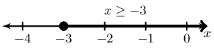

In interval notation: \([-3; \infty)\)

**Problem:**
\(\dfrac{x - 7}{3} > \dfrac{2x - 3}{2}\)

**Solution:**
\begin{align*}
                                \frac{x - 7}{3} & > \frac{2x - 3}{2} \\
                                2(x - 7) & > 3(2x - 3) \\
                                2x - 14 > 6x - 9 \\
                                -4x > 5 \\
                                x < -\frac{5}{4}
                                \end{align*}

Represented on a number line:

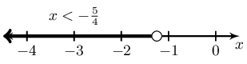

In interval notation: \((-\infty; -\frac{5}{4})\)

**Problem:**
\(-4(x - 1) < x + 2\)

**Solution:**
\begin{align*}
                                -4(x - 1) & < x + 2 \\
                                -4x + 4 & < x + 2 \\
                                -5x < -2 \\
                                x > \frac{2}{5}
                                \end{align*}

Represented on a number line:

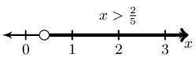

In interval notation: \((\frac{2}{5}; \infty)\)

**Problem:**
\(\dfrac{1}{2}x + \dfrac{1}{3}(x - 1) \ge \dfrac{5}{6}x - \dfrac{1}{3}\)

**Solution:**
\begin{align*}
                                \frac{1}{2}x + \frac{1}{3}(x - 1) & \ge \frac{5}{6}x - \frac{1}{3} \\
                                \frac{1}{2}x + \frac{1}{3}x - \frac{1}{3} & \ge \frac{5}{6}x - \frac{1}{3} \\
                                \frac{1}{2}x + \frac{1}{3}x - \frac{5}{6}x & \ge \frac{1}{3} - \frac{1}{3} \\
                                \frac{3}{6}x + \frac{2}{6}x - \frac{5}{6}x & \ge 0 \\
                                0x \ge 0
                                \end{align*}

The inequality is true for all real values of \(x\).

**Problem:**
\(-2 \le x - 1 < 3\)

**Solution:**
\[\begin{array}{ccccc}
                                -2 & \le & x - 1 & < & 3 \\
                                -1 & \le & x & < & 4
                                \end{array}\]

Represented on a number line:

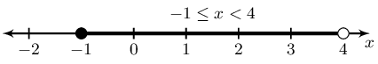

In interval notation: \([-1; 4)\)

**Problem:**
\(-5 < 2x - 3 \le 7\)

**Solution:**
\[\begin{array}{ccccc}
                                -5 & < & 2x - 3 & \le & 7 \\
                                -2 & < & 2x & \le & 10 \\
                                -1 & < & x & \le & 5
                                \end{array}\]

Represented on a number line:

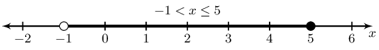

In interval notation: \((-1; 5]\)

**Problem:**
\(7(3x + 2) - 5(2x - 3) > 7\)

**Solution:**
\begin{align*}
                                7(3x + 2) - 5(2x - 3) & > 7 \\
                                21x + 14 - 10x + 15 & > 7 \\
                                11x & > -22 \\
                                x & > -2
                                \end{align*}

Represented on a number line:

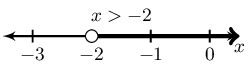

In interval notation: \((-2; \infty)\)

**Problem:**
\(\dfrac{5x - 1}{-6} \ge \dfrac{1 - 2x}{3}\)

**Solution:**
\begin{align*}
                                \frac{5x - 1}{-6} & \ge \frac{1 - 2x}{3} \\
                                5x - 1 & \ge -2(1 - 2x) \\
                                5x - 1 & \ge -2 + 4x \\
                                5x - 4x & \ge -1 \\
                                x & \ge -1
                                \end{align*}

Represented on a number line:

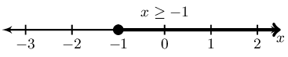

In interval notation: \([-1; \infty)\)

**Problem:**
\(3 \le 4 - x \le 16\)

**Solution:**
\[\begin{array}{ccccc}
                                3 & \le & 4 - x & \le & 16 \\
                                -1 & \le & -x & \le & 12 \\
                                1 & \ge & x & \ge & -12
                                \end{array}\]

Represented on a number line:

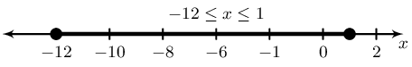

In interval notation: \([1; 12]\)

**Problem:**
\(\dfrac{-7y}{3} - 5 > -7\)

**Solution:**
\begin{align*}
                                \frac{-7y}{3} - 5 & > -7 \\
                                -7y - 15 & > -21 \\
                                -7y & > -6 \\
                                y & < \frac{6}{7}
                                \end{align*}

Represented on a number line:

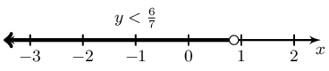

In interval notation: \((-\infty;\frac{6}{7})\)

**Problem:**
\(1 \le 1 - 2y < 9\)

**Solution:**
\[\begin{array}{ccccc}
                                1 & \le & 1 - 2y & < & 9 \\
                                0 & \le & -2y & < & 8 \\
                                0 & \ge & y & > & -4 \\
                                -4 & < & y & \le & 0
                                \end{array}\]

Represented on a number line:

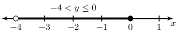

In interval notation: \((-4;0]\)

**Problem:**
\(-2 < \dfrac{x - 1}{-3} < 7\)

**Solution:**
\[\begin{array}{ccccc}
                                -2 & < & \dfrac{x - 1}{-3} & < & 7 \\
                                6 & > & x - 1 & > & -21 \\
                                7 & > & x & > & -20 \\
                                -20 & < & x & < & 7
                                \end{array}\]

Represented on a number line:

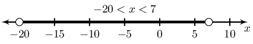

In interval notation: \((-20;7)\)

Solve for \(x\) and show your answer in interval notation:

**Problem:**
\(2x -1 < 3(x+11)\)

**Solution:**
\begin{align*}
                                    2 x -1 &< 3(x +11) \\
                                    2 x -1 &< 3 x +33 \\
                                    2 x -3 x &< 33 +1 \\
                                    -1 x &< 34 \\
                                    \therefore x &> -34
                                    \end{align*}

\[\left(-34;\infty\right)\]

**Problem:**
\(x -1 < -4(x-6)\)

**Solution:**
\begin{align*}
                                    x -1 &< -4(x -6) \\
                                    x -1 &< -4 x +24 \\
                                    x +4 x &< 24 +1 \\
                                    5 x &< 25 \\
                                    \therefore x &< 5
                                    \end{align*}

\[\left(-\infty;5\right)\]

**Problem:**
\(\dfrac{x-1}{8} \leq \dfrac{2(x-2)}{3}\)

**Solution:**
\begin{align*}
                                \frac{x-1}{8} &\leq \frac{2(x-2)}{3} \\
                                3(x-1) &\leq 16(x-2) \\
                                3x-3 &\leq 16x-32 \\
                                3x -16x &\leq -32 +3 \\
                                -13x &\leq -29 \\
                                \therefore x &\geq\frac{29}{13}
                                \end{align*}

\(\; x \in \left[ \frac{29}{13} ;\infty\right)\).

**Problem:**
\(\dfrac{x+2}{4} \leq \dfrac{-2(x-4)}{7}\)

**Solution:**
\begin{align*}
                                \frac{x+2}{4} &\leq \frac{-2(x-4)}{7} \\
                                7(x+2) &\leq -8(x-4) \\
                                7x+14 &\leq -8x+32 \\
                                7x +8x &\leq 32 -14 \\
                                15x &\leq 18 \\
                                \therefore x &\leq\frac{6}{5}
                                \end{align*}

\(\; x \in \left(-\infty; \frac{6}{5} \right]\).

**Problem:**
\(\dfrac{1}{5}x - \dfrac{5}{4}(x+2) > \dfrac{1}{4}x + 3\)

**Solution:**
\begin{align*}
                                    \frac{1}{5}x - \frac{5}{4}(x+2) &> \frac{1}{4}x +3 \\
                                    4x - 25(x+2) &> 5x +60 \\
                                    4x - 25 x-50 &> 5x +60 \\
                                    4x - 25 x -5x &> 60 + 50\\
                                    -26x &> 110\\
                                    \therefore x &< -\frac{55}{13}
                                    \end{align*}

The interval is:
                                    \[\left(-\infty;-\frac{55}{13}\right)\]

**Problem:**
\(\dfrac{1}{5}x - \dfrac{2}{5}(x+3) \geq \dfrac{4}{2}x +3\)

**Solution:**
\begin{align*}
                                    \frac{1}{5}x - \frac{2}{5}(x+3) &\geq \frac{4}{2}x +3 \\
                                    2x - 4(x+3) &\geq 20x +30 \\
                                    2x - 4 x-12 &\geq 20x +30 \\
                                    2x - 4 x -20x &\geq 30 + 12\\
                                    -22x &\geq 42\\
                                    \therefore x &\leq -\frac{21}{11}
                                    \end{align*}

The interval is:
                                    \[\left(-\infty;-\frac{21}{11}\right]\]

**Problem:**
\(4x +3 < -3 \quad\text{or}\quad 4x +3 > 5\)

**Solution:**
Solve the inequality:
                                    \[\begin{array}{rclcrcl}
                                    4x +3 &<& -3 &\text{or}& 4x +3 &>& 5 \\
                                    4x &<& -3-3 &\text{or}& 4x &>& 5-3 \\
                                    x &<& \frac{-3-3}{4} &\text{or}& x &>& \frac{5-3}{4}
                                    \\
                                    x &<& - \frac{3}{2} &\text{or}& x &>& \frac{1}{2} \\
                                    \end{array}\]

\[\left(-\infty; - \frac{3}{2}\right) \cup \left(\frac{1}{2}; \infty\right)\]

**Problem:**
\(4 \ge -6x -6 \ge -3\)

**Solution:**
Solve the inequality:
                                    \[\begin{array}{rcccl}
                                    4 &\ge& -6x -6 &\ge& -3 \\
                                    4+6 &\ge& -6x &\ge& -3+6 \\
                                    \frac{4+6}{-6} &\le& x &\le& \frac{-3+6}{-6} \\
                                    - \frac{5}{3} &\le& x &\le& - \frac{1}{2} \\
                                    \end{array}\]

\[\left[- \frac{5}{3}; - \frac{1}{2}\right]\]

Solve for the unknown variable and show your answer on a number line.

**Problem:**
\(6b - 3 > b + 2 , ~b \in \mathbb{Z}\)

**Solution:**
\begin{align*}
                                6b - 3 > b + 2 , ~b \in \mathbb{Z}\\
                                5b > 5 \\
                                b > 1
                                \end{align*}

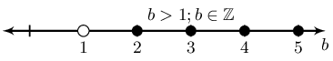

**Problem:**
\(3a - 1 < 4a + 6 , ~a \in \mathbb{N}\)

**Solution:**
\begin{align*}
                                3a - 1 < 4a + 6 \\
                                -a < 7 \\
                                a > -7
                                \end{align*}

However we are told that \(a \in \mathbb{N}\) and so \(a > 0\).

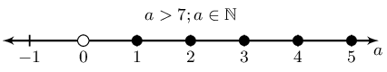

**Problem:**
\(\dfrac{b-3}{2} + 1 < \dfrac{b}{4} - 4 , ~b \in \mathbb{R}\)

**Solution:**
\begin{align*}
                                \frac{b-3}{2} + 1 < \frac{b}{4} - 4 \\
                                2b - 6 + 4 < b - 16 \\
                                b < -14
                                \end{align*}

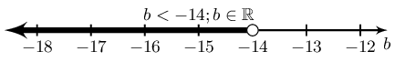

**Problem:**
\(\dfrac{4a +7}{3} - 5 > a - \dfrac{2}{3} , ~a \in \mathbb{N}\)

**Solution:**
\begin{align*}
                                \frac{4a +7}{3} - 5 > a - \frac{2}{3} \\
                                4a + 7 - 15 > 3a - 2 \\
                                a > 6
                                \end{align*}

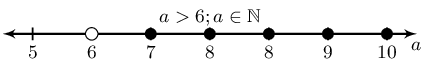
