### Textbook Exercise 4.7

Solve:

**Problem:**
\(5a-7 = -2\)

**Solution:**
\begin{align*}
                            5a -7 &= -2\\
                            5a &= -2 - (-7)\\
                            5a & = 5\\
                            a & = \frac{5}{5}\\
                            & = 1
                            \end{align*}

**Problem:**
\(5m+3 = -2\)

**Solution:**
\begin{align*}
                            5m +3 &= -2\\
                            5m &= -2 - 3\\
                            5m & = -5\\
                            m & = \frac{-5}{5}\\
                            & = -1
                            \end{align*}

**Problem:**
\(1 = 4 - 3y\)

**Solution:**
\begin{align*}
                            1 &= 4 - 3y\\
                            3y &= 4 - 1\\
                            3y & = 3\\
                            y & = \frac{3}{3}\\
                            & = 1
                            \end{align*}

**Problem:**
\(2(p - 1) = 3(p + 2)\)

**Solution:**
\begin{align*}
                        2(p - 1) & = 3(p + 2) \\
                        2p - 2 & = 3p + 6 \\
                        p & = -8
                        \end{align*}

**Problem:**
\(3 - 6k = 2k - 1\)

**Solution:**
\begin{align*}
                        3 - 6k & = 2k - 1 \\
                        8k & = 4 \\
                        k & = \frac{1}{2}
                        \end{align*}

**Problem:**
\(\text{2,1}x + 3 = \text{4,1} - \text{3,3}x\)

**Solution:**
\begin{align*}
                        \text{2,1}x + 3 &= \text{4,1} - \text{3,3}x \\
                        \text{5,4}x &= \text{1,1} \\
                        x &= \frac{11}{54}
                        \end{align*}

**Problem:**
\(m + 6(-m + 1) + 8m = 0\)

**Solution:**
\begin{align*}
                        m + 6(-m + 1) + 8m & = 0 \\
                        m - 6m + 6 + 8m & = 0 \\
                        3m & = -6 \\
                        m & = -2
                        \end{align*}

**Problem:**
\(2k + 3 = 2 - 3(k + 2)\)

**Solution:**
\begin{align*}
                        2k + 3 & = 2 - 3(k + 3) \\
                        2k + 3 & = 2 - 3k - 9 \\
                        5k & = -10 \\
                        k & = -2
                        \end{align*}

**Problem:**
\(3 + \dfrac{q}{5} = \dfrac{q}{2}\)

**Solution:**
\begin{align*}
                        3 + \frac{q}{5} & = \frac{q}{2} \\
                        30 + 2q & = 5q \\
                        3q & = 30 \\
                        q & = 10
                        \end{align*}

**Problem:**
\(\dfrac{1}{2} = \dfrac{4z + 1}{5z - 6}\)

**Solution:**
Note that \(z \neq \frac{6}{5}\)

                        \begin{align*}
                        \frac{1}{2} &= \frac{4z + 1}{5z - 6} \\
                        8z + 2 &= 5z - 6 \\
                        3z &= - 8 \\
                        z &= -\frac{8}{3}
                        \end{align*}

**Problem:**
\(2 + \dfrac{a - 4}{2} - \dfrac{a}{3} = 7\)

**Solution:**
\begin{align*}
                        2 + \frac{a - 4}{2} - \frac{a}{3} &= 7 \\
                        \frac{3(a - 4) - 2a}{6} &= 5 \\
                        3a -12 -2a &= 30 \\
                        a &= 42
                        \end{align*}

**Problem:**
\(5 - \dfrac{2(m + 4)}{m} = \dfrac{7}{m}\)

**Solution:**
\begin{align*}
                        5 - \frac{2(m + 4)}{m} & = \dfrac{7}{m} \\
                        5m - 2(m + 4) & = 7 \\
                        5m - 2m - 8 & = 7 \\
                        3m & = 15 \\
                        m & = 5
                        \end{align*}

**Problem:**
\(\dfrac{2}{t} - 2 - \dfrac{1}{2} = \dfrac{1}{2}\left(1 + \dfrac{2}{t}\right)\)

**Solution:**
\begin{align*}
                        \frac{2}{t} - 2 - \frac{1}{2} & = \frac{1}{2}\left(1 + \frac{2}{t}\right) \\
                        \frac{2}{t} - 2 - \frac{1}{2} & = \frac{1}{2} + \frac{1}{t} \\
                        \frac{4}{t} - 4 - 1 & = 1 + \frac{2}{t} \\
                        4 - 4t - t & = t + 2 \\
                        6t & = 2 \\
                        t & = \frac{1}{3}
                        \end{align*}

Solve:

**Problem:**
\(b^{2} +6b -27 = 0\)

**Solution:**
\begin{align*}
                        b^{2} +6b -27 &= 0 \\
                        (b -3)(b +9) &=0 \\
                        b = -9 & \text{ or } b = 3
                        \end{align*}

**Problem:**
\(- x^{2} + 5 x + 6 = 0\)

**Solution:**
\begin{align*}
                        x^{2} - 5 x - 6 & = 0 \\
                        \left(x - 6\right) \left(x + 1\right) & = 0 \\
                        x = -1 & \text{ or } x = 6
                        \end{align*}

**Problem:**
\(- b^{2} - 3 b + 10 = 0\)

**Solution:**
\begin{align*}
                        b^{2} + 3 b - 10 & = 0 \\
                        \left(b - 2\right) \left(b + 5\right) & = 0 \\
                        b = -5 & \text{ or } b = 2
                        \end{align*}

**Problem:**
\(2b - 15 = (b+1)(b-6) - b^2\)

**Solution:**
\begin{align*}
                        2b - 15 &= (b+1)(b-6) - b^2 \\
                        2b - 15 &= b^2 - 5b - 6 - b^2 \\
                        7b &= 9 \\
                        b &= \frac{9}{7}
                        \end{align*}

**Problem:**
\((5x + 1)(x - 3) = 0\)

**Solution:**
\begin{align*}
                        (5x + 1)(x - 3) &= 0 \\
                        x = -\frac{1}{5} & \text{ or } x =3
                        \end{align*}

**Problem:**
\(5t - 1 = t^{2} - (t + 2)(t - 2)\)

**Solution:**
\begin{align*}
                        5t - 1 & = t^{2} - (t + 2)(t - 2) \\
                        5t - 1 & = t^{2} - t^{2} + 4 \\
                        5t - 1 & = 4 \\
                        5t & = 5 \\
                        t & = 1
                        \end{align*}

**Problem:**
\(\dfrac{a +2}{a -3} = \dfrac{a +8}{a +4}\)

**Solution:**
Note restrictions: \(a \ne 3; a \ne -4\).

                        \begin{align*}
                        \frac{a +2}{a -3} & = \frac{a +8}{a +4} \\
                        \frac{(a + 2)(a + 4)}{(a -3)(a + 4)} & = \frac{(a +8)(a -3)}{(a -3)(a + 4)} \\
                        (a + 2)(a + 4) &=(a + 8)(a - 3) \\
                        a^{2} + 2a + 4a + (2)(4) &= a^{2} - 3a + 8a + (-3)(8)\\
                        a^{2} + 6a + 8 &= a^{2} + 5a - 24 \\
                        6a + 8 & = 5a - 24\\
                        6a - (5a) & = -24 - (8)\\
                        a & = \frac{-32}{1}\\
                        & = -32
                        \end{align*}

**Problem:**
\(\dfrac{n + 3}{n - 2} = \dfrac{n - 1}{n - 7}\)

**Solution:**
Note restrictions: \(n \ne 2; n \ne 7\).

\begin{align*}
                            \frac{n + 3}{n - 2} & = \frac{n - 1}{n - 7} \\
                            \frac{(n +3)(n -7)}{(n -2)(n -7)} & = \frac{(n -1)(n -2)}{(n -7)(n -2)} \\
                            (n + 3)(n - 7) & = (n - 1)(n - 2) \\
                            n^{2} + 3n - 7n + (3)(-7) & = n^{2} - 2n - 1n + (-2)(-1) \\
                            n^{2} - 4n - 21 & = n^{2} - 3n + 2 \\
                            -4n - 21 & = -3n + 2\\
                            -4n - (-3n) & = 2 - (-21)\\
                            n & = \frac{23}{-1}\\
                            & = -23
                            \end{align*}

**Problem:**
\(x^{2} - 3x + 2 = 0\)

**Solution:**
\begin{align*}
                        x^{2} - 3x + 2 & = 0 \\
                        (x - 2)(x - 1) & = \\
                        x = 2 & \text{ or } x = 1
                        \end{align*}

**Problem:**
\(y^{2} + y = 6\)

**Solution:**
\begin{align*}
                        y^{2} + y & = 6 \\
                        y^{2} + y - 6 & = 0 \\
                        (y + 3)(y - 2) & = 0 \\
                        y = -3 & \text{ or } y = 2
                        \end{align*}

**Problem:**
\(0 = 2x^{2} - 5x - 18\)

**Solution:**
\begin{align*}
                        0 & = 2x^{2} - 5x - 18 \\
                        0 & = (2x + 9)(x - 2) \\
                        2x + 9 = 0 & \text{ or } x - 2 = 0 \\
                        x = -\frac{9}{2} & \text{ or } x = 2
                        \end{align*}

**Problem:**
\((d + 4)(d - 3) - d = (3d - 2)^{2} - 8d(d - 1)\)

**Solution:**
\begin{align*}
                        (d + 4)(d - 3) - d & = (3d - 2)^{2} - 8d(d - 1) \\
                        d^{2} + d - 12 - d & = 9d^{2} - 12d + 4 - 8d^{2} + 8d\\
                        d^{2} - 12 & = d^{2} - 4d + 4 \\
                        4d & = 16 \\
                        d & = 4
                        \end{align*}

**Problem:**
Look at the graph below:

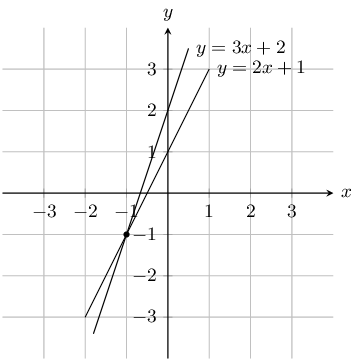

Solve the equations \(y = 3x + 2\) and \(y = 2x + 1\) simultaneously.

**Solution:**
From the graph we can see that the lines intersect at \(x = - 1\) and \(y = -1\)

**Problem:**
Look at the graph below:

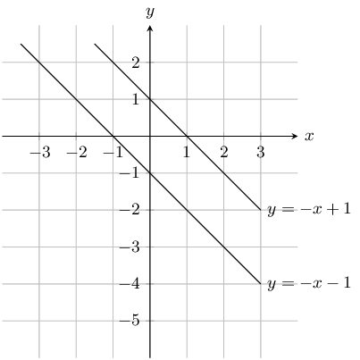

Solve the equations \(y = -x + 1\) and \(y = -x - 1\) simultaneously.

**Solution:**
The lines are parallel therefore there is no solution to \(x\) and \(y\).

**Problem:**
Look at the graph below:

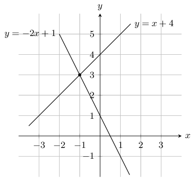

Solve the equations \(y = x + 4\) and \(y = -2x + 1\) simultaneously.

**Solution:**
From the graph we can see that the lines intersect at \(x = - 1\) and \(y = 3\)

Solve the following simultaneous equations:

**Problem:**
\(7x + 3y = 13\) and \(2x - 3y = -4\)

**Solution:**
Add the two equations to remove the \(y\) term and solve for \(x\):

                        \[\begin{array}{cccc}
                        & 7x + 3y & = & 13 \\
                        + & (2x - 3y & = & -4) \\ \hline
                        & 9x & = & 9
                        \end{array}\]

Therefore \(x = 1\).

Substitute value of \(x\) into second equation:

                        \begin{align*}
                        2x - 3y & = -4 \\
                        2(1) - 3y & = -4 \\
                        3y & = 6 \\
                        y & = 2
                        \end{align*}

Therefore \(x = 1 \text{ and } y = 2\).

**Problem:**
\(10 = 2x + y\) and \(y = x - 2\)

**Solution:**
Substitute value of \(y\) into first equation:

                        \begin{align*}
                        10 & = 2x + x - 2 \\
                        10 & = 3x - 2 \\
                        12 & = 3x \\
                        x & = 4
                        \end{align*}

Substitute value of \(x\) back into second equation:

                        \begin{align*}
                        y & = x - 2 \\
                        & = 4 - 2 \\
                        & = 2
                        \end{align*}

Therefore \(x = 4 \text{ and } y = 2\).

**Problem:**
\(7x - 41 = 3y\) and \(17 = 3x - y\)

**Solution:**
Make \(y\) the subject of the first equation:

                        \begin{align*}
                        17 & = 3x - y \\
                        y & = 3x - 17
                        \end{align*}

Substitute value of \(y\) into first equation:

                        \begin{align*}
                        7x - 41 & = 3y \\
                        7x - 41 & = 3(3x - 17) \\
                        7x - 41 & = 9x - 51 \\
                        2x & = 10 \\
                        x & = 5
                        \end{align*}

Substitute value of \(x\) back into second equation:

                        \begin{align*}
                        y & = 3x - 17 \\
                        y & = 3(5) - 17 \\
                        & = -2
                        \end{align*}

Therefore \(x = 5 \text{ and } y = -2\).

**Problem:**
\(2x-4y = 32\) and \(7x + 2y = 32\)

**Solution:**
Make \(x\) the subject of the first equation:

                        \begin{align*}
                        2x-4y &= 32 \\
                        2x &= 32+4y \\
                        x &= \frac{32+4y}{2}
                        \end{align*}

Substitute value of \(x\) into second equation:

                        \begin{align*}
                        7x+2y &= 32 \\
                        7 \left(\frac{32+4y}{2} \right) +2y &= 32 \\
                        7(32+4y) +2(2)y &= 32(2) \\
                        224+28y+4y &= 64\\
                        32 y &= -160 \\
                        \therefore y &= -5
                        \end{align*}

Substitute value of \(y\) back into first equation:

                        \begin{align*}
                        x &= \frac{32+4y}{2} \\
                        x &= \frac{32+4(-5)}{2} \\
                        x &= 6
                        \end{align*}

Therefore \(x = 6\) and \(y = -5\).

**Problem:**
\(7x + 6y = -18\) and \(4x + 12y = 24\)

**Solution:**
Multiply the first equation by 2 so that the coefficient of \(y\) is the same as the second
                            equation:

                        \begin{align*}
                        7x+6y &= -18 \\
                        7 (2) x+6 (2)y &= -18 (2)\\
                        14x+12y &= -36
                        \end{align*}

Subtract the second equation from the first equation:

                        \[\begin{array}{cccc}
                        & 14x + 12y & = & -36 \\
                        - & (4x + 12y & = & 24) \\ \hline
                        & 10x & = & -60
                        \end{array}\]

Solve for \(x\):

                        \begin{align*}
                        \therefore x &= \frac{-60}{10} \\
                        & = -6
                        \end{align*}

Substitute the value of \(x\) into the first equation and solve for \(y\):

                        \begin{align*}
                        7x+6y &= -18 \\
                        7(-6)+6y &= -18\\
                        \therefore y &= \frac{-18-7(-6)}{6} \\
                        &= 4
                        \end{align*}

Therefore \(x = -6\) and \(y = 4\).

**Problem:**
\(3x - 4y = -15\) and \(12x + 5y = 66\)

**Solution:**
Multiply the first equation by 4 so that the coefficient of \(x\) is the same as the second
                            equation:

                        \begin{align*}
                        3x - 4y &= -15 \\
                        3 (4) x-4 (4)y &= -15 (4)\\
                        12x-16y &= -60
                        \end{align*}

Subtract the second equation from the first equation:

                        \[\begin{array}{cccc}
                        & 12x - 16y & = & -60 \\
                        - & (12x + 5y & = & 66) \\ \hline
                        & -21y & = & -126
                        \end{array}\]

Solve for \(y\):

                        \begin{align*}
                        \therefore y &= \frac{-126}{-21} \\
                        &= 6
                        \end{align*}

Substitute the value of \(y\) into the first equation and solve for \(x\):

                        \begin{align*}
                        3x-4y &= -15 \\
                        3x-4(6) &= -15\\
                        x &= \frac{-15+4(6)}{3} \\
                        &= 3
                        \end{align*}

Therefore \(x = 3\) and \(y = 6\).

**Problem:**
\(x - 3y = -22\) and \(5x + 2y = -25\)

**Solution:**
Write the first equation in terms of \(x\):

                        \begin{align*}
                        x - 3y & = -22 \\
                        x &= 3y - 22
                        \end{align*}

Substitute the value of \(x\) into the second equation:

                        \begin{align*}
                        5x + 2y & = -25 \\
                        5(3y - 22) + 2y & = -25 \\
                        15y - 110 + 2y & = -25 \\
                        17y & = 85 \\
                        y & = 5
                        \end{align*}

Substitute the value of \(y\) into the first equation and solve for \(x\):

                        \begin{align*}
                        x - 3y & = -22 \\
                        x - 3(5) & = -22 \\
                        x & = -22 + 15 \\
                        &= -7
                        \end{align*}

Therefore \(x = -7\) and \(y = 5\).

**Problem:**
\(3x + 2y = 46\) and \(15x + 5y = 220\)

**Solution:**
Make \(y\) the subject of the second equation:

                        \begin{align*}
                        15x + 5y &= 220 \\
                        3x + y &= 44 \\
                        y &= 44 - 3x
                        \end{align*}

Substitute the value of \(y\) into the first equation:

                        \begin{align*}
                        3x + 2y &= 46 \\
                        3x + 2(44 - 3x) & = 46 \\
                        3x + 88 - 6x & = 46 \\
                        42 & = 3x \\
                        x &= 14
                        \end{align*}

Substitute the value of \(x\) into the second equation:

                        \begin{align*}
                        3x + y &= 44 \\
                        3(14) + y &= 44\\
                        y &= 44 - 42 \\
                        &= 2
                        \end{align*}

Therefore \(x = 14\) and \(y = 2\).

**Problem:**
\(6x + 3y = -63\) and \(24x + 4y = -212\)

**Solution:**
Multiply the first equation by 4 so that the coefficient of \(x\) is the same as the second
                            equation:

                        \begin{align*}
                        6x + 3y &= -63 \\
                        6(4)x - 3(4)y &= -63(4)\\
                        24x + 12y &= -252
                        \end{align*}

Subtract the second equation from the first equation:

                        \[\begin{array}{cccc}
                        & 24x + 12y & = & -252 \\
                        - & (24x + 4y & = & -212) \\ \hline
                        & 8y & = & -40
                        \end{array}\]

Solve for \(y\):

                        \begin{align*}
                        \therefore y &= \frac{-40}{8} \\
                        &= -5
                        \end{align*}

Substitute the value of \(y\) into the first equation and solve for \(x\):

                        \begin{align*}
                        6x + 3y &= -63 \\
                        6x - 3(-5) &= -63\\
                        x & = \frac{-63 + 15}{6} \\
                        & = -8
                        \end{align*}

Therefore \(x = -8\) and \(y = -5\).

**Problem:**
\(5x - 6y = 11\) and \(25x - 3y = 28\)

**Solution:**
Multiply the first equation by 5 so that the coefficient of \(x\) is the same as the second
                            equation:

                        \begin{align*}
                        5x - 6y &= 11 \\
                        5(5)x - 6(5)y &= 11(5) \\
                        25x - 30y &= 55
                        \end{align*}

Subtract the second equation from the first equation:

                        \[\begin{array}{cccc}
                        & 25x - 30y & = & 55 \\
                        - & (25x - 3y & = & 28) \\ \hline
                        & -27y & = & 27
                        \end{array}\]

Solve for \(y\):

                        \begin{align*}
                        \therefore y &= \frac{27}{-27} \\
                        &= -1
                        \end{align*}

Substitute the value of \(y\) into the first equation and solve for \(x\):

                        \begin{align*}
                        5x - 6y & = 11 \\
                        5x - 6(-1) & = 11\\
                        x &= \frac{11 - 6}{5} \\
                        &= 1
                        \end{align*}

Therefore \(x = 1\) and \(y = -1\).

**Problem:**
\(-9x + 3y = 4\) and \(2x + 2y = 6\)

**Solution:**
Make \(x\) the subject of the second equation:

                        \begin{align*}
                        2x + 2y & = 6 \\
                        x & = 3 - y
                        \end{align*}

Substitute the value of \(x\) into the first equation:

                        \begin{align*}
                        -9x + 3y & = 4 \\
                        -9(3 - y) + 3y & = 4 \\
                        -27 + 9y + 3y & = 4 \\
                        12y & = 31 \\
                        y & = \frac{31}{12}
                        \end{align*}

Substitute the value of \(y\) into the second equation and solve for \(x\):

                        \begin{align*}
                        x & = 3 - y \\
                        & = 3 - \frac{31}{12} \\
                        & = \frac{36 - 31}{12} \\
                        & = \frac{5}{12}
                        \end{align*}

Therefore \(x = \frac{5}{12}\) and \(y = \frac{31}{12}\).

**Problem:**
\(3x - 7y = -10\) and \(10x + 2 y = -6\)

**Solution:**
Make \(y\) the subject of the second equation:

                        \begin{align*}
                        10x + 2 y & = -6 \\
                        5x + y & = -3 \\
                        y & = -3 - 5x
                        \end{align*}

Substitute the value of \(y\) into the first equation:

                        \begin{align*}
                        3x - 7y & = -10 \\
                        3x - 7(-3 - 5x) & = -10 \\
                        3x + 21 + 35x & = -10 \\
                        38x & = -10 -21 \\
                        38x & = -31 \\
                        x & = \frac{-31}{38}
                        \end{align*}

Substitute the value of \(x\) into the second equation and solve for \(y\):

                        \begin{align*}
                        5x + y & = -3 \\
                        5\left(\frac{-31}{38}\right) + y & = -3 \\
                        y & = \frac{-114 + 155}{38} \\
                        & = \frac{41}{38}
                        \end{align*}

Therefore \(x = -\frac{31}{38}\) and \(y = \frac{41}{38}\).

**Problem:**
\(2y = x + 8\) and \(4y = 2x - 44\)

**Solution:**
We note that the second equation has a common factor of 2:

                        \begin{align*}
                        4y & = 2x - 44 \\
                        2y & = x - 22
                        \end{align*}

Now we can subtract the second equation from the first:

                        \[\begin{array}{cccc}
                        & 2y & = & x + 8 \\
                        - & 2y & = & x - 22 \\ \hline
                        & 0 & =& -22
                        \end{array}\]

There is no solution for this system of equations. We can see this if we graph the two
                            equations:

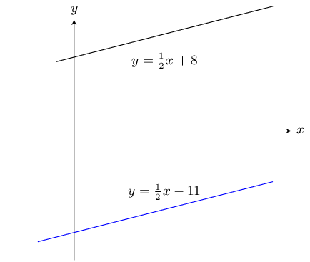

From the graph we see that the lines have the same gradient and do not intersect.

Therefore there is no solution.

**Problem:**
\(2a(a- 1) - 4 + a - b = 0\) and \(2a^2 - a = b + 4\)

**Solution:**
Look at the first equation

                        \begin{align*}
                        2a(a- 1) - 4 + a - b &= 0 \\
                        2a^2 - 2a - 4 + a - b &= 0 \\
                        2a^2 - a &= b + 4
                        \end{align*}

Note that this is the same as the second equation

\(a\) and \(b\) can be any real number except for \(\text{0}\).

**Problem:**
\(y = (x-2)^2\) and \(x(x+3)-y = 3x +4(x-1)\)

**Solution:**
Look at the second equation:

                        \begin{align*}
                        x(x+3)-y &= 3x +4(x-1)\\
                        x^2 + 3x - y &= 3x +4x - 4 \\
                        x^2 - 4x + 4 &= y \\
                        y &= (x-2)^2
                        \end{align*}

Note that this is the same as the first equation.

\(x\) and \(y\) can be any real number except for \(\text{0}\).

**Problem:**
\(\dfrac{x+1}{y}= 7\) and \(\dfrac{x}{y+1} =6\)

**Solution:**
Note that \(y \neq 0\) and \(y \neq -1\)

                        \begin{align*}
                        \frac{x+1}{y}&= 7 \qquad \text{ equation 1}\\
                        \frac{x}{y+1} &=6 \qquad \text{ equation 2}
                        \end{align*}

Make \(x\) the subject of equation 1:

                        \begin{align*}
                        \frac{x+1}{y} &= 7 \\
                        x + 1 &= 7y \\
                        x &= 7y -1 \qquad \text{ equation 3}
                        \end{align*}

Make \(x\) the subject of equation 2:

                        \begin{align*}
                        \frac{x}{y+1} &=6 \\
                        x &= 6(y+1) \\
                        &= 6y + 6 \qquad \text{ equation 4}
                        \end{align*}

Substitute equation 3 into equation 4:

                        \begin{align*}
                        6y + 6 &= 7y -1 \\
                        6 + 1 &= 7y - 6y \\
                        y &= 7
                        \end{align*}

Substitute the value of \(y\) into equation 3:

                        \begin{align*}
                        x &= 7(7) -1 \\
                        &= 48
                        \end{align*}

Therefore \(x = 48 \text{ and } y = 7\)

**Problem:**
\((x+3)^2 + (y-4)^2 = 0\)

**Solution:**
Note that \((x + 3)^2\) and \((y - 4)^2\) are both greater than or equal to zero therefore
                            for the equation to be true they must both equal zero.

                        \begin{align*}
                        (x+3)^2 = 0 \\
                        x = -3 \\ \\
                        (y-4)^2 = 0 \\
                        y = 4\\ \\
                        \therefore x = -3 &\text{ and } y = 4
                        \end{align*}

Find the solutions to the following word problems:

**Problem:**
\(\frac{7}{8}\) of a certain number is \(\text{5}\) more than \(\frac{1}{3}\) of the number.
                            Find the number.

**Solution:**
Let \(x\) be the number.

                        \begin{align*}
                        \frac{7}{8}x &= \frac{1}{3}x + 5 \\
                        21x & = 8x + 120 \\
                        13x & = 120 \\
                        x & = \frac{120}{13}
                        \end{align*}

The number is \(\frac{120}{13}\).

**Problem:**
Three rulers and two pens have a total cost of \(\text{R}\,\text{21,00}\). One ruler and one
                            pen have a total cost of \(\text{R}\,\text{8,00}\). How much does a ruler cost and how much
                            does a pen cost?

**Solution:**
Let the price of a ruler be \(r\) and the price of a pen be \(p\).

                        \begin{align*}
                        3r + 2p & = 21 \\
                        r + p & = 8
                        \end{align*}

From the second equation: \(r = 8 - p\)

Substitute the value of \(r\) into the first equation:

                        \begin{align*}
                        3(8 - p) + 2p & = 21 \\
                        24 - 3p + 2p & = 21 \\
                        p & = 3
                        \end{align*}

Substitute the value of \(p\) into the second equation:

                        \begin{align*}
                        r + 3 & = 8 \\
                        r & = 5
                        \end{align*}

Therefore each ruler costs \(\text{R}\,\text{5}\) and each pen costs \(\text{R}\,\text{3}\).

**Problem:**
A group of friends is buying lunch. Here are some facts about their lunch:

- a hotdog costs \(\text{R}\,\text{6}\) more than a milkshake
- the group buys 3 hotdogs and 2 milkshakes
- the total cost for the lunch is \(\text{R}\,\text{143}\)

                        Determine the individual prices for the lunch items.

**Solution:**
Let the price of a hotdog be \(h\) and the price of a milkshake be \(m\). From the given
                            information we get:

                        \begin{align*}
                        h & = m + 6 \\
                        3h + 2m & = 143
                        \end{align*}

Substitute the first equation into the second equation:

                        \begin{align*}
                        3h + 2m &= 143 \\
                        3(m + 6) + 2m &= 143 \\
                        3m + 6(3) + 2m &= 143 \\
                        5m &= 143 - 18 \\
                        \therefore m &= \frac{125}{5} \\
                        &= 25
                        \end{align*}

Substitute the value of \(m\) into the first equation:

                        \begin{align*}
                        h & = m + 6 \\
                        & = 25 + 6 \\
                        & = 31
                        \end{align*}

The price of the hotdog is \(\text{R}\,\text{31}\) while a milkshake costs
                            \(\text{R}\,\text{25}\).

**Problem:**
Lefu and Monique are friends. Monique takes Lefu's business studies test paper and will not
                            tell him what his mark is. She knows that Lefu dislikes word problems so she decides to
                            tease him. Monique says: “I have \(\text{12}\) marks more than you do and the sum of
                            both our marks is equal to \(\text{166}\). What are our marks?”

**Solution:**
Let Lefu's mark be \(l\) and let Monique's mark be \(m\). Then
                            \begin{align*}
                            m &= l + \text{12} \\
                            l + m &= \text{166}
                            \end{align*}

Substitute the first equation into the second equation and solve:

                        \begin{align*}
                        l + m &= \text{166} \\
                        l + (l + \text{12}) &= \text{166} \\
                        2l &= 166 - \text{12}\\
                        \therefore l &= \frac{\text{154}}{\text{2}}\\
                        &= \text{77}
                        \end{align*}

Substituting this value back into the first equation gives:

                        \begin{align*}
                        m &= l + \text{12} \\
                        &= \text{77} + \text{12} \\
                        &= \text{89}
                        \end{align*}

The students obtained the following marks: Lefu has \(\text{77}\) marks and Monique has
                            \(\text{89}\) marks.

**Problem:**
A man runs to the bus stop and back in \(\text{15}\) minutes. His speed on the way to the bus
                            stop is \(\text{5}\) \(\text{km·h$^{-1}$}\) and his speed on the way back is
                            \(\text{4}\) \(\text{km·h$^{-1}$}\). Find the distance to the bus stop.

**Solution:**
Let \(D\) be the distance to the bus stop.

Speed \(s_{1} = \text{5}\text{ km·h$^{-1}$}\) and \(s_{2} = \text{4}\text{
                            km·h$^{-1}$}\).

Distance is given by speed times time. The man runs the same distance to the bus stop as he
                            does from the bus stop. Therefore:

                        \begin{align*}
                        D & = s \times t \\
                        D & = 5t_{1} = 4t_{2}
                        \end{align*}

He takes a total of 15 minutes to run there and back so the total time is \(t_{1} + t_{2} =
                            15\). However the speeds are given in kilometers per hour and so we must convert the time to
                            hours. Therefore \(t_{1} + t_{2} = \text{0,25}.\)

Next we note that \(t_{1} = \dfrac{D}{5}\) and \(t_{2} = \dfrac{D}{4}\).

Therefore:

                        \begin{align*}
                        \frac{D}{5} + \frac{D}{4} & = \text{0,25} \\
                        4D + 5D & = \text{0,25}(20) \\
                        9D & = 5 \\
                        D & = \frac{5}{9}
                        \end{align*}

The bus stop is \(\text{0,56}\) \(\text{km}\) away.

**Problem:**
Two trucks are travelling towards each other from factories that are \(\text{175}\)
                            \(\text{km}\) apart. One truck is travelling at \(\text{82}\) \(\text{km·h$^{-1}$}\)
                            and the other truck at \(\text{93}\) \(\text{km·h$^{-1}$}\). If both trucks started
                            their journey at the same time, how long will they take to pass each other?

**Solution:**
Notice that the sum of the distances for the two trucks must be equal to the total distance
                            when the trucks meet: \(D_{1} + D_{2} = d_{\text{total}} \longrightarrow D_{1} + D_{2} =
                            \text{175}\text{ km}\).

This question is about distances, speeds and times. The equation connecting these values is
                            \[\text{speed } = \frac{\text{distance }}{\text{time}} \quad \text{- or -} \quad
                            \text{distance } = \text{speed } \times \text{time}\]

You want to know the amount of time needed for the trucks to meet - let the time taken be
                            \(t\). Then you can write an expression for the distance each of the trucks travels:
                            \begin{align*}
                            \text{For truck 1:} \quad D_{1} &= s_{1} t \\
                            &= \text{82}t \\
                            \text{For truck 2:} \quad D_{2} &= s_{2} t \\
                            &= \text{93}t
                            \end{align*}

Now you have three different equations: you must solve them simultaneously; substitution is
                            the easiest choice.
                            \begin{align*}
                            D_{1} + D_{2} &= \text{175} \\
                            (\text{82}t) + (\text{93}t) &= \text{175} \\
                            \text{175}t &= \text{175} \\
                            \therefore t &= \frac{\text{175}}{\text{175}} \\
                            &= \text{1}
                            \end{align*}
                            The trucks will meet after \(\text{1}\) hours.

**Problem:**
Zanele and Piet skate towards each other on a straight path. They set off \(\text{20}\)
                            \(\text{km}\) apart. Zanele skates at \(\text{15}\) \(\text{km·h$^{-1}$}\) and Piet at
                            \(\text{10}\) \(\text{km·h$^{-1}$}\). How far will Piet have skated when they reach
                            each other?

**Solution:**
Let \(x\) be the distance that Zanele skates and \(20 - x\) the distance Piet skates.

Next we note the following information:

- Zanele skates \(x ~\text{km}\) at a speed of \(\text{15}\) \(\text{km·h$^{-1}$}\) in a time of \(\frac{x}{15}\)
- Piet skates \(20 - x ~\text{km}\) at a speed of \(\text{10}\) \(\text{km·h$^{-1}$}\) in a time of \(\frac{20 - x}{10}\)

                        \begin{align*}
                        \frac{x}{15} & = \frac{20 - x}{10} \\
                        10x & = 15(20 - x) \\
                        10x & = 300 - 15x \\
                        25x & = 300 \\
                        x & = 12
                        \end{align*}

Zanele will have skated \(\text{12}\) \(\text{km}\) and Piet will have skated \(\text{8}\)
                            \(\text{km}\) when they reach other.

**Problem:**
When the price of chocolates is increased by \(\text{R}\,\text{10}\), we can buy five fewer
                            chocolates for \(\text{R}\,\text{300}\). What was the price of each chocolate before the
                            price was increased?

**Solution:**
Let \(x\) be the original price of chocolates. The new price of \(x\) chocolates is
                            \(\text{R}\,\text{300}\).

                        \begin{align*}
                        \left(x + 10\right)\left(\frac{300}{x} - 5\right) & = 300 \\
                        300 - 5x + \frac{\text{3 000}}{x} - 50 & = 300 \\
                        -5x + \frac{\text{3 000}}{x} - 50 & = 0 \\
                        -5x^{2} + \text{3 000} - 50x & = 0 \\
                        x^{2} + 10x - 600 & = 0 \\
                        (x - 20)(x + 30) & = 0 \\
                        x = 20 & \text{ or } x = -30
                        \end{align*}

Since price has to be positive the chocolates used to cost \(\text{R}\,\text{20}\).

**Problem:**
A teacher bought \(\text{R}\,\text{11 300}\) worth of textbooks. The text books were for
                            Science and Mathematics with each of them being sold at \(\text{R}\,\text{100}\) per book
                            and \(\text{R}\,\text{125}\) per book respectively. If the teacher bought 97 books in total,
                            how many Science books did she buy?

**Solution:**
\begin{align*}
                        x + y &= 97 \quad (1)\\
                        100x + 125y &= \text{11 300} \quad (2)\\ \\
                        &\text{look at }(1) \\
                        x &= 97- y \quad (3)\\
                        (3) &\text{ into } (2) \\
                        100(97- y) + 125y &= \text{11 300} \\
                        -100y + 125y &= \text{11 300} - \text{9 700} \\
                        25y &= \text{1 600} \\
                        y &= 64 \\
                        x &= 97- y \\
                        x &= 33
                        \end{align*}

She bought \(\text{33}\) science books.

**Problem:**
Thom's mom bought \(\text{R}\,\text{91,50}\) worth of easter eggs. The easter eggs came in 3
                            different colours blue, green and yellow. The blue ones cost \(\text{R}\,\text{2}\) each,
                            green ones \(\text{R}\,\text{1,50}\) each and yellow ones \(\text{R}\,\text{1}\) each. She
                            bought three times as many yellow eggs as the green ones and \(\text{72}\) eggs in total.
                            How many blue eggs did she buy?

**Solution:**
\begin{align*}
                        x + y + z &= 72 ~(1)\\
                        2x + \text{1,5}y + z &= \text{91,5} ~(2)\\
                        z &= 3y ~(3) \\
                        (3) &\text{ into } (1) \\
                        x + y + 3y &= 72 \\
                        x &= 72 - 4y ~(4)\\
                        (3) &\text{ into } (2) \\
                        2x + \text{1,5}y + 3y &= \text{91,5} \\
                        2x = \text{91,5} - \text{4,5}y ~(5)\\
                        (4) &\text{ into } (5) \\
                        2(72 - 4y) &= \text{91,5} - \text{4,5}y \\
                        144 - 8y &= \text{91,5} - \text{4,5}y \\
                        \text{52,5} &= \text{3,5}y \\
                        y &= 15 \\
                        x &= 72 - 4(15) = 12 \\
                        \therefore \text{Thom's mom bought } &12 \text{ blue easter eggs}
                        \end{align*}

**Problem:**
Two equivalent fractions both have their numerator as one. The denominator of one fraction is
                            the sum of two and a number, while the other fraction is twice the number less 3. What is
                            the number?

**Solution:**
\begin{align*}
                        \frac{1}{x+2} &= \frac{1}{2x - 3} \\
                        \text{Note } x \neq -2 &\text{ and } x \neq \frac{3}{2} \\
                        x + 2 &= 2x - 3 \\
                        x &= 5
                        \end{align*}

Consider the following literal equations:

**Problem:**
Solve for \(x\):
                            \(a - bx = c\)

**Solution:**
\begin{align*}
                            a - bx &= c \\
                            -bx &= c - a \\
                            -\frac{1}{b}(-bx) &= (c - a)\left( -\frac{1}{b}\right) \\
                            \therefore \; x &= \frac{a - c}{b}, b \neq 0
                            \end{align*}

**Problem:**
Solve for \(I\): \(P = VI\).

**Solution:**
\begin{align*}
                        P & = VI \\
                        \frac{P}{V} & = I
                        \end{align*}

Note restriction: \(V \ne 0\).

**Problem:**
Make \(m\) the subject of the formula: \(E = mc^{2}\).

**Solution:**
\begin{align*}
                        E & = mc^{2} \\
                        \frac{E}{c^{2}} & = m
                        \end{align*}

Note restriction: \(c \ne 0\).

**Problem:**
Solve for \(t\): \(v = u + at\).

**Solution:**
\begin{align*}
                        v & = u + at \\
                        v - u & = at \\
                        \frac{v - u}{a} & = t
                        \end{align*}

Note restriction: \(a \ne 0\).

**Problem:**
Make \(f\) the subject of the formula: \(\dfrac{1}{u} + \dfrac{1}{v} = \dfrac{1}{f}\).

**Solution:**
\begin{align*}
                        \frac{1}{u} + \frac{1}{v} & = \frac{1}{f} \\
                        \frac{f}{u} + \frac{f}{v} & = 1 \\
                        \frac{fv}{uv} + \frac{fu}{uv} & = 1 \\
                        fv + fu & = uv \\
                        f(v + u) & = uv \\
                        f & = \frac{uv}{v + u}
                        \end{align*}

Note restriction: \(v \ne -u\).

**Problem:**
Solve for \(y\): \(m = \dfrac{y - c}{x}\).

**Solution:**
\begin{align*}
                        m & = \frac{y - c}{x} \\
                        mx & = y - c \\
                        mx + c & = y
                        \end{align*}

**Problem:**
Solve for \(x\) in: \(ax - 4a + ab = 4b - bx - b^2 + 4c - cx - bc\)

**Solution:**
\begin{align*}
                        ax - 4a + ab &= 4b - bx - b^2 + 4c - cx - bc \\
                        ax - 4a + ab + bx - 4b + b^2 + cx - 4c + bc &= 0\\
                        a(x-4+b) + b(x-4+b) + c(x-4+b) &= 0 \\
                        (a + b + c)(x - 4 + b) &= 0 \\
                        \text{If } (a + b + c) \neq 0 \text{ then } x = 4 - b & \text{ If } a + b + c = 0, x \in
                        \mathbb{R}
                        \end{align*}

**Problem:**
Solve for \(r\) in \(S = \dfrac{a}{1-r}\) if \(a = \text{0,4}\) and \(S = 3\)

**Solution:**
\begin{align*}
                        S &= \frac{a}{1-r} \\
                        1 - r & \frac{a}{S} \\
                        r &= 1 - \frac{a}{S} \\
                        r &= 1 - \frac{\text{0,4}}{3} \\
                        r &= \frac{13}{15}
                        \end{align*}

**Problem:**
Solve for \(b\) in \(I = \frac{1}{2}M(a^2 + b^2)\) if \(a = 4\), \(M = 8\), \(I = 320\)

**Solution:**
\begin{align*}
                        I &= \frac{1}{2}M(a^2 + b^2) \\
                        \frac{2I}{M} &= a^2 + b^2 \\
                        b^2 & = \frac{2I}{M} - a^2 \\
                        b &= \pm \sqrt{\frac{2I}{M} - a^2} \\
                        b &= \pm \sqrt{\frac{2(320)}{8} - 4^2} \\
                        b &= \pm \sqrt{80 - 16} \\
                        b & = \pm 8
                        \end{align*}

Write down the inequality represented by the following:

**Problem:**
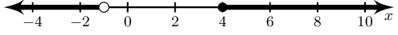

**Solution:**
\(x < -1 \text{ and } x \geq 4 ; x \in \mathbb{R}\)

**Problem:**
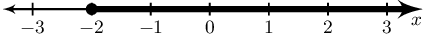

**Solution:**
\(x \geq -2 ; x \in \mathbb{R}\)

**Problem:**
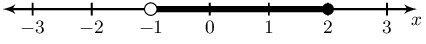

**Solution:**
\(-1 < x \leq -2 ; x \in \mathbb{R}\)

Solve for \(x\) and show your answer in interval notation

**Problem:**
\(-4x +1 > -2(x-15)\)

**Solution:**
\begin{align*}
                            -4 x +1 &> -2(x -15) \\
                            -4 x +1 &> -2 x +30 \\
                            -4 x +2 x &> 30 -1 \\
                            -2 x &> 29 \\
                            \therefore x &< \frac{-29}{2}
                            \end{align*}

\[\left(-\infty;\frac{-29}{2}\right)\]

**Problem:**
\(\dfrac{x+2}{4} \leq \dfrac{-1(x+1)}{6}\)

**Solution:**
\begin{align*}
                        \frac{x+2}{4} &\leq \frac{-1(x+1)}{6} \\
                        6(x+2) &\leq -4(x+1) \\
                        6x+12 &\leq -4x-4
                        \end{align*}

Now solve. (Remember to flip the inequality symbol if you multiply or divide by a negative.)

                        \begin{align*}
                        6x+12 &\leq -4x-4 \\
                        6x +4x &\leq -4 -12 \\
                        10x &\leq -16 \\
                        \therefore x &\leq\frac{-8}{5}
                        \end{align*}

\(\; x \in \left(-\infty; \frac{-8}{5} \right]\).

**Problem:**
\(\dfrac{1}{4}x + \dfrac{2}{3}(x+1) \geq \dfrac{2}{5}x +2\)

**Solution:**
\begin{align*}
                            \frac{1}{4}x + \frac{2}{3}(x+1) &\geq \frac{2}{5}x +2 \\
                            15x + 40(x+1) &\geq 24x +120 \\
                            15x + 40 x+40 &\geq 24x +120 \\
                            15x + 40 x -24x &\geq 120 - 40\\
                            31x &\geq 80\\
                            \therefore x &\geq \frac{80}{31}
                            \end{align*}

The interval is:
                            \[\left[\frac{80}{31};\infty\right)\]

**Problem:**
\(3x -3 > 14 \quad\text{ or }\quad 3x -3 < -2\)

**Solution:**
Solve the inequality:
                            \[\begin{array}{rclcrcl}
                            3x -3 &>& 14 &\text{or}& 3x -3 &<& -2 \\
                            3x &>& 14+3 &\text{or}& 3x &<& -2+3 \\
                            x &>& \frac{14+3}{3} &\text{or}& x &<& \frac{-2+3}{3} \\
                            x &>& \frac{17}{3} &\text{or}& x &<& \frac{1}{3} \\
                            \end{array}\]

\[\left(-\infty; \frac{1}{3}\right) \cup \left(\frac{17}{3}; \infty\right)\]

Solve and represent your answer on a number line

**Problem:**
\(2x -3 < \dfrac{3x -2}{2} , ~x \in \mathbb{N}\)

**Solution:**
\begin{align*}
                        2x -3 & < \frac{3x -2}{2} \\
                        4x - 6 & < 3x- 2 \\
                        x & < 4
                        \end{align*}

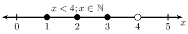

**Problem:**
\(3(1 - b) - 4 + b > 7+ b , ~b \in \mathbb{Z}\)

**Solution:**
\begin{align*}
                        3(1 - b) - 4 + b & > 7+ b \\
                        3 - 3b - 4 +b & > 7 + b \\
                        -2b & > 8 \\
                        b & < -4
                        \end{align*}

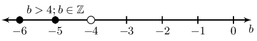

**Problem:**
\(1 -5x > 4(x + 1) - 3 , ~x \in \mathbb{R}\)

**Solution:**
\begin{align*}
                        1 -5x & > 4(x + 1) - 3 \\
                        1 - 5x & > 4x + 4 - 3 \\
                        -9x & > 0 \\
                        x & < 0
                        \end{align*}

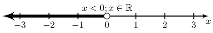

Solve for the unknown variable

**Problem:**
\(2 + 2\frac{1}{3}(x + 4) = \frac{1}{5}(3 - x) + \frac{1}{6}\)

**Solution:**
\begin{align*}
                        2 + 2\frac{1}{3}(x + 4) &= \frac{1}{5}(3 - x) + \frac{1}{6} \\
                        2 + 2\frac{1}{3}x + 9\frac{1}{3} &= \frac{3}{5} - \frac{1}{5}x + \frac{1}{6} \\
                        2\frac{1}{3}x + \frac{1}{5}x &= \frac{3}{5} + \frac{1}{6} - 2 - 9\frac{1}{3} \\
                        \frac{38}{15}x &= -\frac{317}{30} \\
                        x &= -\frac{317}{76}
                        \end{align*}

**Problem:**
\(36 - (x-4)^2 = 0\)

**Solution:**
\begin{align*}
                        36 - (x-4)^2 &= 0 \\
                        (6 + x - 4)(6 - (x-4)) &= 0\\
                        (2 + x)(10 - x) &= 0\\
                        \therefore x = -2 &\text{ or } x = 10
                        \end{align*}

**Problem:**
\(64 - (a + 3)^2 = 0\)

**Solution:**
\begin{align*}
                        64 - (a + 3)^2 &= 0 \\
                        (8 - a - 3)(8 + a + 3) &= 0\\
                        (5 - a)(11 + a) & = 0\\
                        \therefore a = 5 &\text{ or } a = -11
                        \end{align*}

**Problem:**
\(\dfrac{1}{2}x - \dfrac{2}{x} = 0\)

**Solution:**
Note \(x \neq 0\)

                        \begin{align*}
                        \frac{1}{2}x - \frac{2}{x} &= 0 \\
                        x^2 - 4 &= 0 \\
                        (x-2)(x+2) &= 0 \\
                        \therefore x = 2 &\text{ or } x = -2
                        \end{align*}

**Problem:**
\(a -3 = 2\left(\dfrac{6}{a} +1\right)\)

**Solution:**
Note \(a \neq 0\)

                        \begin{align*}
                        a - 3 &= 2\left(\frac{6}{a} -1\right) \\
                        a - 3 &= \frac{12}{a} - 2 \\
                        a^2 -3a &= 12 - 2a \\
                        a^2 -a - 12 &= 0\\
                        (a - 4)(a +3)&= 0 \\
                        \therefore a = 4 &\text{ or } a = -3
                        \end{align*}

**Problem:**
\(a - \dfrac{6}{a} = -1\)

**Solution:**
Note \(a \neq 0\)

                        \begin{align*}
                        a - \frac{6}{a} &= -1 \\
                        a^2 - 6 &= -a \\
                        a^2 +a - 6 &= 0 \\
                        (a - 2)(a +3) &= 0 \\
                        \therefore a = 2 &\text{ or } a = -3
                        \end{align*}

**Problem:**
\((a + 6)^2 - 5(a + 6) - 24 = 0\)

**Solution:**
\begin{align*}
                        (a + 6)^2 - 5(a + 6) - 24 &= 0 \\
                        ((a + 6) - 8)((a + 6) + 3) &= 0 \\
                        (a - 2)(a + 9) &= 0 \\
                        \therefore a = 2 &\text{ or } a = -9
                        \end{align*}

**Problem:**
\(a^4 - 4a^2 + 3 = 0\)

**Solution:**
\begin{align*}
                        a^4 - 4a^2 + 3 &= 0 \\
                        (a^2 - 3)(a^2 - 1) &= 0 \\
                        (a - \sqrt{3})(a + \sqrt{3})(a - 1)(a+1) &= 0 \\
                        \therefore b = \pm \sqrt{3} &\text{ or } b = \pm 1
                        \end{align*}

**Problem:**
\(9y^4 - 13y^2 + 4 = 0\)

**Solution:**
\begin{align*}
                        9y^4 - 13y^2 + 4 &= 0 \\
                        (9y^2 - 4)(y^2 - 1) &= 0 \\
                        (3y - 2)(3y + 2)(y-1)(y+1) &= 0 \\
                        \therefore y = \pm \frac{2}{3} &\text{ or } y = \pm 1
                        \end{align*}

**Problem:**
\(\dfrac{(b+1)^2 - 16}{b + 5} =1\)

**Solution:**
Note \(b \neq -5\)

                        \begin{align*}
                        \frac{(b + 1)^2 - 16}{b + 5} &= 1 \\
                        b^2 + 2b + 1 - 16 &= b + 5 \\
                        b^2 + b - 20 &= 0 \\
                        (b - 4)(b + 5) & = 0 \\
                        \therefore b &= 4
                        \end{align*}

**Problem:**
\(\dfrac{a^2 + 8a + 7}{a+7}= 2\)

**Solution:**
Note \(a \neq -7\)

                        \begin{align*}
                        \frac{a^2 + 8a + 7}{a+7}&= 2 \\
                        a^2 + 8a + 7 &= 2a + 14 \\
                        a^2 + 6a - 7 &= 0 \\
                        (a - 1)(a + 7) &= 0 \\
                        \therefore a &= 1
                        \end{align*}

**Problem:**
\(5x + 2 \le 4(2x - 1)\)

**Solution:**
\begin{align*}
                        5x + 2 & \le 4(2x - 1) \\
                        5x + 2 & \le 8x - 4 \\
                        -3x & \le -6 \\
                        x & \ge 2
                        \end{align*}

**Problem:**
\(\dfrac{4x - 2}{6} > 2x + 1\)

**Solution:**
\begin{align*}
                        \frac{4x - 2}{6} & > 2x + 1 \\
                        4x - 2 & > 12x + 6 \\
                        -8x & > 8 \\
                        x & < -1
                        \end{align*}

**Problem:**
\(\dfrac{x}{3} - 14 > 14 - \dfrac{x}{7}\)

**Solution:**
\begin{align*}
                        \frac{x}{3} - 14 & > 14 - \dfrac{x}{7} \\
                        7x - 294 & > 294 - 3x \\
                        10x & > 588 \\
                        x & > \frac{588}{10}
                        \end{align*}

**Problem:**
\(\dfrac{1 - a}{2} - \dfrac{2 - a}{3} \ge 1\)

**Solution:**
\begin{align*}
                        \frac{1 - a}{2} - \frac{2 - a}{3} & \ge 1 \\
                        3 - 3a - 4 + 2a & \ge 6 \\
                        -a & \ge 7 \\
                        a & \le -7
                        \end{align*}

**Problem:**
\(-5 \le 2k + 1 < 5\)

**Solution:**
\[\begin{array}{ccccc}
                        -5 & \le & 2k + 1 & < & 5 \\
                        -6 & \le & 2k & < & 4 \\
                        -3 & \le & k & < & 2
                        \end{array}\]

**Problem:**
\(x - 1 = \dfrac{42}{x}\)

**Solution:**
Note that \(x \ne 0\).

                        \begin{align*}
                        x - 1 & = \frac{42}{x} \\
                        x^{2} - x & = 42 \\
                        x^{2} - x - 42 & = 0 \\
                        (x - 7)(x + 6) & = 0 \\
                        x = 7 & \text{ or } x = -6
                        \end{align*}

**Problem:**
\((x+1)^2 = (x+1)(2x+3)\)

**Solution:**
\begin{align*}
                        (x+1)^2 & = (x+1)(2x+3) \\
                        x^2 + 2x + 1 & = 2x^2 + 3x + 2x + 3 \\
                        0 & = 2x^2 - x^2 + 5x - 2x + 3 - 1 \\
                        x^2 + 3x + 2 & = 0\\
                        (x+1)(x+2) & = 0 \\ \\
                        \therefore x = -1 &\text{ or } x= -2
                        \end{align*}

**Problem:**
\(3ax + 2a - ax = 5ax -6a\)

**Solution:**
\begin{align*}
                        3ax + 2a - ax &= 5ax -6a \\
                        0 &= 5ax -3ax -6a - 2a + ax \\
                        3ax - 8a &= 0 \\
                        a(3x - 8) & = 0\\ \\
                        \therefore x & = \frac{3}{8} \text{ if } a \neq 0, x \in \mathbb{R}
                        \end{align*}

Note that you cannot simply divide through by \(a\), because it is not stated that \(a \neq
                            0\), so the value of \(a\) may be \(\text{0}\) and you cannot divide by zero.

**Problem:**
\(\dfrac{ax}{b} - \dfrac{bx}{a} = \dfrac{a}{b} + 1\)

**Solution:**
Note that in this solution \(a\) and \(b\) are denominators, this means that they are no
                            equal to zero.

                        \begin{align*}
                        \frac{ax}{b} - \frac{bx}{a} &= \frac{a}{b} + 1 \\
                        (ab) \frac{ax}{b} - (ab) \frac{bx}{a} &= (ab) \frac{a}{b} + (ab) 1 \\
                        a^2x - b^2x &= a^2 + ab \\
                        x(a^2 - b^2) &= a(a+b)\\
                        x(a+b)(a-b) &= a(a+b)\\
                        x &= \frac{a(a+b)}{(a+b)(a-b)}\\
                        \therefore x &= \frac{a}{(a-b)} \text{ for } a,b \neq 0 \text{ and } a \neq b
                        \end{align*}

**Problem:**
\(3x^2 - xy - 2y^2 = 0\)

**Solution:**
\begin{align*}
                        3x^2 - xy - 2y^2 &= 0 \\
                        (3x+2y)(x-y) &= 0 \\
                        \therefore x = -\frac{2}{3}y &\text{ or } x = y
                        \end{align*}

**Problem:**
\(x(2x + 1) = 1\)

**Solution:**
\begin{align*}
                        x(2x + 1) &= 1 \\
                        2x^2 + x - 1 &= 0 \\
                        (2x-1)(x+1) &= 0 \\
                        \therefore x = \frac{1}{2} &\text{ or } x = -1
                        \end{align*}

**Problem:**
\(\dfrac{2x-5}{(x+2)(x-4)} = \dfrac{1}{2(x-4)}\)

**Solution:**
Note that \(x \neq 4\) and \(x \neq -2\), because the numerator cannot be zero

                        \begin{align*}
                        \frac{2x-5}{(x+2)(x-4)} &= \frac{1}{2(x-4)} \\
                        2(2x-5) &= x +2 \\
                        4x - 10 &= x +2 \\
                        3x &=12 \\
                        x &= 4 \\
                        \therefore \text{no solution since } x &\neq 4
                        \end{align*}

**Problem:**
\(x^2 + 1 =0\)

**Solution:**
\begin{align*}
                        x^2 + 1 &=0 \\
                        x^2 &= -1 \\
                        x &= \sqrt{-1}\\
                        \therefore \text{no solution since } \sqrt{-1} \text{ is not a real number}
                        \end{align*}

**Problem:**
\(\dfrac{x+4}{3} -2 ~> \dfrac{x-3}{2} - \dfrac{x+1}{4}\)

**Solution:**
\begin{align*}
                        \frac{x+4}{3} -2 &~> \frac{x-3}{2} - \frac{x+1}{4} \\
                        12(\frac{x+4}{3}) -(12)(2) &~> 12(\frac{x-3}{2}) - 12(\frac{x+1}{4}) \\
                        4x + 16 - 24 &~> 6x - 18 - 3x - 3 \\
                        4x + 3x - 6x + 16 - 24 + 18 + 3 &~> 0\\
                        x +13 &~> 0\\
                        x &~> -13 \\
                        \therefore x &~> -13
                        \end{align*}

**Problem:**
After solving an equation, Luke gave his answer as \(\text{4,5}\) rounded to one decimal digit.
                        Show on a number line the interval in which his solution lay.

**Solution:**
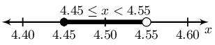
