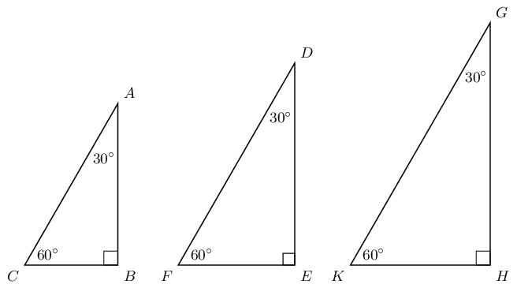
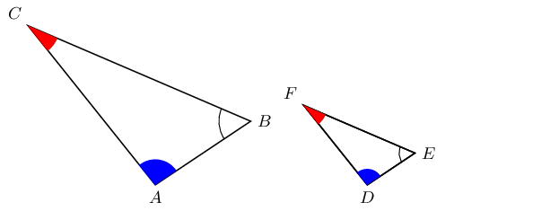

# 5.2 Similarity of triangles

<QuizCard id="m10-05-02a" title="Interactive Exercise 5.2" question="The diagram below shows a right-angled triangle with sides \(A\) , \(B\) , and \(C\) , and two acute                 angles: \(\delta\) , and \(\beta\) . Which side is opposite to the angle \(\beta\) ?" options=["A", "B", "C", "None of the above"] answer="A" hint="" explanation="Identify the side opposite to the angle \(\beta\) The labels of the sides of a right-angled triangle are: adjacent, opposite, and hypotenuse. The side that does not touch the \(\text{90}\text{°}\) angle is the hypotenuse. The hypotenuse is also the longest side of a right-angled triangle. In this question, the hypotenuse is the side \(C\) . We label the other two sides according to the location of the angle of interest . This question asked about the sides adjacent and opposite to the angle \(\beta\) , so the angle of interest is angle \(\beta\) . Using this angle, we label the other two sides in this manner: The side that touches the angle \(\beta\) is the adjacent side. The remaining side that is faraway from the angle \(\beta\) is the opposite side. There is another acute angle in the triangle, which we can call \(\delta\) . If we change the angle of interest to \(\delta\) , the labels opposite and adjacent will change. However, the hypotenuse remains the same. We can summarise the above information using the diagram below: NOTE: The sides \(B\) and \(A\) can each be the opposite side or the adjacent side. It depends on the angle of interest. The side opposite to angle \(\beta\) is \(A\) . Submit your answer as: A" />

<QuizCard id="m10-05-02a" title="Interactive Exercise 5.2" question="Consider the figure below: Triangle \(QRS\) Triangle \(XYZ\) Triangles \(QRS\) and \(XYZ\) are             right-angled triangles. For triangle \(QRS\) , \(\tan\hat{S} = \dfrac{5}{12}\) . Do you think \(\tan\hat{Z}\) is also equal to \(\dfrac{5}{12}\) ? Give a reason for your answer." options=["equal", "not equal", "the ratio of tan S is not equal to the ratio of tan Z", "it makes sense", "the definition of tangent depends on the triangle", "angles Z and S are equal"] answer="1, 0" hint="" explanation="Check if the triangles \(QRS\) and \(XYZ\) are similar We need to find out if \(\tan\hat{Z}\) is equal to \(\dfrac{5}{12}\) . Since triangles \(QRS\) and \(XYZ\) are right-angled, the tangent of angle \(\hat{Z}\) will be equal to \(\dfrac{5}{12}\) if angle \(\hat{Z}\) is equal to angle \(\hat{S}\) . Angles \(\hat{S}\) and \(\hat{Z}\) can only be equal if triangles \(QRS\) and \(XYZ\) are similar. We need to start by checking if the triangles \(QRS\) and \(XYZ\) are similar. Triangles are similar if either: corresponding angles are congruent, or corresponding sides are all in the same proportion. In this case, if the sides have the same proportion, then: \[                     \begin{aligned}                         \dfrac{QR}{XY} =                         \dfrac{RS}{YZ} =                         \dfrac{QS}{XZ}                     \end{aligned}                 \] We will use side lengths from the figure to work out these ratios and find out if they are equal. \(                             \dfrac{QR}{XY} =                             \dfrac{\text{20}}{\text{27}}                                                      \) \(                             \dfrac{RS}{YZ} =                             \dfrac{\text{52}}{\text{45}}                                                      \) \(                             \dfrac{QS}{XZ} =                             \dfrac{\text{48}}{\text{36}}                             = \dfrac{4}{3}                         \) The ratios of all corresponding sides are not equal. This shows that the triangles are not similar . In fact, the triangles also do not look similar:                     the figures are drawn to scale and we can see that they do not have the same shape. Determine if \(\tan\hat{Z}\) is equal to \(\dfrac{5}{12}\) We found out that triangles \(QRS\) and \(XYZ\) are not similar . This means that: \(\hat{R} \neq \hat{Y}\) , and \(\hat{S} \neq \hat{Z}\) . The only angles with equal sizes are \(\hat{Q}\) and \(\hat{X}\) . These are the right-angles. For right-angled triangles, the trigonometric ratios for angles of different sizes are different. And that means \(\tan\hat{S}\) cannot be equal to \(\tan\hat{Z}\) . This is a direct result of similarity. The triangles are not similar, which guarantees that the trigonometric ratios are not equal. We can use the lengths of the sides of triangles \(QRS\) and \(XYZ\) to show that this is true. The tangent of angle \(\hat{S}\) in triangle \(QRS\) is: \[\begin{array}{c}\tan\hat{S} =                 \dfrac{20}{48}                 = \dfrac{5}{12}\end{array}\] The tangent of angle \(\hat{Z}\) in triangle \(XYZ\) is: \[\begin{array}{c}\tan\hat{Z} =                 \dfrac{27}{36}                 = \dfrac{3}{4}\end{array}\] We can see that \(\tan\hat{S}\) is                  not equal to \(\tan\hat{Z}\) . The correct answer is: \(\tan\hat{Z}\) is not equal to \(\tan\hat{S}\) . Submit your answer as: not equal and the ratio of tan S is not equal to the ratio of tan Z" />

<QuizCard id="m10-05-02a" title="Interactive Exercise 5.2" question="Are triangles \(ABC\) and \(MNP\) similar?" options=["similar", "not similar", "equal to", "not equal to"] answer="similar" hint="" explanation="Use the definition of similarity of triangles We need to find out if triangles \(ABC\) and \(MNP\) are similar or not. Triangles are similar if either: corresponding angles are congruent, or corresponding sides are all in the same proportion. In this case, if the sides have the same proportion, then: \[                         \begin{aligned}                             \dfrac{AB}{MN} = \dfrac{BC}{NP} = \dfrac{AC}{MP}                         \end{aligned}                     \] We will use side lengths from the figures to work out these ratios and find out if they are equal. \(                                 \dfrac{AB}{MN} =                                 \dfrac{\text{42}}{\text{42}}                                 = 1                             \) \(                                 \dfrac{BC}{NP} =                                 \dfrac{\text{58}}{\text{58}}                                 = 1                             \) \(                                 \dfrac{AC}{MP} =                                 \dfrac{\text{40}}{\text{40}}                                 = 1                             \) The ratios of all corresponding sides are equal. This shows that the triangles are                         similar. In fact, the triangles also look similar. The figures are drawn                         to scale and we can see that they have the same shape. NOTE: Triangles \(ABC\) and \(MNP\) are congruent because their corresponding sides are equal. Congruent triangles are a special type of similar triangles. They have the same shape and size. The correct answer is: triangles \(ABC\) and \(MNP\) are similar . Submit your answer as: similar" />

## 5.2 Similarity of triangles (EMA3N)

Before we delve into the theory of trigonometry, complete the following investigation to get a better
                        understanding of the foundation of trigonometry.

## Ratios of similar triangles

Draw three similar triangles of different sizes using a protractor and a ruler, with each
                                triangle having interior angles equal to \(\text{30}\)°, \(\text{90}\)° and
                                \(\text{60}\)° as shown below. Measure the angles and lengths accurately in order
                                to fill in the table (leave your answers as a simplified fraction):

| Dividing lengths of sides (ratios) |
| --- |
| \(\frac{AB}{BC}=\) | \(\frac{AB}{AC}=\) | \(\frac{CB}{AC}=\) |
| \(\frac{DE}{EF}=\) | \(\frac{DE}{DF}=\) | \(\frac{FE}{DF}=\) |
| \(\frac{GH}{HK}=\) | \(\frac{GH}{GK}=\) | \(\frac{KH}{GK}=\) |

What observations can you make about the ratios of the sides?

Have you noticed that it does not matter what the lengths of the sides of the triangles are,
                                if the angle remains constant, the ratio of the sides will always yield the same answer?

In the triangles below, \(\triangle ABC\) is similar to \(\triangle DEF\). This is written as:

                \(\triangle ABC ||| \triangle DEF\)

In similar triangles, it is possible to deduce ratios between corresponding sides:

                \begin{align*}
                \frac{AB}{BC} & = \frac{DE}{EF} \\
                \frac{AB}{AC} & = \frac{DE}{DF} \\
                \frac{AC}{BC} & = \frac{DF}{EF} \\
                \frac{AB}{DE} & = \frac{BC}{EF} = \frac{AC}{DF}
                \end{align*}

Another important fact about similar triangles \(ABC\) and \(DEF\) is that the angle at vertex \(A\)
                        is equal to the angle at vertex \(D\), the angle at vertex \(B\) is equal to the angle at vertex
                        \(E\), and the angle at vertex \(C\) is equal to the angle at vertex \(F\).

                \begin{align*}
                \hat{A} & = \hat{D} \\ \hat{B} & = \hat{E} \\ \hat{C} & = \hat{F}
                \end{align*}

<Callout type="note" title="Note">
The order of letters for similar triangles is very important. Always label similar triangles
                                in corresponding order. For example,

                        \begin{align*}
                        \triangle ABC ||| \triangle DEF &\text{ is correct; but } \\
                        \triangle ABC ||| \triangle DFE & \text{ is incorrect.}
                        \end{align*}
</Callout>
