## 5.3 Defining the trigonometric ratios (EMA3P)

The ratios of similar triangles are used to define the trigonometric ratios. Consider a right-angled
                        triangle \(ABC\) with an angle marked \(\theta\) (said 'theta').

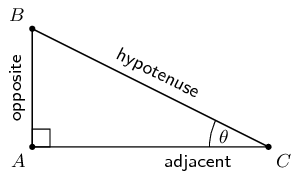

In a right-angled triangle, we refer to the three sides according to how they are placed in relation
                        to the angle \(\theta\). The side opposite to the right-angle is labelled the hypotenuse, the
                        side opposite \(\theta\) is labelled “opposite”, the side next to \(\theta\) is
                        labelled “adjacent”.

You can choose either non-\(\text{90}\)° internal angle and then define the adjacent and
                        opposite sides accordingly. However, the hypotenuse remains the same regardless of which
                        internal angle you are referring to because it is always opposite the right-angle and
                        always the longest side.

We define the trigonometric ratios: sine (\(\sin\)), cosine (\(\cos\)) and tangent (\(\tan\)), of an
                        angle, as follows:

                \begin{align*}
                \sin \theta & = \frac{\text{opposite}}{\text{hypotenuse}} \\ \\
                \cos \theta & = \frac{\text{adjacent}}{\text{hypotenuse}} \\ \\
                \tan \theta & = \frac{\text{opposite}}{\text{adjacent}}
                \end{align*}

These ratios, also known as trigonometric identities, relate the lengths of the sides of a
                        right-angled triangle to its interior angles. These three ratios form the basis of trigonometry.

<Callout type="note" title="Note">
The definitions of opposite, adjacent and hypotenuse are only applicable when working with
                                right-angled triangles! Always check to make sure your triangle has a right-angle before
                                you use them, otherwise you will get the wrong answer.
</Callout>

You may also hear people saying “Soh Cah Toa”. This is a mnemonic technique for
                        remembering the trigonometric ratios:

| \(\mathbf{\text{s}}\text{in }\theta
                                                        =\dfrac{\mathbf{\text{o}}\text{pposite}}{\mathbf{\text{h}}\text{ypotenuse}}\) |
| --- |
| \(\mathbf{\text{c}}\text{os }\theta
                                                        =\dfrac{\mathbf{\text{a}}\text{djacent}}{\mathbf{\text{h}}\text{ypotenuse}}\) |
| \(\mathbf{\text{t}}\text{an }\theta
                                                        =\dfrac{\mathbf{\text{o}}\text{pposite}}{\mathbf{\text{a}}\text{djacent}}\) |

<Callout type="tip" title="Multimedia & Video">
The following video introduces the three trigonometric ratios.

<VideoPlayer src="https://www.youtube.com/embed/Jsiy4TxgIME" title="Video: 2FN8" />
</Callout>

<Callout type="tip" title="Worked example 1: Trigonometric ratios">
**Question:**
Given the following triangle:

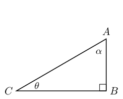

- Label the hypotenuse, opposite and adjacent sides of the triangle with respect to \(\theta\).
- State which sides of the triangle you would use to find \(\sin \theta\), \(\cos \theta\) and \(\tan \theta\).
- Label the hypotenuse, opposite and adjacent sides of the triangle with respect to \(\alpha\).
- State which sides of the triangle you would use to find \(\sin \alpha\), \(\cos \alpha\) and \(\tan \alpha\).

**Label the triangle:**
First find the right angle, the hypotenuse is always directly
                                        opposite the right angle. The hypotenuse never changes position, it is always
                                        directly opposite the right angle and so we find this first.

The opposite and adjacent sides depend on the angle we are looking at. The opposite
                                        side relative to the angle \(\theta\) is directly opposite (as the word opposite
                                        suggests) the angle \(\theta\). Finally the adjacent side is the remaining side
                                        of the triangle and must be one of the sides that forms the angle \(\theta\).

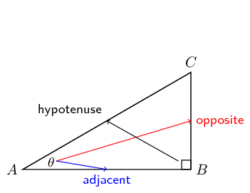

**Complete the trigonometric ratios:**
Now we can complete the trigonometric ratios for \(\theta\):

                                \begin{align*}
                                \sin \theta & = \frac{\text{opposite}}{\text{hypotenuse}} = \frac{CB}{AC} \\
                                \cos \theta & = \frac{\text{adjacent}}{\text{hypotenuse}} = \frac{AB}{AC} \\
                                \tan \theta & = \frac{\text{opposite}}{\text{adjacent}} = \frac{CB}{AB}
                                \end{align*}

Therefore to find \(\sin \theta\) we would use sides \(CB\) (opposite side to
                                        \(\theta\)) and \(AC\) (hypotenuse). To find \(\cos \theta\) we would use sides
                                        \(AB\) (adjacent side to \(\theta\)) and \(AC\) (hypotenuse). To find \(\tan
                                        \theta\) we would use sides \(CB\) (opposite side to \(\theta\)) and \(AB\)
                                        (adjacent side to \(\theta\)).

And then we can complete the trigonometric ratios for \(\alpha\). For angle
                                        \(\alpha\) the opposite and adjacent sides switch places (redraw the triangle
                                        above to help you see this). Notice how the hypotenuse is still \(AC\).

                                \begin{align*}
                                \sin \alpha & = \frac{\text{opposite}}{\text{hypotenuse}} = \frac{AB}{AC} \\
                                \cos \alpha & = \frac{\text{adjacent}}{\text{hypotenuse}} = \frac{CB}{AC} \\
                                \tan \alpha & = \frac{\text{opposite}}{\text{adjacent}} = \frac{AB}{CB}
                                \end{align*}

Therefore to find \(\sin \alpha\) we would use sides \(AB\) (opposite side to
                                        \(\alpha\)) and \(AC\) (hypotenuse). To find \(\cos \alpha\) we would use sides
                                        \(CB\) (adjacent side to \(\alpha\)) and \(AC\) (hypotenuse). To find \(\tan
                                        \alpha\) we would use sides \(AB\) (opposite side to \(\alpha\)) and \(CB\)
                                        (adjacent side to \(\alpha\)).
</Callout>

### Textbook Exercise 5.1

Complete each of the following:

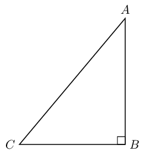

**Problem:**
\(\sin \hat{A} =\)

**Solution:**
First find the right angle, the hypotenuse is always directly
                                                                opposite the right angle. The opposite and adjacent
                                                                sides depend on the angle we are looking at. The
                                                                opposite side relative to the angle \(\hat{A}\) is
                                                                directly opposite the angle \(\hat{A}\). Finally the
                                                                adjacent side is the remaining side of the triangle and
                                                                must be one of the sides that forms the angle
                                                                \(\hat{A}\).

                                                        \[\sin \hat{A} = \frac{\text{opposite}}{\text{hypotenuse}} =
                                                        \frac{CB}{AC}\]

**Problem:**
\(\cos \hat{A} =\)

**Solution:**
First find the right angle, the hypotenuse is always directly
                                                                opposite the right angle. The opposite and adjacent
                                                                sides depend on the angle we are looking at. The
                                                                opposite side relative to the angle \(\hat{A}\) is
                                                                directly opposite the angle \(\hat{A}\). Finally the
                                                                adjacent side is the remaining side of the triangle and
                                                                must be one of the sides that forms the angle
                                                                \(\hat{A}\).

                                                        \[\cos \hat{A} = \frac{\text{adjacent}}{\text{hypotenuse}} =
                                                        \frac{AB}{AC}\]

**Problem:**
\(\tan \hat{A} =\)

**Solution:**
First find the right angle, the hypotenuse is always directly
                                                                opposite the right angle. The opposite and adjacent
                                                                sides depend on the angle we are looking at. The
                                                                opposite side relative to the angle \(\hat{A}\) is
                                                                directly opposite the angle \(\hat{A}\). Finally the
                                                                adjacent side is the remaining side of the triangle and
                                                                must be one of the sides that forms the angle
                                                                \(\hat{A}\).

                                                        \[\tan \hat{A} = \frac{\text{opposite}}{\text{adjacent}} =
                                                        \frac{CB}{AB}\]

**Problem:**
\(\sin \hat{C} =\)

**Solution:**
First find the right angle, the hypotenuse is always directly
                                                                opposite the right angle. The opposite and adjacent
                                                                sides depend on the angle we are looking at. The
                                                                opposite side relative to the angle \(\hat{C}\) is
                                                                directly opposite the angle \(\hat{C}\). Finally the
                                                                adjacent side is the remaining side of the triangle and
                                                                must be one of the sides that forms the angle
                                                                \(\hat{C}\).

                                                        \[\sin \hat{C} = \frac{\text{opposite}}{\text{hypotenuse}} =
                                                        \frac{AB}{AC}\]

**Problem:**
\(\cos \hat{C} =\)

**Solution:**
First find the right angle, the hypotenuse is always directly
                                                                opposite the right angle. The opposite and adjacent
                                                                sides depend on the angle we are looking at. The
                                                                opposite side relative to the angle \(\hat{C}\) is
                                                                directly opposite the angle \(\hat{C}\). Finally the
                                                                adjacent side is the remaining side of the triangle and
                                                                must be one of the sides that forms the angle
                                                                \(\hat{C}\).

                                                        \[\cos \hat{C} = \frac{\text{adjacent}}{\text{hypotenuse}} =
                                                        \frac{CB}{AC}\]

**Problem:**
\(\tan \hat{C} =\)

**Solution:**
First find the right angle, the hypotenuse is always directly
                                                                opposite the right angle. The opposite and adjacent
                                                                sides depend on the angle we are looking at. The
                                                                opposite side relative to the angle \(\hat{C}\) is
                                                                directly opposite the angle \(\hat{C}\). Finally the
                                                                adjacent side is the remaining side of the triangle and
                                                                must be one of the sides that forms the angle
                                                                \(\hat{C}\).

                                                        \[\tan \hat{C} = \frac{\text{opposite}}{\text{adjacent}} =
                                                        \frac{AB}{CB}\]

In each of the following triangles, state whether \(a\), \(b\) and
                                                        \(c\) are the hypotenuse, opposite or adjacent sides of the
                                                        triangle with respect to \(\theta\).

**Problem:**
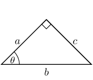

**Solution:**
First find the right angle, the hypotenuse is always directly
                                                                opposite the right angle. The opposite and adjacent
                                                                sides depend on the angle we are looking at. The
                                                                opposite side relative to the angle \(\theta\) is
                                                                directly opposite the angle \(\theta\). Finally the
                                                                adjacent side is the remaining side of the triangle and
                                                                must be one of the sides that forms the angle
                                                                \(\theta\).

- \(a\) is the adjacent side
- \(b\) is the hypotenuse
- \(c\) is the opposite side

**Problem:**
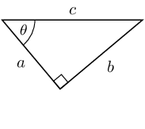

**Solution:**
First find the right angle, the hypotenuse is always directly
                                                                opposite the right angle. The opposite and adjacent
                                                                sides depend on the angle we are looking at. The
                                                                opposite side relative to the angle \(\theta\) is
                                                                directly opposite the angle \(\theta\). Finally the
                                                                adjacent side is the remaining side of the triangle and
                                                                must be one of the sides that forms the angle
                                                                \(\theta\).

- \(a\) is the adjacent side
- \(b\) is the opposite side
- \(c\) is the hypotenuse

**Problem:**
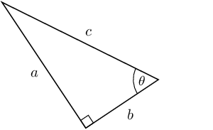

**Solution:**
First find the right angle, the hypotenuse is always directly
                                                                opposite the right angle. The opposite and adjacent
                                                                sides depend on the angle we are looking at. The
                                                                opposite side relative to the angle \(\theta\) is
                                                                directly opposite the angle \(\theta\). Finally the
                                                                adjacent side is the remaining side of the triangle and
                                                                must be one of the sides that forms the angle
                                                                \(\theta\).

- \(a\) is the opposite side
- \(b\) is the adjacent side
- \(c\) is the hypotenuse

**Problem:**
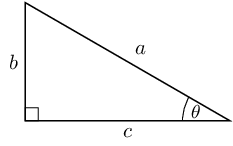

**Solution:**
First find the right angle, the hypotenuse is always directly
                                                                opposite the right angle. The opposite and adjacent
                                                                sides depend on the angle we are looking at. The
                                                                opposite side relative to the angle \(\theta\) is
                                                                directly opposite the angle \(\theta\). Finally the
                                                                adjacent side is the remaining side of the triangle and
                                                                must be one of the sides that forms the angle
                                                                \(\theta\).

- \(a\) is the hypotenuse
- \(b\) is the opposite side
- \(c\) is the adjacent side

**Problem:**
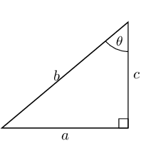

**Solution:**
First find the right angle, the hypotenuse is always directly
                                                                opposite the right angle. The opposite and adjacent
                                                                sides depend on the angle we are looking at. The
                                                                opposite side relative to the angle \(\theta\) is
                                                                directly opposite the angle \(\theta\). Finally the
                                                                adjacent side is the remaining side of the triangle and
                                                                must be one of the sides that forms the angle
                                                                \(\theta\).

- \(a\) is the opposite side
- \(b\) is the hypotenuse
- \(c\) is the adjacent side

**Problem:**
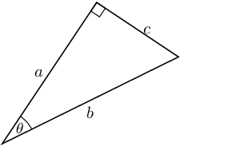

**Solution:**
First find the right angle, the hypotenuse is always directly
                                                                opposite the right angle. The opposite and adjacent
                                                                sides depend on the angle we are looking at. The
                                                                opposite side relative to the angle \(\theta\) is
                                                                directly opposite the angle \(\theta\). Finally the
                                                                adjacent side is the remaining side of the triangle and
                                                                must be one of the sides that forms the angle
                                                                \(\theta\).

- \(a\) is the adjacent side
- \(b\) is the hypotenuse
- \(c\) is the opposite side

Consider the following diagram:

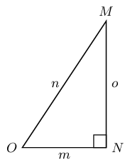

Without using a calculator, answer each of the following questions.

**Problem:**
Write down \(\cos \hat{O}\) in terms of \(m\), \(n\) and
                                                                \(o\).

**Solution:**
- \(m\) is the adjacent side
- \(n\) is the hypotenuse
- \(o\) is the opposite side

\(\cos \hat{O} = \dfrac{\text{adjacent}}{\text{hypotenuse}} =
                                                                \dfrac{m}{o}\)

**Problem:**
Write down \(\tan \hat{M}\) in terms of \(m\), \(n\) and
                                                                \(o\).

**Solution:**
- \(m\) is the opposite side
- \(n\) is the hypotenuse
- \(o\) is the adjacent side

\(\tan \hat{M} = \dfrac{\text{opposite}}{\text{adjacent}} =
                                                                \dfrac{m}{o}\)

**Problem:**
Write down \(\sin \hat{O}\) in terms of \(m\), \(n\) and
                                                                \(o\).

**Solution:**
- \(m\) is the adjacent side
- \(n\) is the hypotenuse
- \(o\) is the opposite side

\(\sin \hat{O} = \dfrac{\text{opposite}}{\text{hypotenuse}} =
                                                                \dfrac{o}{n}\)

**Problem:**
Write down \(\cos \hat{M}\) in terms of \(m\), \(n\) and
                                                                \(o\).

**Solution:**
- \(m\) is the opposite side
- \(n\) is the hypotenuse
- \(o\) is the adjacent side

\(\cos \hat{M} = \dfrac{\text{adjacent}}{\text{hypotenuse}} =
                                                                \dfrac{o}{n}\)

**Problem:**
Find \(x\) in the diagram in three different ways. You do not need to
                                                        calculate the value of \(x\), just write down the appropriate
                                                        ratio for \(x\).

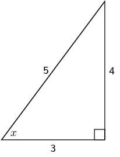

**Solution:**
- Side of length 4 is the opposite side
- Side of length 5 is the hypotenuse
- Side of length 3 is the adjacent side

Notice that the hypotenuse is the longest side as we would expect.

                                                \begin{align*}
                                                \sin x & = \frac{4}{5} \\
                                                \cos x & = \frac{3}{5} \\
                                                \tan x & = \frac{4}{3}
                                                \end{align*}

**Problem:**
Which of these statements is true about \(\triangle PQR\)?

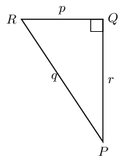

1. \(\sin \hat{R} = \dfrac{p}{q}\)
2. \(\tan \hat{Q} = \dfrac{r}{p}\)
3. \(\cos \hat{P} = \dfrac{r}{q}\)
4. \(\sin \hat{P} = \dfrac{p}{r}\)

**Solution:**
We first find the opposite and adjacent sides with respect to
                                                        \(\hat{P}\) and \(\hat{R}\):

- \(p\) is the opposite side to \(\hat{P}\) and the adjacent side to \(\hat{R}\)
- \(q\) is the hypotenuse
- \(r\) is the adjacent side to \(\hat{P}\) and the opposite side to \(\hat{R}\)

We also note that:

- \(\sin \theta = \frac{\text{opposite}}{\text{hypotenuse}}\)
- \(\cos \theta = \frac{\text{adjacent}}{\text{hypotenuse}}\)
- \(\tan \theta = \frac{\text{opposite}}{\text{adjacent}}\)

Looking at each of the given ratios we can see that only \(\cos
                                                        \hat{P} = \dfrac{r}{q}\) is correct.

**Problem:**
Sarah wants to find the value of \(\alpha\) in the triangle below.
                                                        Which statement is a correct line of working?

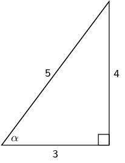

1. \(\sin \alpha = \frac{4}{5}\)
2. \(\cos \left(\frac{3}{5}\right) = \alpha\)
3. \(\tan \alpha = \frac{5}{4}\)
4. \(\cos \text{0,8} = \alpha\)

**Solution:**
Sarah first needs to identify the hypotenuse, opposite and adjacent
                                                        sides in the triangle. She then needs to write down a
                                                        trigonometric ratio that will allow her to find \(\alpha\).

\(\sin \alpha = \frac{4}{5}\) is one such ratio that will help her
                                                        find \(\alpha\). From the given list of options this is the only
                                                        correct line of reasoning.

\(\cos \left(\frac{3}{5}\right) = \alpha\) has the angle and the
                                                        lengths of the sides switched around.

\(\tan \alpha = \frac{3}{4}\) uses the wrong sides with respect to
                                                        \(\alpha\) for \(\tan\).

\(\cos \text{0,8} = \alpha\) uses the wrong sides with respect to
                                                        \(\alpha\) for \(\cos\). Note that you can reduce the fraction
                                                        to a decimal number but you need to first write the correct
                                                        fraction.

Explain what is wrong with each of the following diagrams.

**Problem:**
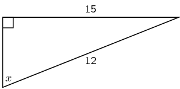

**Solution:**
The hypotenuse is too small. The hypotenuse is the longest
                                                                side of the right-angled triangle and in this case one
                                                                side of the triangle is given as being larger than the
                                                                hypotenuse.

**Problem:**
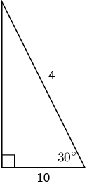

**Solution:**
The hypotenuse is too small. The hypotenuse is the longest
                                                                side of the right-angled triangle and in this case one
                                                                side of the triangle is given as being larger than the
                                                                hypotenuse.
