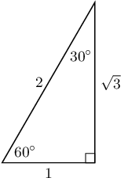
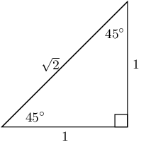
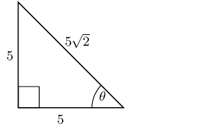
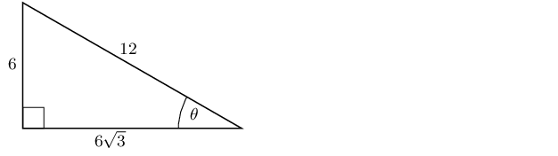

## 5.6 Special angles (EMA3S)

For most angles we need a calculator to calculate the values of \(\sin\), \(\cos\) and \(\tan\). However, there
      are some angles we can easily work out the values for without a calculator as they produce simple ratios. The
      values of the trigonometric ratios for these special angles, as well as the triangles from which they are derived,
      are shown below.

<Callout type="note" title="Note">
Remember that the lengths of the sides of a right-angled triangle must obey the Theorem of Pythagoras: the
        square of the hypotenuse equals the sum of the squares of the two other sides.
</Callout>

| \(\theta\) | 30° | 45° | 60° |
| --- | --- | --- | --- |
| \(\cos\theta\) | \(\frac{\sqrt{3}}{2}\) | \(\frac{1}{\sqrt{2}}\) | \(\frac{1}{2}\) |
| \(\sin\theta\) | \(\frac{1}{2}\) | \(\frac{1}{\sqrt{2}}\) | \(\frac{\sqrt{3}}{2}\) |
| \(\tan\theta\) | \(\frac{1}{\sqrt{3}}\) | 1 | \(\sqrt{3}\) |

These values are useful when we need to solve a problem involving trigonometric ratios without using a
      calculator.

### Textbook Exercise 5.3

Select the closest answer for each expression from the list provided:

**Problem:**
\(\cos 45^\circ\)

              \[\begin{array}{c c c c c}
              \frac{1}{2} & 1 & \sqrt{2} &\frac{1}{\sqrt{3}} &\frac{1}{\sqrt{2}}
              \end{array}\]

**Solution:**
\[\cos 45^\circ = \frac{1}{\sqrt{2}}\]

**Problem:**
\(\sin 45^\circ\)

              \[\begin{array}{c c c c c}
              \sqrt{2} &\frac{1}{2} &\frac{1}{\sqrt{2}} &\frac{\sqrt{3}}{1} & 1
              \end{array}\]

**Solution:**
\begin{align*}
              \sin 45^\circ & = \frac{1}{\sqrt{2}}
              \end{align*}

**Problem:**
\(\tan{30^\circ}\)

              \[\begin{array}{c c c c c}
              \frac{1}{2} &\frac{\sqrt{3}}{1} &\frac{1}{\sqrt{2}} &\frac{\sqrt{3}}{2}
              &\frac{1}{\sqrt{3}}
              \end{array}\]

**Solution:**
\begin{align*}
              \tan{30^\circ} & = \frac{1}{\sqrt{3}}
              \end{align*}

**Problem:**
\(\tan{60^\circ}\)

              \[\begin{array}{c c c c c}
              \frac{\sqrt{3}}{2} &\frac{1}{\sqrt{2}} &\frac{1}{\sqrt{3}} &\frac{\sqrt{3}}{1}
              &\frac{1}{1}
              \end{array}\]

**Solution:**
\begin{align*}
              \tan{60^\circ} & = \frac{\sqrt{3}}{1}
              \end{align*}

**Problem:**
\(\cos 45^\circ\)

              \[\begin{array}{c c c c c}
              \frac{\sqrt{3}}{2} &\frac{1}{2} &\frac{1}{\sqrt{3}} &\frac{1}{\sqrt{2}} &\sqrt{2}
              \end{array}\]

**Solution:**
\[\cos 45^\circ = \frac{1}{\sqrt{2}}\]

**Problem:**
\(\tan{30^\circ}\)

              \[\begin{array}{c c c c c}
              \frac{1}{\sqrt{2}} &\frac{1}{2} &\frac{\sqrt{3}}{2} &\frac{1}{1} &\frac{1}{\sqrt{3}}
              \end{array}\]

**Solution:**
\begin{align*}
              \tan{30^\circ} & = \frac{1}{\sqrt{3}}
              \end{align*}

**Problem:**
\(\tan{30^\circ}\)

              \[\begin{array}{c c c c c}
              \frac{1}{\sqrt{3}} &\frac{1}{2} &\frac{1}{\sqrt{2}} &\frac{\sqrt{3}}{2}
              &\frac{\sqrt{3}}{1}
              \end{array}\]

**Solution:**
\begin{align*}
              \tan{30^\circ} & = \frac{1}{\sqrt{3}}
              \end{align*}

**Problem:**
\(\cos 60^\circ\)

              \[\begin{array}{c c c c c}
              \frac{1}{\sqrt{3}} &\frac{1}{2} &\frac{\sqrt{3}}{2} &\frac{\sqrt{3}}{1}
              &\frac{1}{\sqrt{2}}
              \end{array}\]

**Solution:**
\[\cos 60^\circ = \frac{1}{2}\]

**Problem:**
Solve for \(\cos{\theta}\) in the following triangle, in surd form:

**Solution:**
\begin{align*}
            \cos{\theta} &= \frac{\text{opposite}}{\text{hypotenuse}} \\
            & = \frac{5}{5\sqrt{2}} \\
            &= \frac{1}{\sqrt{2}}
            \end{align*}

**Problem:**
Solve for \(\tan{\theta}\) in the following triangle, in surd form:

**Solution:**
\begin{align*}
            \tan{\theta} &= \frac{\text{opposite}}{\text{adjacent}} \\
            & = \frac{6}{6\sqrt{3}} \\
            &= \frac{1}{\sqrt{3}}
            \end{align*}

Calculate the value of the following without using a calculator:

**Problem:**
\(\sin 45° \times \cos 45°\)

**Solution:**
For both ratios the angle given is 45°. This is one of the special angles. We note that \(\sin
                45° = \cos 45° = \dfrac{1}{\sqrt{2}}\) using special angles.

              \begin{align*}
              \sin 45° \times \cos 45° & = \left(\frac{1}{\sqrt{2}}\right)\left(\frac{1}{\sqrt{2}}\right)
              \\
              & = \frac{1}{2}
              \end{align*}

**Problem:**
\(\cos 60° + \tan 45°\)

**Solution:**
We are given angles of 45° and 60°. These are both special angles. We note that \(\cos
                60° = \frac{1}{2}\) and \(\tan 45° = 1\) using special angles.

              \begin{align*}
              \cos 60° + \tan 45° & = \frac{1}{2} + 1 \\
              & = \frac{3}{2}
              \end{align*}

**Problem:**
\(\sin 60° - \cos 60°\)

**Solution:**
For both ratios the angle given is 60°. This is one of the special angles. We note that \(\sin
                60° = \dfrac{\sqrt{3}}{2}\) and \(\cos 60° = \frac{1}{2}\) using special angles.

              \begin{align*}
              \sin 60° - \cos 60° & = \frac{\sqrt{3}}{2} - \frac{1}{2} \\
              & = \frac{\sqrt{3} - 1}{2}
              \end{align*}

Evaluate the following without using a calculator. Select the closest answer from the list provided.

**Problem:**
\(\tan{45^\circ} \div \sin{60^\circ}\)

              \[\begin{array}{c c c c c }
              \frac{2}{\sqrt{3}} &\frac{\sqrt{3}}{1} &\frac{\sqrt{2}}{\sqrt{3}} &\frac{1}{1}
              &\frac{1}{2}
              \end{array}\]

**Solution:**
We need to use special angles to help us solve this problem. First write down each ratio using special
                angles and then simplify the answer.

              \begin{align*}
              \tan{45^\circ} \div \sin{60^\circ} & = \frac{1}{1} \div \frac{\sqrt{3}}{2} \\
              & = 1 \times \frac{2}{\sqrt{3}} \\
              & = \frac{2}{\sqrt{3}}
              \end{align*}

**Problem:**
\(\tan{30^\circ} - \sin{60^\circ}\)

              \[\begin{array}{c c c c c }
              0 &\frac{1}{2} &-\frac{\sqrt{3}}{2} &-\frac{1}{2\sqrt{3}} &\frac{\sqrt{3}}{2}
              \end{array}\]

**Solution:**
We need to use special angles to help us solve this problem. First write down each ratio using special
                angles and then simplify the answer.

              \begin{align*}
              \tan{30^\circ} - \sin{60^\circ} & = \frac{1}{\sqrt{3}} - \frac{\sqrt{3}}{2} \\
              & = \frac{2 - \left(\sqrt{3}\right)\left(\sqrt{3}\right)}{(2)\left(\sqrt{3}\right)} \\
              & = \frac{2 - 3}{2\sqrt{3}} \\
              & = \frac{-1}{2\sqrt{3}}
              \end{align*}

**Problem:**
\(\sin{30^\circ} - \tan{45^\circ} - \sin{30^\circ}\)

              \[\begin{array}{c c c c c}
              -\frac{\sqrt{3}}{2} & -1 &-\frac{1}{\sqrt{3}} &-\frac{\sqrt{3}}{1} &-\frac{7}{2\sqrt{3}}
              \end{array}\]

**Solution:**
We need to use special angles to help us solve this problem. First write down each ratio using special
                angles and then simplify the answer.

              \begin{align*}
              \sin{30^\circ} - \tan{45^\circ} - \sin{30^\circ} & = \frac{1}{2} - \frac{1}{1} - \frac{1}{2} \\
              & = \frac{1 - 2 - 1}{2} \\
              & = -1
              \end{align*}

**Problem:**
\(\tan{30^\circ} \div \tan{30^\circ} \div \sin{45^\circ}\)

              \[\begin{array}{c c c c c}
              \frac{\sqrt{3}}{1} &\frac{2\sqrt{3}}{\sqrt{2}} &\frac{2}{\sqrt{3}} &\frac{\sqrt{2}}{1}
              &\frac{2\sqrt{2}}{\sqrt{3}}
              \end{array}\]

**Solution:**
We need to use special angles to help us solve this problem. First write down each ratio using special
                angles and then simplify the answer.

              \begin{align*}
              \tan{30^\circ} \div \tan{30^\circ} \div \sin{45^\circ} & = \frac{1}{\sqrt{3}} \div \frac{1}{\sqrt{3}}
              \div \frac{1}{\sqrt{2}} \\
              & = \left(\frac{1}{\sqrt{3}} \times \frac{\sqrt{3}}{1}\right) \div \frac{1}{\sqrt{2}} \\
              & = 1 \times \frac{\sqrt{2}}{1} \\
              & = \frac{\sqrt{2}}{1}
              \end{align*}

**Problem:**
\(\sin{45^\circ} \div \sin{30^\circ} \div \cos{45^\circ}\)

              \[\begin{array}{c c c c c}
              \frac{\sqrt{2}}{\sqrt{3}} &\frac{1}{\sqrt{2}} &\frac{4}{\sqrt{3}} &2
              &\frac{2\sqrt{2}}{\sqrt{3}}
              \end{array}\]

**Solution:**
We need to use special angles to help us solve this problem. First write down each ratio using special
                angles and then simplify the answer.

              \begin{align*}
              \sin{45^\circ} \div \sin{30^\circ} \div \cos{45^\circ} & = \frac{1}{\sqrt{2}} \div \frac{1}{2} \div
              \frac{1}{\sqrt{2}} \\
              & = \left(\frac{1}{\sqrt{2}} \times \frac{2}{1}\right) \div \frac{1}{\sqrt{2}}\\
              & = \frac{2}{\sqrt{2}} \times \frac{\sqrt{2}}{1} \\
              & = 2
              \end{align*}

**Problem:**
\(\tan{60^\circ} - \tan{60^\circ} - \sin{60^\circ}\)

              \[\begin{array}{c c c c c}
              -\frac{1}{\sqrt{3}} &-\frac{1}{2} &-\frac{1}{\sqrt{2}} &-\frac{1}{1} &\frac{-\sqrt{3}}{2}
              \end{array}\]

**Solution:**
We need to use special angles to help us solve this problem. First write down each ratio using special
                angles and then simplify the answer.

              \begin{align*}
              \tan{60^\circ} - \tan{60^\circ} - \sin{60^\circ} & = \frac{\sqrt{3}}{1} - \frac{\sqrt{3}}{1} -
              \frac{\sqrt{3}}{2} \\
              & = \frac{(2)\left(\sqrt{3}\right) - (2)\left(\sqrt{3}\right) - \sqrt{3}}{2} \\
              & = \frac{-\sqrt{3}}{2}
              \end{align*}

**Problem:**
\(\cos{45^\circ} - \sin{60^\circ} - \sin{45^\circ}\)

              \[\begin{array}{c c c c c}
              -\frac{1}{2} &-\frac{1}{\sqrt{2}} &-\frac{7}{2\sqrt{3}} &\frac{-\sqrt{3}}{2}
              &-\frac{1}{\sqrt{3}}
              \end{array}\]

**Solution:**
We need to use special angles to help us solve this problem. First write down each ratio using special
                angles and then simplify the answer.

              \begin{align*}
              \cos{45^\circ} - \sin{60^\circ} - \sin{45^\circ} & = \frac{1}{\sqrt{2}} - \frac{\sqrt{3}}{2} -
              \frac{1}{\sqrt{2}} \\
              & = \frac{2 - \left(\sqrt{3}\right)\left(\sqrt{2}\right) - 2}{(2)\left(\sqrt{2}\right)} \\
              & = \frac{-\sqrt{3} \sqrt{2}}{2\sqrt{2}} \\
              & = \frac{-\sqrt{3}}{2}
              \end{align*}

Use special angles to show that:

**Problem:**
\(\dfrac{\sin 60°}{\cos 60°} = \tan 60°\)

**Solution:**
We are told to use special angles, so we first write each ratio using special angles and then simplify
                each side of the equation.

LHS:

              \begin{align*}
              \frac{\sin 60°}{\cos 60°} & = \frac{\frac{\sqrt{3}}{2}}{\frac{1}{2}} \\
              & = \frac{\sqrt{3}}{2} \times \frac{2}{1} \\
              & = \sqrt{3}
              \end{align*}

RHS:

              \[\tan 60° = \sqrt{3}\]

Therefore the equation is true.

**Problem:**
\(\sin^{2}45° + \cos^{2}45° = 1\)

**Solution:**
We are told to use special angles, so we first write each ratio using special angles and then simplify
                each side of the equation.

LHS:

              \begin{align*}
              \sin^{2}45° + \cos^{2}45° & = \left(\frac{1}{\sqrt{2}}\right)\left(\frac{1}{\sqrt{2}}\right)
              + \left(\frac{1}{\sqrt{2}}\right)\left(\frac{1}{\sqrt{2}}\right) \\
              & = \frac{1}{2} + \frac{1}{2} \\
              & = 1
              \end{align*}

RHS \(= \text{1}\)

Therefore the equation is true.

**Problem:**
\(\cos 30° = \sqrt{1 - \sin^{2}30°}\)

**Solution:**
We are told to use special angles, so we first write each ratio using special angles and then simplify
                each side of the equation.

LHS:

              \[\cos 30° = \frac{\sqrt{3}}{2}\]

RHS:

              \begin{align*}
              \sqrt{1 - \sin^{2}30°} & = \sqrt{1 - \left(\frac{1}{2}\right)\left(\frac{1}{2}\right)} \\
              & = \sqrt{1 - \frac{1}{4}} \\
              & = \sqrt{\frac{3}{4}} \\
              & = \frac{\sqrt{3}}{2}
              \end{align*}

Therefore the equation is true.

Use the definitions of the trigonometric ratios to answer the following questions:

**Problem:**
Explain why \(\sin \alpha \le 1\) for all values of \(\alpha\).

**Solution:**
The sine ratio is defined as \(\frac{\text{opposite}}{\text{hypotenuse}}\). In any right-angled
                triangle, the hypotenuse is the side of longest length. Therefore the maximum length of the opposite
                side is equal to the length of the hypotenuse. The maximum value of the sine ratio is then
                \(\frac{\text{hypotenuse}}{\text{hypotenuse}} = 1\).

**Problem:**
Explain why \(\cos \alpha\) has a maximum value of \(\text{1}\).

**Solution:**
The cosine ratio is defined as \(\frac{\text{adjacent}}{\text{hypotenuse}}\). In any right-angled
                triangle, the hypotenuse is the side of longest length. Therefore the maximum length of the adjacent
                side is equal to the length of the hypotenuse. The maximum value of the cosine ratio is then
                \(\frac{\text{hypotenuse}}{\text{hypotenuse}} = 1\).

**Problem:**
Is there a maximum value for \(\tan \alpha\)?

**Solution:**
The tangent ratio is defined as \(\frac{\text{opposite}}{\text{adjacent}}\). Since the opposite and
                adjacent sides can have any value (so long as the length of the side is less than or equal to the length
                of the hypotenuse), there is no maximum value for the tangent ratio.
