## 5.7 Solving trigonometric equations (EMA3T)

In this section we will first look at finding unknown lengths in right-angled triangles and then we will look at
      finding unknown angles in right-angled triangles. Finally we will look at how to solve more general trigonometric
      equations.

### Finding lengths (EMA3V)

From the definitions of the trigonometric ratios and what we have learnt about determining the values of these
        ratios for any angle we can now use this to help us find unknown lengths in right-angled triangles. The
        following worked examples will show you how.

<Callout type="tip" title="Worked example 4: Finding lengths">
**Question:**
Find the length of \(x\) in the following right-angled triangle using the appropriate trigonometric ratio
            (round your answer to two decimal places).

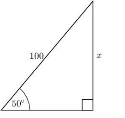

**Identify the opposite and adjacent sides and the hypotenuse with reference to the given
            angle:**
Remember that the hypotenuse side is always opposite the right angle, it never changes
            position. The opposite side is opposite the angle we are interested in and the adjacent side is the
            remaining side.

          \begin{align*}
          \sin \theta & = \frac{\text{opposite}}{\text{hypotenuse}} \\
          \sin 50° & = \frac{x}{100}
          \end{align*}

**Rearrange the equation to solve for \(x\):**
\begin{align*}
          \sin 50° \times 100 & = \frac{x}{100} \times 100 \\
          \sin 50° \times 100 & = x \\
          x & = 100 \sin 50°
          \end{align*}

**Use your calculator to find the answer:**
\begin{align*}
          x & = \text{76,60444...} \\
          x & \approx \text{76,60}
          \end{align*}
</Callout>

<Callout type="tip" title="Worked example 5: Finding lengths">
**Question:**
Find the length of \(x\) in the following right-angled triangle using the appropriate trigonometric ratio
            (round your answer to two decimal places).

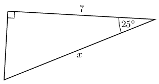

**Identify the opposite and adjacent sides and the hypotenuse with reference to the given
            angle:**
Remember that the hypotenuse side is always opposite the right angle, it never changes
            position. The opposite side is opposite the angle we are interested in and the adjacent side is the
            remaining side.

          \begin{align*}
          \cos \theta & = \frac{\text{adjacent}}{\text{hypotenuse}} \\
          \cos 25° & = \frac{7}{x}
          \end{align*}

**Rearrange the equation to solve for \(x\):**
\begin{align*}
          \cos 25° \times x & = \frac{7}{x} \times x \quad \text{multiply both sides by } x\\
          x \cos 25° & = 7 \\
          \frac{x \cos 25°}{\cos 25°} & = \frac{7}{\cos 25°} \quad \text{divide both sides by } \cos
          25°\\
          x & = \frac{7}{\cos 25°}
          \end{align*}

**Use your calculator to find the answer:**
\begin{align*}
          x & = \frac{7}{\text{0,90630...}} \\
          & = \text{7,723645...} \\
          & \approx \text{7,72}
          \end{align*}
</Callout>

<Callout type="tip" title="Worked example 6: Finding lengths">
**Question:**
Find the length of \(x\) and \(y\) in the following right-angled triangle using the appropriate
            trigonometric ratio (round your answers to two decimal places).

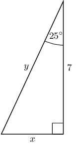

**Identify the opposite and adjacent sides and the hypotenuse with reference to the given
            angle:**
\begin{align*}
          \tan \theta & = \frac{\text{opposite}}{\text{adjacent}} \\
          \tan 25° & = \frac{x}{7} \\ \\
          \cos \theta & = \frac{\text{adjacent}}{\text{hypotenuse}} \\
          \cos 25° & = \frac{7}{y}
          \end{align*}

**Rearrange the equations to solve for \(x\) and \(y\):**
\begin{align*}
          x & = 7 \times \tan 25° \\ \\
          y & = \frac{7}{\cos 25°}
          \end{align*}

**Use your calculator to find the answers:**
\begin{align*}
          x & = \text{3,26415...} \\
          x & \approx \text{3,26} \\ \\
          y & = \text{7,72364...} \\
          y & \approx \text{7,72}
          \end{align*}
</Callout>

<Callout type="tip" title="Multimedia & Video">
The following video shows an example of finding unknown lengths in a triangle using the trigonometric ratios.

<VideoPlayer src="https://www.youtube.com/embed/eqGmQ80C3eU?list=PLOaNAKtW5HLRFWWTk2gYTAhk-UsZKHDOn" title="Video: 2FQT" />
</Callout>

### Textbook Exercise 5.4

In each triangle find the length of the side marked with a letter. Give your answers correct to
                \(\text{2}\) decimal places.

**Problem:**
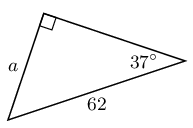

**Solution:**
\begin{align*}
                \sin \theta & = \frac{\text{opposite}}{\text{hypotenuse}} \\
                \sin 37° & = \frac{a}{62} \\
                62(\text{0,6018...}) & = a \\
                a & = \text{36,10890...} \\
                & \approx \text{36,11}
                \end{align*}

**Problem:**
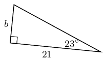

**Solution:**
\begin{align*}
                \tan \theta & = \frac{\text{opposite}}{\text{adjacent}} \\
                \tan 23° & = \frac{b}{21} \\
                21(\text{0,42447...}) & = b \\
                b & = \text{8,91397...} \\
                & \approx \text{8,91}
                \end{align*}

**Problem:**
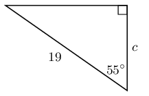

**Solution:**
\begin{align*}
                \cos \theta & = \frac{\text{adjacent}}{\text{hypotenuse}} \\
                \cos 55° & = \frac{c}{19} \\
                19(\text{0,5735...}) & = c \\
                c & = \text{10,89795...} \\
                & \approx \text{10,90}
                \end{align*}

**Problem:**
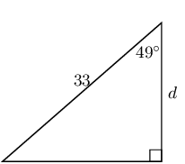

**Solution:**
\begin{align*}
                \cos \theta & = \frac{\text{adjacent}}{\text{hypotenuse}} \\
                \cos 49° & = \frac{d}{33} \\
                33(\text{0,65605...}) & = d \\
                d & = \text{21,64994...} \\
                & \approx \text{21,65}
                \end{align*}

**Problem:**
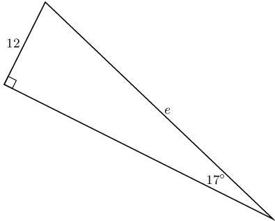

**Solution:**
\begin{align*}
                \sin \theta & = \frac{\text{opposite}}{\text{hypotenuse}} \\
                \sin 17° & = \frac{12}{e} \\
                e &= \frac{12}{\sin 17°} \\
                e & = \text{41,0436}\ldots \\
                & \approx \text{41,04}
                \end{align*}

**Problem:**
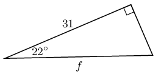

**Solution:**
\begin{align*}
                \cos \theta & = \frac{\text{adjacent}}{\text{hypotenuse}} \\
                \cos 22° & = \frac{31}{f} \\
                f(\text{0,92718...}) & = 31 \\
                f & = \text{33,434577...} \\
                & \approx \text{33,43}
                \end{align*}

**Problem:**
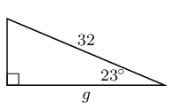

**Solution:**
\begin{align*}
                \cos \theta & = \frac{\text{adjacent}}{\text{hypotenuse}} \\
                \cos 23° & = \frac{g}{32} \\
                32(\text{0,92050...}) & = g \\
                g & = \text{29,4561...} \\
                & \approx \text{29,46}
                \end{align*}

**Problem:**
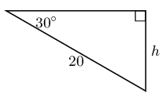

**Solution:**
\begin{align*}
                \sin \theta & = \frac{\text{opposite}}{\text{hypotenuse}} \\
                \sin 30° & = \frac{h}{20} \\
                20(\text{0,5}) & = h \\
                h & \approx \text{10}
                \end{align*}

**Problem:**
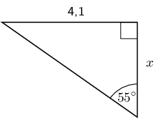

**Solution:**
\begin{align*}
                \tan{\theta} & = \frac{\text{opposite}}{\text{adjacent}}\\
                \tan{\text{55}^\circ} & = \frac{\text{4,1}}{x} \\
                x & = \text{2,87}
                \end{align*}

**Problem:**
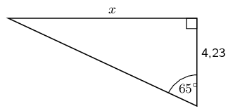

**Solution:**
\begin{align*}
                \tan{\theta} & = \frac{\text{opposite}}{\text{adjacent}}\\
                \tan{\text{65}^\circ} & = \frac{x}{\text{4,23}} \\
                x & = \text{9,06}
                \end{align*}

Write down two ratios for each of the following in terms of the sides: \(AB; BC; BD; AD; DC \text{ and
                } AC\).

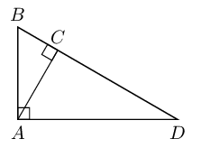

**Problem:**
\(\sin \hat{B}\)

**Solution:**
We note that triangles \(ABC\) and \(ABD\) both contain angle \(B\) so we can use these triangles to
                  write down the ratios:

                \[\sin \hat{B} = \frac{AC}{AB} = \frac{AD}{BD}\]

**Problem:**
\(\cos \hat{D}\)

**Solution:**
We note that triangles \(ACD\) and \(ABD\) both contain angle \(D\) so we can use these triangles to
                  write down the ratios:

                \[\cos \hat{D} = \frac{AD}{BD} = \frac{CD}{AD}\]

**Problem:**
\(\tan \hat{B}\)

**Solution:**
We note that triangles \(ABC\) and \(ABD\) both contain angle \(B\) so we can use these triangles to
                  write down the ratios:

                \[\tan \hat{B} = \frac{AC}{BC} = \frac{AD}{AB}\]

**Problem:**
In \(\triangle MNP\), \(\hat{N} = 90°\), \(MP=20\) and \(\hat{P} = 40°\). Calculate \(NP\)
                and \(MN\) (correct to \(\text{2}\) decimal places).

**Solution:**
Sketch the triangle:

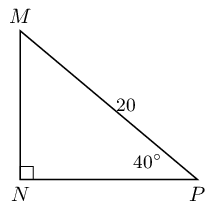

To find \(MN\) we use the sine ratio:

              \begin{align*}
              \sin \hat{P} &= \frac{MN}{MP} \\
              \sin 40° & = \frac{MN}{20} \\
              20(\text{0,642787...}) & = MN \\
              MN & = \text{12,8557...} \\
              & \approx \text{12,86}
              \end{align*}

To find \(NP\) we can use the cosine ratio:

              \begin{align*}
              \cos \hat{P} &= \frac{NP}{MP} \\
              \cos 40° & = \frac{NP}{20} \\
              20(\text{0,76604...}) & = NP \\
              NP & = \text{15,32088...} \\
              & \approx \text{15,32}
              \end{align*}

Therefore \(MN = \text{12,86} \text{ and } NP = \text{15,32}\)

**Problem:**
Calculate \(x\) and \(y\) in the following diagram.

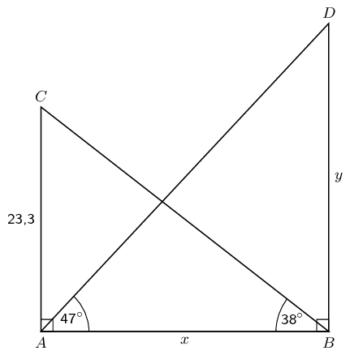

**Solution:**
To find \(x\) we use \(\triangle ABC\) and the tangent ratio. To find \(y\) we use \(\triangle ABD\)
                and the tangent ratio.

              \begin{align*}
              \tan 38° & = \frac{\text{23,3}}{x} \\
              x & = \frac{\text{23,3}}{\tan 38°} \\
              & = \text{29,82264...} \\
              & \approx \text{29,82} \\\\
              \tan 47° & = \frac{y}{\text{29,82264...}} \\
              y & = \text{29,82264...}\tan 47° \\
              & = \text{31,98086...} \\
              & \approx \text{31,98}
              \end{align*}

Therefore \(x = \text{29,82} \text{ and } y = \text{31,98}\).

### Finding an angle (EMA3W)

If the length of two sides of a triangle are known, the angles can be calculated using trigonometric ratios. In
        this section, we are finding angles inside right-angled triangles using the ratios of the sides.

<Callout type="tip" title="Worked example 7: Finding angles">
**Question:**
Find the value of \(\theta\) in the following right-angled triangle using the appropriate trigonometric
            ratio.

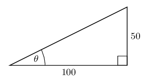

**Identify the opposite and adjacent sides with reference to the given angle and the
            hypotenuse:**
In this case you have the opposite side and the adjacent side for angle \(\theta\).

          \begin{align*}
          \tan \theta & = \frac{\text{opposite}}{\text{adjacent}} \\
          \tan \theta & =
          \frac{50}{100}
          \end{align*}

**Use your calculator to solve for \(\theta\):**
To solve for \(\theta\), you will need to use the inverse tangent function on your calculator. This works
            backwards by using the ratio of the sides to determine the angle which resulted in that ratio.

Press
            \(\boxed{\text{SHIFT}} \enspace
            \boxed{\text{tan}} \enspace
            \boxed{50} \enspace
            \boxed{\div} \enspace
            \boxed{100} \enspace
            \boxed{)} \enspace
            \boxed{=} \enspace
            \text{26,56505...}
            \approx \text{26,6}\)

**Write the final answer:**
\(\theta \approx\text{26,6}°\)
</Callout>

### Textbook Exercise 5.5

Determine \(\alpha\) in the following right-angled triangles:

**Problem:**
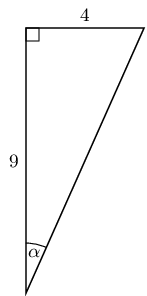

**Solution:**
\begin{align*}
              \tan \alpha & = \frac{4}{9} \\
              & = \text{0,4444...} \\
              \alpha & = \text{23,9624...} \\
              & \approx \text{23,96}°
              \end{align*}

**Problem:**
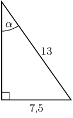

**Solution:**
\begin{align*}
              \sin \alpha & = \frac{\text{7,5}}{13} \\
              & = \text{0,5769...} \\
              \alpha & = \text{35,2344...} \\
              & \approx \text{35,23}°
              \end{align*}

**Problem:**
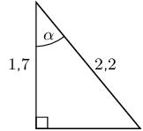

**Solution:**
\begin{align*}
              \sin \alpha & = \frac{\text{1,7}}{\text{2,2}} \\
              \alpha & = \text{39,4005...} \\
              & \approx \text{39,40}°
              \end{align*}

**Problem:**
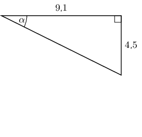

**Solution:**
\begin{align*}
              \tan \alpha & = \frac{\text{4,5}}{\text{9,1}} \\
              & = \text{0,49450...} \\
              \alpha & = \text{26,3126...} \\
              & \approx \text{26,31}°
              \end{align*}

**Problem:**
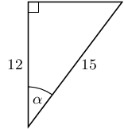

**Solution:**
\begin{align*}
              \cos \alpha & = \frac{12}{15} \\
              & = \text{0,8} \\
              \alpha & = \text{36,869897...} \\
              & \approx \text{36,87}°
              \end{align*}

**Problem:**
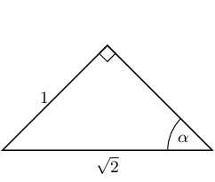

**Solution:**
\begin{align*}
              \sin \alpha & = \frac{1}{\sqrt{2}} \\
              & = \text{0,7071...} \\
              \alpha & = 45°
              \end{align*}

**Problem:**
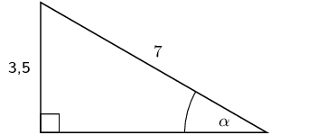

**Solution:**
\begin{align*}
              \sin{\alpha} & = \frac{\text{3,5}}{\text{7}} \\
              & = \text{0,5} \\
              \alpha & = \text{30}°
              \end{align*}

We have now seen how to solve trigonometric equations in right-angled triangles. We can use the same techniques
      to help us solve trigonometric equations when the triangle is not shown.

<Callout type="tip" title="Worked example 8: Solving trigonometric equations">
**Question:**
Find the value of \(\theta\) if \(\cos \theta = \text{0,2}\).

**Use your calculator to solve for \(\theta\):**
To solve for \(\theta\), you will need to use the inverse cosine function on your calculator. This works
          backwards by using the ratio of the sides to determine the angle which resulted in that ratio.

Press \(\boxed{\text{SHIFT}} \enspace \boxed{\text{cos}} \enspace \boxed{0} \enspace \boxed{.} \enspace
          \boxed{2} \enspace \boxed{)} \enspace \boxed{=} \enspace \text{78,46304} \approx \text{78,46}\)

**Write the final answer:**
\(\theta \approx \text{78,46}°\)
</Callout>

<Callout type="tip" title="Worked example 9: Solving trigonometric equations">
**Question:**
Find the value of \(\theta\) if \(3\sin \theta = \text{2,4}\).

**Rearrange the equation:**
We need to rearrange the equation so that \(\sin \theta\) is on one side of the equation.

        \begin{align*}
        3\sin \theta & = \text{2,4} \\
        \sin \theta & = \frac{\text{2,4}}{3}
        \end{align*}

**Use your calculator to solve for \(\theta\):**
To solve for \(\theta\), you will need to use the inverse sine function on your calculator. This works
          backwards by using the ratio of the sides to determine the angle which resulted in that ratio.

Press \(\boxed{\text{SHIFT}} \enspace \boxed{\text{sin}} \enspace \boxed{(} \enspace \boxed{2} \enspace
          \boxed{.} \enspace \boxed{4} \enspace \boxed{\div} \enspace \boxed{3} \enspace \boxed{)} \enspace \boxed{=}
          \enspace \text{53,1301...} \approx \text{53,13}\).

**Write the final answer:**
\(\theta \approx \text{53,13}°\)
</Callout>

<Callout type="note" title="Note">
When you are solving trigonometric equations you might find that you get an error when you try to calculate
        \(\sin\) or \(\cos\) (remember that both the sine and cosine functions have a maximum value of 1). For these
        cases there is no solution to the equation.
</Callout>

If learners get a math error on their calculator encourage them to think about what might have happened. It is
        also important to ensure that they know they must write down no solution rather than math error when this
        happens.

<Callout type="tip" title="Worked example 10: Solving trigonometric equations">
**Question:**
Solve for \(\alpha\): \(3 \sec \alpha = \text{1,4}\).

**Convert \(\sec\) to \(\cos\):**
There is no “\(\sec\)” button on the calculator and so we need to convert \(\sec\) to \(\cos\) so
          we can find \(\alpha\).

        \begin{align*}
        3 \sec \alpha & = \text{1,4} \\
        \frac{3}{\cos \alpha} & = \text{1,4}
        \end{align*}

**Rearrange the equation:**
We need to rearrange the equation so that we have \(\cos \alpha\) on one side of the equation.

        \begin{align*}
        \frac{3}{\cos \alpha} & = \text{1,4} \\
        3 & = \text{1,4} \cos \alpha \\
        \frac{3}{\text{1,4}} & = \cos \alpha
        \end{align*}

**Use your calculator to solve for \(\alpha\):**
To solve for \(\alpha\), you will need to use the inverse cosine function on your calculator. This works
          backwards by using the ratio of the sides to determine the angle which resulted in that ratio.

Press \(\boxed{\text{SHIFT}} \enspace \boxed{\text{cos}} \enspace \boxed{3} \enspace \boxed{\div} \enspace
          \boxed{1} \enspace \boxed{.} \enspace \boxed{4} \enspace \boxed{)} \enspace \boxed{=}\) math error

In this case we get an error when we try to do the calculation. This is because \(\dfrac{3}{\text{1,4}}\) is
          greater than 1 and the maximum value of the cosine function is 1. Therefore there is no solution. It is
          important in this case to write no solution and not math error.

**Write the final answer:**
There is no solution.
</Callout>

### Textbook Exercise 5.6

Determine the angle (correct to \(\text{1}\) decimal place):

**Problem:**
\(\tan \theta = \text{1,7}\)

**Solution:**
\begin{align*}
              \tan \theta & = \text{1,7} \\
              \theta & = \text{59,5344...} \\
              & \approx \text{59,5}°
              \end{align*}

**Problem:**
\(\sin \theta = \text{0,8}\)

**Solution:**
\begin{align*}
              \sin \theta & = \text{0,8} \\
              \theta & = \text{53,1301...} \\
              & \approx \text{53,1}°
              \end{align*}

**Problem:**
\(\cos \alpha = \text{0,32}\)

**Solution:**
\begin{align*}
              \cos \alpha & = \text{0,32} \\
              \alpha & = \text{71,3370...} \\
              & \approx \text{71,3}°
              \end{align*}

**Problem:**
\(\tan \beta = \text{4,2}\)

**Solution:**
\begin{align*}
              \tan \beta & = \text{4,2} \\
              \beta & = \text{76,60750...} \\
              & \approx \text{76,6}°
              \end{align*}

**Problem:**
\(\tan \theta = 5\frac{3}{4}\)

**Solution:**
\begin{align*}
              \tan \theta & = 5\frac{3}{4} \\
              & = \text{5,75} \\
              \theta & = \text{80,13419...} \\
              & \approx \text{80,1}°
              \end{align*}

**Problem:**
\(\sin \theta = \frac{2}{3}\)

**Solution:**
\begin{align*}
              \sin \theta & = \frac{2}{3} \\
              & = \text{0,666...} \\
              \theta & = \text{41,8103...} \\
              & \approx \text{41,8}°
              \end{align*}

**Problem:**
\(\cos \beta = \text{1,2}\)

**Solution:**
\begin{align*}
              \cos \beta & = \text{1,2} \\
              & \text{ no solution }
              \end{align*}

**Problem:**
\(4\cos \theta = 3\)

**Solution:**
\begin{align*}
              4\cos \theta & = 3 \\
              \cos \theta & = \frac{3}{4} \\
              & = \text{0,75} \\
              \theta & = \text{41,40962...} \\
              & \approx \text{41,4}°
              \end{align*}

**Problem:**
\(\cos 4\theta = \text{0,3}\)

**Solution:**
\begin{align*}
              \cos 4 \theta & = \text{0,3} \\
              4 \theta & = \text{72,54239...} \\
              \theta & = \text{18,135599...} \\
              & \approx \text{18,1}°
              \end{align*}

**Problem:**
\(\sin \beta + 2 = \text{2,65}\)

**Solution:**
\begin{align*}
              \sin \beta + 2 & = \text{2,65} \\
              \sin \beta & = \text{0,65} \\
              \beta & = \text{40,54160...} \\
              & \approx \text{40,5}°
              \end{align*}

**Problem:**
\(2\sin \theta + 5 = \text{0,8}\)

**Solution:**
\begin{align*}
              2 \sin \theta + 5 & = \text{0,8} \\
              2 \sin \theta & = -\text{4,2} \\
              \sin \theta & = -\text{2,1} \\
              & \text{ no solution }
              \end{align*}

**Problem:**
\(3 \tan \beta = 1\)

**Solution:**
\begin{align*}
              3\tan \beta & = 1 \\
              \tan \beta & = \frac{1}{3} \\
              & = \text{0,3333...} \\
              \beta & = \text{18,434948...} \\
              & \approx \text{18,4}°
              \end{align*}

**Problem:**
\(\sin 3 \alpha = \text{1,2}\)

**Solution:**
\begin{align*}
              \sin 3 \alpha & = \text{1,2} \\
              & \text{ no solution }
              \end{align*}

**Problem:**
\(\tan \frac{\theta}{3} = \sin 48°\)

**Solution:**
\begin{align*}
              \tan \frac{\theta}{3} & = \sin48° \\
              & = \text{0,7431...} \\
              \frac{\theta}{3} & = \text{36,61769...} \\
              \theta & = \text{109,8530...} \\
              & \approx \text{109,9}°
              \end{align*}

**Problem:**
\(\frac{1}{2}\cos 2\beta = \text{0,3}\)

**Solution:**
\begin{align*}
              \frac{1}{2} \cos 2 \beta & = \text{0,3} \\
              \cos 2 \beta & = \text{0,6} \\
              2 \beta & = \text{53,1301...} \\
              \beta & = \text{26,56505...} \\
              & \approx \text{26,6}°
              \end{align*}

**Problem:**
\(2 \sin 3\theta + 1 = \text{2,6}\)

**Solution:**
\begin{align*}
              2 \sin 3\theta + 1 & = \text{2,6} \\
              2 \sin 3\theta & = \text{1,6} \\
              \sin 3\theta & = \text{0,8} \\
              3 \theta & = \text{53,1301...} \\
              \theta & = \text{17,71003...} \\
              & \approx \text{17,7}°
              \end{align*}

If \(x = 16°\) and \(y = 36°\), use your calculator to evaluate each of the following, correct
              to 3 decimal places.

**Problem:**
\(\sin(x - y)\)

**Solution:**
\begin{align*}
              \sin(x - y) & = \sin(16 - 36) \\
              & = \sin (-20) \\
              & = -\text{0,3420201...} \\
              & \approx -\text{0,342}
              \end{align*}

**Problem:**
\(3\sin x\)

**Solution:**
\begin{align*}
              3 \sin x & = 3 \sin(16) \\
              & = \text{0,826912...} \\
              & \approx \text{0,827}
              \end{align*}

**Problem:**
\(\tan x - \tan y\)

**Solution:**
\begin{align*}
              \tan x - \tan y & = \tan(16) - \tan(36) \\
              & = -\text{0,439797...} \\
              & \approx -\text{0,440}
              \end{align*}

**Problem:**
\(\cos x + \cos y\)

**Solution:**
\begin{align*}
              \cos x + \cos y & = \cos(16) + \cos(36) \\
              & = \text{1,77027...} \\
              & \approx \text{1,770}
              \end{align*}

**Problem:**
\(\frac{1}{3} \tan y\)

**Solution:**
\begin{align*}
              \frac{1}{3}\tan y & = \frac{1}{3}\tan(36) \\
              & = \text{0,24218...} \\
              & \approx \text{0,242}
              \end{align*}

**Problem:**
\(\text{cosec }(x - y)\)

**Solution:**
\begin{align*}
              \text{cosec }(x - y) & = \text{cosec }(16 - 36) \\
              & = \text{cosec } (-20) \\
              & = \frac{1}{\sin (-20)} \\
              & = -\text{2,92380...} \\
              & \approx -\text{2,924}
              \end{align*}

**Problem:**
\(2\cos x + \cos 3y\)

**Solution:**
\begin{align*}
              2\cos x + \cos 3y & = 2\cos(16) + \cos(3(36)) \\
              & = 2\cos 16 + \cos 108 \\
              & = \text{1,61350...} \\
              & \approx \text{1,614}
              \end{align*}

**Problem:**
\(\tan(2x - 5y)\)

**Solution:**
\begin{align*}
              \tan(2x - 5y) & = \tan(2(16) - 5(36)) \\
              & = \tan(-148) \\
              & = \text{0,624869...} \\
              & \approx \text{0,625}
              \end{align*}

In each of the following find the value of \(x\) correct to two decimal places.

**Problem:**
\(\sin x = \text{0,814}\)

**Solution:**
\begin{align*}
              \sin x & = \text{0,814} \\
              x & = \text{54,48860...} \\
              & \approx \text{54,49}°
              \end{align*}

**Problem:**
\(\sin x = \tan \text{45}°\)

**Solution:**
\begin{align*}
              \sin x & = \tan \text{45}° \\
              & = 1 \\
              x & = \text{90}°
              \end{align*}

**Problem:**
\(\tan 2x = \text{3,123}\)

**Solution:**
\begin{align*}
              \tan 2x & = \text{3,123} \\
              2x & = \text{72,244677...} \\
              x & = \text{36,12233...} \\
              & \approx \text{36,12}°
              \end{align*}

**Problem:**
\(\tan x = 3 \sin \text{41}°\)

**Solution:**
\begin{align*}
              \tan x & = 3 \sin \text{41}° \\
              & = \text{1,96817...} \\
              x & = \text{63,06558...} \\
              & \approx \text{63,07}°
              \end{align*}

**Problem:**
\(\sin(2x + 45) = \text{0,123}\)

**Solution:**
\begin{align*}
              \sin(2x + 45°) & = \text{0,123} \\
              2x + 45 & = \text{7,06527...} \\
              2x & = -\text{37,9347...} \\
              x & = -\text{18,9673...} \\
              & \approx -\text{18,97}°
              \end{align*}

**Problem:**
\(\sin(x - 10°) = \cos\text{57}°\)

**Solution:**
\begin{align*}
              \sin(x - 10°) & = \cos\text{57}° \\
              & = \text{0,54463...} \\
              x - 10 & = \text{33} \\
              x & = \text{43}°
              \end{align*}
