## 5.8 Defining ratios in the Cartesian plane (EMA3X)

We have defined the trigonometric ratios using right-angled triangles. We can extend these definitions to
                  any angle, noting that the definitions do not rely on the lengths of the sides of the triangle, but on
                  the size of the angle only. So if we plot any point on the Cartesian plane and then draw a line from
                  the origin to that point, we can work out the angle between the \(x\)-axis and that line. We will
                  first look at this for two specific points and then look at the more general case.

Finding an angle for specific points

In the figure below points \(P\) and \(Q\) have been plotted. A line from the origin (\(O\)) to each
                  point is drawn. The dotted lines show how we can construct right-angled triangles for each point. The
                  dotted line must always be drawn to the \(x\)-axis. Now we can find the angles \(A\) and \(B\):

<Callout type="note" title="Note">
We can also extend the definitions of the reciprocals in the same way.
</Callout>

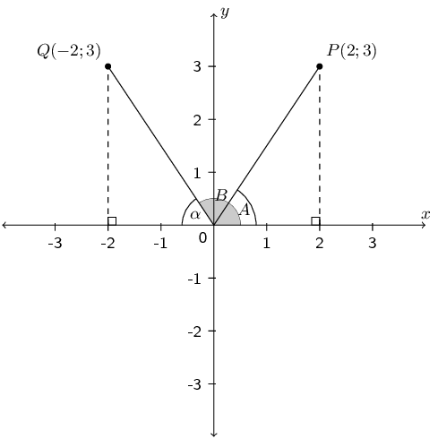

From the coordinates of \(P\left(2;3\right)\), we can see that \(x=2\) and \(y=3\). Therefore, we know
                  the length of the side opposite \(\hat{A}\) is \(\text{3}\) and the length of the adjacent side is
                  \(\text{2}\). Using:
                  \[\tan\hat{A} = \frac{\text{opposite}}{\text{adjacent}} = \frac{3}{2}\]

                  we calculate that \(\hat{A} = \text{56,3}°\).

We can also use the theorem of Pythagoras to calculate the hypotenuse of the triangle and then calculate
                  \(\hat{A}\) using:
                  \[\sin\hat{A} = \frac{\text{opposite}}{\text{hypotenuse}} \qquad \text{ or } \qquad \cos\hat{A} =
                  \frac{\text{adjacent}}{\text{hypotenuse}}\]

Consider point \(Q\left(-2;3\right)\). We define \(\hat{B}\) as the angle formed between line \(OQ\) and
                  the positive \(x\)-axis. This is called the standard position of an angle. Angles are always measured
                  from the positive \(x\)-axis in an anti-clockwise direction. Let \(\alpha\) be the angle formed
                  between the line \(OQ\) and the negative \(x\)-axis such that \(\hat{B} + \alpha = 180°\).

From the coordinates of \(Q\left(-2;3\right)\), we know the length of the side opposite \(\alpha\) is
                  \(\text{3}\) and the length of the adjacent side is \(\text{2}\). Using:
                  \[\tan\alpha = \frac{\text{opposite}}{\text{adjacent}} = \frac{3}{2}\]

                  we calculate that \(\alpha = \text{56,3}°\). Therefore \(\hat{B} = 180° - \alpha =
                  \text{123,7}°\).

Similarly, an alternative method is to calculate the hypotenuse using the theorem of Pythagoras and
                  calculate \(\alpha\) using:
                  \[\sin\alpha = \frac{\text{opposite}}{\text{hypotenuse}} \qquad \text{ or } \qquad \cos\alpha =
                  \frac{\text{adjacent}}{\text{hypotenuse}}\]

Finding any angle

If we were to draw a circle centred on the origin (\(O\)) and passing through the point \(P(x;y)\), then
                  the length from the origin to point \(P\) is the radius of the circle, which we denote \(r\). We
                  denote the angle formed between the line \(OP\) and the \(x\)-axis as \(\theta\).

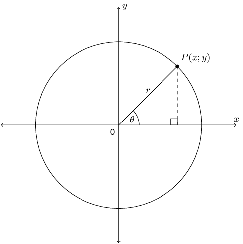

We can rewrite all the trigonometric ratios in terms of \(x\), \(y\) and \(r\). The general definitions
                  for the trigonometric ratios are:

            \[\begin{array}{cccc}
            \sin \theta & = \dfrac{y}{r} & \text{ cosec }\theta & = \dfrac{r}{y} \\ \\
            \cos \theta & = \dfrac{x}{r} & \sec\theta & = \dfrac{r}{x} \\ \\
            \tan \theta & = \dfrac{y}{x} & \cot \theta & = \dfrac{x}{y}
            \end{array}\]

The CAST diagram

The Cartesian plane is divided into \(\text{4}\) quadrants in an anti-clockwise direction as shown in the
                  diagram below. Notice that \(r\) is always positive but the values of \(x\) and \(y\) change depending
                  on the position of the point in the Cartesian plane. As a result, the trigonometric ratios can be
                  positive or negative. The letters C, A, S and T indicate which of the ratios are positive in each
                  quadrant:

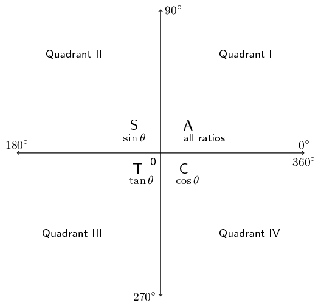

This diagram is known as the CAST diagram.

We note the following using the general definitions of the trigonometric ratios:

- Quadrant I Both the \(x\) and \(y\) values are positive so all ratios are positive in this quadrant.
- Quadrant II The \(y\) values are positive therefore \(\sin\) and cosec are positive in this quadrant (recall that \(\sin\) and cosec are defined in terms of \(y\) and \(r\)).
- Quadrant III Both the \(x\) and the \(y\) values are negative therefore \(\tan\) and \(\cot\) are positive in this quadrant (recall that \(\tan\) and \(\cot\) are defined in terms of \(x\) and \(y\)).
- Quadrant IV The \(x\) values are positive therefore \(\cos\) and \(\sec\) are positive in this quadrant (recall that \(\cos\) and \(\sec\) are defined in terms of \(x\) and \(r\)).

<Callout type="note" title="Note">
The hypotenuse, \(r\), is a length, and is therefore always positive.
</Callout>

<Callout type="tip" title="Multimedia & Video">
The following video provides a summary of the trigonometric ratios in the Cartesian plane.

<VideoPlayer src="https://www.youtube.com/embed/50BLDkLP2Is?list=PLOaNAKtW5HLRFWWTk2gYTAhk-UsZKHDOn" title="Video:
                              2FSN" />
</Callout>

<QuizCard id="m10-05-08a" title="Interactive Exercise 5.9" question="The figure below shows the CAST diagram . Point \(P\) is shown, and angle \(\theta\) is the angle from the positive \(x\) -axis to Point \(P\) . Is \(\sin  \theta\) positive or negative?" options=["positive", "negative", "impossible to know", "positive", "negative", "impossible to know"] answer="negative" hint="" explanation="Read the answer from the CAST diagram We need to determine if the expression \(\sin  \theta\) is positive or negative. We can find the answer using the CAST diagram because the CAST diagram tells us when the trigonometric ratios are positive or negative. We can see that the angle \(\theta\) puts Point \(P\) in Quadrant IV. On the CAST diagram, what letter is in Quadrant IV? It is C . The C means that the cosine ratio is positive in that quadrant and the other ratios are negative. Based on the CAST diagram, the expression \(\sin  \theta\) must be negative . Submit your answer as: negative" />

<QuizCard id="m10-05-08a" title="Interactive Exercise 5.9" question="Determine the length of the radius, \(r\) ." options=[] answer="10" hint="You should enter a number here. If you want to, you can use a space to separate thousands.                Example: 12 800,25 For scientific notation you need to use the multiply symbol                ( ∗ ) and the exponent symbol ( ^ ). For example 6,673 × 10 −11 should be written as: 6,673 ∗ 10^−11" explanation="Draw a right-angled triangle on the figure We need to find the radius of the circle. We can do this by using the coordinates of Point \(E\) . This first thing we need to do is draw a right-angled triangle on the figure. This triangle should connect Point \(E\) , the origin, and the \(x\) -axis, as shown below. Here is the key step: we can label the lengths of the sides of the triangle based on the coordinates of Point \(E\) . The \(x\) -coordinate of Point \(E\) is \(\text{8}\) : that means \(E\) is \(\text{8}\) units away from the \(y\) -axis. Similarly, the \(y\) -coordinate of \(E\) is \(-\text{6}\) , which means that \(E\) is \(\text{6}\) units away from the \(x\) -axis. Notice that the sides of the triangle are labelled with positive numbers even though the \(y\) -coordinate is negative. TIP: You can count the grid marks on the picture to verify that the lengths of the triangle's legs are correct! Use the triangle to calculate the radius The radius that we want is the hypotenuse of the triangle. So we can find the radius using the theorem of Pythagoras. \[                         \begin{aligned}                             a^2 + b^2 & = c^2 \\                             (8)^2 + (6)^2 & = r^2 \\                             100 & = r^2 \\                             \pm \sqrt{100} & = \sqrt{r^2} \\                             \pm 10 & = r                         \end{aligned}                     \] We get a radius of \(\pm 10\) . But it must be positive because it is a length. The length of the radius of the circle is \(\text{10}\) . Submit your answer as:" />

Special angles in the Cartesian plane

When working in the Cartesian plane we include two other special angles in right-angled triangles:
                  \(\text{0}\)° and \(\text{90}\)°.

Notice that when \(\theta = 0°\) the length of the opposite side is equal to \(\text{0}\) and the
                  length of the adjacent side is equal to the length of the hypotenuse. Therefore:

            \begin{align*}
            \sin 0° & = \frac{\text{opposite}}{\text{hypotenuse}} = \frac{0}{\text{hypotenuse}} = 0 \\
            \cos 0° & = \frac{\text{adjacent}}{\text{hypotenuse}} = \frac{\text{hypotenuse}}{\text{hypotenuse}}
            = 1 \\
            \tan 0° & = \frac{\text{opposite}}{\text{adjacent}}=\frac{0}{\text{adjacent}} = 0
            \end{align*}

When \(\theta =90°\) the length of the adjacent side is equal to \(\text{0}\) and the length of the
                  opposite side is equal to the length of the hypotenuse. Therefore:

            \begin{align*}
            \sin 90° & = \frac{\text{opposite}}{\text{hypotenuse}} =
            \frac{\text{hypotenuse}}{\text{hypotenuse}} = 1 \\
            \cos 90° & = \frac{\text{adjacent}}{\text{hypotenuse}} = \frac{0}{\text{hypotenuse}} = 0 \\
            \tan 90° & = \frac{\text{opposite}}{\text{adjacent}} = \frac{\text{opposite}}{0} = \text{undefined}
            \end{align*}

Now we can extend our knowledge of special angles.

| \(\theta\) | \(\text{0}\)° | \(\text{30}\)° | \(\text{45}\)° | \(\text{60}\)° | \(\text{90}\)° |
| --- | --- | --- | --- | --- | --- |
| \(\sin\theta\) | 0 | \(\dfrac{1}{2}\) | \(\dfrac{1}{\sqrt{2}}\) | \(\dfrac{\sqrt{3}}{2}\) | 1 |
| \(\cos\theta\) | 1 | \(\dfrac{\sqrt{3}}{2}\) | \(\dfrac{1}{\sqrt{2}}\) | \(\dfrac{1}{2}\) | 0 |
| \(\tan\theta\) | 0 | \(\dfrac{1}{\sqrt{3}}\) | 1 | \(\sqrt{3}\) | undefined |

<Callout type="tip" title="Worked example 11: Ratios in the Cartesian plane">
**Question:**
\(P\left(-3;4\right)\) is a point on the Cartesian plane with origin \(O\). \(\theta\) is the
                              angle between \(OP\) and the positive \(x\)-axis. Without using a calculator, determine
                              the value of:

1. \(\cos\theta\)
2. \(3\tan\theta\)
3. \(\frac{1}{2}\text{cosec }\theta\)

**Sketch point \(P\) in the Cartesian plane and label the angle \(\theta\):**
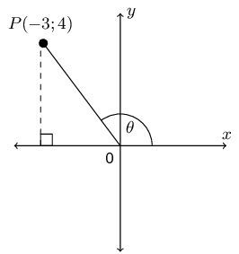

**Use the theorem of Pythagoras to calculate \(r\):**
\begin{align*}
                        {r}^{2} & = {x}^{2} + {y}^{2} \\
                        & = {\left(-3\right)}^{2} + {\left(4\right)}^{2} \\
                        & = 25 \\
                        \therefore r & = 5
                        \end{align*}

Note \(r\) is positive as it is the radius of the circle.

**Substitute values for \(x\), \(y\) and \(r\) into the required ratios:**
We note that \(x = -3\), \(y = 4\) and \(r = 5\).

1. \(\cos\theta = \dfrac{x}{r} = \dfrac{-3}{5}\)
2. \(3\tan\theta = 3\left(\dfrac{y}{x}\right) = 3\left(\dfrac{4}{-3}\right) = -4\)
3. \(\dfrac{1}{2}\text{cosec }\theta = \dfrac{1}{2}\left(\dfrac{r}{y}\right) = \frac{1}{2}\left(\dfrac{5}{4}\right) = \dfrac{5}{8}\)
</Callout>

<Callout type="tip" title="Worked example 12: Ratios in the Cartesian plane">
**Question:**
\(X\hat{O}K=\theta\) is an angle in the third quadrant where \(X\) is a point on the positive
                              \(x\)-axis and \(K\) is the point \(\left(-5;y\right)\). \(OK\) is \(\text{13}\)
                              \(\text{units}\).

1. Determine, without using a calculator, the value of \(y\).
2. Prove that \({\tan}^{2}\theta + 1 = {\sec}^{2}\theta\) without using a calculator.

**Sketch point \(K\) in the Cartesian plane and label the angle \(\theta\):**
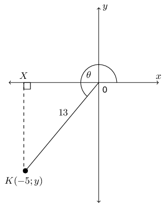

**Use the theorem of Pythagoras to calculate \(y\):**
\begin{align*}
                        {r}^{2} & = {x}^{2} + {y}^{2} \\
                        {y}^{2} & = {r}^{2} - {x}^{2} \\
                        & = {\left(13\right)}^{2} - {\left(-5\right)}^{2} \\
                        & = 169 - 25 \\
                        & = 144 \\
                        y & = ±12
                        \end{align*}

Given that \(\theta\) lies in the third quadrant, \(y\) must be negative.

                        \[\therefore y = -12\]

**Substitute values for \(x\), \(y\) and \(r\) and simplify:**
\(x = -5\), \(y = -12\) and \(r = 13\).

LHS

                        \begin{align*}
                        {\tan}^{2}\theta + 1 & = {\left(\frac{y}{x}\right)}^{2} + 1 \\
                        & = {\left(\frac{-12}{-5}\right)}^{2} + 1 \\
                        & = \left(\frac{144}{25}\right) + 1 \\
                        & = \frac{144 + 25}{25} \\
                        & = \frac{169}{25}
                        \end{align*}

RHS

                        \begin{align*}
                        {\sec}^{2}\theta & = {\left(\frac{r}{x}\right)}^{2} \\
                        & = {\left(\frac{13}{-5}\right)}^{2} \\
                        & = \frac{169}{25}
                        \end{align*}

Therefore the LHS = RHS and we have proved that \({\tan}^{2}\theta + 1 = {\sec}^{2}\theta\).
</Callout>

<Callout type="note" title="Note">
Whenever you have to solve trigonometric problems without a calculator, it can be very helpful to
                        make a sketch.
</Callout>

### Textbook Exercise 5.7

\(B\) is a point in the Cartesian plane. Determine without using a calculator:

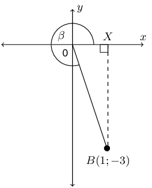

**Problem:**
\(OB\)

**Solution:**
\(OB\) is the hypotenuse of \(\triangle BOX\). We can calculate the length
                                                of \(OB\) using the theorem of Pythagoras:

                                          \begin{align*}
                                          OB^{2} & = OX^{2} + XB^{2} \\
                                          & = (1)^{2} + (3)^{2} \\
                                          & = 10 \\
                                          OB & = \sqrt{10}
                                          \end{align*}

**Problem:**
\(\cos \beta\)

**Solution:**
From the diagram and the first question we know that \(x = 1\), \(y = -3\)
                                                and \(r = \sqrt{10}\).

                                          \begin{align*}
                                          \cos \beta & = \frac{x}{r} \\
                                          & = \frac{1}{\sqrt{10}}
                                          \end{align*}

**Problem:**
\(\text{cosec } \beta\)

**Solution:**
From the diagram and the first question we know that \(x = 1\), \(y = -3\)
                                                and \(r = \sqrt{10}\).

                                          \begin{align*}
                                          \text{cosec } \beta & = \frac{r}{y} \\
                                          & = \frac{\sqrt{10}}{-3}
                                          \end{align*}

**Problem:**
\(\tan \beta\)

**Solution:**
From the diagram and the first question we know that \(x = 1\), \(y = -3\)
                                                and \(r = \sqrt{10}\).

                                          \begin{align*}
                                          \tan \beta & = \frac{y}{x} \\
                                          & = \frac{-3}{1} \\
                                          & = -3
                                          \end{align*}

If \(\sin \theta = \text{0,4}\) and \(\theta\) is an obtuse angle, determine:

**Problem:**
\(\cos \theta\)

**Solution:**
We first need to determine \(x\), \(y\) and \(r\).

                                          \begin{align*}
                                          \sin \theta & = \text{0,4} \\
                                          & = \frac{4}{10} \\
                                          & = \frac{2}{5} \\
                                          & = \frac{y}{r}
                                          \end{align*}

Therefore \(y = 2\) and \(r = 5\).

                                          \begin{align*}
                                          x^{2} & = r^{2} - y^{2} \\
                                          & = (5)^{2} - (2)^{2} \\
                                          & = 21 \\
                                          x & = \pm \sqrt{21}
                                          \end{align*}

We are told that the angle is obtuse. An obtuse angle is greater than
                                                90° but less than 180°. Therefore the angle is in the second
                                                quadrant and \(x\) is negative. Therefore \(x = - \sqrt{21}\).

Next draw a sketch:

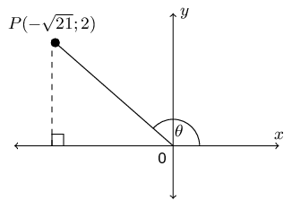

Now we can determine \(\cos \theta\):

                                          \begin{align*}
                                          \cos \theta & = \frac{x}{r} \\
                                          & = \frac{-\sqrt{21}}{5}
                                          \end{align*}

**Problem:**
\(\sqrt{21} \tan \theta\)

**Solution:**
From the first question we have a sketch of the angle and \(x\), \(y\) and
                                                \(r\).

                                          \begin{align*}
                                          \sqrt{21} \tan \theta & = \sqrt{21}\left(\frac{y}{x}\right) \\
                                          & = \sqrt{21}\left(\frac{2}{-\sqrt{21}}\right) \\
                                          & = -2
                                          \end{align*}

Given \(\tan \theta = \dfrac{t}{2}\), where \(0° \le \theta \le 90°\).
                                          Determine the following in terms of \(t\):

**Problem:**
\(\sec \theta\)

**Solution:**
We first need to determine \(x\), \(y\) and \(r\). We are given \(\tan
                                                \theta = \dfrac{t}{2}\) and so we can use this to find \(x\) and \(y\).

                                          \begin{align*}
                                          \tan \theta & = \frac{t}{2} \\
                                          \frac{y}{x} & = \frac{t}{2}
                                          \end{align*}

Therefore \(y = t\) and \(x = 2\).

                                          \begin{align*}
                                          r^{2} & = x^{2} + y^{2} \\
                                          & = (2)^{2} + (t)^{2} \\
                                          & = 4 + t^{2} \\
                                          r & = \sqrt{4 + t^{2}}
                                          \end{align*}

We are told that \(0° \le \theta \le 90°\). Therefore the angle
                                                is in the first quadrant. Even though we do not know the value of \(t\)
                                                we can draw a rough sketch:

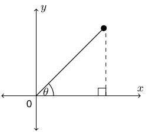

Now we can determine \(\sec \theta\):

                                          \begin{align*}
                                          \sec \theta & = \frac{r}{x} \\
                                          & = \frac{\sqrt{t^2 + 4}}{2}
                                          \end{align*}

**Problem:**
\(\cot \theta\)

**Solution:**
From the first question we have a sketch of the angle and \(x\), \(y\) and
                                                \(r\).

                                          \begin{align*}
                                          \cot \theta & = \frac{x}{y} \\
                                          & = \frac{2}{t}
                                          \end{align*}

**Problem:**
\(\cos^{2} \theta\)

**Solution:**
From the first question we have a sketch of the angle and \(x\), \(y\) and
                                                \(r\).

                                          \begin{align*}
                                          \cos^2 \theta & = \left(\frac{x}{r}\right)^{2} \\
                                          & = \left(\frac{2}{\sqrt{t^2 + 4}} \right)^2 \\
                                          &= \frac{4}{t^2 + 4}
                                          \end{align*}

**Problem:**
\(\tan^{2} \theta - \sec^{2} \theta\)

**Solution:**
From the first question we have a sketch of the angle and \(x\), \(y\) and
                                                \(r\).

                                          \begin{align*}
                                          \tan^2 \theta - \sec^2 \theta & = \left(\frac{y}{x}\right)^{2} +
                                          \left(\frac{x}{y}\right)^{2} \\
                                          & = \left(\frac{t}{2}\right)^{2} - \left(\frac{\sqrt{t^2 + 4}}{2}
                                          \right)^{2} \\
                                          & = \frac{t^{2}}{4} - \frac{t^2 + 4}{4} \\
                                          & =\frac{t^{2} - t^{2} - 4}{4} \\
                                          & = -1
                                          \end{align*}

Given: \(10 \cos \beta + 8 = 0\) and \(180^{\circ} < \beta < 360^{\circ}\).
                                          Determine the value of:

**Problem:**
\(\cos \beta\)

**Solution:**
We are given an equation with \(\cos \beta\) in it. We can therefore
                                                rearrange this equation to find \(\cos \beta\):

                                          \begin{align*}
                                          10 \cos \beta + 8 & = 0 \\
                                          \cos \beta & = \frac{-8}{10} \\
                                          & = \frac{-4}{5}
                                          \end{align*}

**Problem:**
\(\dfrac{3}{\tan{\beta}} + 2 \sin^2{\beta}\)

**Solution:**
We first need to determine \(x\), \(y\) and \(r\). In the first question we
                                                found that \(\cos \beta = \frac{-4}{5}\) and so we can use this to find
                                                \(x\) and \(r\).

                                          \begin{align*}
                                          \cos \beta & = \frac{-4}{5} \\
                                          \frac{x}{r} & = \frac{-4}{5}
                                          \end{align*}

Therefore \(x = -4\) and \(r = 5\).

                                          \begin{align*}
                                          y^{2} & = r^{2} - x^{2} \\
                                          & = (5)^{2} - (-4)^{2} \\
                                          & = 25 - 16 \\
                                          y & = \pm 3
                                          \end{align*}

We are told that \(180^{\circ} < \beta < 360^{\circ}\). Therefore the
                                                angle is in the third quadrant and \(y = -3\). We can draw a rough
                                                sketch of the angle:

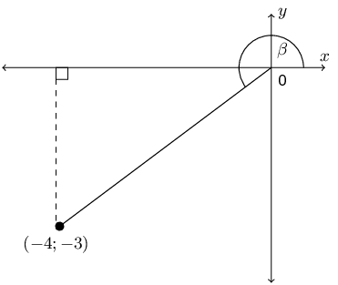

We can now find \(\frac{3}{\tan{\beta}} + 2 \sin^2{\beta}\):

                                          \begin{align*}
                                          \frac{3}{\tan{\beta}} + 2 \sin^2{\beta} & = \frac{3}{\frac{y}{x}} +
                                          2\left(\frac{y}{r}\right)^{2} \\
                                          & = \frac{3x}{y} + \frac{2y^{2}}{r^{2}} \\
                                          & = \frac{3(-4)}{-3} + \frac{2(-3)^{2}}{(5)^{2}} \\
                                          & = \frac{-12}{3} + \frac{18}{25} \\
                                          & = -4 + \frac{18}{25} \\
                                          & = \frac{-100 + 18}{25} \\
                                          & = \frac{-82}{25}
                                          \end{align*}

If \(\sin{\theta} = -\dfrac{15}{17}\) and \(\cos \theta < 0\) find the
                                          following, without the use of a calculator:

**Problem:**
\(\cos \theta\)

**Solution:**
We first need to determine \(x\), \(y\) and \(r\). We are given
                                                \(\sin{\theta} = -\frac{15}{17}\) and so we can use this to find \(y\)
                                                and \(r\).

                                          \begin{align*}
                                          \sin \theta & = -\frac{15}{17} \\
                                          \frac{y}{r} & = -\frac{15}{17}
                                          \end{align*}

Therefore \(y = -15\) and \(r = 17\) (remember that \(r\) cannot be
                                                negative).

                                          \begin{align*}
                                          x^{2} & = r^{2} - y^{2} \\
                                          & = (17)^{2} - (-15)^{2} \\
                                          & = 289 - 225 \\
                                          x & = \pm 8
                                          \end{align*}

We are told that \(\cos \theta < 0\). Therefore the angle is in either
                                                the second or the third quadrant. From the value of \(y\) we see that
                                                the angle must lie in the third quadrant and \(x = -8\).

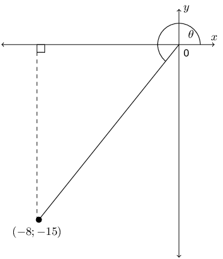

Now we can determine \(\cos \theta\):

                                          \begin{align*}
                                          \cos \theta & = \frac{x}{r} \\
                                          & = \frac{-8}{17}
                                          \end{align*}

**Problem:**
\(\tan \theta\)

**Solution:**
From the first part we have \(x = -8\), \(y = -15\) and \(r = 17\) so we
                                                can find \(\tan \theta\).

                                          \begin{align*}
                                          \tan \theta & = \frac{y}{x} \\
                                          & = \frac{-15}{-8} \\
                                          & = \frac{15}{8}
                                          \end{align*}

**Problem:**
\(\cos^2 \theta + \sin^2 \theta\)

**Solution:**
From the first part we have \(x = -8\), \(y = -15\) and \(r = 17\) so we
                                                can find \(\cos^2 \theta + \sin^2 \theta\).

                                          \begin{align*}
                                          \cos^2 \theta + \sin^2 \theta & = \left(\frac{x}{r}\right)^{2} +
                                          \left(\frac{y}{r}\right)^{2} \\
                                          & = \frac{x^{2}}{r^{2}} + \frac{y^{2}}{r^{2}} \\
                                          & = \frac{x^{2} + y^{2}}{r^{2}} \\
                                          & = \frac{(-8)^{2} + (-15)^{2}}{(17)^{2}} \\
                                          & = \frac{64 + 225}{289} \\
                                          & = 1
                                          \end{align*}

**Problem:**
Find the value of \(\sin A + \cos A\) without using a calculator, given that \(13
                                          \sin A - 12 = 0\), where \(\cos A < 0\).

**Solution:**
We first need to determine \(x\), \(y\) and \(r\). We are given \(13 \sin A - 12
                                          = 0\) and so we can use this to find \(y\) and \(r\).

                                    \begin{align*}
                                    13 \sin A - 12 & = 0 \\
                                    \sin A & = \frac{12}{13}
                                    \end{align*}

Therefore \(y = 12\) and \(r = 13\).

                                    \begin{align*}
                                    x^{2} & = r^{2} - y^{2} \\
                                    & = (13)^{2} - (12)^{2} \\
                                    & = 169 - 144 \\
                                    x & = \pm 5
                                    \end{align*}

We are told that \(\cos A < 0\). Therefore the angle is in either the second
                                          or the third quadrant. From the value of \(y\) we see that the angle must lie
                                          in the second quadrant.

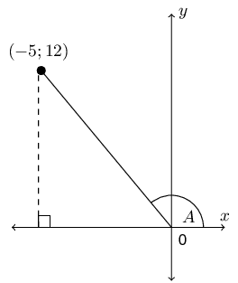

Now we can determine \(\sin A + \cos A\):

                                    \begin{align*}
                                    \sin A + \cos A & = \frac{y}{r} + \frac{x}{r} \\
                                    & = \frac{y + x}{r} \\
                                    & = \frac{12 - 5}{13} \\
                                    & = \frac{7}{13}
                                    \end{align*}

If \(17 \cos \theta = -8\) and \(\tan \theta > 0\) determine the following
                                          with the aid of a diagram (not a calculator):

**Problem:**
\(\dfrac{\cos \theta}{\sin \theta}\)

**Solution:**
We first need to determine \(x\), \(y\) and \(r\). We are given \(17 \cos
                                                \theta = -8\) and so we can use this to find \(x\) and \(r\).

                                          \begin{align*}
                                          17 \cos \theta = -8 & = 0 \\
                                          \cos \theta & = \frac{-8}{17}
                                          \end{align*}

Therefore \(x = -8\) and \(r = 17\).

                                          \begin{align*}
                                          y^{2} & = r^{2} - x^{2} \\
                                          & = (17)^{2} - (8)^{2} \\
                                          y & = \pm 15
                                          \end{align*}

We are told that \(\tan \theta > 0\). Therefore the angle is in either
                                                the first or the third quadrant. From the value of \(x\) we see that the
                                                angle must lie in the third quadrant.

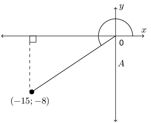

Now we can determine \(\dfrac{\cos \theta}{\sin \theta}\):

                                          \begin{align*}
                                          \frac{\cos \theta}{\sin \theta} & = \cos \theta \times \frac{1}{\sin
                                          \theta} \\
                                          & = \frac{y}{r} \times \frac{1}{\frac{x}{r}} \\
                                          & = \frac{y}{r} \times \frac{r}{x} \\
                                          & = \frac{y}{x} \\
                                          & = \frac{-8}{-15} \\
                                          & = \frac{8}{15}
                                          \end{align*}

**Problem:**
\(17 \sin \theta - 16 \tan \theta\)

**Solution:**
From the first part we have that \(x = -15\), \(y = -8\) and \(r = 17\).

                                          \begin{align*}
                                          17 \sin \theta - 16 \tan \theta & = 17\frac{y}{r} - 16\frac{y}{x} \\
                                          & = 17\left(\frac{-15}{17}\right) - 16\left(\frac{-15}{-8}\right) \\
                                          & = -15 - 2(15) \\
                                          & = -45
                                          \end{align*}

\(L\) is a point with co-ordinates \((5;8)\) on a Cartesian plane. \(LK\) forms
                                          an angle, \(\theta\), with the positive \(x\)-axis. Set up a diagram and use
                                          it to answer the following questions.

**Problem:**
Find the distance \(LK\).

**Solution:**
We are given \(L(5;8)\). Therefore the angle lies in the first quadrant. We
                                                can sketch this and use our sketch to find \(x\), \(y\) and \(r\).

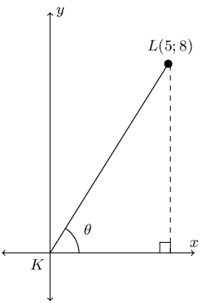

Therefore \(x = 5\) and \(y = 8\). We can calculate \(r\) using the theorem
                                                of Pythagoras. From the diagram we note that \(LK = r\).

                                          \begin{align*}
                                          LK^{2} & = 5^{2} + 8^{2} \\
                                          & = 89 \\
                                          LK & = \sqrt{89}
                                          \end{align*}

**Problem:**
\(\sin \theta\)

**Solution:**
From the previous question we have that \(x = 5\), \(y = 8\) and \(r =
                                                \sqrt{89}\).

                                          \begin{align*}
                                          \sin \theta & = \frac{y}{r} \\
                                          & = \frac{8}{\sqrt{89}}
                                          \end{align*}

**Problem:**
\(\cos \theta\)

**Solution:**
From the previous question we have that \(x = 5\), \(y = 8\) and \(r =
                                                \sqrt{89}\).

                                          \begin{align*}
                                          \cos \theta & = \frac{x}{r} \\
                                          & = \frac{5}{\sqrt{89}}
                                          \end{align*}

**Problem:**
\(\tan \theta\)

**Solution:**
From the previous question we have that \(x = 5\), \(y = 8\) and \(r =
                                                \sqrt{89}\).

                                          \begin{align*}
                                          \tan \theta & = \frac{y}{x} \\
                                          & = \frac{8}{5}
                                          \end{align*}

**Problem:**
\(\text{cosec } \theta\)

**Solution:**
From the previous question we have that \(x = 5\), \(y = 8\) and \(r =
                                                \sqrt{89}\).

                                          \begin{align*}
                                          \text{cosec } \theta & = \frac{r}{y} \\
                                          & = \frac{\sqrt{89}}{8}
                                          \end{align*}

**Problem:**
\(\sec \theta\)

**Solution:**
From the previous question we have that \(x = 5\), \(y = 8\) and \(r =
                                                \sqrt{89}\).

                                          \begin{align*}
                                          \sec \theta & = \frac{r}{x} \\
                                          & = \frac{\sqrt{89}}{5}
                                          \end{align*}

**Problem:**
\(\cot \theta\)

**Solution:**
From the previous question we have that \(x = 5\), \(y = 8\) and \(r =
                                                \sqrt{89}\).

                                          \begin{align*}
                                          \cot \theta & = \frac{x}{y} \\
                                          & = \frac{5}{8}
                                          \end{align*}

**Problem:**
\(\sin^{2} \theta + \cos^{2} \theta\)

**Solution:**
From the previous question we have that \(x = 5\), \(y = 8\) and \(r =
                                                \sqrt{89}\).

                                          \begin{align*}
                                          \sin^{2} \theta + \cos^{2} \theta & = \left(\frac{y}{r}\right)^{2} +
                                          \left(\frac{x}{r}\right)^{2} \\
                                          & = \frac{y^{2}}{r^{2}} + \frac{x^{2}}{r^{2}} \\
                                          & = \frac{y^{2} + x^{2}}{r^{2}} \\
                                          & = \frac{64 + 25}{89} \\
                                          & = 1
                                          \end{align*}

Given the following diagram and that \(\cos \theta = -\frac{24}{25}\).

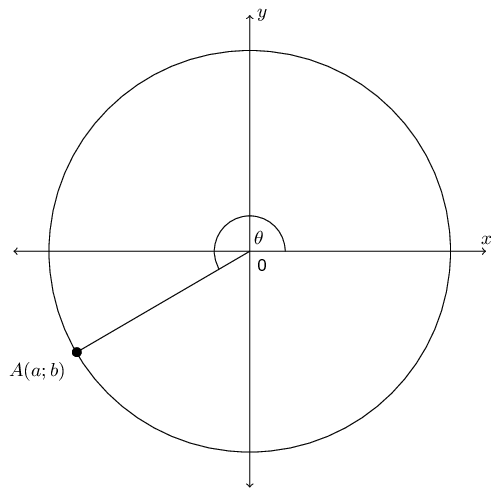

**Problem:**
State two sets of possible values of \(a\) and \(b\).

**Solution:**
We first need to use the given information to find a possible set of values
                                                for \(a\) and \(b\).

Using \(\cos \theta = -\frac{24}{25}\) and the fact that \(\cos \theta =
                                                \dfrac{x}{r}\) we can determine that \(x = -24\) and \(r = 25\). Now we
                                                can find \(y\):

                                          \begin{align*}
                                          y^{2} & = r^{2} - x^{2} \\
                                          & = (25)^2 - (24)^2 \\
                                          & = 625 - 576 \\
                                          & = 49 \\
                                          y & = \pm 7
                                          \end{align*}

From the diagram we see that \(y\) must be negative.

This gives us one possible set of values for \(a\) and \(b\): \(a = 24\)
                                                and \(b = -7\).

Now we note that we can simply double the size of the circle and the
                                                trigonometric ratios will stay the same. We could even multiply the
                                                radius of the circle by any integer and the trigonometric ratios will
                                                still remain the same.

Therefore the possible sets of values for \(A(a,b)\) are multiples of
                                                \((-24;-7)\). Two possible sets are \((-24;-7)\) and \((-48;-14)\).

**Problem:**
If \(OA = 100\), state the values of \(a\) and \(b\).

**Solution:**
First note that in the original diagram \(OA = 25\). Now we are multiplying
                                                \(OA\) by 4. This also means that the \(x\) and \(y\) values must be
                                                multiplied by 4.

Therefore \(a = 4(-24) = -96\) and \(b = 4(-7) = -28\).

**Problem:**
Hence determine without the use of a calculator the value of \(\sin
                                                \theta\).

**Solution:**
The question states: “hence”. This means we must use the scaled
                                                values for \(a\) and \(b\) not the original values. We know that \(x =
                                                -96\), \(y = -28\) and \(r = 100\).

                                          \begin{align*}
                                          \sin \theta & = \frac{y}{r} \\
                                          &= \frac{-28}{100}\\
                                          &= \frac{-7}{25}
                                          \end{align*}

Notice how the answer reduced to the original values of \(y\) and \(r\) as
                                                we would expect from the first question.

**Problem:**
If \(\tan{\alpha} = \dfrac{5}{-12}\) and \(0^{\circ} \le \alpha \le
                                          180^{\circ}\), determine without the use of a calculator the
                                          value of \(\dfrac{12}{\cos{\alpha}}\)

**Solution:**
We first need to determine \(x\), \(y\) and \(r\). We are given \(\tan \alpha =
                                          \dfrac{5}{-12}\) and so we can use this to find \(x\) and \(y\).

                                    \begin{align*}
                                    \tan \alpha & = \frac{5}{-12} \\
                                    \frac{y}{x} & = \frac{5}{-12}
                                    \end{align*}

Therefore \(y = 5\) and \(x = -12\).

                                    \begin{align*}
                                    r^{2} & = x^{2} + y^{2} \\
                                    & = (-12)^{2} + (5)^{2} \\
                                    & = 144 + 25 \\
                                    r & = 13
                                    \end{align*}

We are told that \(0° \le \alpha \le 180°\). Therefore the angle is in
                                          either the first or the second quadrant. From the values of \(x\) and \(y\) we
                                          see that the angle must lie in the second quadrant.

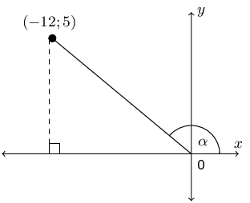

Now we can determine \(\dfrac{12}{\cos{\alpha}}\):

                                    \begin{align*}
                                    \frac{12}{\cos{\alpha}} & = \frac{12}{\frac{x}{r}} \\
                                    & = \frac{12r}{x} \\
                                    & = \frac{12(13)}{-12} \\
                                    & = -13
                                    \end{align*}
