### Textbook Exercise 5.8

State whether each of the following trigonometric ratios has been written correctly.

**Problem:**
\(\sin \theta = \dfrac{\text{hypotenuse}}{\text{adjacent}}\)

**Solution:**
We recall the definition of the sine ratio: \(\sin \theta = \dfrac{\text{opposite}}{\text{hypotenuse}}\).
              Therefore this trigonometric ratio has not been written correctly.

**Problem:**
\(\tan \theta = \dfrac{\text{opposite}}{\text{adjacent}}\)

**Solution:**
We recall the definition of the tangent ratio: \(\tan \theta =
              \dfrac{\text{opposite}}{\text{adjacent}}\). Therefore this trigonometric ratio has been written correctly.

**Problem:**
\(\sec \theta = \dfrac{\text{hypotenuse}}{\text{adjacent}}\)

**Solution:**
We recall the definition of the secant ratio: \(\sec \theta =
              \dfrac{\text{hypotenuse}}{\text{opposite}}\). Therefore this trigonometric ratio has not been written
              correctly.

Use your calculator to evaluate the following expressions to two decimal places:

**Problem:**
\(\tan{80^\circ}\)

**Solution:**
\begin{align*}
            \tan{80^\circ} & = \text{5,6712...} \\
            & \approx \text{5,67}
            \end{align*}

**Problem:**
\(\cos{73^\circ}\)

**Solution:**
\begin{align*}
            \cos{73^\circ} & = \text{0,29237...} \\
            & \approx \text{0,29}
            \end{align*}

**Problem:**
\(\sin{17^\circ}\)

**Solution:**
\begin{align*}
            \sin{17^\circ} & = \text{0,2923...} \\
            & \approx \text{0,29}
            \end{align*}

**Problem:**
\(\tan{313^\circ}\)

**Solution:**
\begin{align*}
            \tan{313^\circ} & = -\text{1,07236...} \\
            & \approx -\text{1,07}
            \end{align*}

**Problem:**
\(\cos{138^\circ}\)

**Solution:**
\begin{align*}
            \cos{138^\circ} & = -\text{0,743144...} \\
            & \approx -\text{0,74}
            \end{align*}

**Problem:**
\(\sec{56^\circ}\)

**Solution:**
\begin{align*}
            \sec{56^\circ} & = \frac{1}{\cos{56^\circ}} \\
            & = \frac{1}{\text{0,5591...}} \\
            & = \text{1,78829...} \\
            & \approx \text{1,79}
            \end{align*}

**Problem:**
\(\cot{18^\circ}\)

**Solution:**
\begin{align*}
            \cot{18^\circ} & = \frac{1}{\tan{18^\circ}} \\
            & = \frac{1}{\text{0,32491...}} \\
            & = \text{3,07768...} \\
            & \approx \text{3,08}
            \end{align*}

**Problem:**
\(\text{cosec }37^\circ\)

**Solution:**
\begin{align*}
            \text{cosec } 37^\circ & = \frac{1}{\sin{37^\circ}} \\
            & = \frac{1}{\text{0,6018...}} \\
            & = \text{1,66164...} \\
            & \approx \text{1,66}
            \end{align*}

**Problem:**
\(\sec 257^\circ\)

**Solution:**
\begin{align*}
            \sec 257^\circ & = \frac{1}{\cos{257^\circ}} \\
            & = \frac{1}{-\text{0,224951...}} \\
            & = -\text{4,445411...} \\
            & \approx -\text{4,45}
            \end{align*}

**Problem:**
\(\sec 304^\circ\)

**Solution:**
\begin{align*}
            \sec 304^\circ & = \frac{1}{\cos{304^\circ}} \\
            & = \frac{1}{\text{0,559193...}} \\
            & = \text{1,788292...} \\
            & \approx \text{1,79}
            \end{align*}

**Problem:**
\(3 \sin 51^{\circ}\)

**Solution:**
\begin{align*}
            3 \sin 51^{\circ} & = \text{2,3314...} \\
            & \approx \text{2,33}
            \end{align*}

**Problem:**
\(4\cot 54^{\circ} + 5 \tan 44^{\circ}\)

**Solution:**
\begin{align*}
            4\cot 54^{\circ} + 5 \tan 44^{\circ} & = \frac{4}{\tan 54^{\circ}} + 5 \tan 44^{\circ} \\
            & = \text{7,7346...} \\
            & \approx \text{7,73}
            \end{align*}

**Problem:**
\(\dfrac{\cos 205^{\circ}}{4}\)

**Solution:**
\begin{align*}
            \frac{\cos 205^{\circ}}{4} & = -\text{0,22657...} \\
            & \approx -\text{0,23}
            \end{align*}

**Problem:**
\(\sqrt{\sin 99^{\circ}}\)

**Solution:**
\begin{align*}
            \sqrt{\sin 99^{\circ}} & = \sqrt{\text{0,98768...}} \\
            & = \text{0,9938...} \\
            & \approx \text{0,99}
            \end{align*}

**Problem:**
\(\sqrt{\cos 687^{\circ} + \sin 120^{\circ}}\)

**Solution:**
\begin{align*}
            \sqrt{\cos 687^{\circ} + \sin 120^{\circ}} & = \sqrt{\text{1,7046...}}\\
            & = \text{1,3056...} \\
            & \approx \text{1,31}
            \end{align*}

**Problem:**
\(\dfrac{\tan 70^{\circ}}{\text{cosec } 1^{\circ}}\)

**Solution:**
\begin{align*}
            \frac{\tan 70^{\circ}}{\text{cosec } 1^{\circ}} & = \tan 70^{\circ} \times \frac{1}{\frac{1}{\sin
            1^{\circ}}} \\
            & = \tan 70^{\circ} \times \sin 1^{\circ} \\
            & = \text{0,04795...} \\
            & \approx \text{0,05}
            \end{align*}

**Problem:**
\(\sec 84^{\circ} + 4\sin \text{0,4}^{\circ} \times 50\cos 50^{\circ}\)

**Solution:**
\begin{align*}
            \sec 84^{\circ} + 4\sin \text{0,4}^{\circ} \times 50\cos 50^{\circ} & = \frac{1}{\cos 84^{\circ}} +
            4\sin \text{0,4}^{\circ} \times 50\cos 50^{\circ} \\
            & = \text{9,56677...} + \text{0,89749...} \\
            & = \text{10,46426...} \\
            & \approx \text{10,46}
            \end{align*}

**Problem:**
\(\dfrac{\cos 40^{\circ}}{\sin 35^{\circ}} + \tan 38^{\circ}\)

**Solution:**
\begin{align*}
            \frac{\cos 40^{\circ}}{\sin 35^{\circ}} + \tan 38^{\circ} & = \text{1,3355...} + \text{0,7812...} \\
            & = \text{2,1168...} \\
            & \approx \text{2,12}
            \end{align*}

Use the triangle below to complete the following:

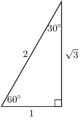

**Problem:**
\(\sin 60° =\)

**Solution:**
Remember to first identify the hypotenuse, opposite and adjacent sides for the given angle. Then write
              down the correct fraction for each ratio. You can confirm your answer by using your calculator to find the
              value of the ratio for that angle.

            \[\sin 60° = \frac{\sqrt{3}}{2}\]

**Problem:**
\(\cos 60° =\)

**Solution:**
Remember to first identify the hypotenuse, opposite and adjacent sides for the given angle. Then write
              down the correct fraction for each ratio. You can confirm your answer by using your calculator to find the
              value of the ratio for that angle.

            \[\cos 60° = \frac{1}{2}\]

**Problem:**
\(\tan 60° =\)

**Solution:**
Remember to first identify the hypotenuse, opposite and adjacent sides for the given angle. Then write
              down the correct fraction for each ratio. You can confirm your answer by using your calculator to find the
              value of the ratio for that angle.

            \[\tan 60° = \frac{\sqrt{3}}{1} = \sqrt{3}\]

**Problem:**
\(\sin 30° =\)

**Solution:**
Remember to first identify the hypotenuse, opposite and adjacent sides for the given angle. Then write
              down the correct fraction for each ratio. You can confirm your answer by using your calculator to find the
              value of the ratio for that angle.

            \[\sin 30° = \frac{1}{2}\]

**Problem:**
\(\cos 30° =\)

**Solution:**
Remember to first identify the hypotenuse, opposite and adjacent sides for the given angle. Then write
              down the correct fraction for each ratio. You can confirm your answer by using your calculator to find the
              value of the ratio for that angle.

            \[\cos 30° = \frac{\sqrt{3}}{2}\]

**Problem:**
\(\tan 30° =\)

**Solution:**
Remember to first identify the hypotenuse, opposite and adjacent sides for the given angle. Then write
              down the correct fraction for each ratio. You can confirm your answer by using your calculator to find the
              value of the ratio for that angle.

            \[\tan 30° = \frac{1}{\sqrt{3}}\]

Use the triangle below to complete the following:

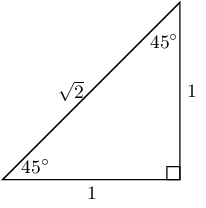

**Problem:**
\(\sin 45° =\)

**Solution:**
Remember to first identify the hypotenuse, opposite and adjacent sides for the given angle. Then write
              down the correct fraction for each ratio. You can confirm your answer by using your calculator to find the
              value of the ratio for that angle.

            \[\sin 45° = \frac{1}{\sqrt{2}}\]

**Problem:**
\(\cos 45° =\)

**Solution:**
Remember to first identify the hypotenuse, opposite and adjacent sides for the given angle. Then write
              down the correct fraction for each ratio. You can confirm your answer by using your calculator to find the
              value of the ratio for that angle.

            \[\cos 45° = \frac{1}{\sqrt{2}}\]

**Problem:**
\(\tan 45° =\)

**Solution:**
Remember to first identify the hypotenuse, opposite and adjacent sides for the given angle. Then write
              down the correct fraction for each ratio. You can confirm your answer by using your calculator to find the
              value of the ratio for that angle.

            \[\tan 45° = \frac{1}{1} = 1\]

Evaluate the following without using a calculator. Select the closest answer from the list provided.

**Problem:**
\(\sin{60^\circ} - \tan{60^\circ}\)

            \[\begin{array}{c c c c c }
            0 &-\dfrac{1}{2} &\dfrac{2}{\sqrt{3}} &-\dfrac{\sqrt{3}}{2} &-\dfrac{2}{\sqrt{3}}
            \end{array}\]

**Solution:**
\begin{align*}
            \sin{60^\circ} - \tan{60^\circ} & = \frac{\sqrt{3}}{2} - \frac{\sqrt{3}}{1} \\
            & = \frac{\sqrt{3} - 2\sqrt{3}}{2} \\
            & = -\frac{\sqrt{3}}{2}
            \end{align*}

**Problem:**
\(\tan{30^\circ} - \cos{30^\circ}\)

            \[\begin{array}{c c c c c }
            0 &-\dfrac{1}{2\sqrt{3}} &\dfrac{\sqrt{3}}{2} &-\dfrac{2}{\sqrt{3}} &-\dfrac{\sqrt{3}}{2}
            \end{array}\]

**Solution:**
\begin{align*}
            \tan{30^\circ} - \cos{30^\circ} & = \frac{1}{\sqrt{3}} - \frac{\sqrt{3}}{2} \\
            & = \frac{2 - \left(\sqrt{3}\right)\left(\sqrt{3}\right)}{2 \sqrt{3}} \\
            & = -\frac{1}{2\sqrt{3}}
            \end{align*}

**Problem:**
\(\tan{60^\circ} - \sin{60^\circ} - \tan{60^\circ}\)

            \[\begin{array}{c c c c c}
            -\dfrac{\sqrt{3}}{2} &-\dfrac{\sqrt{3}}{1} &-\dfrac{1}{2} &-\dfrac{1}{1}
            &-\dfrac{1}{\sqrt{2}}
            \end{array}\]

**Solution:**
\begin{align*}
            \tan{60^\circ} - \sin{60^\circ} - \tan{60^\circ} & = \frac{\sqrt{3}}{1} - \frac{\sqrt{3}}{2} -
            \frac{\sqrt{3}}{1} \\
            & = \frac{2\sqrt{3} - \sqrt{3} - 2\sqrt{3}}{2} \\
            & = -\frac{\sqrt{3}}{2}
            \end{align*}

**Problem:**
\(\sin{30^\circ} \times \sin{30^\circ} \times \sin{30^\circ}\)

            \[\begin{array}{c c c c c}
            \dfrac{1}{2} &\dfrac{1}{2\sqrt{3}} &\dfrac{1}{8} &\dfrac{1}{4} &\dfrac{\sqrt{3}}{4\sqrt{2}}
            \end{array}\]

**Solution:**
\begin{align*}
            \sin{30^\circ} \times \sin{30^\circ} \times \sin{30^\circ} & = \frac{1}{2} \times \frac{1}{2} \times
            \frac{1}{2} \\
            & = \frac{1}{8}
            \end{align*}

**Problem:**
\(\sin{45^\circ} \times \tan{45^\circ} \times \tan{60^\circ}\)

            \[\begin{array}{c c c c c}
            \dfrac{3}{2\sqrt{2}} &\dfrac{\sqrt{3}}{8} &\dfrac{3}{4} &\dfrac{\sqrt{3}}{\sqrt{2}}
            &\dfrac{1}{4}
            \end{array}\]

**Solution:**
\begin{align*}
            \sin{45^\circ} \times \tan{45^\circ} \times \tan{60^\circ} & = \frac{1}{\sqrt{2}} \times \frac{1}{1}
            \times \frac{\sqrt{3}}{1} \\
            & = \frac{\sqrt{3}}{\sqrt{2}}
            \end{align*}

**Problem:**
\(\cos{60^\circ} \times \cos{45^\circ} \times \tan{60^\circ}\)

            \[\begin{array}{c c c c c}
            \dfrac{\sqrt{3}}{2\sqrt{2}} &\dfrac{\sqrt{3}}{4} &\dfrac{3}{4\sqrt{2}} &\dfrac{1}{2}
            &\dfrac{1}{4\sqrt{3}}
            \end{array}\]

**Solution:**
\begin{align*}
            \cos{60^\circ} \times \cos{45^\circ} \times \tan{60^\circ} & = \frac{1}{2} \times \frac{1}{\sqrt{2}}
            \times \frac{\sqrt{3}}{1} \\
            & = \frac{\sqrt{3}}{2\sqrt{2}}
            \end{align*}

**Problem:**
\(\tan{45^\circ} \times \sin{60^\circ} \times \tan{45^\circ}\)

            \[\begin{array}{c c c c c}
            \dfrac{\sqrt{3}}{2} &\dfrac{3}{8} &\dfrac{1}{3} &\dfrac{\sqrt{3}}{2\sqrt{2}}
            &\dfrac{1}{4\sqrt{3}}
            \end{array}\]

**Solution:**
\begin{align*}
            \tan{45^\circ} \times \sin{60^\circ} \times \tan{45^\circ} & = \frac{1}{1} \times \frac{\sqrt{3}}{2}
            \times \frac{1}{1} \\
            & = \frac{\sqrt{3}}{2}
            \end{align*}

**Problem:**
\(\cos{30^\circ} \times \cos{60^\circ} \times \sin{60^\circ}\)

            \[\begin{array}{c c c c c}
            \dfrac{3}{8} &\dfrac{3}{2\sqrt{2}} &\dfrac{\sqrt{3}}{4\sqrt{2}} &\dfrac{1}{2\sqrt{3}}
            &\dfrac{1}{4\sqrt{3}}
            \end{array}\]

**Solution:**
\begin{align*}
            \cos{30^\circ} \times \cos{60^\circ} \times \sin{60^\circ} & = \frac{\sqrt{3}}{2} \times \frac{1}{2}
            \times \frac{\sqrt{3}}{2} \\
            & = \frac{3}{8}
            \end{align*}

**Problem:**
Without using a calculator, determine the value of:

          \[\sin 60° \cos 30° - \cos 60° \sin 30° + \tan 45°\]

**Solution:**
These are all special angles.

          \begin{align*}
          \sin 60° \cos 30° - \cos 60° \sin 30° + \tan 45° & =
          \left(\frac{\sqrt{3}}{2}\right)\left(\frac{\sqrt{3}}{2}\right) -
          \left(\frac{1}{2}\right)\left(\frac{1}{2}\right) + 1 \\
          & = \frac{3}{4} - \frac{1}{4} + 1 \\
          & = \frac{2}{4} + 1 \\
          & = \frac{3}{2}
          \end{align*}

**Problem:**
Solve for \(\sin{\theta}\) in the following triangle, in surd form:

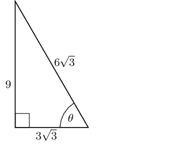

**Solution:**
\begin{align*}
          \sin{\theta} &= \frac{9}{6\sqrt{3}} \\
          &= \frac{3}{2\sqrt{3}}
          \end{align*}

**Problem:**
Solve for \(\tan{\theta}\) in the following triangle, in surd form:

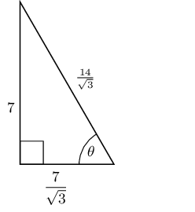

**Solution:**
\begin{align*}
          \tan{\theta} &= \frac{7}{\frac{7}{\sqrt{3}}} \\
          & = 7 \times \frac{\sqrt{3}}{7} \\
          &= \sqrt{3}
          \end{align*}

**Problem:**
A right-angled triangle has hypotenuse \(\text{13}\) \(\text{mm}\). Find the length of the other two sides
            if one of the angles of the triangle is \(\text{50}\)°.

**Solution:**
First draw a diagram:

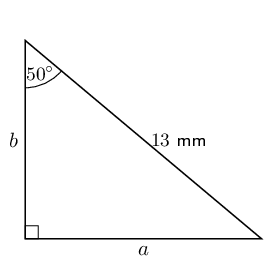

Next we get:

          \begin{align*}
          \sin \theta & = \frac{\text{opposite}}{\text{hypotenuse}} \\
          \sin 50° & = \frac{a}{13} \\
          a & = 13 \sin 50° \\
          & = \text{9,9585...} \\
          & \approx \text{9,96}\text{ mm}
          \end{align*}

Now we can use the theorem of Pythagoras to find the other side:

          \begin{align*}
          b^{2} & = c^{2} - a^{2} \\
          & = (13)^{2} - (\text{9,9585...})^{2} \\
          & = \text{69,8267...} \\
          b & = \text{8,3562...} \\
          & = \text{8,36}\text{ mm}
          \end{align*}

Therefore the other two sides are \(\text{9,96}\) \(\text{mm}\) and \(\text{8,35}\) \(\text{mm}\).

Solve for \(x\) to the nearest integer.

**Problem:**
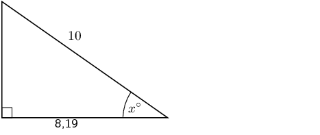

**Solution:**
\begin{align*}
            \cos{\theta} & = \frac{\text{adjacent}}{\text{hypotenuse}}\\
            \cos x & = \frac{\text{8,19}}{\text{10}} \\
            & = \text{0,819} \\
            x & = \text{35,0151...} \\
            & \approx \text{35}^\circ
            \end{align*}

**Problem:**
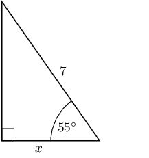

**Solution:**
\begin{align*}
            \cos{\theta} & = \frac{\text{adjacent}}{\text{hypotenuse}}\\
            \cos{\text{55}^\circ} & = \frac{x}{\text{7}} \\
            7 \cos \text{55}^\circ & = x \\
            x & = \text{4,01503...} \\
            & \approx \text{4}
            \end{align*}

**Problem:**
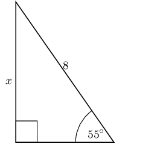

**Solution:**
\begin{align*}
              \sin{\theta} & = \frac{\text{opposite}}{\text{hypotenuse}}\\
              \sin{\text{55}^\circ} & = \frac{x}{\text{8}} \\
              \text{8} \sin{\text{55}^\circ} & = x \\
              x & = \text{6,55321...} \\
              & \approx \text{7}
              \end{align*}

**Problem:**
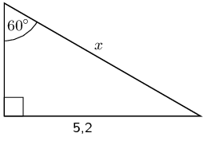

**Solution:**
\begin{align*}
              \sin{\theta} & = \frac{\text{opposite}}{\text{hypotenuse}}\\
              \sin{\text{60}^\circ} & = \frac{\text{5,2}}{x} \\
              x & = \frac{\text{5,2}}{\sin{\text{60}^\circ}} \\
              & = \text{6,00444...} \\
              & \approx \text{6}
              \end{align*}

**Problem:**
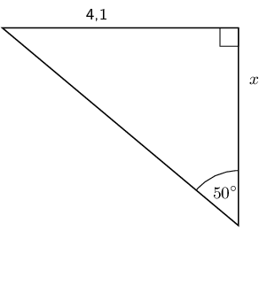

**Solution:**
\begin{align*}
            \tan{\theta} & = \frac{\text{opposite}}{\text{adjacent}}\\
            \tan{\text{50}^\circ} & = \frac{\text{4,1}}{x} \\
            x & = \frac{\text{4,1}}{\tan{\text{50}^\circ}} \\
            & = \text{3,4403...} \\
            & \approx \text{3}
            \end{align*}

**Problem:**
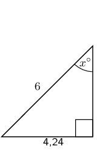

**Solution:**
\begin{align*}
              \sin{\theta} & = \frac{\text{opposite}}{\text{hypotenuse}}\\
              \sin x & = \frac{\text{4,24}}{\text{6}} \\
              & = \text{0,7067...} \\
              x & = \text{44,96434...} \\
              & \approx \text{45}^\circ
              \end{align*}

**Problem:**
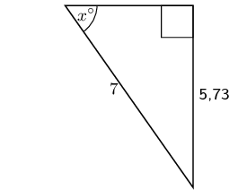

**Solution:**
\begin{align*}
              \sin{\theta} & = \frac{\text{opposite}}{\text{hypotenuse}}\\
              \sin x & = \frac{\text{5,73}}{\text{7}} \\
              & = \text{0,81857...} \\
              x & = \text{54,9420...} \\
              & \approx \text{55}^\circ
              \end{align*}

**Problem:**
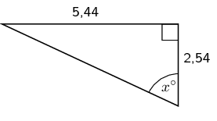

**Solution:**
\begin{align*}
            \tan{\theta} & = \frac{\text{opposite}}{\text{adjacent}}\\
            \tan x & = \frac{\text{5,44}}{\text{2,54}} \\
            & = \text{2,14173...} \\
            x & = \text{64,9715...} \\
            & \approx \text{65}^\circ
            \end{align*}

**Problem:**
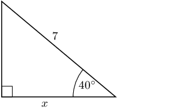

**Solution:**
\begin{align*}
            \cos{\theta} & = \frac{\text{adjacent}}{\text{hypotenuse}}\\
            \cos 40^{\circ} & = \frac{x}{\text{7}} \\
            7 \cos 40^{\circ} & = x \\
            x & = \text{5,36231...} \\
            & \approx \text{5}
            \end{align*}

**Problem:**
Calculate the unknown lengths in the diagrams below:

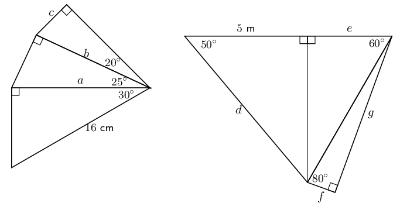

**Solution:**
For all of these we use the appropriate trigonometric ratio or the theorem of Pythagoras to solve.

To find \(a\) and \(b\) we use \(\cos \theta = \frac{\text{adjacent}}{\text{hypotenuse}}\):

          \begin{align*}
          \cos 30° & = \frac{a}{16} \\
          a & = 16 \cos 30° \\
          & \approx \text{13,86}\text{ cm}
          \end{align*}
          \begin{align*}
          \cos 25° & = \frac{b}{\text{13,86}} \\
          b & = \text{13,86} \cos 25° \\
          & \approx \text{12,56}\text{ cm}
          \end{align*}

To find \(c\) we use \(\sin \theta = \frac{\text{opposite}}{\text{hypotenuse}}\):

          \begin{align*}
          \sin 20° & = \frac{c}{\text{12,56}} \\
          c & = \text{12,56} \sin 20° \\
          & \approx \text{4,30}\text{ cm}
          \end{align*}

To find \(d\) we use \(\cos \theta = \frac{\text{adjacent}}{\text{hypotenuse}}\)

          \begin{align*}
          \cos 50° & = \frac{5}{d} \\
          d \cos 50 & = 5 \\
          d & = \frac{5}{\cos 50°} \\
          & \approx \text{7,78}\text{ cm}
          \end{align*}

Next we use the theorem of Pythagoras to find the third side, so we can use trig functions to find \(e\):

          \begin{align*}
          (\text{5})^{2} + (\text{7,78})^{2} & = \text{85,5284} \\
          \sqrt{\text{85,5284}} & \approx \text{9,25}
          \end{align*}

We use \(\tan \theta = \frac{\text{opposite}}{\text{adjacent}}\) to find \(e\):

          \begin{align*}
          \tan 60° & = \frac{\text{9,25}}{e} \\
          e \tan 60° & = \text{9,25} \\
          e & = \frac{\text{9,25}}{\tan 60°} \\
          & \approx \text{5,34}\text{ cm}
          \end{align*}

Next we use the theorem of Pythagoras to find the third side, so we can use trig functions to find \(f\)
            and \(g\):

          \begin{align*}
          (\text{5,34})^{2} + (\text{7,78})^{2} & = \text{89,0044...} \\
          \sqrt{\text{89,0044...}} & \approx \text{9,44}
          \end{align*}

We use \(\tan \theta = \frac{\text{opposite}}{\text{adjacent}}\) to find \(g\):

          \begin{align*}
          \tan 80° & = \frac{\text{9,44}}{g} \\
          g \tan 80° & = \text{9,44} \\
          g & = \frac{\text{9,44}}{\tan 80°} \\
          & \approx \text{1,66}\text{ cm}
          \end{align*}

And finally we find \(f\) using the theorem of Pythagoras:

          \begin{align*}
          f^{2} & = (\text{9,44})^{2} - (\text{1,65})^{2} \\
          f & = \sqrt{\text{86,39}} \\
          & \approx \text{9,29}\text{ cm}
          \end{align*}

The final answers are: \(a = \text{13,86}\), \(b = \text{12,56}\), \(c = \text{4,30}\), \(d =
            \text{7,78}\), \(e = \text{5,34}\), \(f = \text{9,29}\) and \(g = \text{1,66}\).

In \(\triangle PQR\), \(PR = \text{20}\text{ cm}\), \(QR = \text{22}\text{ cm}\) and \(P\hat{R}Q =
            30°\). The perpendicular line from \(P\) to \(QR\) intersects \(QR\) at \(X\). Calculate:

**Problem:**
the length \(XR\)

**Solution:**
First draw a sketch:

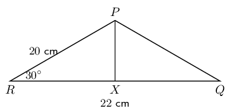

Since we are told that \(PX \perp QR\) we can use \(\cos \theta =
              \frac{\text{adjacent}}{\text{hypotenuse}}\) to find \(XR\).

            \begin{align*}
            \cos 30° & = \frac{XR}{20} \\
            XR & = 20 \cos 30° \\
            & = \text{17,3205...} \\
            & \approx \text{17,32}\text{ cm}
            \end{align*}

**Problem:**
the length \(PX\)

**Solution:**
We can use \(\sin \theta = \frac{\text{opposite}}{\text{hypotenuse}}\) to find \(PX\).

            \begin{align*}
            \sin 30° & = \frac{PX}{20} \\
            PX & = 20 \sin 30° \\
            & = \text{9,999...} \\
            & \approx \text{10}\text{ cm}
            \end{align*}

**Problem:**
the angle \(Q\hat{P}X\)

**Solution:**
We know the length of \(QR\) and we have found the length of \(XR\), so we can work out the length of
              \(QX\):

            \begin{align*}
            QX & = QR - XR \\
            & = (22) - (\text{17,32})\\
            & = \text{4,68}
            \end{align*}

Since we know two sides and an angle we can use \(\tan \theta = \frac{\text{opposite}}{\text{adjacent}}\)
              to find the angle:

            \begin{align*}
            \tan (Q\hat{P}X) & = \frac{\text{4,68}}{10} \\
            & = \text{0,468} \\
            Q\hat{P}X & = \text{25,0795...} \\
            & \approx \text{25,08}°
            \end{align*}

**Problem:**
In the following triangle find the size of \(A\hat{B}C\).

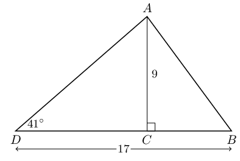

**Solution:**
We use \(\tan \theta = \frac{\text{opposite}}{\text{adjacent}}\) to find \(DC\):

          \begin{align*}
          \tan 41° & = \frac{9}{DC} \\
          DC & = 9 \tan 41° \\
          & = \text{7,8235...}
          \end{align*}

Next we find \(BC\):

          \begin{align*}
          BC & = BD - DC \\
          & = 17 - \text{7,8235...} \\
          & = \text{9,1764...}
          \end{align*}

And then we use \(\tan \theta = \frac{\text{opposite}}{\text{adjacent}}\) to find the angle:

          \begin{align*}
          \tan A\hat{B}C & = \frac{9}{\text{9,1764...}} \\
          & = \text{0,98077...} \\
          A\hat{B}C & = \text{44,439...} \\
          & \approx \text{44,44}°
          \end{align*}

**Problem:**
In the following triangle find the length of side \(CD\):

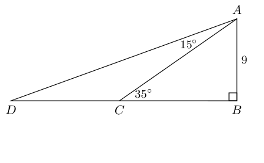

**Solution:**
We use the angles in a triangle to find \(C\hat{A}B\):

          \[C\hat{A}B = 180° - 90° - 35° = 55°\]

Then we find \(D\hat{A}B\):

          \[D\hat{A}B = 15° + 55° = 70°\]

Now we can use \(\tan \theta = \frac{\text{opposite}}{\text{adjacent}}\) to find \(BC\):

          \begin{align*}
          \tan 35° & = \frac{9}{BC} \\
          BC & = \frac{9}{\tan 35°} \\
          BC & = \text{12,85}
          \end{align*}

Then we find \(BD\) also using \(\tan \theta = \frac{\text{opposite}}{\text{adjacent}}\):

          \begin{align*}
          \tan 70° & = \frac{BD}{9} \\
          BD & = 9 \tan 70° \\
          BD & = \text{24,73}
          \end{align*}

Finally we can find \(CD\):

          \begin{align*}
          CD & = BD - BC \\
          & = \text{24,73} - \text{12,85} \\
          & = \text{11,88}
          \end{align*}

Determine

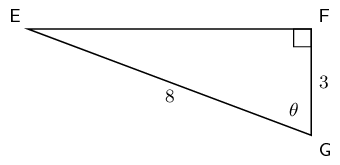

**Problem:**
The length of \(EF\)

**Solution:**
\begin{align*}
            GE^2 &= EF^2 + FG^2 \\
            EF^2 &= GE^2 - FG^2 \\
            EF &= \sqrt{GE^2 - FG^2} \\
            &= \sqrt{8^2 - 3^2} \\
            &= \sqrt{64 - 9} \\
            &= \sqrt{55}
            \end{align*}

**Problem:**
\(\tan{(90^{\circ}- \theta)}\)

**Solution:**
We note that \(\hat{G} = \theta\) and \(\hat{F} = 90^{\circ}\), therefore \(\hat{E} = 90^{\circ}-
              \theta\). So we need to find \(\tan \hat{E}\):

            \begin{align*}
            \tan{(90^{\circ}- \theta)} = \frac{3}{\sqrt{55}}
            \end{align*}

**Problem:**
The value of \(\theta\)

**Solution:**
\begin{align*}
            \cos{\theta} &= \frac{3}{8} \\
            \theta &= \cos^{-1}\frac{3}{8} \\
            \theta &= \text{67,976}^{\circ}
            \end{align*}

**Problem:**
Given that \(\hat{D} = x, ~ \hat{C_1} = 2x, ~ BC = \text{12,2}\text{ cm}, ~ AB = \text{24,6}\text{ cm}\).
            Calculate \(CD\).

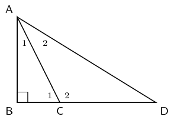

**Solution:**
We first calculate \(\hat{C_{1}}\) by using the given information about \(AB\) and \(BC\).

          \begin{align*}
          \tan{\hat{C_1}} &= \frac{AB}{BC} \\
          &= \frac{\text{24,6}}{\text{12,2}} \\
          \hat{C_1} &= \text{63,62257...}
          \end{align*}

Next we find \(\hat{D}\):

          \begin{align*}
          \hat{D} &= \frac{\hat{C_1}}{2} \\
          &= \frac{\text{63,62257...}}{2} \\
          &= \text{31,8107...}
          \end{align*}

Now we can calculate \(BD\):

          \begin{align*}
          \tan{\hat{D}} &= \frac{AB}{BD} \\
          BD &= \frac{AB}{\tan{\hat{D}}} \\
          &= \frac{\text{24,6}}{\tan{\text{31,8107...}}} \\
          &= \text{39,65906...}
          \end{align*}

Finally we can calculate \(CD\):

          \begin{align*}
          CD &= BD - BC \\
          &= \text{39,65906...} - \text{12,2} \\
          & = \text{27,45906...}\\
          & \approx \text{27,46}\text{ cm}
          \end{align*}

Solve for \(\theta\) if \(\theta\) is a positive, acute angle:

**Problem:**
\(2 \sin \theta = \text{1,34}\)

**Solution:**
\begin{align*}
            2 \sin \theta & = \text{1,34} \\
            \sin \theta & = \text{0,67} \\
            \theta & = \text{42,06706}\ldots \\
            & = \text{42,07}°
            \end{align*}

**Problem:**
\(1 - \tan \theta = -1\)

**Solution:**
\begin{align*}
            1 - \tan \theta & = -1 \\
            -\tan \theta & = -2 \\
            \tan \theta & = 2 \\
            \theta & = \text{63,43494}\ldots \\
            & = \text{63,43}°
            \end{align*}

**Problem:**
\(\cos 2\theta = \sin 40°\)

**Solution:**
\begin{align*}
            \cos 2\theta & = \sin 40° \\
            & = \text{0,64278}\ldots \\
            2\theta & = \text{50} \\
            \theta & = \text{25}°
            \end{align*}

**Problem:**
\(\sec \theta = \text{1,8}\)

**Solution:**
\begin{align*}
            \sec \theta & = \text{1,8} \\
            \frac{1}{\cos \theta} & = \text{1,8} \\
            1 & = \text{1,8}\cos \theta \\
            \frac{1}{\text{1,8}} & = \cos \theta \\
            \theta & = \text{56,25101...} \\
            & \approx \text{56,25}°
            \end{align*}

**Problem:**
\(\cot 4 \theta = \sin 40°\)

**Solution:**
\begin{align*}
            \cot 4 \theta & = \sin 40° \\
            \cot 4 \theta & = \text{0,642787...} \\
            \frac{1}{\tan 4 \theta} & = \text{0,642787...} \\
            \frac{1}{\text{0,642787...}} & = \tan 4 \theta \\
            4 \theta & = \text{57,2675...} \\
            \theta & = \text{14,3168...} \\
            & \approx \text{14,32}°
            \end{align*}

**Problem:**
\(\sin 3 \theta + 5 = 4\)

**Solution:**
\begin{align*}
            \sin 3 \theta + 5 & = 4 \\
            \sin 3 \theta & = -1 \\
            3 \theta & = 90 \\
            \theta & = 30°
            \end{align*}

**Problem:**
\(\cos (4 + \theta) = \text{0,45}\)

**Solution:**
\begin{align*}
            \cos (4 + \theta) & = \text{0,45} \\
            4 + \theta & = \text{63,25631...} \\
            \theta & = \text{59,25631...} \\
            & \approx \text{59,26}
            \end{align*}

**Problem:**
\(\dfrac{\sin \theta}{\cos \theta} = 1\)

**Solution:**
First we note that:

            \begin{align*}
            \frac{\sin \theta}{\cos \theta} & = \sin \theta \times \frac{1}{\cos \theta} \\
            & = \frac{\text{opposite}}{\text{hypotenuse}} \times \frac{\text{hypotenuse}}{\text{adjacent}} \\
            & = \frac{\text{opposite}}{\text{adjacent}} \\
            & = \tan \theta
            \end{align*}

Now we can solve for \(\theta\):

            \begin{align*}
            \dfrac{\sin \theta}{\cos \theta} & = 1 \\
            \tan \theta & = 1 \\
            \theta & = 45°
            \end{align*}

If \(a = 29°\), \(b = 38°\) and \(c = 47°\), use your calculator to evaluate each of the
            following, correct to 2 decimal places.

**Problem:**
\(\tan(a + c)\)

**Solution:**
\begin{align*}
            \tan(a + c) & = \tan(29 + 47) \\
            & = \tan 76 \\
            & = \text{4,0107...} \\
            & \approx \text{4,01}
            \end{align*}

**Problem:**
\(\text{cosec } (c - b)\)

**Solution:**
\begin{align*}
            \text{cosec }(c - b) & = \sin(47 - 38) \\
            & = \text{cosec } 9 \\
            & = \frac{1}{\sin 9} \\
            & = \text{6,3924...} \\
            & \approx \text{6,39}
            \end{align*}

**Problem:**
\(\sin(a \times b \times c)\)

**Solution:**
\begin{align*}
            \sin(a \times b \times c) & = \sin((29)(38)(47)) \\
            & = \sin (114) \\
            & = \text{0,9135...} \\
            & \approx \text{0,91}
            \end{align*}

**Problem:**
\(\tan a + \sin b + \cos c\)

**Solution:**
\begin{align*}
            \tan a + \sin b + \cos c & = \tan 29 + \sin 38 + \cos 47 \\
            & = \text{1,8519...} \\
            & \approx \text{1,85}
            \end{align*}

If \(3 \tan \alpha = -5\) and \(0° < \alpha < 270°\), use a sketch to determine:

**Problem:**
\(\cos \alpha\)

**Solution:**
Find \(x\), \(y\) and \(r\)

            \begin{align*}
            3 \tan \alpha & = -5 \\
            \tan \alpha & = \frac{-5}{3}
            \end{align*}

Therefore \(x = -3\) and \(y = 5\).

            \begin{align*}
            r^{2} & = x^{2} + y^{2} \\
            & = (-3)^{2} + (5)^{2} \\
            & = 34 \\
            r & = \sqrt{34}
            \end{align*}

Draw a sketch:

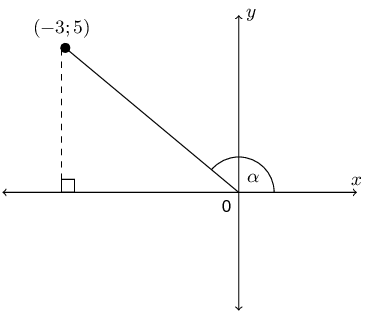

Now we can find \(\cos \alpha\):

            \begin{align*}
            \cos \alpha & = \frac{x}{r} \\
            & = \frac{-3}{\sqrt{34}}
            \end{align*}

**Problem:**
\(\tan^{2} \alpha - \sec^{2} \alpha\)

**Solution:**
We have \(x\), \(y\) and \(r\) from the first question.

            \begin{align*}
            \tan^{2} \alpha - \sec^{2} \alpha & = \left(\frac{y}{x}\right)^{2} - \left(\frac{r}{x}\right)^{2} \\
            & = \left(\frac{5}{-3}\right)^{2} - \left(\frac{\sqrt{34}}{-3}\right)^{2} \\
            & = \frac{25}{9} - \frac{34}{9} \\
            & = \frac{-9}{9} \\
            & = -1
            \end{align*}

**Problem:**
Given \(A(5;0)\) and \(B(11;4)\), find the angle between the line through \(A\) and \(B\) and the
            \(x\)-axis.

**Solution:**
First draw a diagram:

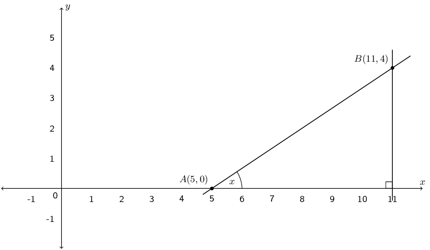

Next we note that the distance from \(B\) to the \(x\)-axis is \(\text{4}\) (\(B\) is \(\text{4}\) units up
            from the \(x\)-axis) and that the distance from \(A\) to \(C\) is \(11 - 5 = 6 \text{ units}\).

We use the tangent ratio to find the angle:

          \begin{align*}
          \tan x & = \frac{4}{6} \\
          \tan x & = \text{0,66666}\ldots \\
          x & = \text{33,69}°
          \end{align*}

Therefore the angle between line \(AB\) and the \(x\)-axis is \(\text{33,69}\)°.

**Problem:**
Given \(C(0;-13)\) and \(D(-12;14)\), find the angle between the line through \(C\) and \(D\) and the
            \(y\)-axis.

**Solution:**
First draw a diagram:

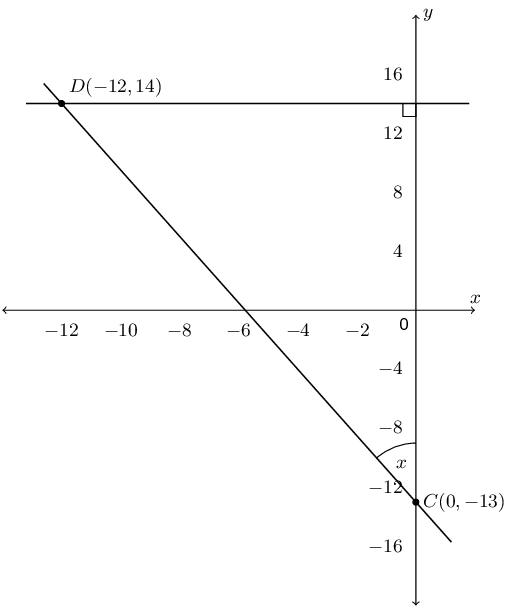

Next we note that the distance from \(D\) to the \(x\)-axis is \(\text{12}\) (although \(D\) is
            \((-12;14)\) the distance is positive). The distance from \(C\) to the point where the perpendicular line
            from \(D\) intercepts the \(y\)-axis is \(14 - (-13) = 27 \text{ units}\).

We use the tangent ratio to find the angle:

          \begin{align*}
          \tan x & = \frac{12}{27} \\
          \tan x & = \text{0,4444}\ldots \\
          x & = \text{23,96}°
          \end{align*}

Therefore the angle between line \(CD\) and the \(x\)-axis is \(\text{23,96}\)°.

**Problem:**
Given the points \(E(5;0)\), \(F(6;2)\) and \(G(8;-2)\). Find the angle \(F\hat{E}G\).

**Solution:**
First draw a sketch:

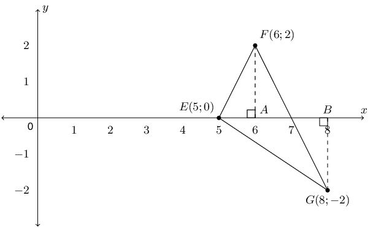

To find \(F\hat{E}G\) we look at \(\triangle FEA\) and \(\triangle GEB\) in turn. These two triangles will
            each give one part of the angle that we want.

In triangle \(FEA\) we can use the tangent ratio. \(FA\) is \(\text{2}\) units and \(EA\) is \(\text{1}\)
            unit.

          \begin{align*}
          \tan F\hat{E}X & = \frac{2}{1} \\
          F\hat{E}X & = \text{63,43}°
          \end{align*}

In triangle \(GEB\) we also use the tangent ratio. \(GB\) is \(\text{2}\) units and \(EB\) is \(\text{3}\)
            units.

          \begin{align*}
          \tan G\hat{E}X & = \frac{2}{3} \\
          G\hat{E}X & = \text{33,69}°
          \end{align*}

Now we add these two angles together to get the angle we want to find:

          \begin{align*}
          G\hat{E}X + F\hat{E}X & = F\hat{E}G \\
          F\hat{E}G & = \text{33,69}° + \text{63,43}° \\
          & = \text{97,12}°
          \end{align*}

**Problem:**
A triangle with angles \(\text{40}\)°, \(\text{40}\)° and \(\text{100}\)° has a perimeter of
            \(\text{20}\) \(\text{cm}\). Find the length of each side of the triangle.

**Solution:**
First draw a sketch:

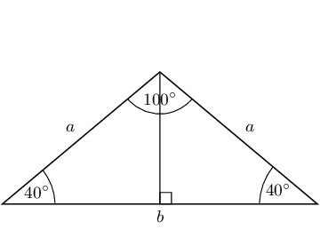

We construct a perpendicular bisector and now we have a right-angled triangle to work with. We can use
            either of these two triangles.

We know \(2a + b = 20\). Rearranging gives: \(b = 2(10 - a)\). We can use the cos ratio to find \(a\):

          \begin{align*}
          \cos 40° & = \frac{\frac{b}{2}}{a} \\
          \text{0,77} & = \frac{\frac{2(10 - a)}{2}}{a} \\
          & = \frac{10 - a}{a} \\
          \text{0,77}a & = 10 - a \\
          a & = \text{5,65}\text{ cm}
          \end{align*}

From the perimeter we get:

          \[b = 2(10 - \text{5,65}) = \text{8,7}\text{ cm}\]

Therefore the lengths of the sides are \(\text{8,7}\) \(\text{cm}\), \(\text{5,65}\) \(\text{cm}\) and
            \(\text{5,65}\) \(\text{cm}\).

**Problem:**
Determine the area of \(\triangle ABC\).

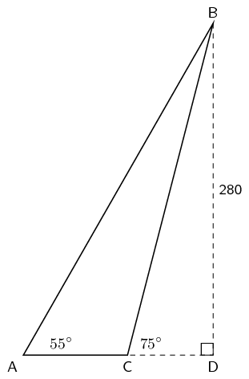

**Solution:**
\begin{align*}
          \tan{55} &= \frac{280}{AD} \\
          AD &= \frac{280}{\tan{55}} \\
          AD &= \text{196,058} \\ \\
          \tan{75} &= \frac{280}{CD} \\
          CD &= \frac{280}{\tan{75}} \\
          CD &= \text{75,026} \\ \\
          AC &= AD - CD \\
          AC &= \text{121,032} \\ \\
          \text{Area of } \triangle ABC &= \frac{1}{2} \text{base} \times \text{height} \\
          \text{Area of } \triangle ABC &= \frac{1}{2} \times \text{121,032} \times 280 \\
          \therefore \text{Area of } \triangle ABC &= 16944 \text{ units}^2
          \end{align*}
