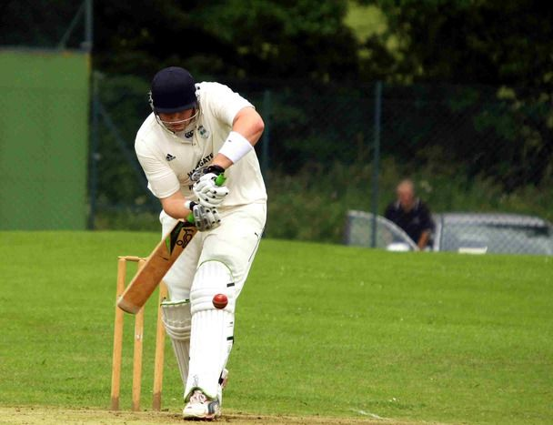
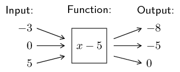
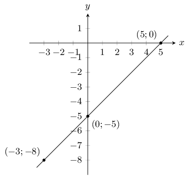
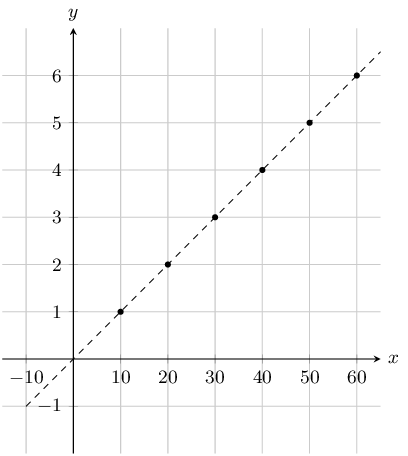
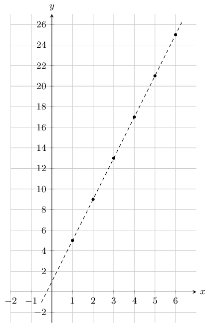
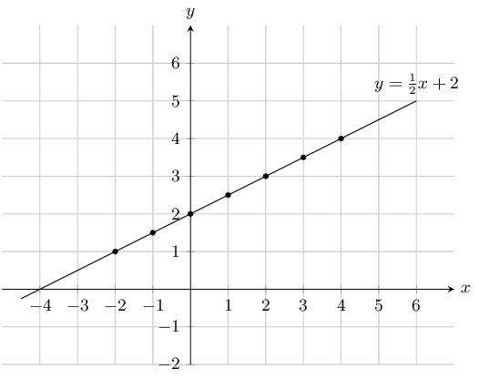
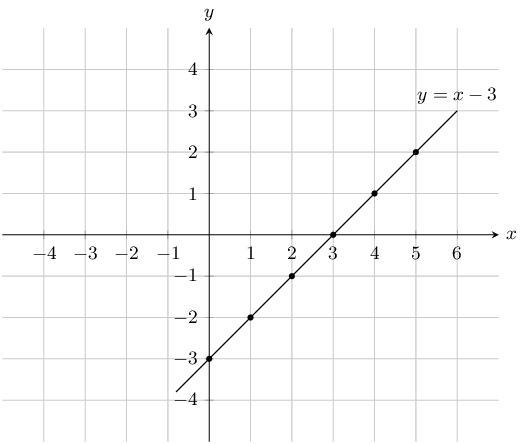
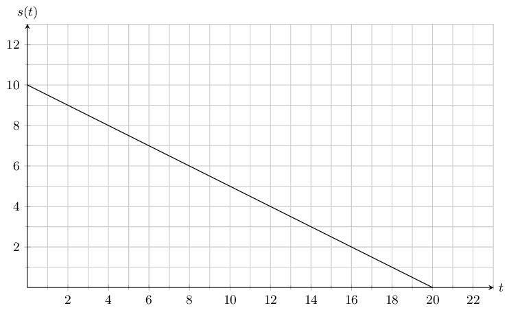
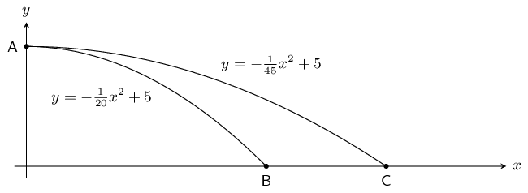

# Chapter 6: Functions

## 6.1 Introduction (EMA3Z)

- This chapter covers the concept of a function and representing functions using tables, graphs, words and formulae. Straight line graphs were covered in grade 9 and are revised here. Parabolas, hyperbolas and exponential graphs are introduced here. Graphs for sine, cosine and tangent functions are also introduced here.
- A more formal definition of a function is only covered in grade 12. At this level learners should know the terms independent (input) and dependent (output) variables as well as how these vary.
- Summaries should be compiled for each type of graph and include the effects of a (vertical stretch and/or reflection in x) and q (vertical shift).
- Remember that graphs in some practical applications might be discrete or continuous.
- Encourage learners to state restrictions, particularly for quadratic functions.
- Learners must understand that \(y = \sqrt{x}\) has no real solutions for \(x < 0\).
- Sketching graphs is based on knowing the effects of \(a\) and \(q\) and using these to determine the shape of the graph.

A tool such as this one
        can be used to plot graphs for classroom use. If you use this tool for plotting trigonometric graphs the values
        on the \(x\)-axis will not be in degrees.

Functions are mathematical building blocks for designing machines, predicting natural disasters, curing diseases,
      understanding world economies and for keeping aeroplanes in the air. Functions can take input from many variables,
      but always give the same output, unique to that function.

Functions also allow us to visualise relationships in terms of graphs, which are much easier to read and
      interpret than lists of numbers.

A cricket player facing a delivery. If a cricket player is hit on his batting pads and
        the umpire thinks that the ball would have hit the stumps behind him, he is given out LBW (leg before wicket).
        At professional levels of the game, sophisticated software is used to determine if the ball will hit the stumps.
        The software uses functions to predict the flight of the ball if the cricket players leg had not been in the
        way.

Some examples of functions include:

- Money as a function of time. You never have more than one amount of money at any time because you can always add everything to give one total amount. By understanding how your money changes over time, you can plan to spend your money sensibly. Businesses find it very useful to plot the graph of their money over time so that they can see when they are spending too much.
- Temperature as a function of various factors. Temperature is a very complicated function because it has so many inputs, including: the time of day, the season, the amount of clouds in the sky, the strength of the wind, where you are and many more. But the important thing is that there is only one temperature output when you measure it in a specific place.
- Location as a function of time. You can never be in two places at the same time. If you were to plot the graphs of where two people are as a function of time, the place where the lines cross means that the two people meet each other at that time. This idea is used in logistics, an area of mathematics that tries to plan where people and items are for businesses.

<Callout type="info" title="Definition: Function">
A function is a mathematical relationship between two variables, where every input variable has one output
          variable.
</Callout>

### Dependent and independent variables (EMA42)

In functions, the \(x\)-variable is known as the input or independent variable, because its value can be chosen
        freely. The calculated \(y\)-variable is known as the output or dependent variable, because its value depends on
        the chosen input value.

### Set notation (EMA43)

Examples:

| \(\left\{x:x\in \mathbb{R},x>0\right\}\) | The set of all \(x\)-values such that \(x\) is an element of the set of real numbers and is greater
                than \(\text{0}\). |
| --- | --- |
| \(\left\{y:y\in \mathbb{N},3<y\le 5\right\}\) | The set of all \(y\)-values such that \(y\) is a natural number, is greater than \(\text{3}\) and is
                less than or equal to \(\text{5}\). |
| \(\left\{z:z\in \mathbb{Z},z\le 100\right\}\) | The set of all \(z\)-values such that \(z\) is an integer and is less than or equal to \(\text{100}\). |

### Interval notation (EMA44)

It is important to note that this notation can only be used to represent an interval of real numbers.

Examples:

| \(\left(3;11\right)\) | Round brackets indicate that the number is not included. This interval includes all real numbers
                greater than but not equal to \(\text{3}\) and less than but not equal to \(\text{11}\). |
| --- | --- |
| \(\left(-\infty ;-2\right)\) | Round brackets are always used for positive and negative infinity. This interval includes all real
                numbers less than, but not equal to \(-\text{2}\). |
| \(\left[1;9\right)\) | A square bracket indicates that the number is included. This interval includes all real numbers greater
                than or equal to \(\text{1}\) and less than but not equal to \(\text{9}\). |

### Function notation (EMA45)

This is a very useful way to express a function. Another way of writing \(y=2x+1\) is \(f(x) = 2x + 1\). We say
        “\(f\) of \(x\) is equal to \(2x + 1\)”. Any letter can be used, for example, \(g(x)\), \(h(x)\),
        \(p(x)\), etc.

1. Determine the output value: “Find the value of the function for \(x=-3\)” can be written as: “find \(f(-3)\)”. Replace \(x\) with \(-\text{3}\): \begin{align*} f(-3) & = 2(-3) + 1 = -5 \\ \therefore f(-3) & = -5 \end{align*} This means that when \(x = -3\), the value of the function is \(-\text{5}\).
2. Determine the input value: “Find the value of \(x\) that will give a \(y\)-value of \(\text{27}\)” can be written as: “find \(x\) if \(f(x)=27\)”. We write the following equation and solve for \(x\): \begin{align*} 2x + 1 & = 27 \\ \therefore x = & 13 \end{align*} This means that when \(x = 13\) the value of the function is \(\text{27}\).

### Representations of functions (EMA46)

Functions can be expressed in many different ways for different purposes.

1. Words: “The relationship between two variables is such that one is always \(\text{5}\) less than the other.”
2. Mapping diagram: 
3. Table: | Input variable \((x)\) | \(-\text{3}\) | \(\text{0}\) | \(\text{5}\) | | --- | --- | --- | --- | | Output variable \((y)\) | \(-\text{8}\) | \(-\text{5}\) | \(\text{0}\) |
4. Set of ordered number pairs: \((-3;-8)\), \((0;-5)\), \((5;0)\)
5. Algebraic formula: \(f(x) = x - 5\)
6. Graph: 

### Domain and range (EMA47)

The domain of a function is the set of all independent \(x\)-values from which the function produces a single
        \(y\)-value for each \(x\)-value.

The range is the set of all dependent \(y\)-values which can be obtained using an independent \(x\)-value.

### Textbook Exercise 6.1

Write the following in set notation:

**Problem:**
\((-\infty;7]\)

**Solution:**
\(\left\{x:x\in \mathbb{R},x \le 7\right\}\)

**Problem:**
\([-13;4)\)

**Solution:**
\(\left\{x:x\in \mathbb{R}, -13 \le x < 4\right\}\)

**Problem:**
\((35;\infty)\)

**Solution:**
\(\left\{x:x\in \mathbb{R}, x > 35\right\}\)

**Problem:**
\([\frac{3}{4};21)\)

**Solution:**
\(\left\{x:x\in \mathbb{R}, \frac{3}{4} \le x < 21\right\}\)

**Problem:**
\([-\frac{1}{2};\frac{1}{2}]\)

**Solution:**
\(\left\{x:x\in \mathbb{R}, -\frac{1}{2} \le x \le \frac{1}{2}\right\}\)

**Problem:**
\((-\sqrt{3};\infty)\)

**Solution:**
\(\left\{x:x\in \mathbb{R}, x > -\sqrt{3}\right\}\)

Write the following in interval notation:

**Problem:**
\(\left\{p:p\in \mathbb{R}, p \le 6 \right\}\)

**Solution:**
\((-\infty;6]\)

**Problem:**
\(\left\{k:k\in \mathbb{R},-5 < k < 5\right\}\)

**Solution:**
\((-5;5)\)

**Problem:**
\(\left\{x:x\in \mathbb{R},x > \frac{1}{5}\right\}\)

**Solution:**
\((\frac{1}{5};\infty)\)

**Problem:**
\(\left\{z:z\in \mathbb{R},21 \le x < 41\right\}\)

**Solution:**
\([21;41)\)

Complete the following tables and identify the function.

**Problem:**
\[\begin{array}{| l | l | l | l | l | l | l |}
              \hline
              x & 1 & 2 & 3 & 4 & 5 & 6\\
              \hline
              y & 5 & 10 & & 20 & & \\
              \hline
              \end{array}\]

**Solution:**
\[\begin{array}{| l | l | l | l | l | l | l |}
              \hline
              x & 1 & 2 & 3 & 4 & 5 & 6 \\
              \hline
              y & 5 & 10 & 15 & 20 & 25 & 30 \\
              \hline
              \end{array}\]

              \[y = 5x\]

**Problem:**
\[\begin{array}{| l | l | l | l | l | l | l | }
              \hline
              x & 1 & & 3 & 4 & & 6 \\
              \hline
              y & 5 & 5 & & & 5 & 5 \\
              \hline
              \end{array}\]

**Solution:**
\[\begin{array}{| l | l | l | l | l | l | l |}
              \hline
              x & 1 & 2 & 3 & 4 & 5 & 6 \\
              \hline
              y & 5 & 5 & 5 & 5 & 5 & 5 \\
              \hline
              \end{array}\]

              \[y = 5\]

**Problem:**
\[\begin{array}{| l | l | l | l | l | l | l |}
              \hline
              x & 2 & & & 8 & 10 & 12 \\
              \hline
              y & 1 & 2 & 3 & & & 6 \\
              \hline
              \end{array}\]

**Solution:**
\[\begin{array}{| l | l | l | l | l | l | l |}
              \hline
              x & 2 & 4 & 6 & 8 & 10 & 12 \\
              \hline
              y & 1 & 2 & 3 & 4 & 5 & 6 \\
              \hline
              \end{array}\]

              \[y = \frac{1}{2}x\]

Plot the following points on a graph.

**Problem:**
\[\begin{array}{| l | l | l | l | l | l | l |}
              \hline
              x & 1 & 2 & 3 & 4 & 5 & 6 \\
              \hline
              y & \text{0,1} & \text{0,2} & \text{0,3} & \text{0,4} & \text{0,5} & \text{0,6} \\
              \hline
              \end{array}\]

**Solution:**

Note that this graph is scaled. Each value for \(x\) and \(y\) has been multiplied by \(\text{10}\).
                This process does not change the function, but it stretches the graph, thereby making
                it easier to read.

**Problem:**
\[\begin{array}{| l | l | l | l | l | l | l |}
              \hline
              x & 1 & 2 & 3 & 4 & 5 & 6 \\
              \hline
              y & 5 & 9 & 13 & 17 & 21 & 25 \\
              \hline
              \end{array}\]

**Solution:**

Create a table of values from the function given and then plot the function. Your table must have at
              least 5 ordered pairs.

**Problem:**
\(y = \frac{1}{2}x + 2\)

**Solution:**
\[\begin{array}{| l | l | l | l | l | l |l | l |}
              \hline
              x & -2 & -1 & 0 & 1 & 2 & 3 & 4 \\
              \hline
              y & 1 & \text{1,5} & 2 & \text{2,5} & 3 & \text{3,5} & 4 \\
              \hline
              \end{array}\]

**Problem:**
\(y = x - 3\)

**Solution:**
\[\begin{array}{| l | l | l | l | l | l | l |}
              \hline
              x & 0 & 1 & 2 & 3 & 4 & 5 \\
              \hline
              y & -3 & -2 & -1 & 0 & 1 & 2 \\
              \hline
              \end{array}\]

If the functions \(f(x) = x^2 + 1 \; ; \; g(x) = x - 4 \; ; \; h(x) = 7 - x^2 \; ; \; k(x) = 3\) are
              given, find the value of the following:

**Problem:**
\(f(-1)\)

**Solution:**
\begin{align*}
              f(x) & = x^2 + 1 \\
              f(-1) &= (-1)^2 + 1 \\
              &= 2
              \end{align*}

**Problem:**
\(g(-7)\)

**Solution:**
\begin{align*}
              g(x) & = x - 4 \\
              g(-7) &= (-7) - 4 \\
              &= -11
              \end{align*}

**Problem:**
\(h(3)\)

**Solution:**
\begin{align*}
              h(x) & = 7 - x^2 \\
              h(3) &= 7 - (3)^2 \\
              &= -2
              \end{align*}

**Problem:**
\(k(100)\)

**Solution:**
\begin{align*}
              k(x) & = 3 \\
              k(100) &= 3
              \end{align*}

Regardless of the value of \(x\), the output is always 3.

**Problem:**
\(f(-2) + h(2)\)

**Solution:**
\begin{align*}
              f(x) + h(x) & = x^2 + 1 + 7 - x^2 \\
              f(-2) + h(2) &= (-2)^2 + 1 + 7 - (2)^2 \\
              &= 8
              \end{align*}

**Problem:**
\(k(-5) + h(3)\)

**Solution:**
\begin{align*}
              k(x) + h(x) & = 3 + 7 - x^2 \\
              k(-5) + h(3) &= 3 + 7 - (3)^2\\
              &= 1
              \end{align*}

**Problem:**
\(f(g(1))\)

**Solution:**
\begin{align*}
              g(x) & = x - 4 \\
              g(1) &= (1) - 4 \\
              &= -3 \\
              \therefore f(g(1)) &= f(-3) \\
              f(x) & = x^2 + 1 \\
              &= (-3)^2 + 1 \\
              &= 10
              \end{align*}

**Problem:**
\(k(f(6))\)

**Solution:**
\begin{align*}
              f(x) & = x^2 + 1 \\
              f(6) & = (6)^{2} + 1 \\
              & = 37 \\
              \therefore k(f(6)) & = k(37) \\
              k(x) & = 3 \\
              k(f(6)) &= 3
              \end{align*}

Regardless of the value of \(x\), the output is always 3.

The cost of petrol and diesel per litre are given by the functions \(P\) and \(D\), where:

            \begin{align*}
            P & = \text{13,61}V \\
            D & = \text{12,46}V
            \end{align*}

Use this information to answer the following:

**Problem:**
Evaluate \(P(8)\)

**Solution:**
\begin{align*}
              P(8) &= \text{13,61}(8) \\
              &= \text{R}\,\text{108,88}
              \end{align*}

**Problem:**
Evaluate \(D(16)\)

**Solution:**
\begin{align*}
              D(16) &= \text{12,46}(16) \\
              &= \text{R}\,\text{199,36}
              \end{align*}

**Problem:**
How many litres of petrol can you buy with \(\text{R}\,\text{300}\)?

**Solution:**
\begin{align*}
              P(V) &= 300 \\
              \text{13,61}V &= 300 \\
              V &= \text{22,043}\text{ L}
              \end{align*}

**Problem:**
How many litres of petrol can you buy with \(\text{R}\,\text{275}\)?

**Solution:**
\begin{align*}
              D(V) &= 275 \\
              \text{12,46}V &= 275 \\
              V &= \text{22,071}\text{ L}
              \end{align*}

**Problem:**
How much more expensive is petrol than diesel? Show you answer as a function.

**Solution:**
\begin{align*}
              P(V) - D(V) &= \text{13,61} V - \text{12,46} V \\
              &= \text{1,15}V
              \end{align*}

A ball is rolling down a \(\text{10}\) \(\text{m}\) slope. The graph below shows the relationship between
              the distance and the time.

Use this information to answer the following:

**Problem:**
After \(\text{6}\) \(\text{s}\) how much further does the ball have to roll?

**Solution:**
\(\text{7}\) \(\text{m}\)

**Problem:**
What is the range of the function?

**Solution:**
\(\text{0}\) \(\text{m}\) \(\le\) s(t) \(\le\) \(\text{10}\) \(\text{m}\)

**Problem:**
What is the domain of the function, and what does it represent?

**Solution:**
The domain is \(\text{0}\text{ s} \le t \le \text{20}\text{ s}\). It represents the total time taken to
                reach the bottom of the slope.

James and Themba both throw a stone from the top of a building into a river. The path travelled by the
              stones can be described by quadratic equations. \(y = -\frac{1}{20}x^2 + 5\) describes the path of the
              stone thrown by James and \(y = -\frac{1}{45}x^2 + 5\) describes the path of Themba's stone.

**Problem:**
What is the height of the building that they stood on?

**Solution:**
Both functions have a maximum value of \(\text{5}\) \(\text{m}\). This can be found by letting \(x =
                0\) in each of the two functions and is represented by point A on the graph above.

**Problem:**
How far did James throw his stone before it hit the river surface?

**Solution:**
\begin{align*}
              y &= -\frac{1}{20}x^2 + 5 \\
              0 &= -\frac{1}{20}x^2 + 5 \\
              \frac{1}{20}x^2 - 5 &= 0 \\
              x^2 - 100 &= 0 \\
              (x - 10)(x + 10) &= 0\\
              \therefore & x = \text{10}\text{ m}
              \end{align*}

James threw his stone \(\text{10}\) \(\text{m}\) before it hit the river surface.

**Problem:**
How much farther did Themba throw his stone before it hit the river surface?

**Solution:**
\begin{align*}
              y &= -\frac{1}{45}x^2 + 5 \\
              0 &= -\frac{1}{45}x^2 + 5 \\
              \frac{1}{45}x^2 - 5 &= 0 \\
              x^2 - 225 &= 0 \\
              (x - 15)(x + 15) &= 0\\
              \therefore & x = \text{15}\text{ m}
              \end{align*}

Themba threw his stone \(\text{15}\) \(\text{m}\) before it hit the river surface.

Therefore Themba threw his stone \(\text{5}\) \(\text{m}\) farther than James did.
