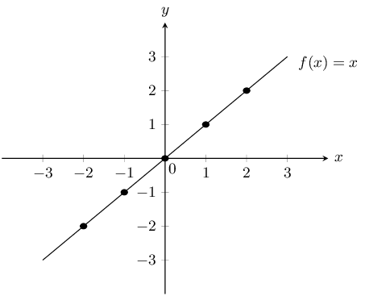
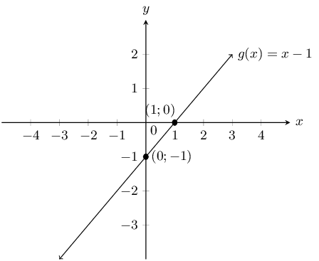
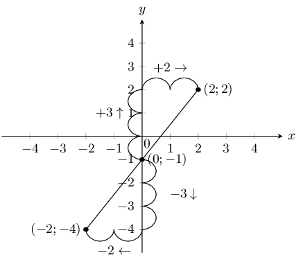
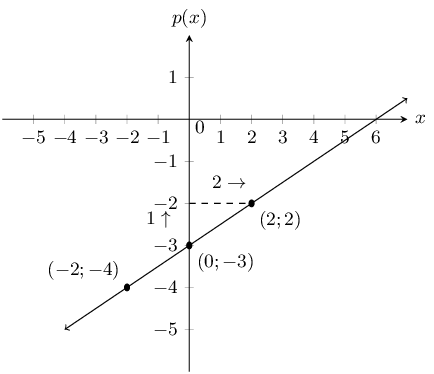
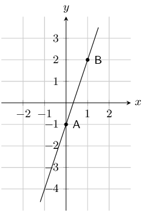
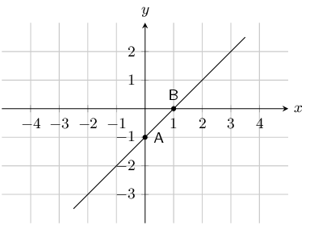
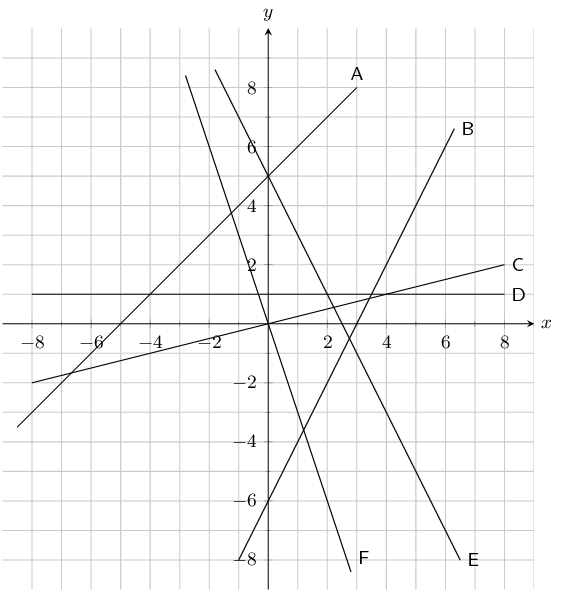
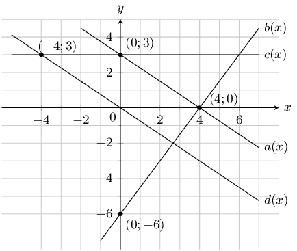
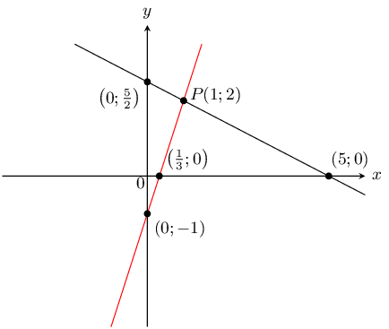
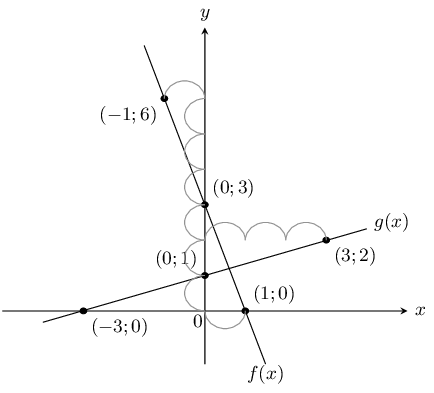

## 6.2 Linear functions (EMA48)

### Functions of the form \(y=x\) (EMA49)

Functions of the form \(y=mx+c\) are called straight line functions. In the equation, \(y=mx+c\), \(m\) and
        \(c\) are constants and have different effects on the graph of the function.

<Callout type="tip" title="Worked example 1: Plotting a straight line graph">
**Question:**
\(y=f(x)=x\)

Complete the following table for \(f(x)=x\) and plot the points on a set of axes.

| \(x\) | \(-\text{2}\) | \(-\text{1}\) | \(\text{0}\) | \(\text{1}\) | \(\text{2}\) |
| --- | --- | --- | --- | --- | --- |
| \(f(x)\) | \(-\text{2}\) |  |  |  |  |

1. Join the points with a straight line.
2. Determine the domain and range.
3. About which line is \(f\) symmetrical?
4. Using the graph, determine the value of \(x\) for which \(f(x)=4\). Confirm your answer graphically.
5. Where does the graph cut the axes?

**Substitute values into the equation:**
| \(x\) | \(-\text{2}\) | \(-\text{1}\) | \(\text{0}\) | \(\text{1}\) | \(\text{2}\) |
| --- | --- | --- | --- | --- | --- |
| \(f(x)\) | \(-\text{2}\) | \(-\text{1}\) | \(\text{0}\) | \(\text{1}\) | \(\text{2}\) |

**Plot the points and join with a straight line curve:**
From the table, we get the following points and the graph:

          \((-2;-2), (-1;-1), (0;0), (1;1), (2;2)\)

**Determine the domain and range:**
Domain: \(x\in \mathbb{R}\)

Range: \(f(x)\in \mathbb{R}\)

**Determine the value of \(x\) for which \(f(x)=4\):**
From the graph we see that when \(f(x)=4\), \(x=4\). This gives the point \((4;4)\).

**Determine the intercept:**
The function \(f\) intercepts the axes at the origin \((0;0)\).
</Callout>

### Functions of the form \(y=mx+c\) (EMA4B)

## The effects of \(m\) and \(c\) on a straight line graph

On the same set of axes, plot the following graphs:

1. \(y=x-2\)
2. \(y=x-1\)
3. \(y=x\)
4. \(y=x+1\)
5. \(y=x+2\)

Use your results to deduce the effect of different values of \(c\) on the graph.

On the same set of axes, plot the following graphs:

1. \(y=-2x\)
2. \(y=-x\)
3. \(y=x\)
4. \(y=2x\)

Use your results to deduce the effect of different values of \(m\) on the graph.

The effect of \(m\)

We notice that the value of \(m\) affects the slope of the graph. As \(m\) increases, the gradient of the graph
        increases.

If \(m>0\) then the graph increases from left to right (slopes upwards).

If \(m<0\) then the graph increases from right to left (slopes downwards). For this reason, \(m\) is
        referred to as the gradient of a straight-line graph.

The effect of \(c\)

We also notice that the value of \(c\) affects where the graph cuts the \(y\)-axis. For this reason, \(c\) is
        known as the \(y\)-intercept.

If \(c>0\) the graph shifts vertically upwards.

If \(c<0\) the graph shifts vertically downwards.

|  | \(m<0\) | \(m=0\) | \(m>0\) |
| --- | --- | --- | --- |
| \(c>0\) |  |  |  |
| \(c=0\) |  |  |  |
| \(c<0\) |  |  |  |

Table 6.1: The effect of \(m\) and \(c\) on a straight line graph.

<Callout type="tip" title="Multimedia & Video">
You can use this Phet simulation
          to help you see the effects of changing \(m\) and \(c\).
</Callout>

### Discovering the characteristics (EMA4C)

The standard form of a straight line graph is the equation \(y=mx+c\).

#### Domain and range

The domain is \(\left\{x:x\in \mathbb{R}\right\}\) because there is no value of \(x\) for which
          \(f\left(x\right)\) is undefined.

The range of \(f\left(x\right)=mx+c\) is also \(\left\{f\left(x\right):f\left(x\right)\in
          \mathbb{R}\right\}\) because \(f\left(x\right)\) can take on any real value.

#### Intercepts

The \(y\)-intercept:

Every point on the \(y\)-axis has an \(x\)-coordinate of \(\text{0}\). Therefore to calculate the
          \(y\)-intercept, let \(x=0\).

For example, the \(y\)-intercept of \(g\left(x\right)=x-1\) is given by setting \(x=0\):

        \begin{align*}
        g\left(x\right)& = x-1 \\
        g\left(0\right)& = 0-1 \\
        & = -1
        \end{align*}

This gives the point \(\left(0;-1\right)\).

The \(x\)-intercept:

Every point on the \(x\)-axis has a \(y\)-coordinate of \(\text{0}\). Therefore to calculate the
          \(x\)-intercept, let \(y=0\).

For example, the \(x\)-intercept of \(g\left(x\right)=x-1\) is given by setting \(y=0\):

        \begin{align*}
        g\left(x\right)& = x-1 \\
        0& = x-1 \\
        \therefore x& = 1
        \end{align*}

This gives the point \(\left(1;0\right)\).

### Sketching graphs of the form \(y=mx+c\) (EMA4D)

In order to sketch graphs of the form, \(f\left(x\right)=mx+c\), we need to determine three characteristics:

1. sign of \(m\)
2. \(y\)-intercept
3. \(x\)-intercept

### Dual intercept method (EMA4F)

Only two points are needed to plot a straight line graph. The easiest points to use are the \(x\)-intercept and
        the \(y\)-intercept.

<Callout type="tip" title="Worked example 2: Sketching a straight line graph using the dual intercept method">
**Question:**
Sketch the graph of \(g(x)=x-1\) using the dual intercept method.

**Examine the standard form of the equation:**
\(m>0\). This means that the graph increases as \(x\) increases.

**Calculate the intercepts:**
For the \(y\)-intercept, let \(x=0\); therefore \(g(0)=-1\). This gives the point \((0;-1)\).

For the \(x\)-intercept, let \(y=0\); therefore \(x=1\). This gives the point \((1;0)\).

**Plot the points and draw the graph:**

</Callout>

### Gradient and \(y\)-intercept method (EMA4G)

We can draw a straight line graph of the form \(y=mx+c\) using the gradient (\(m\)) and the \(y\)-intercept
        (\(c\)).

We calculate the \(y\)-intercept by letting \(x = 0\). This gives us one point \((0;c)\) for drawing the graph
        and we use the gradient to calculate the second point.

The gradient of a line is the measure of steepness. Steepness is determined by the ratio of vertical change to
        horizontal change:

      \[m = \frac{\text{change in }y}{\text{change in }x} = \frac{\text{vertical change}}{\text{horizontal change}}\]

For example, \(y = \frac{3}{2}x - 1\), therefore \(m > 0\) and the graph slopes upwards.

      \[m = \frac{\text{change in }y}{\text{change in }x} = \frac{3\uparrow}{2\to }=\frac{-3\downarrow}{-2\leftarrow}\]

<Callout type="tip" title="Worked example 3: Sketching a straight line graph using the gradient–intercept method">
**Question:**
Sketch the graph of \(p(x) = \frac{1}{2}x - 3\) using the gradient-intercept method.

**Use the intercept:**
\(c=-3\), which gives the point \((0;-3)\).

**Use the gradient:**
\[m=\frac{\text{change in }y}{\text{change in }x}=\frac{1\uparrow}{2\to }=\frac{-1\downarrow}{-2\leftarrow}\]

Start at \((0;-3)\). Move \(\text{1}\) unit up and \(\text{2}\) units to the right. This gives the second
            point \((2;-2)\).

Or start at \((0;-3)\), move \(\text{1}\) unit down and \(\text{2}\) units to the left. This gives the
            second point \((-2;-4)\).

**Plot the points and draw the graph:**

</Callout>

Always write the function in the form \(y = mx + c\) and take note of \(m\). After plotting the graph, make
        sure that the graph increases if \(m > 0\) and that the graph decreases if \(m < 0\).

### Textbook Exercise 6.2

Determine the \(x\)-intercept and the \(y\)-intercept of the following equations.

**Problem:**
\(y = x - 1\)

**Solution:**
\begin{align*}
                y & = x - 1 \\
                y & = (0) - 1 \\
                y & = -1 \\
                \therefore c &= -1
                \end{align*}
                \begin{align*}
                y & = x - 1 \\
                (0) & = x - 1 \\
                1 & = x \\
                1 & = x
                \end{align*}

\(x\)-intercept \(=1\) and \(y\)-intercept \(=-1\)

**Problem:**
\(y = x + 2\)

**Solution:**
\begin{align*}
                y & = x + 2 \\
                y & = (0) + 2 \\
                y & = 2 \\
                \therefore c &= 2
                \end{align*}
                \begin{align*}
                y & = x + 2 \\
                (0) & = x + 2 \\
                -2 & = x \\
                -2 & = x
                \end{align*}

\(x\)-intercept \(=-2\) and \(y\)-intercept \(=2\)

**Problem:**
\(y = x - 3\)

**Solution:**
\begin{align*}
                y & = x - 3 \\
                y & = (0) - 3 \\
                y & = -3 \\
                \therefore c &= -3
                \end{align*}
                \begin{align*}
                y & = x - 3 \\
                (0) & = x - 3 \\
                3 & = x \\
                3 & = x
                \end{align*}

\(x\)-intercept \(=3\) and \(y\)-intercept \(=-3\)

**Problem:**
In the graph below there is a function with the equation \(y = mx + c\). Determine the values of \(m\)
                (the gradient of the line) and \(c\) (the \(y\)-intercept of the line).

**Solution:**
To determine \(m\), we use the coordinates of any other point on the line apart from the one used for
                the \(y\)-intercept. In this solution, we have chosen the coordinates of point \(B\) which are
                \((1;2)\).

From the \(y\)-intercept \(c = -1\).

              \begin{align*}
              y & = mx + c \\
              2 & = m(1) - 1 \\
              2 & = m - 1 \\
              3 & = m
              \end{align*}

\(m = 3\) and \(c = -1\).

**Problem:**
The graph below shows a function with the equation \(y = mx + c\). Determine the values of \(m\) (the
                gradient of the line) and \(c\) (the \(y\)-intercept of the line).

**Solution:**
To determine \(m\), we use the coordinates of any other point on the line apart from the one used for
                the \(y\)-intercept. In this solution, we have chosen the coordinates of point \(B\) which are
                \((1;2)\).

From the \(y\)-intercept \(c = -1\).

              \begin{align*}
              y & = mx + c \\
              0 & = m(1) - 1 \\
              0 & = m - 1 \\
              1 & = m
              \end{align*}

\(m = 1\), and \(c = -1\).

List the \(x\) and \(y\)-intercepts for the following straight line graphs. Indicate whether the graph
                is increasing or decreasing:

**Problem:**
\(y = x + 1\)

**Solution:**
To find the \(x\)-intercept we set \(y = 0\) and to find the \(y\)-intercept we set \(x = 0\). This
                  gives the points \((0;1)\) and \((-1;0)\). The graph is increasing (\(m > 0\)).

**Problem:**
\(y=x-1\)

**Solution:**
To find the \(x\)-intercept we set \(y = 0\) and to find the \(y\)-intercept we set \(x = 0\). This
                  gives the points \((0;-1)\) and \((1;0)\). The graph is increasing (\(m > 0\)).

**Problem:**
\(h(x) = 2x + 1\)

**Solution:**
To find the \(x\)-intercept we set \(y = 0\) and to find the \(y\)-intercept we set \(x = 0\). This
                  gives the points \((0;-1)\) and \(\left(\frac{1}{2};0\right)\). The graph is increasing (\(m >
                  0\)).

**Problem:**
\(y+3x=1\)

**Solution:**
To find the \(x\)-intercept we set \(y = 0\) and to find the \(y\)-intercept we set \(x = 0\). This
                  gives the points \((0;1)\) and \(\left(\frac{1}{3};0\right)\). The graph is decreasing (\(m < 0\)).

**Problem:**
\(3y-2x=6\)

**Solution:**
To find the \(x\)-intercept we set \(y = 0\) and to find the \(y\)-intercept we set \(x = 0\). This
                  gives the points \((0;2)\) and \(\left(-3;0\right)\). The graph is increasing (\(m > 0\)).

**Problem:**
\(k(x) = -3\)

**Solution:**
To find the \(x\)-intercept we set \(y = 0\) and to find the \(y\)-intercept we set \(x = 0\). This
                  gives the point \((0;3)\). The graph is horizontal.

**Problem:**
\(x=3y\)

**Solution:**
To find the \(x\)-intercept we set \(y = 0\) and to find the \(y\)-intercept we set \(x = 0\). This
                  gives the same point for both intercepts: \((0;0)\). The graph is increasing (\(m > 0\)).

**Problem:**
\(\frac{x}{2}-\frac{y}{3} = 1\)

**Solution:**
To find the \(x\)-intercept we set \(y = 0\) and to find the \(y\)-intercept we set \(x = 0\). This
                  gives the points \((0;-3)\) and \(\left(2;0\right)\). The graph is increasing (\(m > 0\)).

State whether the following are true or not.

**Problem:**
The gradient of \(2y = 3x -1\) is \(3\).

**Solution:**
False

                \begin{align*}
                2y &= 3x -1 \\
                y &= \frac{3}{2}x -{1}{2}
                \end{align*}

Therefore the gradient is \(\frac{3}{2}\).

**Problem:**
The \(y\)-intercept of \(y = x + 4\) is \(4\).

**Solution:**
True

**Problem:**
The gradient of \(2 - y = 2x - 1\) is \(-2\).

**Solution:**
True

**Problem:**
The gradient of \(y = \frac{1}{2}x - 1\) is \(-1\).

**Solution:**
False

                \[m = \frac{1}{2}\]

**Problem:**
The \(y\)-intercept of \(2y = 3x - 6\) is \(6\).

**Solution:**
False

                \begin{align*}
                2y &= 3x - 6 \\
                y &= \frac{3}{2}x - 3
                \end{align*}

Write the following in standard form (\(y = mx + c\)):

**Problem:**
\(2y + 3x = 1\)

**Solution:**
\begin{align*}
                2y + 3x &= 1 \\
                2y &= 1 - 3x \\
                y = & -\frac{3}{2}x + \frac{1}{2}
                \end{align*}

**Problem:**
\(3x - y = 5\)

**Solution:**
\begin{align*}
                3x - y &= 5 \\
                -y &= 5 - 3x \\
                y = & -3x + 5
                \end{align*}

**Problem:**
\(3y - 4 = x\)

**Solution:**
\begin{align*}
                3y - 4 &= x \\
                3y &= x + 4 \\
                y = & \frac{1}{3}x + \frac{4}{3}
                \end{align*}

**Problem:**
\(y + 2x - 3 = 1\)

**Solution:**
\begin{align*}
                y + 2x - 3 &= 1 \\
                y &= -2x + 4
                \end{align*}

Look at the graphs below. Each graph is labelled with a letter. In the questions that follow, match any
                given equation with the label of a corresponding graph.

**Problem:**
\(y = 5 -2x\)

**Solution:**
E

**Problem:**
\(x + 5\)

**Solution:**
A

**Problem:**
\(y = 2x - 6\)

**Solution:**
B

**Problem:**
\(y = -3x\)

**Solution:**
F

**Problem:**
\(y = 1\)

**Solution:**
D

**Problem:**
\(y = \frac{1}{2}x\)

**Solution:**
C

For the functions in the diagram below, give the equation of each line:

**Problem:**
\(a(x)\)

**Solution:**
The \(y\)-intercept is \((0;3)\), therefore \(c = 3\).

                \begin{align*}
                y & = mx + 3 \\
                0 & = 4m + 3 \\
                \therefore m & = \frac{-3}{4}
                \end{align*}

Therefore \(a(x) = -\frac{3}{4}x + 3\)

**Problem:**
\(b(x)\)

**Solution:**
The \(y\)-intercept is \((0;-6)\), therefore \(c = -6\).

                \begin{align*}
                y & = mx - 6 \\
                0 & = 4m - 6 \\
                \therefore m & = \frac{3}{2}
                \end{align*}

Therefore \(b(x) = \frac{3}{2}x - 6\)

**Problem:**
\(c(x)\)

**Solution:**
The \(y\)-intercept is \((0;3)\), therefore \(c = 3\).

                \begin{align*}
                y & = mx + 3 \\
                3 & = -4m + 3 \\
                0 & = -4m \\
                \therefore m & = 0
                \end{align*}

Therefore \(c(x) = 3\)

**Problem:**
\(d(x)\)

**Solution:**
The \(y\)-intercept is \((0;0)\), therefore \(c = 0\).

                \begin{align*}
                y & = mx \\
                3 & = -4m \\
                \therefore m & = \frac{-3}{4}
                \end{align*}

Therefore \(d(x) = -\frac{3}{4}x\)

**Problem:**
Sketch the following functions on the same set of axes, using the dual intercept method. Clearly
                indicate the coordinates of the intercepts with the axes and the point of intersection of the two
                graphs: \(x+2y-5=0\) and \(3x-y-1=0\).

**Solution:**
For \(x+2y-5=0\):

We first write the equation in standard form: \(y = -\frac{1}{2}x + \frac{5}{2}\). From this we see
                that the \(y\)-intercept is \(\frac{5}{2}\). The \(x\)-intercept is \(\text{5}\).

For \(3x-y-1=0\):

We first write the equation in standard form: \(y = 3x - 1\). From this we see that the \(y\)-intercept
                is \(-\text{1}\). The \(x\)-intercept is \(\frac{1}{3}\).

To find the point of intersection we need to solve the two equations simultaneously. We can use the
                standard form of the first equation and substitute this value of \(y\) into the second equation:

              \begin{align*}
              3x + \frac{1}{2}x - \frac{5}{2} - 1 & = 0 \\
              \frac{7}{2}x & = \frac{7}{2} \\
              x & = 1
              \end{align*}

Substitute the value of \(x\) back into the first equation:

              \begin{align*}
              x + 2y - 5 & = 0 \\
              1 + 2y - 5 & = 0 \\
              2y & = 4 \\
              y & = 2
              \end{align*}

Therefore the graphs intersect at \((1;2)\).

Now we can sketch the graphs:

**Problem:**
On the same set of axes, draw the graphs of \(f(x) = 3 - 3x\) and \(g(x) = \frac{1}{3}x+1\) using the
                gradient-intercept method.

**Solution:**
For \(f(x) = 3 - 3x\) the \(y\)-intercept is 3. The gradient is \(-\text{3}\).

To get the second point we start at \((0;3)\) and move 3 units up and 1 unit to the left. This gives
                the second point \((-1;6)\). Or we can move 3 units down and 1 unit right to get \((1;0)\).

For \(g(x) = \frac{1}{3}x + 1\) the \(y\)-intercept is 1. The gradient is \(\frac{1}{3}\).

To get the second point we start at \((0;1)\) and move 1 unit up and 3 units to the right. This gives
                the second point \((3;2)\). Or we can move 1 unit down and 3 units left to get \((-3;0)\).

Now we can sketch the graphs.

