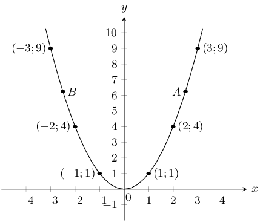
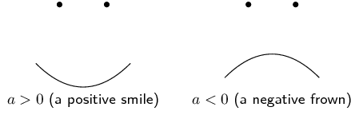
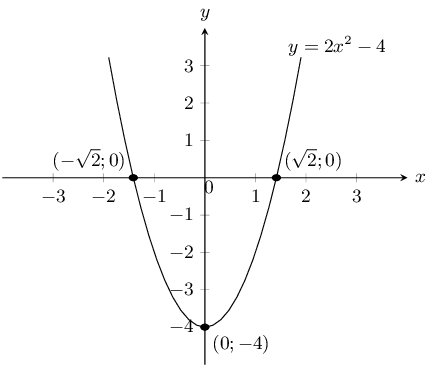
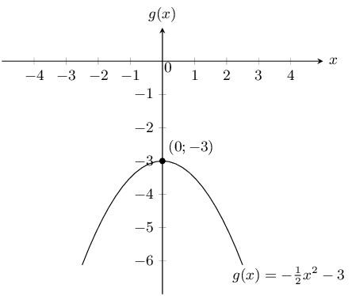
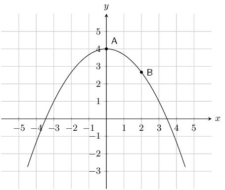
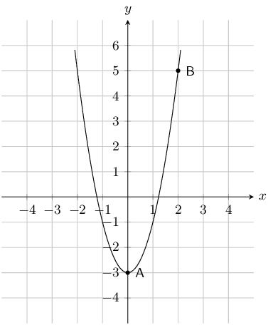
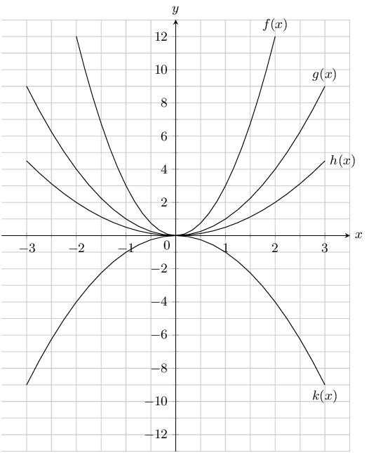
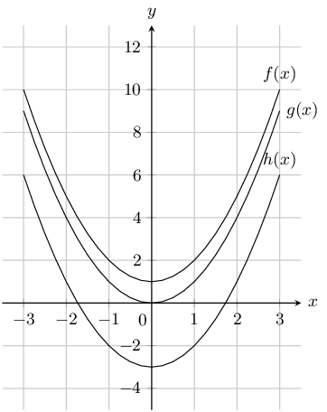
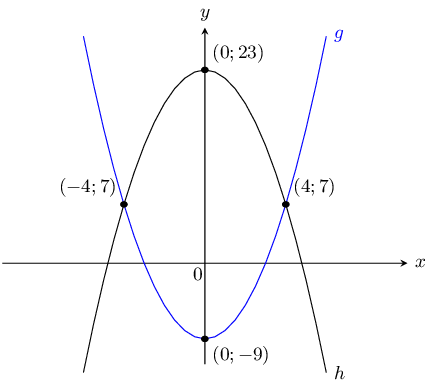
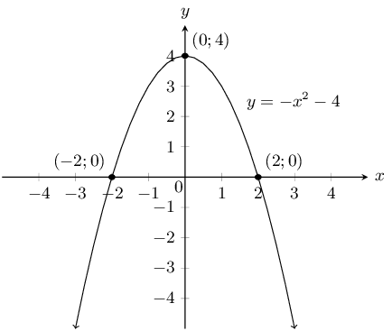

## 6.3 Quadratic functions (EMA4H)

### Functions of the form \(y={x}^{2}\) (EMA4J)

Functions of the general form \(y=a{x}^{2}+q\) are called parabolic functions. In the equation
        \(y=a{x}^{2}+q\), \(a\) and \(q\) are constants and have different effects on the parabola.

<Callout type="tip" title="Worked example 4: Plotting a quadratic function">
**Question:**
\(y=f(x)={x}^{2}\)

Complete the following table for \(f(x)={x}^{2}\) and plot the points on a system of axes.

| \(x\) | \(-\text{3}\) | \(-\text{2}\) | \(-\text{1}\) | \(\text{0}\) | \(\text{1}\) | \(\text{2}\) | \(\text{3}\) |
| --- | --- | --- | --- | --- | --- | --- | --- |
| \(f(x)\) | \(\text{9}\) |  |  |  |  |  |  |

1. Join the points with a smooth curve.
2. The domain of \(f\) is \(x\in \mathbb{R}\). Determine the range.
3. About which line is \(f\) symmetrical?
4. Determine the value of \(x\) for which \(f(x)=6\frac{1}{4}\). Confirm your answer graphically.
5. Where does the graph cut the axes?

**Substitute values into the equation:**
\begin{align*}
          f(x) & = {x}^{2} \\
          f(-3) & = {(-3)}^{2} = 9\\
          f(-2) & = {(-2)}^{2} = 4\\
          f(-1) & = {(-1)}^{2} = 1\\
          f(0) & = {(0)}^{2} = 0\\
          f(1) & = {(1)}^{2} = 1\\
          f(2) & = {(2)}^{2} = 4\\
          f(3) & = {(3)}^{2} = 9
          \end{align*}

| \(x\) | \(-\text{3}\) | \(-\text{2}\) | \(-\text{1}\) | \(\text{0}\) | \(\text{1}\) | \(\text{2}\) | \(\text{3}\) |
| --- | --- | --- | --- | --- | --- | --- | --- |
| \(f(x)\) | \(\text{9}\) | \(\text{4}\) | \(\text{1}\) | \(\text{0}\) | \(\text{0}\) | \(\text{4}\) | \(\text{9}\) |

**Plot the points and join with a smooth curve:**
From the table, we get the following points:

          \((-3;9), (-2;4), (-1;1), (0;0), (1;1), (2;4), (3;9)\)

**Determine the domain and range:**
Domain: \(x\in \mathbb{R}\)

From the graph we see that for all values of \(x\), \(y \ge 0\).

Range: \(\left\{y:y\in \mathbb{R}, y\ge 0\right\}\)

**Find the axis of symmetry:**
\(f\) is symmetrical about the \(y\)-axis. Therefore the axis of symmetry of \(f\) is the line \(x=0\).

**Determine the \(x\)-value for which \(f(x)=6\frac{1}{4}\):**
\begin{align*}
          f(x)& = \frac{25}{4} \\
          \therefore \frac{25}{4}& = {x}^{2} \\
          x& = ±\frac{5}{2}\\
          & = ±2\frac{1}{2}
          \end{align*}

See points \(A\) and \(B\) on the graph.

**Determine the intercept:**
The function \(f\) intercepts the axes at the origin \((0;0)\).

We notice that as the value of \(x\) increases from \(-\infty\) to \(\text{0}\), \(f(x)\) decreases.

At the turning point \((0;0)\), \(f(x)=0\).

As the value of \(x\) increases from \(\text{0}\) to \(∞\), \(f(x)\) increases.
</Callout>

### Functions of the form \(y=a{x}^{2}+q\) (EMA4K)

## The effects of \(a\)and \(q\) on a parabola.

Complete the table and plot the following graphs on the same system of axes:

1. \({y}_{1}={x}^{2}-2\)
2. \({y}_{2}={x}^{2}-1\)
3. \({y}_{3}={x}^{2}\)
4. \({y}_{4}={x}^{2}+1\)
5. \({y}_{5}={x}^{2}+2\)

| \(x\) | \(-\text{2}\) | \(-\text{1}\) | \(\text{0}\) | \(\text{1}\) | \(\text{2}\) |
| --- | --- | --- | --- | --- | --- |
| \({y}_{1}\) |  |  |  |  |  |
| \({y}_{2}\) |  |  |  |  |  |
| \({y}_{3}\) |  |  |  |  |  |
| \({y}_{4}\) |  |  |  |  |  |
| \({y}_{5}\) |  |  |  |  |  |

Use your results to deduce the effect of \(q\).

Complete the table and plot the following graphs on the same system of axes:

1. \({y}_{6}=-2{x}^{2}\)
2. \({y}_{7}=-{x}^{2}\)
3. \({y}_{8}={x}^{2}\)
4. \({y}_{9}=2{x}^{2}\)

| \(x\) | \(-\text{2}\) | \(-\text{1}\) | \(\text{0}\) | \(\text{1}\) | \(\text{2}\) |
| --- | --- | --- | --- | --- | --- |
| \({y}_{6}\) |  |  |  |  |  |
| \({y}_{7}\) |  |  |  |  |  |
| \({y}_{8}\) |  |  |  |  |  |
| \({y}_{9}\) |  |  |  |  |  |

Use your results to deduce the effect of \(a\).

The effect of \(q\)

The effect of \(q\) is called a vertical shift because all points are moved the same distance in the same
        direction (it slides the entire graph up or down).

- For \(q>0\), the graph of \(f(x)\) is shifted vertically upwards by \(q\) units. The turning point of
            \(f(x)\) is above the \(y\)-axis.
- For \(q<0\), the graph of \(f(x)\) is shifted vertically downwards by \(q\) units. The turning point of
            \(f(x)\) is below the \(y\)-axis.

The effect of \(a\)

The sign of \(a\) determines the shape of the graph.

- For \(a>0\), the graph of \(f(x)\) is a “smile” and has a minimum turning point at
            \((0;q)\). The graph of \(f(x)\) is stretched vertically upwards; as \(a\) gets larger, the graph gets
            narrower.

For \(0<a<1\), as \(a\) gets closer to \(\text{0}\), the graph of \(f(x)\) gets wider.
- For \(a<0\), the graph of \(f(x)\) is a “frown” and has a maximum turning point at
            \((0;q)\). The graph of \(f(x)\) is stretched vertically downwards; as \(a\) gets smaller, the graph gets
            narrower.

For \(-1<a<0\), as \(a\) gets closer to \(\text{0}\), the graph of \(f(x)\) gets wider.

|  | \(a<0\) | \(a>0\) |
| --- | --- | --- |
| \(q>0\) |  |  |
| \(q=0\) |  |  |
| \(q<0\) |  |  |

Table 6.2: The effect of \(a\) and \(q\) on a parabola.

<Callout type="tip" title="Multimedia & Video">
You can use this Phet simulation to help
          you see the effects of changing \(a\) and \(q\) for a parabola.
</Callout>

### Discovering the characteristics (EMA4M)

The standard form of the equation of a parabola is \(y=a{x}^{2}+q\).

#### Domain and range

The domain is \(\left\{x:x\in \mathbb{R}\right\}\) because there is no value for which \(f(x)\) is undefined.

If \(a>0\) then we have:

        \[\begin{array}{cccl}
        {x}^{2}& \ge & 0 & (\text{Perfect square is always positive}) \\
        a{x}^{2}& \ge & 0 & (\text{since } a>0) \\
        a{x}^{2}+q & \ge & q & (\text{add } q \text{ to both sides}) \\
        \therefore f(x) & \ge & q &
        \end{array}\]

Therefore if \(a>0\), the range is \(\left[q;\infty \right)\). Similarly, if \(a<0\) then the range is
          \(\left(-\infty ;q\right]\).

<Callout type="tip" title="Worked example 5: Domain and range of a parabola">
**Question:**
If \(g(x)={x}^{2}+2\), determine the domain and range of the function.

**Determine the domain:**
The domain is \(\left\{x:x\in \mathbb{R}\right\}\) because there is no value for which \(g(x)\) is
              undefined.

**Determine the range:**
The range of \(g(x)\) can be calculated as follows:

            \begin{align*}
            {x}^{2}& \ge 0 \\
            {x}^{2}+2& \ge 2\\
            g(x)& \ge 2
            \end{align*}

Therefore the range is \(\left\{g\left(x\right):g\left(x\right)\ge 2\right\}\).
</Callout>

#### Intercepts

The \(y\)-intercept:

Every point on the \(y\)-axis has an \(x\)-coordinate of \(\text{0}\), therefore to calculate the
          \(y\)-intercept let \(x=0\).

For example, the \(y\)-intercept of \(g(x)={x}^{2}+2\) is given by setting \(x=0\):

        \begin{align*}
        g(x)& = {x}^{2}+2 \\
        g(0)& ={0}^{2}+2\\
        & =2
        \end{align*}

This gives the point \((0;2)\).

The \(x\)-intercepts:

Every point on the \(x\)-axis has a \(y\)-coordinate of \(\text{0}\), therefore to calculate the
          \(x\)-intercept let \(y=0\).

For example, the \(x\)-intercepts of \(g(x)={x}^{2}+2\) are given by setting \(y=0\):

        \begin{align*}
        g(x)& = {x}^{2}+2 \\
        0 & = {x}^{2}+2 \\
        -2& = {x}^{2}
        \end{align*}

There is no real solution, therefore the graph of \(g(x)={x}^{2}+2\) does not have \(x\)-intercepts.

#### Turning points

The turning point of the function of the form \(f(x)=a{x}^{2}+q\) is determined by examining the range of the
          function.

- If \(a>0\), the graph of \(f(x)\) is a “smile” and has a minimum turning point at
              \((0;q)\).
- If \(a<0\), the graph of \(f(x)\) is a “frown” and has a maximum turning point at
              \((0;q)\).

#### Axes of symmetry

The axis of symmetry for functions of the form \(f(x)=a{x}^{2}+q\) is the \(y\)-axis, which is the line
          \(x=0\).

### Sketching graphs of the form \(y=a{x}^{2}+q\) (EMA4N)

In order to sketch graphs of the form \(f(x)=a{x}^{2}+q\), we need to determine the following characteristics:

1. sign of \(a\)
2. \(y\)-intercept
3. \(x\)-intercept
4. turning point

<Callout type="tip" title="Worked example 6: Sketching a parabola">
**Question:**
Sketch the graph of \(y={2x}^{2}-4\). Mark the intercepts and turning point.

**Examine the standard form of the equation:**
We notice that \(a>0\). Therefore the graph is a “smile” and has a minimum turning point.

**Calculate the intercepts:**
For the \(y\)-intercept, let \(x=0\):

          \begin{align*}
          y& = 2{x}^{2}-4 \\
          & = 2{(0)}^{2}-4 \\
          & =-4
          \end{align*}

This gives the point \((0;-4)\).

For the \(x\)-intercepts, let \(y=0\):

          \begin{align*}
          y& = 2{x}^{2}-4 \\
          0& = 2{x}^{2}-4 \\
          {x}^{2}& = 2 \\
          \therefore x& = ±\sqrt{2}
          \end{align*}

This gives the points \((-\sqrt{2};0)\) and \((\sqrt{2};0)\).

**Determine the turning point:**
From the standard form of the equation we see that the turning point is \((0;-4)\).

**Plot the points and sketch the graph:**

Domain: \(\left\{x:x\in \mathbb{R}\right\}\)

Range: \(\left\{y:y\ge -4,y\in \mathbb{R}\right\}\)

The axis of symmetry is the line \(x=0\).
</Callout>

<Callout type="tip" title="Worked example 7: Sketching a parabola">
**Question:**
Sketch the graph of \(g(x)=-\frac{1}{2}{x}^{2}-3\). Mark the intercepts and the turning point.

**Examine the standard form of the equation:**
We notice that \(a<0\). Therefore the graph is a “frown” and has a maximum turning point.

**Calculate the intercepts:**
For the \(y\)-intercept, let \(x=0\):

          \begin{align*}
          g(x)& = -\frac{1}{2}{x}^{2}-3 \\
          g(0)& = -\frac{1}{2}{(0)}^{2}-3 \\
          & = -3
          \end{align*}

This gives the point \((0;-3)\).

For the \(x\)-intercepts let \(y=0\):

          \begin{align*}
          0& = -\frac{1}{2}{x}^{2}-3 \\
          3& = -\frac{1}{2}{x}^{2} \\
          -2(3)& = {x}^{2} \\
          -6& = {x}^{2}
          \end{align*}

There is no real solution, therefore there are no \(x\)-intercepts.

**Determine the turning point:**
From the standard form of the equation we see that the turning point is \((0;-3)\).

**Plot the points and sketch the graph:**

Domain: \(x\in \mathbb{R}\).

Range: \(y\in \left(-\infty ;-3\right]\).

The axis of symmetry is the line \(x=0\).
</Callout>

### Textbook Exercise 6.3

**Problem:**
The graph below shows a quadratic function with the following form: \(y = ax^2 + q\).
                Two points on the parabola are shown: Point A, the turning point of the parabola, at
                \((0;4)\), and Point B is at \(\left(2; \frac{8}{3}\right)\). Calculate the values of
                \(a\) and \(q\).

**Solution:**
The value of \(q\) is 4.

              \begin{align*}
              y & = ax^2 +4 \\
              \left( \frac{8}{3} \right) & = a(\text{2})^2 +4 \quad \longleftarrow \quad ^{\text{substitute in
              the}}_{\text{coordinates of a point!}} \\
              \frac{8}{3} & = \text{4}a +4 \\
              \frac{8}{3} -4 & = \text{4}a \\
              - \frac{4}{3} & = \text{4}a \\
              - \frac{1}{3} & = a
              \end{align*}
              \[a = - \frac{1}{3};~ q = 4\]

**Problem:**
The graph below shows a quadratic function with the following form: \(y = ax^2 + q\).
                Two points on the parabola are shown: Point A, the turning point of the parabola, at
                \((0;-3)\), and Point B is at \(\left(2; 5\right)\). Calculate the values of \(a\) and
                \(q\).

**Solution:**
The value of \(q\) is -3.

              \begin{align*}
              y & = ax^2 -3 \\
              \left( 5 \right) & = a(\text{2})^2 -3 \quad \longleftarrow \quad ^{\text{substitute in
              the}}_{\text{coordinates of a point!}} \\
              5 & = \text{4}a -3 \\
              5 +3 & = \text{4}a \\
              8 & = \text{4}a \\
              2 & = a
              \end{align*}
              \[a = 2;~ q = -3\]

Given the following equation:

\(y=5 x^{2} - 2\)

**Problem:**
Calculate the \(y\)-coordinate of the \(y\)-intercept.

**Solution:**
\begin{align*}
                y & = ax^2 + q \\
                & = 5 x^{2} - 2 \\
                & = 5 (0)^{2} - 2\\
                & = 0-2
                \end{align*}

The \(y\)-coordinate of the \(y\)-intercept is \(-2\).

**Problem:**
Now calculate the \(x\)-intercepts. Your answer must be correct to 2 decimal places.

**Solution:**
\begin{align*}
                y & = 5 x^{2} - 2 \\
                (0) & =5 x^{2} - 2 \\
                - 5 x^{2} &=-2\\
                x^2 &= \frac{-2}{-5} \\
                x & =\pm \sqrt{\frac{2}{5}}\\
                \text{Therefore: }
                x = +\sqrt{\frac{2}{5}} &\text{ and } x = - \sqrt{\frac{2}{5}} \\
                x= -\text{0,63} &\text{ and } x= \text{0,63}
                \end{align*}

The \(x\)-intercepts are \((-\text{0,63};0)\) and \((\text{0,63};0)\).

Given the following equation:

\(y=- 2 x^{2} + 1\)

**Problem:**
Calculate the \(y\)-coordinate of the \(y\)-intercept.

**Solution:**
\begin{align*}
                y & = ax^2 + q \\
                & = - 2 x^{2} + 1 \\
                & = - 2 (0)^{2} + 1\\
                & = 0 + 1
                \end{align*}

The \(y\)-coordinate of the \(y\)-intercept is \(\text{1}\).

**Problem:**
Now calculate the \(x\)-intercepts. Your answer must be correct to 2 decimal places.

**Solution:**
\begin{align*}
                y & = - 2 x^{2} + 1 \\
                (0) & =- 2 x^{2} + 1 \\
                2 x^{2} &=1\\
                x^2 &= \frac{1}{2} \\
                x & =\pm \sqrt{\frac{1}{2}}\\
                \text{Therefore: }
                x = +\sqrt{\frac{1}{2}} &\text{ and } x = - \sqrt{\frac{1}{2}} \\
                x= -\text{0,71} & \text{ and } x\end{align*}

The \(x\)-intercepts are \((-\text{0,71};0)\) and \((\text{0,71};0)\).

Given the following graph, identify a function that matches each of the following equations:

**Problem:**
\(y = \text{0,5}x^2\)

**Solution:**
\(h(x)\)

**Problem:**
\(y = x^2\)

**Solution:**
\(g(x)\)

**Problem:**
\(y = 3x^2\)

**Solution:**
\(f(x)\)

**Problem:**
\(y = -x^2\)

**Solution:**
\(k(x)\)

Given the following graph, identify a function that matches each of the following equations:

**Problem:**
\(y = x^2 - 3\)

**Solution:**
\(h(x)\)

**Problem:**
\(y = x^2 + 1\)

**Solution:**
\(f(x)\)

**Problem:**
\(y = x^2\)

**Solution:**
\(g(x)\)

Two parabolas are drawn: \(g: y=ax^2+p\) and \(h:y=bx^2+q\).

**Problem:**
Find the values of \(a\) and \(p\).

**Solution:**
\(p\) is the \(y\)-intercept of the function \(g(x)\), therefore \(p=-9\)

To find \(a\) we use one of the points on the graph (e.g. \((4;7)\)):

\begin{align*}
                  y&=ax^2-9\\
                  7&= a(4^2) - 9\\
                  16a&=16\\
                  \therefore a&=1
                  \end{align*}

                \(a=1\); \(p=-9\)

**Problem:**
Find the values of \(b\) and \(q\).

**Solution:**
\(q\) is the \(y\)-intercept of the function \(h(x)\), therefore \(q = 23\)

To find \(b\), we use one of the points on the graph (e.g. \((4;7)\)):

\begin{align*}
                  y&=bx^{2} =23\\
                  7&= b(4^{2}) +23\\
                  16b&=-16\\
                  \therefore b&=-1
                  \end{align*}

                \(b=-1\); \(q=23\)

**Problem:**
Find the values of \(x\) for which \(g(x) \geq h(x)\).

**Solution:**
These are the points where \(g\) lies above \(h\).

From the graph we see that \(g\) lies above \(h\) when: \(x \le -4\) or \(x \geq 4\)

**Problem:**
For what values of \(x\) is \(g\) increasing?

**Solution:**
\(g\) increases from the turning point \((0;-9)\), i.e. for \(x \geq 0\).

**Problem:**
Show that if \(a < 0\) the range of \(f(x)=ax^2 + q\) is \(\left\{f(x):f(x) \le q\right\}\).

**Solution:**
Because the square of any number is always positive we get: \(x^2 \geq 0\).

If we multiply by \(a\) where \((a < 0)\) then the sign of the inequality is reversed: \(ax^2 \le
                0\)

Adding \(q\) to both sides gives \(ax^2 + q \le q\)

And so \(f(x) \le q\)

This gives the range as \((-\infty; q]\).

**Problem:**
Draw the graph of the function \(y=-x^2 + 4\) showing all intercepts with the axes.

**Solution:**
The \(y\)-intercept is \((0;4)\). The \(x\)-intercepts are given by setting \(y = 0\):

              \begin{align*}
              0 & = -x^2 + 4 \\
              x^2 & = 4 \\
              x & = \pm 2
              \end{align*}

Therefore the \(x\)-intercepts are: \((2;0)\) and \((-2;0)\).

Now we can sketch the graph:

