## 6.4 Hyperbolic functions (EMA4P)

### Functions of the form \(y=\dfrac{1}{x}\) (EMA4Q)

Functions of the general form \(y=\dfrac{a}{x}+q\) are called hyperbolic functions.

<Callout type="tip" title="Worked example 8: Plotting a hyperbolic function">
**Question:**
\(y=h\left(x\right)=\dfrac{1}{x}\)

Complete the following table for \(h\left(x\right)=\dfrac{1}{x}\) and plot the points on a system of axes.

| \(x\) | \(-\text{3}\) | \(-\text{2}\) | \(-\text{1}\) | \(-\dfrac{1}{2}\) | \(-\dfrac{1}{4}\) | 0 | \(\dfrac{1}{4}\) | \(\dfrac{1}{2}\) | \(\text{1}\) | \(\text{2}\) | \(\text{3}\) |
| --- | --- | --- | --- | --- | --- | --- | --- | --- | --- | --- | --- |
| \(h\left(x\right)\) | \(-\dfrac{1}{3}\) |  |  |  |  |  |  |  |  |  |  |

1. Join the points with smooth curves.
2. What happens if \(x = 0\)?
3. Explain why the graph consists of two separate curves.
4. What happens to \(h\left(x\right)\) as the value of \(x\) becomes very small or very large?
5. The domain of \(h\left(x\right)\) is \(\left\{x:x\in \mathbb{R},x\ne 0\right\}\). Determine the range.
6. About which two lines is the graph symmetrical?

**Substitute values into the equation:**
\begin{align*}
          h(x)& = \frac{1}{x} \\
          h(-3)& = \frac{1}{-3} = -\frac{1}{3} \\
          h(-2)& = \frac{1}{-2} = -\frac{1}{2} \\
          h(-1)& = \frac{1}{-1} = -1 \\
          h\left(-\frac{1}{2}\right)& = \frac{1}{-\frac{1}{2}} = -2 \\
          h\left(-\frac{1}{4}\right)& = \frac{1}{-\frac{1}{4}} = -4 \\
          h(0)& = \frac{1}{0} = \text{undefined} \\
          h\left(\frac{1}{4}\right)& = \frac{1}{\frac{1}{4}} = 4 \\
          h\left(\frac{1}{2}\right)& = \frac{1}{\frac{1}{2}} = 2 \\
          h(1)& = \frac{1}{1} = 1 \\
          h(2)& = \frac{1}{2} = \frac{1}{2} \\
          h(3)& = \frac{1}{3} = \frac{1}{3}
          \end{align*}

| \(x\) | \(-\text{3}\) | \(-\text{2}\) | \(-\text{1}\) | \(-\dfrac{1}{2}\) | \(-\dfrac{1}{4}\) | \(\text{0}\) | \(\dfrac{1}{4}\) | \(\dfrac{1}{2}\) | \(\text{1}\) | \(\text{2}\) | \(\text{3}\) |
| --- | --- | --- | --- | --- | --- | --- | --- | --- | --- | --- | --- |
| \(h(x)\) | \(-\dfrac{1}{3}\) | \(-\dfrac{1}{2}\) | \(-\text{1}\) | \(-\text{2}\) | \(-\text{4}\) | undefined | \(\text{4}\) | \(\text{2}\) | \(\text{1}\) | \(\dfrac{1}{2}\) | \(\dfrac{1}{3}\) |

**Plot the points and join with two smooth curves:**
From the table we get the following points: \(\left(-3;-\frac{1}{3}\right)\),
            \(\left(-2;-\frac{1}{2}\right)\), \(\left(-1;-1\right)\), \(\left(-\frac{1}{2};-2\right)\),
            \(\left(-\frac{1}{4};-4\right)\), \(\left(\frac{1}{4};4\right)\), \(\left(\frac{1}{2};2\right)\),
            \(\left(1;1\right)\), \(\left(2;\frac{1}{2}\right)\), \(\left(3;\frac{1}{3}\right)\)

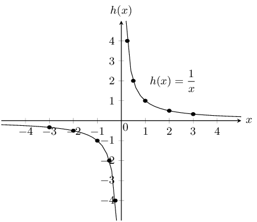

For \(x=0\) the function \(h\) is undefined. This is called a discontinuity at \(x=0\).

\(y=h(x)=\dfrac{1}{x}\) therefore we can write that \(x\times y=1\). Since the product of two positive
            numbers and the product of two negative numbers can be equal to \(\text{1}\), the graph
            lies in the first and third quadrants.

**Determine the asymptotes:**
As the value of \(x\) gets larger, the value of \(h(x)\) gets closer to, but does not equal \(\text{0}\).
            This is a horizontal asymptote, the line \(y=0\). The same happens in the third quadrant; as \(x\) gets
            smaller \(h(x)\) also approaches the negative \(x\)-axis asymptotically.

We also notice that there is a vertical asymptote, the line \(x=0\); as \(x\) gets closer to \(\text{0}\),
            \(h(x)\) approaches the \(y\)-axis asymptotically.

**Determine the range:**
Domain: \(\left\{x:x\in \mathbb{R},x\ne 0\right\}\)

From the graph, we see that \(y\) is defined for all values except \(\text{0}\).

Range: \(\left\{y:y\in \mathbb{R},y\ne 0\right\}\)

**Determine the lines of symmetry:**
The graph of \(h(x)\) has two axes of symmetry: the lines \(y=x\) and \(y=-x\). About these two lines, one
            half of the hyperbola is a mirror image of the other half.
</Callout>

### Functions of the form \(y=\dfrac{a}{x}+q\) (EMA4R)

## The effects of \(a\) and \(q\) on a hyperbola.

On the same set of axes, plot the following graphs:

1. \({y}_{1}=\dfrac{1}{x}-2\)
2. \({y}_{2}=\dfrac{1}{x}-1\)
3. \({y}_{3}=\dfrac{1}{x}\)
4. \({y}_{4}=\dfrac{1}{x}+1\)
5. \({y}_{5}=\dfrac{1}{x}+2\)

Use your results to deduce the effect of \(q\).

On the same set of axes, plot the following graphs:

1. \({y}_{6}=\dfrac{-2}{x}\)
2. \({y}_{7}=\dfrac{-1}{x}\)
3. \({y}_{8}=\dfrac{1}{x}\)
4. \({y}_{9}=\dfrac{2}{x}\)

Use your results to deduce the effect of \(a\).

The effect of \(q\)

The effect of \(q\) is called a vertical shift because all points are moved the same distance in the same
        direction (it slides the entire graph up or down).

- For \(q>0\), the graph of \(f(x)\) is shifted vertically upwards by \(q\) units.
- For \(q<0\), the graph of \(f(x)\) is shifted vertically downwards by \(q\) units.

The horizontal asymptote is the line \(y = q\) and the vertical asymptote is always the \(y\)-axis, the line
        \(x = 0\).

The effect of \(a\)

The sign of \(a\) determines the shape of the graph.

- If \(a > 0\), the graph of \(f(x)\) lies in the first and third quadrants. For \(a > 1\), the graph of \(f(x)\) will be further away from the axes than \(y = \dfrac{1}{x}\). For \(0 < a < 1\), as \(a\) tends to \(\text{0}\), the graph moves closer to the axes than \(y = \dfrac{1}{x}\).
- If \(a < 0\), the graph of \(f(x)\) lies in the second and fourth quadrants. For \(a < -1\), the graph of \(f(x)\) will be further away from the axes than \(y = -\dfrac{1}{x}\). For \(-1 < a < 0\), as \(a\) tends to \(\text{0}\), the graph moves closer to the axes than \(y=-\dfrac{1}{x}\).

|  | \(a<0\) | \(a>0\) |
| --- | --- | --- |
| \(q>0\) |  |  |
| \(q=0\) |  |  |
| \(q<0\) |  |  |

Table 6.3: The effects of \(a\) and \(q\) on a hyperbola.

### Discovering the characteristics (EMA4S)

The standard form of a hyperbola is the equation \(y=\dfrac{a}{x}+q\).

#### Domain and range

For \(y = \dfrac{a}{x} + q\), the function is undefined for \(x=0\). The domain is therefore \(\left\{x:x\in
          \mathbb{R}, x\ne 0\right\}\).

We see that \(y = \dfrac{a}{x} + q\) can be rewritten as:

        \begin{align*}
        y& = \frac{a}{x}+q \\
        y-q& = \frac{a}{x} \\
        \text{If } x\ne 0 \text{ then: }\left(y-q\right)x& = a \\
        x& = \frac{a}{y-q}
        \end{align*}

This shows that the function is undefined only at \(y = q\).

Therefore the range is \(\left\{f(x):f(x)\in \mathbb{R}, f(x)\ne q\right\}\)

<Callout type="tip" title="Worked example 9: Domain and range of a hyperbola">
**Question:**
If \(g(x) = \dfrac{2}{x}+2\), determine the domain and range of the function.

**Determine the domain:**
The domain is \(\left\{x:x\in \mathbb{R}, x\ne 0\right\}\) because \(g(x)\) is undefined only at \(x=0\).

**Determine the range:**
We see that \(g(x)\) is undefined only at \(y = 2\). Therefore the range is \(\left\{g(x):g(x)\in
              \mathbb{R}, g(x)\ne 2\right\}\)
</Callout>

#### Intercepts

The \(y\)-intercept:

Every point on the \(y\)-axis has an \(x\)-coordinate of \(\text{0}\), therefore to calculate the
          \(y\)-intercept let \(x = 0\).

For example, the \(y\)-intercept of \(g(x) = \dfrac{2}{x}+2\) is given by setting \(x = 0\):

        \begin{align*}
        y& = \frac{2}{x}+2 \\
        y& = \frac{2}{0}+2
        \end{align*}

which is undefined, therefore there is no \(y\)-intercept.

The \(x\)-intercept:

Every point on the \(x\)-axis has a \(y\)-coordinate of \(\text{0}\), therefore to calculate the
          \(x\)-intercept, let \(y = 0\).

For example, the \(x\)-intercept of \(g(x)=\dfrac{2}{x}+2\) is given by setting \(y = 0\):

        \begin{align*}
        y& = \frac{2}{x}+2 \\
        0& = \frac{2}{x}+2 \\
        \frac{2}{x}& = -2 \\
        x& = \frac{2}{-2} \\
        & = -1
        \end{align*}

This gives the point \((-1;0)\).

#### Asymptotes

There are two asymptotes for functions of the form \(y = \dfrac{a}{x} + q\).

The horizontal asymptote is the line \(y = q\) and the vertical asymptote is always the \(y\)-axis, the line
          \(x = 0\).

#### Axes of symmetry

There are two lines about which a hyperbola is symmetrical: \(y = x + q\) and \(y = -x + q\).

### Sketching graphs of the form \(y = \dfrac{a}{x} + q\) (EMA4T)

In order to sketch graphs of functions of the form, \(y=f(x) = \dfrac{a}{x} + q\), we need to determine four
        characteristics:

1. sign of \(a\)
2. \(y\)-intercept
3. \(x\)-intercept
4. asymptotes

<Callout type="tip" title="Worked example 10: Sketching a hyperbola">
**Question:**
Sketch the graph of \(g(x) = \dfrac{2}{x} + 2\). Mark the intercepts and the asymptotes.

**Examine the standard form of the equation:**
We notice that \(a > 0\) therefore the graph of \(g(x)\) lies in the first and third quadrant.

**Calculate the intercepts:**
For the \(y\)-intercept, let \(x = 0\):

          \begin{align*}
          g(x)=& \frac{2}{x}+2 \\
          g(0)=& \frac{2}{0}+2
          \end{align*}

This is undefined, therefore there is no \(y\)-intercept.

For the \(x\)-intercept, let \(y = 0\):

          \begin{align*}
          g(x)& = \frac{2}{x}+2 \\
          0& = \frac{2}{x}+2 \\
          \frac{2}{x}& = -2 \\
          \therefore x& = -1
          \end{align*}

This gives the point \((-1;0)\).

**Determine the asymptotes:**
The horizontal asymptote is the line \(y = 2\). The vertical asymptote is the line \(x = 0\).

**Sketch the graph:**
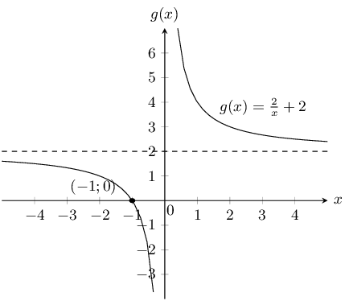

Domain: \(\left\{x:x\in \mathbb{R}, x\ne 0\right\}\)

Range: \(\left\{y:y\in \mathbb{R}, y\ne 2\right\}\)
</Callout>

<Callout type="tip" title="Worked example 11: Sketching a hyperbola">
**Question:**
Sketch the graph of \(y = \dfrac{-4}{x} + 7\).

**Examine the standard form of the equation:**
We see that \(a < 0\) therefore the graph lies in the second and fourth quadrants.

**Calculate the intercepts:**
For the \(y\)-intercept, let \(x = 0\):

          \begin{align*}
          y& = \frac{-4}{x}+7 \\
          & = \frac{-4}{0}+7
          \end{align*}

This is undefined, therefore there is no \(y\)-intercept.

For the \(x\)-intercept, let \(y = 0\):

          \begin{align*}
          y& = \frac{-4}{x}+7 \\
          0& = \frac{-4}{x}+7 \\
          \frac{-4}{x}& = -7 \\
          \therefore x& = \frac{4}{7}
          \end{align*}

This gives the point \(\left(\dfrac{4}{7};0\right)\).

**Determine the asymptotes:**
The horizontal asymptote is the line \(y = 7\). The vertical asymptote is the line \(x = 0\).

**Sketch the graph:**
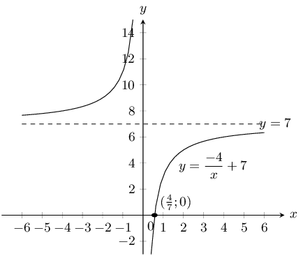

Domain: \(\left\{x:x\in \mathbb{R}, x\ne 0\right\}\)

Range: \(\left\{y:y\in \mathbb{R}, y\ne 7\right\}\)

Axis of symmetry: \(y=x+7\) and \(y=-x+7\)
</Callout>

### Textbook Exercise 6.4

**Problem:**
The following graph shows a hyperbolic equation of the form \(y = \dfrac {a}{x} + q\). Point
                  A is shown at \(\left( -2 ; \dfrac{5}{2} \right)\). Calculate the values of \(a\) and \(q\).

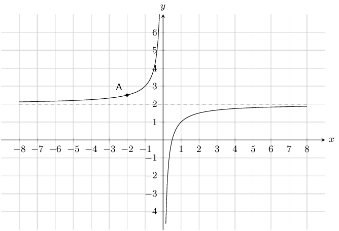

**Solution:**
\begin{align*}
              q & = 2 \\ \\
              y & = \frac {a}{x} +2 \\
              \left( \frac{5}{2} \right) & = \dfrac {a}{(-2)} +2 \\
              -2 \left( \frac{5}{2} \right) & = \left[ \dfrac {a}{-2} +2 \right] (-2) \\
              -\text{5} & = a -\text{4} \\
              -\text{1} & = a
              \end{align*}

Therefore \[a = -1\]
                and \(q = 2\)

The equation is \(y = - \dfrac {1}{x} +2\).

**Problem:**
The following graph shows a hyperbolic equation of the form \(y = \dfrac {a}{x} + q\). Point
                  A is shown at \(\left( -1 ; 5 \right)\). Calculate the values of \(a\) and \(q\).

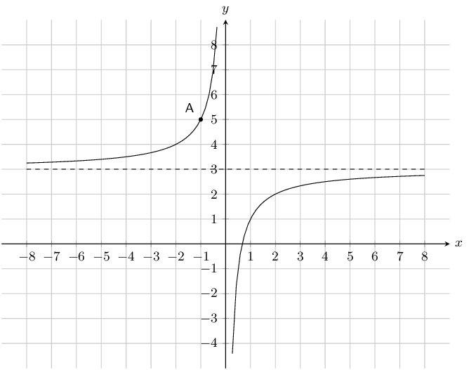

**Solution:**
\begin{align*}
              q & = 3 \\ \\
              y & = \frac {a}{x} +3 \\
              (5) & = \dfrac {a}{(-1)} +3 \\
              -1(5) & = \left[ \dfrac {a}{-1} +3 \right](-1) \\
              -\text{5} & = a-\text{3} \\
              -\text{2} & = a
              \end{align*}

Therefore \[a = -2\]
                and \(q = 3\)

The equation is \(y = - \dfrac {2}{x} +3\).

Given the following equation:
                \[y = \frac{3}{x} +2\]

**Problem:**
Determine the location of the \(y\)-intercept.

**Solution:**
\begin{align*}
                y & = \frac{3}{x} +2 \\
                & = \frac{3}{(0)} +2\\
                & \text{undefined}
                \end{align*}

There is no \(y\)-intercept.

**Problem:**
Determine the location of the \(x\)-intercept. Give your answer as a fraction.

**Solution:**
\begin{align*}
                y & = \frac{3}{x} +2 \\
                (0) & = \frac{3}{x} +2 \\
                (x)(0) & = \left[ \frac{3}{x} +2 \right](x) \\
                0 & = 3 +2x \\
                -3 & = 2 x \\
                x & = - \frac{3}{2}
                \end{align*}

Given the following equation:
                \[y = - \frac{2}{x} -2\]

**Problem:**
Determine the location of the \(y\)-intercept.

**Solution:**
\begin{align*}
                y & = - \frac{2}{x} -2 \\
                y & = - \frac{2}{(0)} -2\\
                & \text{undefined}
                \end{align*}

There is no \(y\)-intercept.

**Problem:**
Determine the location of the \(x\)-intercept.

**Solution:**
\begin{align*}
                y & = - \frac{2}{x} -2 \\
                (0) & = - \frac{2}{x} -2 \\
                (x)(0) & = \left[-\frac{2}{x} -2 \right](x) \\
                0 & = -2 - 2x \\
                2 & = -2x \\
                x & = -1
                \end{align*}

Given the following graph, identify a function that matches each of the following equations:

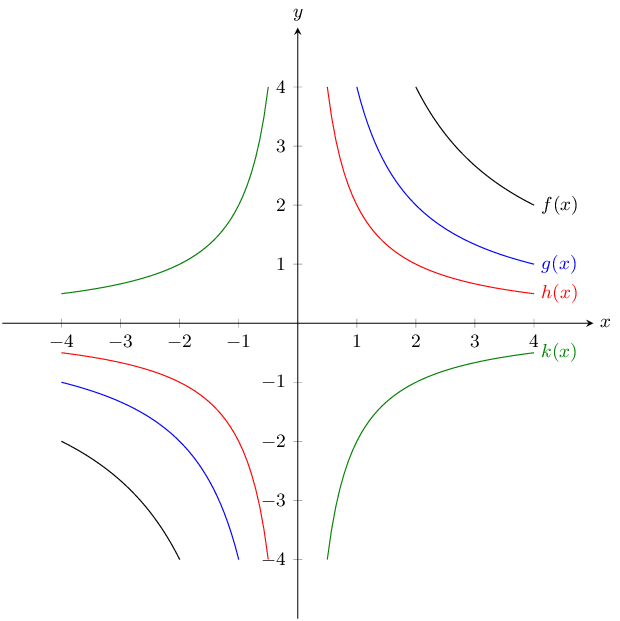

**Problem:**
\(y = \dfrac{2}{x}\)

**Solution:**
\(h(x)\)

**Problem:**
\(y = \dfrac{4}{x}\)

**Solution:**
\(g(x)\)

**Problem:**
\(y = -\dfrac{2}{x}\)

**Solution:**
\(k(x)\)

**Problem:**
\(y = \dfrac{8}{x}\)

**Solution:**
\(f(x)\)

Given the function: \(xy=-6\).

**Problem:**
Draw the graph.

**Solution:**
\(a\) is negative and so the function lies in the second and fourth quadrants.

There is no \(y\)-intercept or \(x\)-intercept.

Instead we can plot the graph from a table of values.

                \[\begin{array}{|c|c|c|c|c|}
                \hline
                x & -2 & -1 & 1 & 2 \\ \hline
                y & 3 & 6 & -6 & -3 \\
                \hline
                \end{array}\]

Now we can plot the graph:

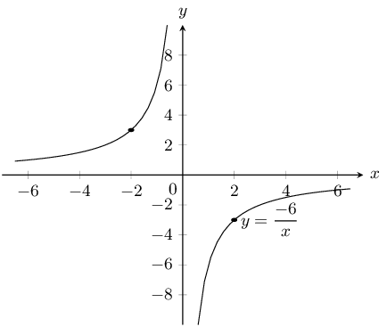

**Problem:**
Does the point \((-2;3)\) lie on the graph? Give a reason for your answer.

**Solution:**
If we substitute the point \((-2; 3)\) into each side of the equation we get:

                \begin{align*}
                RHS: & = -6 \\
                LHS: & xy = (-2)(3) = -6
                \end{align*}

This satisfies the equation therefore the point does lie on the graph.

**Problem:**
If the \(x\)-value of a point on the graph is \(\text{0,25}\) what is the corresponding \(y\)-value?

**Solution:**
Substitute in the value of \(x\):
                  \begin{align*}
                  y&=\frac{-6}{\text{0,25}} \\
                  & = \frac{-6}{\frac{1}{4}} \\
                  &= -6 \times \frac{4}{1} \\
                  &= -24
                  \end{align*}

**Problem:**
What happens to the \(y\)-values as the \(x\)-values become very large?

**Solution:**
The \(y\)-values decrease as the \(x\)-values become very large. The larger the denominator (\(x\)),
                  the smaller the result of the fraction (\(y\)).

**Problem:**
Give the equation of the asymptotes.

**Solution:**
The graph is not vertically or horizontally shifted, therefore the asymptotes are \(y=0\) and
                  \(x=0\).

**Problem:**
With the line \(y=-x\) as a line of symmetry, what is the point symmetrical to \((-2;3)\)?

**Solution:**
Across the line of symmetry \(y=-x\), the point symmetrical to \((-2; 3)\) is \((-3;2)\).

Given the function: \(h(x)=\dfrac{8}{x}\).

**Problem:**
Draw the graph.

**Solution:**
\(a\) is positive and so the function lies in the first and third quadrants.

There is no \(y\)-intercept and no \(x\)-intercept.

Instead we can plot the graph from a table of values.

                \[\begin{array}{|c|c|c|c|c|}
                \hline
                x & -2 & -1 & 1 & 2 \\ \hline
                y & -4 & -8 & 8 & 4 \\
                \hline
                \end{array}\]

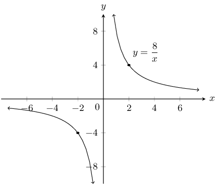

**Problem:**
How would the graph of \(g(x)=\dfrac{8}{x}+3\) compare with that of \(h(x)=\dfrac{8}{x}\)? Explain
                  your answer fully.

**Solution:**
The graph \(g(x)=\dfrac{8}{x}+3\) is the graph of \(h(x)=\dfrac{8}{x}\), vertically shifted upwards
                  by \(3\) units. They would be the same shape but the asymptote of \(g(x)\) would be \(y=3\), instead
                  of \(y=0\) (for \(h(x)\)) and the axis of symmetry would be \(y=-x+3\) instead of \(y = -x\).

**Problem:**
Draw the graph of \(y = \dfrac{8}{x} + 3\) on the same set of axes, showing asymptotes, axes of
                  symmetry and the coordinates of one point on the graph.

**Solution:**
\(a\) is positive and so the function lies in the first and third quadrants.

For \(y = \frac{8}{x} + 3\) there is no \(y\)-intercept. The \(x\)-intercept is at \(-\frac{8}{3}\).

We can plot the graph from a table of values.

                \[\begin{array}{|c|c|c|c|c|}
                \hline
                x & -4 & -2 & 2 & 4 \\ \hline
                y & 1 & -1 & 7 & 5 \\
                \hline
                \end{array}\]

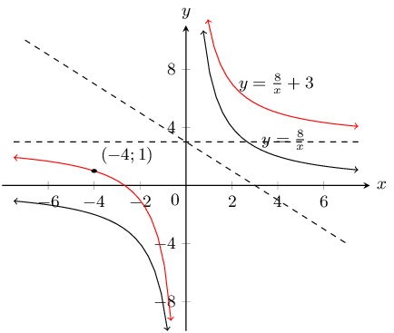

Sketch the functions given and describe the transformation performed on the first function to obtain
                the second function. Show all asymptotes.

**Problem:**
\(y = \dfrac{1}{x}\) and \(\dfrac{3}{x}\)

**Solution:**
\(a\) is positive for both graphs and so both graphs lie in the first and third quadrants.

For both graphs there is no \(y\)-intercept or \(x\)-intercept.

Instead we can plot the graph from a table of values.

\(y = \frac{1}{x}\):

                \[\begin{array}{|c|c|c|c|c|}
                \hline
                x & -2 & -1 & 1 & 2 \\ \hline
                y & -\frac{1}{2} & -1 & 1 & \frac{1}{2} \\
                \hline
                \end{array}\]

\(y = \frac{3}{x}\):

                \[\begin{array}{|c|c|c|c|c|}
                \hline
                x & -2 & -1 & 1 & 2 \\ \hline
                y & -\frac{3}{2} & -3 & 3 & \frac{3}{2} \\
                \hline
                \end{array}\]

The asymptotes are \(y = 0\) and \(x = 0\).

Now we can plot the graphs:

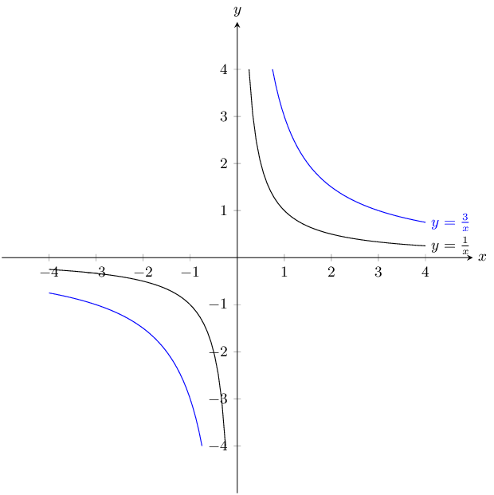

Magnification by 3

**Problem:**
\(y = \dfrac{6}{x}\) and \(\dfrac{6}{x} - 1\)

**Solution:**
\(a\) is positive for both graphs and so both graphs lie in the first and third quadrants.

For both graphs there is no \(y\)-intercept. For \(y = \frac{6}{x}\) there is no \(x\)-intercept. For
                  \(y = \frac{6}{x} - 1\) the \(x\)-intercept is \((6;0)\).

We can plot the graphs from a table of values.

\(y = \frac{6}{x}\):

                \[\begin{array}{|c|c|c|c|c|}
                \hline
                x & -2 & -1 & 1 & 2 \\ \hline
                y & -3 & -6 & 6 & 3 \\
                \hline
                \end{array}\]

\(y = \frac{6}{x} - 1\):

                \[\begin{array}{|c|c|c|c|c|}
                \hline
                x & -2 & -1 & 1 & 2 \\ \hline
                y & -4 & -7 & 5 & 2 \\
                \hline
                \end{array}\]

The asymptotes for \(y = \frac{6}{x}\) are \(y = 0\) and \(x = 0\).

The asymptotes for \(y = \frac{6}{x} - 1\) are \(y = -1\) and \(x = 0\).

Now we can plot the graphs:

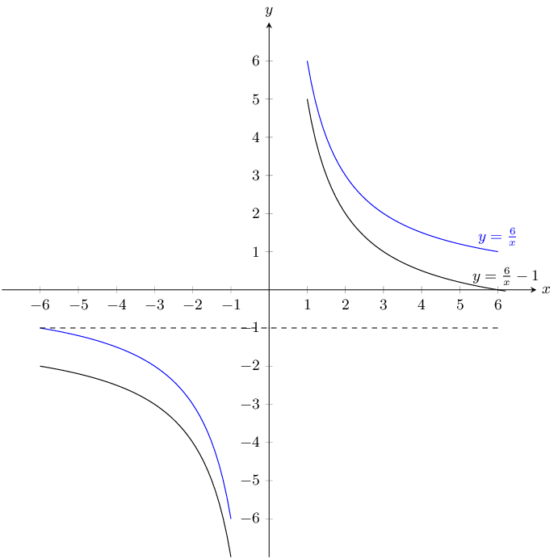

Translation along the \(y\)-axis by -1

**Problem:**
\(y = \dfrac{5}{x}\) and \(-\dfrac{5}{x}\)

**Solution:**
\(y = \frac{5}{x}\):

\(a\) is positive and so the graph lies in the first and third quadrants.

There is no \(y\)-intercept and no \(x\)-intercept.

We can plot the graph from a table of values.

                \[\begin{array}{|c|c|c|c|c|}
                \hline
                x & -2 & -1 & 1 & 2 \\ \hline
                y & -\frac{5}{2} & -5 & 5 & \frac{5}{2} \\
                \hline
                \end{array}\]

The asymptotes are \(y = 0\) and \(x = 0\).

\(y = -\frac{5}{x}\):

\(a\) is negative and so the graph lies in the second and fourth quadrants.

There is no \(y\)-intercept and no \(x\)-intercept.

We can plot the graph from a table of values.

                \[\begin{array}{|c|c|c|c|c|}
                \hline
                x & -2 & -1 & 1 & 2 \\ \hline
                y & \frac{5}{2} & 5 & -5 & -\frac{5}{2} \\
                \hline
                \end{array}\]

The asymptotes are \(y = 0\) and \(x = 0\).

Now we can plot the graphs:

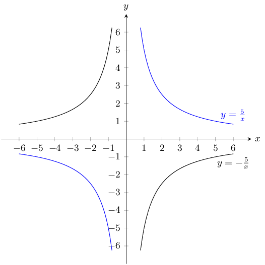

Reflection on the \(x\)-axis or reflection on the \(y\)-axis.

**Problem:**
\(y = \dfrac{1}{x}\) and \(\dfrac{1}{2x}\)

**Solution:**
\(a\) is positive for both graphs and so both graphs lie in the first and third quadrants.

For both graphs there is no \(y\)-intercept and no \(x\)-intercept.

We can plot the graphs from a table of values.

\(y = \frac{1}{x}\):

                \[\begin{array}{|c|c|c|c|c|}
                \hline
                x & -2 & -1 & 1 & 2 \\ \hline
                y & -\frac{1}{2} & -1 & 1 & \frac{1}{2} \\
                \hline
                \end{array}\]

\(y = \frac{1}{2x}\):

                \[\begin{array}{|c|c|c|c|c|}
                \hline
                x & -2 & -1 & 1 & 2 \\ \hline
                y & -\frac{1}{4} & -\frac{1}{2} & \frac{1}{2} & \frac{1}{4} \\
                \hline
                \end{array}\]

The asymptotes for both graphs are \(y = 0\) and \(x = 0\).

Now we can plot the graphs:

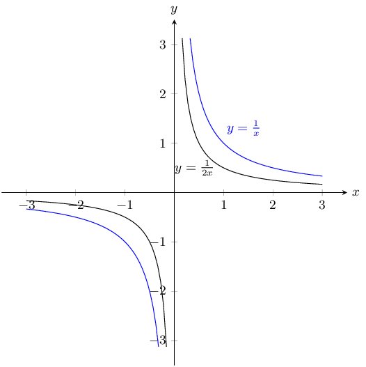

Reduction by 2
