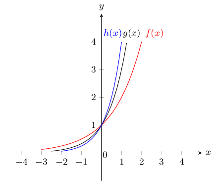
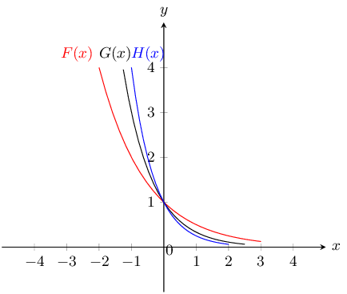
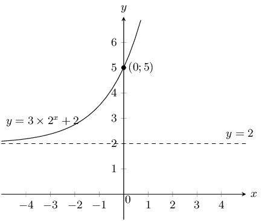
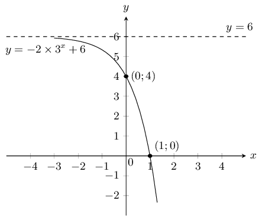
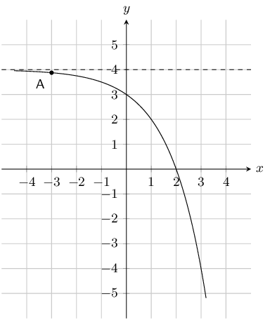
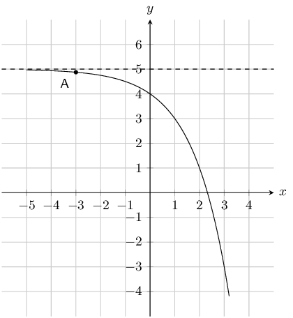
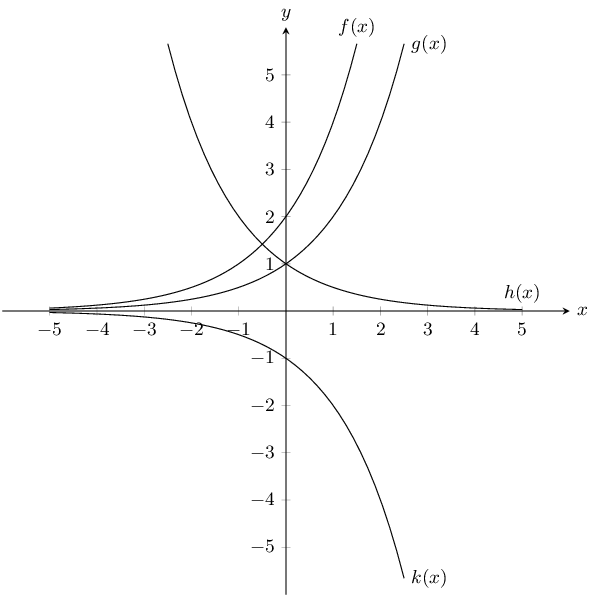
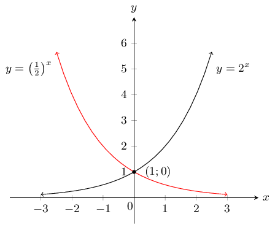
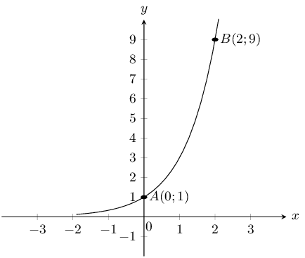

## 6.5 Exponential functions (EMA4V)

### Functions of the form \(y={b}^{x}\) (EMA4W)

Functions of the general form \(y=a{b}^{x}+q\) are called exponential functions. In the
                                equation \(a\) and \(q\) are constants and have different effects on the function.

<Callout type="tip" title="Worked example 12: Plotting an exponential function">
**Question:**
\(y=f(x)={b}^{x} \text{ for } b>0 \text{ and } b\ne 1\)

Complete the following table for each of the functions and draw the graphs on
                                                the same system of axes: \(f(x)={2}^{x}\), \(g(x)={3}^{x}\),
                                                \(h(x)={5}^{x}\).

|  | \(-\text{2}\) | \(-\text{1}\) | \(\text{0}\) | \(\text{1}\) | \(\text{2}\) |
| --- | --- | --- | --- | --- | --- |
| \(f(x)={2}^{x}\) |  |  |  |  |  |
| \(g(x)={3}^{x}\) |  |  |  |  |  |
| \(h(x)={5}^{x}\) |  |  |  |  |  |

1. At what point do these graphs intersect?
2. Explain why they do not cut the \(x\)-axis.
3. Give the domain and range of \(h(x)\).
4. As \(x\) increases, does \(h(x)\) increase or decrease?
5. Which of these graphs increases at the slowest rate?
6. For \(y={k}^{x}\) and \(k>1\), the greater the value of
                                                                \(k\), the steeper the curve of the graph. True or
                                                                false?

Complete the following table for each of the functions and draw the graphs on
                                                the same system of axes: \(F(x)={\left(\dfrac{1}{2}\right)}^{x}\),
                                                \(G(x)={\left(\dfrac{1}{3}\right)}^{x}\),
                                                \(H(x)={\left(\dfrac{1}{5}\right)}^{x}\)

|  | \(-\text{2}\) | \(-\text{1}\) | \(\text{0}\) | \(\text{1}\) | \(\text{2}\) |
| --- | --- | --- | --- | --- | --- |
| \(F(x)={\left(\frac{1}{2}\right)}^{x}\) |  |  |  |  |  |
| \(G(x)={\left(\frac{1}{3}\right)}^{x}\) |  |  |  |  |  |
| \(H(x)={\left(\frac{1}{5}\right)}^{x}\) |  |  |  |  |  |

1. Give the \(y\)-intercept for each function.
2. Describe the relationship between the graphs \(f(x)\) and
                                                                \(F(x)\).
3. Describe the relationship between the graphs \(g(x)\) and
                                                                \(G(x)\).
4. Give the domain and range of \(H(x)\).
5. For \(y={\left(\dfrac{1}{k}\right)}^{x}\) and \(k>1\), the
                                                                greater the value of \(k\), the steeper the curve of the
                                                                graph. True or false?
6. Give the equation of the asymptote for the functions.

**Substitute values into the equations:**
|  | \(-\text{2}\) | \(-\text{1}\) | \(\text{0}\) | \(\text{1}\) | \(\text{2}\) |
| --- | --- | --- | --- | --- | --- |
| \(f(x)={2}^{x}\) | \(\frac{1}{4}\) | \(\frac{1}{2}\) | \(\text{1}\) | \(\text{2}\) | \(\text{4}\) |
| \(g(x)={3}^{x}\) | \(\frac{1}{9}\) | \(\frac{1}{3}\) | \(\text{1}\) | \(\text{3}\) | \(\text{9}\) |
| \(h(x)={5}^{x}\) | \(\frac{1}{25}\) | \(\frac{1}{5}\) | \(\text{1}\) | \(\text{5}\) | \(\text{25}\) |

|  | \(-\text{2}\) | \(-\text{1}\) | \(\text{0}\) | \(\text{1}\) | \(\text{2}\) |
| --- | --- | --- | --- | --- | --- |
| \(F(x)={\left(\frac{1}{2}\right)}^{x}\) | \(\text{4}\) | \(\text{2}\) | \(\text{1}\) | \(\frac{1}{2}\) | \(\frac{1}{4}\) |
| \(G(x)={\left(\frac{1}{3}\right)}^{x}\) | \(\text{9}\) | \(\text{3}\) | \(\text{1}\) | \(\frac{1}{3}\) | \(\frac{1}{9}\) |
| \(H(x)={\left(\frac{1}{5}\right)}^{x}\) | \(\text{25}\) | \(\text{5}\) | \(\text{1}\) | \(\frac{1}{5}\) | \(\frac{1}{25}\) |

**Plot the points and join with a smooth curve:**

1. We notice that all graphs pass through the point \((0;1)\).
                                                                Any number with exponent \(\text{0}\) is equal to
                                                                \(\text{1}\).
2. The graphs do not cut the \(x\)-axis because you can never
                                                                get \(\text{0}\) by raising any non-zero number to the
                                                                power of any other number.
3. Domain: \(\left\{x:x\in \mathbb{R}\right\}\)

Range: \(\left\{y:y\in \mathbb{R}, y>0\right\}\)
4. As \(x\) increases, \(h(x)\) increases.
5. \(f(x)={2}^{x}\) increases at the slowest rate because it has
                                                                the smallest base.
6. True: the greater the value of \(k\) \(\left(k>1\right)\),
                                                                the steeper the graph of \(y={k}^{x}\).

1. The \(y\)-intercept is the point \((0;1)\) for all graphs.
                                                                For any real number \(z\): \({z}^{0}=1 \qquad z \ne 0\).
2. \(F(x)\) is the reflection of \(f(x)\) about the \(y\)-axis.
3. \(G(x)\) is the reflection of \(g(x)\) about the \(y\)-axis.
4. Domain: \(\left\{x:x\in \mathbb{R}\right\}\)

Range: \(\left\{y:y\in \mathbb{R}, y>0\right\}\)
5. True: the greater the value of \(k\) \(\left(k>1\right)\),
                                                                the steeper the graph of
                                                                \(y={\left(\frac{1}{k}\right)}^{x}\).
6. The equation of the horizontal asymptote is \(y=0\), the
                                                                \(x\)-axis.
</Callout>

### Functions of the form \(y=a{b}^{x}+q\) (EMA4X)

CAPS states to only investigate the effects of \(a\) and \(q\) on an exponential
                                        graph. However it is also important for learners to see that \(b\) has a
                                        different effect on the graph depending on if \(b > 1\) or \(0 < b <
                                        1\).

For this reason the effect of \(b\) is included in the investigation so that learners
                                        can see what happens when \(b > 1\) and when \(0 < b < 1\).

Also note that the above worked example further reinforces the effects of \(b\) on
                                        the exponential graph.

## The effects of \(a\), \(q\) and \(b\) on an exponential graph.

On the same set of axes, plot the following graphs (\(a=1\), \(q=0\) and \(b\)
                                        changes):

1. \(y_{1} = 2^{x}\)
2. \(y_{2} = \left(\frac{1}{2}\right)^{x}\)
3. \(y_{3} = 6^{x}\)
4. \(y_{4} = \left(\frac{1}{6}\right)^{x}\)

|  | \(-\text{2}\) | \(-\text{1}\) | \(\text{0}\) | \(\text{1}\) | \(\text{2}\) |
| --- | --- | --- | --- | --- | --- |
| \(y_{1}=2^{x}\) |  |  |  |  |  |
| \(y_{2}=\left(\frac{1}{2}\right)^{x}\) |  |  |  |  |  |
| \(y_{3}=6^{x}\) |  |  |  |  |  |
| \(y_{4}=\left(\frac{1}{6}\right)^{x}\) |  |  |  |  |  |

Use your results to deduce the effect of \(b\).

On the same set of axes, plot the following graphs (\(b=2\), \(a=1\) and \(q\)
                                        changes):

1. \({y}_{5}={2}^{x}-2\)
2. \({y}_{6}={2}^{x}-1\)
3. \({y}_{7}={2}^{x}\)
4. \({y}_{8}={2}^{x}+1\)
5. \({y}_{9}={2}^{x}+2\)

|  | \(-\text{2}\) | \(-\text{1}\) | \(\text{0}\) | \(\text{1}\) | \(\text{2}\) |
| --- | --- | --- | --- | --- | --- |
| \({y}_{5}={2}^{x}-2\) |  |  |  |  |  |
| \({y}_{6}={2}^{x}-1\) |  |  |  |  |  |
| \({y}_{7}={2}^{x}\) |  |  |  |  |  |
| \({y}_{8}={2}^{x}+1\) |  |  |  |  |  |
| \({y}_{9}={2}^{x}+2\) |  |  |  |  |  |

Use your results to deduce the effect of \(q\).

On the same set of axes, plot the following graphs (\(b=2\), \(q=0\) and \(a\)
                                        changes).

1. \({y}_{10}=1 \times {2}^{x}\)
2. \({y}_{11}=2\times {2}^{x}\)
3. \({y}_{12}=-1 \times {2}^{x}\)
4. \({y}_{13}=-2\times {2}^{x}\)

|  | \(-\text{2}\) | \(-\text{1}\) | \(\text{0}\) | \(\text{1}\) | \(\text{2}\) |
| --- | --- | --- | --- | --- | --- |
| \({y}_{10}=1 \times {2}^{x}\) |  |  |  |  |  |
| \({y}_{11}=2\times {2}^{x}\) |  |  |  |  |  |
| \({y}_{12}=-1 \times {2}^{x}\) |  |  |  |  |  |
| \({y}_{13}=-2\times {2}^{x}\) |  |  |  |  |  |

Use your results to deduce the effect of \(a\).

The effect of \(q\)

The effect of \(q\) is called a vertical shift because all points are moved the same distance
                                in the same direction (it slides the entire graph up or down).

- For \(q>0\), the graph is shifted vertically upwards by \(q\) units.
- For \(q<0\), the graph is shifted vertically downwards by \(q\) units.

The horizontal asymptote is shifted by \(q\) units and is the line \(y=q\).

The effect of \(a\)

The sign of \(a\) determines whether the graph curves upwards or downwards.

For \(0 < b < 1\):

- For \(a>0\), the graph curves downwards. It reflects the graph about the
                                                horizontal asymptote.
- For \(a<0\), the graph curves upwards.

For \(b > 1\):

- For \(a>0\), the graph curves upwards.
- For \(a<0\), the graph curves downwards. It reflects the graph about the
                                                horizontal asymptote.

| \(b>1\) | \(a<0\) | \(a>0\) |
| --- | --- | --- |
| \(q>0\) |  |  |
| \(q<0\) |  |  |

The effect of \(a\) and \(q\) on an exponential graph when \(b > 1\).

| \(0<b<1\) | \(a<0\) | \(a>0\) |
| --- | --- | --- |
| \(q>0\) |  |  |
| \(q<0\) |  |  |

The effect of \(a\) and \(q\) on an exponential graph when \(0 < b <
                                                1\).

### Discovering the characteristics (EMA4Y)

The standard form of an exponential function is \(y=a{b}^{x}+q\).

#### Domain and range

For \(y=a{b}^{x}+q\), the function is defined for all real values of \(x\). Therefore
                                        the domain is \(\left\{x:x\in \mathbb{R}\right\}\).

The range of \(y=a{b}^{x}+q\) is dependent on the sign of \(a\).

For \(a>0\):

                                \begin{align*}
                                {b}^{x}& > 0 \\ a{b}^{x}& > 0 \\
                                a{b}^{x}+q& > q \\
                                f(x)& > q
                                \end{align*}

Therefore, for \(a>0\) the range is \(\left\{f(x):f(x)>q\right\}\).

For \(a<0\):

                                \begin{align*}
                                {b}^{x}& > 0 \\
                                a{b}^{x}& < 0 \\
                                a{b}^{x}+q& < q \\
                                f(x)& < q
                                \end{align*}

Therefore, for \(a<0\) the range is \(\left\{f(x):f(x)<q\right\}\).

<Callout type="tip" title="Worked example 13: Domain and range of an exponential function">
**Question:**
Find the domain and range of \(g(x)=5 \cdot {2}^{x}+1\)

**Find the domain:**
The domain of \(g(x)=5\times {2}^{x}+1\) is \(\left\{x:x\in
                                                        \mathbb{R}\right\}\).

**Find the range:**
\begin{align*}
                                                {2}^{x}& > 0 \\
                                                5\times {2}^{x}& > 0 \\
                                                5\times {2}^{x}+1& > 1
                                                \end{align*}

Therefore the range is \(\left\{g(x):g(x)>1\right\}\).
</Callout>

#### Intercepts

The \(y\)-intercept.

For the \(y\)-intercept, let \(x=0\):

                                \begin{align*}
                                y& = a{b}^{x}+q \\
                                & = a{b}^{0}+q \\
                                & = a(1)+q \\
                                & = a+q
                                \end{align*}

For example, the \(y\)-intercept of \(g(x)=5\times {2}^{x}+1\) is given by setting
                                        \(x=0\):

                                \begin{align*}
                                y& = 5\times {2}^{x}+1 \\
                                & = 5\times {2}^{0}+1 \\
                                & = 5+1 \\
                                & = 6
                                \end{align*}

This gives the point \((0;6)\).

The \(x\)-intercept:

For the \(x\)-intercept, let \(y=0\).

For example, the \(x\)-intercept of \(g(x)=5\times {2}^{x}+1\) is given by setting
                                        \(y=0\):

                                \begin{align*}
                                y& = 5\times {2}^{x}+1 \\
                                0& = 5\times {2}^{x}+1 \\
                                -1& = 5\times {2}^{x} \\
                                {2}^{x}& = -\frac{1}{5}
                                \end{align*}

There is no real solution. Therefore, the graph of \(g(x)\) does not have any
                                        \(x\)-intercepts.

#### Asymptotes

Exponential functions of the form \(y=a{b}^{x}+q\) have a single horizontal
                                        asymptote, the line \(x=q\).

### Sketching graphs of the form \(y=a{b}^{x}+q\) (EMA4Z)

In order to sketch graphs of functions of the form, \(y=a{b}^{x}+q\), we need to determine
                                four characteristics:

1. sign of \(a\)
2. \(y\)-intercept
3. \(x\)-intercept
4. asymptote

<Callout type="tip" title="Multimedia & Video">
The following video shows some examples of sketching exponential functions.

<VideoPlayer src="https://www.youtube.com/embed/9SOSfRNCQZQ" title="Video:
                                                2FYW" />
</Callout>

<Callout type="tip" title="Worked example 14: Sketching an exponential function">
**Question:**
Sketch the graph of \(g(x)=3\times {2}^{x}+2\). Mark the intercept and the
                                                asymptote.

**Examine the standard form of the equation:**
From the equation we see that \(a>1\), therefore the graph curves upwards.
                                                \(q>0\) therefore the graph is shifted vertically upwards by
                                                \(\text{2}\) units.

**Calculate the intercepts:**
For the \(y\)-intercept, let \(x=0\):

                                        \begin{align*}
                                        y& = 3\times {2}^{x}+2 \\
                                        & = 3\times {2}^{0}+2 \\
                                        & = 3+2 \\
                                        & = 5
                                        \end{align*}

This gives the point \((0;5)\).

For the \(x\)-intercept, let \(y=0\):

                                        \begin{align*}
                                        y& = 3\times {2}^{x}+2 \\
                                        0& = 3\times {2}^{x}+2 \\
                                        -2& = 3\times {2}^{x} \\
                                        {2}^{x}& = -\frac{2}{3}
                                        \end{align*}

There is no real solution, therefore there is no \(x\)-intercept.

**Determine the asymptote:**
The horizontal asymptote is the line \(y=2\).

**Plot the points and sketch the graph:**

Domain: \(\left\{x:x\in \mathbb{R}\right\}\)

Range: \(\left\{g(x):g(x)>2\right\}\)

Note that there is no axis of symmetry for exponential functions.
</Callout>

<Callout type="tip" title="Worked example 15: Sketching an exponential graph">
**Question:**
Sketch the graph of \(y=-2\times {3}^{x}+6\)

**Examine the standard form of the equation:**
From the equation we see that \(a<0\) therefore the graph curves
                                                downwards. \(q>0\) therefore the graph is shifted vertically upwards
                                                by \(\text{6}\) units.

**Calculate the intercepts:**
For the \(y\)-intercept, let \(x=0\):

                                        \begin{align*}
                                        y& = -2\times {3}^{x}+6 \\
                                        & = -2\times {3}^{0}+6 \\
                                        & = 4
                                        \end{align*}

This gives the point \((0;4)\).

For the \(x\)-intercept, let \(y=0\):

                                        \begin{align*}
                                        y& = -2\times {3}^{x}+6 \\
                                        0& = -2\times {3}^{x}+6 \\
                                        -6& = -2\times {3}^{x} \\
                                        {3}^{1}& = {3}^{x} \\
                                        \therefore x& = 1
                                        \end{align*}

This gives the point \((1;0)\).

**Determine the asymptote:**
The horizontal asymptote is the line \(y=6\).

**Plot the points and sketch the graph:**

Domain: \(\left\{x:x\in \mathbb{R}\right\}\)

Range: \(\left\{g(x):g(x)<6\right\}\)
</Callout>

### Textbook Exercise 6.5

Given the following equation:

\(y = -\frac{2}{3}. (\text{3})^{x} + 1\)

**Problem:**
Calculate the \(y\)-intercept. Your answer must be
                                                                        correct to 2 decimal places.

**Solution:**
\begin{align*}
                                                                y & = \left( -\frac{2}{3} \right). (\text{3})^{x} +
                                                                \text{1} \\
                                                                & = \left( -\frac{2}{3} \right). (\text{3})^{(0)} +
                                                                \text{1} \\
                                                                & = \left( -\frac{2}{3} \right). (\text{1}) +
                                                                \text{1} \\
                                                                & = (-\text{0,66666...}) + \text{1} \\
                                                                & = \text{0,33}
                                                                \end{align*}

The \(y\)-intercept is \((0;\text{0,33})\).

**Problem:**
Now calculate the \(x\)-intercept. Estimate your
                                                                        answer to one decimal place if necessary.

**Solution:**
We calculate the \(x\)-intercept by letting \(y =
                                                                        0\). Then we solve for \(x\):

                                                                \begin{align*}
                                                                0 & = \left( -\frac{2}{3} \right). (\text{3})^{x} +
                                                                \text{1} \\
                                                                -\text{1} & = \left( -\frac{2}{3}
                                                                \right)(\text{3})^{x} \\
                                                                \left( - \frac{3}{2} \right) (-\text{1}) & = \left(
                                                                - \frac{3}{2} \right) \left( - \frac{2}{3} \right).
                                                                (\text{3})^{x} \\
                                                                \frac{3}{2} & = \text{3}^{x}
                                                                \end{align*}

To find the answer we try different values of \(x\):

                                                                \begin{align*}
                                                                \text{Try: } \text{3}^{-1} & = \text{0,333...}\\
                                                                \text{Try: } \text{3}^0 & = \text{1}\\
                                                                \text{Try: } \text{3}^1 & = \text{3}
                                                                \end{align*}

We can see that the exponent must be between 0 and 1.
                                                                        Next we try values starting with \(\text{0,1}\)
                                                                        and see what the value of the exponent is. Doing
                                                                        this we find that \(x = \text{0,4}\).

The \(x\)-intercept is \((\text{0,4};0)\).

**Problem:**
The graph here shows an exponential function with the
                                                                equation \(y = a \cdot 2^{x} + q\). One point is given
                                                                on the curve: Point A is at
                                                                \((-3;\text{3,875})\). Determine the values of \(a\) and
                                                                \(q\), correct to the nearest integer.

**Solution:**
The asymptote lies at \(y = 4\). Therefore \(q\) is 4.

At this point we know that the equation for the graph must be
                                                                \(y = a \cdot 2^{x} + 4\).

                                                        \begin{align*}
                                                        y & = a (2)^{x} + 4 \\
                                                        (\text{3,875}) & = a (2)^{(-3)} + 4 \\
                                                        \text{3,875} - 4 & = a (2)^{\left(-3\right)} \\
                                                        -\text{0,125} & = a (\text{0,125}) \\
                                                        -1 & = a
                                                        \end{align*}

Therefore \(a = -1 \text{ and } q = 4\)

**Problem:**
Below you see a graph of an exponential function with the
                                                                equation \(y = a \cdot 2^{x} + q\). One point is given
                                                                on the curve: Point A is at
                                                                \((-3;\text{4,875})\). Calculate the values of \(a\) and
                                                                \(q\), correct to the nearest integer.

**Solution:**
The asymptote lies at \(y = 5\). Therefore \(q\) is 5.

At this point we know that the equation for the graph must be
                                                                \(y = a \cdot 2^{x} + 5\).

                                                        \begin{align*}
                                                        y & = a (2)^{x} + 5 \\
                                                        (\text{4,875}) & = a (2)^{ (-3)} + 5 \\
                                                        \text{4,875} - 5 & = a (2)^{\left(-3\right)} \\
                                                        -\text{0,125} & = a (\text{0,125}) \\
                                                        -1 & = a
                                                        \end{align*}

Therefore \(a = -1 \text{ and } q = 5\).

Given the following equation:

\(y = \dfrac{1}{4} \cdot (4)^{x} - 1\)

**Problem:**
Calculate the \(y\)-intercept. Your answer must be
                                                                        correct to 2 decimal places.

**Solution:**
\begin{align*}
                                                                y & = \left( \frac{1}{4} \right)\cdot(4)^{x} - 1 \\
                                                                & = \left( \frac{1}{4} \right) \cdot (4)^{(0)}
                                                                -\text{1} \\
                                                                & = \left( \frac{1}{4} \right) \cdot (1) - 1 \\
                                                                & = (\text{0,25}) - 1 \\
                                                                & = -\text{0,75}
                                                                \end{align*}

Therefore the \(y\)-intercept is
                                                                        \((0;-\text{0,75})\).

**Problem:**
Now calculate the \(x\)-intercept.

**Solution:**
We calculate the \(x\)-intercept by letting \(y =
                                                                        0\). Then start to solve for \(x\).

                                                                \begin{align*}
                                                                0 & = \left( \frac{1}{4} \right) \cdot (4)^{x} - 1
                                                                \\
                                                                1 & = \left( \frac{1}{4} \right) \cdot (4)^{x} \\
                                                                \left( 4 \right) (1) & = \left( 4 \right) \left(
                                                                \frac{1}{4} \right) \cdot (4)^{x} \\
                                                                4^1 & = 4^{x} \\
                                                                x &= 1
                                                                \end{align*}

Therefore the \(x\)-intercept is \((1;0)\).

Given the following graph, identify a function that matches
                                                                each of the following equations:

**Problem:**
\(y = 2^x\)

**Solution:**
\(g(x)\)

**Problem:**
\(y = -2^x\)

**Solution:**
\(k(x)\)

**Problem:**
\(y = 2 \cdot 2^x\)

**Solution:**
\(f(x)\)

**Problem:**
\(y = \left(\frac{1}{2}\right)^{x}\)

**Solution:**
\(h(x)\)

Given the functions \(y=2^{x}\) and
                                                                \(y=\left(\frac{1}{2}\right)^{x}\).

**Problem:**
Draw the graphs on the same set of axes.

**Solution:**
For \(y=2^{x}\):

\(a\) is positive and greater than 1 and so the graph
                                                                        curves upwards. The \(y\)-intercept is
                                                                        \((0;1)\). There is no \(x\)-intercept. The
                                                                        asymptote is the line \(x = 0\).

For \(y=\left(\frac{1}{2}\right)^{x}\):

\(a\) is positive and less than 1 and so the graph
                                                                        curves downwards. The \(y\)-intercept is
                                                                        \((0;1)\). There is no \(x\)-intercept. The
                                                                        asymptote is the line \(x = 0\).

The graph is:

**Problem:**
Is the \(x\)-axis an asymptote or an axis of symmetry
                                                                        to both graphs? Explain your answer.

**Solution:**
The \(x\)-axis is an asymptote to both graphs because
                                                                        both approach the \(x\)-axis but never touch it.

**Problem:**
Which graph can be described by the equation
                                                                        \(y=2^{-x}\)? Explain your answer.

**Solution:**
\(y= \left(\frac{1}{2}\right)^{x}\) can be described
                                                                        by the equation \(y=2^{-x}\) because
                                                                        \(y=\left(\frac{1}{2}\right)^x = \left(2^{-1}
                                                                        \right)^x = 2^{-x}\).

**Problem:**
Solve the equation \(2^{x} =
                                                                        \left(\frac{1}{2}\right)^{x}\) graphically and
                                                                        check your answer is correct by using
                                                                        substitution.

**Solution:**
The graphs intersect at the point \((0;1)\). If we
                                                                        substitute these values into each side of the
                                                                        equation we get:

                                                                \begin{align*}
                                                                \text{LHS: } 2^{x} & = 2^0 = 1 \text{ and} \\
                                                                \text{RHS: } (\frac{1}{2})^x & = (\frac{1}{2})^0 = 1
                                                                \end{align*}

LHS = RHS, therefore the answer is correct.

The curve of the exponential function \(f\) in the
                                                                accompanying diagram cuts the \(y\)-axis at the point
                                                                \(A(0;1)\) and passes through the point \(B(2;9)\).

**Problem:**
Determine the equation of the function \(f\).

**Solution:**
The general form of the equation is \(f(x)=a \cdot
                                                                        b^x+q\).

We are given \(A(0; 1)\) and \(B(2; 9)\).

The asymptote is at \(y = 0\) and so \(q = 0\).

Substitute in the values of point \(A\):

                                                                \begin{align*}
                                                                1 & = a \cdot b^0 \\
                                                                1 & = a
                                                                \end{align*}

Substitute in the values of point \(B\):

                                                                \begin{align*}
                                                                9 & = b^2 \\
                                                                3^2 & = b^2\\
                                                                \therefore b & = 3
                                                                \end{align*}

Therefore the equation is \(f(x) = 3^x\).

**Problem:**
Determine the equation of the function \(h(x)\), the
                                                                        reflection of \(f(x)\) in the \(x\)-axis.

**Solution:**
\(h(x)=-3^{x}\)

**Problem:**
Determine the range of \(h(x)\).

**Solution:**
Range: \((-\infty;0)\)

**Problem:**
Determine the equation of the function \(g(x)\), the
                                                                        reflection of \(f(x)\) in the \(y\)-axis.

**Solution:**
\(g(x)=3^{-x}\)

**Problem:**
Determine the equation of the function \(j(x)\) if
                                                                        \(j(x)\) is a vertical stretch of \(f(x)\) by
                                                                        \(+2\) units.

**Solution:**
\(j(x)=2 \cdot 3^{x}\)

**Problem:**
Determine the equation of the function \(k(x)\) if
                                                                        \(k(x)\) is a vertical shift of \(f(x)\) by
                                                                        \(-3\) units.

**Solution:**
\(k(x)=3^{x}-3\)
