## 6.6 Trigonometric functions (EMA52)

This section describes the graphs of trigonometric functions.

### Sine function (EMA53)

### Functions of the form \(y=\sin\theta\) (EMA54)

<Callout type="tip" title="Worked example 16: Plotting a sine graph">
**Question:**
\(y=f(\theta) = \sin\theta \quad \left[0° \le \theta \le 360°\right]\)

Use your calculator to complete the following table.

Choose an appropriate scale and plot the values of \(\theta\) on the \(x\)-axis and of \(\sin\theta\) on
            the \(y\)-axis. Round answers to \(\text{2}\) decimal places.

| \(\theta\) | \(0°\) | \(30°\) | \(60°\) | \(90°\) | \(120°\) | \(150°\) | \(180°\) | \(210°\) | \(240°\) | \(270°\) | \(300°\) | \(330°\) | \(360°\) |
| --- | --- | --- | --- | --- | --- | --- | --- | --- | --- | --- | --- | --- | --- |
| \(\sin\theta\) |  |  |  |  |  |  |  |  |  |  |  |  |  |

**Substitute values for \(\theta\):**
| \(\theta\) | \(0°\) | \(30°\) | \(60°\) | \(90°\) | \(120°\) | \(150°\) | \(180°\) | \(210°\) | \(240°\) | \(270°\) | \(300°\) | \(330°\) | \(360°\) |
| --- | --- | --- | --- | --- | --- | --- | --- | --- | --- | --- | --- | --- | --- |
| \(\sin\theta\) | \(\text{0}\) | \(\text{0,5}\) | \(\text{0,87}\) | \(\text{1}\) | \(\text{0,87}\) | \(\text{0,5}\) | \(\text{0}\) | \(-\text{0,5}\) | \(-\text{0,87}\) | \(-\text{1}\) | \(-\text{0,87}\) | \(-\text{0,5}\) | \(\text{0}\) |

**Plot the points and join with a smooth curve:**
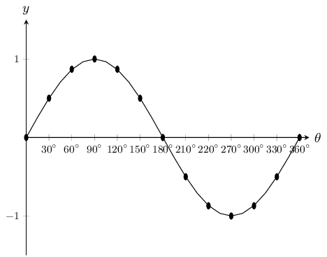

Notice the wave shape of the graph. Each complete wave takes \(360°\) to complete. This is called the
            period. The height of the wave above and below the \(x\)-axis is called the graph's amplitude. The maximum
            value of \(y=\sin\theta\) is \(\text{1}\) and the minimum value is \(-\text{1}\).

Domain: \(\left[0°;360°\right]\)

Range: \(\left[-1;1\right]\)

\(x\)-intercepts: \((0°;0)\), \((180°;0)\), \((360°;0)\)

\(y\)-intercept: \((0°;0)\)

Maximum turning point: \((90°;1)\)

Minimum turning point: \((270°;-1)\)
</Callout>

### Functions of the form \(y=a\sin\theta +q\) (EMA55)

## The effects of \(a\) and \(q\) on a sine graph

In the equation, \(y=a\sin\theta +q\), \(a\) and \(q\) are constants and have different effects on the graph.
          On the same set of axes, plot the following graphs for \(0°\le \theta \le 360°\):

1. \({y}_{1} = \sin\theta -2\)
2. \({y}_{2} = \sin\theta -1\)
3. \({y}_{3} = \sin\theta\)
4. \({y}_{4} = \sin\theta +1\)
5. \({y}_{5} = \sin\theta +2\)

Use your results to deduce the effect of \(q\).

On the same set of axes, plot the following graphs for \(0° \le \theta \le 360°\):

1. \({y}_{6}=-2\sin\theta\)
2. \({y}_{7}=-\sin\theta\)
3. \({y}_{8}=\sin\theta\)
4. \({y}_{9}=2\sin\theta\)

Use your results to deduce the effect of \(a\).

The effect of \(q\)

The effect of \(q\) is called a vertical shift because the whole sine graph shifts up or down by \(q\) units.

- For \(q>0\), the graph is shifted vertically upwards by \(q\) units.
- For \(q<0\), the graph is shifted vertically downwards by \(q\) units.

The effect of \(a\)

The value of \(a\) affects the amplitude of the graph; the height of the peaks and the depth of the troughs.

- For \(a>1\), there is a vertical stretch and the amplitude increases. For \(0<a<1\), the amplitude decreases
- For \(a<0\), there is a reflection about the \(x\)-axis. For \(-1<a<0\), there is a reflection about the \(x\)-axis and the amplitude decreases. For \(a<-1\), there is a reflection about the \(x\)-axis and the amplitude increases.

Note that amplitude is always positive.

| Effect of \(a\) |  |
| --- | --- |
| \(a>1\): vertical stretch, amplitude increases |  |
| \(a=1\): basic sine graph |
| \(0<a<1\): vertical contraction, amplitude decreases |
| \(-1<a<0\): reflection about \(x\)-axis of \(0<a<1\) |
| \(a<-1\): reflection about \(x\)-axis of \(a>1\) |

The effect of \(a\) on a sine graph.

| Effect of \(q\) |  |
| --- | --- |
| \(q>0\): vertical shift upwards by \(q\) units |  |
| \(q=0\): basic sine graph |
| \(q<0\): vertical shift downwards by \(q\) units |

The effect of \(q\) on a sine graph.

### Discovering the characteristics (EMA56)

#### Domain and range

For \(f(\theta) = a\sin\theta +q\), the domain is \(\left[0°;360°\right]\)

The range of \(f(\theta) = a\sin\theta +q\) depends on the values of \(a\) and \(q\).

For \(a>0\):

        \begin{align*}
        -1& \le \sin \theta \le 1 \\
        -a& \le a\sin\theta \le a \\
        -a+q& \le a\sin\theta +q \le a+q \\
        -a+q& \le f(\theta) \le a+q
        \end{align*}

For all values of \(\theta\), \(f(\theta)\) is always between \(-a+q\) and \(a+q\).

Therefore for \(a>0\), the range of \(f(\theta) = a\sin\theta +q\) is \(\left\{f(\theta):f(\theta)\in
          \left[-a+q, a+q\right]\right\}\)

Similarly, for \(a<0\), the range of \(f(\theta)=a \sin\theta +q\) is \(\left\{f(\theta):f(\theta)\in
          \left[a+q, -a+q\right]\right\}\)

#### Period

The period of \(y=a\sin\theta +q\) is \(360°\). This means that one sine wave is completed in
          \(360°\).

#### Intercepts

The \(y\)-intercept of \(f(\theta)=a\sin\theta +q\) is simply the value of \(f(\theta)\) at \(\theta =
          0°\)

        \begin{align*}
        y& = f(0°) \\
        & = a\sin 0° + q \\
        & = a(0) + q \\
        & = q
        \end{align*}

This gives the point \((0;q)\)

Important: when sketching trigonometric graphs, always start with the basic graph and then
          consider the effects of \(a\) and \(q\).

<Callout type="tip" title="Worked example 17: Sketching a sine graph">
**Question:**
Sketch the graph of \(f(\theta)=2\sin\theta +3\) for \(\theta \in \left[0°;360°\right]\).

**Examine the standard form of the equation:**
From the equation we see that \(a>1\) so the graph is stretched vertically. We also see that
              \(q>0\) so the graph is shifted vertically upwards by \(\text{3}\) units.

**Substitute values for \(\theta\):**
| \(\theta\) | \(0°\) | \(30°\) | \(60°\) | \(90°\) | \(120°\) | \(150°\) | \(180°\) | \(210°\) | \(240°\) | \(270°\) | \(300°\) | \(330°\) | \(360°\) |
| --- | --- | --- | --- | --- | --- | --- | --- | --- | --- | --- | --- | --- | --- |
| \(f(\theta)\) | \(\text{3}\) | \(\text{4}\) | \(\text{4,73}\) | \(\text{5}\) | \(\text{4,73}\) | \(\text{4}\) | \(\text{3}\) | \(\text{2}\) | \(\text{1,27}\) | \(\text{1}\) | \(\text{1,27}\) | \(\text{2}\) | \(\text{3}\) |

**Plot the points and join with a smooth curve:**
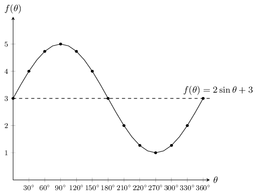

Domain: \(\left[0°;360°\right]\)

Range: \(\left[1;5\right]\)

\(x\)-intercepts: none

\(y\)-intercepts: \((0°;3)\)

Maximum turning point: \((90°;5)\)

Minimum turning point: \((270°;1)\)
</Callout>

<QuizCard id="m10-06-06a" title="Interactive Exercise 6.6" question="Determine the value of \(a\) ." options=["-3 \u2264 h \u2264 3", "-3 < h < 3", "-7 < h < -1", "-7 \u2264 h \u2264 -1"] answer="-3" hint="You should enter a number here. If you want to, you can use a space to separate thousands.                Example: 12 800,25 For scientific notation you need to use the multiply symbol                ( ∗ ) and the exponent symbol ( ^ ). For example 6,673 × 10 −11 should be written as: 6,673 ∗ 10^−11" explanation="Read off the coordinates of the peak of the graph and use them to solve for \(a\) We need to find the value of \(a\) in \(g(x) =                             a \sin x\) for \(                               \text{0}\text{°}                               \leq x \leq                               \text{360}\text{°}                             \) . The value of \(a\) affects the amplitude of the graph, that is, the height of the peaks and the                             depth of the troughs. So we need to read off the coordinates of either a peak or a trough of the                       graph and use them to find the value of \(a\) . NOTE: We could use the coordinates of any point except those that are on the \(x\) -axis. For this graph, it is easier to read off the coordinates of either the peak                       or the trough. Can you think of why we do not use the points on the \(x\) -axis? In this solution, we will use the coordinates of a peak: \((\text{270}\text{°}\, ; \text{3})\) . We will substitute these coordinates into the equation of \(g(x)\) and solve for \(a\) . \[                         \begin{aligned}                         	g(x) &= a \sin x \\                           (3)  &= a \sin (\text{270}\text{°}) \\                             3  &= a (-1) \\                             -3 &= a                         \end{aligned}                     \] NOTE: If we look at the graph of \(g(x)\) again, we see that the                       height of the peaks or depth of the troughs is \(\text{3}\) .                       This means that the amplitude of \(g(x)\) is \(\text{3}\) .                       This is the same as the magnitude of \(a\) that  we have calculated. As a general rule, the amplitude of any sine function of the                       form \(f = a \sin x \) , is the positive value of \(a\) . With this value of \(a\) , we can now write the equation of \(g(x)\) : \(g(x) = -3 \sin x\) . The value of \(a\) is \(-\text{3}\) . Submit your answer as:" />

### Cosine function (EMA57)

### Functions of the form \(y=\cos\theta\) (EMA58)

<Callout type="tip" title="Worked example 18: Plotting a cosine graph">
**Question:**
\(y=f(\theta)=\cos\theta \quad \left[0°\le \theta \le 360°\right]\)

Use your calculator to complete the following table.

Choose an appropriate scale and plot the values of \(\theta\) on the \(x\)-axis and \(\cos\theta\) on the
            \(y\)-axis. Round your answers to \(\text{2}\) decimal places.

| \(\theta\) | \(0°\) | \(30°\) | \(60°\) | \(90°\) | \(120°\) | \(150°\) | \(180°\) | \(210°\) | \(240°\) | \(270°\) | \(300°\) | \(330°\) | \(360°\) |
| --- | --- | --- | --- | --- | --- | --- | --- | --- | --- | --- | --- | --- | --- |
| \(\cos\theta\) |  |  |  |  |  |  |  |  |  |  |  |  |  |

**Substitute values for \(\theta\):**
| \(\theta\) | \(0°\) | \(30°\) | \(60°\) | \(90°\) | \(120°\) | \(150°\) | \(180°\) | \(210°\) | \(240°\) | \(270°\) | \(300°\) | \(330°\) | \(360°\) |
| --- | --- | --- | --- | --- | --- | --- | --- | --- | --- | --- | --- | --- | --- |
| \(\cos\theta\) | \(\text{1}\) | \(\text{0,87}\) | \(\text{0,5}\) | \(\text{0}\) | \(-\text{0,5}\) | \(-\text{0,87}\) | \(-\text{1}\) | \(-\text{0,87}\) | \(-\text{0,5}\) | \(\text{0}\) | \(\text{0,5}\) | \(\text{0,87}\) | \(\text{1}\) |

**Plot the points and join with a smooth curve:**
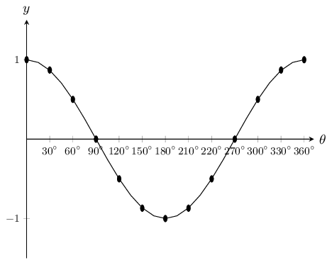

Notice the similar wave shape of the graph. The period is also \(360°\) and the amplitude is
            \(\text{1}\). The maximum value of \(y=\cos\theta\) is \(\text{1}\) and the minimum value is \(-\text{1}\).

Domain: \(\left[0°;360°\right]\)

Range: \(\left[-1;1\right]\)

\(x\)-intercepts: \((90°;0)\), \((270°;0)\)

\(y\): \((0°;1)\)

Maximum turning points: \((0°;1)\), \((360°;1)\)

Minimum turning point: \((180°;-1)\)
</Callout>

### Functions of the form \(y=a\cos\theta +q\) (EMA59)

## The effects of \(a\) and \(q\) on a cosine graph

In the equation, \(y=a\cos\theta +q\), \(a\) and \(q\) are constants and have different effects on the graph.

On the same set of axes, plot the following graphs for \(0° \le \theta \le 360°\):

1. \({y}_{1}=\cos\theta -2\)
2. \({y}_{2}=\cos\theta -1\)
3. \({y}_{3}=\cos\theta\)
4. \({y}_{4}=\cos\theta +1\)
5. \({y}_{5}=\cos\theta +2\)

Use your results to deduce the effect of \(q\).

On the same set of axes, plot the following graphs for \(0° \le \theta \le 360°\):

1. \({y}_{6}=-2\cos\theta\)
2. \({y}_{7}=-\cos\theta\)
3. \({y}_{8}=\cos\theta\)
4. \({y}_{9}=2\cos\theta\)

Use your results to deduce the effect of \(a\).

The effect of \(q\)

The effect of \(q\) is called a vertical shift because the whole cosine graph shifts up or down by \(q\) units.

- For \(q>0\), the graph is shifted vertically upwards by \(q\) units.
- For \(q<0\), the graph is shifted vertically downwards by \(q\) units.

The effect of \(a\)

The value of \(a\) affects the amplitude of the graph; the height of the peaks and the depth of the troughs.

- For \(a>0\), there is a vertical stretch and the amplitude increases. For \(0<a<1\), the amplitude decreases.
- For \(a<0\), there is a reflection about the \(x\)-axis. For \(-1<a<0\), there is a reflection about the \(x\)-axis and the amplitude decreases. For \(a<-1\), there is a reflection about the \(x\)-axis and the amplitude increases.

Note that amplitude is always positive.

| Effect of \(a\) |  |
| --- | --- |
| \(a>1\): vertical stretch, amplitude increases |  |
| \(a=1\): basic cosine graph |
| \(0<a<1\): amplitude decreases |
| \(-1<a<0\): reflection about \(x\)-axis, amplitude decreases |
| \(a<-1\): reflection about \(x\)-axis, amplitude increases |  |

The effect of \(a\) on a cosine graph.

| Effect of \(q\) |  |
| --- | --- |
| \(q>0\): vertical shift upwards by \(q\) units |  |
| \(q=0\): basic cosine graph |
| \(q<0\): vertical shift downwards by \(q\) units |

The effect of \(q\) on a cosine graph.

### Discovering the characteristics (EMA5B)

#### Domain and range

For \(f(\theta)=a\cos\theta +q\), the domain is \(\left[0°;360°\right]\)

It is easy to see that the range of \(f(\theta)\) will be the same as the range of \(a\sin\theta +q\). This
          is because the maximum and minimum values of \(a\cos \theta + q\) will be the same as the maximum and minimum
          values of \(a\sin\theta +q\).

For \(a>0\) the range of \(f(\theta)=a\cos\theta +q\) is \(\left\{f(\theta):f(\theta)\in
          \left[-a+q;a+q\right]\right\}\)

For \(a<0\) the range of \(f(\theta)=a \cos\theta +q\) is \(\left\{f(\theta):f(\theta)\in
          \left[a+q;-a+q\right]\right\}\)

#### Period

The period of \(y=a\cos\theta +q\) is \(360°\). This means that one cosine wave is completed in
          \(360°\).

#### Intercepts

The \(y\)-intercept of \(f(\theta)=a\cos\theta +q\) is calculated in the same way as for sine.

        \begin{align*}
        y& = f(0°) \\
        & = a\cos 0°+q \\
        & = a(1)+q \\
        & = a+q
        \end{align*}

This gives the point \((0°;a+q)\).

<Callout type="tip" title="Worked example 19: Sketching a cosine graph">
**Question:**
Sketch the graph of \(f(\theta)=2\cos\theta +3\) for \(\theta \in \left[0°;360°\right]\).

**Examine the standard form of the equation:**
From the equation we see that \(a>1\) so the graph is stretched vertically. We also see that
              \(q>0\) so the graph is shifted vertically upwards by \(\text{3}\) units.

**Substitute values for \(\theta\):**
| \(\theta\) | \(0°\) | \(30°\) | \(60°\) | \(90°\) | \(120°\) | \(150°\) | \(180°\) | \(210°\) | \(240°\) | \(270°\) | \(300°\) | \(330°\) | \(360°\) |
| --- | --- | --- | --- | --- | --- | --- | --- | --- | --- | --- | --- | --- | --- |
| \(f(\theta)\) | \(\text{5}\) | \(\text{4,73}\) | \(\text{4}\) | \(\text{3}\) | \(\text{2}\) | \(\text{1,27}\) | \(\text{1}\) | \(\text{1,27}\) | \(\text{2}\) | \(\text{3}\) | \(\text{4}\) | \(\text{4,73}\) | \(\text{5}\) |

**Plot the points and join with a smooth curve:**
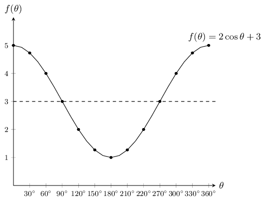

Domain: \(\left[0°;360°\right]\)

Range: \(\left[1;5\right]\)

\(x\)-intercepts: none

\(y\)-intercept: \((0°;5)\)

Maximum turning points: \((0°;5)\), \((360°;5)\)

Minimum turning point: \((180°;1)\)
</Callout>

<QuizCard id="m10-06-06b" title="Interactive Exercise 6.7" question="Determine the value of \(a\) ." options=["1 < h < 7", "-3 < h < 3", "1 \u2264 h \u2264 7", "1 \u2265 h \u2265 7"] answer="1 ≥ h ≥ 7" hint="You should enter a number here. If you want to, you can use a space to separate thousands.                Example: 12 800,25 For scientific notation you need to use the multiply symbol                ( ∗ ) and the exponent symbol ( ^ ). For example 6,673 × 10 −11 should be written as: 6,673 ∗ 10^−11" explanation="Read off the coordinates of the peak of the graph and use them to solve for \(a\) We need to find the value of \(a\) in \(g(x) =                             a \cos x\) for \(                               \text{0}\text{°}                               \leq x \leq                               \text{360}\text{°}                             \) . The value of \(a\) affects the amplitude of the graph, that is, the height of the peaks and the depths of                       the troughs. So we need to read off the coordinates of either a peak or a trough of the                       graph and use them to find the value of \(a\) . NOTE: We could use the coordinates of any point except those that are on the \(x\) -axis. For this graph, it is easier to read off the coordinates of either the peak                       or the trough. Can you think of why we do not use the points on the \(x\) -axis? In this solution, we will use the coordinates of a peak: \((\text{0}\text{°}\, ; \text{3})\) . We will substitute these coordinates into the equation of \(g(x)\) and solve for \(a\) . \[                         \begin{aligned}                         	g(x) &= a \cos x \\                           (3)  &= a \cos (\text{0}\text{°}) \\                             3  &= a (1) \\                             3 &= a                         \end{aligned}                     \] NOTE: If we look at the graph of \(g(x)\) again, we see that the                       height of the peaks or depth of the troughs is \(\text{3}\) .                       This means that the amplitude of \(g(x)\) is \(\text{3}\) .                       This is the same value that we have calculated for \(a\) . As a general rule, the amplitude of any cosine function of the                       form \(f = a \cos x \) , is the positive value of \(a\) . With this value of \(a\) , we can now write the equation of \(g(x)\) : \(g(x) = 3 \cos x\) . The value of \(a\) is \(\text{3}\) . Submit your answer as:" />

### Comparison of graphs of \(y=\sin\theta\) and \(y=\cos\theta\) (EMA5C)

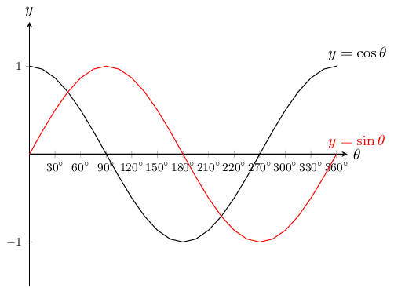

Notice that the two graphs look very similar. Both waves move up and down along the \(x\)-axis. The distances
        between the peaks for each graph is the same. The height of the peaks and the depths of the troughs are also the
        same.

If you shift the whole cosine graph to the right by \(90°\) it will overlap perfectly with the sine graph.
        If you shift the sine graph \(90°\) to the left it would overlap perfectly with the cosine graph. This
        means that:

      \[\begin{array}{ccl}
      \sin \theta & = \cos \left(\theta -90°\right) & \left(\text{shift the cosine graph to the
      right}\right) \\
      \cos \theta & =\sin \left(\theta +90°\right) & \left(\text{shift the sine graph to the left}\right)
      \end{array}\]

### Tangent function (EMA5D)

### Functions of the form \(y=\tan\theta\) (EMA5F)

<Callout type="tip" title="Worked example 20: Plotting a tangent graph">
**Question:**
\(y=f(\theta)=\tan\theta \quad \left[0°\le \theta \le 360°\right]\)

Use your calculator to complete the following table.

Choose an appropriate scale and plot the values with \(\theta\) on the \(x\)-axis and \(\tan\theta\) on the
            \(y\)-axis. Round your answers to \(\text{2}\) decimal places.

| \(\theta\) | \(0°\) | \(30°\) | \(45°\) | \(60°\) | \(90°\) | \(120°\) | \(135°\) | \(150°\) | \(180°\) |
| --- | --- | --- | --- | --- | --- | --- | --- | --- | --- |
| \(\tan\theta\) |  |  |  |  |  |  |  |  |  |
| \(\theta\) | \(210°\) | \(235°\) | \(240°\) | \(270°\) | \(300°\) | \(315°\) | \(330°\) | \(360°\) |  |
| \(\tan\theta\) |  |  |  |  |  |  |  |  |  |

**Substitute values for \(\theta\):**
| \(\theta\) | \(0°\) | \(30°\) | \(45°\) | \(60°\) | \(90°\) | \(120°\) | \(135°\) | \(150°\) | \(180°\) |
| --- | --- | --- | --- | --- | --- | --- | --- | --- | --- |
| \(\tan\theta\) | \(\text{0}\) | \(\text{0,58}\) | \(\text{1}\) | \(\text{1,73}\) | undef | \(-\text{1,73}\) | \(-\text{1}\) | \(-\text{0,58}\) | \(\text{0}\) |
| \(\theta\) | \(210°\) | \(235°\) | \(240°\) | \(270°\) | \(300°\) | \(315°\) | \(330°\) | \(360°\) |  |
| \(\tan\theta\) | \(\text{0,58}\) | \(\text{1}\) | \(\text{1,73}\) | undef | \(-\text{1,73}\) | \(-\text{1}\) | \(-\text{0,58}\) | \(\text{0}\) |  |

**Plot the points and join with a smooth curve:**
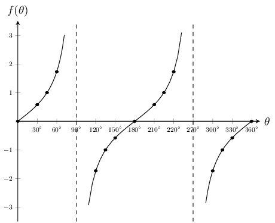

There is an easy way to visualise the tangent graph. Consider our definitions of \(\sin\theta\) and
            \(\cos\theta\) for right-angled triangles:

          \begin{align*}
          \frac{\sin\theta}{\cos\theta} & =
          \frac{\left(\frac{\text{opposite}}{\text{hypotenuse}}\right)}{\left(\frac{\text{adjacent}}{\text{hypotenuse}}\right)}
          \\
          & = \frac{\text{opposite}}{\text{hypotenuse}} \times \frac{\text{hypotenuse}}{\text{adjacent}} \\
          & = \frac{\text{opposite}}{\text{adjacent}} \\
          & = \tan\theta
          \end{align*}

So for any value of \(\theta\):

          \(\tan{\theta} =\dfrac{\sin\theta }{\cos\theta }\)

So we know that for values of \(\theta\) for which \(\sin\theta = 0\), we must also have \(\tan\theta =0\).
            Also if \(\cos\theta =0\) the value of \(\tan\theta\) is undefined as we cannot divide by \(\text{0}\). The
            dashed vertical lines are at the values of \(\theta\) where \(\tan\theta\) is not defined and are called the
            asymptotes.

Asymptotes: the lines \(\theta =90°\) and \(\theta =270°\)

Period: \(180°\)

Domain: \(\left\{\theta :0° \le \theta \le 360°, \theta \ne 90°; 270°\right\}\)

Range: \(\left\{f\left(\theta \right):f\left(\theta \right)\in \mathbb{R}\right\}\)

\(x\)-intercepts: \(\left(0°;0\right)\), \(\left(180°;0\right)\), \(\left(360°;0\right)\)

\(y\)-intercept: \(\left(0°;0\right)\)
</Callout>

### Functions of the form \(y=a\tan\theta + q\) (EMA5G)

## The effects of \(a\) and \(q\) on a tangent graph

On the same set of axes, plot the following graphs for \(0° \le \theta \le 360°\):

1. \({y}_{1}=\tan\theta -2\)
2. \({y}_{2}=\tan\theta -1\)
3. \({y}_{3}=\tan\theta\)
4. \({y}_{4}=\tan\theta +1\)
5. \({y}_{5}=\tan\theta +2\)

Use your results to deduce the effect of \(q\).

On the same set of axes, plot the following graphs for \(0° \le \theta \le 360°\):

1. \({y}_{6}=-2\tan\theta\)
2. \({y}_{7}=-\tan\theta\)
3. \({y}_{8}=\tan\theta\)
4. \({y}_{9}=2\tan\theta\)

Use your results to deduce the effect of \(a\).

The effect of \(q\)

The effect of \(q\) is called a vertical shift because the whole tangent graph shifts up or down by \(q\)
        units.

- For \(q>0\), the graph is shifted vertically upwards by \(q\) units.
- For \(q<0\), the graph is shifted vertically downwards by \(q\) units.

The effect of \(a\)

The value of \(a\) affects the steepness of each of the branches of the graph. The greater the value of \(a\),
        the quicker the branches of the graph approach the asymptotes.

|  | \(a<0\) | \(a>0\) |
| --- | --- | --- |
| \(q>0\) |  |  |
| \(q=0\) |  |  |
| \(q<0\) |  |  |

Table 6.4: The effect of \(a\) and \(q\) on a tangent graph.

### Discovering the characteristics (EMA5H)

#### Domain and range

From the graph we see that \(\tan\theta\) is undefined at \(\theta =90°\) and \(\theta =270°\).

Therefore the domain is \(\left\{\theta :0°\le \theta \le 360°, \theta \ne 90°;
          270°\right\}\).

The range is \(\left\{f(\theta):f(\theta)\in \mathbb{R}\right\}\).

#### Period

The period of \(y=a\tan\theta +q\) is \(180°\). This means that one tangent cycle is completed in
          \(180°\).

#### Intercepts

The \(y\)-intercept of \(f(\theta)=a\tan\theta +q\) is simply the value of \(f(\theta)\) at \(\theta
          =0°\).

        \begin{align*}
        y& = f(0°) \\
        & = a\tan 0°+q \\
        & = a(0)+q \\
        & = q
        \end{align*}

This gives the point \((0°;q)\).

#### Asymptotes

The graph has asymptotes at \(\theta = 90°\) and \(\theta =270°\).

<Callout type="tip" title="Worked example 21: Sketching a tangent graph">
**Question:**
Sketch the graph of \(y=2\tan\theta +1\) for \(\theta \in \left[0°;360°\right]\).

**Examine the standard form of the equation:**
We see that \(a>1\) so the branches of the curve will be steeper. We also see that \(q>0\) so the
              graph is shifted vertically upwards by \(\text{1}\) unit.

**Substitute values for \(\theta\):**
| \(\theta\) | \(0°\) | \(30°\) | \(60°\) | \(90°\) | \(120°\) | \(150°\) | \(180°\) | \(210°\) | \(240°\) | \(270°\) | \(300°\) | \(330°\) | \(360°\) |
| --- | --- | --- | --- | --- | --- | --- | --- | --- | --- | --- | --- | --- | --- |
| \(y\) | \(\text{1}\) | \(\text{2,15}\) | \(\text{4,46}\) | – | \(-\text{2,46}\) | \(-\text{0,15}\) | \(\text{1}\) | \(\text{2,15}\) | \(\text{4,46}\) | – | \(-\text{2,46}\) | \(-\text{0,15}\) | \(\text{1}\) |

**Plot the points and join with a smooth curve:**
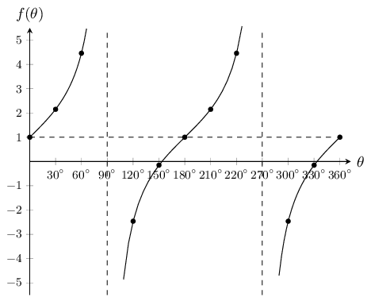

Domain: \(\left\{\theta :0°\le \theta \le 360°,\theta \ne 90°;270°\right\}\)

Range: \(\left\{f(\theta):f(\theta)\in \mathbb{R}\right\}\)
</Callout>

<QuizCard id="m10-06-06c" title="Interactive Exercise 6.8" question="Answer the following questions. What are the asymptotes of \(f(x)\) ? What are the intercepts of \(f(x)\) ? True or False: The graph of \(f(x)\) passes                     through the point \((\text{45}\text{°}\, ;                     8)\) ?" options=["x = 90\u00b0 and x = 270\u00b0", "x = 0\u00b0 and y = 0\u00b0", "x = 45\u00b0 and x = 225\u00b0", "x = 90\u00b0 and x = 225\u00b0", "(0\u00b0; 0), (180\u00b0; 0) and (360\u00b0; 0)", "(0\u00b0; 0)", "(45\u00b0; 0) and (225\u00b0; 0)", "(90\u00b0; 0) and (180\u00b0; 0)", "True", "False"] answer="" hint="" explanation="" />

### Textbook Exercise 6.6

**Problem:**
Shown the following graph of the following form: \(y = a \sin{\theta} + q\) where Point
                    A is at \((180^{\circ};\text{1,5})\), and Point B is at
                  \((90^{\circ};3)\), find the values of \(a\) and \(q\).

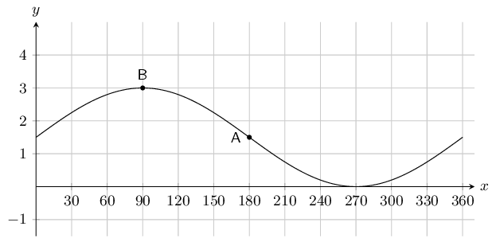

**Solution:**
To find \(q\) we note that \(q\) shifts the graph up or down. To determine \(q\) we can look at any
                  point on the graph. For instance point \(A\) is at \((180^{\circ};\text{1,5})\). For an unshifted sine
                  graph point \(A\) would be at \((180^{\circ};0)\). For this graph we see that this point has been
                  shifted up by \(\text{1,5}\) or \(\frac{3}{2}\) spaces. Therefore \(q = \frac{3}{2}\).

To find \(a\) we note that the \(y\)-value at the middle (point \(A\)) is \(\text{1,5}\), while the
                  \(y\)-value at the top (point \(B\)) is 3. We can find the amplitude by working out the distance from
                  the top of the graph to the middle of the graph: \(3 - \text{1,5} = \text{1,5}\). Therefore \(a =
                  \frac{3}{2}\).

The complete equation for the graph shown in this question is \(y = \frac{3}{2}\sin \theta +
                  \frac{3}{2}\).

Therefore \(a = \frac{3}{2} \text{ and } q = \frac{3}{2}\)

**Problem:**
Shown the following graph of the following form: \(y = a \sin{\theta} + q\) where Point
                    A is at \((270^{\circ};-\text{6})\), and Point B is at
                  \((90^{\circ};\text{2})\), determine the values of \(a\) and \(q\).

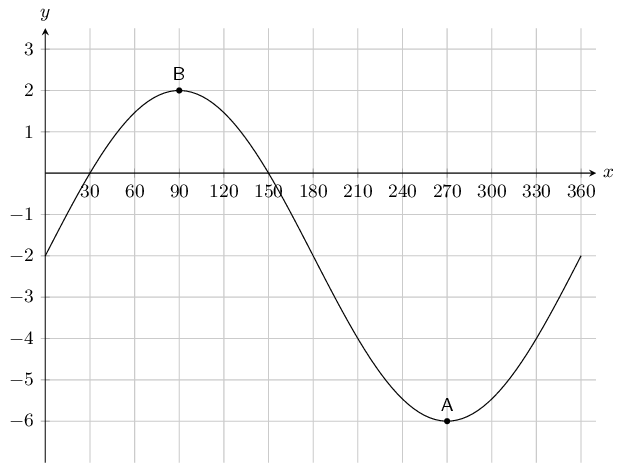

**Solution:**
To find \(a\) we note that the \(y\)-value at the bottom (point \(A\)) is \(-\text{6}\), while the
                  \(y\)-value at the top (point \(B\)) is 2. We can find the amplitude by working out the distance from
                  the top of the graph to the bottom of the graph and then dividing this by 2 since this distance is
                  twice the amplitude: \(\frac{2 - (-6)}{2} = 4\). Therefore \(a = 4\).

To find \(q\) we note that \(q\) shifts the graph up or down. To determine \(q\) we can look at any
                  point on the graph. For instance point \(B\) is at \((90^{\circ};2)\). For an unshifted sine graph
                  with the same \(a\) value (i.e. \(4 \sin \theta\)) point \(B\) would be at \((90^{\circ};4)\). For
                  this graph we see that this point has been shifted down by \(\text{2}\) spaces. Therefore \(q = 2\).

The complete equation for the graph shown in this question is \(y = 4\sin \theta - 2\).

Therefore \(a = 4 \text{ and } q = -2\)

**Problem:**
The graph below shows a trigonometric equation of the following form: \(y = a \cos{\theta} + q\). Two
                  points are shown on the graph: Point A at \((180^{\circ};-\text{1,5})\), and
                  Point B: \((0^{\circ};-\text{0,5})\). Calculate the values of \(a\) (the amplitude of
                  the graph) and \(q\) (the vertical shift of the graph).

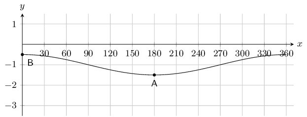

**Solution:**
To find \(a\) we note that the \(y\)-value at the bottom (point \(A\)) is \(-\text{1,5}\), while the
                  \(y\)-value at the top (point \(B\)) is \(-\text{0,5}\). We can find the amplitude by working out the
                  distance from the top of the graph to the bottom of the graph and then dividing this by 2 since this
                  distance is twice the amplitude: \(\frac{-\text{0,5} - (-\text{1,5})}{2} = \frac{1}{2}\). Therefore
                  \(a = \frac{1}{2}\).

To find \(q\) we note that \(q\) shifts the graph up or down. To determine \(q\) we can look at any
                  point on the graph. For instance point \(B\) is at \((0^{\circ};-\text{0,5})\). For an unshifted
                  cosine graph with the same \(a\) value (i.e. \(\frac{1}{2} \cos \theta\)) point \(B\) would be at
                  \((0^{\circ};\text{0,5})\). For this graph we see that this point has been shifted down by
                  \(\text{1}\) space. Therefore \(q = 1\).

The complete equation for the graph shown in this question is \(y = \frac{1}{2}\cos \theta - 1\).

Therefore \(a = \frac{1}{2}, \text{ and } q= -1\).

**Problem:**
The graph below shows a trigonometric equation of the following form: \(y = a \cos{\theta} + q\). Two
                  points are shown on the graph: Point A at \((90^{\circ};\text{0,0})\), and
                  Point B: \((180^{\circ};-\text{0,5})\). Calculate the values of \(a\) (the amplitude
                  of the graph) and \(q\) (the vertical shift of the graph).

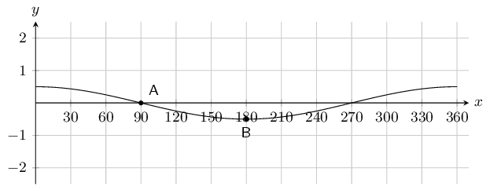

**Solution:**
To find \(a\) we note that the \(y\)-value at the bottom (point \(B\)) is \(-\text{0,5}\), while the
                  \(y\)-value at the middle (point \(A\)) is \(\text{0}\). We can find the amplitude by working out the
                  distance from the top of the graph to the middle of the graph: \(\text{0} - (-\text{0,5}) =
                  \frac{1}{2}\). Therefore \(a = \frac{1}{2}\).

To find \(q\) we note that \(q\) shifts the graph up or down. To determine \(q\) we can look at any
                  point on the graph. For instance point \(A\) is at \((90^{\circ};\text{0})\). For an unshifted cosine
                  graph with the same \(a\) value (i.e. \(\frac{1}{2} \cos \theta\)) point \(B\) would be at
                  \((0^{\circ};\text{0})\). For this graph we see that this point has not been shifted. Therefore \(q =
                  0\).

The complete equation for the graph shown in this question is \(y = \frac{1}{2}\cos \theta\).

Therefore \(a = \frac{1}{2}, \text{ and } q= 0\).

**Problem:**
On the graph below you see a tangent curve of the following form: \(y = a \tan{\theta} + q\). Two
                  points are labelled on the curve: Point A is at \(\left(0^{\circ}; \frac{1}{3}
                  \right)\), and Point B is at \(\left(45^{\circ}; \frac{10}{3} \right)\).

Calculate, or otherwise determine, the values of \(a\) and \(q\).

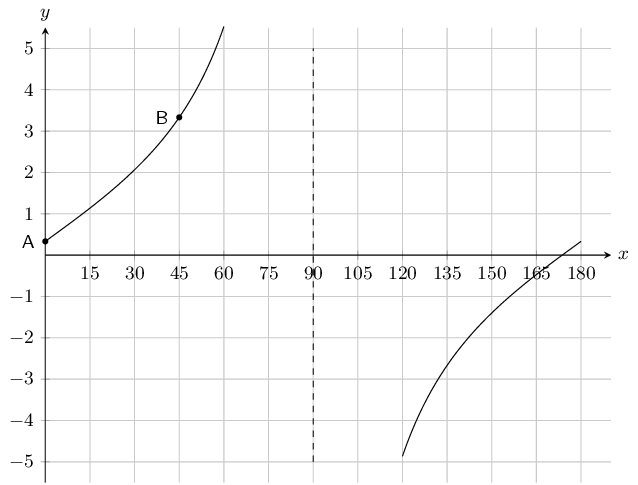

**Solution:**
To find \(q\) we note that \(q\) shifts the graph up or down. To determine \(q\) we can look at any
                  point on the graph. For instance point \(A\) is at \(\left(0^{\circ};\frac{1}{3}\right)\). For an
                  unshifted tangent graph point \(A\) would be at \((0^{\circ};\text{0})\). For this graph we see that
                  this point been shifted upwards by a \(\frac{1}{3}\). Therefore \(q = \frac{1}{3}\).

To find \(a\) we can substitute point \(B\) into the equation for the tangent graph:

                \begin{align*}
                y & = a \tan{\theta} + \frac{1}{3} \\
                \left( \frac{10}{3} \right) & = a \tan{45^{\circ}} + \frac{1}{3} \\
                \frac{10}{3} & = a(1) + \frac{1}{3} \\
                \frac{10}{3} - \frac{1}{3} & = a \\
                3 & = a
                \end{align*}

The complete equation is: \(y = 3 \tan{\theta} + \frac{1}{3}\).

Therefore \(a = 3 \text{ and } q = \frac{1}{3}\).

**Problem:**
The graph below shows a tangent curve with an equation of the form \(y = a \tan{\theta} + q\). Two
                  points are labelled on the curve: Point A is at \((0^{\circ} ; 0)\), and
                  Point B is at \((45^{\circ} ; 1)\).

Find \(a\) and \(q\).

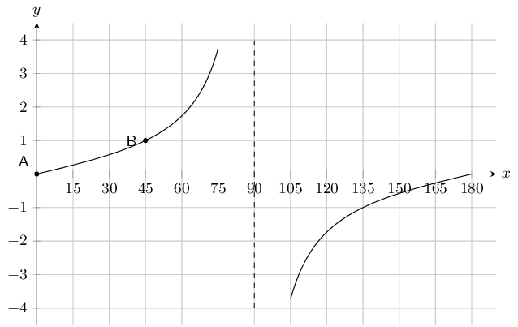

**Solution:**
To find \(q\) we note that \(q\) shifts the graph up or down. To determine \(q\) we can look at any
                  point on the graph. For instance point \(A\) is at \((0^{\circ};0)\). For an unshifted tangent graph
                  point \(A\) would be at \((0^{\circ};\text{0})\). For this graph we see that the graph has not been
                  shifted. Therefore \(q = 0\).

To find \(a\) we can substitute point \(B\) into the equation for the tangent graph:

                \begin{align*}
                y & = a \tan{\theta} \\
                1 & = a \tan{45^{\circ}} \\
                1 & = a(1) \\
                1 & = a
                \end{align*}

The complete equation is: \(y = \tan{\theta}\).

Therefore \(a = 1 \text{ and } q = 0\).

Given the following graph, identify a function that matches each of the following equations:

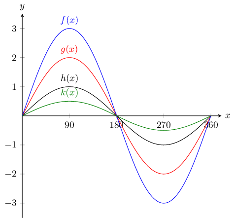

**Problem:**
\(y = \sin{\theta}\)

**Solution:**
\(h(x)\)

**Problem:**
\(y = \frac{1}{2}\sin{\theta}\)

**Solution:**
\(k(x)\)

**Problem:**
\(y = 3\sin{\theta}\)

**Solution:**
\(f(x)\)

**Problem:**
\(y = 2\sin{\theta}\)

**Solution:**
\(g(x)\)

**Problem:**
The graph below shows functions \(f(x)\) and \(g(x)\)

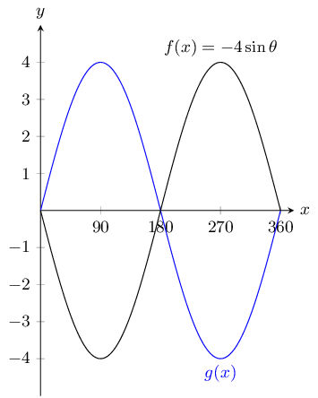

What is the equation for \(g(x)\)?

**Solution:**
\(g(x) = 4\sin{\theta}\)

**Problem:**
With the assistance of the table below sketch the three functions on the same set of axes.

                \[\begin{array}{| l | l | l | l | l | l | l | l | l | l | }
                \hline
                \theta & 0^{\circ} & 45^{\circ} & 90^{\circ} & 135^{\circ} & 180^{\circ} &
                225^{\circ} & 270^{\circ} & 315^{\circ} & 360^{\circ} \\
                \hline
                \tan{\theta} & 0 & 1 & \text{undefined} & -1 & 0 & 1 & \text{undefined}
                & -1 & 0 \\
                \hline
                3\tan{\theta} & 0 & 3 & \text{undefined} & -3 & 0 & 3 & \text{undefined}
                & -3 & 0 \\
                \hline
                \frac{1}{2}\tan{\theta} & 0 & \frac{1}{2} & \text{undefined} & -\frac{1}{2} & 0
                & \frac{1}{2} & \text{undefined} & -\frac{1}{2} & 0 \\
                \hline
                \end{array}\]

**Solution:**
We are given a table with values and so we plot each of these points and join them with a smooth
                  curve.

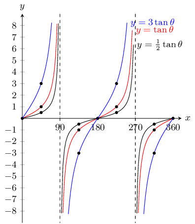

**Problem:**
With the assistance of the table below sketch the three functions on the same set of axes.

                \[\begin{array}{| l | l | l | l | l | l | }
                \hline
                \theta & 0^{\circ} & 90^{\circ} & 180^{\circ} & 270^{\circ} & 360^{\circ} \\
                \hline
                \cos{\theta} - 2 & -1 & -2 & -3 &-2 & -1 \\
                \hline
                \cos{\theta} + 4 & 5 & 4 & 2 & 4 & 5 \\
                \hline
                \cos{\theta} + 2 & 3 & 2 & 1 & 2 & 3 \\
                \hline
                \end{array}\]

**Solution:**
We are given a table with values and so we plot each of these points and join them with a smooth
                  curve.

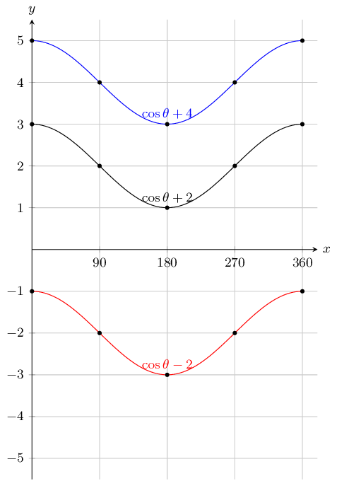

State the coordinates at \(E\) and the range of the function.

**Problem:**
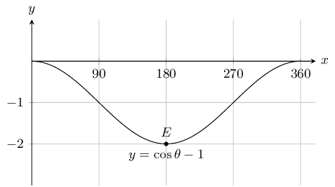

**Solution:**
To find the coordinates of \(E\) we read the value off the graph. To find the range we note that
                    this is a cosine graph and so the maximum value occurs at \(0^\circ\) (and at \(360^\circ\)). The
                    minimum value occurs at \(180^\circ\). So we read off the value of \(y\) at \(0^\circ\) and at
                    \(180^\circ\).

Therefore \(E(180^{\circ};-2) \text{ and } -2 \le y \le 0\).

**Problem:**
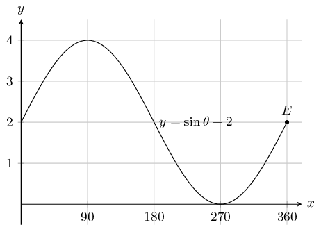

**Solution:**
To find the coordinates of \(E\) we read the value off the graph. To find the range we note that
                    this is a sine graph and so the maximum value occurs at \(90^\circ\). The minimum value occurs at
                    \(270^\circ\). So we read off the value of \(y\) at \(90^\circ\) and at \(270^\circ\).

Therefore \(E(360^{\circ};2) \text{ and } 0 \le y \le 4\)

**Problem:**
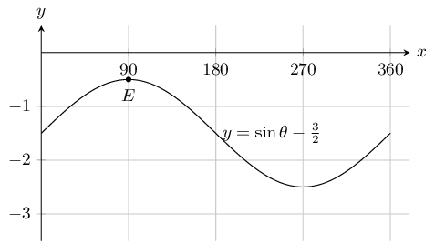

**Solution:**
To find the coordinates of \(E\) we read the value off the graph. To find the range we note that
                    this is a sine graph and so the maximum value occurs at \(90^\circ\). The minimum value occurs at
                    \(270^\circ\). So we read off the value of \(y\) at \(90^\circ\) and at \(270^\circ\).

Therefore \(E(90^{\circ};-\text{0,5}) \text{ and } -\text{2,5} \le y \le -\text{0,5}\)

**Problem:**
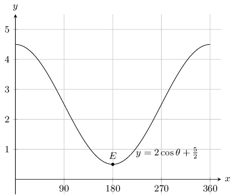

**Solution:**
To find the coordinates of \(E\) we read the value off the graph. To find the range we note that
                    this is a cosine graph and so the maximum value occurs at \(0^\circ\) (and at \(360^\circ\)). The
                    minimum value occurs at \(180^\circ\). So we read off the value of \(y\) at \(0^\circ\) and at
                    \(180^\circ\).

Therefore \(E(180^{\circ};\text{0,5}) \text{ and } \text{0,5} \le y \le \text{4,5}\)

**Problem:**
State the coordinates at \(E\) and the domain and range of the function in the interval shown.

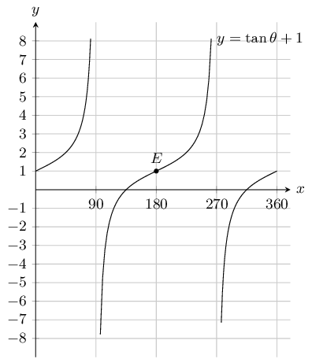

**Solution:**
\(E(180^{\circ};1) \text{ , range } y \in \mathbb{R} \text{ and domain } 0 \le \theta \le 360, x \neq
                90, x\neq 270\)

Using your knowledge of the effects of \(a\) and \(q\), sketch each of the following graphs, without
                  using a table of values, for \(\theta \in \left[0°;360°\right]\)

**Problem:**
\(y=2\sin\theta\)

**Solution:**
In this case \(q = 0\) and so the basic sine graph is not shifted up or downwards. We also note
                    that \(a = 2\) and so the graph is stretched by 2 units. The maximum value will be 2 and the minimum
                    value will be \(-\text{2}\).

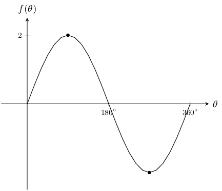

**Problem:**
\(y=-4\cos\theta\)

**Solution:**
In this case \(q = 0\) and so the basic cosine graph is not shifted up or downwards. We also note
                    that \(a = -4\) and so the graph is stretched by \(-\text{4}\) units. The maximum value will be 4
                    and the minimum value will be \(-\text{4}\).

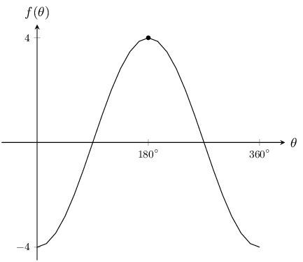

**Problem:**
\(y=-2\cos\theta + 1\)

**Solution:**
In this case \(q = 1\) and so the basic cosine graph is shifted upwards by 1 unit. We also note
                    that \(a = -2\) and so the graph is stretched by \(-\text{2}\) units. The maximum value will be 3
                    and the minimum value will be \(-\text{1}\).

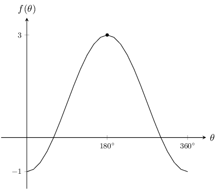

**Problem:**
\(y=\sin\theta - 3\)

**Solution:**
In this case \(q = -3\) and so the basic sine graph is shifted downwards by 3 units. We also note
                    that \(a = 1\) and so the graph is not stretched. The maximum value will be \(-\text{2}\) and the
                    minimum value will be \(-\text{4}\).

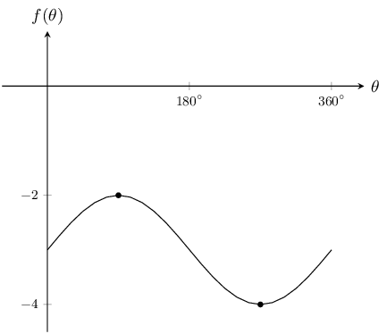

**Problem:**
\(y=\tan\theta - 2\)

**Solution:**
In this case \(q = -2\) and so the basic tangent graph is shifted downwards by 2 units. We also
                    note that \(a = 1\) and so the graph is not stretched. When \(\theta = 0^\circ\), \(y = -2\).
                    Similarly when \(\theta = 180^\circ\), \(y = -2\) and when \(\theta = 360^\circ\), \(y = -2\).

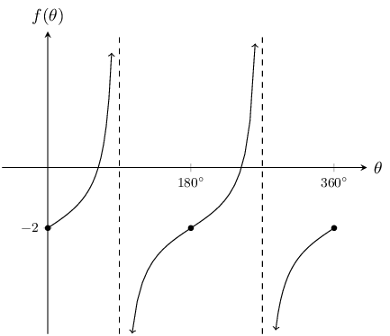

**Problem:**
\(y=2\cos\theta - 1\)

**Solution:**
In this case \(q = -1\) and so the basic cosine graph is shifted downwards by 1 units. We also note
                    that \(a = 2\) and so the graph is stretched by 2 units. The maximum value will be \(\text{1}\) and
                    the minimum value will be \(-\text{3}\).

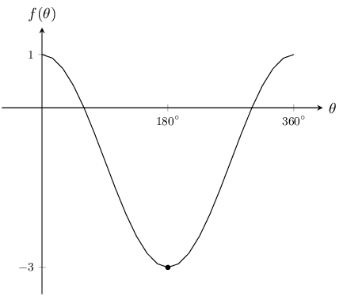

Give the equations for each of the following graphs:

**Problem:**
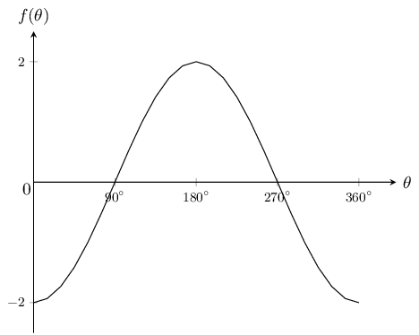

**Solution:**
The general form of a cosine graph is \(y = a \cos \theta + q\). We note that in this case the
                    graph is not shifted. We also note the graph is stretched by \(-\text{2}\) units.

Therefore \(y=-2\cos\theta\).

**Problem:**
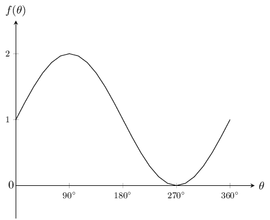

**Solution:**
The general form of a sine graph is \(y = a \sin \theta + q\). We note that in this case the graph
                    is shifted upwards by 1 unit. We also note the graph is not stretched.

Therefore \(y=\sin\theta + 1\).

**Problem:**
For which values of \(\theta\) is the function increasing, in the interval shown?

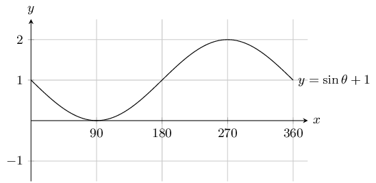

**Solution:**
\(90^{\circ} < \theta < 270^{\circ}\)

**Problem:**
For which values of \(\theta\) is the function negative, in the interval shown?

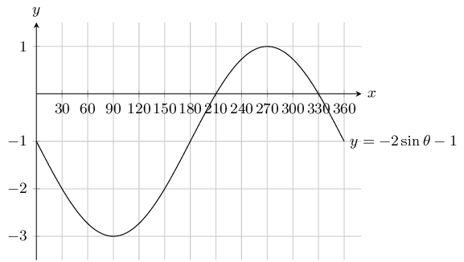

**Solution:**
\(0^{\circ} < \theta < 210^{\circ} \text { and } 330^{\circ} < \theta < 360^{\circ}\)

**Problem:**
For which values of \(\theta\) is the function positive, in the interval shown?

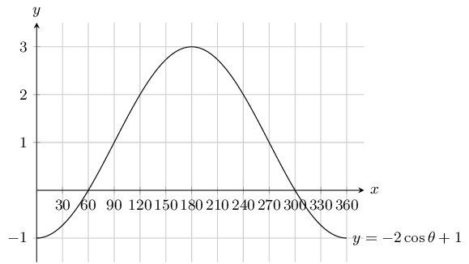

**Solution:**
\(60^{\circ} < \theta < 300^{\circ}\)

Given the following graph.

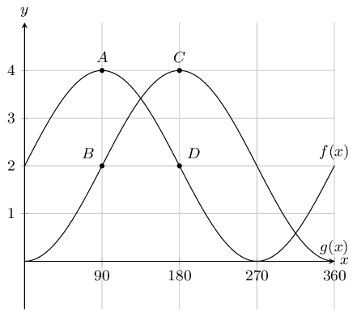

**Problem:**
State the coordinates at \(A,~B,~C\) and \(D\).

**Solution:**
We can read the values off the graph:

\(A = (90^{\circ};4),~B = (90^{\circ};-2),~C = (180 ^{\circ}; 4) \text{ and } D = ( 180^{\circ};
                    -2)\)

**Problem:**
How many times in this interval does \(f(x)\) intersect \(g(x)\).

**Solution:**
\(2\)

**Problem:**
What is the amplitude of \(f(x)\).

**Solution:**
\(2\)

**Problem:**
Evaluate: \(f(360^{\circ}) - g(360^{\circ})\) .

**Solution:**
Read off the value of \(f(360^{\circ})\) and \(g(360^{\circ})\) from the graph. Then subtract
                    \(g(360^{\circ})\) from \(f(360^{\circ})\).

                  \begin{align*}
                  f(360^{\circ}) - g(360^{\circ}) &= 2 - 0 \\
                  &=2
                  \end{align*}

Given the following graph.

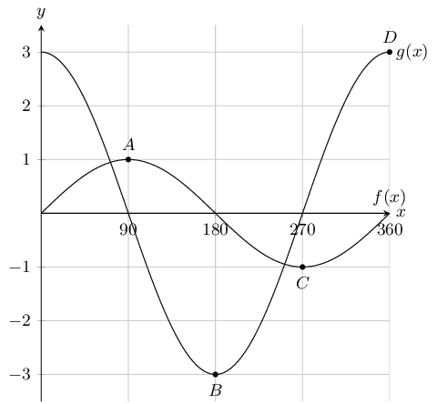

**Problem:**
State the coordinates at \(A,~B,~C\) and \(D\).

**Solution:**
We read the values off the graph:

                  \(A = ( 90^{\circ}; 1),~B = ( 180^{\circ}; -3),~C = (270 ^{\circ};-1 ) \text{ and } D = ( 360^{\circ};
                  3)\)

**Problem:**
How many times in this interval does \(f(x)\) intersect \(g(x)\).

**Solution:**
\(2\)

**Problem:**
What is the amplitude of \(g(x)\).

**Solution:**
\(3\)

**Problem:**
Evaluate: \(f(90^{\circ}) - g(90^{\circ})\) .

**Solution:**
Read off the value of \(f(90^{\circ})\) and \(g(90^{\circ})\) from the graph. Then subtract
                    \(g(90^{\circ})\) from \(f(90^{\circ})\).

                  \begin{align*}
                  f(90^{\circ}) - g(90^{\circ}) &= 1 - 0 \\
                  &=1
                  \end{align*}

Given the following graph:

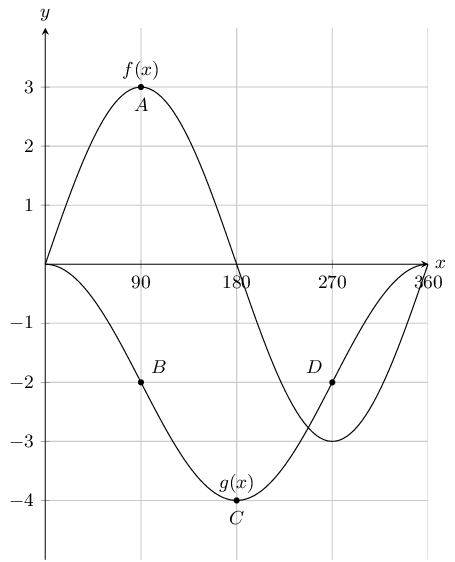

**Problem:**
State the coordinates at \(A,~B,~C\) and \(D\).

**Solution:**
We read the values off the graph:

                  \(A = (90 ^{\circ};3 ),~B = (90 ^{\circ};2 ),~C = (180 ^{\circ}; -4) \text{ and } D = (
                  270^{\circ};2)\)

**Problem:**
How many times in this interval does \(f(x)\) intersect \(g(x)\).

**Solution:**
\(3\)

**Problem:**
What is the amplitude of \(g(x)\).

**Solution:**
\(2\)

**Problem:**
Evaluate: \(f(270^{\circ}) - g(270^{\circ})\) .

**Solution:**
Read off the value of \(f(270^{\circ})\) and \(g(270^{\circ})\) from the graph. Then subtract
                    \(g(270^{\circ})\) from \(f(270^{\circ})\).

                  \begin{align*}
                  f(270^{\circ}) - g(270^{\circ}) &= -3 - (-2)\\
                  &=-1
                  \end{align*}
