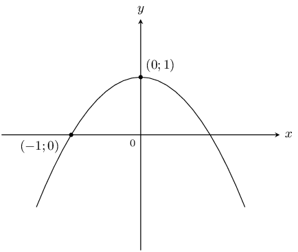
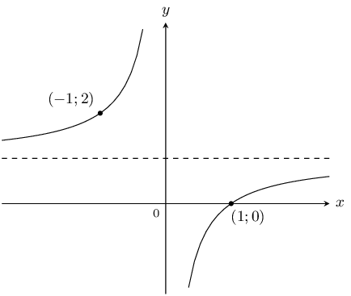
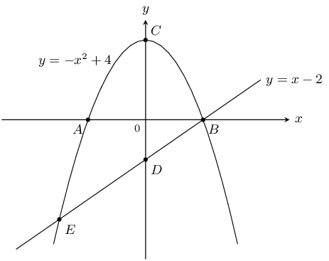
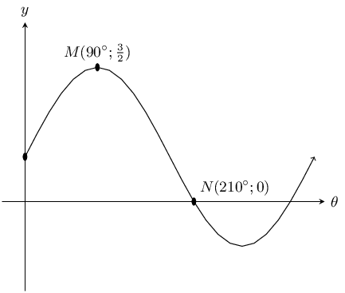
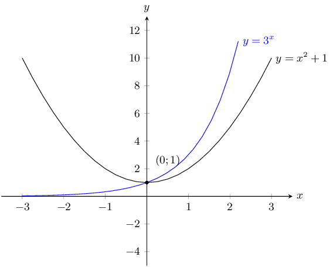
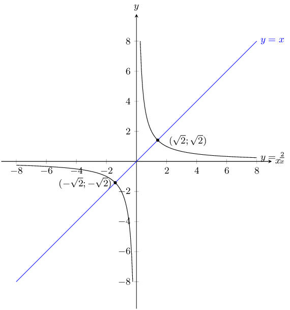
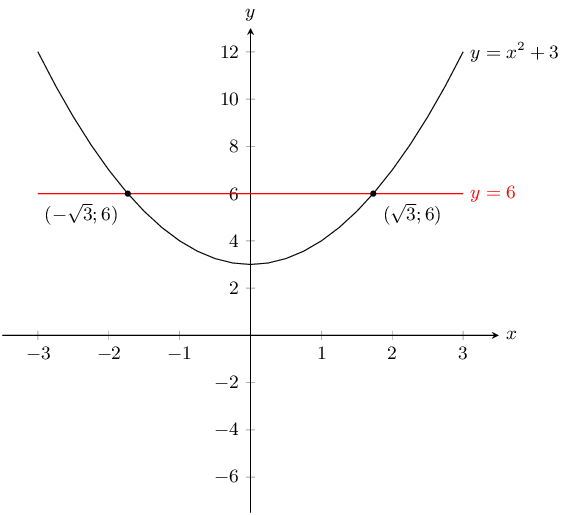
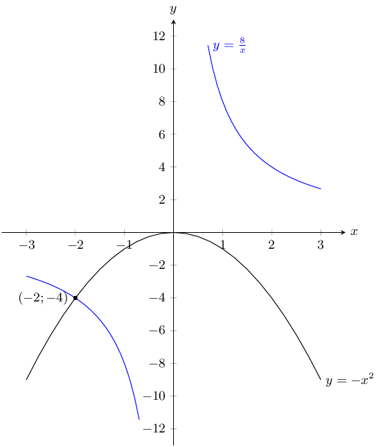
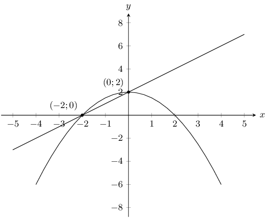
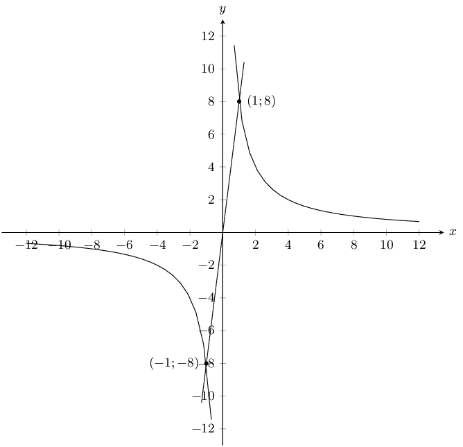

## 6.7 Interpretation of graphs (EMA5J)

<Callout type="tip" title="Worked example 22: Determining the equation of a parabola">
**Question:**
Use the sketch below to determine the values of \(a\) and \(q\) for the parabola of
                                        the form \(y=a{x}^{2}+q\).

**Examine the sketch:**
From the sketch we see that the shape of the graph is a “frown”,
                                        therefore \(a<0\). We also see that the graph has been shifted vertically
                                        upwards, therefore \(q>0\).

**Determine \(q\) using the \(y\)-intercept:**
The \(y\)-intercept is the point \((0;1)\).

                                \begin{align*}
                                y& = a{x}^{2}+q \\
                                1& = a{(0)}^{2}+q \\
                                \therefore q& = 1
                                \end{align*}

**Use the other given point to determine \(a\):**
Substitute point \((-1;0)\) into the equation:

                                \begin{align*}
                                y& = a{x}^{2}+q \\
                                0& = a{(-1)}^{2}+1 \\
                                \therefore a& = -1
                                \end{align*}

**Write the final answer:**
\(a=-1\) and \(q=1\), so the equation of the parabola is \(y=-{x}^{2}+1\).
</Callout>

<Callout type="tip" title="Worked example 23: Determining the equation of a hyperbola">
**Question:**
Use the sketch below to determine the values of \(a\) and \(q\) for the hyperbola of
                                        the form \(y=\frac{a}{x}+q\).

**Examine the sketch:**
The two curves of the hyperbola lie in the second and fourth quadrant, therefore
                                        \(a<0\). We also see that the graph has been shifted vertically upwards,
                                        therefore \(q>0\).

**Substitute the given points into the equation and solve:**
Substitute the point \((-1;2)\):

                                \begin{align*}
                                y& = \frac{a}{x}+q \\
                                2& = \frac{a}{-1}+q \\
                                \therefore 2& = -a+q
                                \end{align*}

Substitute the point \((1;0)\):

                                \begin{align*}
                                y& = \frac{a}{x}+q \\
                                0& = \frac{a}{1}+q \\
                                \therefore a& = -q
                                \end{align*}

**Solve the equations simultaneously using substitution:**
\begin{align*}
                                2& = -a+q \\
                                & = q+q \\
                                & = 2q \\
                                \therefore q& = 1 \\
                                \therefore a& = -q \\
                                & = -1
                                \end{align*}

**Write the final answer:**
\(a=-1\) and \(q=1\), therefore the equation of the hyperbola is
                                        \(y=\dfrac{-1}{x}+1\).
</Callout>

<Callout type="tip" title="Worked example 24: Interpreting graphs">
**Question:**
The graphs of \(y=-{x}^{2}+4\) and \(y=x-2\) are given. Calculate the following:

1. coordinates of \(A\), \(B\), \(C\), \(D\)
2. coordinates of \(E\)
3. distance \(CD\)

**Calculate the intercepts:**
For the parabola, to calculate the \(y\)-intercept, let \(x=0\):

                                \begin{align*}
                                y& = -{x}^{2}+4 \\
                                & = -{0}^{2}+4 \\
                                & = 4
                                \end{align*}

This gives the point \(C(0;4)\).

To calculate the \(x\)-intercept, let \(y=0\):

                                \begin{align*}
                                y& = -{x}^{2}+4 \\
                                0& = -{x}^{2}+4 \\
                                {x}^{2}-4& = 0 \\
                                (x+2)(x-2)& = 0 \\
                                \therefore x& = ±2
                                \end{align*}

This gives the points \(A(-2;0)\) and \(B(2;0)\).

For the straight line, to calculate the \(y\)-intercept, let \(x=0\):

                                \begin{align*}
                                y& = x-2 \\
                                & = 0-2 \\
                                & = -2
                                \end{align*}

This gives the point \(D(0;-2)\).

**Calculate the point of intersection \(E\):**
At \(E\) the two graphs intersect so we can equate the two expressions:

                                \begin{align*}
                                x-2& = -{x}^{2}+4 \\
                                \therefore {x}^{2}+x-6& = 0 \\
                                \therefore (x-2)(x+3)& = 0 \\
                                \therefore x& = 2 \text{ or } -3
                                \end{align*}

At \(E\), \(x=-3\), therefore \(y=x-2=-3-2=-5\). This gives the point \(E(-3;-5)\).

**Calculate distance \(CD\):**
\begin{align*}
                                CD& = CO+OD \\
                                & = 4+2 \\
                                & = 6
                                \end{align*}

Distance \(CD\) is \(\text{6}\) units.

**Write the final answer:**
1. coordinates of \(A(-2;0)\), \(B(2;0)\), \(C(0;4)\), \(D(0;-2)\)
2. coordinates of \(E(-3;-5)\)
3. distance \(CD = 6\) units
</Callout>

<Callout type="tip" title="Worked example 25: Interpreting trigonometric graphs">
**Question:**
Use the sketch to determine the equation of the trigonometric function \(f\) of the
                                        form \(y=a f(\theta)+q\).

**Examine the sketch:**
From the sketch we see that the graph is a sine graph that has been shifted
                                        vertically upwards. The general form of the equation is \(y=a\sin\theta +q\).

**Substitute the given points into equation and solve:**
At \(N\), \(\theta =210°\) and \(y=0\):

                                \begin{align*}
                                y& = a\sin\theta +q \\
                                0& = a\sin 210°+q \\
                                & = a\left(-\frac{1}{2}\right)+q \\
                                \therefore q& = \frac{a}{2}
                                \end{align*}

At \(M\), \(\theta = 90°\) and \(y=\frac{3}{2}\):

                                \begin{align*}
                                \frac{3}{2}& = a\sin90°+q \\
                                & = a+q
                                \end{align*}

**Solve the equations simultaneously using substitution:**
\begin{align*}
                                \frac{3}{2}& = a+q \\
                                & = a+\frac{a}{2} \\
                                3& = 2a+a \\
                                3a& = 3 \\
                                \therefore a& = 1 \\
                                \therefore q& = \frac{a}{2} \\
                                & = \frac{1}{2}
                                \end{align*}

**Write the final answer:**
\(y=\sin\theta +\frac{1}{2}\)
</Callout>

### Textbook Exercise 6.7

Plot the following functions on the same set of axes and clearly
                                                        label all the points at which the functions intersect.

**Problem:**
\(y = x^2 +1\) and \(y = 3^x\)

**Solution:**
The \(y\)-intercept for each graph is:

                                                        \(\begin{aligned}
                                                        0^2 + 1 & = 1 \\
                                                        3^0 & = 1
                                                        \end{aligned}\)

This is also the only point of intersection.

For both graphs there is no \(x\)-intercept.

**Problem:**
\(y = x\) and \(y = \dfrac{2}{x}\)

**Solution:**
\(y = x\) is a basic straight line graph. For \(y
                                                                =\frac{2}{x}\) there is no \(y\)-intercept and no
                                                                \(x\)-intercept. We note that this is a hyperbolic graph
                                                                that has been stretched by 2 units.

The points of intersection are:

                                                        \begin{align*}
                                                        x &= \frac{2}{x} \\
                                                        x^2 &= 2 \\
                                                        x^2 - 2 & = 0\\
                                                        (x - \sqrt{2})(x + \sqrt{2}) & = 0\\
                                                        x = \sqrt{2} &\text{ or } x = -\sqrt{2} \\
                                                        y = \sqrt{2} &\text{ or } y = -\sqrt{2}
                                                        \end{align*}

The graphs intersect at \(\left(\sqrt{2};\sqrt{2}\right)\)
                                                                and \(\left(-\sqrt{2};-\sqrt{2}\right)\).

**Problem:**
\(y = x^2 +3\) and \(y = 6\)

**Solution:**
\(y = 6\) is a horizontal line through \((0;6)\). For \(y
                                                                =x^2 + 3\) the \(y\)-intercept is \((0;3)\) and there
                                                                are no \(x\)-intercepts. From the value of \(q\) we see
                                                                that this is a basic parabola that has been shifted
                                                                upwards by 3 units.

The points of intersection are:

                                                        \begin{align*}
                                                        x^2 + 3 &= 6 \\
                                                        x^2 - 3 &= 0 \\
                                                        (x - \sqrt{3})(x + \sqrt{3}) & = 0\\
                                                        x = \sqrt{3} &\text{ or } x = -\sqrt{3} \\
                                                        y = 6
                                                        \end{align*}

The graphs intersect at \(\left(\sqrt{3};6\right)\) and
                                                                \(\left(-\sqrt{3};-6\right)\).

**Problem:**
\(y = -x^2\) and \(y = \dfrac{8}{x}\)

**Solution:**
\(y = -x^{2}\) is a parabola that has been reflected about
                                                                the \(x\)-axis. For \(y =\frac{8}{x}\) there is no
                                                                \(y\)-intercept and there is no \(x\)-intercepts. From
                                                                the value of \(a\) we see that this is a basic hyperbola
                                                                that has been stretched by 8 units.

The points of intersection are:

                                                        \begin{align*}
                                                        -x^2 &= \frac{8}{x} \\
                                                        x^3 &= - 8 \\
                                                        x & = -2\\
                                                        y &= \frac{8}{-2} \\
                                                        y &= -4
                                                        \end{align*}

The graphs intersect at \(\left(-2;-4\right)\).

Determine the equations for the graphs given below.

**Problem:**

**Solution:**
For the straight line graph we have the \(x\) and
                                                                \(y\)-intercepts. The \(y\)-intercept gives \(c = 2\).
                                                                Now we can calculate the gradient of the straight line
                                                                graph:

                                                        \begin{align*}
                                                        y &= mx + 2 \\
                                                        m &= \frac{2 - 0}{0 - (-2)} \\
                                                        &= 1
                                                        \end{align*}

Therefore the equation of the straight line graph is \(y = x
                                                                + 2\).

For the parabola we also have the \(x\) and \(y\)-intercepts.
                                                                The \(y\)-intercept gives \(q = 2\). Now we can
                                                                calculate \(a\):

                                                        \begin{align*}
                                                        y &= ax^2 + 2 \\
                                                        0 &= a(-2)^2 + 2 \\
                                                        -2 &= 4a \\
                                                        a &= -\frac{1}{2}
                                                        \end{align*}

Therefore the equation of the parabola is \(y =
                                                                -\frac{1}{2}x^2 + 2\).

The equations for the two graphs are \(y = x + 2\) and \(y =
                                                                -\frac{1}{2}x^2 + 2\)

**Problem:**

**Solution:**
For the straight line graph we notice that it passes through
                                                                \((0;0)\) and so \(c = 0\).

We have two points on the straight line graph and so we can
                                                                calculate the gradient, \(m\):

                                                        \begin{align*}
                                                        y &= mx + 0 \\
                                                        m &= \frac{8 - (-8)}{1 - (- 1)} \\
                                                        m &= 8
                                                        \end{align*}

The equation of the straight line graph is \(y = 8x\).

For the hyperbola we note that the graph is not shifted
                                                                either upwards or downwards. Therefore \(q = 0\). Now we
                                                                can calculate \(a\):

                                                        \begin{align*}
                                                        y &= \frac{a}{x} \\
                                                        8 &= \frac{a}{1} \\
                                                        a &= 8
                                                        \end{align*}

Therefore the equation of the hyperbola is \(y =
                                                                \frac{8}{x}\).

The equations for the two graphs are \(y = 8x\) and \(y =
                                                                \frac{8}{x}\).

Choose the correct answer:

**Problem:**
The range of \(y = 2 \sin{\theta} + 1\) is:

1. \(1 \le \theta \le 2\)
2. \(-2 \le \theta \le 2\)
3. \(-1 \le \theta \le 3\)
4. \(-2 \le \theta \le 3\)

**Solution:**
3

**Problem:**
The range of \(y = 2 \cos{\theta} - 4\) is:

1. \(-6 \le \theta \le 2\)
2. \(-4 \le \theta \le -2\)
3. \(-6 \le \theta \le 1\)
4. \(-6 \le \theta \le -2\)

**Solution:**
4

**Problem:**
The y-intercept of \(2^x + 1\) is:

1. \(3\)
2. \(1\)
3. \(2\)
4. \(0\)

**Solution:**
3

**Problem:**
Which of the following passes through \((1;7)\)?

1. \(y = \frac{7}{x}\)
2. \(y = 2x + 3\)
3. \(y = \frac{4}{x}\)
4. \(y = x^2 + 1\)

**Solution:**
1
