### Textbook Exercise 6.8

Complete the following tables and identify the function.

**Problem:**
\[\begin{array}{| l | l | l | l | l | l | l |}
            \hline
            x & & 2 & 3 & 4 & & 6 \\
            \hline
            y & 3 & 6 & & 12 & 15 & \\
            \hline
            \end{array}\]

**Solution:**
\[\begin{array}{| l | l | l | l | l | l | l |}
            \hline
            x & 1 & 2 & 3 & 4 & 5 & 6 \\
            \hline
            y & 3 & 6 & 9 & 12 & 15 & 18 \\
            \hline
            \end{array}\]

            \[y = 3x\]

**Problem:**
\[\begin{array}{| l | l | l | l | l | l | l |}
            \hline
            x & 1 & & & 4 & 5 & 6 \\
            \hline
            y & -3 & -2 & -1 & & 1 & 2 \\
            \hline
            \end{array}\]

**Solution:**
\[\begin{array}{| l | l | l | l | l | l | l |}
            \hline
            x & 1 & 2 & 3 & 4 & 5 & 6 \\
            \hline
            y & -3 & -2 & -1 & 0 & 1 & 2 \\
            \hline
            \end{array}\]

            \[y = x -4\]

Plot the following points on a graph.

**Problem:**
\[\begin{array}{| l | l | l | l | l | l | l |}
            \hline
            x & 1 & 2 & 3 & 4 & 5 & 6 \\
            \hline
            y & 1 & 2 & 3 & 4 & 5 & 6 \\
            \hline
            \end{array}\]

**Solution:**
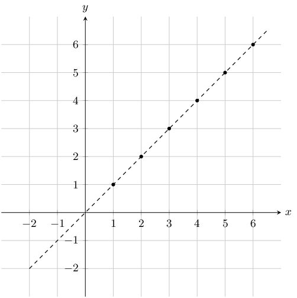

**Problem:**
\[\begin{array}{| l | l | l | l | l | l | l |}
            \hline
            x & 50 & 100 & 150 & 200 & 250 & 300 \\
            \hline
            y & 1 & 2 & 3 & 4 & 5 & 6 \\
            \hline
            \end{array}\]

**Solution:**
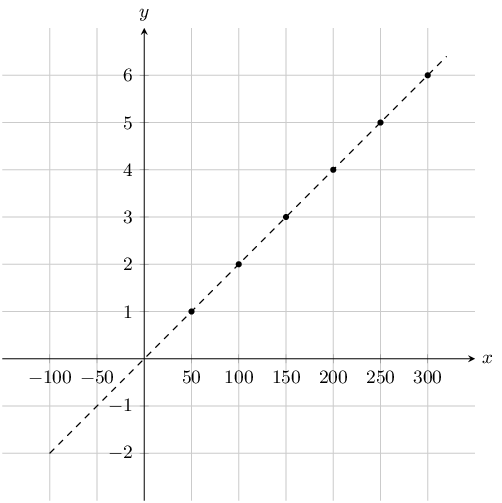

Create a table of values from the function given and then plot the function. Your table must have at least
            5 ordered pairs.

**Problem:**
\(x^2 - 4\)

**Solution:**
\[\begin{array}{| l | l | l | l | l | l | l | l |}
            \hline
            x & -3 & -2 & -1 & 0 & 1 & 2 & 3 \\
            \hline
            y & 5 & 0 & -3 & -4 & -3 & 0 & 5 \\
            \hline
            \end{array}\]

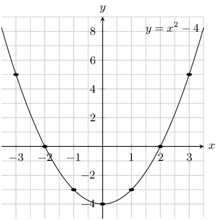

**Problem:**
\(y = 4x - 1\)

**Solution:**
\[\begin{array}{| l | l | l | l | l | l |}
            \hline
            x & -1 & -\text{0,5} & 0 & \text{0,5} & 1 \\
            \hline
            y & -5 & -3 & -1 & 1 & 3 \\
            \hline
            \end{array}\]

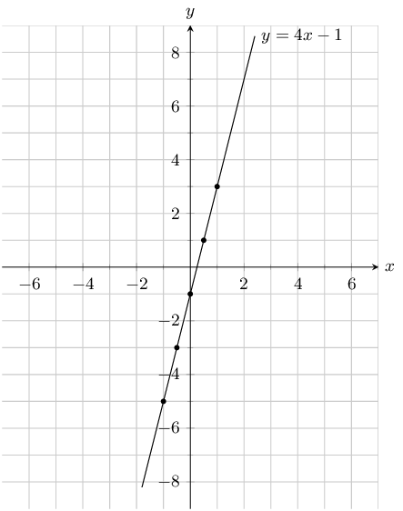

Determine the \(y\)-intercept and the \(x\)-intercepts of the function.

**Problem:**
\(y = - 3 x - 5\)

**Solution:**
\begin{align*}
            y & = - 3 x - 5 \\
            y & = - 3 (0) - 5 \\
            y & = -5 \\
            \therefore c &= -5
            \end{align*}
            \begin{align*}
            y & = - 3 x - 5 \\
            (0) & = - 3 x - 5 \\
            5 & = - 3 x \\
            - \frac{5}{3} & = x
            \end{align*}

\(x\)-intercept \(=- \frac{5}{3}\) and \(y\)-intercept \(=-5\)

**Problem:**
\(y = 2 x + 4\)

**Solution:**
\begin{align*}
            y & = 2 x + 4 \\
            y & = 2 (0) + 4 \\
            y & = 4 \\
            \therefore c &= 4
            \end{align*}
            \begin{align*}
            y & = 2 x + 4 \\
            (0) & = 2 x + 4 \\
            -4 & = 2 x \\
            -2 & = x
            \end{align*}

\(x\)-intercept \(=-2\) and \(y\)-intercept \(=4\)

**Problem:**
The graph below shows an equation, which has the form \(y = mx + c\). Calculate or otherwise find the
            values of \(m\) (the gradient of the line) and \(c\) (the \(y\)-intercept of the line).

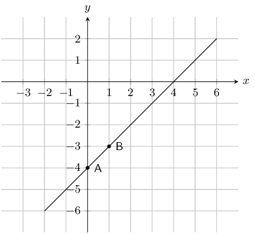

**Solution:**
Point \(A\) is the \(y\)-intercept. Point \(A\) has co-ordinates \((0;-4)\) and so \(c = -4\).

          \begin{align*}
          y & = mx + c \\
          (-3) & = m(1) - 4
          -3 & = m - 4 \\
          1 & = m
          \end{align*}

Therefore \(m = 1\), and \(y = x -4\).

Look at the graphs below. Each graph is labelled with a letter. In the questions that follow, match any
            given equation with the label of a corresponding graph.

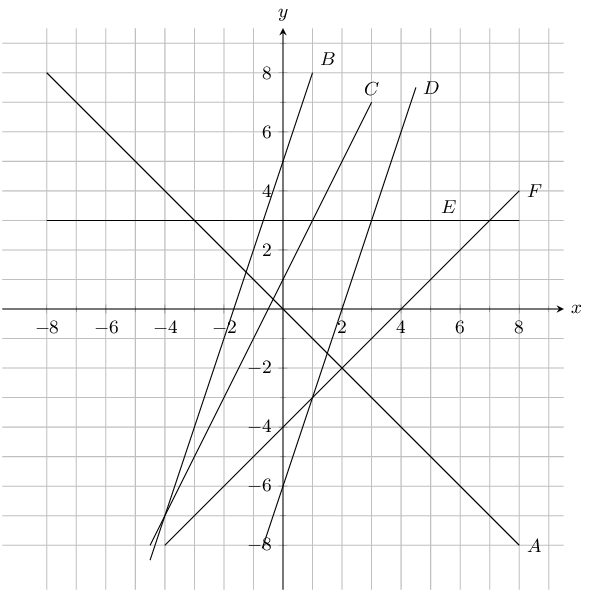

**Problem:**
\(y = 3\)

**Solution:**
\(E\)

**Problem:**
\(y = 3x + 5\)

**Solution:**
\(B\)

**Problem:**
\(y = -x\)

**Solution:**
\(A\)

**Problem:**
\(y = 2x + 1\)

**Solution:**
\(C\)

**Problem:**
\(y = x - 4\)

**Solution:**
\(F\)

**Problem:**
\(y = 3x - 6\)

**Solution:**
\(D\)

State whether the following is true or not

**Problem:**
The \(y\)-intercept of \(y + 5 = x\) is \(-5\).

**Solution:**
True

**Problem:**
The gradient of \(-y = x + 2\) is \(1\).

**Solution:**
False

            \begin{align*}
            -y &= x + 2 \\
            y &= -x - 2
            \end{align*}

**Problem:**
The gradient of \(-4y = 3\) is \(1\).

**Solution:**
False

            \begin{align*}
            -4y &= 3 \\
            y &= -\frac{3}{4}
            \end{align*}

Write the following in standard form:

**Problem:**
\(2y - 5x = 6\)

**Solution:**
\begin{align*}
            2y - 5x &= 6 \\
            2y&= 5x + 6 \\
            y & = \frac{5}{2}x + 3
            \end{align*}

**Problem:**
\(6y - 3x = 5x + 1\)

**Solution:**
\begin{align*}
            6y - 3x &= 5x + 1 \\
            6y&= 8x + 1 \\
            y = & \frac{4}{3}x + \frac{1}{6}
            \end{align*}

Sketch the graphs of the following:

**Problem:**
\(y=2x+4\)

**Solution:**
The \(y\)-intercept is \((0;4)\) and the \(x\)-intercept is \((-2;0)\).

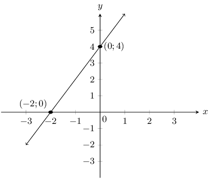

**Problem:**
\(y-3x=0\)

**Solution:**
Write the equation in standard form: \(y = 3x\).

The \(y\)-intercept is \((0;0)\) and the \(x\)-intercept is \((0;0)\).

We note the following pairs of values: \((1;3)\), \((2;6)\), \((-1;-3)\) and \((-2;-6)\). Now we can draw
              the graph.

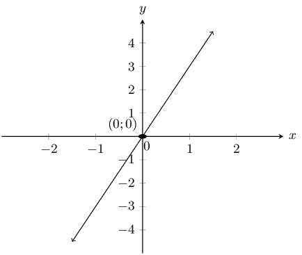

**Problem:**
\(2y=4-x\)

**Solution:**
Write the equation in standard form: \(y = -\frac{1}{2}x + 2\).

The \(y\)-intercept is \((0;2)\) and the \(x\)-intercept is \((4;0)\).

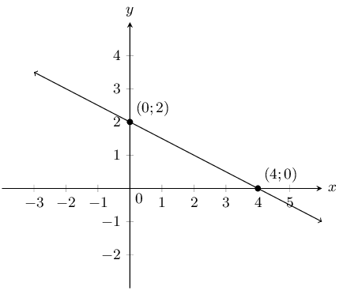

The function for how much water a tap dispenses is given by: \(V = 60t\), where \(x \text { and } V\) are
            in seconds and \(\text{mL}\) respectively.

Use this information to answer the following:

**Problem:**
Evaluate \(V(2)\).

**Solution:**
\begin{align*}
            V(2) &= \text{60}(2) \\
            &=\text{120}\text{ mL}
            \end{align*}

**Problem:**
Evaluate \(V(10)\).

**Solution:**
\begin{align*}
            V(10) &= \text{60}(10) \\
            &= \text{600}\text{ mL}
            \end{align*}

**Problem:**
How long will it take to fill a \(\text{2}\) \(\text{L}\) bottle of water?

**Solution:**
\begin{align*}
            V(t) &= \text{2 000}t \\
            t &= \frac{\text{2 000}}{60} \\
            t &= \text{33,33}s
            \end{align*}

**Problem:**
How much water can the tap dispense in \(\text{4}\) \(\text{s}\)?

**Solution:**
\begin{align*}
            V(4) &= 60(4) \\
            &= \text{240}\text{ mL}
            \end{align*}

The graph below shows the distance travelled by a car over time, where \(s(t)\) is distance in
            \(\text{km}\) and \(t\) is time in minutes.

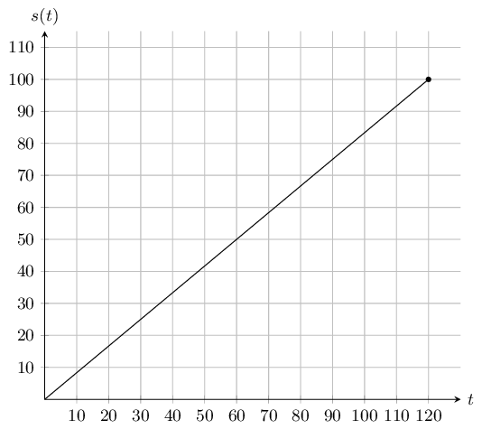

Use this information to answer the following:

**Problem:**
What distance did the car travel in an hour?

**Solution:**
50km

**Problem:**
What is the domain of the function?

**Solution:**
The domain is \(0 \le t \le 120\) min.

**Problem:**
What is the range of the function? What does it represent?

**Solution:**
The range is \(0 \le s \le 100\) km, it represents the total distance travelled.

**Problem:**
On the graph here you see a function of the form: \(y = ax^2 + q\).
            Two points on the parabola are shown: Point A, the turning point of the parabola, at
            \((\text{0};\text{6})\), and Point B is at \(\left(\text{3}; 3\right)\). Calculate the
            values of \(a\) and \(q\).

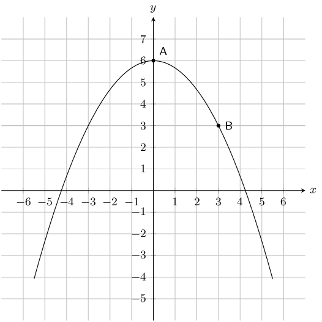

**Solution:**
The value of \(q\) is 6.

          \begin{align*}
          y & = ax^2 +6 \\
          \left( 3 \right) & = a(\text{3})^2 +6 \quad \longleftarrow \quad ^{\text{substitute in
          the}}_{\text{coordinates of a point!}} \\
          3 & = \text{9}a +6 \\
          3 -6 & = \text{9}a \\
          -3 & = \text{9}a \\
          - \frac{1}{3} & = a
          \end{align*}
          \[a = - \frac{1}{3};~ q = 6\]

Given the following equation:

\(y= -5x^{2} + 3\)

**Problem:**
Calculate the \(y\)-coordinate of the \(y\)-intercept.

**Solution:**
\begin{align*}
            y & = ax^2 + q \\
            & = - 5 x^{2} + 3 \\
            & = - 5 (0)^{2} + 3\\
            & = 0+3
            \end{align*}

The \(y\)-coordinate of the \(y\)-intercept is \(3\).

**Problem:**
Now calculate the \(x\)-intercepts. Your answer must be correct to 2 decimal places.

**Solution:**
\begin{align*}
            y & = - 5 x^{2} + 3 \\
            (0) & =- 5 x^{2} + 3 \\
            5 x^{2} &=3\\
            x^2 &= \frac{3}{5} \\
            x & =\pm \sqrt{\frac{3}{5}}\\
            \text{Therefore: }
            x = +\sqrt{\frac{3}{5}} &\text{ and } x = - \sqrt{\frac{3}{5}} \\
            x= -\text{0,77} &\text{ and } x= \text{0,77}
            \end{align*}

The \(x\)-intercepts are \((-\text{0,77};0)\) and \((\text{0,77};0)\).

Given the following graph, identify a function that matches each of the given equations:

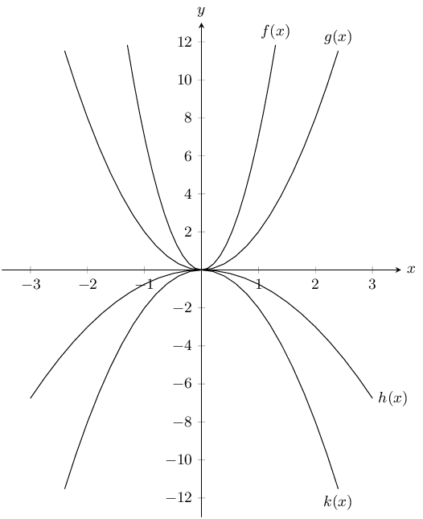

**Problem:**
\(y = -2x^2\)

**Solution:**
\(k(x)\)

**Problem:**
\(y = 2x^2\)

**Solution:**
\(g(x)\)

**Problem:**
\(y = -\text{0,75}x^2\)

**Solution:**
\(h(x)\)

**Problem:**
\(y = 7x^2\)

**Solution:**
\(f(x)\)

Given the following graph, identify a function that matches each of the given equations:

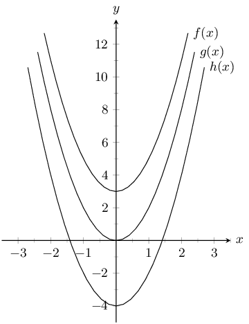

**Problem:**
\(y = 2x^2\)

**Solution:**
\(g(x)\)

**Problem:**
\(y = 2x^2 + 3\)

**Solution:**
\(f(x)\)

**Problem:**
\(y = 2x^2 - 4\)

**Solution:**
\(h(x)\)

Sketch the following functions:

**Problem:**
\(y=x^{2}+3\)

**Solution:**
The \(y\)-intercept is \((0;3)\). There are no \(x\)-intercepts.

\(a\) is positive and so the graph is a smile with a minimum turning point at \((0;3)\).

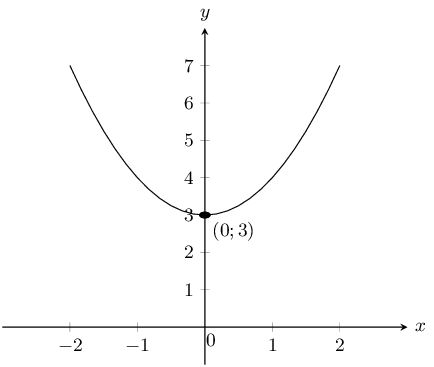

**Problem:**
\(y=\frac{1}{2}x^{2}+4\)

**Solution:**
The \(y\)-intercept is \((0;4)\). There are no \(x\)-intercepts.

\(a\) is positive and so the graph is a smile with a minimum turning point at \((0;4)\).

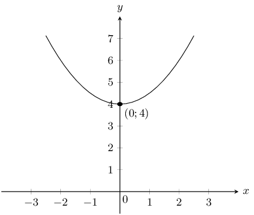

**Problem:**
\(y=2x^{2}-4\)

**Solution:**
The \(y\)-intercept is \((0;-4)\). The \(x\)-intercepts are at \(\left(\sqrt{2};0\right)\) and
              \(\left(-\sqrt{2};0\right)\).

\(a\) is positive and so the graph is a smile with a minimum turning point at \((0;-4)\).

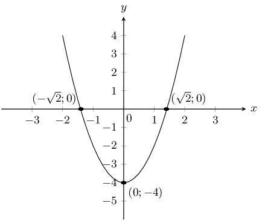

Sebastian and Lucas dive into a pool from different heights. Their midair paths can be described by the
            following quadratic equations: \(y = -2x^2 +8\) for Sebastian and \(y = -\frac{2}{3}x^2 + 6\) for Lucas.

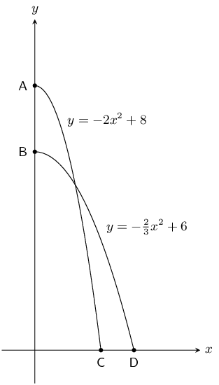

**Problem:**
From what height did Sebastian dive?

**Solution:**
Maximum value of \(y = -2x^2 +8\) is \(\text{8}\) \(\text{m}\)

**Problem:**
From what height did Lucas dive?

**Solution:**
Maximum value of \(y = -\frac{2}{3}x^2 + 6\) is \(\text{6}\) \(\text{m}\)

**Problem:**
How far from the pool wall did Lucas land?

**Solution:**
\begin{align*}
            y = &-\frac{2}{3}x^2 + 6 \\
            0 = &-\frac{2}{3}x^2 + 6 \\
            \frac{3}{2}x^2 - 6&= 0 \\
            x^2 - 9 &= 0 \\
            (x - 3)(x + 3) &= 0\\
            \therefore & x = \text{3}\text{ m}
            \end{align*}

Lucas landed \(\text{3}\) \(\text{m}\) from the pool wall.

**Problem:**
How much closer to the pool wall did Sebastian land compared to Lucas?

**Solution:**
\begin{align*}
            y &= -2x^2 +8 \\
            0 &= -2x^2 +8 \\
            2x^2-8 &= 0 \\
            x^2 - 4 &= 0 \\
            (x - 2)(x + 2) &= 0\\
            \therefore & x = \text{2}\text{ m}
            \end{align*}

Sebastian landed \(\text{2}\) \(\text{m}\) from the pool wall.

Therefore Sebastian landed \(\text{1}\) \(\text{m}\) closer to the wall than Lucas.

**Problem:**
The following graph shows a hyperbolic equation of the form \(y = \dfrac {a}{x} + q\). Point
              A is shown at \(\left( -1 ; -5 \right)\). Calculate the values of \(a\) and \(q\).

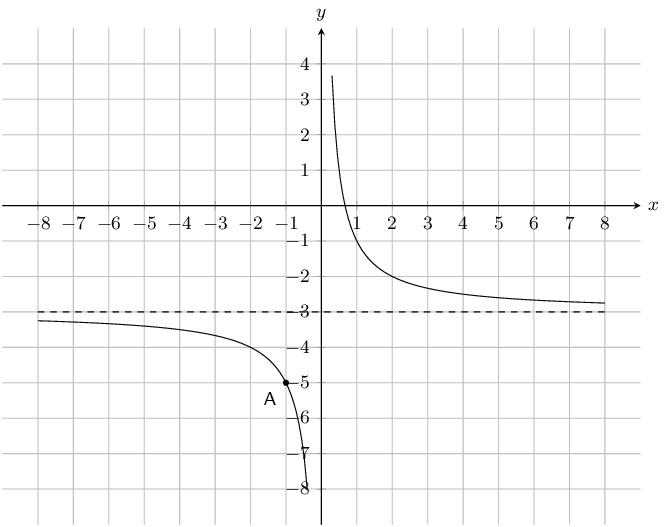

**Solution:**
\begin{align*}
          q & = -3 \\ \\
          y & = \frac {a}{x} -3 \\
          \left( -5 \right) & = \dfrac {a}{ \left( -1 \right) } -3
          \end{align*}
          \begin{align*}
          -1 \left( -5 \right) & = \left[ \dfrac {a}{-1} -3 \right] \left( -1 \right) \\
          \text{5} & = a + \text{3} \\
          \text{2} & = a
          \end{align*}

Therefore \(a = 2\) and \(q = -3\).

The equation is \(y = \dfrac {2}{x} -3\).

Given the following equation:
            \[y = - \frac{3}{x} +4\]

**Problem:**
Determine the location of the \(y\)-intercept.

**Solution:**
\begin{align*}
            y & = - \frac{3}{x} +4 \\
            y & = - \frac{3}{(0)} +4\\
            & \text{no solution}
            \end{align*}

There is no \(y\)-intercept.

**Problem:**
Determine the location of the \(x\)-intercept.

**Solution:**
\begin{align*}
            y & = - \frac{3}{x} +4 \\
            (0) & = - \frac{3}{x} +4 \\
            (x)(0) & = \left[ - \frac{3}{x} +4 \right](x) \\
            0 & = -3 +4x \\
            3 & = 4 x \\
            x & = \frac{3}{4}
            \end{align*}

The \(x\)-intercept is at \(\left(\frac{3}{4};0\right)\).

Given the following graph, identify a function that matches each of the given equations:

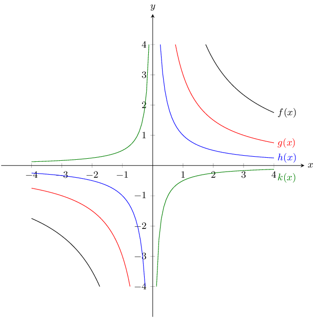

**Problem:**
\(y = -\dfrac{1}{2x}\)

**Solution:**
\(k(x)\)

**Problem:**
\(y = \dfrac{7}{x}\)

**Solution:**
\(f(x)\)

**Problem:**
\(y = \dfrac{3}{x}\)

**Solution:**
\(g(x)\)

**Problem:**
\(y = \dfrac{1}{x}\)

**Solution:**
\(h(x)\)

Sketch the following functions and identify the asymptotes:

**Problem:**
\(y=\dfrac{3}{x}+4\)

**Solution:**
The asymptote is \(y = 4\).

\(a\) is positive and so the graph lies in the first and third quadrants.

There is no \(y\)-intercept. The \(x\)-intercept is at \(\left(-\frac{3}{4};0\right)\).

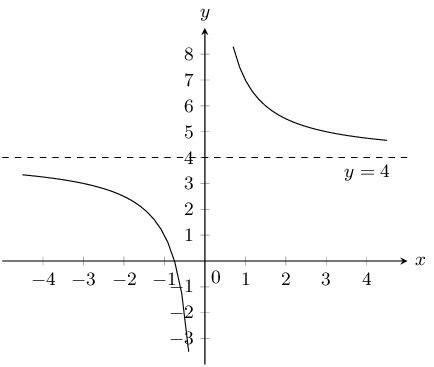

**Problem:**
\(y=\dfrac{1}{x}\)

**Solution:**
The asymptote is \(y = 0\).

\(a\) is positive and so the graph lies in the first and third quadrants.

There is no \(y\)-intercept and no \(x\)-intercept.

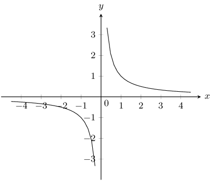

**Problem:**
\(y=\dfrac{2}{x} - 2\)

**Solution:**
The asymptote is \(y = -2\).

\(a\) is positive and so the graph lies in the first and third quadrants.

There is no \(y\)-intercept. The \(x\)-intercept is at \((1;0)\).

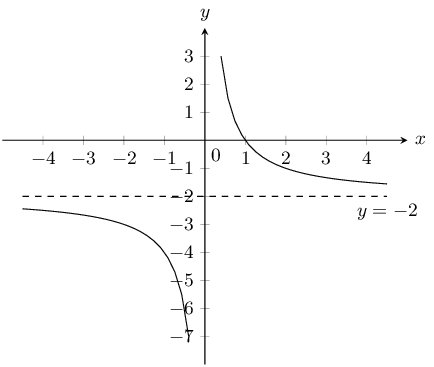

Sketch the functions given and describe the transformation used to obtain the second function. Show all
            asymptotes.

**Problem:**
\(y = \dfrac{2}{x}\) and \(\dfrac{2}{x} + 2\)

**Solution:**
\(y = \dfrac{2}{x}\):

The asymptote is \(y = 0\).

\(a\) is positive and so the graph lies in the first and third quadrants.

There is no \(y\)-intercept and no \(x\)-intercept.

\(y = \dfrac{2}{x} + 2\):

The asymptote is \(y = 2\).

\(a\) is positive and so the graph lies in the first and third quadrants.

There is no \(y\)-intercept. The \(x\)-intercept is at \((-1;0)\).

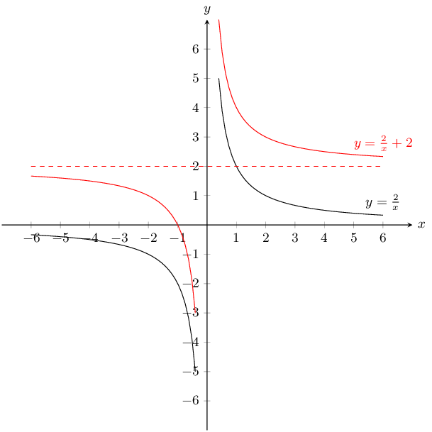

Translation by 2 in the positive \(y\)-direction.

**Problem:**
\(y = \dfrac{2}{x}\) and \(\dfrac{1}{2x}\)

**Solution:**
\(y = \dfrac{2}{x}\):

The asymptote is \(y = 0\).

\(a\) is positive and so the graph lies in the first and third quadrants.

There is no \(y\)-intercept and no \(x\)-intercept.

\(y = \dfrac{1}{2x}\):

The asymptote is \(y = 0\).

\(a\) is positive and so the graph lies in the first and third quadrants.

There is no \(y\)-intercept and no \(x\)-intercept.

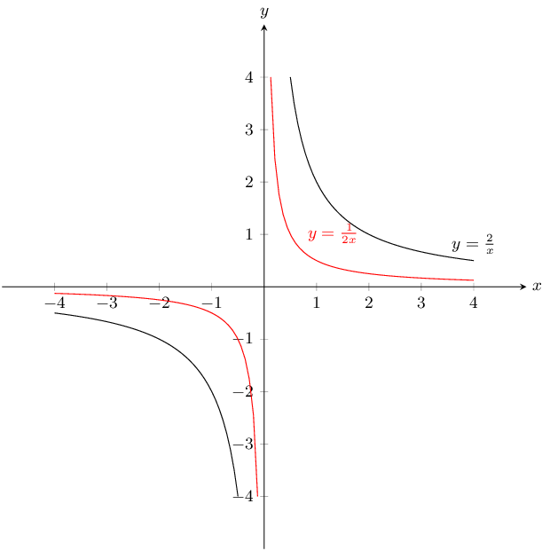

Reduction by 4

**Problem:**
\(y = \dfrac{3}{x}\) and \(y = \dfrac{3x + 3}{x}\)

**Solution:**
First simplify the second equation:

            \(y = \dfrac{3x + 3}{x} = \dfrac{3}{x} + 1\)

\(y = \dfrac{3}{x}\):

The asymptote is \(y = 0\).

\(a\) is positive and so the graph lies in the first and third quadrants.

There is no \(y\)-intercept and no \(x\)-intercept.

\(y = \dfrac{3}{x} + 1\):

The asymptote is \(y = 1\).

\(a\) is positive and so the graph lies in the first and third quadrants.

There is no \(y\)-intercept. The \(x\)-intercept is at \((-1;0)\).

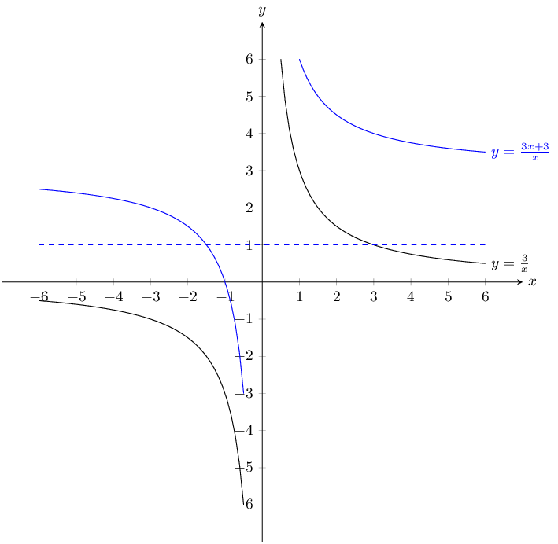

Translation by 3 units in the positive \(y\)-direction.

**Problem:**
\(y = \dfrac{3}{x}\) and \(y = -\dfrac{3}{x}\)

**Solution:**
\(y = \dfrac{3}{x}\):

The asymptote is \(y = 0\).

\(a\) is positive and so the graph lies in the first and third quadrants.

There is no \(y\)-intercept and no \(x\)-intercept.

\(y = -\dfrac{3}{x}\):

The asymptote is \(y = 0\).

\(a\) is negative and so the graph lies in the second and fourth quadrants.

There is no \(y\)-intercept and no \(x\)-intercept.

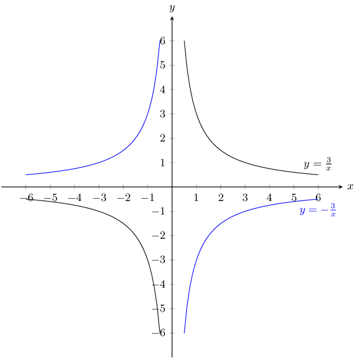

Reflection on \(x\)-axis

Given the following equation:

\(y = -\frac{1}{2} \cdot (4)^{x} + 3\)

**Problem:**
Calculate the \(y\)-intercept. Your answer must be correct to 2 decimal places.

**Solution:**
\begin{align*}
            y & = \left( -\frac{1}{2} \right). (4)^{x} + 3 \\
            & = \left( -\frac{1}{2} \right). (4)^{(0)} + 3 \\
            & = \left( -\frac{1}{2} \right). (1) + 3 \\
            & = (-\text{0,5}) + 3 \\
            & = \text{2,50}
            \end{align*}

The \(y\)-intercept is \((0;\text{2,50})\).

**Problem:**
Now calculate the \(x\)-intercept. Estimate your answer to one decimal place if necessary.

**Solution:**
We calculate the \(x\)-intercept by letting \(y = 0\). Then start to solve for \(x\).

            \begin{align*}
            0 & = \left( -\frac{1}{2} \right)
            \cdot (4)^{x} + 3\\
            -3 & = \left( -\frac{1}{2} \right)\cdot (4)^{x} \\
            \left(-2\right)(-3) & = \left(-2\right) \left(-\frac{1}{2}\right)\cdot (4)^{x} \\
            6 & = 4^{x}
            \end{align*}
            \begin{align*}
            \text{Try: } 4^0 & = 1\\
            \text{Try: } 4^1 & = 4\\
            \text{Try: } 4^2 & = 16
            \end{align*}

We can see that the exponent must be between 1 and 2. By trial and error we get \(\text{1,3}\). Therefore
              the \(x\)-intercept is \((\text{1,3};0)\).

Sketch the following functions and identify the asymptotes:

**Problem:**
\(y=3^{x}+2\)

**Solution:**
The \(y\)-intercept is \((0;2)\). There is no \(x\)-intercept. The asymptote is at \(y = 2\).

\(a > 1\) therefore the graph curves upwards.

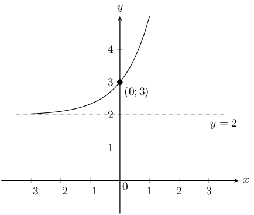

**Problem:**
\(y=-4\times 2^{x}\)

**Solution:**
The \(y\)-intercept is \((0;-4)\). There is no \(x\)-intercept. The asymptote is at \(y = 0\).

\(a < 1\) therefore the graph curves downwards.

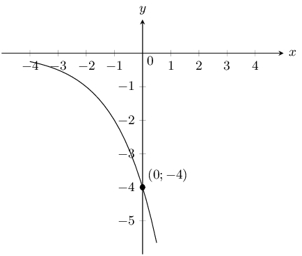

**Problem:**
\(y=\left(\frac{1}{3}\right)^{x} - 2\)

**Solution:**
The \(y\)-intercept is \((0;-2)\). The \(x\)-intercept is \((\text{0,6};0)\). The asymptote is at \(y =
              -2\).

\(0 < a < 1\) therefore the graph curves downwards.

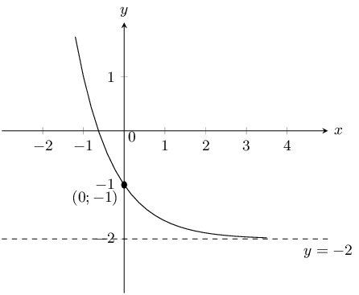

**Problem:**
The form of the curve graphed below is \(y = a \cdot \text{2}^{x} + q\). One point is given on the curve:
            Point A is at \((-\text{3};-\text{3,625})\). Find the values of \(a\) and \(q\), correct to
            the nearest integer.

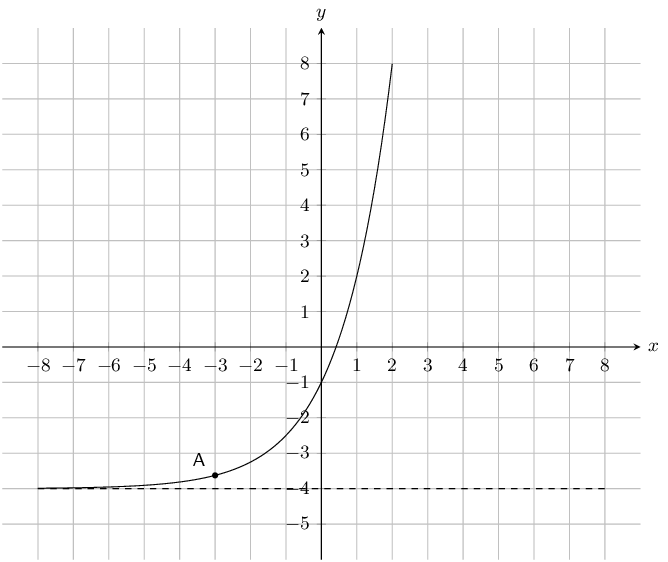

**Solution:**
The asymptote lies at \(y = -\text{4}\). Therefore \(q\) is \(-\text{4}\).

At this point we know that the equation for the graph must be \(y = a.\text{2}^{x} -4\).

          \begin{align*}
          y & = a (\text{2})^{x} -\text{4} \\
          (-\text{3,625}) & = a (\text{2})^{ (-\text{3})} -\text{4} \\
          -\text{3,625} +4 & = a (\text{2})^{\left( -\text{3} \right)} \\
          \text{0,375} & = a (\text{0,125}) \\
          \text{3} & = a
          \end{align*}
          \(a = 3 \text{ and } q = -4\)

Given the following graph, identify a function that matches each of the given equations

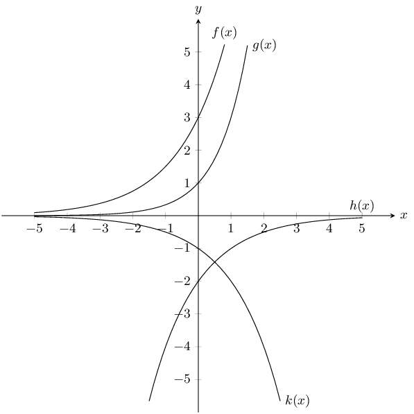

**Problem:**
\(y = -2\left(\dfrac{1}{2}\right)^{x}\)

**Solution:**
\(h(x)\)

**Problem:**
\(y = \text{3,2}^x\)

**Solution:**
\(f(x)\)

**Problem:**
\(y = -2^x\)

**Solution:**
\(k(x)\)

**Problem:**
\(y = 3^x\)

**Solution:**
\(g(x)\)

Use the functions \(f(x) = 3 - x, g(x) = 2x^2 - 4; h(x) = 3^x - 4; k(x) = \dfrac{3}{2x} - 1,\) to find the
            value of the following:

**Problem:**
\(f(7)\)

**Solution:**
\begin{align*}
            f(1) &= 3 - (7) \\
            &= -4
            \end{align*}

**Problem:**
\(g(1)\)

**Solution:**
\begin{align*}
            g(1) &= 2(1)^2 - 4 \\
            &= -2
            \end{align*}

**Problem:**
\(h(-4)\)

**Solution:**
\begin{align*}
            h(-4) &= 3^{-4} - 4 \\
            &= -\frac{323}{81}
            \end{align*}

**Problem:**
\(k(5)\)

**Solution:**
\begin{align*}
            k(5) &= \frac{3}{2(5)} - 1\\
            &= -\frac{7}{10}
            \end{align*}

**Problem:**
\(f(-1) + h(-3)\)

**Solution:**
\begin{align*}
            f(-1) + h(-3) &= 3 -(-1) + 3^{-3} - 4\\
            &= \frac{1}{27}
            \end{align*}

**Problem:**
\(h(g(-2))\)

**Solution:**
\begin{align*}
            g(-2) &= 2(-2)^2 - 4 \\
            &= 4 \\
            \therefore h(g(-2)) &= h(4) \\
            &= 3^{4} - 4 \\
            &= 77
            \end{align*}

**Problem:**
\(k(f(6))\)

**Solution:**
\begin{align*}
            f(6) &= 3 - (6) \\
            &= -3 \\
            \therefore k(f(6)) &= k(-3) \\
            &= \frac{3}{2(-3)} -1 \\
            &= -\frac{3}{2}
            \end{align*}

Determine whether the following statements are true or false. If the statement is false, give reasons why.

**Problem:**
The given or chosen \(y\)-value is known as the independent variable.

**Solution:**
False, the given or chosen \(y\)-value is the dependent variable because it's value depends on the
              independent variable \(x\).

**Problem:**
A graph is said to be continuous if there are breaks in the graph.

**Solution:**
False, a graph is said to be continuous if there are no breaks in it.

**Problem:**
Functions of the form \(y=ax+q\) are straight lines.

**Solution:**
True

**Problem:**
Functions of the form \(y=\frac{a}{x}+q\) are exponential functions.

**Solution:**
False, functions of the form \(y=\frac{a}{x}+q\) are hyperbolic functions.

**Problem:**
An asymptote is a straight line which a graph will intersect at least once.

**Solution:**
False, an asymptote is a straight line that a graph will never intersect.

**Problem:**
Given a function of the form \(y=ax+q\), to find the \(y\)-intercept let \(x=0\) and solve for \(y\).

**Solution:**
True

Given the functions \(f(x) = 2x^{2}-6\) and \(g(x)=-2x+6\).

**Problem:**
Draw \(f\) and \(g\) on the same set of axes.

**Solution:**
For \(g(x)\) the \(y\)-intercept is \((0;6)\) and the \(x\)-intercept is \((3;0)\).

For \(f(x)\) the \(y\)-intercept is \((0;-6)\) and the \(x\)-intercepts are \(\left(\sqrt{3};0\right)\)
              and \(\left(-\sqrt{3};0\right)\).

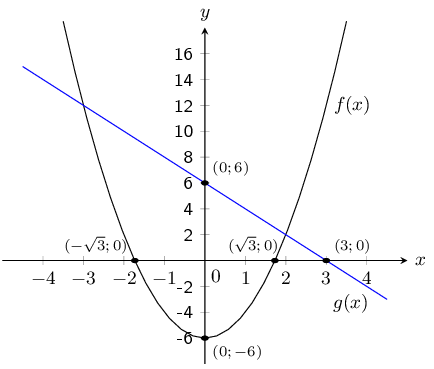

**Problem:**
Calculate the points of intersection of \(f\) and \(g\).

**Solution:**
The \(x\)-values of the points of intersection can be found by setting \(f(x)=g(x)\):

            \begin{align*}
            2x^2 - 6 &= -2x +6\\
            2x^2+2x-12&=0\\
            x^2 +x - 6&=0\\
            (x-2)(x+3) &= 0\\
            \therefore x=2 &\text{ and }x=-3
            \end{align*}

The \(y\)-values can be obtained by substituting the \(x\)-values into either equation:

            \begin{align*}
            g(x) &= -2(-3)+6 = 12\\
            g(x) &= -2(2)+6=2
            \end{align*}

Therefore the points of intersection are \((-3;12)\) and \((2;2)\).

**Problem:**
Use your graphs and the points of intersection to solve for \(x\) when:

1. \(f(x) > 0\)
2. \(g(x) < 0\)
3. \(f(x) \le g(x)\)

**Solution:**
1. \begin{align*}
                \text{Let }f(x)&=0\\
                2x^2-6&=0\\
                2x^2&=6\\
                x^2&=3\\
                x&=\pm \sqrt{3}
                \end{align*}

Therefore, for \(f(x)>0\), \(x \in (-\infty; \sqrt{3})\cup(\sqrt{3}; \infty)\).
2. \begin{align*}
                \text{Let }g(x)&=0\\
                -2x+6&=0\\
                -2x&=-6\\
                x&=3
                \end{align*}

Therefore, for \(g(x) <0\), \(x \in (3;\infty)\).
3. This is found by looking at where the graph of \(f(x)\) lies underneath the graph of \(g(x)\).

For \(f(x)\le g(x)\), \(x \in [-3;2]\).

**Problem:**
Give the equation of the reflection of \(f\) in the \(x\)-axis.

**Solution:**
\(y=-2x^2+6\)

**Problem:**
After a ball is dropped, the rebound height of each bounce decreases. The equation \(y=5(\text{0,8})^{x}\)
            shows the relationship between the number of bounces \(x\) and the height of the bounce \(y\) for a certain
            ball. What is the approximate height of the fifth bounce of this ball to the nearest tenth of a unit?

**Solution:**
For the fifth bounce \(x = 5\). Now we can solve for \(y\):

          \begin{align*}
          y &= 5(\text{0,8})^x\\
          & = 5\left(\frac{4}{5}\right)^5\\
          &= 5\left(\frac{1024}{3125}\right)\\
          &=5(\text{0,38})\\
          &=\text{1,6} \text{ units}
          \end{align*}

Therefore the approximate height of the fifth bounce is \(\text{1,6}\) units

Mark had \(\text{15}\) coins in \(\text{R}\,\text{5}\) and \(\text{R}\,\text{2}\) pieces. He had
            \(\text{3}\) more \(\text{R}\,\text{2}\) coins than \(\text{R}\,\text{5}\) coins. He wrote a system of
            equations to represent this situation, letting \(x\) represent the number of \(\text{R}\,\text{5}\) coins
            and \(y\) represent the number of \(\text{R}\,\text{2}\) coins. Then he solved the system by graphing.

**Problem:**
Write down the system of equations.

**Solution:**
Let \(x = \text{R}\,\text{5}\) coins and \(y = \text{R}\,\text{2}\) coins. Then the system of equations
              is:

\(x+y=15\); \(y=x+3\)

**Problem:**
Draw their graphs on the same set of axes.

**Solution:**
For \(x + y = 15\) the \(y\)-intercept is \((0;15)\) and the \(x\)-intercept is \((15;0)\).

For \(y = x + 3\) the \(y\)-intercept is \((0;3)\) and the \(x\)-intercept is \((-3;0)\).

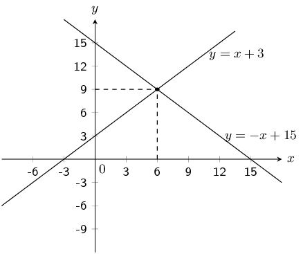

**Problem:**
Use your sketch to determine how many \(\text{R}\,\text{5}\) and \(\text{R}\,\text{2}\) pieces Mark had.

**Solution:**
From the sketch we see that the graphs intersect at \((6;9)\). Checking algebraically we get:

Substitute the value of \(y=-x+15\) into the second equation:

            \begin{align*}
            -x+15&=x+3\\
            -2x &= -12\\
            \therefore x&=6
            \end{align*}

Substitute the value of \(x\) back into the first equation:

            \begin{align*}
            y &= -(6) + 15\\
            &= 9
            \end{align*}

Mark has \(\text{6}\) \(\text{R}\,\text{5}\) coins and \(\text{9}\) \(\text{R}\,\text{2}\) coins.

**Problem:**
Shown the following graph of the following form: \(y = a \sin{\theta} + q\) where Point A
            is at \((90^{\circ};\text{4,5})\), and Point B is at \((180^{\circ};3)\), determine the
            values of \(a\) and \(q\).

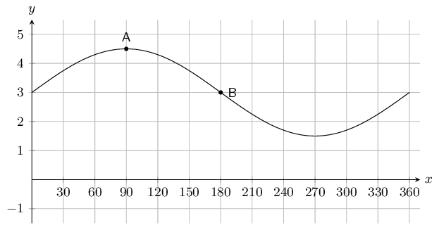

**Solution:**
To find \(q\) we note that \(q\) shifts the graph up or down. To determine \(q\) we can look at any point
            on the graph. For instance point \(B\) is at \((180^{\circ};3)\). For an unshifted sine graph point \(B\)
            would be at \((180^{\circ};0)\). For this graph we see that this point has been shifted up by 3 spaces.
            Therefore \(q = 3\).

To find \(a\) we note that the \(y\)-value at the middle (point \(B\)) is 3, while the \(y\)-value at the
            top (point \(A\)) is \(\text{4,5}\). We can find the amplitude by working out the distance from the top of
            the graph to the middle of the graph: \(\text{4,5} - 3 = \text{1,5}\). Therefore \(a = \frac{3}{2}\).

The complete equation for the graph shown in this question is \(y = \frac{3}{2}\sin \theta + 3\).

Therefore \(a = \frac{3}{2} \text{ and } q = 3\).

**Problem:**
The graph below shows a trigonometric equation of the following form: \(y = a \cos{\theta} + q\). Two
            points are shown on the graph: Point A at \((90^{\circ};0)\), and Point B:
            \((180^{\circ};-\text{3})\). Calculate the values of \(a\) (the amplitude of the graph) and \(q\) (the
            vertical shift of the graph).

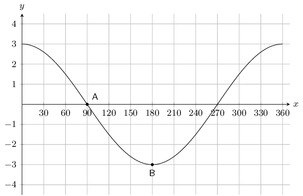

**Solution:**
To find \(q\) we note that \(q\) shifts the graph up or down. To determine \(q\) we can look at any point
            on the graph. For instance point \(A\) is at \((90^{\circ};0)\). For an unshifted cosine graph point \(A\)
            would be at \((90^{\circ};0)\). For this graph we see that this point has not been shifted. Therefore \(q =
            0\).

To find \(a\) we note that the \(y\)-value at the middle (point \(A\)) is 0, while the \(y\)-value at the
            bottom (point \(B\)) is \(-\text{3}\). We can find the amplitude by working out the distance from the middle
            of the graph to the bottom of the graph: \(0 - (-3) = 3\). Therefore \(a = 3\).

The complete equation for the graph shown in this question is \(y = 3\cos \theta\).

Therefore \(a = 3 \text{ and } q = 0\).

**Problem:**
On the graph below you see a tangent curve of the following form: \(y = a \tan{\theta} + q\). Two points
            are labelled on the curve: Point A is at \(\left(0^{\circ} ; -3 \right)\), and
            Point B is at \(\left(45^{\circ} ; -2 \right)\).

Calculate, or otherwise determine, the values of \(a\) and \(q\).

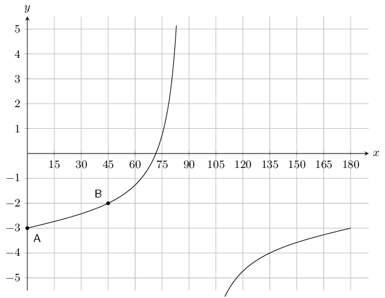

**Solution:**
To find \(q\) we note that \(q\) shifts the graph up or down. To determine \(q\) we can look at any point
            on the graph. For instance point \(A\) is at \(\left(0^{\circ};-3\right)\). For an unshifted tangent graph
            point \(A\) would be at \((0^{\circ};0)\). For this graph we see that this point been shifted downwards by
            \(3\). Therefore \(q = -3\).

To find \(a\) we can substitute point \(B\) into the equation for the tangent graph:

          \begin{align*}
          y & = a \tan{\theta} -3 \\
          \left( -2 \right) & = a \tan{45^{\circ}} - 3 \\
          -2 & = a(-1) - 3 \\
          -2 + 3 & = -a \\
          -1 & = -a \\
          1 & = a
          \end{align*}

The complete equation is: \(y = \tan{\theta} - 3\).

Therefore \(a = 1 \text{ and } q = -3\).

Given the following graph, identify a function that matches each of the given equations:

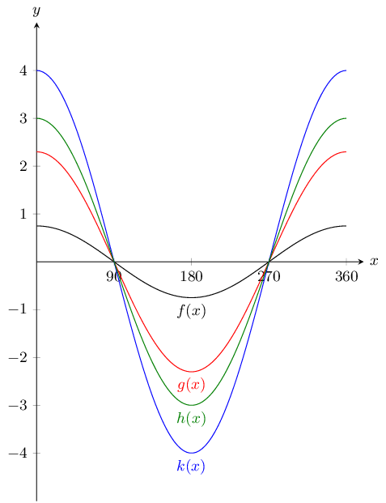

**Problem:**
\(y = \text{2,3}\cos{\theta}\)

**Solution:**
\(g(x)\)

**Problem:**
\(y = \text{0,75}\cos{\theta}\)

**Solution:**
\(f(x)\)

**Problem:**
\(y = 4\cos{\theta}\)

**Solution:**
\(k(x)\)

**Problem:**
\(y = 3\cos{\theta}\)

**Solution:**
\(h(x)\)

**Problem:**
The graph below shows functions \(f(x)\) and \(g(x)\).

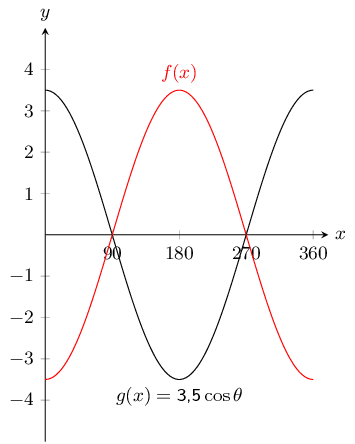

What is the equation for \(f(x)\)?

**Solution:**
\(f(x) = -\text{3,5}\cos{\theta}\)

**Problem:**
With the assistance of the table below sketch the three functions on the same set of axes.

          \[\begin{array}{| l | l | l | l | l | l | l | l | l | l | }
          \hline
          \theta & 0^{\circ} & 45^{\circ} & 90^{\circ} & 135^{\circ} & 180^{\circ} & 225^{\circ}
          & 270^{\circ} & 315^{\circ} & 360^{\circ} \\
          \hline
          \tan{\theta} & 0 & 1 & \text{undefined} & -1 & 0 & 1 & \text{undefined} & -1
          & 0 \\
          \hline
          2\tan{\theta} & 0 & 2 & \text{undefined} & -2 & 0 & 2 & \text{undefined} & -2
          & 0 \\
          \hline
          \frac{1}{3}\tan{\theta} & 0 & \frac{1}{3} & \text{undefined} & -\frac{1}{3} & 0 &
          \frac{1}{3} & \text{undefined} & -\frac{1}{3} & 0 \\
          \hline
          \end{array}\]

**Solution:**
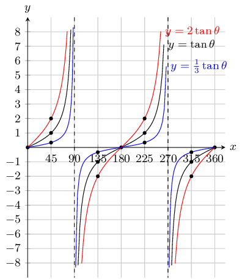

**Problem:**
With the assistance of the table below sketch the three functions on the same set of axes.

          \[\begin{array}{| l | l | l | l | l | l | }
          \hline
          \theta & 0^{\circ} & 90^{\circ} & 180^{\circ} & 270^{\circ} & 360^{\circ} \\
          \hline
          \sin{\theta} + 1 & 1 & 2 & 1 & 0 & 1 \\
          \hline
          \sin{\theta} + 2 & 3 & 2 & 2 & 1 & 2 \\
          \hline
          \sin{\theta} - 2 & -2 & -1 & -2 &-3 & -2 \\
          \hline
          \end{array}\]

**Solution:**
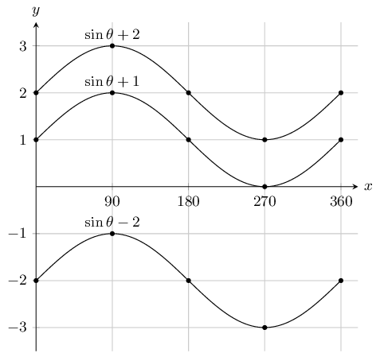

Sketch graphs of the following trigonometric functions for \(\theta \in \left[0°;360°\right]\).
            Show intercepts and asymptotes.

**Problem:**
\(y=-4\cos \theta\)

**Solution:**
The \(y\)-intercept is \((0^\circ;-4)\). The \(x\)-intercepts are \((90^\circ;0)\) and \((270^\circ;0)\).
              There are no asymptotes.

The graph is not shifted up or down since \(q = 0\). The graph is stretched by 4 and reflected in the
              \(x\)-axis.

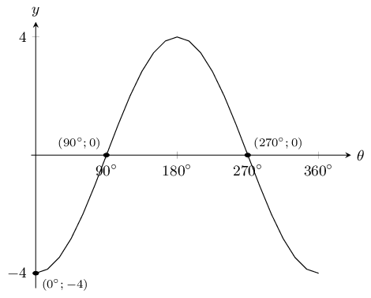

**Problem:**
\(y=\sin \theta - 2\)

**Solution:**
The \(y\)-intercept is \((0^\circ;-2)\). There are no \(x\)-intercepts. There are no asymptotes.

The graph is shifted down by \(-\text{2}\) since \(q = -2\). The graph is not stretched since \(a = 1\).

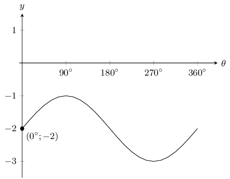

**Problem:**
\(y=-2\sin \theta + 1\)

**Solution:**
The \(y\)-intercept is \((0^\circ;1)\). The \(x\)-intercepts are \((30^\circ;0)\) and \((150^\circ;0)\).
              There are no asymptotes.

The graph is shifted up by 1 since \(q = 1\). The graph is stretched by \(-\text{2}\) and reflected in
              the \(x\)-axis since \(a = -2\).

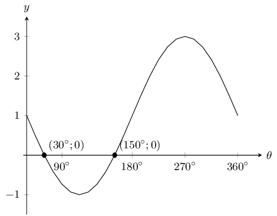

**Problem:**
\(y=\tan \theta + 2\)

**Solution:**
The \(y\)-intercept is \((0^\circ;2)\). The \(x\)-intercepts are \((\text{116,57}^\circ;0)\) and
              \((\text{296,57}^\circ;0)\). The asymptotes are \(x = 90^\circ\) and \(x = 270^\circ\).

The graph is shifted up by 2 since \(q = 2\). The graph is not stretched since \(a = 1\).

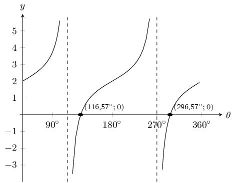

**Problem:**
\(y=\frac{\cos \theta}{2}\)

**Solution:**
The \(y\)-intercept is \((0^\circ;\text{0,5})\). The \(x\)-intercepts are \((90^\circ;0)\) and
              \((270^\circ;0)\). There are no asymptotes.

The graph is not shifted upwards or downwards since \(q = 0\). The graph is stretched by \(\text{0,5}\)
              since \(a = \frac{1}{2}\).

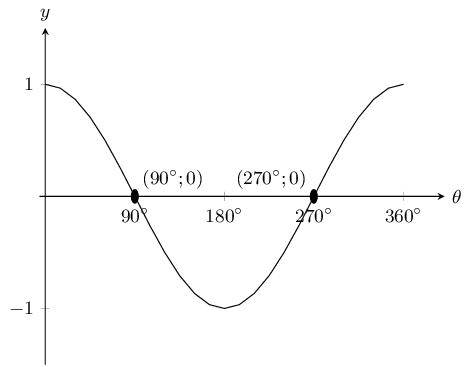

State the coordinates at \(E\) and the range of the function.

**Problem:**
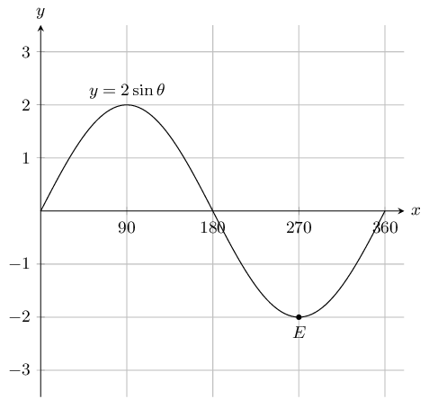

**Solution:**
\(E = (270^{\circ};-2) \text{ and } -2 \le y \le 2\)

**Problem:**
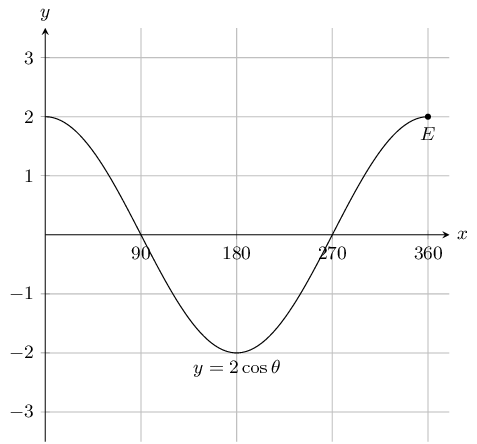

**Solution:**
\(E = (360^{\circ};2) \text{ and } -2 \le y \le 2\)

**Problem:**
State the coordinates at \(E\) and the domain and range of the function in the interval shown.

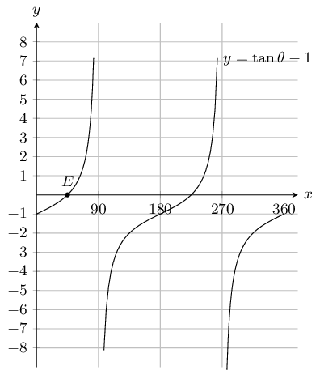

**Solution:**
\(E = (45^{\circ};0) \text{ , range } y \in \mathbb{R} \text{ and domain } 0 \le x \le 360, x \neq 90, \theta
          \neq 270\)

**Problem:**
For which values of \(\theta\) is the function decreasing, in the interval shown?

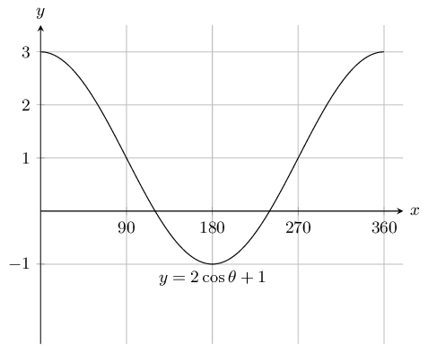

**Solution:**
\(0^{\circ} < \theta < 180^{\circ}\)

**Problem:**
For which values of \(\theta\) is the function increasing, in the interval shown?

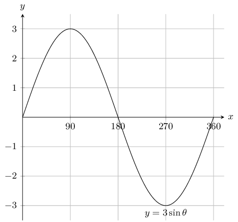

**Solution:**
\(0^{\circ} < \theta < 90^{\circ} \text{ and } 270^{\circ} < \theta < 360^{\circ}\)

**Problem:**
For which values of \(\theta\) is the function positive, in the interval shown?

**Solution:**
\(0^{\circ} < \theta < 360^{\circ}\)

Given the general equations \(y=mx+c\), \(y=ax^2+q\), \(y=\dfrac{a}{x} + q\), \(y = a \cdot b^x + q\),
            \(y=a\sin \theta+q\), \(y=a\cos \theta+q\) and \(y=a\tan \theta\), determine the specific equations for each
            of the following graphs.

**Problem:**

**Solution:**
This is a straight line graph and so the general equation is \(y = mx + c\). The \(y\)-intercept is at
              \((0;0)\) and so \(c = 0\).

To find \(m\) we substitute in the given point into the equation and solve for \(m\):

            \begin{align*}
            y & = mx \\
            -6 & = -2m \\
            m & = 3
            \end{align*}

Therefore the equation is \(y=3x\).

**Problem:**

**Solution:**
This is a parabola and so we use \(y = ax^2 + q\). The \(y\)-intercept is at \((0;3)\) and so \(q = 3\).

We substitute the point \((1;1)\) into the equation and solve for \(a\):

            \begin{align*}
            y & = ax^2 + 3 \\
            1 & = a(1)^2 + 3 \\
            -2 & = a
            \end{align*}

Therefore the equation is \(y=-2x^{2}+3\).

**Problem:**

**Solution:**
This is a hyperbola and so we use \(y = \frac{a}{x} + q\). There is no \(x\)-intercept and so the graph
              has not been shifted upwards or downwards. Therefore \(q = 0\).

We substitute the point \((3;-1)\) into the equation and solve for \(a\):

            \begin{align*}
            y & = \frac{a}{x} \\
            -1 & = \frac{a}{3} \\
            -3 & = a
            \end{align*}

Therefore the equation is \(y=\frac{-3}{x}\).

**Problem:**

**Solution:**
This is a straight line graph and so the general equation is \(y = mx + c\). The \(y\)-intercept is at
              \((0;2)\) and so \(c = 2\).

To find \(m\) we substitute the point \((4;6)\) into the equation and solve for \(m\):

            \begin{align*}
            y & = mx + 2 \\
            6 & = 4m + 2 \\
            m & = 1
            \end{align*}

Therefore the equation is \(y=x + 2\).

**Problem:**

**Solution:**
This is a sine graph and so the general equation is \(y = a\sin\theta + q\).

To find \(a\) we note that the \(y\)-value at the bottom is \(-\text{4}\), while the \(y\)-value at the
              top is \(\text{6}\). We can find the amplitude by working out the distance from the bottom of the graph to
              the top of the graph and dividing this value by 2: \(\frac{6 - (-4)}{2} = 5\). Therefore \(a = 5\).

To find \(q\) we note that \(q\) shifts the graph up or down. To determine \(q\) we can look at any point
              on the graph. For instance we can see that when \(x = 180^\circ\), \(y = 1\). For an unshifted sine graph
              with the same \(a\) value (i.e. \(5 \sin \theta\)) this point would be at \((180^{\circ};0)\). For this
              graph we see that this point has been shifted upwards by 1 unit. Therefore \(q = 1\).

The complete equation for the graph shown in this question is \(y = 5\sin \theta + 1\).

**Problem:**

**Solution:**
This is an exponential graph and so we use \(y = a \cdot b^x + q\). We see that the asymptote is at \(y =
              1\) and so \(q = 1\). To find \(a\) we substitute the point \((0;3)\) into the equation:

            \begin{align*}
            y & = a \cdot b^x + 1 \\
            3 & = a \cdot b^0 + 1 \\
            a & = 2
            \end{align*}

To find \(b\) we substitute the point \((2;9)\) into the equation:

            \begin{align*}
            y & = 2 \cdot b^x + 1 \\
            9 & = 2 \cdot b^2 + 1 \\
            4 & = b^2 \\
            2^2 & = b^2 \\
            b & = 2
            \end{align*}

Therefore the equation is \(y=2 \times 2^{x} + 1\).

**Problem:**

**Solution:**
This is a tangent graph and so we use \(y = a \tan \theta + q\). To find \(q\) we note that the graph has
              been shifted down by 2 units (the point \((180^\circ;-2)\) is given). Therefore \(q = -2\).

To find \(a\) we substitute \((135^\circ;-1)\) into the equation:

            \begin{align*}
            y & = a \tan \theta - 2 \\
            -1 & = a \tan (135^\circ) - 2 \\
            1 & = -a \\
            a & = -1
            \end{align*}

Therefore the equation is \(y=-\tan \theta - 2\).

**Problem:**
State the coordinates at \(A,~B,~C\) and \(D\).

**Solution:**
\(A( 90^{\circ};1 ),~B(90 ^{\circ};-1 ),~C( 180^{\circ}; 2) \text{ and } D(360 ^{\circ};1)\)

**Problem:**
How many times in this interval does \(f(x)\) intersect \(g(x)\).

**Solution:**
0

**Problem:**
What is the amplitude of \(f(x)\).

**Solution:**
1

**Problem:**
Evaluate: \(f(180^{\circ}) - g(180^{\circ})\) .

**Solution:**
\begin{align*}
            f(180^{\circ}) - g(180^{\circ}) &= 2 - (-3)\\
            &=5
            \end{align*}

**Problem:**
State the coordinates at \(A,~B,~C\) and \(D\).

**Solution:**
\(A( 90^{\circ}; 1),~B(270 ^{\circ}; 3),~C(270 ^{\circ}; 1) \text{ and } D(360 ^{\circ}; 2)\)

**Problem:**
How many times in this interval does \(f(x)\) intersect \(g(x)\).

**Solution:**
2

**Problem:**
What is the amplitude of \(g(x)\).

**Solution:**
3

**Problem:**
Evaluate: \(g(180^{\circ}) - f(180^{\circ})\) .

**Solution:**
\begin{align*}
            f(180^{\circ}) - g(180^{\circ}) &= 4 - 2 \\
            &=2
            \end{align*}

\(y=2^{x}\) and \(y=-2^{x}\) are sketched below. Answer the questions that follow.

**Problem:**
Calculate the coordinates of \(M\) and \(N\).

**Solution:**
\(M\) is the \(y\)-intercept of \(y=2^{x}\) and so \(y = 2^0 = 1\). Therefore the coordinates of \(M\)
              are \((0;1)\).

\(N\) is the \(y\)-intercept of \(y=-2^{x}\) and so \(y= -(2^0)= -1\). Therefore the coordinates of \(N\)
              are \((0;-1)\).

Therefore \(M(0;1)\) and \(N(0;-1)\).

**Problem:**
Calculate the length of \(MN\).

**Solution:**
\(M\) and \(N\) both lie on the \(y\)-axis and so they both lie on a straight line.

Therefore \(MN = 1 + 1 = 2\).

**Problem:**
Calculate the length of \(PQ\) if \(OR = \text{1}\text{ unit}\).

**Solution:**
At \(P\), \(x=-1\), therefore \(y = 2^{-1} = \frac{1}{2}\).

At \(Q\), \(x=-1\), therefore \(y=-(2^{-1}) = -\frac{1}{2}\).

Therefore length \(PQ = \frac{1}{2} + \frac{1}{2} =1\).

**Problem:**
Give the equation of \(y=2^{x}\) reflected about the \(y\)-axis.

**Solution:**
\(y=2^{-x}\)

**Problem:**
Give the range of both graphs.

**Solution:**
Range \(y=2^x\): \((0;\infty)\)

Range \(y=-2^x\): \((-\infty;0)\)

Plot the following functions on the same set of axes and clearly label all points of intersection.

**Problem:**
\(\begin{aligned}
            y & = -2x^2 +3 \\
            y & = 2x + 4
            \end{aligned}\)

**Solution:**
For \(y = -2x^2 + 3\):

The \(y\)-intercept is at \((0;3)\). The \(x\)-intercepts are at \(\left(\sqrt{\frac{3}{2}};0\right)\)
              and \(\left(-\sqrt{\frac{3}{2}};0\right)\).

For \(y = 2x + 4\):

The \(y\)-intercept is at \((0;4)\). The \(x\)-intercept is at \((-2;0)\).

There are no points of intersection.

**Problem:**
\(\begin{aligned}
            y & =x^2 -4 \\
            y & = 3x
            \end{aligned}\)

**Solution:**
For \(y = x^2 - 4\):

The \(y\)-intercept is at \((0;-4)\). The \(x\)-intercepts are at \((2;0)\) and \((-2;0)\).

For \(y = 3x\):

The \(y\)-intercept is at \((0;0)\). The \(x\)-intercept is at \((0;0)\).

To find the point of intersection we equate the two functions:

            \begin{align*}
            x^2 - 4 &= 3x \\
            x^2 - 3x - 4 &= 0 \\
            (x - 4)(x + 1) & = 0\\
            x = 4 &\text{ or } x = -1 \\
            y = 3(4) \text{ or } y = 3(-1) \\
            y = 12 \text{ or } y = -3
            \end{align*}

Therefore the graphs intersect at \((4;12)\) and \((-1;-3)\).

\(f(x)=4^x\) and \(g(x)=-4x^2+q\) are sketched below. The points \(A(0;1)\) and \(B(1;4)\) are given.
            Answer the questions that follow.

**Problem:**
Determine the value of \(q\).

**Solution:**
Point \(A\) is the \(y\)-intercept of \(g(x)\) and so \(q=1\).

**Problem:**
Calculate the length of \(BC\).

**Solution:**
\(B\) is at \((1;4)\) and so \(C\) is at \((1;y)\). To find \(y\) we substitute point \(C\) into
              \(g(x)\):

            \begin{align*}
            g(x) & = -4x^2 + 1 \\
            y & = -4(1)^2 + 1 \\
            & = -3
            \end{align*}

Therefore \(BC = 3 + 4 = \text{7}\text{ units}\).

**Problem:**
Give the equation of \(f(x)\) reflected about the \(x\)-axis.

**Solution:**
\(y=-4^{x}\)

**Problem:**
Give the equation of \(f(x)\) shifted vertically upwards by \(\text{1}\) unit.

**Solution:**
\(y=4^{x}+1\)

**Problem:**
Give the equation of the asymptote of \(f(x)\).

**Solution:**
\(y=0\)

**Problem:**
Give the ranges of \(f(x)\) and \(g(x)\).

**Solution:**
Range \(f(x)\): \((0;\infty)\), Range \(g(x)\): \((-\infty;1]\)

Given \(h(x)=x^2-4\) and \(k(x)=-x^2+4\). Answer the questions that follow.

**Problem:**
Sketch both graphs on the same set of axes.

**Solution:**
For \(h(x)\) the \(y\)-intercept is at \((0;4)\). The \(x\)-intercepts are at \((2;0)\) and \((-2;0)\).

For \(k(x)\) the \(y\)-intercept is at \((0;-4)\). The \(x\)-intercepts are at \((2;0)\) and \((-2;0)\).

**Problem:**
Describe the relationship between \(h\) and \(k\).

**Solution:**
\begin{align*}
            h(x) &= x^2 - 4\\
            k(x) &= -x^2+4\\
            &=-(x^2-4)\\
            &= -h(x)
            \end{align*}

\(k(x)\) is therefore the reflection of \(h(x)\) about the \(x\)-axis.

**Problem:**
Give the equation of \(k(x)\) reflected about the line \(y=4\).

**Solution:**
\(y=x^2+4\)

**Problem:**
Give the domain and range of \(h\).

**Solution:**
Domain \(h\): \((-\infty;\infty)\). Range \(h\): \([-4;\infty)\).

**Problem:**
Sketch the graphs of \(f(\theta)=2\sin \theta\) and \(g(\theta)=\cos \theta-1\) on the same set of axes.
            Use your sketch to determine:

1. \(f(180°)\)
2. \(g(180°)\)
3. \(g(270°) - f(270°)\)
4. The domain and range of \(g\).
5. The amplitude and period of \(f\).

**Solution:**

1. \(f(180°)=0\)
2. \(g(180°)=-2\)
3. \(g(270°)-f(270°)=-1-(-2)=-1+2=1\)
4. Domain: \([0°;360°]\). Range: \([-2;0]\)
5. Amplitude: \(\text{2}\). Period: \(360°\)

The graphs of \(y=x\) and \(y=\dfrac{8}{x}\) are shown in the following diagram.

Calculate:

**Problem:**
The coordinates of points \(A\) and \(B\).

**Solution:**
\(A\) and \(B\) are the points of intersection of the two functions. Therefore:

            \begin{align*}
            x&=\frac{8}{x}\\
            x^2&=8\\
            \therefore x&=\pm\sqrt{8}
            \end{align*}

Since the equation of the straight line is \(y = x\) these are also the \(y\)-values of the points of
              intersection.

Therefore \(A(\sqrt{8};\sqrt{8})\) and \(B(-\sqrt{8};-\sqrt{8})\)

**Problem:**
The length of \(CD\).

**Solution:**
\(C\) has the same \(x\) value as \(A\) and \(D\) has the same \(x\) value as \(B\).

Therefore \(C(-\sqrt{8};0)\) and \(D(\sqrt{8};0)\).

\(CD = \sqrt{8} +\sqrt{8} =2\sqrt{8}\).

**Problem:**
The length of \(AB\).

**Solution:**
Using Pythagoras:

            \begin{align*}
            OD=\sqrt{8} \text{ units and }&AD=\sqrt{8} \text{ units}\\
            AO^2&=OD^2+AD^2\\
            &=(\sqrt{8})^2+(\sqrt{8})^2\\
            &=8+8\\
            &=16\\
            \therefore AO&=4 \text{ units} \\
            \text{Similarly, } OB&=4 \text{ units}\\
            \therefore AB&=8 \text{ units}
            \end{align*}

**Problem:**
The length of \(EF\), given \(G(-2;0)\).

**Solution:**
\(F\) and \(E\) have the same \(x\) value as point \(G\). \(F\) lies on \(y = x\) and so \(F(-2;-2)\).
              \(E\) lies on \(y = \frac{8}{x}\) and so \(E(-2;-4)\).

Therefore length \(EF = 2 + 4 = 2\) units.

Given the diagram with \(y=-3x^2+3\) and \(y=-\dfrac{18}{x}\).

**Problem:**
Calculate the coordinates of \(A\), \(B\) and \(C\).

**Solution:**
\(A\) and \(B\) are the \(x\)-intercepts of \(y=-3x^2+3\). \(C\) is the \(y\)-intercept of \(y=-3x^2+3\).

Therefore point \(C\) is at \((0;3)\).

Points \(B\) and \(A\) are at \((1;0)\) and \((-1;0)\) respectively.

Therefore \(A(-1;0)\), \(B(1;0)\), \(C(0;3)\)

**Problem:**
Describe in words what happens at point \(D\).

**Solution:**
The parabola and the hyperbola intersect at point \(D\) which lies in the fourth quadrant.

**Problem:**
Calculate the coordinates of \(D\).

**Solution:**
\begin{align*}
            -\frac{18}{x}&=-3x^2+3\\
            -18&=-3x^3+3x\\
            0&=-3x^3 + 3x + 18\\
            0&=x^3 - x - 6\\
            0 & = (x - 2)(x^2 + 2x + 3) \\
            x & = 2 \\
            f(2)&=(2)^3-2-6=0\\
            \text{when } x=2 \text{, } &y=-3(2)^2+3=-9\\
            \therefore D(2;-9)
            \end{align*}

**Problem:**
Determine the equation of the straight line that would pass through points \(C\) and \(D\).

**Solution:**
Determine gradient \(D(2;-9)\) and \(C(0;3)\):

            \begin{align*}
            m&=\frac{-9-3}{2-0} \\
            & =-6\\
            \end{align*}

\(C\) is the \(y\)-intercept and so \(c = 3\).

Therefore \(y=-6x+3\).

The diagram shows the graphs of \(f(\theta)=3\sin\theta\) and \(g(\theta)=-\tan\theta\)

**Problem:**
Give the domain of \(g\).

**Solution:**
Domain: \(\{ \theta: 0° \le \theta \le 360°, \theta \ne 90°; 270° \}\)

**Problem:**
What is the amplitude of \(f\)?

**Solution:**
Amplitude: \(\text{3}\)

**Problem:**
Determine for which values of \(\theta\):

1. \(f(\theta)=0=g(\theta)\)
2. \(f(\theta) \times g(\theta) < 0\)
3. \(\frac{g(\theta)}{f(\theta)} > 0\)
4. \(f(\theta)\) is increasing

**Solution:**
1. \(\{0°;~180°;~360°\}\)
2. \((0°;~90°) \cup (270°;~360°)\)
3. \(\{\theta: 90° < \theta <270°, \theta \ne 180°\}\)
4. \((0°;~90°) \cup (270°;~360°)\)

Determine the equations for the graphs given below.

**Problem:**

**Solution:**
For the straight line:

            \begin{align*}
            y &= mx + c \\
            c &= 0 \\
            m &= \frac{6 - (-2)}{-3 - 1} \\
            m &= -2 \\
            y &= -2x
            \end{align*}

For the parabola:

            \begin{align*}
            y &= ax^2 + q \\
            q &= -3 \\
            y &= ax^2 - 3 \\
            6 &= a(-3)^2 - 3 \\
            9 &= 9a \\
            a &= 1 \\
            y &= x^2 -3
            \end{align*}

Therefore the equations are: \(y = -2x\) and \(y = x^2 - 3\).

**Problem:**

**Solution:**
For the straight line:

            \begin{align*}
            y &= mx + c \\
            c &= 1 \\
            m &= \frac{9 - 1}{2 - 0} \\
            m &= 4 \\
            y &= 4x + 1
            \end{align*}

For the exponential graph:

            \begin{align*}
            y &= a \cdot b^x + q \\
            q &= 0 \\
            y &= a \cdot b^x \\
            1 &= a(b^0) \\
            1 &= a \\
            y &= b^x \\
            9 &= b^2\\
            3^2 &= b^2\\
            b &= 3\\
            y &= 3^x
            \end{align*}

Therefore the equations are \(y = 4x + 1\) and \(y = 3^x\).

Choose the correct answer:

**Problem:**
Which of the following does not have a gradient of 3?

1. \(y = 3x + 6\)
2. \(3y = 9x - 1\)
3. \(\frac{1}{3}(y - 1) = x\)
4. \(\frac{1}{2}(y - 3) = 6x\)

**Solution:**
\(\)

4

**Problem:**
The asymptote of \(xy = 3 + x\) is:

1. \(3\)
2. \(1\)
3. \(-3\)
4. \(-1\)

**Solution:**
\(\)

2

Sketch the following

**Problem:**
\(y = -\text{1,5}^{x}\)

**Solution:**
The asymptote is at \(y = 0\). The \(y\)-intercept is at \((0;-1)\). There is no \(x\)-intercept.

**Problem:**
\(xy = 5 + 2x\)

**Solution:**
First rewrite the equation in standard form:

            \begin{align*}
            xy & = 5 + 2x \\
            y &= \frac{5}{x} + 2
            \end{align*}

There is no \(y\)-intercept. The \(x\)-intercept is at \((-\text{2,5};0)\). The asymptote is at \(y =
              2\).

**Problem:**
\(2y + 2x = 3\)

**Solution:**
First write the equation in standard form:

            \begin{align*}
            2y + 2x &= 3 \\
            y &= -x + \frac{3}{2}
            \end{align*}

