# Chapter 7: Euclidean geometry

- Content covered in this chapter includes revision of lines, angles and triangles. The mid-point theorem is
        introduced. Kites, parallelograms, rectangle, rhombus, square and trapezium are investigated.
- Solving problems and proving riders is only covered later in the year. The focus of this chapter is on
        introducing the special quadrilaterals and revising content from earlier grades.
- Revision of triangles should focus on similar and congruent triangles.
- Sketches are valuable and important tools. Encourage learners to draw accurate diagrams to solve problems.
- It is important to stress to learners that proportion gives no indication of actual length. It only indicates
        the ratio between lengths.
- Notation - emphasise to learners the importance of the correct ordering of letters, as this indicates which
        angles are equal and which sides are in the same proportion.

Geometry (from the Greek “geo” = earth and “metria” = measure) arose as the field of
    knowledge dealing with spatial relationships. Analytical geometry deals with space and shape using algebra and a
    coordinate system. Euclidean geometry deals with space and shape using a system of logical deductions.

Euclidean geometry was first used in surveying and is still used extensively for surveying today. Euclidean
    geometry is also used in architecture to design new buildings. Other uses of Euclidean geometry are in art and to
    determine the best packing arrangement for various types of objects.

A small piece of the original version of Euclid's elements. Euclid is considered to be
      the father of modern geometry. Euclid's elements was used for many years as the standard text for geometry.

<Callout type="tip" title="Multimedia & Video">
This video highlights some of the basic concepts used in geometry.

<VideoPlayer src="https://www.youtube.com/embed/il0EJrY64qE" title="Video: 2G5V" />
</Callout>

<Callout type="note" title="Note">
In Euclidean geometry we use two fundamental types of measurement: angles and distances.
</Callout>

GeoGebra is a useful tool to use for sketching out
      the worked examples and activities.

## 7.1 Introduction (EMA5M)

### Angles (EMA5N)

An angle is formed when two straight lines meet at a point, also known as a vertex. Angles are labelled with a
        caret on a letter, for example, \(\hat{B}\). Angles can also be labelled according to the line segments that
        make up the angle, for example \(C\hat{B}A\) or \(A\hat{B}C\). The \(\angle\) symbol is a short method of
        writing angle in geometry and is often used in phrases such as “sum of \(\angle\)s in
        \(\triangle\)”. Angles are measured in degrees which is denoted by \(°\), a small circle raised above
        the text, similar to an exponent.

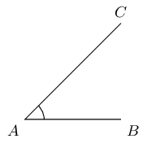

### Properties and notation (EMA5P)

In the diagram below two straight lines intersect at a point, forming the four angles \(\hat{a}\), \(\hat{b}\),
        \(\hat{c}\) and \(\hat{d}\).

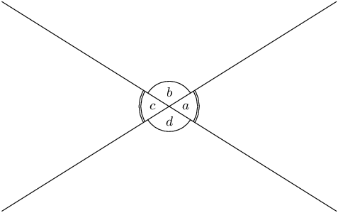

The following table summarises the different types of angles, with examples from the figure above.

| Term | Property | Examples |
| --- | --- | --- |
| Acute angle | \(0° <\text{angle} < 90°\) | \(\hat{a}\); \(\hat{c}\) |
| Right angle | Angle \(=90°\) |  |
| Obtuse angle | \(90° < \text{angle} < 180°\) | \(\hat{b}\); \(\hat{d}\) |
| Straight angle | Angle \(=180°\) | \(\hat{a}+\hat{b}\); \(\hat{b}+\hat{c}\) |
| Reflex angle | \(180° < \text{angle} < 360°\) | \(\hat{a}+\hat{b}+\hat{c}\) |
| Adjacent angles | Angles that share a vertex and a common side. | \(\hat{a}\) and \(\hat{d}\); \(\hat{c}\) and \(\hat{d}\) |
| Vertically opposite angles | Angles opposite each other when two lines intersect. They share a vertex and are equal. | \(\hat{a}=\hat{c}\); \(\hat{b}=\hat{d}\) |
| Supplementary angles | Two angles that add up to \(180°\) | \(\hat{a}+\hat{b}= 180°\); \(\hat{b} + \hat{c} = 180°\) |
| Complementary angles | Two angles that add up to \(90°\) |  |
| Revolution | The sum of all angles around a point. | \(\hat{a}+\hat{b}+\hat{c}+\hat{d}= 360°\) |

Note that adjacent angles on a straight line are supplementary.

<Callout type="tip" title="Multimedia & Video">
The following video provides a summary of the terms used to refer to angles.

<VideoPlayer src="https://www.youtube.com/embed/DGKwdHMiqCg" title="Video: 2G5W" />
</Callout>

### Parallel lines and transversal lines (EMA5Q)

Two lines intersect if they cross each other at a point. For example, at a traffic intersection two or more
        streets intersect; the middle of the intersection is the common point between the streets.

Parallel lines are always the same distance apart and they are denoted by arrow symbols as shown below.

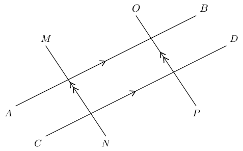

In writing we use two vertical lines to indicate that two lines are parallel:

      \[AB \parallel CD \text{ and } MN \parallel OP\]

A transversal line intersects two or more parallel lines. In the diagram below, \(AB\parallel CD\) and \(EF\)
        is a transversal line.

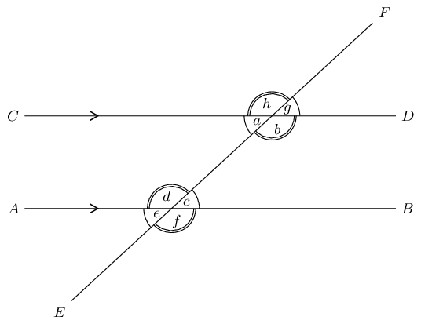

The properties of the angles formed by these intersecting lines are summarised in the following table:

| Name of angle | Definition | Examples | Notes |
| --- | --- | --- | --- |
| Interior angles | Angles that lie in between the parallel lines. | \(\hat{a}\), \(\hat{b}\), \(\hat{c}\) and \(\hat{d}\) are interior angles. | Interior means inside. |
| Exterior angles | Angles that lie outside the parallel lines. | \(\hat{e}\), \(\hat{f}\), \(\hat{g}\) and \(\hat{h}\) are exterior angles. | Exterior means outside. |
| Corresponding angles | Angles on the same side of the lines and the same side of the transversal. If the lines are parallel,
                the corresponding angles will be equal. | \(\hat{a}\) and \(\hat{e}\), \(\hat{b}\) and \(\hat{f}\), \(\hat{c}\) and \(\hat{g}\), \(\hat{d}\) and
                \(\hat{h}\) are pairs of corresponding angles. \(\hat{a}=\hat{e}\), \(\hat{b}=\hat{f}\),
                \(\hat{c}=\hat{g}\) and \(\hat{d}=\hat{h}\). |  |
| Co-interior angles | Angles that lie in between the lines and on the same side of the transversal. If the lines are
                parallel, the angles are supplementary. | \(\hat{a}\) and \(\hat{d}\), \(\hat{b}\) and \(\hat{c}\) are pairs of co-interior angles.
                \(\hat{a}+\hat{d}= 180°\), \(\hat{b}+\hat{c}=180°\). |  |
| Alternate interior angles | Equal interior angles that lie inside the lines and on opposite sides of the transversal. If the lines
                are parallel, the interior angles will be equal. | \(\hat{a}\) and \(\hat{c}\), \(\hat{b}\) and \(\hat{d}\) are pairs of alternate interior angles.
                \(\hat{a}=\hat{c}\), \(\hat{b}=\hat{d}\) |  |

<Callout type="tip" title="Multimedia & Video">
This video provides a short summary of some of the angles formed by intersecting lines.

<VideoPlayer src="https://www.youtube.com/embed/H-E5rlpCVu4?list=PL26812DF9846578C3" title="Video:
            2G5X" />
</Callout>

If two lines are intersected by a transversal such that:

- corresponding angles are equal; or
- alternate interior angles are equal; or
- co-interior angles are supplementary

then the two lines are parallel.

<Callout type="note" title="Note">
When we refer to lines we can either write \(EF\) to mean the line through points \(E\) and \(F\) or
          \(\overline{EF}\) to mean the line segment from point \(E\) to point \(F\).
</Callout>

<Callout type="tip" title="Worked example 1: Finding angles">
**Question:**
Find all the unknown angles. Is \(EF\parallel CG\)? Explain your answer.

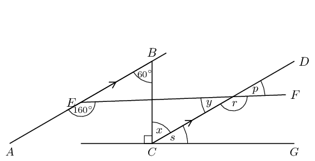

**Use the properties of parallel lines to find all equal angles on the diagram:**
Redraw the diagram and mark all the equal angles.

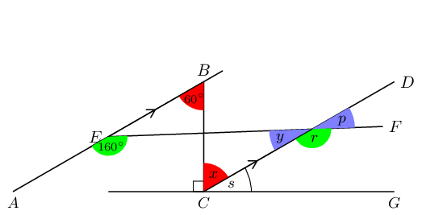

**Determine the unknown angles:**
\[\begin{array}{rll} AB& \parallel CD & \text{(given)} \\
          \therefore \hat{x} & = 60° & \text{(alt }\angle \text{s; } AB \parallel CD \text{)}\\
          \hat{y} + 160° & = 180° & \text{(co-int }\angle \text{s; } AB \parallel CD \text{)}\\
          \therefore \hat{y} & = 20° & \\
          \hat{p}& = \hat{y} & \text{(vert opp }\angle \text{s } = \text{)}\\
          \therefore \hat{p}& = 20° & \\
          \hat{r}& = 160° & \text{(corresp }\angle \text{s; } AB \parallel CD \text{)} \\
          \hat{s} + \hat{x} + 90° & = 180° & \text{(}\angle \text{s on a str line)}\\
          \hat{s} + 60° & = 90°& \\
          \therefore \hat{s} & = 30° &
          \end{array}\]

**Determine whether \(EF\parallel CG\):**
If \(EF\parallel CG\) then \(\hat{p}\) will be equal to corresponding angle \(\hat{s}\), but \(\hat{p}=
            20°\) and \(\hat{s}= 30°\). Therefore \(EF\) is not parallel to \(CG\).
</Callout>

### Textbook Exercise 7.1

**Problem:**
Use adjacent, corresponding, co-interior and alternate angles to fill in all the angles labelled with
                letters in the diagram:

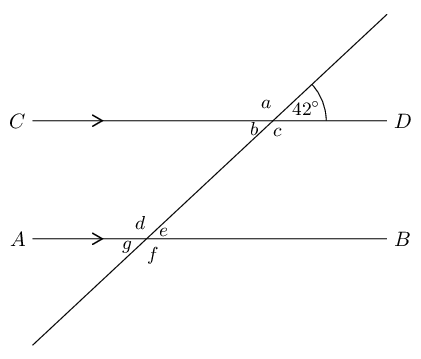

**Solution:**
You can redraw the diagram and fill in the angles as you find them.

              \[\begin{array}{rll}
              a & = 180° - 42° = 138° & \text{(}\angle \text{s on a str line)} \\
              b & = 42° & \text{(vert opp } \angle\text{s } = \text{)}\\
              c & = 138° & \text{(vert opp } \angle\text{s } = \text{)}\\
              d & = 138° & \text{(co-int }\angle\text{s; } AB \parallel CD \text{)}\\
              e & = 180° - 138° = 42° & \text{(}\angle \text{s on a str line)}\\
              f & = 138° & \text{(vert opp } \angle\text{s } =\text{)}\\
              g & = 42° & \text{(vert opp } \angle\text{s } =\text{)}
              \end{array}\]

**Problem:**
Find all the unknown angles in the figure:

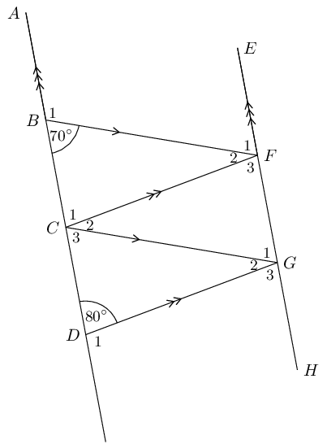

**Solution:**
\[\begin{array}{rll}
              \hat{B}_{1} & = 180° - 70° = 110° & \text{(}\angle \text{s on a str line)} \\
              \hat{D}_{1} & = 180° - 80° = 100° & \text{(}\angle \text{s on a str line)} \\
              \hat{F}_{1} & = 70° & \text{(co-int } \angle \text{s; } AD \parallel EH\text{)} \\
              \hat{G}_{3} & = 80° & \text{(co-int } \angle \text{s; } AD \parallel EH\text{)} \\
              \hat{C}_{3} & = 70° & \text{(corresp } \angle \text{s; } BF \parallel CG\text{)} \\
              \hat{G}_{1} & = 70° & \text{(corresp } \angle \text{s; } BF \parallel CG\text{)} \\
              \hat{G}_{2} & = 180° - 70° - 80° = 30° & \text{(}\angle \text{s on a str
              line)} \\
              \hat{C}_{2} & = 30° & \text{(alt } \angle \text{s; } CF \parallel DG\text{)} \\
              \hat{F}_{2} & = 30° & \text{(alt } \angle \text{s; } BF \parallel CG\text{)} \\
              \hat{F}_{3} & = 80° & \text{(}\angle \text{s on a str line)} \\
              \hat{C}_{1} & = 80° & \text{(}\angle \text{s on a str line)}
              \end{array}\]

**Problem:**
Find the value of \(x\) in the figure:

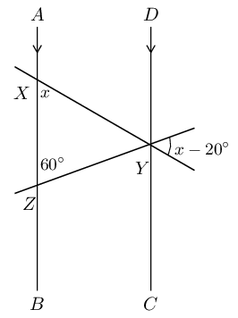

**Solution:**
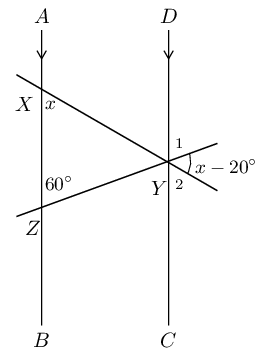

\(\hat{Y}_{1} = 60°\) (corresp \(\angle\)s; \(AB \parallel DC\)).

\(\hat{Y}_{2} = x\) (corresp \(\angle\)s; \(AB \parallel DC\)).

              \begin{align*}
              \therefore x + 60° + (x - 20°) &= 180° \qquad \text{(}\angle \text{s on a str line)}\\
              2x &= 180° - 40° \\
              2x &= 140° \\
              \therefore x &= 70°
              \end{align*}

Find each of the unknown angles marked in the figure below. Find a reason that leads to the answer in a
                single step.

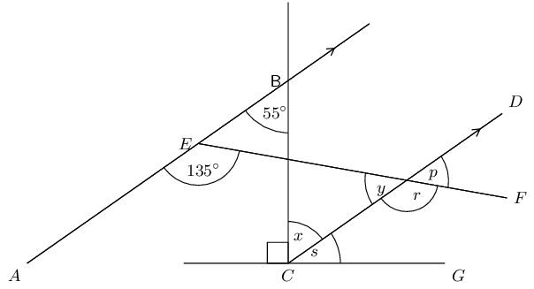

**Problem:**
\(\hat{x}\)

**Solution:**
\(\hat{x}\) and \(A\hat{B}C\) are alternate interior angles on transversal \(BC\). Therefore, they
                  must be equal in size since \(AB \parallel CD\).

Therefore \(\hat{x} = 55^{\circ}\).

**Problem:**
\(\hat{s}\)

**Solution:**
We have just found that \(\hat{x} = 55^{\circ}\). \(\hat{x} + \hat{s} + 90^{\circ} = 180^{\circ}\)
                  (\(\angle\)s on a str line)

                \begin{align*}
                \hat{s} & = 90^{\circ} - 55^{\circ} \\
                & = 35^{\circ}
                \end{align*}

**Problem:**
\(\hat{r}\)

**Solution:**
\(\angle A\hat{E}F\) and \(\hat{r}\) are corresponding angles (\(AB \parallel CD\)).

Therefore: \(\hat{r} = 135^{\circ}\).

**Problem:**
\(\hat{y}\)

**Solution:**
\(\hat{r} + \hat{y} = 180^{\circ}\) (\(\angle\)s on a str line).

                \begin{align*}
                \hat{y} & = 180^{\circ} - 135^{\circ} \\
                & = 45^{\circ}
                \end{align*}

**Problem:**
\(\hat{p}\)

**Solution:**
\(\hat{p} = \hat{y}\) (vert opp \(\angle\)s \(=\))

Therefore: \(\hat{p} = 45^{\circ}\).

**Problem:**
Based on the results for the angles above, is \(EF \parallel CG\)?

**Solution:**
To prove \(EF \parallel CG\) we need to show that one of the following is true:

- \(\hat{s} = \hat{p}\) (corresp \(\angle\)s)
- \(\hat{s} = \hat{y}\) (alt \(\angle\)s)
- \(\hat{s} + \hat{r} = 180^{\circ}\) (co-int \(\angle\)s)

However \(\hat{s} \ne \hat{p}\), therefore \(EF\) is not parallel to \(CG\).

Find each of the unknown angles marked in the figure below. Find a reason that leads to the answer in a
                single step.

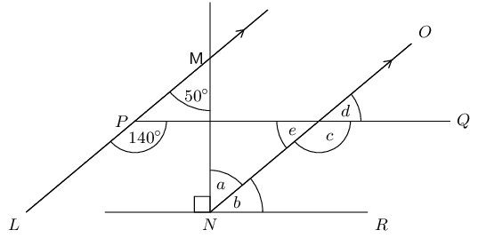

**Problem:**
\(\hat{a}\)

**Solution:**
\(\hat{a}\) and \(L\hat{M}N\) are alternate interior angles on transversal \(MN\). Since \(LM
                  \parallel NO\) they must be equal in size.

Therefore \(\hat{a} = 50^{\circ}\).

**Problem:**
\(\hat{b}\)

**Solution:**
We have just found that \(\hat{a} = 50^{\circ}\). \(\hat{a} + \hat{b} + 90^{\circ} = 180^{\circ}\)
                  (\(\angle\)s on a str line)

                \begin{align*}
                \hat{b} & = 90^{\circ} - 50^{\circ} \\
                & = 40^{\circ}
                \end{align*}

**Problem:**
\(\hat{c}\)

**Solution:**
\(\angle L\hat{P}Q\) and \(\hat{c}\) are corresponding angles (\(LM \parallel NO\)).

Therefore: \(\hat{c} = 140^{\circ}\).

**Problem:**
\(\hat{e}\)

**Solution:**
\(\hat{c} + \hat{e} = 180^{\circ}\) (\(\angle\)s on a str line).

                \begin{align*}
                \hat{e} & = 180^{\circ} - 140^{\circ} \\
                & = 40^{\circ}
                \end{align*}

**Problem:**
\(\hat{d}\)

**Solution:**
\(\hat{d} = \hat{e}\) (vert opp \(\angle\)s \(=\)).

Therefore: \(\hat{d} = 40^{\circ}\).

**Problem:**
Based on the results for the angles above, is \(PQ \parallel NR\)?

**Solution:**
To prove \(PQ \parallel NR\) we need to show that one of the following is true:

- \(\hat{b} = \hat{d}\) (corresp \(\angle\)s)
- \(\hat{b} = \hat{e}\) (alt \(\angle\)s)
- \(\hat{b} + \hat{c} = 180^{\circ}\) (co-int \(\angle\)s)

\(\hat{b} = \hat{d}\) (corresp \(\angle\)s), therefore \(PQ \parallel NR\). We also note that
                  \(\hat{b} = \hat{e}\) and \(\hat{b} + \hat{c} = 180^{\circ}\).

Determine whether the pairs of lines in the following figures are parallel:

**Problem:**
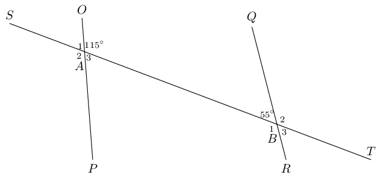

**Solution:**
If \(OP \parallel QR\) then \(O\hat{A}B + Q\hat{B}A = 180°\) (co-int \(\angle\)s). But
                  \(O\hat{A}B + Q\hat{B}A = 115° + 55° = 170°\). Therefore there are no parallel lines,
                  \(OP\) is not parallel to \(QR\). Note that we do not consider \(ST\) as this is a transversal.

**Problem:**
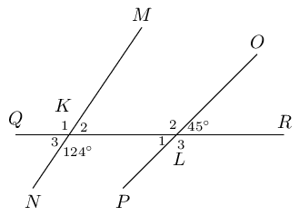

**Solution:**
\(K_2 = 180° - 124° = 56°\) (\(\angle\)s on a str line). If \(MN \parallel OP\) then
                  \(\hat{K}_2\) would be equal to \(\hat{L}\), \(\therefore MN\) is not parallel to \(OP\). Note that
                  \(QR\) is a transversal.

**Problem:**
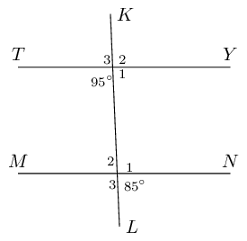

**Solution:**
Let \(U\) be point of intersection of lines \(KL\) and \(TY\) and \(V\) be the point of intersection
                  of lines \(KL\) and \(MN\).

                \begin{align*}
                \hat{U}_4 &= 95° \\
                \hat{U}_1 &= 180° - 95° \qquad \text{(} \angle \text{s on a str line)}\\
                \hat{U}_1 &= 85° \\
                \hat{V}_4 &= 85° \qquad \text{(given)} \\
                \therefore \hat{V}_{4} & = \hat{U}_1
                \end{align*}

These are corresponding angles \(\therefore TY \parallel MN\).

**Problem:**
If \(AB\) is parallel to \(CD\) and \(AB\) is parallel to \(EF\), explain why \(CD\) must be parallel
                to \(EF\).

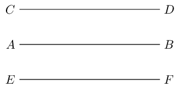

**Solution:**
If \(a = 2\) and \(b = a\) then we know that \(b = 2\).

Similarly if \(AB \parallel CD\) and \(EF \parallel AB\) then we know that \(EF \parallel CD\).
