## 7.2 Triangles (EMA5R)

### Classification of triangles (EMA5S)

A triangle is a three-sided polygon. Triangles can be classified according to sides:
                                equilateral, isosceles and scalene. Triangles can also be classified according to
                                angles: acute-angled, obtuse-angled and right-angled.

We use the notation \(\triangle ABC\) to refer to a triangle with vertices labelled \(A\),
                                \(B\) and \(C\).

| Name | Diagram | Properties |
| --- | --- | --- |
| Scalene |  | All sides and angles are different. |
| Isosceles |  | Two sides are equal in length. The angles opposite the equal
                                                                sides are also equal. |
| Equilateral |  | All three sides are equal in length and all three angles are
                                                                equal. |
| Acute |  | Each of the three interior angles is less than \(90°\). |
| Obtuse |  | One interior angle is greater than \(90°\). |
| Right-angled |  | One interior angle is \(90°\). |

Different combinations of these properties are also possible. For example, an obtuse
                                isosceles triangle and a right-angled isosceles triangle are shown below:

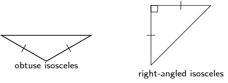

<Callout type="tip" title="Multimedia & Video">
This video shows the different ways to classify triangles.

<VideoPlayer src="https://www.youtube.com/embed/mLeNaZcy-hE?list=PLUPEBWbAHUsx47fzhccfRSk4uNnBwtk7n" title="Video:
                                                2G69" />
</Callout>

## Interior angles of a triangle

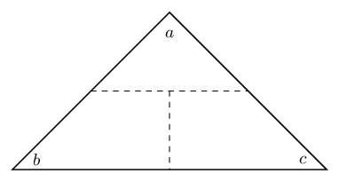

1. On a piece of paper draw a triangle of any size and shape.
2. Cut it out and label the angles \(\hat{a}\), \(\hat{b}\) and \(\hat{c}\) on both sides of the paper.
3. Draw dotted lines as shown and cut along these lines to get three pieces of paper.
4. Place them along your ruler as shown in the figure below.
5. What can we conclude?

Hint: What is the sum of angles on a straight line?

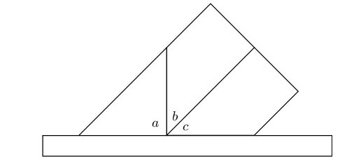

## Exterior angles of a triangle

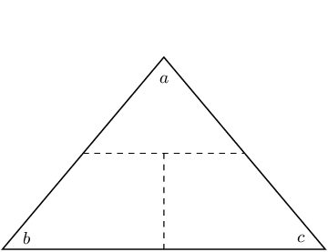

1. On a piece of paper draw a triangle of any size and shape. On another piece of paper, make a copy of the triangle.
2. Cut both out and label the angles of both triangles \(\hat{a}\), \(\hat{b}\) and \(\hat{c}\) on both sides of the paper.
3. Draw dotted lines on one triangle as shown and cut along the lines.
4. Place the second triangle and the cut out pieces as shown in the figure below.
5. What can we can conclude?

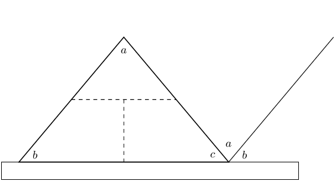

<Callout type="tip" title="Multimedia & Video">
We can use the fact that the angles in a triangle add up to \(180^{\circ}\) to work
                                        out the sum of the exterior angles in a pentagon. This video shows you how.

<VideoPlayer src="https://www.youtube.com/embed/95logvV8nXY?list=PL26812DF9846578C3" title="Video:
                                                2G6B" />
</Callout>

### Congruency (EMA5T)

Two triangles are congruent if one fits exactly over the other. This means that the triangles
                                have equal corresponding angles and sides. To determine whether two triangles are
                                congruent, it is not necessary to check every side and every angle. We indicate
                                congruency using \(\equiv\).

The following table describes the requirements for congruency:

| Rule | Description | Diagram |
| --- | --- | --- |
| RHS or \(90°\)HS (\(90°\), hypotenuse, side) | If the hypotenuse and one side of a right-angled triangle are
                                                                equal to the hypotenuse and the corresponding side of
                                                                another right-angled triangle, then the two triangles
                                                                are congruent. | \(\triangle ABC\equiv \triangle DEF\) |
| SSS (side, side, side) | If three sides of a triangle are equal in length to the
                                                                corresponding sides of another triangle, then the two
                                                                triangles are congruent. | \(\triangle PQR\equiv \triangle STU\) |
| SAS or S\(\angle\)S (side, angle, side) | If two sides and the included angle of a
                                                                triangle are equal to the corresponding two sides and included angle of another triangle,
                                                                then the two triangles are congruent. | \(\triangle FGH\equiv \triangle IJK\) |
| AAS or \(\angle \angle\)S (angle, angle, side) | If one side and two angles of a triangle are equal to the
                                                                corresponding one side and two angles of another
                                                                triangle, then the two triangles are congruent. | \(\triangle UVW\equiv \triangle XYZ\) |

The order of letters when labelling congruent triangles is very important.

                        \[\triangle ABC\equiv \triangle DEF\]

This notation indicates the following properties of the two triangles: \(\hat{A}=\hat{D}\),
                                \(\hat{B}=\hat{E}\), \(\hat{C}=\hat{F}\), \(AB=DE\), \(AC=DF\) and \(BC=EF\).

<Callout type="note" title="Note">
You might see \(\cong\) used to show that two triangles are congruent. This is the
                                        internationally recognised symbol for congruency.
</Callout>

<Callout type="tip" title="Multimedia & Video">
This video shows some practice examples of finding congruent triangles.

<VideoPlayer src="https://www.youtube.com/embed/d5UCZ9hO8X4?list=PL26812DF9846578C3" title="Video:
                                                2G6C" />
</Callout>

<QuizCard id="m10-07-02a" title="Interactive Exercise 7.2" question="Answer the two questions below." options=["yes", "no", "RHS", "SSS", "SAS", "AAS", "not congruent", "JKL", "JLK", "KJL", "KLJ", "LJK", "LKJ", "No answer (not congruent!)"] answer=" 1 ,  4 " hint="" explanation="Examine the picture to see if the triangles are identical The word \"congruent\" means \"identical.\" If the triangles have exactly the same shape, then they are congruent. There are four different ways to determine if two triangles are congruent. Right angle, hypotenuse, side (RHS): the two triangles are right-angled triangles, the hypotenuse of one triangle is the same length as the hypotenuse of the other triangle and one of the other pairs of corresponding sides are equal in length. Side, side, side (SSS): all three pairs of corresponding sides in the two triangles have equal lengths. Side, angle, side (SAS): two pairs of corresponding sides and the included angle are equal. Angle, angle, side (AAS): two pairs of corresponding angles are equal and one pair of corresponding sides have equal lengths. In this case, none of the above reasons apply: you can see that the triangles have different shapes. The triangle on the right is shorter and wider than the triangle on the left.  The labels for both triangles also indicate that the sides are not the same length. Therefore, these two triangles are not congruent. Submit your answer as: no and not congruent" />

<QuizCard id="m10-07-02a" title="Interactive Exercise 7.2" question="Answer the two questions below." options=["no", "yes", "RHS", "SSS", "SAS", "AAS", "not congruent", "XYZ", "XZY", "YXZ", "YZX", "ZXY", "ZYX", "No answer (not congruent!)"] answer=" 0 ,  1 " hint="" explanation="Examine the picture to see if the triangles are identical The word \"congruent\" means \"identical.\" If the triangles have exactly the same shape, then they are congruent. There are four different ways to determine if two triangles are congruent. Right angle, hypotenuse, side (RHS): the two triangles are right-angled triangles, the hypotenuse of one triangle is the same length as the hypotenuse of the other triangle and one of the other pairs of corresponding sides are equal in length. Side, side, side (SSS): all three pairs of corresponding sides in the two triangles have equal lengths. Side, angle, side (SAS): two pairs of corresponding sides and the included angle are equal. Angle, angle, side (AAS): two pairs of corresponding angles are equal and one pair of corresponding sides have equal lengths. The sides of both triangles are labelled with \( m \) , \( n \) and \( p \) . This means that there are three pairs of corresponding and equal sides. Therefore, these two triangles are congruent, and the reason is SSS. Submit your answer as: yes and SSS" />

<QuizCard id="m10-07-02a" title="Interactive Exercise 7.2" question="Answer the two questions below." options=["yes", "no", "RHS", "SSS", "SAS", "AAS", "not congruent", "QRS", "QSR", "RQS", "RSQ", "SQR", "SRQ", "No answer (not congruent!)"] answer=" 0 ,  1 " hint="" explanation="Examine the picture to see if the triangles are identical The word \"congruent\" means \"identical.\" If the triangles have exactly the same shape, then they are congruent. There are four different ways to determine if two triangles are congruent. Right angle, hypotenuse, side (RHS): the two triangles are right-angled triangles, the hypotenuse of one triangle is the same length as the hypotenuse of the other triangle and one of the other pairs of corresponding sides are equal in length. Side, side, side (SSS): all three pairs of corresponding sides in the two triangles have equal lengths. Side, angle, side (SAS): two pairs of corresponding sides and the included angle are equal. Angle, angle, side (AAS): two pairs of corresponding angles are equal and one pair of corresponding sides have equal lengths. The sides of both triangles are labelled with \( x \) , \( y \) and \( z \) . This means that there are three pairs of corresponding and equal sides. Therefore, these two triangles are congruent, and the reason is SSS. Submit your answer as: yes and SSS" />

### Similarity (EMA5V)

Two triangles are similar if one triangle is a scaled version of the other. This means that
                                their corresponding angles are equal in measure and the ratio of their corresponding
                                sides are in proportion. The two triangles have the same shape, but different scales.
                                Congruent triangles are similar triangles, but not all similar triangles are congruent.
                                We use \(\enspace|||\enspace\) to indicate that two triangles are similar.

The following table describes the requirements for similarity:

| Rule | Description | Diagram |
| --- | --- | --- |
| AAA (angle, angle, angle) | If all three pairs of corresponding angles of two triangles
                                                                are equal, then the triangles are similar. | \(\hat{A} = \hat{D}\), \(\hat{B} = \hat{E}\), \(\hat{C} =
                                                                \hat{F}\) \(\therefore \triangle ABC \enspace ||| \enspace \triangle
                                                                DEF\) |
| SSS (side, side, side) | If all three pairs of corresponding sides of two triangles
                                                                are in proportion, then the triangles are similar. | \(\frac{MN}{RS}=\frac{ML}{RT}=\frac{NL}{ST}\) \(\therefore \triangle MNL \enspace|||\enspace \triangle
                                                                RST\) |

The order of letters for similar triangles is very important. Always label similar triangles
                                in corresponding order. For example,

                        \begin{align*}
                        \triangle MNL \enspace|||\enspace \triangle RST &\text{ is correct; but } \\
                        \triangle MNL \enspace|||\enspace \triangle RTS & \text{ is incorrect.}
                        \end{align*}

<Callout type="note" title="Note">
You might see \(\sim\) used to show that two triangles are similar. This is the
                                        internationally recognised symbol for similarity.
</Callout>

<Callout type="tip" title="Multimedia & Video">
The following video explains similar triangles.

<VideoPlayer src="https://www.youtube.com/embed/ST2P6Sn3cuo" title="Video:
                                                2G6D" />
</Callout>

<QuizCard id="m10-07-02b" title="Interactive Exercise 7.3" question="Given the following diagrams: Diagram A Diagram B Which diagram shows a pair of similar triangles?" options=["A", "B", "neither"] answer="B" hint="" explanation="Compare the triangles and decide which ones are similar There are two ways we can check for similarity in triangles: using the sides or using the angles. Angles (AAA): If all three pairs of corresponding angles of two triangles are equal, then the triangles are similar. Sides (SSS): If all three pairs of corresponding sides of two triangles are in proportion, then the triangles are similar. We note that we are given information about the sides of all the triangles and so we need to find a diagram that shows a pair of triangles with all three pairs of corresponding sides in proportion. We look at the side labels. In Diagram A we note that the three pairs of corresponding sides are in different proportions. In Diagram B we note the three pairs of corresponding sides are in proportion. Therefore Diagram B gives a pair of triangles that are similar.  When two shapes are similar, we use the symbol \( \; ||| \; \) to show it.  For example, in Diagram B, \( \Delta ACB ||| \Delta DFE \) , which means, 'triangle \( ACB \) is similar to triangle \( DFE \) . ' The correct choice is B . Submit your answer as: B" />

<QuizCard id="m10-07-02b" title="Interactive Exercise 7.3" question="Given the following diagrams: Diagram A Diagram B Which diagram shows a pair of similar triangles?" options=["A", "B", "neither"] answer="B" hint="" explanation="Compare the triangles and decide which ones are similar There are two ways we can check for similarity in triangles: using the sides or using the angles. Angles (AAA): If all three pairs of corresponding angles of two triangles are equal, then the triangles are similar. Sides (SSS): If all three pairs of corresponding sides of two triangles are in proportion, then the triangles are similar. We note that we are given information about the sides of all the triangles and so we need to find a diagram that shows a pair of triangles with all three pairs of corresponding sides in proportion. We look at the side labels. In Diagram A we note that the three pairs of corresponding sides are in different proportions. In Diagram B we note the three pairs of corresponding sides are in proportion. Therefore Diagram B gives a pair of triangles that are similar.  When two shapes are similar, we use the symbol \( \; ||| \; \) to show it.  For example, in Diagram B, \( \Delta ACB ||| \Delta DFE \) , which means, 'triangle \( ACB \) is similar to triangle \( DFE \) . ' The correct choice is B . Submit your answer as: B" />

<QuizCard id="m10-07-02b" title="Interactive Exercise 7.3" question="Given the following diagrams: Diagram A Diagram B Which diagram shows a pair of similar triangles?" options=["A", "B", "neither"] answer="A" hint="" explanation="Compare the triangles and decide which ones are similar There are two ways we can check for similarity in triangles: using the sides or using the angles. Angles (AAA): If all three pairs of corresponding angles of two triangles are equal, then the triangles are similar. Sides (SSS): If all three pairs of corresponding sides of two triangles are in proportion, then the triangles are similar. We note that we are given information about the sides of all the triangles and so we need to find a diagram that shows a pair of triangles with all three pairs of corresponding sides in proportion. We look at the side labels. In Diagram A we note the three pairs of corresponding sides are in proportion. In Diagram B we note that the three pairs of corresponding sides are in different proportions. Therefore Diagram A gives a pair of triangles that are similar.  When two shapes are similar, we use the symbol \( \; ||| \; \) to show it.  For example, in Diagram A, \( \Delta ACB ||| \Delta DFE \) , which means, 'triangle \( ACB \) is similar to triangle \( DFE \) . ' The correct choice is A . Submit your answer as: A" />

### The theorem of Pythagoras (EMA5W)

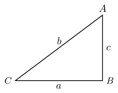

If \(\triangle ABC\) is right-angled with \(\hat{B}= 90°\), then \({b}^{2} = {a}^{2} +
                                {c}^{2}\).

Converse: If \({b}^{2} = {a}^{2} + {c}^{2}\), then \(\triangle ABC\) is
                                right-angled with \(\hat{B} = 90°\).

<Callout type="tip" title="Multimedia & Video">
The following video explains the theorem of Pythagoras and shows some examples of
                                        working with the theorem of Pythagoras.

<VideoPlayer src="https://www.youtube.com/embed/AA6RfgP-AHU?list=PL26812DF9846578C3" title="Video:
                                                2G6F" />
</Callout>

<Callout type="tip" title="Worked example 2: Triangles">
**Question:**
Determine if the two triangles are congruent. Use the result to find \(x\),
                                                \(\hat{y}\) and \(z\).

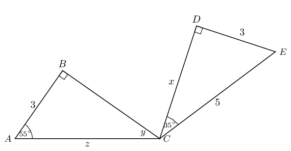

**Examine the information given for both triangles:**

**Determine whether \(\triangle CDE\equiv \triangle CBA\):**
In \(\triangle CDE\):

                                        \begin{align*}
                                        \hat{D} + \hat{C} + \hat{E} & = 180° \qquad \text{(sum of }\angle
                                        \text{s} \text{ in }\triangle \text{)}\\
                                        90° + 35° + \hat{E} & = 180° \\
                                        \therefore \hat{E} & = 55°
                                        \end{align*}

In \(\triangle CDE\) and \(\triangle CBA\):

                                        \[\begin{array}{rll} D\hat{E}C & = B\hat{A}C = 55° &
                                        \text{(proved)} \\
                                        C\hat{D}E & = C\hat{B}A = 90° & \text{(given)}\\
                                        DE & = BA = 3 & \text{(given)} \\
                                        \therefore \triangle CDE& \equiv \triangle CBA & \text{(AAS)}
                                        \end{array}\]

**Determine the unknown angles and sides:**
In \(\triangle CDE\):

                                        \begin{align*}
                                        C{E}^{2} & = D{E}^{2} + C{D}^{2} \qquad \text{(Pythagoras)} \\
                                        {5}^{2} & = {3}^{2} + {x}^{2} \\
                                        {x}^{2} & = 16 \\
                                        \therefore x & = 4
                                        \end{align*}

In \(\triangle CBA\):

                                        \begin{align*}
                                        \hat{B} + \hat{A} + \hat{y} & = 180° \qquad \text{(sum of } \angle
                                        \text{s in }\triangle \text{)}\\
                                        90° + 55° + \hat{y} & = 180° \\
                                        \therefore \hat{y} & = 35°
                                        \end{align*}\begin{align*}
                                        \triangle CDE& \equiv \triangle CBA \qquad \text{(proved)}\\
                                        \therefore CE & = CA \\
                                        \therefore z & = 5
                                        \end{align*}
</Callout>

<QuizCard id="m10-07-02c" title="Interactive Exercise 7.4" question="Solve for \(x\) in the following triangle. Two sides are given, with lengths of \(\text{5,44}\) and \(\text{2,54}\) . INSTRUCTION: Round your answer to two decimal places ." options=[] answer="
                    ['6', '6e+0']
                " hint="You should enter a number here. If you want to, you can use a space to separate thousands.                Example: 12 800,25 For scientific notation you need to use the multiply symbol                ( ∗ ) and the exponent symbol ( ^ ). For example 6,673 × 10 −11 should be written as: 6,673 ∗ 10^−11" explanation="As we are given all three sides of a right-angled triangle, we can use the Theorem of Pythagoras.  Remember that the hypotenuse                     (the side of the triangle opposite the right angle) belongs in a specific place in the formula: it must go in the place of \(c\) . \[                     \begin{aligned}                     c^2 & = a^2 + b^2 \\                     x^2 & = (\text{5,44})^2 + (\text{2,54})^2 \\                     \therefore x^2 & = \text{36,0452} \\                     \therefore x & = \sqrt{\text{36,0452}} \\                     & = \text{6,00376...} \\ & \approx \text{6}                     \end{aligned}                 \] Submit your answer as:" />

<QuizCard id="m10-07-02c" title="Interactive Exercise 7.4" question="Solve for \(x\) in the following triangle. Two sides are given, with lengths of \(\text{2,87}\) and \(\text{5}\) . INSTRUCTION: Round your answer to two decimal places ." options=[] answer="
                    ['4.09', '4.09e+0']
                " hint="You should enter a number here. If you want to, you can use a space to separate thousands.                Example: 12 800,25 For scientific notation you need to use the multiply symbol                ( ∗ ) and the exponent symbol ( ^ ). For example 6,673 × 10 −11 should be written as: 6,673 ∗ 10^−11" explanation="As we are given all three sides of a right-angled triangle, we can use the Theorem of Pythagoras.  Remember that the hypotenuse                     (the side of the triangle opposite the right angle) belongs in a specific place in the formula: it must go in the place of \(c\) . \[                     \begin{aligned}                     c^2 & = a^2 + b^2 \\                     (\text{5})^2 & = (\text{2,87})^2 + x^2 \\                     \therefore x^2 & = \text{16,7631} \\                     \therefore x & = \sqrt{\text{16,7631}} \\                     & = \text{4,09427...} \\ & \approx \text{4,09}                     \end{aligned}                 \] Submit your answer as:" />

### Textbook Exercise 7.2

Calculate the unknown variables in each of the following
                                                                figures.

**Problem:**
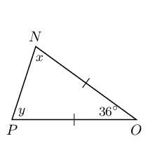

**Solution:**
The triangle is isosceles therefore \(x = y\)
                                                                        (\(\angle\)s opp equal sides).

                                                                \begin{align*}
                                                                180° & = 36° - 2x \qquad \text{(sum of
                                                                }\angle \text{s} \text{ in }\triangle \text{)} \\
                                                                2x & = 144° \\
                                                                \therefore x & = 72° = y
                                                                \end{align*}

**Problem:**
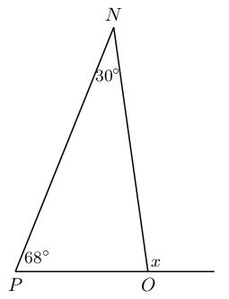

**Solution:**
\(x\) is an exterior angle, therefore \(P\hat{N}O +
                                                                        O\hat{P}N = x\) (ext \(\angle\) of
                                                                        \(\triangle\)).

                                                                \begin{align*}
                                                                x & = 30° + 68° \\
                                                                &= 98°
                                                                \end{align*}

**Problem:**
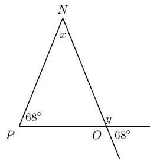

**Solution:**
First find \(y\). \(y + 68° = 180°\)
                                                                        (\(\angle\)s on a str line). Therefore \(y =
                                                                        112°\).

\(y\) is an exterior angle, therefore \(P\hat{N}O +
                                                                        O\hat{P}N = y\) (ext \(\angle\) of
                                                                        \(\triangle\)).

                                                                \begin{align*}
                                                                112° & = x + 68°\\
                                                                x & = 112° - 68° \\
                                                                & = 44°
                                                                \end{align*}

Therefore \(y = 112°\) and \(x = 44°\).

**Problem:**
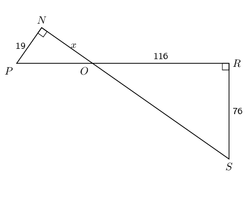

**Solution:**
\begin{align*}
                                                                N\hat{P}O & = 180° - P\hat{N}O - N\hat{O}P
                                                                \qquad \text{(sum of } \angle \text{s in } \triangle
                                                                \text{)}\\
                                                                & = 180° - 90° - N\hat{O}P \\
                                                                & = 90° - N\hat{O}P
                                                                \end{align*}
                                                                \begin{align*}
                                                                R\hat{S}O & = 180° - O\hat{R}S - R\hat{O}S
                                                                \qquad \text{(sum of } \angle \text{s in } \triangle
                                                                \text{)}\\
                                                                & = 180° - 90° - R\hat{O}S \\
                                                                & = 90° - R\hat{O}S
                                                                \end{align*}

\(N\hat{O}P = R\hat{O}S\) (vert opp \(\angle\)s).

\(\therefore N\hat{P}O = R\hat{S}O\).

Therefore \(\triangle NPO\) and \(\triangle ROS\) are
                                                                        similar because they have the same angles.

Similar triangles have proportional sides:

                                                                \begin{align*}
                                                                \therefore \frac{NP}{RS} &= \frac{NO}{OR}\\
                                                                \frac{19}{76}&=\frac{x}{116}\\
                                                                \therefore x &= 29
                                                                \end{align*}

**Problem:**
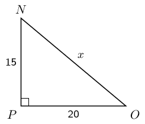

**Solution:**
From the theorem of Pythagoras we have:

                                                                \begin{align*}
                                                                x^2 &= 15^2 + 20^2 \\
                                                                \therefore x &= \sqrt{625} \\
                                                                &= 25
                                                                \end{align*}

**Problem:**
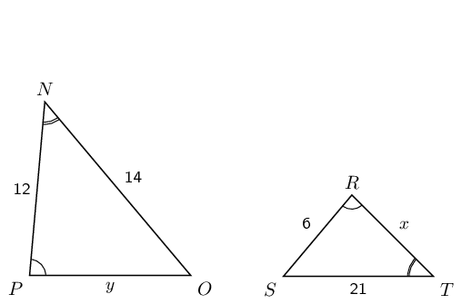

**Solution:**
We note that:

                                                                \begin{align*}
                                                                N\hat{P}O & = S\hat{R}T \qquad \text{(given)} \\
                                                                P\hat{N}O & = R\hat{T}S \qquad \text{(given)} \\
                                                                \therefore P\hat{N}O & = R\hat{T}S \qquad \text{(sum
                                                                of} \angle \text{s in } \triangle \text{)} \\
                                                                \therefore \triangle NPO &\enspace|||\enspace
                                                                \triangle TSR \text{ (AAA)}
                                                                \end{align*}

Now we can use the fact that the sides are in
                                                                        proportion to find \(x\) and \(y\):

                                                                \begin{align*}
                                                                \frac{NO}{OP} &= \frac{TS}{TR} \\
                                                                \frac{14}{12} &= \frac{21}{x} \\
                                                                x &= \frac{21 \times 12}{14} \\
                                                                &= 18 \\\\
                                                                \frac{OP}{NP} &= \frac{SR}{TR}\\
                                                                \frac{y}{12} & = \frac{6}{18} \\
                                                                18y & = 72 \\
                                                                y & = 4
                                                                \end{align*}

Therefore \(x = 18\) and \(y = 4\).

**Problem:**
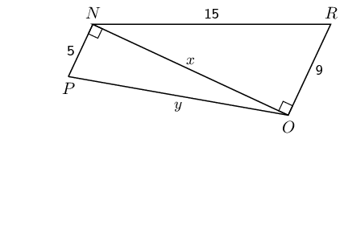

**Solution:**
From the theorem of Pythagoras:

                                                                \begin{align*}
                                                                x^2 & = 15^2 - 9^2\\
                                                                x & = \sqrt{144}\\
                                                                & = 12 \\ \\
                                                                y^2 & = x^2 + 5^2 \\
                                                                y^2 & = 144 + 25 \\
                                                                y & = \sqrt{169} \\
                                                                y & = 13
                                                                \end{align*}

Therefore \(x = 12\) and \(y = 13\).

**Problem:**
Given the following diagrams:

Diagram A

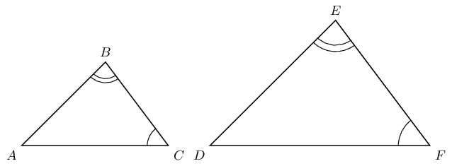

Diagram B

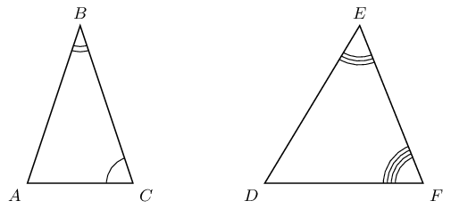

Which diagram correctly gives a pair of similar triangles?

**Solution:**
Diagram A shows a pair of triangles with all pairs of
                                                                corresponding angles equal (the same three angle markers
                                                                are shown in both triangles). Diagram B shows a pair of
                                                                triangles with different angles in each triangle. All
                                                                six angles are different and there are no pairs of
                                                                corresponding angles that are equal.

Therefore diagram A gives a pair of triangles that are
                                                                similar.

**Problem:**
Given the following diagrams:

Diagram A

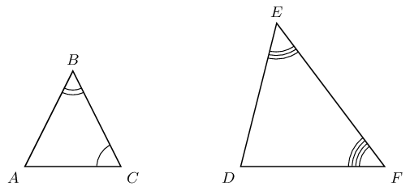

Diagram B

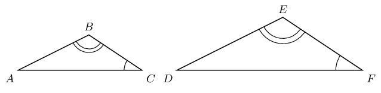

Which diagram correctly gives a pair of similar triangles?

**Solution:**
Diagram A shows a pair of triangles with different angles in
                                                                each triangle. All six angles are different and there
                                                                are no pairs of corresponding angles that are equal.
                                                                Diagram B shows a pair of triangles with all pairs of
                                                                corresponding angles equal (the same two angle markers
                                                                are shown in both triangles and the third angle in each
                                                                triangle must be equal).

Therefore diagram B gives a pair of triangles that are
                                                                similar.

**Problem:**
Have a look at the following triangles, which are drawn to
                                                                scale:

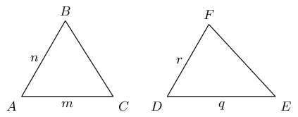

Are the two triangles congruent? If so state the reason and
                                                                use the correct notation to state that they are
                                                                congruent.

**Solution:**
We are not told if \(n = r\) and \(m = q\) or \(n = q\) and
                                                                \(m = r\) therefore we cannot say that the sides are the
                                                                same length. Also we are not given any information about
                                                                the angles of the two triangles. Therefore we cannot say
                                                                if the two triangles are congruent.

**Problem:**
Have a look at the following triangles, which are drawn to
                                                                scale:

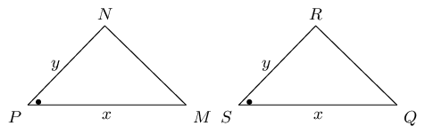

Are the two triangles congruent? If so state the reason and
                                                                use the correct notation to state that they are
                                                                congruent.

**Solution:**
Note that the two pairs of sides are equal, as indicated by
                                                                the \(x\) and \(y\). In addition, the angle between
                                                                those two sides are marked as equal (this is the
                                                                included angle).

Therefore, these two triangles are congruent. \(\triangle PNM
                                                                \equiv \triangle QSR\), reason: SAS.

State whether the following pairs of triangles are congruent
                                                                or not. Give reasons for your answers. If there is not
                                                                enough information to make a decision, explain why.

**Problem:**
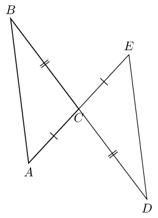

**Solution:**
\begin{align*}
                                                                AC & = CE \qquad \text{(given)} \\
                                                                BC & = CD \qquad \text{(given)} \\
                                                                A\hat{C}B & = D\hat{C}E \qquad \text{(vert opp }
                                                                \angle \text{s} = \text{)} \\
                                                                \therefore \triangle ABC & \equiv \triangle EDC
                                                                \qquad \text{SAS}
                                                                \end{align*}

**Problem:**
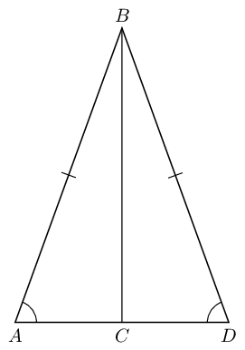

**Solution:**
We have two equal sides (\(AB = BD\) and \(BC\) is
                                                                        common to both triangles) and one equal angle
                                                                        (\(\hat{A} = \hat{D}\)) but the sides do not
                                                                        include the known angle. The triangles therefore
                                                                        do not have a SAS and are therefore not
                                                                        congruent. (Note: \(A\hat{C}B\) is not
                                                                        necessarily equal to \(D\hat{C}B\) because it is
                                                                        not given that \(BC \perp AD\)).

**Problem:**
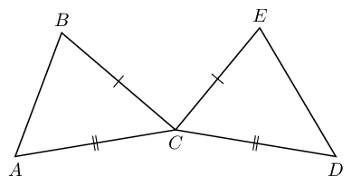

**Solution:**
There is not enough information given. We need at
                                                                        least three facts about the triangles and in
                                                                        this example we only know two sides in each
                                                                        triangle.

Note that \(BCD\) and \(ECA\) are not straight lines
                                                                        and so we cannot use vertically opposite angles.

**Problem:**
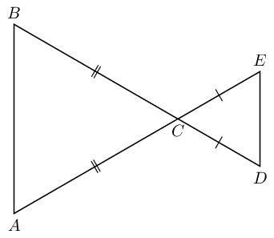

**Solution:**
There is not enough information given. Although we
                                                                        can work out which angles are equal we are not
                                                                        given any sides as equal. All we know is that we
                                                                        have two isosceles triangles. Note how this
                                                                        question differs from part a). In part a) we
                                                                        were given equal sides in both triangles, in
                                                                        this question we are only given that sides in
                                                                        the same triangle are equal.

**Problem:**
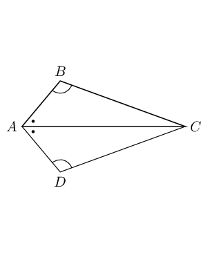

**Solution:**
\begin{align*}
                                                                AC & = AC \qquad \text{(common side)} \\
                                                                B\hat{A}C & = D\hat{A}C \qquad \text{(given)} \\
                                                                A\hat{B}C & = A\hat{D}C \qquad \text{(given)} \\
                                                                \therefore \triangle ABC & \equiv \triangle ADC
                                                                \qquad \text{AAS}
                                                                \end{align*}
