## 7.3 Quadrilaterals (EMA5X)

<Callout type="info" title="Definition: Quadrilateral">
A quadrilateral is a closed shape consisting of four straight line segments.
</Callout>

<Callout type="note" title="Note">
The interior angles of a quadrilateral add up to \(\text{360}\)°.
</Callout>

Mathopenref has some useful simulations on different types of quadrilaterals. Clicking on any of the
                named quadrilaterals will take you to a page specific to that quadrilateral.

### Parallelogram (EMA5Y)

<Callout type="info" title="Definition: Parallelogram">
A parallelogram is a quadrilateral with both pairs of opposite sides parallel.
</Callout>

<Callout type="tip" title="Worked example 3: Properties of a parallelogram">
**Question:**
\(ABCD\) is a parallelogram with \(AB\parallel DC\) and \(AD\parallel BC\). Show that:

1. \(AB=DC\) and \(AD=BC\)
2. \(\hat{A}=\hat{C}\) and \(\hat{B}=\hat{D}\)

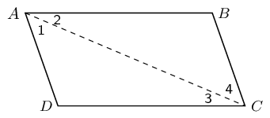

**Connect \(AC\) to form \(\triangle ABC\) and \(\triangle CDA\):**
Redraw the diagram and draw line \(AC\).

**Use properties of parallel lines to indicate all equal angles on the diagram:**
On your diagram mark all the equal angles.

**Prove \(\triangle ABC\equiv \triangle CDA\):**
In \(\triangle ABC\) and \(\triangle CDA\):

                    \[\begin{array}{rll}
                    {\hat{A}}_{2}& = {\hat{C}}_{3}& \text{(alt }\angle \text{s; } AB\parallel DC\text{)}\\
                    {\hat{C}}_{4}& = {\hat{A}}_{1}& \text{(alt }\angle \text{s; } BC\parallel AD\text{)} \\
                    AC & & \text{(common side)} \\
                    \therefore \triangle ABC & \equiv \triangle CDA & \text{(AAS)} \\
                    \therefore AB = CD & \text{ and } BC = DA &
                    \end{array}\]

\(\therefore\) Opposite sides of a parallelogram have equal length.

We have already shown \({\hat{A}}_{2}={\hat{C}}_{3}\) and \({\hat{A}}_{1}={\hat{C}}_{4}\).
                        Therefore,

                    \[\hat{A} = {\hat{A}}_{1} + {\hat{A}}_{2} = {\hat{C}}_{3} + {\hat{C}}_{4} = \hat{C}\]

Furthermore,

                    \[\hat{B}=\hat{D}
                    \enspace \left(\triangle ABC\equiv \triangle CDA\right)\]

Therefore opposite angles of a parallelogram are equal.
</Callout>

Summary of the properties of a parallelogram:

- Both pairs of opposite sides are parallel.
- Both pairs of opposite sides are equal in length.
- Both pairs of opposite angles are equal.
- Both diagonals bisect each other.

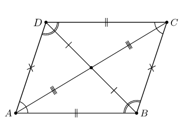

<Callout type="tip" title="Worked example 4: Proving a quadrilateral is a parallelogram">
**Question:**
Prove that if both pairs of opposite angles in a quadrilateral are equal, the quadrilateral is a
                        parallelogram.

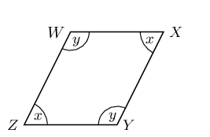

**Find the relationship between \(\hat{x}\) and \(\hat{y}\):**
In \(WXYZ\):

                    \[\begin{array}{rll}
                    \hat{W} = \hat{Y} & =\hat{y} & \text{ (given)} \\
                    \hat{Z} = \hat{X} & =\hat{x} & \text{ (given)} \\
                    \hat{W} + \hat{X} + \hat{Y} + \hat{Z} & = 360° & \text{ (sum of }\angle \text{s in a
                    quad)}\\
                    \therefore 2\hat{x} + 2\hat{y} & =360° & \\
                    \therefore \hat{x} + \hat{y} & = 180°& \\
                    \hat{W} + \hat{Z} & = \hat{x} + \hat{y} & \\
                    & = 180°
                    \end{array}\]

But these are co-interior angles between lines \(WX\) and \(ZY\). Therefore \(WX\parallel ZY\).

**Find parallel lines:**
Similarly \(\hat{W} + \hat{X} = 180°\). These are co-interior angles between lines \(XY\)
                        and \(WZ\). Therefore \(XY\parallel WZ\).

Both pairs of opposite sides of the quadrilateral are parallel, therefore \(WXYZ\) is a
                        parallelogram.
</Callout>

## Proving a quadrilateral is a parallelogram

1. Prove that if both pairs of opposite sides of a quadrilateral are equal, then the quadrilateral is a parallelogram.
2. Prove that if the diagonals of a quadrilateral bisect each other, then the quadrilateral is a parallelogram.
3. Prove that if one pair of opposite sides of a quadrilateral are both equal and parallel, then the quadrilateral is a parallelogram.

A quadrilateral is a parallelogram if:

- Both pairs of opposite sides are parallel.
- Both pairs of opposite sides are equal.
- Both pairs of opposite angles are equal.
- The diagonals bisect each other.
- One pair of opposite sides are both equal and parallel.

<QuizCard id="m10-07-03a" title="Interactive Exercise 7.6" question="Select the most correct definition for a trapezium." options=["rhombus", "triangle", "kite", "quadrilateral"] explanation="Refer to the section rules and worked examples to verify." />

<QuizCard id="m10-07-03a" title="Interactive Exercise 7.6" question="Select the most correct definition for a rectangle." options=["rhombus", "square", "parallelogram", "trapezium"] explanation="Refer to the section rules and worked examples to verify." />

<QuizCard id="m10-07-03a" title="Interactive Exercise 7.6" question="It is useful to think about quadrilaterals as a connected family. One type of quadrilateral can have all the same properties as another type of quadrilateral, plus some extra properties. A square is a rectangle with extra properties." options=[] explanation="Refer to the section rules and worked examples to verify." />

<QuizCard id="m10-07-03a" title="Interactive Exercise 7.6" question="It is useful to think about quadrilaterals as a connected family. One type of quadrilateral can have all the same properties as another type of quadrilateral, plus some extra properties. A square is a rhombus with extra properties." options=[] explanation="Refer to the section rules and worked examples to verify." />

### Textbook Exercise 7.3

\(PQRS\) is a parallelogram. \(PS = OS\) and \(QO = QR\). \(S\hat{O}R = 96^{\circ}\) and
                                \(Q\hat{O}R = x\).

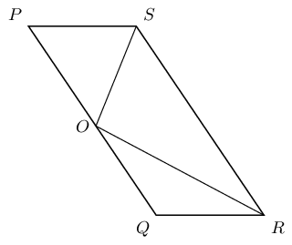

**Problem:**
Find with reasons, two other angles equal to \(x\).

**Solution:**
\(S\hat{R}O = Q\hat{O}R = x\) (alt \(\angle\)s; \(SR \parallel OQ\)).

\(O\hat{R}Q = Q\hat{O}R = x\) (\(\angle\)s opp equal sides).

Therefore \(S\hat{R}O\) and \(O\hat{R}Q\) are both equal to \(x\).

**Problem:**
Write \(\hat{P}\) in terms of \(x\).

**Solution:**
\begin{align*}
                                \hat{P} &= Q\hat{R}S \qquad \text{( opp } \angle \text{s of }\parallel \text{m)} \\
                                &= S\hat{R}O + O\hat{R}Q \\
                                \therefore \hat{P} & = 2x
                                \end{align*}

**Problem:**
Calculate the value of \(x\).

**Solution:**
\begin{align*}
                                S\hat{O}R & = 96^{\circ} \qquad \text{(given)} \\
                                S\hat{O}P & = \hat{P} \qquad \text{(}\angle\text{s opp equal sides)}\\
                                180^{\circ} & = \hat{P} + 96^{\circ} + Q\hat{O}R \qquad \text{(sum of } \angle
                                \text{s on a str line)}\\
                                84^{\circ} & = 2x + x\\
                                3x & = 84^{\circ} \\
                                \therefore x & = 28^{\circ}
                                \end{align*}

**Problem:**
Prove that the diagonals of parallelogram \(MNRS\) bisect one another at \(P\).

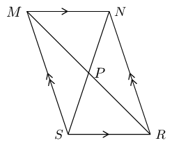

Hint: Use congruency.

**Solution:**
First number each angle on the given diagram:

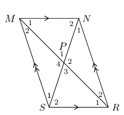

In \(\triangle MNP\) and \(\triangle RSP\):

                            \begin{align*}
                            \hat{M_1} &= \hat{R_1} \quad \text{(alt } \angle \text{s; } MN \parallel SR\text{)} \\
                            \hat{P_1} &= \hat{P_3} \quad \text{(vert opp } \angle \text{s } = \text{)} \\
                            MN & = RS \text{ (opp sides of }\parallel\text{m)}
                            \end{align*}

Therefore \(\triangle MNP \equiv \triangle RSP\) (AAS).

Now we know that \(MP = RP\) and therefore \(P\) is the mid-point of \(MR\).

Similarly, in \(\triangle MSP\) and \(\triangle RNP\):

                            \begin{align*}
                            \hat{M_2} &= \hat{R_2} \quad \text{(alt } \angle \text{s; } MS \parallel NR\text{)} \\
                            \hat{P_4} &= \hat{P_2} \quad \text{(vert opp } \angle \text{s } = \text{)} \\
                            MS & = RN \text{ (opp sides of }\parallel\text{m)}
                            \end{align*}

Therefore \(\triangle MSP \equiv \triangle RNP\) (AAS).

Now we know that \(NP = SP\) and therefore \(P\) is the mid-point of \(NS\).

Therefore the diagonals of a parallelogram bisect each other.

### Rectangle (EMA5Z)

<Callout type="info" title="Definition: Rectangle">
A rectangle is a parallelogram that has all four angles equal to \(90°\).
</Callout>

A rectangle has all the properties of a parallelogram:

- Both pairs of opposite sides are parallel.
- Both pairs of opposite sides are equal in length.
- Both pairs of opposite angles are equal.
- Both diagonals bisect each other.

It also has the following special property:

<Callout type="tip" title="Worked example 5: Special property of a rectangle">
**Question:**
\(PQRS\) is a rectangle. Prove that the diagonals are of equal length.

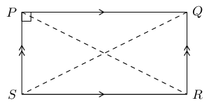

**Connect \(P\) to \(R\) and \(Q\) to \(S\) to form \(\triangle PSR\) and
                        \(\triangle QRS\):**

**Use the definition of a rectangle to fill in on the diagram all equal angles and
                        sides:**

**Prove \(\triangle PSR \equiv \triangle QRS\):**
In \(\triangle PSR\) and \(\triangle QRS\):

                    \[\begin{array}{rll}
                    PS & = QR& \text{(opp sides of rectangle)}\\
                    SR & & \text{(common side)} \\
                    P\hat{S}R & = Q\hat{R}S = 90° & \text{ (}\angle \text{s of rectangle)}\\
                    \therefore \triangle PSR & \equiv \triangle QRS & \text{ (RHS)} \\
                    \text{Therefore } PR & = QS &
                    \end{array}\]

The diagonals of a rectangle are of equal length.
</Callout>

Summary of the properties of a rectangle:

- Both pairs of opposite sides are parallel.
- Both pairs of opposite sides are of equal length.
- Both pairs of opposite angles are equal.
- Both diagonals bisect each other.
- Diagonals are equal in length.
- All interior angles are equal to \({90}^{°}\)

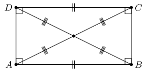

### Textbook Exercise 7.4

\(ABCD\) is a quadrilateral. Diagonals \(AC\) and \(BD\) intersect at \(T\). \(AC = BD\),
                                \(AT = TC\), \(DT = TB\). Prove that:

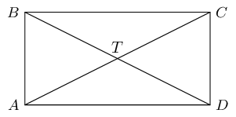

**Problem:**
\(ABCD\) is a parallelogram

**Solution:**
\(AT = TC\) (given)

\(\therefore DB\) bisects \(AC\) at \(T\)

and \(DT = TB\) (given)

\(\therefore AC\) bisects \(DB\) at \(T\)

therefore quadrilateral \(ABCD\) is a parallelogram (diag of \(\parallel\)m)

**Problem:**
\(ABCD\) is a rectangle

**Solution:**
\(AC = BD\) (given).

Therefore \(ABCD\) is a rectangle (diags of rectangle).

### Rhombus (EMA62)

<Callout type="info" title="Definition: Rhombus">
A rhombus is a parallelogram with all four sides of equal length.
</Callout>

A rhombus has all the properties of a parallelogram:

- Both pairs of opposite sides are parallel.
- Both pairs of opposite sides are equal in length.
- Both pairs of opposite angles are equal.
- Both diagonals bisect each other.

It also has two special properties:

<Callout type="tip" title="Worked example 6: Special properties of a rhombus">
**Question:**
\(XYZT\) is a rhombus. Prove that:

1. the diagonals bisect each other perpendicularly;
2. the diagonals bisect the interior angles.

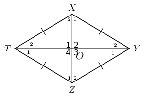

**Use the definition of a rhombus to fill in on the diagram all equal angles and
                        sides:**

**Prove \(\triangle XTO\equiv \triangle ZTO\):**
\[\begin{array}{rll}
                    XT& = ZT & \text{ (sides of rhombus)}\\
                    TO & & \text{(common side)} \\
                    X O& = OZ & \text{(diags of rhombus)}\\
                    \therefore \triangle XTO & \equiv \triangle ZTO & \text{(SSS)} \\
                    \therefore {\hat{O}}_{1} & = {\hat{O}}_{4} & \\
                    \text{But } \hat{O}_{1} + \hat{O}_{4}& = 180° & \text{(}\angle \text{s on a str
                    line)}\\
                    \therefore {\hat{O}}_{1}& = {\hat{O}}_{4} = 90°
                    \end{array}\]

We can further conclude that \({\hat{O}}_{1} = {\hat{O}}_{2} = {\hat{O}}_{3} = {\hat{O}}_{4} =
                        90°\).

Therefore the diagonals bisect each other perpendicularly.

**Use properties of congruent triangles to prove diagonals bisect interior angles:**
\[\begin{array}{rll}
                    {\hat{X}}_{2} & = {\hat{Z}}_{1} & \text{ (}\triangle XTO\equiv \triangle ZTO\text{)} \\
                    \text{and } {\hat{X}}_{2}& = {\hat{Z}}_{2} & \text{ (alt }\angle \text{s; } XT\parallel
                    YZ\text{)} \\
                    \therefore {\hat{Z}}_{1} & = {\hat{Z}}_{2} &
                    \end{array}\]

Therefore diagonal \(XZ\) bisects \(\hat{Z}\). Similarly, we can show that \(XZ\) also bisects
                        \(\hat{X}\); and that diagonal \(TY\) bisects \(\hat{T}\) and \(\hat{Y}\).

We conclude that the diagonals of a rhombus bisect the interior angles.
</Callout>

To prove a parallelogram is a rhombus, we need to show any one of the following:

- All sides are equal in length.
- Diagonals intersect at right angles.
- Diagonals bisect interior angles.

Summary of the properties of a rhombus:

- Both pairs of opposite sides are parallel.
- Both pairs of opposite sides are equal in length.
- Both pairs of opposite angles are equal.
- Both diagonals bisect each other.
- All sides are equal in length.
- The diagonals bisect each other at \({90}^{°}\)
- The diagonals bisect both pairs of opposite angles.

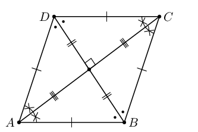

### Square (EMA63)

<Callout type="info" title="Definition: Square">
A square is a rhombus with all four interior angles equal to \(90°\)

OR

A square is a rectangle with all four sides equal in length.
</Callout>

A square has all the properties of a rhombus:

- Both pairs of opposite sides are parallel.
- Both pairs of opposite sides are equal in length.
- Both pairs of opposite angles are equal.
- Both diagonals bisect each other.
- All sides are equal in length.
- The diagonals bisect each other at \(90°\)
- The diagonals bisect both pairs of opposite angles.

It also has the following special properties:

- All interior angles equal \(90°\).
- Diagonals are equal in length.
- Diagonals bisect both pairs of interior opposite angles (i.e. all are \(45°\)).

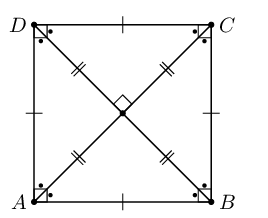

To prove a parallelogram is a square, we need to show either one of the following:

- It is a rhombus (all four sides of equal length) with interior angles equal to \(90°\).
- It is a rectangle (interior angles equal to \(90°\)).

### Trapezium (EMA64)

<Callout type="info" title="Definition: Trapezium">
A trapezium is a quadrilateral with one pair of opposite sides parallel.
</Callout>

In British English a trapezium is used to indicate a quadrilateral with one pair of opposite sides
                    parallel while in American English a trapezium is a quadrilateral with no pairs of opposite sides
                    parallel. We will use the British English definition of trapezium in this book.

In British English a trapezoid is used to indicate a quadrilateral with no pairs of opposite sides
                    parallel while in American English a trapezoid is a quadrilateral with one pair of opposite sides
                    parallel.

<Callout type="note" title="Note">
A trapezium is sometimes called a trapezoid.
</Callout>

Some examples of trapeziums are given below:

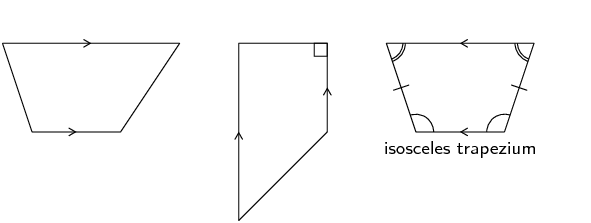

### Kite (EMA65)

<Callout type="info" title="Definition: Kite">
A kite is a quadrilateral with two pairs of adjacent sides equal.
</Callout>

<Callout type="tip" title="Worked example 7: Properties of a kite">
**Question:**
\(ABCD\) is a kite with \(AD=AB\) and \(CD=CB\). Prove that:

1. \(A\hat{D}C=A\hat{B}C\)
2. Diagonal \(AC\) bisects \(\hat{A}\) and \(\hat{C}\)

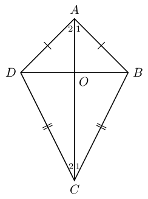

**Prove \(\triangle ADC\equiv \triangle ABC\):**
In \(\triangle ADC\) and \(\triangle ABC\):

                    \[\begin{array}{rll}
                    AD & =AB & \text{(given)} \\
                    CD & = CB & \text{(given)} \\
                    AC & & \text{(common side)} \\
                    \therefore \triangle ADC & \equiv \triangle ABC & \text{(SSS)} \\
                    \therefore A\hat{D}C & = A\hat{B}C &
                    \end{array}\]

Therefore one pair of opposite angles are equal in kite \(ABCD\).

**Use properties of congruent triangles to prove \(AC\) bisects \(\hat{A}\) and
                        \(\hat{C}\):**
\[\begin{array}{rll}
                    \hat{A}_{1} & = {\hat{A}}_{2} & (\triangle ADC\equiv \triangle ABC) \\
                    \text{and } {\hat{C}}_{1} & = {\hat{C}}_{2} & (\triangle ADC\equiv \triangle ABC)
                    \end{array}\]

Therefore diagonal \(AC\) bisects \(\hat{A}\) and \(\hat{C}\).

We conclude that the diagonal between the equal sides of a kite bisects the two interior angles
                        and is an axis of symmetry.
</Callout>

Summary of the properties of a kite:

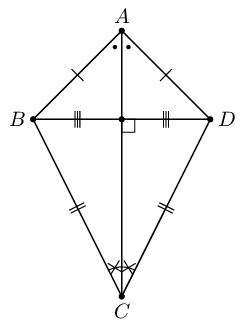

- Diagonal between equal sides bisects the other diagonal.
- One pair of opposite angles are equal (the angles between unequal sides).
- Diagonal between equal sides bisects the interior angles and is an axis of symmetry.
- Diagonals intersect at \(90°\)

### Textbook Exercise 7.5

**Problem:**
Use the sketch of quadrilateral \(ABCD\) to prove the diagonals of a kite are
                                perpendicular to each other.

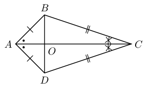

**Solution:**
First number the angles:

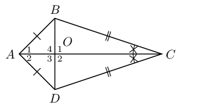

In \(\triangle ADO\) and \(\triangle ABO\):

                            \[\begin{array}{rll}
                            AD & = AB & \text{(given)} \\
                            AO & & \text{(common side)} \\
                            B\hat{A}O & = D\hat{A}O & \text{(given)} \\
                            \therefore \triangle ADO & \equiv \triangle ABO & \text{(SAS)} \\
                            \therefore A\hat{B}O & = A\hat{D}O &
                            \end{array}\]

In \(\triangle ADB\):

                            \begin{align*}
                            \text{let } \hat{A_1} & = \hat{A_2} = t \\
                            \text{and let } A\hat{D}O &= A\hat{B}O = p \\
                            2t + 2p &= 180° \quad \text{(sum of }\angle \text{s in} \triangle \text{)} \\
                            \therefore t + p &= 90°
                            \end{align*}

Next we note that:

                            \begin{align*}
                            \hat{O_1} & = A\hat{B}O + \hat{A_1} \text{ (ext }\angle \text{ of } \triangle \text{)}\\
                            \hat{O_1} &= p + t \\
                            &= 90°\\
                            \therefore AC &\perp BD
                            \end{align*}

Therefore the diagonals of a kite are perpendicular to each other.

**Problem:**
Explain why quadrilateral \(WXYZ\) is a kite. Write down all the properties of
                                quadrilateral \(WXYZ\).

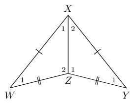

**Solution:**
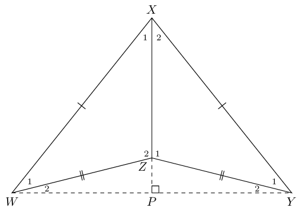

Quadrilateral \(WXYZ\) is a kite because is has two pairs of adjacent sides that are
                                equal in length.

- Diagonal between equal sides bisects the other diagonal: \(WP = PY\).
- One pair of opposite angles are equal: \(\hat{W_{1}} = \hat{Y_{1}}\).
- Diagonal between equal sides bisects the interior angles and is an axis of symmetry: \(\hat{X_1} = \hat{X_2}\).
- Diagonals intersect at \(90°\): \(WY \perp PX\).

<Callout type="tip" title="Multimedia & Video">
This video provides a summary of the different types of quadrilaterals and their properties.

<VideoPlayer src="https://www.youtube.com/embed/yiREqzDsMP8" title="Video: 2G77" />
</Callout>

## Relationships between the different quadrilaterals

Heather has drawn the following diagram to illustrate her understanding of the relationships between
                    the different quadrilaterals. The following diagram summarises the different types of special
                    quadrilaterals.

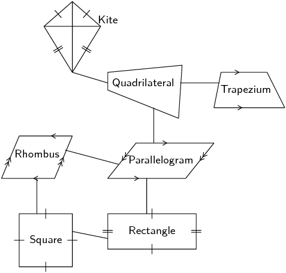

1. Explain her possible reasoning for structuring the diagram as shown.
2. Design your own diagram to show the relationships between the different quadrilaterals and write a short explanation of your design.

### Textbook Exercise 7.6

**Problem:**
The following shape is drawn  to scale :

Give the most specific name for the shape.

**Solution:**
We start by counting the number of sides. There are four sides in this figure and so it
                                is either just a quadrilateral or one of the special types of quadrilateral.

Next we ask ourselves if there are any parallel lines in the figure. You can look at the
                                figure to see if any of the lines look parallel or make a quick sketch of the image and
                                see if any pairs of opposite lines meet at a point.

Both pairs of opposite sides are parallel. This means that the figure can only be one of
                                the following: parallelogram, rectangle, rhombus or square.

Next we ask ourselves if all the interior angles are 90°. All the interior angles
                                are 90° and so this must be a square or a rectangle. Finally we check to see if all
                                the sides are equal in length. In this figure the sides are not equal in length and so
                                it is a rectangle.

Therefore this is a rectangle.

The shape is also a parallelogram and a quadrilateral. This question, however, asked for
                                the most specific name for the shape.

**Problem:**
The following shape is drawn  to scale :

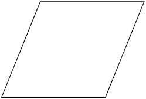

Give the most specific name for the shape.

**Solution:**
We start by counting the number of sides. There are four sides in this figure and so it
                                is either just a quadrilateral or one of the special types of quadrilateral.

Next we ask ourselves if there are any parallel lines in the figure. You can look at the
                                figure to see if any of the lines look parallel or make a quick sketch of the image and
                                see if any pairs of opposite lines meet at a point.

Both pairs of opposite sides are parallel. This means that the figure can only be one of
                                the following: parallelogram, rectangle, rhombus or square.

Next we ask ourselves if all the interior angles are 90°. All the interior angles
                                are not 90° and so this must be a parallelogram or a rhombus. Finally we check to
                                see if all the sides are equal in length. In this figure the sides are equal in length
                                and so it is a rhombus.

Therefore this is a rhombus.

The shape is also a parallelogram and a quadrilateral. This question, however, asked for
                                the most specific name for the shape.

**Problem:**
Based on the shape that you see list the all the names of the shape. The figure is drawn
                                to scale

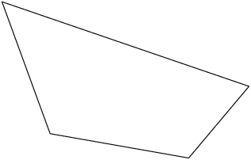

**Solution:**
Both pairs of opposite sides are not parallel. This means that the figure can only be
                                some combination of the following: trapezium, kite, or quadrilateral.

The shape is definitely a quadrilateral because it has four sides. It does not have any
                                special properties: it does not have parallel sides, or right angles, or sides which are
                                equal in length. Therefore it is only a quadrilateral.

**Problem:**
Based on the shape that you see list the all the names of the shape. The figure is drawn
                                to scale

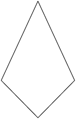

**Solution:**
Both pairs of opposite sides are not parallel. This means that the figure can only be
                                some combination of the following: trapezium, kite, or quadrilateral.

The shape is definitely a quadrilateral because it has four sides. It is also a kite
                                because it has two pairs of adjacent sides which are the same lengths. It cannot be a
                                square or a rectangle because it does not have right angles. It cannot be a
                                parallelogram or a trapezium because it does not have any parallel sides. And it is not
                                a rhombus because the four sides are not all the same length.

Therefore the correct answer is: kite and quadrilateral.

**Problem:**
Based on the shape that you see list the all the names of the shape. The figure is drawn
                                to scale

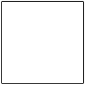

**Solution:**
Both pairs of opposite sides are parallel. That means that this shape can belong to one
                                or more of these groups: square, rhombus, rectangle or parallelogram.

The given shape is a square. However, it is also a rectangle. A square is also a
                                parallelogram, because it has parallel sides; and it is a rhombus as well, it just
                                happens to have right angles. A square is also a kite, a trapezium and of course a
                                quadrilateral.

Therefore the correct answer is: square, rectangle, rhombus, parallelogram, kite,
                                trapezium and quadrilateral.

**Problem:**
Find the area of \(ACDF\) if \(AB = 8,~ BF = 17,~ FE = EC,~ BE = ED,~ \hat{A} =
                                90^{\circ} ,~ C\hat{E}D = 90^{\circ}\)

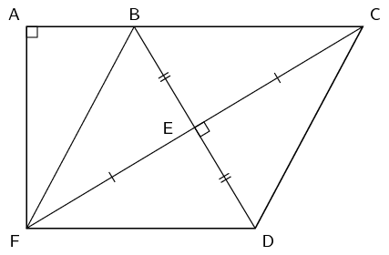

**Solution:**
Construct \(G\) such that \(AC = FG\)

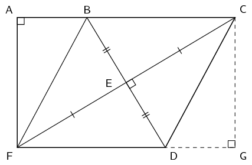

\(BCDF\) is a rhombus (diagonals bisect at right angles)

Since \(BCDF\) is a rhombus \(BC = DF\). We constructed \(G\) such that \(AC = FG\).
                                Therefore \(AB = DG\).

In \(\triangle ABF\) and \(\triangle CGD\):

                            \begin{align*}
                            B\hat{A}F & = C\hat{G}D = 90^{\circ} \quad \text{(given and by construction)} \\
                            AB & = DG \quad \text{(by construction)} \\
                            BF & = CD \quad \text{(} BCDF \text{ is a rhombus)}
                            \end{align*}

Therefore \(ABF \equiv CGD\) (RHS)

Therefore \(AF = CG\) and so \(ACGF\) is a rectangle (both pairs of opposite sides equal
                                in length and all interior angles are 90°).

We are given the length of \(AB\) and \(BF\). Since \(\triangle ABF\) is right-angled we
                                can use the theorem of Pythagoras to find the length of \(AF\):

                            \begin{align*}
                            BF^{2} & = AB^{2} + AF^{2} \\
                            (17)^{2} & = (8)^{2} + AF^{2} \\
                            AF^{2} & = 225 \\
                            AF & = 15
                            \end{align*}

We also know that \(FD = BF = 17\) and so \(AC = 17 + 8 = 25\).

Therefore the area of rectangle \(ACGF\) is:

                            \begin{align*}
                            A_{\text{rectangle}} & = l \times b \\
                            & = (25)(15) \\
                            & = 375
                            \end{align*}

We are almost there. We now need to calculate the area of triangle \(CDG\) and subtract
                                this from the area of the rectangle to get the area of \(ACDF\).

The area of triangle \(CDG\) is:

                            \begin{align*}
                            A_{\text{triangle}} &= \frac{1}{2} DG \times CG \\
                            & = \frac{1}{2} (8 \times 15) \\
                            &= 60
                            \end{align*}

Therefore the area of \(ACDF\) is \(375 - 60 = 315\).
