## 7.4 The mid-point theorem (EMA66)

## Proving the mid-point theorem

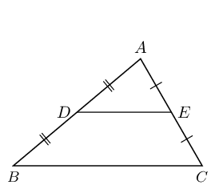

1. Draw a large scalene triangle on a sheet of paper.
2. Name the vertices \(A\), \(B\) and \(C\). Find the mid-points (\(D\) and \(E\)) of two sides and connect
            them.
3. Cut out \(\triangle ABC\) and cut along line \(DE\).
4. Place \(\triangle ADE\) on quadrilateral \(BDEC\) with vertex \(E\) on vertex \(C\). Write down your
            observations.
5. Shift \(\triangle ADE\) to place vertex \(D\) on vertex \(B\). Write down your observations.
6. What do you notice about the lengths \(DE\) and \(BC\)?
7. Make a conjecture regarding the line joining the mid-point of two sides of a triangle.

<Callout type="tip" title="Worked example 8: Mid-point theorem">
**Question:**
Prove that the line joining the mid-points of two sides of a triangle is parallel to the third side and equal
          to half the length of the third side.

**Extend \(DE\) to \(F\) so that \(DE=EF\) and join \(FC\):**
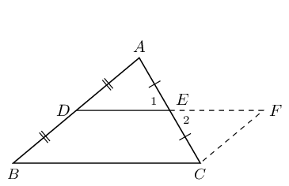

**Prove \(BCFD\) is a parallelogram:**
In \(\triangle EAD\) and \(\triangle ECF\):

        \[\begin{array}{rll}
        \hat{E}_{1} & = \hat{E}_{2}& \text{(vert opp }\angle \text{s} = \text{)}\\
        AE & = CE & \text{ (given)} \\
        DE & = EF & \text{ (by construction)} \\
        \therefore \triangle EAD & \equiv \triangle ECF & \text{(SAS)} \\
        \therefore A\hat{D}E & = C\hat{F}E &
        \end{array}\]

But these are alternate interior angles, therefore \(BD\parallel FC\)

        \[\begin{array}{rll}
        BD & = DA & \text{(given)}\\
        DA & = FC & (\triangle EAD\equiv \triangle ECF)\\
        \therefore BD& = FC &
        \end{array}\]
        \[\therefore BCFD \text{ is a parallelogram } \text{(one pair opp. sides } = \text{ and
        }\parallel \text{)}\]

Therefore \(DE\parallel BC\).

We conclude that the line joining the two mid-points of two sides of a triangle is parallel to the third
          side.

**Use properties of parallelogram \(BCFD\) to prove that \(DE=\frac{1}{2}BC\):**
\[\begin{array}{rll}
        DF & = BC & \text{(opp sides of } \parallel \text{m)} \\
        \text{and } DF & = 2\left(DE\right) & \text{(by construction)} \\
        \therefore 2DE & = BC & \\
        \therefore DE & = \frac{1}{2}BC &
        \end{array}\]

We conclude that the line joining the mid-point of two sides of a triangle is equal to half the length of the
          third side.
</Callout>

Converse

The converse of this theorem states: If a line is drawn through the mid-point of a side of a triangle parallel to
      the second side, it will bisect the third side.

<Callout type="tip" title="Multimedia & Video">
You can use GeoGebra to show that the converse of
        the mid-point theorem is true.
</Callout>

### Textbook Exercise 7.7

**Problem:**
Points \(C\) and \(A\) are the mid-points on lines \(BD\) and \(BE\). Study \(\triangle EDB\) carefully.
              Identify the third side of this triangle, using the information as shown, together with what you know
              about the mid-point theorem. Name the third side by its endpoints, e.g., \(FG\).

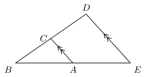

**Solution:**
The red line, \(ED\) or \(DE\), indicates the third side of the triangle. According to the mid-point
              theorem, the line joining the mid-points of two sides of a triangle is parallel to the third side of the
              triangle.

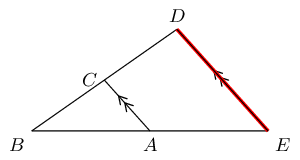

**Problem:**
Points \(R\) and \(P\) are the mid-points on lines \(QS\) and \(QT\). Study \(\triangle TSQ\) carefully.
              Identify the third side of this triangle, using the information as shown, together with what you know
              about the mid-point theorem. Name the third side by its endpoints, e.g., \(FG\).

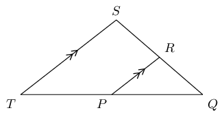

**Solution:**
The red line, \(TS\) or \(ST\), indicates the third side of the triangle. According to the mid-point
              theorem, the line joining the mid-points of two sides of a triangle is parallel to the third side of the
              triangle.

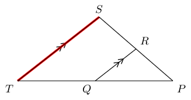

**Problem:**
Points \(C\) and \(A\) are given on the lines \(BD\) and \(BE\). Study the triangle carefully, then
              identify and name the parallel lines.

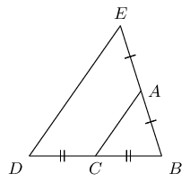

**Solution:**
The lines \(ED\) and \(AC\) are parallel according to the mid-point theorem because \(AC\) is bisecting
              the lines \(EB\) and \(DB\).

**Problem:**
Points \(R\) and \(P\) are given on the lines \(QS\) and \(QT\). Study the triangle carefully, then
              identify and name the parallel lines.

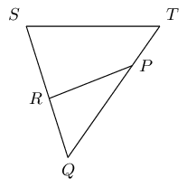

**Solution:**
The lines \(TS\) and \(PR\) are not parallel according to the mid-point theorem because line \(PR\) does
              not bisect \(TQ\) and \(SQ\). Therefore there are no parallel lines in the triangle.

The figure below shows a large triangle with vertices \(A\), \(B\) and \(D\), and a smaller triangle with
              vertices at \(C\), \(D\) and \(E\). Point \(C\) is the mid-point of \(BD\) and point \(E\) is the
              mid-point of \(AD\).

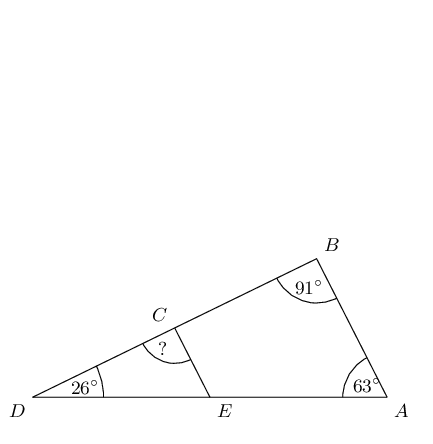

**Problem:**
Three angles are given: \(\hat{A} = 63^{\circ}\), \(\hat{B} = 91^{\circ}\) and \(\hat{D} =
                26^{\circ}\); determine the value of \(D\hat{C}E\).

**Solution:**
\begin{align*}
              AB & \parallel EC \qquad \text{(Midpt Theorem)} \\
              \therefore D\hat{C}E & = \hat{B} \qquad \text{(corresp } \angle \text{s; } AB \parallel EC\text{)} \\
              D\hat{C}E & = 91^{\circ}
              \end{align*}

**Problem:**
The two triangles in this question are similar triangles. Complete the following statement correctly by
                giving the three vertices in the correct order (there is only one correct answer).

              \(\triangle DEC \enspace|||\enspace \triangle ?\)

**Solution:**
Angle \(D\) corresponds to angle \(D\); angle \(E\) corresponds to angle \(A\); and angle \(C\)
                corresponds to angle \(B\). Therefore, \(\triangle DEC \enspace|||\enspace \triangle DAB\).

The figure below shows a large triangle with vertices \(G\), \(H\) and \(K\), and a smaller triangle with
              vertices at \(J\), \(K\) and \(L\). Point \(J\) is the mid-point of \(HK\) and point \(L\) is the
              mid-point of \(GK\).

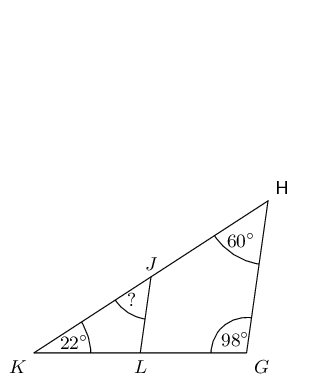

**Problem:**
Three angles are given: \(\hat{G} = 98^{\circ}\), \(\hat{H} = 60^{\circ}\), and \(\hat{K} =
                22^{\circ}\); determine the value of \(K\hat{J}L\).

**Solution:**
\begin{align*}
              GH & \parallel LJ \qquad \text{(Midpt Theorem)} \\
              \therefore K\hat{J}L & = \hat{H} \qquad \text{(corresp } \angle \text{s; } GH \parallel LJ\text{)}\\
              K\hat{J}L & = 60^{\circ}
              \end{align*}

**Problem:**
The two triangles in this question are similar triangles. Complete the following statement correctly by
                giving the three vertices in the correct order (there is only one correct answer).

              \(\triangle HKG \enspace|||\enspace \triangle ?\)

**Solution:**
Angle \(H\) corresponds to angle \(J\); angle \(K\) corresponds to angle \(K\) ; and angle \(G\)
                corresponds to angle \(L\). Therefore, \(\triangle HKG \enspace|||\enspace \triangle JKL\).

**Problem:**
Consider the triangle in the diagram below. There is a line crossing through a large triangle. Notice
              that some lines in the figure are marked as equal to each other. One side of the triangle has a given
              length of 3. Some information is also given about the lengths of other lines along the edges of the
              triangle.

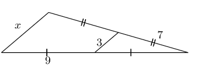

Determine the value of \(x\).

**Solution:**
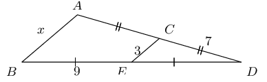

From the mid-point theorem we know:

            \begin{align*}
            AB & = 2 \times CE \\
            x & = 2(3) \\
            & = 6
            \end{align*}

**Problem:**
Consider the triangle in the diagram below. There is a line crossing through a large triangle. Notice
              that some lines in the figure are marked as equal to each other. One side of the triangle has a given
              length of 6.

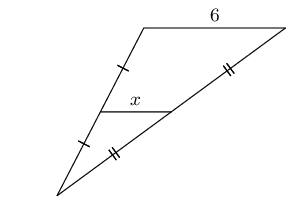

Determine the value of \(x\).

**Solution:**
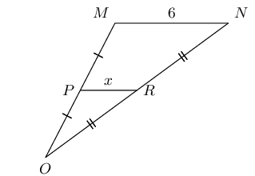

From the mid-point theorem we know:

            \begin{align*}
            MN & = 2 \times PR \\
            \left( 6 \right) & = 2x \\
            \frac{1}{2} \left( 6 \right) & = x \\
            3 & = x
            \end{align*}

**Problem:**
In the figure below, \(VW \parallel ZX\), as labelled. Furthermore, the following lengths and angles are
              given: \(VW = 12\); \(ZX = 6\); \(XY = \text{5,5}\); \(YZ = 5\) and \(\hat{V} = 59^{\circ}\). The figure
              is drawn to scale.

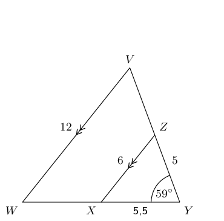

Determine the length of \(WY\).

**Solution:**
\(X\) is the mid-point of \(WY\) and \(Z\) is the mid-point of \(VY\) (\(VW \parallel ZX\), also it is
              given that \(XZ = \frac{1}{2}VW\)).

            \begin{align*}
            WY & = 2 \times XY \qquad \text{definition of mid-point} \\
            & = 2(\text{5,5}) \\
            & = \text{11}
            \end{align*}

**Problem:**
In the figure below, \(VW \parallel ZX\), as labelled. Furthermore, the following lengths and angles are
              given: \(VW = 4\); \(ZX = 2\); \(WX = 4\); \(YZ = \text{3,5}\) and \(\hat{Y} = 30^{\circ}\). The figure is
              drawn to scale.

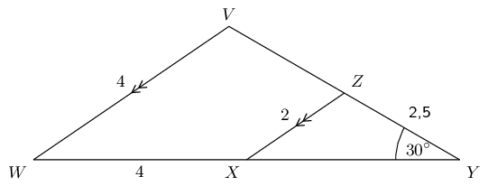

Determine the length of \(XY\).

**Solution:**
\(X\) is the mid-point of \(WY\) and \(Z\) is the mid-point of \(VY\) (\(VW \parallel ZX\), also it is
              given that \(XZ = \frac{1}{2}VW\)).

            \begin{align*}
            XY & = WX \qquad \text{definition of mid-point} \\
            & = \text{4}
            \end{align*}

Find \(x\) and \(y\) in the following:

**Problem:**
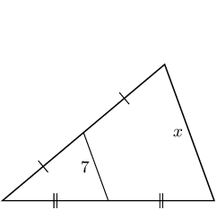

**Solution:**
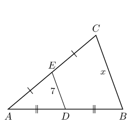

From the mid-point theorem we know:

              \begin{align*}
              BC & = 2 \times DE \\
              x & = 2(7) \\
              & = 14
              \end{align*}

**Problem:**
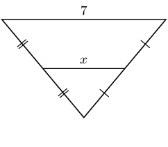

**Solution:**
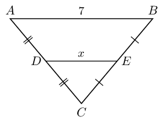

From the mid-point theorem we know:

              \begin{align*}
              AB & = 2 \times DE \\
              7 & = 2x \\
              \text{3,5} & = x
              \end{align*}

**Problem:**
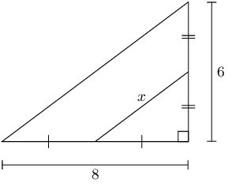

**Solution:**
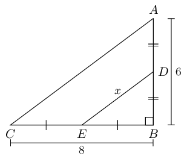

We can use the theorem of Pythagoras to find \(AC\):

              \begin{align*}
              AC^{2} & = BC^{2} + AB^{2} \\
              & = (8)^{2} + (6)^{2} \\
              & = 64 + 36 \\
              & = 100 \\
              AC & = 10
              \end{align*}

From the mid-point theorem we know:

              \begin{align*}
              AC & = 2 \times DE \\
              10 & = 2x \\
              \text{5} & = x
              \end{align*}

**Problem:**
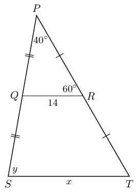

**Solution:**
From the mid-point theorem we know:

              \begin{align*}
              ST & = 2 \times QR \\
              x & = 2(14) \\
              & = 28
              \end{align*}

To find \(y\) we note the following:

- \(P\hat{Q}R = 180° - 60° - 40° = 100°\) (sum of \(\angle\)s in \(\triangle\)).
- From the mid-point theorem we also know that \(QR \parallel ST\).

Therefore \(y = 100°\) (corresp \(\angle\)s; \(QR \parallel ST\)).

The final answer is: \(x = 28\text{ units}\) and \(y = 100°\).

**Problem:**
In the following diagram \(PQ = \text{2,5}\) and \(RT = \text{6,5}\).

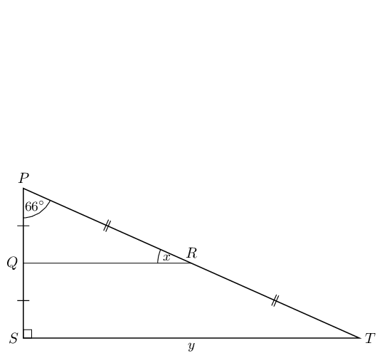

**Solution:**
From the mid-point theorem we know that \(QR \parallel ST\). Therefore \(P\hat{Q}R = P\hat{S}T =
                90°\) (corresp \(\angle\)s; \(QR \parallel ST\)).

Therefore \(x = 180° - 90° - 66° = 24°\) (sum of \(\angle\)s in \(\triangle\)).

To find \(y\) we note that \(PQ + QS = PS\) and \(PQ = QS\), therefore \(PS = 2PQ\). Similarly \(PT =
                2RT\).

We can use the theorem of Pythagoras to find \(ST\):

              \begin{align*}
              ST^{2} & = PS^{2} + PT^{2} \\
              & = 2PQ + 2RT \\
              & = (2(\text{2,5}))^{2} + (2(\text{6,5}))^{2} \\
              & = \text{25} + \text{169} \\
              & = 194 \\
              ST & = \text{13,93}
              \end{align*}

Therefore: \(x = 24°\) and \(y = \text{13,93}\).

**Problem:**
Show that \(M\) is the mid-point of \(AB\) and that \(MN = RC\).

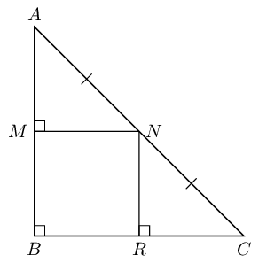

**Solution:**
We are given that \(AN = NC\).

We are also given that \(\hat{B} = \hat{M} = 90°\), therefore \(MN \parallel BR\) (\(\hat{B}\) and
              \(\hat{M}\) are equal, corresponding angles).

Therefore \(M\) is the mid-point of \(AB\) (converse of mid-point theorem).

Similarly we can show that \(R\) is the mid-point of \(BC\).

We also know that \(MN = BR\) (\(MB \parallel NR\) and parallel lines are a constant distance apart).

But \(BR = RC\) (\(R\) is the mid-point of \(BC\)), therefore \(MN = RC\).

In the diagram below, \(P\) is the mid-point of \(NQ\) and \(R\) is the mid-point of \(MQ\). The segment
              inside of the large triangle is labelled with a length of \(-2a + 4\).

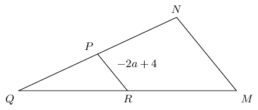

**Problem:**
Calculate the value of \(MN\) in terms of \(a\).

**Solution:**
Use the mid-point theorem to fill in known information on the diagram:

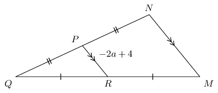

Remember that the mid-point theorem tells us that the segments \(MN\) and \(PR\) have a ratio of \(2 :
                1\) (\(MN\) is twice as long as \(PR\)).

              \begin{align*}
              MN & = 2 \times PR\\
              & = 2 \left( -2a + 4 \right) \\
              & = -4a + 8
              \end{align*}

The final answer is \(MN = -4a + 8\) (twice as long as \(PR\)).

**Problem:**
You are now told that \(MN\) has a length of \(\text{18}\). What is the value of \(a\)? Give your
                answer as a fraction.

**Solution:**
\begin{align*}
              - 4 a + 8 & = \text{18} \\
              - 4 a & = 10 \\
              \left( - \frac{1}{4} \right) \left( - 4 a \right) & = \left( 10 \right) \left( - \frac{1}{4} \right)
              \\
              a & = - \frac{5}{2}
              \end{align*}

In the diagram below, \(P\) is the mid-point of \(NQ\) and \(R\) is the mid-point of \(MQ\). One side of
              the triangle has a given length of \(\dfrac{2 a}{3} + 4\).

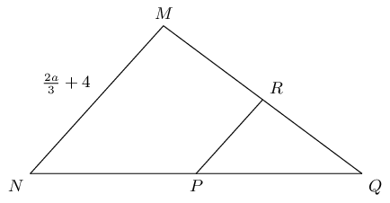

**Problem:**
Find the value of \(PR\) in terms of \(a\).

**Solution:**
Use the mid-point theorem to fill in known information on the diagram:

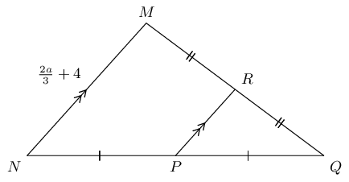

Remember that the mid-point theorem tells us that the segments \(MN\) and \(PR\) have a ratio of \(2 :
                1\) (\(MN\) is twice as long as \(PR\)).

              \begin{align*}
              MN & = 2 \times PR \\
              \left( \frac{2 a}{3} + 4 \right) & = 2 \left(PR\right) \\
              \frac{1}{2} \left( \frac{2 a}{3} + 4 \right) & = PR \\
              \frac{a}{3} + 2 & = PR
              \end{align*}

**Problem:**
You are now told that \(PR\) has a length of \(\text{8}\). What is the value of \(a\)?

**Solution:**
\begin{align*}
              \frac{a}{3} + 2 & = \text{8} \\
              \frac{a}{3} & = 6 \\
              \left( 3 \right) \left( \frac{a}{3} \right) & = \left( 6 \right) \left( 3 \right) \\
              a & = 18
              \end{align*}

The figure below shows \(\triangle ABD\) crossed by \(EC\). Points \(C\) and \(E\) bisect their
              respective sides of the triangle.

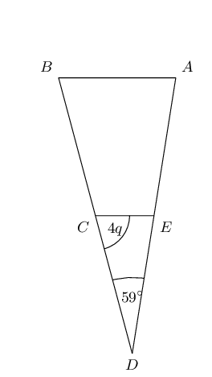

**Problem:**
The angles \(\hat{D} = 59^{\circ}\) and \(E\hat{C}D = 4 q\) are given; determine the value of
                \(\hat{A}\) in terms of \(q\).

**Solution:**
We note the following from the mid-point theorem:

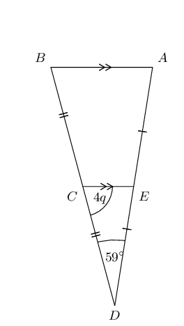

Also \(\hat{A} = D\hat{E}C\)

              \begin{align*}
              \hat{A} + 4 q + 59^{\circ} & = 180^{\circ} \qquad \text{(sum of }\angle\text{s in } \triangle \text{)}
              \\
              \hat{A} & = 180^{\circ} - \left( 4 q + 59^{\circ} \right) \\
              & = - 4 q + 121^{\circ}
              \end{align*}

In terms of \(q\), the answer is: \(\hat{A} = -4q + 121^{\circ}\).

**Problem:**
You are now told that \(E\hat{C}D\) has a measure of \(72^{\circ}\). Calculate for the value of \(q\).

**Solution:**
\begin{align*}
              E\hat{C}D & = 72^{\circ} \\
              4 q & = 72^{\circ} \\
              q & = 18^{\circ}
              \end{align*}

The figure below shows \(\triangle GHK\) crossed by \(LJ\). Points \(J\) and \(L\) bisect their
              respective sides of the triangle.

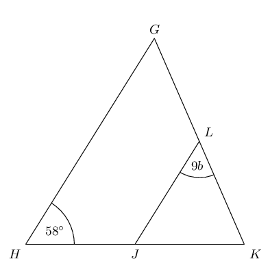

**Problem:**
Given the angles \(\hat{H} = 58^{\circ}\) and \(K\hat{L}J = 9 b\), determine the value of \(\hat{K}\)
                in terms of \(b\).

**Solution:**
Using the mid-point theorem we can add the following information to the diagram:

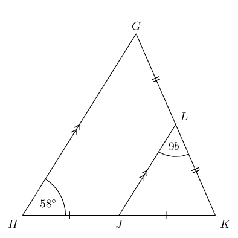

Also: \(\hat{H} = K\hat{J}L = 58^{\circ}\)

              \begin{align*}
              \hat{K} + 9 b+58^{\circ} & = 180^{\circ} \qquad \text{(sum of }\angle\text{s in } \triangle \text{)}
              \\
              \hat{K} & = 180^{\circ} - \left( 9 b+58^{\circ} \right) \\
              & = - 9 b + 122^{\circ}
              \end{align*}

In terms of \(b\), the answer is: \(\hat{K} \; = - 9 b + 122^{\circ}\).

**Problem:**
You are now told that \(\hat{K}\) has a measure of \(74^{\circ}\). Solve for the value of \(b\). Give
                your answer as a fraction.

**Solution:**
\begin{align*}
              \hat{K} & = 74^{\circ} \\
              - 9 b + 122^{\circ} & = 74^{\circ} \\
              b & = \frac{16}{3}
              \end{align*}
