### Textbook Exercise 7.8

Identify the types of angles shown below:

**Problem:**

**Solution:**
straight angle

**Problem:**

**Solution:**
obtuse angle

**Problem:**
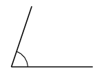

**Solution:**
acute angle

**Problem:**
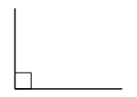

**Solution:**
right angle

**Problem:**
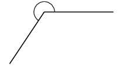

**Solution:**
Reflex angle

**Problem:**
An angle of \(\text{91}\)°

**Solution:**
obtuse angle

**Problem:**
An angle of \(\text{180}\)°

**Solution:**
straight angle

**Problem:**
An angle of \(\text{210}\)°

**Solution:**
reflex angle

Assess whether the following statements are true or false. If the statement is false, explain why:

**Problem:**
A trapezium is a quadrilateral with two pairs of opposite sides that are parallel.

**Solution:**
False, a trapezium only has one pair of opposite parallel sides.

**Problem:**
Both diagonals of a parallelogram bisect each other.

**Solution:**
True

**Problem:**
A rectangle is a parallelogram that has all interior angles equal to \(\text{90}\)°.

**Solution:**
True

**Problem:**
Two adjacent sides of a rhombus have different lengths.

**Solution:**
False, two adjacent sides of a rhombus are equal in length.

**Problem:**
The diagonals of a kite intersect at right angles.

**Solution:**
True

**Problem:**
All squares are parallelograms.

**Solution:**
True

**Problem:**
A rhombus is a kite with a pair of equal, opposite sides.

**Solution:**
True

**Problem:**
The diagonals of a parallelogram are axes of symmetry.

**Solution:**
True

**Problem:**
The diagonals of a rhombus are equal in length.

**Solution:**
False, the diagonals of a rhombus are not equal in length.

**Problem:**
Both diagonals of a kite bisect the interior angles.

**Solution:**
False, only one diagonal of a kite bisects one pair of interior angles.

Find all pairs of parallel lines in the following figures, giving reasons in each case.

**Problem:**
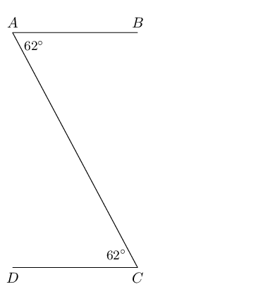

**Solution:**
\(AB \parallel CD\) (alt \(\angle\)s equal)

**Problem:**
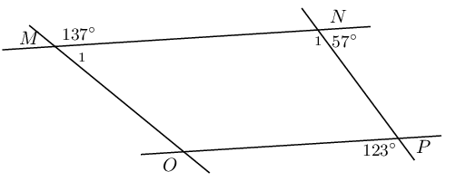

**Solution:**
Using the sum of angles on a straight line we can state the following:

- \(\hat{M}_{1} = 180^{\circ} - 137^{\circ} = 43^{\circ}\)
- \(\hat{N}_{1} = 180^{\circ} - 57^{\circ} = 123^{\circ}\)

\(NP\) not \(\parallel MO\) (corresp \(\angle\)s not equal).

\(MN \parallel OP\) (corresp \(\angle\)s equal).

**Problem:**
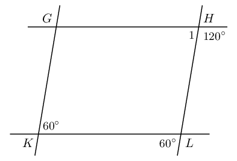

**Solution:**
\(\hat{H}_{1} = 180^{\circ} - 120^{\circ} = 60^{\circ}\) (\(\angle\)s on a str line).

Therefore \(GH \parallel KL\) (corresp \(\angle\)s equal).

And \(GK \parallel HL\) (alt \(\angle\)s equal).

The pairs of parallel lines are \(GH \parallel KL\) and \(GK \parallel HL\).

Find angles \(a\), \(b\), \(c\) and \(d\) in each case, giving reasons:

**Problem:**
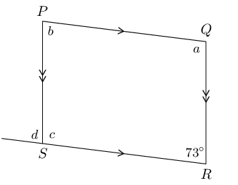

**Solution:**
\begin{align*}
            a & = 180° - 73° = 107° \qquad \text{ (co-int }\angle\text{s; } PQ \parallel SR\text{)}
            \\
            b & = 180° - 107° = 73° \text{ (co-int }\angle\text{s; } PS \parallel QR\text{)} \\
            c & = 180° - 73° = 107° \text{ (co-int }\angle\text{s; } PQ \parallel SR\text{)} \\
            d & = 73° \qquad \text{ (corresp }\angle \text{s; } PS \parallel QR \text{)}
            \end{align*}

Therefore \(a = 107°, b = 73°, c = 107°, d = 73°\).

**Problem:**
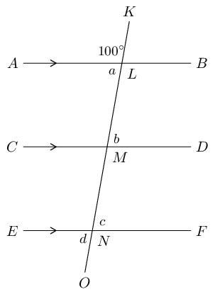

**Solution:**
\begin{align*}
            a & = 80° \qquad \text{ (sum of } \angle \text{s on str line)} \\
            b & = 80° \qquad \text{ (alt } \angle \text{s; } AB \parallel CD\text{)}\\
            c & = 80° \qquad \text{ (corresp } \angle \text{s; } CD \parallel EF \text{)} \\
            d & = 80° \qquad \text{ (vert opp } \angle\text{s } = \text{)}
            \end{align*}

Therefore \(a = b = c = d = 80°\).

**Problem:**
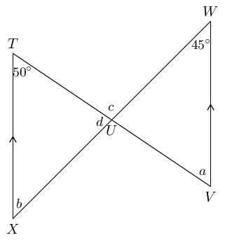

**Solution:**
\begin{align*}
            a & = 50° \qquad \text{ (alt }\angle \text{s; } TX \parallel WV \text{)}\\
            b & = 45° \qquad \text{ (alt }\angle \text{s; } TX \parallel WV \text{)}\\
            c & = 95° \qquad \text{ (ext }\angle \text{ of } \triangle \text{)}\\
            d & = 85° \qquad \text{ (sum of }\angle\text{'s in }\triangle\text{)}
            \end{align*}

Therefore \(a=50°, b=45°, c=95°, d=85°\).

Find each of the unknown angles marked in the figure below. Find a reason that leads to the answer in a
            single step.

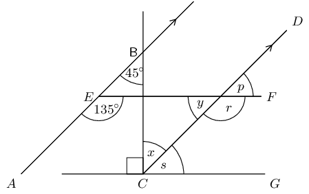

**Problem:**
\(\hat{x}\)

**Solution:**
\(\hat{x}\) and \(A\hat{B}C\) are alternate interior angles on transversal \(BC\). \(AB \parallel CD\),
              therefore they must be equal in size.

Therefore \(\hat{x} = 45^{\circ}\).

**Problem:**
\(\hat{s}\)

**Solution:**
\begin{align*}
              \hat{s} & = 90^{\circ} - 45^{\circ} \\
              & = 45^{\circ}
              \end{align*}

**Problem:**
\(\hat{r}\)

**Solution:**
\(A\hat{E}F\) corresponds to (matches) \(\hat{r}\); and corresponding angles are equal in size since \(AB
              \parallel CD\).

Therefore: \(\hat{r} = 135^{\circ}\).

**Problem:**
\(\hat{y}\)

**Solution:**
\(\hat{r} + \hat{y} = 180^{\circ}\) (\(\angle\)s on str line):

            \begin{align*}
            \hat{y} & = 180^{\circ} - 135^{\circ} \\
            & = 45^{\circ}
            \end{align*}

**Problem:**
\(\hat{p}\)

**Solution:**
\(\hat{p}\) and \(\hat{y}\) are vertically opposite angles and vertically opposite angles have the same
              measure (equal sizes).

Therefore: \(\hat{p} = 45^{\circ}\).

**Problem:**
Based on the results for the angles above, is \(EF \parallel CG\)?

**Solution:**
If \(EF\) is parallel to \(CG\), then the following things must all be true:

- \(\hat{s} = \hat{p}\) (corresponding angles)
- \(\hat{s} = \hat{y}\) (alternate interior angles)
- \(\hat{s} + \hat{r} = 180^{\circ}\) (co-interior angles)

All the above is true, therefore the lines are parallel.

**Problem:**
Given the following diagrams:

Diagram A

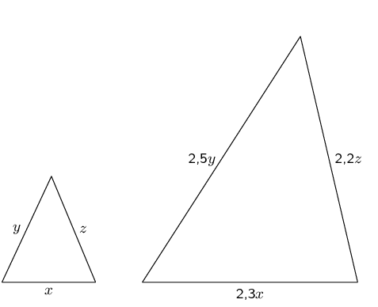

Diagram B

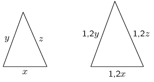

Which diagram correctly gives a pair of similar triangles?

**Solution:**
We look at the side labels. In diagram A we note that the three pairs of corresponding sides are in
            different proportions. In diagram B we note the three pairs of corresponding sides are in proportion.

Therefore diagram B gives a pair of triangles that are similar.

**Problem:**
Given the following diagrams:

Diagram A

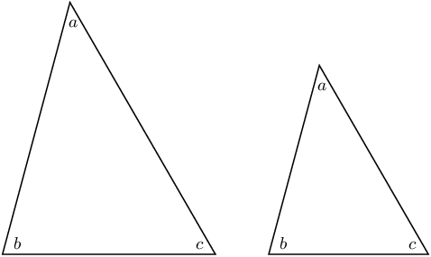

Diagram B

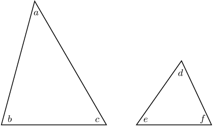

Which diagram correctly gives a pair of similar triangles?

**Solution:**
Diagram A shows a pair of triangles with all pairs of corresponding angles equal (the same three angle
            markers are shown in both triangles). Diagram B shows a pair of triangles with different angles in each
            triangle. All six angles are different and there are no pairs of corresponding angles that are equal.

Therefore diagram A gives a pair of triangles that are similar.

**Problem:**
Have a look at the following triangles, which are drawn to scale:

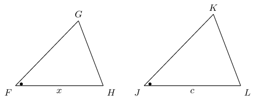

Are the triangles congruent? If so state the reason and use correct notation to state that they are
            congruent.

**Solution:**
We are given one angle that is equal. We are not given any equal sides (we do not know if \(x = c\)). To
            determine if two triangles are congruent we need to have three pieces of information (recall that the
            reasons for congruent triangles are: SSS, SAS, AAS and RHS). Therefore we cannot state whether or not the
            triangles are congruent.

Therefore, there is not enough information to determine if the two triangles are congruent.

**Problem:**
Have a look at the following triangles, which are drawn to scale:

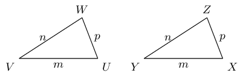

Are the triangles congruent? If so state the reason and use correct notation to state that they are
            congruent.

**Solution:**
The sides of both triangles are labelled with \(m\), \(n\) and \(p\). This means that there are three pairs
            of corresponding and equal sides.

Therefore, these two triangles are congruent (\(\triangle VWU \equiv \triangle YZX\)), reason: SSS.

Say which of the following pairs of triangles are congruent with reasons.

**Problem:**
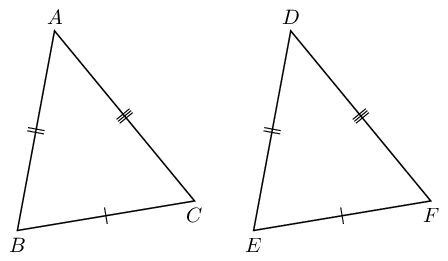

**Solution:**
We are given \(CB = FE\), \(AB = DE\) and \(AC = DF\).

Therefore \(\triangle ABC \equiv \triangle DEF\) by SSS.

**Problem:**
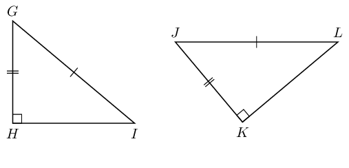

**Solution:**
We are given \(GI = JL\), \(GH = JK\) and \(G\hat{H}I = J\hat{K}L = 90^{\circ}\).

Therefore \(\triangle GHI \equiv \triangle JKL\) by RHS.

**Problem:**
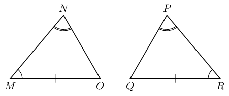

**Solution:**
We are given \(MO = QR\), \(O\hat{M}N = P\hat{R}Q\) and \(M\hat{N}O = Q\hat{P}R\).

Therefore \(\triangle MNO \equiv \triangle RPQ\) by AAS.

**Problem:**
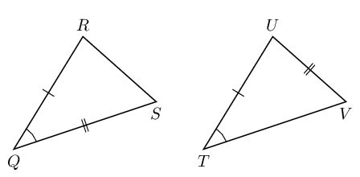

**Solution:**
We are given \(QR = TU\), \(QS = UV\) and \(S\hat{Q}R = V\hat{T}U\). But \(V\hat{T}U\) is not the
              included angle between sides \(UV\) and \(TU\).

Therefore \(\triangle QRS \text{ not congruent } \triangle TUV\).

Using the theorem of Pythagoras, calculate the length \(x\):

**Problem:**
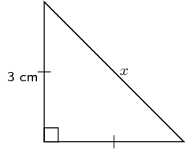

**Solution:**
\begin{align*}
            x^{2} & = (3)^{2} + (3)^{2} \\
            & = 18 \\
            x & = \sqrt{18} \\
            & = \text{4,24}\text{ cm}
            \end{align*}

**Problem:**
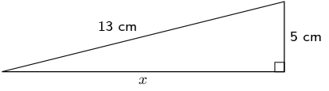

**Solution:**
\begin{align*}
            x^{2} & = (13)^{2} - (5)^{2} \\
            & = 144 \\
            x & = \text{12}\text{ cm}
            \end{align*}

**Problem:**
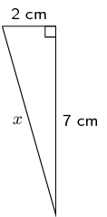

**Solution:**
\begin{align*}
            x^{2} & = (2)^{2} + (7)^{2} \\
            & = 53 \\
            x & = \sqrt{53} \\
            & = \text{7,28}\text{ cm}
            \end{align*}

**Problem:**
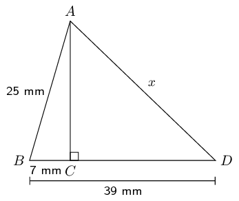

**Solution:**
First find \(AC\):

            \begin{align*}
            AC^{2} & = (25)^{2} - (7)^{2} \\
            & = 576 \\
            AC & = \sqrt{576}
            \end{align*}

Now we note that \(CD = 39 - 7 = 32\) and then we find \(x\):

            \begin{align*}
            x^{2} & = (\sqrt{576})^{2} + (32)^{2} \\
            x^{2} & = 1600 \\
            x & = \text{40}\text{ mm}
            \end{align*}

Calculate \(x\) and \(y\) in the diagrams below:

**Problem:**
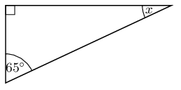

**Solution:**
\(x = 180° - 90° - 65° = 25°\) (sum of \(\angle\)s in \(\triangle\)).

**Problem:**
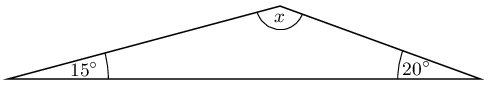

**Solution:**
\(x = 180° - 20° - 15° = 145°\) (sum of \(\angle\)s in \(\triangle\)).

**Problem:**
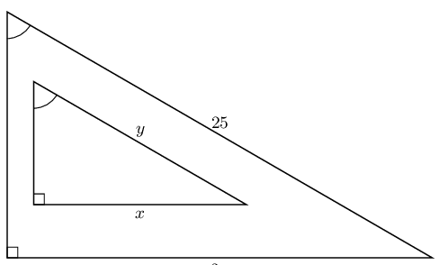

**Solution:**
We can find \(x\) using the theorem of Pythagoras:

            \begin{align*}
            25^2 & = 15^2 + (2x)^2\\
            4x^2 & = 400\\
            x^2 & = 100\\
            \therefore x & = 10
            \end{align*}

We note that the triangles are similar by AAA. Therefore the sides must be in proportion. Therefore \(y\)
              is:

            \begin{align*}
            \frac{x}{2x} &= \frac{y}{25}\\
            \therefore y &=\text{12,5}
            \end{align*}

Therefore \(x = 10\) and \(y=\text{12,5}\).

**Problem:**
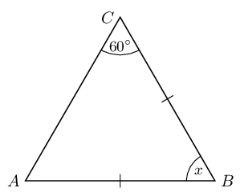

**Solution:**
This is an isosceles triangle so \(\hat{C} = \hat{A} = 60°\).

Therefore \(x = 180° - 60° - 60° = 60°\) (sum of \(\angle\)s in triangle).

**Problem:**
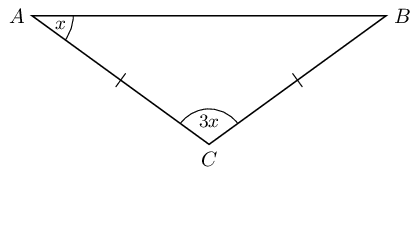

**Solution:**
This is an isosceles triangle so \(\hat{A} = \hat{B} = x\).

            \begin{align*}
            x + x + 3x& = 180° \qquad \text{(sum of } \angle \text{s in } \triangle \text{)}\\
            \therefore 5x &= 180° \\
            x & = 36°
            \end{align*}

**Problem:**
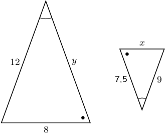

**Solution:**
The two triangles are similar by AAA. Therefore the sides are in proportion.

            \begin{align*}
            \frac{x}{9} & = \frac{8}{12}\\
            \therefore x & =6 \\\\
            \frac{y}{12} & = \frac{\text{7,5}}{9} \\
            \therefore y & = 10
            \end{align*}

Therefore \(x = 6\) and \(y = 10\).

**Problem:**
Consider the diagram below. Is \(\triangle ABC \enspace|||\enspace \triangle DEF\)? Give reasons for your
            answer.

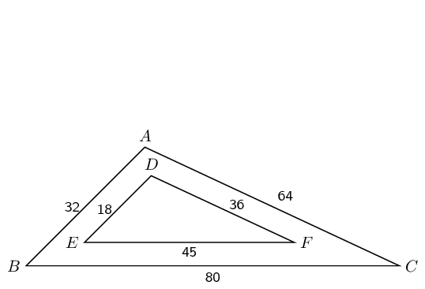

**Solution:**
\begin{align*}
          \frac{ED}{BA} &= \frac{18}{32} = \frac{9}{16} \\
          \frac{DF}{AC} &= \frac{32}{64} = \frac{9}{16} \\
          \frac{EF}{BC} &= \frac{45}{80} = \frac{9}{16}
          \end{align*}

All three pairs of sides are in proportion, \(\therefore \triangle ABC \enspace|||\enspace \triangle DEF\).

**Problem:**
Explain why \(\triangle PQR\) is similar to \(\triangle TSR\) and calculate the values of \(x\) and \(y\).

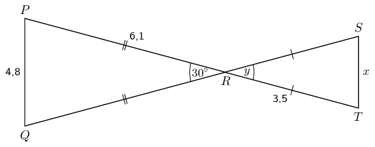

**Solution:**
\begin{align*}
          y & = 30° \qquad \text{ (vert opp }\angle\text{s} = \text{)}\\
          \hat{P} & = \hat{Q} \qquad \text{(}\angle \text{s opp equal sides)}\\
          \text{and }\hat{S} & = \hat{T} \qquad \text{(}\angle \text{s opp equal sides)}
          \end{align*}

However \(\hat{P} + \hat{Q} + 30° = 180°\) (sum of \(\angle\)s in \(\triangle\)). Therefore
            \(\hat{P} + \hat{Q} = 150°\).

Similarly \(\hat{S} + \hat{T} = 150°\).

But \(\hat{P} = \hat{Q}\) so \(2\hat{P} = 150°\) and \(\hat{S} = \hat{T}\) so \(2\hat{S} =
            150°\). Therefore \(\hat{P} = \hat{S}\).

Therefore \(\triangle PQR \enspace|||\enspace \triangle TRS\) (AAA).

Now we can use the fact that the sides are in proportion to find \(x\):

          \begin{align*}
          \frac{x}{\text{4,8}} &= \frac{\text{3,5}}{\text{6,1}} \\
          \therefore x &= \text{2,75}
          \end{align*}

Therefore \(x = \text{2,75}\) and \(y = 30°\).

**Problem:**
The following shape is drawn to scale:

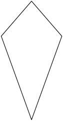

Give the most specific name for the shape.

**Solution:**
We start by counting the number of sides. There are four sides in this figure and so it is either just a
            quadrilateral or one of the special types of quadrilateral.

Next we ask ourselves if there are any parallel lines in the figure. You can look at the figure to see if
            any of the lines look parallel or make a quick sketch of the image and see if any pairs of opposite lines
            meet at a point.

Both pairs of opposite sides are not parallel. This means that the figure can only be one of the following:
            trapezium, kite or quadrilateral.

Next we ask ourselves if one of the pairs of opposite sides is parallel, while the other is not. Neither of
            the two pairs of opposite sides is parallel so we must now look to see if both pairs of adjacent sides are
            equal in length. Both pairs of adjacent sides are equal in length. So this is a kite.

Therefore this is a kite.

**Problem:**
Based on the shape that you see list the all the names of the shape. The figure is drawn to scale.

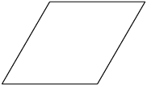

**Solution:**
Both pairs of opposite sides are parallel. That means that this shape can belong to one or more of these
            groups: square, rhombus, rectangle, and/or parallelogram.

The shape shown is a rhombus. It is certainly a quadrilateral (because it has four sides). It is also a
            parallelogram, because the opposite sides are parallel to each other. The rhombus is not a rectangle or a
            square because it does not have right angles. However, the rhombus is a kite, because it has two pairs of
            adjacent sides which are equal in length. And finally, it is a trapezium because it has a pair of opposite
            sides which are parallel.

Therefore the correct answer is: rhombus, parallelogram, kite, trapezium and quadrilateral.

**Problem:**
\(FGHI\) is a rhombus. \(\hat{F_1} = 3x + 20^{\circ}\) ; \(\hat{G_1} = x + 10^{\circ}\). Determine the
            value of \(x\).

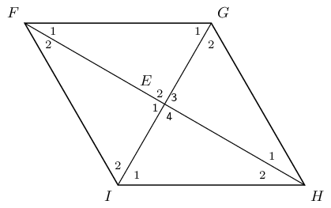

**Solution:**
\(\hat{E_2} = 90^{\circ}\) (diagonals of a rhombus bisect at right angles)

          \begin{align*}
          \hat{F_1} + \hat{G_1} + 90^{\circ} &= 180^{\circ} \qquad \text{ (sum of } \angle \text{s in }
          \triangle\text{)} \\
          3x + 20^{\circ} + x + 10^{\circ} &= 90^{\circ}\\
          4x &= 60^{\circ} \\
          \therefore x &= 15^{\circ}
          \end{align*}

In the diagram below, \(AB = BC = CD = DE = EF = FA = BE\).

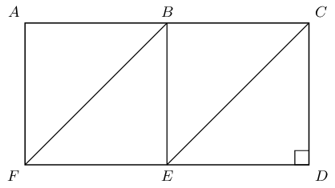

Name:

**Problem:**
\(\text{3}\) rectangles

**Solution:**
\(ACDF\), \(ABEF\) and \(BCDE\)

**Problem:**
\(\text{4}\) parallelograms

**Solution:**
\(ACDF\), \(ABEF\), \(BCDE\) and \(BCEF\)

**Problem:**
\(\text{2}\) trapeziums

**Solution:**
\(ACEF\) and \(BCDF\)

**Problem:**
\(\text{2}\) rhombi

**Solution:**
\(ABEF\) and \(BCDE\)

**Problem:**
Points \(R\) and \(P\) are the mid-points on lines \(QS\) and \(QT\). Study \(\triangle TSQ\) carefully.
            Identify the third side of this triangle, using the information as shown, together with what you know about
            the mid-point theorem. (Name the third side by its endpoints, e.g., \(FG\).)

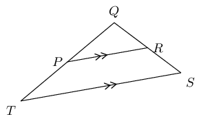

**Solution:**
The red line, \(TS\) or \(ST\), indicates the third side of the triangle. According to the mid-point
            theorem, the line joining the mid-points of two sides of a triangle is parallel to the third side of the
            triangle.

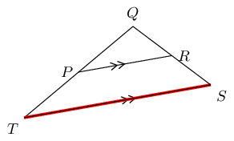

**Problem:**
Points \(X\) and \(V\) are given on the segments \(WY\) and \(WZ\). Study the triangle carefully, then
            identify and name the parallel line segments.

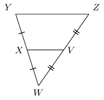

**Solution:**
The line segments \(YZ\) and \(VX\) are parallel according to the mid-point theorem because segment \(VX\)
            is bisecting the line segments \(WZ\) and \(WY\).

The figure below shows a large triangle with vertices \(A\), \(B\) and \(D\), and a smaller triangle with
            vertices at \(C\), \(D\) and \(E\). Point \(C\) is the mid-point of \(BD\) and point \(E\) is the mid-point
            of \(AD\).

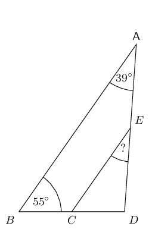

**Problem:**
The angles \(\hat{A} = 39^{\circ}\) and \(\hat{B} = 55^{\circ}\) are given; determine the value of
              \(D\hat{E}C\).

**Solution:**
\begin{align*}
            AB & \parallel EC \qquad \text{(Midpt Theorem)} \\
            D\hat{E}C & = \hat{A} \qquad \text{(corresp } \angle \text{s; } AB \parallel EC \text{)}\\
            D\hat{E}C & = 39^{\circ}
            \end{align*}

**Problem:**
The two triangles in this question are similar triangles. Complete the following statement correctly by
              giving the three vertices in the correct order (there is only one correct answer).

            \(\triangle DEC \enspace|||\enspace \triangle ?\)

**Solution:**
Angle \(D\) corresponds to angle \(D\); angle \(E\) corresponds to angle \(A\) ; and angle \(C\)
              corresponds to angle \(B\). Therefore, \(\triangle DEC \enspace|||\enspace \triangle DAB\).

The figure below shows a large triangle with vertices \(M\), \(N\) and \(Q\), and a smaller triangle with
            vertices at \(P\), \(Q\) and \(R\). Point \(P\) is the mid-point of \(NQ\) and point \(R\) is the mid-point
            of \(MQ\).

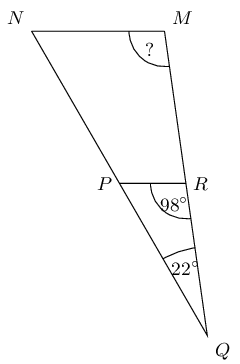

**Problem:**
With the two angles given, \(\hat{Q} = 22^{\circ}\) and \(Q\hat{R}P = 98^{\circ}\), determine the value
              of \(\hat{M}\).

**Solution:**
\begin{align*}
            MN & \parallel RP \qquad \text{(Midpt Theorem)} \\
            \hat{M} & = Q\hat{R}P \qquad \text{(corresp } \angle \text{s; } MN \parallel PR\text{)}\\
            \hat{M} & = 98^{\circ}
            \end{align*}

**Problem:**
The two triangles in this question are similar triangles. Complete the following statement correctly by
              giving the three vertices in the correct order (there is only one correct answer).

            \(\triangle QMN \enspace|||\enspace \triangle ?\)

**Solution:**
Angle \(Q\) corresponds to angle \(Q\); angle \(M\) corresponds to angle \(R\) ; and angle \(N\)
              corresponds to angle \(P\). Therefore, \(\triangle QMN \enspace|||\enspace \triangle QRP\).

**Problem:**
Consider the triangle in the diagram below. There is a line segment crossing through a large triangle.
            Notice that some segments in the figure are marked as equal to each other. One side of the triangle has a
            given length of 10. Some information is also given about the lengths of other segments along the edges of
            the triangle.

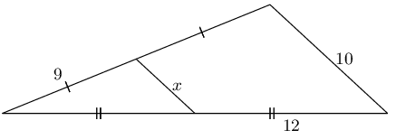

**Solution:**
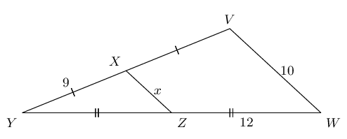

From the mid-point theorem we know:

          \begin{align*}
          VW & = 2 \times XZ \\
          \left( 10 \right) & = 2x \\
          \frac{1}{2} \left( 10 \right) & = x \\
          5 & = x
          \end{align*}

**Problem:**
In the figure below, \(GH \parallel LJ\), as labelled. Furthermore, the following lengths and angles are
            given: \(GH = 10\); \(LJ = 5\); \(HJ = 9\); \(KL = 8\) and \(\hat{G} = 84^{\circ}\). The figure is drawn to
            scale.

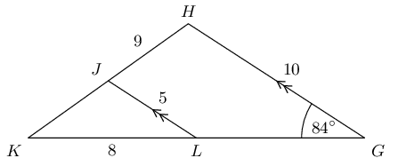

Calculate the length of \(JK\).

**Solution:**
We are given that \(GH \parallel LJ\). The length of \(JL\) is 5 and the length of \(GH\) is 10, therefore
            \(JL = \frac{1}{2}GH\).

Therefore we know from the mid-point theorem that \(L\) is the mid-point of \(GK\) and \(J\) is the
            mid-point of \(HK\).

Therefore \(HJ = JK = 9\).

**Problem:**
The figure below shows triangle \(GHK\) with the smaller triangle \(JKL\) sitting inside of it.
            Furthermore, the following lengths and angles are given: \(GH = 12 ; LJ = 7 ; HJ = 8; LG = 11\) ; \(\hat{K}
            = 33^{\circ}\). The figure is drawn to scale.

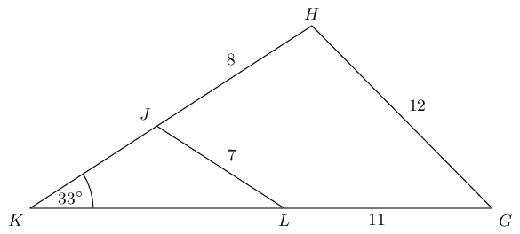

Find the length of \(KL\).

**Solution:**
You can see in the figure that the segment \(LJ\) is not parallel to \(GH\). This means that the mid-point
            theorem cannot apply to this triangle. There are no other options to use either: this question cannot be
            solved. There is no solution.

In the diagram below, \(P\) is the mid-point of \(NQ\) and \(R\) is the mid-point of \(MQ\). One side of
            the triangle has a given length of \(\dfrac{z}{2} - 2\).

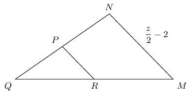

**Problem:**
Determine the value of \(PR\) in terms of \(z\).

**Solution:**
Fill in information on the diagram using the mid-point theorem:

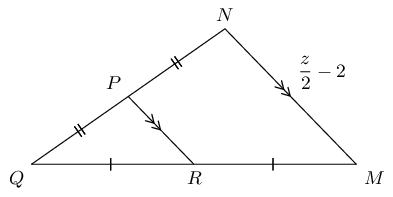

Remember that the mid-point theorem tells us that the segments \(MN\) and \(PR\) have a ratio of \(2 :
              1\) (\(MN\) is twice as long as \(PR\)).

            \begin{align*}
            MN & = 2 \times PR \\
            \left( \frac{z}{2} - 2 \right) & = 2 \left(PR\right) \\
            \frac{1}{2} \left( \frac{z}{2} - 2 \right) & = PR \\
            \frac{z}{4} - 1 & = PR
            \end{align*}

The final answer is \(PR = \dfrac{z}{4} - 1\) (half the size as \(MN\)).

**Problem:**
You are now told that \(PR\) has a length of \(\text{2}\). What is the value of \(z\)?

**Solution:**
\begin{align*}
            \frac{z}{4} - 1 & = \text{2} \\
            \frac{z}{4} & = 3 \\
            \left( 4 \right) \left( \frac{z}{4} \right) & = \left( 3 \right) \left( 4 \right) \\
            z & = 12
            \end{align*}

The final answer is \(z = 12\).

The figure below shows \(\triangle MNQ\) crossed by \(RP\). Points \(P\) and \(R\) bisect their respective
            sides of the triangle.

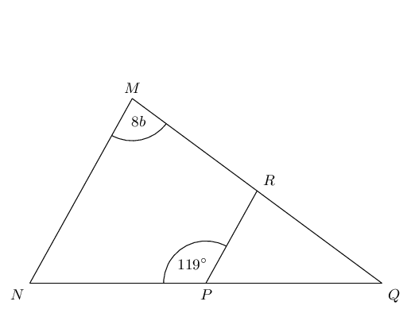

**Problem:**
With the two angles given, \(\hat{M} = 8 b\) and \(\angle {NPR} = 119^{\circ}\), determine the value of
              \(\hat{Q}\) in terms of \(b\).

**Solution:**
Redraw the diagram and fill in the known information using the mid-point theorem:

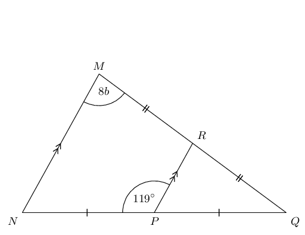

\(Q\hat{P}R = 180^{\circ} - R\hat{P}N = 180^{\circ} - 119^{\circ} = 61^{\circ}\) (\(\angle\)s on str
              line).

\(Q\hat{R}P = 8b\) (corresp \(\angle\)s; \(MN \parallel RP\)).

Therefore:

            \begin{align*}
            \hat{Q} + 8b + 61^{\circ} & = 180^{\circ} \qquad \text{(sum of } \angle \text{s in }\triangle \text{)}
            \\
            \hat{Q} & = 180^{\circ} - \left(8b + 61^{\circ} \right) \\
            & = - 8b + 119^{\circ}
            \end{align*}

**Problem:**
You are now told that \(\hat{M}\) has a measure of \(76^{\circ}\). Determine for the value of \(b\). Give
              your answer as an exact fractional value.

**Solution:**
\begin{align*}
            \hat{M} & = 76^{\circ} \\
            8b & = 76^{\circ} \\
            b & = \frac{19}{2}
            \end{align*}

The figure below shows \(\triangle MNQ\) crossed by \(RP\). Points \(P\) and \(R\) bisect their respective
            sides of the triangle.

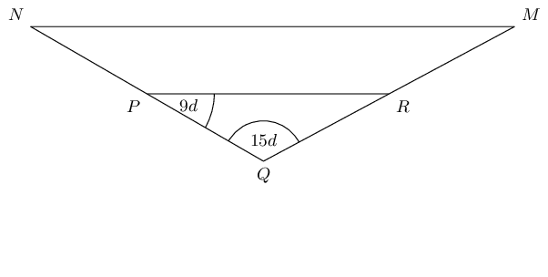

**Problem:**
The angles \(\hat{Q} = 15 d\) and \(R\hat{P}Q = 9 d\) are given in the large triangle; determine the
              value of \(\hat{M}\) in terms of \(d\).

**Solution:**
Redraw the diagram and fill in known information using the mid-point theorem:

\(P\hat{R}Q = \hat{M}\) (corresp \(\angle\)s; \(MN \parallel RP\)).

            \begin{align*}
            \hat{M} + 9d + 15d & = 180^{\circ} \qquad \text{(sum of } \angle \text{s in } \triangle \text{)}\\
            \hat{M} & = 180^{\circ} - \left( 9 d + 15 d \right) \\
            & = -24d + 180^{\circ}
            \end{align*}

**Problem:**
You are now told that \(R\hat{P}Q\) has a measure of \(60^{\circ}\). Solve for the value of \(d\). Give
              your answer as an exact fractional value.

**Solution:**
\begin{align*}
            R\hat{P}Q & = 60^{\circ} \\
            9 d & = 60^{\circ} \\
            d & = \frac{20}{3}
            \end{align*}

**Problem:**
Calculate \(a\) and \(b\):

**Solution:**
In \(\triangle TRS\) and \(\triangle PTQ\):

          \begin{align*}
          \hat{T} & = \hat{T} \qquad \text{(common }\angle \text{)} \\
          T\hat{R}S & = \hat{P} \qquad \text{(corresp } \angle \text{s; } RS \parallel PQ \text{)} \\
          T\hat{S}R & = \hat{Q} \qquad \text{(corresp } \angle \text{s; } RS \parallel PQ \text{)}
          \end{align*}

Therefore \(\triangle TRS \enspace ||| \enspace \triangle PTQ\) (AAA).

Therefore the sides are in proportion.

          \begin{align*}
          \frac{TR}{TP} & = \frac{TS}{TQ} \\
          \frac{a}{a + 15} &= \frac{\frac{b}{4}}{b} \\
          \frac{a}{a + 15} &= \frac{1}{4} \\
          a &= (a + 15) \left(\frac{1}{4}\right) \\
          4a & = a + 15\\
          3a & = 15\\
          \therefore a & = 5\\\\
          b & = \frac{b}{4} + 9\\
          4b & = b + 36\\
          3b & = 36 \\
          \therefore b & = 12
          \end{align*}

Therefore: \(a = 5\) and \(b=12\).

**Problem:**
\(\triangle PQR\) and \(\triangle PSR\) are equilateral triangles. Prove that \(PQRS\) is a rhombus.

**Solution:**
We are given two equilateral triangles, therefore in \(\triangle PSR\): \(PS = SR = PR\) and in \(\triangle
            PQR\): \(PQ = QR = PR\).

But \(PR\) is a common side and so \(PR = PS = SR = PQ = QR\).

Also in each triangle all the interior angles are equal to 60°. Therefore \(\hat{P}_{1} =
            \hat{R}_{2}\) and \(\hat{P}_{2} = \hat{R}_{2}\). Therefore \(PQ \parallel SR\) and \(PS \parallel QR\) (alt.
            int. \(\angle\)'s equal).

\(\therefore PQRS\) is a rhombus (all sides are equal in length, both pairs of opposite sides parallel).

\(LMNO\) is a quadrilateral with \(LM = LO\) and diagonals that intersect at \(S\) such that \(MS = SO\).
            Prove that:

**Problem:**
\(M\hat{L}S = S\hat{L}O\)

**Solution:**
\begin{align*}
            \text{In }\triangle LMS &\text{ and }\triangle LOS\\
            LM &= LO \text{ (given)}\\
            MS&=SO \text{ (given)}\\
            LS &\text{ is a common side}\\
            \therefore \triangle LMS &\equiv \triangle LOS \text{ (SSS)}\\
            \therefore M\hat{L}S &= S\hat{L}O
            \end{align*}

**Problem:**
\(\triangle LON \equiv \triangle LMN\)

**Solution:**
\begin{align*}
            \text{In }\triangle LON &\text{ and }\triangle LMN\\
            LO &= LM \text{ (given)}\\
            M\hat{L}S &= S\hat{L}O \text{ (proved above)}\\
            LN &\text{ is a common side}\\
            \therefore \triangle LON &\equiv \triangle LMN \text{ (SAS)}
            \end{align*}

**Problem:**
\(MO \perp LN\)

**Solution:**
We need to show that one of \(L\hat{S}M\) or \(L\hat{S}O\) or \(M\hat{S}N\) or \(O\hat{S}N\) is equal to
              90°.

We have already proved that \(M\hat{L}S = O\hat{L}S\) and that \(L\hat{M}S = L\hat{O}S\) (using congruent
              triangles).

We also note that \(M\hat{L}O = M\hat{L}S + O\hat{L}S\).

Next we note that:

            \begin{align*}
            M\hat{L}S + O\hat{L}S + L\hat{M}S = L\hat{O}S &= 180° \text{ (sum of }\angle \text{s in
            }\triangle\text{)} \\
            \therefore 2(M\hat{L}S) + 2(L\hat{M}S) &= 180°\\
            2(M\hat{L}S + L\hat{M}S) &= 180° \\
            M\hat{L}S + L\hat{M}S &= 90°
            \end{align*}

Now we note that:

            \begin{align*}
            L\hat{S}O &= M\hat{L}S + L\hat{M}S \text{ (ext }\angle \text{ of }\triangle{)} \\
            \therefore L\hat{S}O &= 90°\\
            \therefore MO &\perp LN
            \end{align*}

**Problem:**
Using the figure below, show that the sum of the three angles in a triangle is 180°. Line \(DE\) is
            parallel to \(BC\).

**Solution:**
\(DE \parallel BC\) (given).

\(e = c\) (alt \(\angle\)s; \(DE \parallel BC\)).

\(d = b\) (alt \(\angle\)s; \(DE \parallel BC\)).

\(d + a + e = 180°\) (\(\angle\)s on str line).

And we have shown that \(e = c\) and \(d = b\) therefore we can replace \(d\) with \(b\) and \(e\) with
            \(c\) to get:

\(a + b + c = 180°\).

Therefore the angles in a triangle add up to \(180°\).

\(PQR\) is an isosceles triangle with \(PR = QR\). \(S\) is the mid-point of \(PQ\), \(T\) is the mid-point
            of \(PR\) and \(U\) is the mid-point of \(RQ\).

**Problem:**
Prove \(\triangle STU\) is also isosceles.

**Solution:**
\begin{align*}
            PT&=\frac{1}{2} PR \text{ (given)}\\
            S &\text{ mid-point of } PQ\\
            U &\text{ mid-point of } RQ\\
            SU&=\frac{1}{2}PR\\
            \therefore SU&=PT\\
            S &\text{ mid-point of }PQ\\
            T &\text{ mid-point of }PR\\
            \therefore ST &= \frac{1}{2}QR=QU\\
            \text{But }PR&=QR \text{ (given)}\\
            \therefore SU&=ST\\
            \therefore \triangle STU &\text{ is isosceles.}
            \end{align*}

**Problem:**
What type of quadrilateral is \(STRU\)? Motivate your answer.

**Solution:**
\(STRU\) is a rhombus. It is a parallelogram since \(SU \parallel TR\) and \(ST \parallel UR\) (from the
              mid-point theorem) with four equal sides: \(US = ST = TR = RU\) (given and proved above).

**Problem:**
If \(R\hat{T}U = 68°\) calculate, with reasons, the size of \(T\hat{S}U\).

**Solution:**
\begin{align*}
            R\hat{T}U &= 68°\\
            \therefore T\hat{U}S &= 68° \qquad \text{ (alt }\angle \text{s; }TR \parallel SU\text{)} \\
            \therefore S\hat{T}U &= 68° \qquad \text{(}\angle \text{s opp equal sides} \\
            \therefore T\hat{S}U &= 180° - 2(68)° \qquad \text{(sum of } \angle \text{s in } \triangle
            \text{)} \\
            \therefore T\hat{S}U &= 180° - 136° \\
            & = 44°
            \end{align*}

**Problem:**
\(ABCD\) is a parallelogram. \(BE = BC\). Prove that \(A\hat{B}E = B\hat{C}D\).

**Solution:**
\begin{align*}
          B\hat{C}D & = B\hat{E}C \qquad \text{(}\angle \text{s opp equal sides} \\
          A\hat{B}E & = B\hat{E}C \text{ (alt } \angle\text{s; } AB \parallel DC \text{)} \\
          \therefore A\hat{B}E & = B\hat{C}D
          \end{align*}

In the diagram below, \(D\), \(E\) and \(G\) are the mid-points of \(AC\), \(AB\) and \(BC\) respectively.
            \(EC \parallel FG\).

**Problem:**
Prove that \(FECG\) is a parallelogram.

**Solution:**
\begin{align*}
            AE & = EB \text{ ( } E \text{ is mid-point )} \\
            AD & = DC \text{ ( } D \text{ is mid-point )} \\
            FD & \parallel BC \text{ (Midpt Theorem)} \\
            EC & \parallel FG \text{ (given)} \\
            \therefore FECG & \text{ is a parallelogram (opp sides of quad are } \parallel \text{)}
            \end{align*}

**Problem:**
Prove that \(FE = ED\).

**Solution:**
\begin{align*}
            ED & = \frac{1}{2}BC \text{ (Midpt Theorem)} \\
            GC & = \frac{1}{2}BC \text{(definition of mid-point)} \\
            \therefore ED & = GC \\
            FE & = GC \text{ (opp sides of }\parallel \text{m)} \\
            \therefore ED & = FE
            \end{align*}
