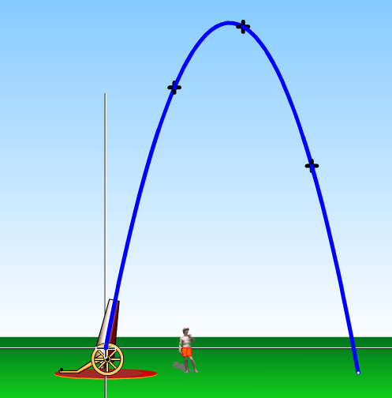
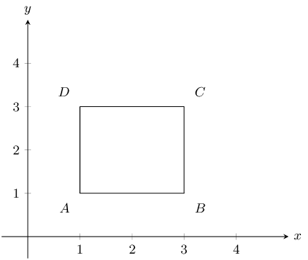
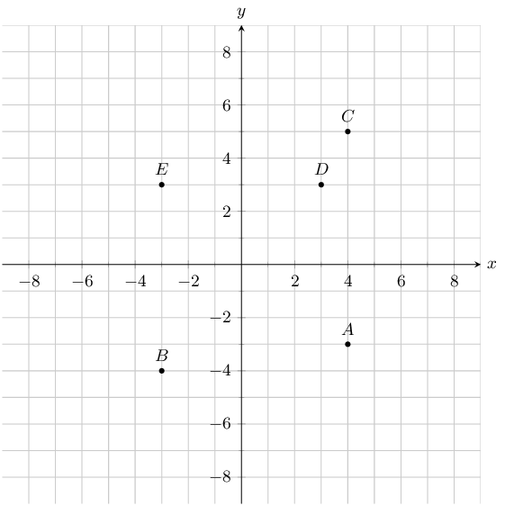
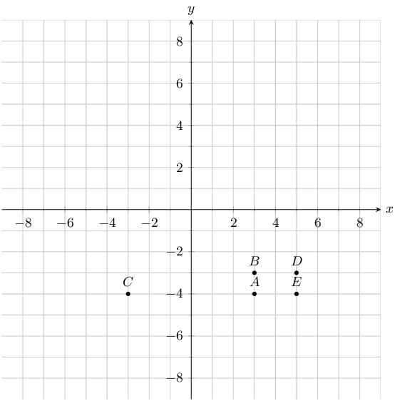
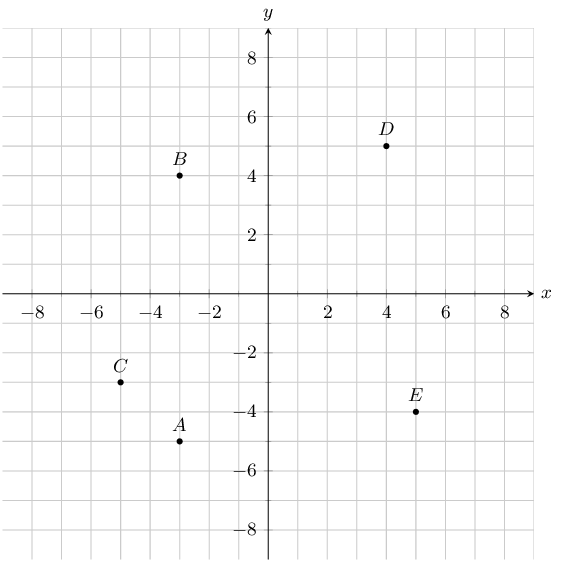
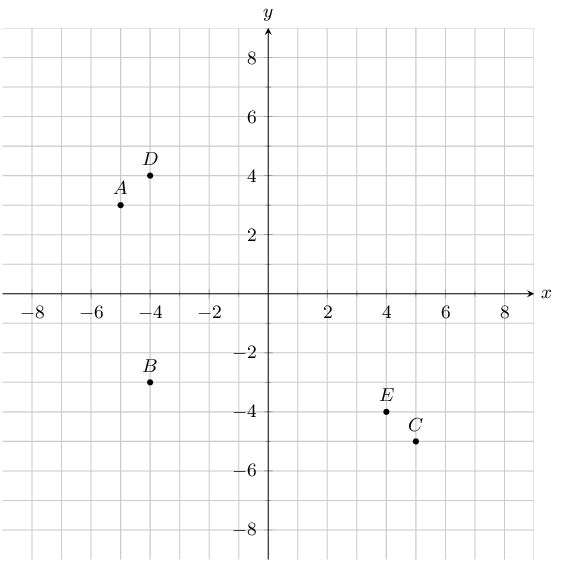
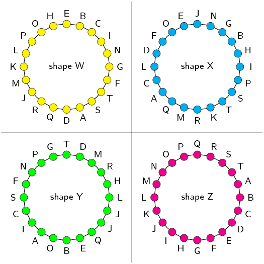
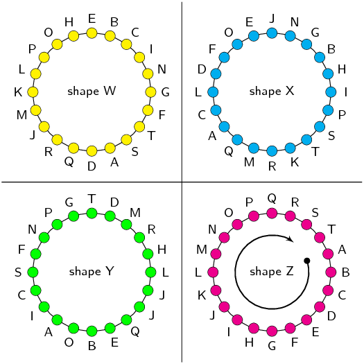
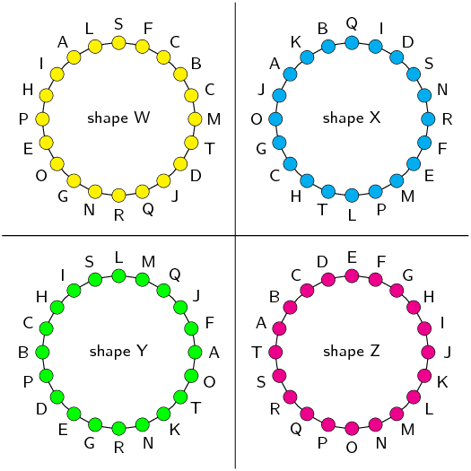
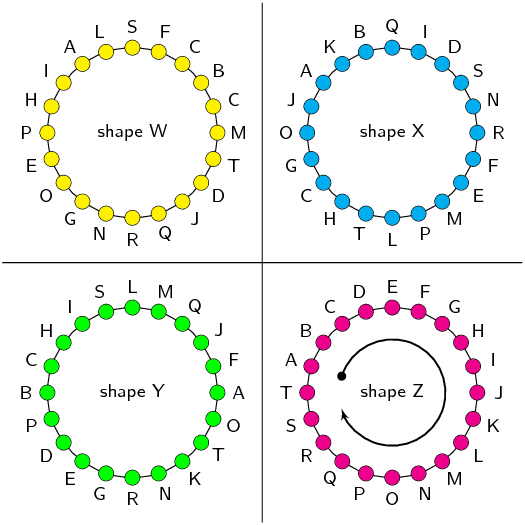

# Chapter 8: Analytical geometry

- This chapter covers representing geometric figures on the Cartesian co-ordinate system. Also covered are the
        distance formula, gradient of a line and mid-point of a line.
- Distance formulae, gradient of a line and mid-point of a line should first be derived and then applied to
        solving problems.
- Integrate Euclidean geometry knowledge with analytical geometry. It may be helpful to have learners write down
        the properties of the special quadrilaterals and keep this handy while working through analytical geometry.
- Emphasise the value and importance of making sketches.
- Emphasise the importance of writing coordinates consistently for the distance formula and gradient.
- This chapter also draws strongly on the equation of a straight line. Ensure learners are comfortable working
        with the equation of a straight line.

mathopenref.com has many
      interactive elements that you can use while teaching analytical geometry.

Analytical geometry is the study of geometric properties, relationships and measurement of points, lines and angles
    in the Cartesian plane. Geometrical shapes are defined using a coordinate system and algebraic principles. Some
    consider the introduction of analytical geometry, also called coordinate or Cartesian geometry, to be the beginning
    of modern mathematics.

The motion of a projectile can be plotted on the Cartesian plane. Animators use this information to help them
        create animations.

## 8.1 Drawing figures on the Cartesian plane (EMA68)

If we are given the coordinates of the vertices of a figure, we can draw the figure on the Cartesian plane. For
      example, quadrilateral \(ABCD\) with coordinates \(A\left(1;1\right)\), \(B\left(3;1\right)\),
      \(C\left(3;3\right)\) and \(D\left(1;3\right)\).

We use a semi-colon (;) to separate the \(x\) and \(y\) values but the internationally accepted method is to
        use a comma (,). If a comma is used than it becomes unclear as to whether the comma is separating the \(x\) and
        \(y\) values or one of the values is a decimal. For example the point \((\text{5,5},5)\) is ambiguous. Is the
        \(x\) value \(\text{5,5}\) or is the \(y\) value \(\text{5,5}\)?

<Callout type="note" title="Note">
You might also see coordinates written as \(A(1,1)\).
</Callout>

The order of the letters for naming a figure is important. It indicates the order in which points must be joined:
      \(A\) to \(B\), \(B\) to \(C\), \(C\) to \(D\) and \(D\) back to \(A\). So the above quadrilateral can be referred
      to as quadrilateral \(ABCD\) or \(CBAD\) or \(BADC\). However it is conventional to write the letters in
      alphabetical order and so we only refer to the quadrilateral as \(ABCD\).

<Callout type="tip" title="Multimedia & Video">
You can use an online tool to help you when plotting points on the Cartesian plane. Click here to try this one
        on mathsisfun.com.
</Callout>

### Textbook Exercise 8.1

**Problem:**
You are given the following diagram, with various points shown:

Find the coordinates of point \(D\).

**Solution:**
For this question, we are only interested in point \(D\). From the graph we can read off the \(x\) and
              \(y\) values.

Point \(D\) has the following coordinates: \((3;3)\).

**Problem:**
You are given the following diagram, with various points shown:

Find the coordinates of all the labelled points.

**Solution:**
From the graph we can read off the \(x\) and \(y\) values for each point.

\(A(3;-4)\), \(B(3;-3)\), \(C(-3;-4)\), \(D(5;-3)\) and \(E(5;-4)\).

**Problem:**
You are given the following diagram, with various points shown:

Which point lies at the coordinates \((5;-4)\)?

**Solution:**
For this question, we are must find point \((5;-4)\).

On the graph we can trace the \(x\) and \(y\) values to find which point lies at the coordinates
              \((5;-4)\).

Doing so we find that point \(E\) lies at the coordinates \((5;-4)\).

**Problem:**
You are given the following diagram, with various points shown:

Which point lies at the coordinates \((-4;-3)\)?

**Solution:**
For this question, we are must find point \((-4;-3)\).

On the graph we can trace the \(x\) and \(y\) values to find which point lies at the coordinates
              \((-4;-3)\).

Doing so we find that point \(B\) lies at the coordinates \((-4;-3)\).

**Problem:**
You are given the following diagram, with 4 shapes drawn.

All the shapes are identical, but each shape uses a different naming convention:

Which shape uses the correct naming convention?

**Solution:**
We recall that the correct naming convention for a shape is in alphabetical order,
              either clockwise or anti-clockwise around the shape.

From the diagram, we can see that only shape Z sticks to this naming convention.

**Problem:**
You are given the following diagram, with 4 shapes drawn.

All the shapes are identical, but each shape uses a different naming convention:

Which shape uses the correct naming convention?

**Solution:**
We recall that the correct naming convention for a shape is in alphabetical order,
              either clockwise or anti-clockwise around the shape.

From the diagram, we can see that only shape Z sticks to this naming convention.

