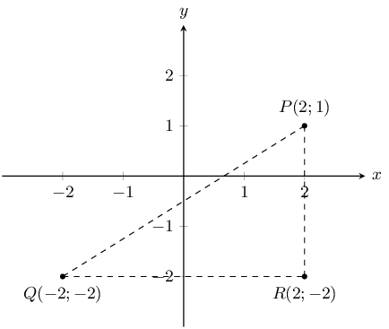
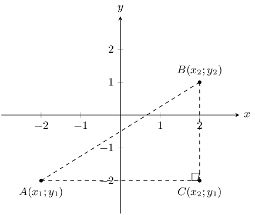
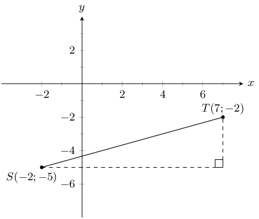
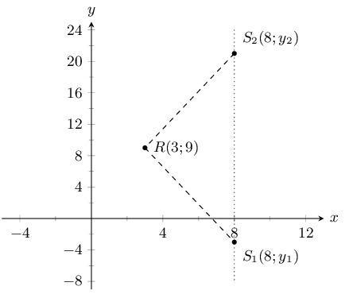
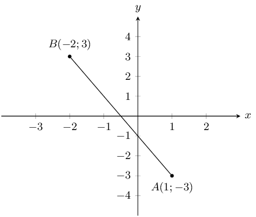
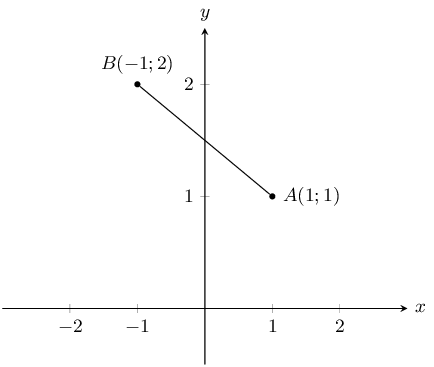
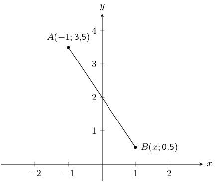
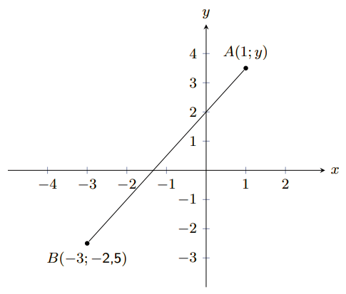

## 8.2 Distance between two points (EMA69)

A point is a simple geometric object having location as its only property.

<Callout type="info" title="Definition: Point">
A point is an ordered pair of numbers written as \(\left(x;y\right)\).
</Callout>

<Callout type="info" title="Definition: Distance">
Distance is a measure of the length between two points.
</Callout>

## Distance between two points

Points \(P\left(2;1\right)\), \(Q\left(-2;-2\right)\) and \(R\left(2;-2\right)\) are given.

- Can we assume that \(\hat{R} = 90°\)? If so, why?
- Apply the theorem of Pythagoras in \(\triangle PQR\) to find the length of \(PQ\).

To derive a general formula for the distance between two points \(A\left({x}_{1};{y}_{1}\right)\) and
      \(B\left({x}_{2};{y}_{2}\right)\) we use the theorem of Pythagoras.

\begin{align*}
    AB^{2} & = AC^{2} + BC^{2} \\
    \therefore AB & = \sqrt{AC^{2} + BC^{2}}
    \end{align*}

And:

    \begin{align*}
    AC & = {x}_{2} - {x}_{1} \\
    BC & = {y}_{2} - {y}_{1}
    \end{align*}

Therefore:

    \begin{align*}
    AB & = \sqrt{AC^{2} + BC^{2}} \\
    & = \sqrt{{\left({x}_{2} - {x}_{1}\right)}^{2} + {\left({y}_{2} - {y}_{1}\right)}^{2}}
    \end{align*}

Therefore to calculate the distance between any two points, \(\left({x}_{1};{y}_{1}\right)\) and
      \(\left({x}_{2};{y}_{2}\right)\), we use:

\(\text{distance }\left(d\right) = \sqrt{{\left({x}_{1} - {x}_{2}\right)}^{2} + {\left({y}_{1} -
        {y}_{2}\right)}^{2}}\)

Note that \({\left({x}_{1} - {x}_{2}\right)}^{2} = {\left({x}_{2} - {x}_{1}\right)}^{2}\).

<Callout type="tip" title="Multimedia & Video">
The following video gives two examples of working with the distance formula and shows how to determine the
        distance formula.

<VideoPlayer src="https://www.youtube.com/embed/nyZuite17Pc" title="Video: 2GBS" />
</Callout>

<Callout type="tip" title="Worked example 1: Using the distance formula">
**Question:**
Find the distance between \(S\left(-2;-5\right)\) and \(Q\left(7;-2\right)\).

**Draw a sketch:**

**Assign values to \(\left({x}_{1};{y}_{1}\right)\) and \(\left({x}_{2};{y}_{2}\right)\):**
Let the coordinates of \(S\) be \(\left({x}_{1};{y}_{1}\right)\) and the coordinates of \(T\) be
          \(\left({x}_{2};{y}_{2}\right)\).

        \[{x}_{1} = -2 \quad {y}_{1} = -5 \quad {x}_{2} = 7 \quad {y}_{2} = -2\]

**Write down the distance formula:**
\[d = \sqrt{{\left({x}_{1} - {x}_{2}\right)}^{2} + {\left({y}_{1} - {y}_{2}\right)}^{2}}\]

**Substitute values:**
\begin{align*}
        {d}_{ST} & = \sqrt{{\left(-2 - 7\right)}^{2} + {\left(-5 - \left(-2\right)\right)}^{2}} \\
        & = \sqrt{{\left(-9\right)}^{2} + {\left(-3\right)}^{2}} \\
        & = \sqrt{81 + 9} \\
        & = \sqrt{90} \\
        & = \text{9,5}
        \end{align*}

**Write the final answer:**
The distance between \(S\) and \(T\) is \(\text{9,5}\) units.
</Callout>

<QuizCard id="m10-08-02a" title="Interactive Exercise 8.2" question="The following diagram shows two points on the Cartesian plane. Point \(A\) is at \(\left(-\text{2} \, ; -\text{1} \right)\) and point \(B\) is at \(\left(\text{3}\, ;\text{2} \right)\) . Calculate the length of line segment \(AB\) INSTRUCTION: Round your answer to two decimal places ." options=[] explanation="Refer to the section rules and worked examples to verify." />

<Callout type="tip" title="Worked example 2: Using the distance formula">
**Question:**
Given \(RS = 13\), \(R\left(3;9\right)\) and \(S\left(8;y\right)\). Find \(y\).

**Draw a sketch:**

Note that we expect two possible values for \(y\). This is because the distance formula includes the term
          \((y_{1} - y_{2})^{2}\) which results in a quadratic equation when we substitute in the \(y\) coordinates.

**Assign values to \(\left({x}_{1};{y}_{1}\right)\) and \(\left({x}_{2};{y}_{2}\right)\):**
Let the coordinates of \(R\) be \(\left({x}_{1};{y}_{1}\right)\) and the coordinates of \(S\) be
          \(\left({x}_{2};{y}_{2}\right)\).

        \[{x}_{1} = 3 \quad {y}_{1} = 9 \quad {x}_{2} = 8 \quad {y}_{2} = y\]

**Write down the distance formula:**
\[d = \sqrt{{\left({x}_{1} - {x}_{2}\right)}^{2} + {\left({y}_{1} - {y}_{2}\right)}^{2}}\]

**Substitute values and solve for \(y\):**
\begin{align*}
        13 & = \sqrt{{\left(3 - 8\right)}^{2} + {\left(9 - y\right)}^{2}} \\
        {13}^{2} & = {\left(-5\right)}^{2} + \left(81 - 18y + {y}^{2}\right) \\
        0 & = {y}^{2} - 18y - 63 \\
        & = \left(y + 3\right)\left(y - 21\right) \\
        \therefore y = -3& \text{ or } y = 21
        \end{align*}

**Check both values for \(y\):**
Check \(y = -3\):

        \begin{align*}
        d & = \sqrt{{\left({x}_{1} - {x}_{2}\right)}^{2} + {\left({y}_{1} - {y}_{2}\right)}^{2}} \\
        & = \sqrt{{\left(3 - 8\right)}^{2} + {\left(9 + 3\right)}^{2}} \\
        & = \sqrt{25 + 144} \\
        & = \sqrt{169} \\
        & = 13
        \end{align*}

Check \(y = 21\):

        \begin{align*}
        d & = \sqrt{{\left({x}_{1} - {x}_{2}\right)}^{2} + {\left({y}_{1} - {y}_{2}\right)}^{2}} \\
        & = \sqrt{{\left(3 - 8\right)}^{2} + {\left(9 - 21\right)}^{2}} \\
        & = \sqrt{25 + 144} \\
        & = \sqrt{169} \\
        & = 13
        \end{align*}

**Write the final answer:**
\(S\) is \(\left(8;-3\right)\) or \(\left(8;21\right)\).

Therefore \(y = -3\) or \(y = 21\).
</Callout>

<QuizCard id="m10-08-02b" title="Interactive Exercise 8.3" question="The following picture shows two points on the Cartesian plane, \(A(-\text{3}\, ;                 -\text{4})\) and \(B(\text{1}\, ;                 y)\) . The distance between the points is \(\text{8,94}\) . Calculate the missing coordinate of point \(B\) . INSTRUCTION: Round your answer to one decimal place ." options=[] explanation="Refer to the section rules and worked examples to verify." />

<Callout type="note" title="Note">
Drawing a sketch helps with your calculation and makes it easier to check if your answer is correct.
</Callout>

### Textbook Exercise 8.2

**Problem:**
You are given the following diagram:

Calculate the length of line \(AB\), correct to 2 decimal places.

**Solution:**
First we recall the equation for distance:

            \(\begin{aligned}
            d_{AB} & = \sqrt{(x_B - x_A)^2 + (y_B - y_A)^2}\\
            & = \sqrt{(\text{1} - (-\text{2}))^2 + (-\text{3} - (\text{3}))^2} \\
            & = \sqrt{(\text{1} \text{+2})^2 + (-\text{3} -\text{3})^2} \\
            & = \sqrt{(\text{3})^2 + (-\text{6})^2} \\
            & = \sqrt{\text{9} + \text{36}} \\
            & = \sqrt{\text{45}} \\
            & \approx \text{6,71}
            \end{aligned}\)

**Problem:**
You are given the following diagram:

Calculate the length of line \(AB\), correct to 2 decimal places.

**Solution:**
First we recall the equation for distance:

            \(\begin{aligned}
            d_{AB} & = \sqrt{(x_B - x_A)^2 + (y_B - y_A)^2}\\
            & = \sqrt{(\text{1} - (-\text{1}))^2 + (\text{1} - (\text{2}))^2} \\
            & = \sqrt{(\text{1} \text{+1})^2 + (\text{1} -\text{2})^2} \\
            & = \sqrt{(\text{2})^2 + (-\text{1})^2} \\
            & = \sqrt{\text{4} + \text{1}} \\
            & = \sqrt{\text{5}} \\
            & \approx \text{2,24}
            \end{aligned}\)

**Problem:**
The following picture shows two points on the Cartesian plane, \(A\) and \(B\).

The distance between the points is \(\text{3,6056}\). Calculate the missing coordinate of point \(B\).

**Solution:**
First we recall the equation for distance:

\(\begin{aligned}
              d_{AB} & = \sqrt{(x_B - x_A)^2 + (y_B - y_A)^2}\\
              \text{3,6056} & = \sqrt{(x - (-\text{1}))^2 + (\text{0,5} - (\text{3,5}))^2} \\
              \text{3,6056} & = \sqrt{(x \text{+1})^2 + (\text{0,5} -\text{3,5})^2}
              \end{aligned}\)

Now we re-arrange, and solve for the value of \(x\):

\(\begin{aligned}
              (\text{3,6056})^2 & = (x + \text{1})^2 + (\text{0,5} - \text{3,5})^2 \\
              \text{13} & = (x + \text{1})^2 + (\text{0,5} -\text{3,5})^2 \\
              \text{13} & = (x + \text{1})^2 + \text{9} \\
              (x+1)^2 & = \text{4} \\
              x + \text{1} & = \pm \sqrt{\text{4}} \\
              x & = \pm \text{2} -\text{1} \\
              x & = \text{1} \text{ or } -\text{3}
              \end{aligned}\)

We now have a choice between 2 values for \(x\). From the diagram we can see that the appropriate value
              for this question is \(x = \text{1}\).

Note that in this case we can use the diagram to check that our answer is valid but we can also calculate
              the distance of line \(AB\) using our answer.

**Problem:**
The following picture shows two points on the Cartesian plane, \(A\) and \(B\).

The line \(AB\) has a length of \(\text{7,2111}\). Calculate the missing coordinate of point \(B\). Round
              your answer to one decimal place.

**Solution:**
First we recall the equation for distance:

\(\begin{aligned}
              d_{AB} & = \sqrt{(x_B - x_A)^2 + (y_B - y_A)^2}\\
              \text{7,2111} & = \sqrt{(\text{1} - (-\text{3}))^2 + (y - (-\text{2,5}))^2} \\
              \text{7,2111} & = \sqrt{(\text{1} + \text{3})^2 + (y + \text{2,5})^2}
              \end{aligned}\)

Now we re-arrange, and solve for the value of \(y\):

\(\begin{aligned}
              (\text{7,2111})^2 & = (\text{1} + \text{3})^2 + (y + \text{2,5})^2 \\
              \text{52} & = (\text{1} + \text{3})^2 + (y + \text{2,5})^2 \\
              \text{52} & = (y + \text{2,5})^2 + \text{16} \\
              (y + \text{2,5})^2 & = \text{36} \\
              y + \text{2,5} & = \pm \sqrt{\text{36}} \\
              y & = \pm \text{6} - \text{2,5} \\
              y & = \text{3,5} \text{ or } -\text{8,5}
              \end{aligned}\)

We now have a choice between 2 values for \(y\). From the diagram we can see that the appropriate value
              for this question is \(y = \text{3,5}\).

Note that in this case we can use the diagram to check that our answer is valid but we can also calculate
              the distance of line \(AB\) using our answer.

Find the length of \(AB\) for each of the following. Leave your answer in surd form.

**Problem:**
\(A(2;7)\) and \(B(-3;5)\)

**Solution:**
\begin{align*}
              d_{AB} &= \sqrt{(x_1 - x_2)^2 + (y_1 - y_2)^2}\\
              & = \sqrt{(2 - (-3))^2 + (7 - 5)^2}\\
              &= \sqrt{(5)^2 + (2)^2}\\
              & = \sqrt{29}
              \end{align*}

**Problem:**
\(A(-3;5)\) and \(B(-9;1)\)

**Solution:**
\begin{align*}
              d_{AB} &= \sqrt{(x_1 - x_2)^2 + (y_1 - y_2)^2}\\
              & = \sqrt{(-3 - (-9))^2 + (5 - 1)^2}\\
              & = \sqrt{(6)^2 + (4)^2}\\
              & = \sqrt{52}
              \end{align*}

**Problem:**
\(A(x;y)\) and \(B(x + 4; y - 1)\)

**Solution:**
\begin{align*}
              d_{AB} &= \sqrt{(x_1 - x_2)^2 + (y_1 - y_2)^2}\\
              & = \sqrt{(x - (x + 4))^2 + (y - (y - 1))^2}\\
              & = \sqrt{(x - x - 4)^2 + (y - y + 1)^2}\\
              & = \sqrt{(-4)^2 + (1)^2}\\
              & = \sqrt{17}
              \end{align*}

The length of \(CD = 5\). Find the missing coordinate if:

**Problem:**
\(C(6;-2)\) and \(D(x;2)\).

**Solution:**
\begin{align*}
              d_{CD} & = \sqrt{(x_1 - x_2)^2 + (y_1 - y_2)^2} \\
              5 & = \sqrt{(6 - x)^2 + (-2 - 2)^2} \\
              5^2 & = 36 - 12x + x^2 + 16\\
              0 & = x^2 - 12x + 36 - 25 + 16\\
              & = x^2 - 12x + 27 \\
              & = (x - 3)(x - 9)
              \end{align*}

Therefore \(x = 3\) or \(x = 9\).

Check solution for \(x = 3\):

              \begin{align*}
              d_{CD} & = \sqrt{(x_1 - x_2)^2 + (y_1 - y_2)^2} \\
              & = \sqrt{(6 - 3)^2 + (-2 - 2)^2} \\
              & = \sqrt{(3)^2 + (-4)^2} \\
              & = \sqrt{25} \\
              & = 5
              \end{align*}

Solution is valid.

Check solution for \(x = 9\):

              \begin{align*}
              d_{CD} & = \sqrt{(x_1 - x_2)^2 + (y_1 - y_2)^2} \\
              & = \sqrt{(6 - 9)^2 + (-2 - 2)^2} \\
              & = \sqrt{(-3)^2 + (-4)^2} \\
              & = \sqrt{25} \\
              & = 5
              \end{align*}

Solution is valid.

**Problem:**
\(C(4;y)\) and \(D(1;-1)\).

**Solution:**
\begin{align*}
              d_{CD} &= \sqrt{(x_1 - x_2)^2 + (y_1 - y_2)^2}\\
              5 &= \sqrt{(4 - 1)^2 + (y + 1)^2}\\
              5^2 &= 9+y^2 + 2y + 1\\
              0 &= y^2 + 2y + 1 + 9 - 25\\
              &= y^2 + 2y - 15\\
              &= (y - 3)(y + 5)
              \end{align*}

Therefore \(y = 3\) or \(y = -5\).

Check solution for \(y = 3\):

              \begin{align*}
              d_{CD} &= \sqrt{(x_1 - x_2)^2 + (y_1 - y_2)^2}\\
              &= \sqrt{(4 - 1)^2 + (3 + 1)^2}\\
              &= \sqrt{3^2 + 4^2} \\
              &= \sqrt{25} \\
              &= 5
              \end{align*}

Solution is valid.

Check solution for \(y = -5\):

              \begin{align*}
              d_{CD} & = \sqrt{(x_1 - x_2)^2 + (y_1 - y_2)^2}\\
              & = \sqrt{(4 - 1)^2 + (-5 + 1)^2}\\
              & = \sqrt{(3)^2 + (-4)^2}\\
              & = \sqrt{25}\\
              & = 5
              \end{align*}

Solution is valid.

**Problem:**
If the distance between \(C(0;-3)\) and \(F(8;p)\) is 10 units, find the possible values of \(p\).

**Solution:**
\begin{align*}
            10 & = \sqrt{(8 - 0)^{2} + (p + 3)^{2}} \\
            & = \sqrt{8^{2} + (p + 3)^{2}} \\
            100 & = 8^{2} + (p + 3)^{2} \\
            36 & = p^{2} + 6p + 9 \\
            0 & = p^{2} + 6p - 27 \\
            & = (p - 3)(p + 9) \\
            \therefore p = 3 & \text{ or } p = -9
            \end{align*}

Check \(p = 3\):

            \begin{align*}
            d & = \sqrt{{\left({x}_{1} - {x}_{2}\right)}^{2} + {\left({y}_{1} - {y}_{2}\right)}^{2}} \\
            & = \sqrt{{\left(8 - 0\right)}^{2} + {\left(3 + 3\right)}^{2}} \\
            & = \sqrt{64 + 36} \\
            & = \sqrt{100} \\
            & = 10
            \end{align*}

Solution is valid.

Check \(p = -9\):

            \begin{align*}
            d & = \sqrt{{\left({x}_{1} - {x}_{2}\right)}^{2} + {\left({y}_{1} - {y}_{2}\right)}^{2}} \\
            & = \sqrt{{\left(8 - 0\right)}^{2} + {\left(-9 + 3\right)}^{2}} \\
            & = \sqrt{64 + 36} \\
            & = \sqrt{100} \\
            & = 10
            \end{align*}

Solution is valid.

Therefore \(p = 3\) or \(p = -9\).
