## 8.3 Gradient of a line (EMA6B)

<Callout type="info" title="Definition: Gradient">
The gradient of a line is determined by the ratio of vertical change to horizontal change.
</Callout>

Gradient (\(m\)) describes the slope or steepness of the line joining two points. In the figure below, line
      \(OQ\) is the least steep and line \(OT\) is the steepest.

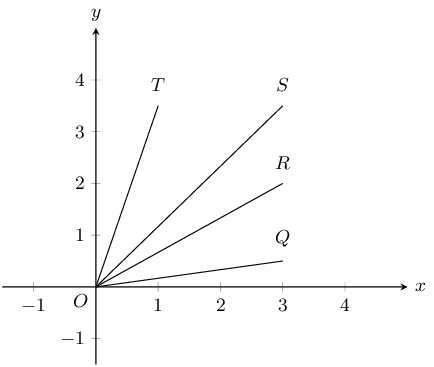

To derive the formula for gradient, we consider any right-angled triangle formed from \(A
      \left(x_{1};{y}_{1}\right)\) and \(B \left({x}_{2};{y}_{2}\right)\) with hypotenuse \(AB\) as shown in the diagram
      below. The gradient is determined by the ratio of the length of the vertical side of the triangle to the length of
      the horizontal side of the triangle. The length of the vertical side of the triangle is the difference in
      \(y\)-values of points \(A\) and \(B\). The length of the horizontal side of the triangle is the difference in
      \(x\)-values of points \(A\) and \(B\).

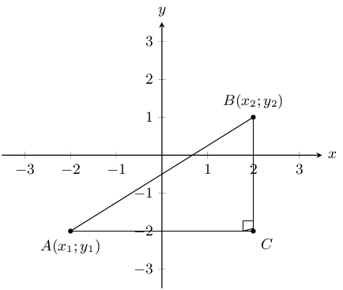

Therefore, gradient is determined using the following formula:

Gradient \(\left(m\right)=\dfrac{{y}_{2}-{y}_{1}}{{x}_{2}-{x}_{1}}\) or
        \(\dfrac{{y}_{1}-{y}_{2}}{{x}_{1}-{x}_{2}}\)

<Callout type="note" title="Note">
Remember to be consistent: \(m\ne \dfrac{{y}_{1}-{y}_{2}}{{x}_{2}-{x}_{1}}\)
</Callout>

<Callout type="tip" title="Multimedia & Video">
To learn more about determining the gradient you can watch the following video.

<VideoPlayer src="https://www.youtube.com/embed/Iqws-qzyZwc" title="Video: 2GC6" />
</Callout>

<Callout type="tip" title="Worked example 3: Gradient between two points">
**Question:**
Find the gradient of the line between points \(E \left(2;5\right)\) and \(F\left(-3;9\right)\).

**Draw a sketch:**
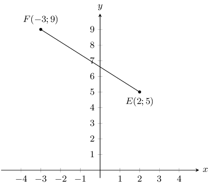

**Assign values to \(\left({x}_{1};{y}_{1}\right)\) and \(\left({x}_{2};{y}_{2}\right)\):**
Let the coordinates of \(E\) be \(\left({x}_{1};{y}_{1}\right)\) and the coordinates of \(F\) be
          \(\left({x}_{2};{y}_{2}\right)\).

        \[{x}_{1} = 2 \quad {y}_{1} = 5 \quad {x}_{2} = -3 \quad {y}_{2} = 9\]

**Write down the formula for gradient:**
\[m = \frac{{y}_{2}-{y}_{1}}{{x}_{2}-{x}_{1}}\]

**Substitute known values:**
\begin{align*}
        m_{EF} & = \frac{9 - 5}{-3 - 2} \\
        & = \frac{4}{-5}
        \end{align*}

**Write the final answer:**
The gradient of \(EF=-\frac{4}{5}\)
</Callout>

<QuizCard id="m10-08-03a" title="Interactive Exercise 8.5" question="You are given the diagram below. The coordinates are \( A: \left( -\text{2} \, ;  -\text{0,5} \right) \) and \(  B: \left( \text{4} \, ;  -\text{3,5} \right) \) . Calculate the gradient ( \(m\) ) of line \(AB\) , correct to 2 decimal places." options=[] explanation="Refer to the section rules and worked examples to verify." />

<Callout type="tip" title="Worked example 4: Gradient between two points">
**Question:**
Given \(G\left(7;-9\right)\) and \(H\left(x;0\right)\), with \({m}_{GH}=3\), find \(x\).

**Draw a sketch:**
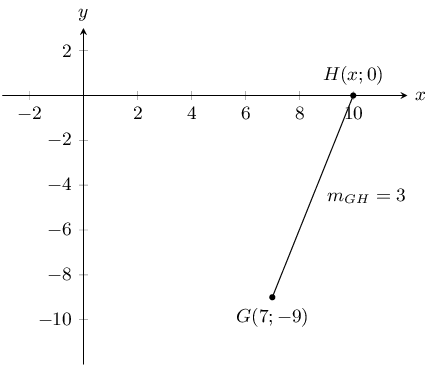

**Assign values to \(\left({x}_{1};{y}_{1}\right)\) and \(\left({x}_{2};{y}_{2}\right)\):**
Let the coordinates of \(G\) be \(\left({x}_{1};{y}_{1}\right)\) and the coordinates of \(H\) be
          \(\left({x}_{2};{y}_{2}\right)\)

        \[{x}_{1} = 7 \quad {y}_{1} = -9 \quad {x}_{2} = x \quad {y}_{2} = 0\]

**Write down the formula for gradient:**
\[m=\frac{{y}_{2}-{y}_{1}}{{x}_{2}-{x}_{1}}\]

**Substitute values and solve for x:**
\begin{align*}
        3 & = \frac{0 - \left(-9\right)}{x - 7} \\
        3\left(x - 7\right)& = 9 \\
        x - 7 & = \frac{9}{3} \\
        x - 7 & = 3 \\
        x & = 3 + 7 \\
        & = 10
        \end{align*}

**Write the final answer:**
The coordinates of \(H\) are \(\left(10;0\right)\).

Therefore \(x = 10\).
</Callout>

<QuizCard id="m10-08-03b" title="Interactive Exercise 8.6" question="You are given the following diagram showing Point \(A(-\text{1}\, ;                 -\text{3})\) and Point \(B(\text{2}\, ;                 \text{0})\) . Point \(C(x\, ; -\text{1,9})\) lies on the line \(AB\) . Calculate the missing coordinate of Point \(C\) . INSTRUCTION: Round your answer to two decimal places." options=[] explanation="Refer to the section rules and worked examples to verify." />

### Textbook Exercise 8.3

Find the gradient of \(AB\) if:

**Problem:**
\(A(7;10)\) and \(B(-4;1)\)

**Solution:**
Let the coordinates of \(A\) be \(\left({x}_{1};{y}_{1}\right)\) and the coordinates of \(B\) be
                \(\left({x}_{2};{y}_{2}\right)\)

              \[{x}_{1} = 7 \quad {y}_{1} = 10 \quad {x}_{2} = -4 \quad {y}_{2} = 1\]

              \begin{align*}
              m_{AB} &= \frac{y_2 - y_1}{x_2 - x_1}\\
              & = \frac{1 - 10}{-4 - 7}\\
              & = \frac{9}{11}
              \end{align*}

**Problem:**
\(A(-5;-9)\) and \(B(3;2)\)

**Solution:**
Let the coordinates of \(A\) be \(\left({x}_{1};{y}_{1}\right)\) and the coordinates of \(B\) be
                \(\left({x}_{2};{y}_{2}\right)\)

              \[{x}_{1} = -5 \quad {y}_{1} = -9 \quad {x}_{2} = 3 \quad {y}_{2} = 2\]

              \begin{align*}
              m_{AB} & = \frac{y_2 - y_1}{x_2 - x_1}\\
              & = \frac{2 - (-9)}{3 - (-5)}\\
              & = \frac{11}{8}
              \end{align*}

**Problem:**
\(A(x-3;y)\) and \(B(x;y+4)\)

**Solution:**
Let the coordinates of \(A\) be \(\left({x}_{1};{y}_{1}\right)\) and the coordinates of \(B\) be
                \(\left({x}_{2};{y}_{2}\right)\)

              \[{x}_{1} = x - 3 \quad {y}_{1} = y \quad {x}_{2} = x \quad {y}_{2} = y + 4\]

              \begin{align*}
              m_{AB} &= \frac{y_2-y_1}{x_2-x_1}\\
              & = \frac{y + 4 - y}{x - (x - 3)}\\
              & = \frac{4}{3}
              \end{align*}

**Problem:**
You are given the following diagram:

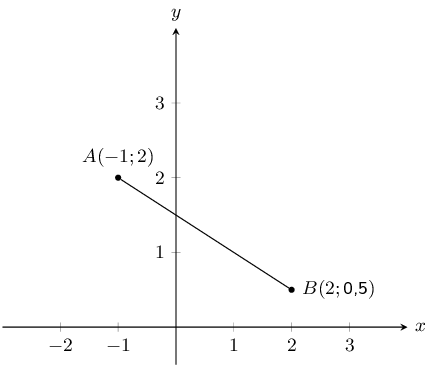

Calculate the gradient (\(m\)) of line \(AB\).

**Solution:**
Let the coordinates of \(A\) be \(\left({x}_{1};{y}_{1}\right)\) and the coordinates of \(B\) be
              \(\left({x}_{2};{y}_{2}\right)\)

            \[{x}_{1} = -1 \quad {y}_{1} = 2 \quad {x}_{2} = 2 \quad {y}_{2} = \text{0,5}\]

            \begin{align*}
            m & = \frac{y_B - y_A}{x_B - x_A} \\
            & = \frac{(\text{0,5}) - (\text{2})}{(\text{2}) - (-\text{1})} \\
            & = \frac{-\text{1,5}}{3} \\
            & = -\text{0,5}
            \end{align*}

Therefore the gradient \(m\) of the line \(AB\) is \(-\text{0,5}\).

**Problem:**
You are given the following diagram:

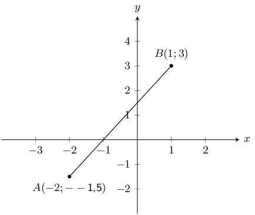

Calculate the gradient (\(m\)) of line \(AB\).

**Solution:**
Let the coordinates of \(A\) be \(\left({x}_{1};{y}_{1}\right)\) and the coordinates of \(B\) be
              \(\left({x}_{2};{y}_{2}\right)\)

            \[{x}_{1} = -2 \quad {y}_{1} = -\text{1,5} \quad {x}_{2} = 1 \quad {y}_{2} = 3\]

            \begin{align*}
            m & = \frac{y_B - y_A}{x_B - x_A} \\
            & = \frac{(\text{3}) - (-\text{1,5})}{(\text{1}) - (-\text{2})} \\
            & = \frac{\text{4,5}}{\text{3}} \\
            & = \text{1,5}
            \end{align*}

Therefore the gradient \(m\) of the line \(AB\) is \(\text{1,5}\).

If the gradient of \(CD = \frac{2}{3}\), find \(p\) given:

**Problem:**
\(C(16;2)\) and \(D(8;p)\).

**Solution:**
Let the coordinates of \(C\) be \(\left({x}_{1};{y}_{1}\right)\) and the coordinates of \(D\) be
                \(\left({x}_{2};{y}_{2}\right)\)

              \[{x}_{1} = 16 \quad {y}_{1} = 2 \quad {x}_{2} = 8 \quad {y}_{2} = p\]

              \begin{align*}
              m_{CD} &= \frac{y_2 - y_1}{x_2 - x_1} \\
              \frac{2}{3} &= \frac{p - 2}{8 - 16} \\
              \frac{2}{3} \times (-8)&= p - 2 \\
              \frac{-16}{3} + 2 & = p \\
              \frac{-16 + 6}{3} &= p \\
              \frac{-10}{3} &= p
              \end{align*}

**Problem:**
\(C(3;2p)\) and \(D(9;14)\).

**Solution:**
Let the coordinates of \(C\) be \(\left({x}_{1};{y}_{1}\right)\) and the coordinates of \(D\) be
                \(\left({x}_{2};{y}_{2}\right)\)

              \[{x}_{1} = 3 \quad {y}_{1} = 2p \quad {x}_{2} = 9 \quad {y}_{2} = 14\]

              \begin{align*}
              m_{CD} &= \frac{y_2 - y_1}{x_2 - x_1}\\
              \frac{2}{3} &= \frac{14 - 2p}{9 - 3}\\
              \frac{2}{3} \times (6)&= 14 - 2p\\
              4 & = 14 - 2p \\
              2p & = 14 - 4 \\
              p & = \frac{10}{2} \\
              & = 5
              \end{align*}

**Problem:**
You are given the following diagram:

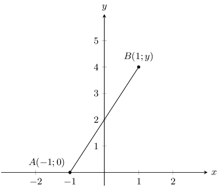

You are also told that line \(AB\) has a gradient (\(m\)) of \(\text{2}\).

Calculate the missing co-ordinate of point \(B\).

**Solution:**
Let the coordinates of \(A\) be \(\left({x}_{1};{y}_{1}\right)\) and the coordinates of \(B\) be
              \(\left({x}_{2};{y}_{2}\right)\)

            \[{x}_{1} = -1 \quad {y}_{1} = 0 \quad {x}_{2} = 1 \quad {y}_{2} = y\]

            \begin{align*}
            m_{AB} &= \frac{y_2 - y_1}{x_2 - x_1}\\
            2 &= \frac{y - 0}{1 - (-1)}\\
            2 & = \frac{y}{2} \\
            4 &= y
            \end{align*}

**Problem:**
You are given the following diagram:

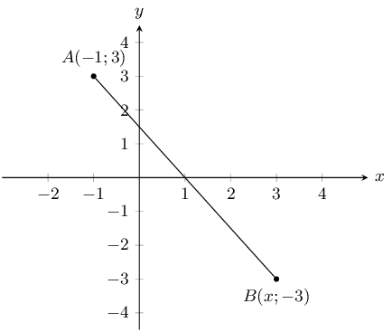

You are also told that line \(AB\) has a gradient (\(m\)) of \(-\text{1,5}\).

Calculate the missing co-ordinate of point \(B\).

**Solution:**
Let the coordinates of \(A\) be \(\left({x}_{1};{y}_{1}\right)\) and the coordinates of \(B\) be
              \(\left({x}_{2};{y}_{2}\right)\)

            \[{x}_{1} = -1 \quad {y}_{1} = 3 \quad {x}_{2} = x \quad {y}_{2} = -3\]

            \begin{align*}
            m_{AB} &= \frac{y_2 - y_1}{x_2 - x_1}\\
            -\text{1,5} &= \frac{-3 - 3}{x - (-1)}\\
            -\text{1,5} & = \frac{-6}{x + 1} \\
            -\text{1,5}(x + 1) & = -6 \\
            -\text{1,5}x - \text{1,5} & = -6 \\
            \text{1,5}x & = \text{4,5} \\
            x &= 3
            \end{align*}

### Straight lines (EMA6C)

<Callout type="info" title="Definition: Straight line">
A straight line is a set of points with a constant gradient between any two of the points.
</Callout>

Consider the diagram below with points \(A\left(x;y\right)\), \(B\left({x}_{2};{y}_{2}\right)\) and
        \(C\left({x}_{1};{y}_{1}\right)\).

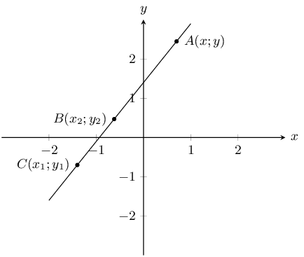

We have \({m}_{AB} = {m}_{BC} = {m}_{AC}\) and \(m = \dfrac{{y}_{2} - {y}_{1}}{{x}_{2} - {x}_{1}} =
        \dfrac{{y}_{1} - {y}_{2}}{{x}_{1} - {x}_{2}}\)

The general formula for finding the equation of a straight line is \(\dfrac{y - {y}_{1}}{x - {x}_{1}} =
        \dfrac{{y}_{2} - {y}_{1}}{{x}_{2} - {x}_{1}}\) where \(\left(x;y\right)\) is any point on the line.

This formula can also be written as \(y - {y}_{1} = m\left(x - {x}_{1}\right)\).

The standard form of the straight line equation is \(y = mx + c\) where \(m\) is the gradient and \(c\) is the
        \(y\)-intercept.

The worked example below shows one method of determining the equation of a straight line. The equation of a
          straight line can also be determined by first finding the gradient and then substituting one of the given
          points into \(y = mx + c\).

<Callout type="tip" title="Worked example 5: Finding the equation of a straight line">
**Question:**
Find the equation of the straight line through \(P\left(-1;-5\right)\) and \(Q\left(5;4\right)\).

**Draw a sketch:**
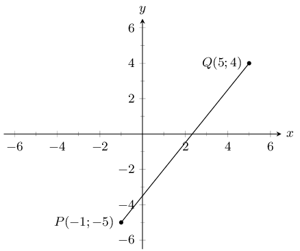

**Assign values:**
Let the coordinates of \(P\) be \(\left({x}_{1};{y}_{1}\right)\) and the coordinates of \(Q\) be
            \(\left({x}_{2};{y}_{2}\right)\).

          \[{x}_{1} = -1 \quad {y}_{1} = -5 \quad {x}_{2} = 5 \quad {y}_{2} = 4\]

**Write down the general formula of the line:**
\[\frac{y - {y}_{1}}{x - {x}_{1}} = \frac{{y}_{2} - {y}_{1}}{{x}_{2} - {x}_{1}}\]

**Substitute values and make \(y\) the subject of the equation:**
\begin{align*} \frac{y - \left(-5\right)}{x - \left(-1\right)} & = \frac{4 - \left(-5\right)}{5 -
          \left(-1\right)} \\
          \frac{y + 5}{x + 1} & = \frac{3}{2} \\
          2\left(y + 5\right) & = 3\left(x + 1\right) \\
          2y + 10 & = 3x + 3 \\
          2y & = 3x - 7 \\
          y & = \frac{3}{2}x - \frac{7}{2}
          \end{align*}

**Write the final answer:**
The equation of the straight line is \(y=\frac{3}{2}x-\frac{7}{2}\).
</Callout>

<QuizCard id="m10-08-03d" title="Interactive Exercise 8.8" question="You are given the following diagram: Calculate the equation of the line \(AB\) ." options=[] explanation="Refer to the section rules and worked examples to verify." />

### Parallel and perpendicular lines (EMA6D)

Two lines that run parallel to each other are always the same distance apart and have equal gradients.

If two lines intersect perpendicularly, then the product of their gradients is equal to \(-\text{1}\).

If line \(WX \perp YZ\), then \({m}_{WX}\times {m}_{YZ} = -1\). Perpendicular lines have gradients that are the
        negative inverses of each other.

<Callout type="tip" title="Multimedia & Video">
The following video shows some examples of calculating the slope of a line and determining if two lines are
          perpendicular or parallel.

<VideoPlayer src="https://www.youtube.com/embed/9hryH94KFJA" title="Video: 2GCJ" />
</Callout>

<Callout type="tip" title="Worked example 6: Parallel lines">
**Question:**
Prove that line \(AB\) with \(A\left(0;2\right)\) and \(B\left(2;6\right)\) is parallel to line \(CD\) with
            equation \(2x-y=2\).

**Draw a sketch:**
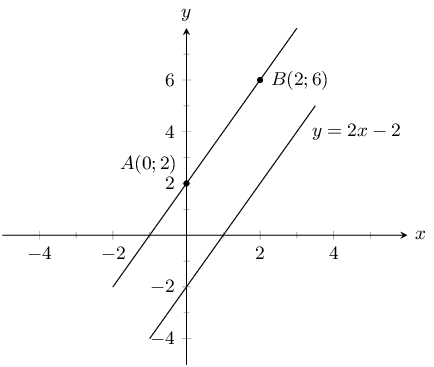

(Be careful - some lines may look parallel but are not!)

**Write down the formula for gradient:**
\[m = \frac{{y}_{2} - {y}_{1}}{{x}_{2} - {x}_{1}}\]

**Substitute values to find the gradient for line \(AB\):**
\begin{align*}
          {m}_{AB} & = \frac{6 - 2}{2 - 0} \\
          & = \frac{4}{2} \\
          & = 2
          \end{align*}

**Check that the equation of \(CD\) is in the standard form \(y = mx + c\):**
\begin{align*}
          2x - y & = 2 \\
          y & = 2x - 2 \\
          \therefore {m}_{CD} & = 2
          \end{align*}

**Write the final answer:**
\[{m}_{AB} = {m}_{CD}\]

therefore line \(AB\) is parallel to line \(CD\).
</Callout>

<QuizCard id="m10-08-03e" title="Interactive Exercise 8.9" question="The following diagram shows two parallel lines. Point \(A\) is at \( \left(-3 \, ; - \frac{1}{2} \right) \) and Point \(B\) is at \( \left(x \, ; -3 \right) \) . Line \(AB\) runs parallel to the following line: \(y = - \frac{1}{2}x-6 \) , which is                 the dashed blue line. Determine the \( x \) -coordinate of Point \(B\) ." options=[] explanation="Refer to the section rules and worked examples to verify." />

<Callout type="tip" title="Worked example 7: Perpendicular lines">
**Question:**
Line \(AB\) is perpendicular to line \(CD\). Find \(y\) given \(A\left(2;-3\right)\),
            \(B\left(-2;6\right)\), \(C\left(4;3\right)\) and \(D\left(7;y\right)\).

**Draw a sketch:**
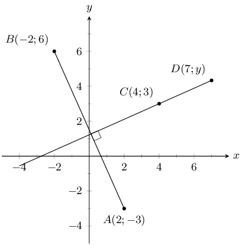

**Write down the relationship between the gradients of the perpendicular lines \(AB\perp CD\):**
\begin{align*}
          {m}_{AB} \times {m}_{CD} & = -1 \\
          \frac{{y}_{B} - {y}_{A}}{{x}_{B} - {x}_{A}} \times \frac{{y}_{D} - {y}_{C}}{{x}_{D} - {x}_{C}} & = -1
          \end{align*}

**Substitute values and solve for \(y\):**
\begin{align*}
          \frac{6 - \left(-3\right)}{-2 - 2}\times \frac{y - 3}{7 - 4}& = -1 \\
          \frac{9}{-4} \times \frac{y - 3}{3} & = -1 \\
          \frac{y - 3}{3} & = -1 \times \frac{-4}{9} \\
          \frac{y - 3}{3} & = \frac{4}{9} \\
          y - 3 & = \frac{4}{9} \times 3 \\
          y - 3 & = \frac{4}{3} \\
          y & = \frac{4}{3} + 3 \\
          & = \frac{4 + 9}{3} \\
          & = \frac{13}{3} \\
          & = 4\frac{1}{3}
          \end{align*}

**Write the final answer:**
Therefore the coordinates of \(D\) are \(\left(7;4\frac{1}{3}\right)\).
</Callout>

<QuizCard id="m10-08-03f" title="Interactive Exercise 8.10" question="You are given the following diagram, which shows two perpendicular lines on the                 Cartesian plane. Line \(AB\) has endpoints at \(A \left(                 -4 \, ; -3 \right)\) and \(B \left( 4 \, ;                 y \right)\) . The other line (the                 dashed line) has the equation \(y = - 2 x - 1\) . Calculate the missing value of \(y\) ." options=[] explanation="Refer to the section rules and worked examples to verify." />

### Horizontal and vertical lines (EMA6F)

A line that runs parallel to the \(x\)-axis is called a horizontal line and has a gradient of zero. This is
        because there is no vertical change:

      \[m = \frac{\text{change in } y}{\text{change in } x} = \frac{0}{\text{change in } x} = 0\]

A line that runs parallel to the \(y\)-axis is called a vertical line and its gradient is undefined. This is
        because there is no horizontal change:

      \[m = \frac{\text{change in } y}{\text{change in } x } = \frac{\text{change in } y}{0} = \text{ undefined}\]

### Points on a line (EMA6G)

A straight line is a set of points with a constant gradient between any of the two points. There are two
        methods to prove that points lie on the same line: the gradient method and a method using the distance formula.

<Callout type="note" title="Note">
If two points lie on the same line then the two points are said to be collinear.
</Callout>

<Callout type="tip" title="Worked example 8: Points on a line">
**Question:**
Prove that \(A\left(-3;3\right)\), \(B\left(0;5\right)\) and \(C\left(3;7\right)\) are on a straight line.

**Draw a sketch:**
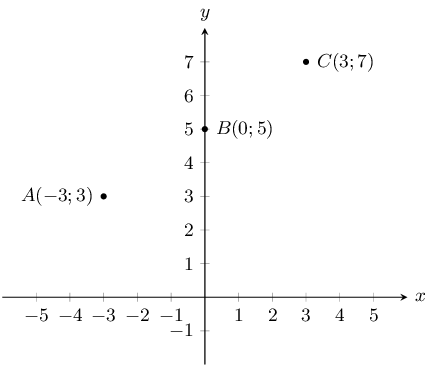

**Calculate two gradients between any of the three points:**
\begin{align*}
          m & = \frac{{y}_{2} - {y}_{1}}{{x}_{2} - {x}_{1}} \\
          {m}_{AB} & = \frac{5 - 3}{0 - \left(-3\right)} = \frac{2}{3}
          \end{align*}

and

          \[{m}_{BC} = \frac{7 - 5}{3 - 0} = \frac{2}{3}\]

OR

          \[{m}_{AC} = \frac{3-7}{3-3} = \frac{-4}{-6} = \frac{2}{3}\]

and

          \[{m}_{BC} = \frac{7-5}{3-0} = \frac{2}{3}\]

**Explain your answer:**
\[{m}_{AB} ={m}_{BC} ={m}_{AC}\]

Therefore the points \(A\), \(B\) and \(C\) are on a straight line.
</Callout>

To prove that three points are on a straight line using the distance formula, we must calculate the distances
        between each pair of points and then prove that the sum of the two smaller distances equals the longest
        distance.

<Callout type="tip" title="Worked example 9: Points on a straight line">
**Question:**
Prove that \(A\left(-3;3\right)\), \(B\left(0;5\right)\) and \(C\left(3;7\right)\) are on a straight line.

**Draw a sketch:**
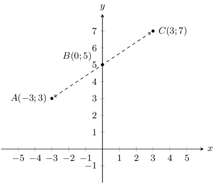

**Calculate the three distances \(AB\), \(BC\) and \(AC\):**
\begin{align*}
          {d}_{AB} & = \sqrt{{\left(-3 - 0\right)}^{2} + {\left(3-5\right)}^{2}} \\
          & = \sqrt{{\left(-3\right)}^{2} + {\left(-2\right)}^{2}} \\
          & = \sqrt{9 + 4} \\
          & = \sqrt{13} \\ \\
          {d}_{BC} & = \sqrt{{\left(0 - 3\right)}^{2} + {\left(5 - 7\right)}^{2}} \\
          & = \sqrt{{\left(-3\right)}^{2} + {\left(-2\right)}^{2}} \\
          & = \sqrt{9 + 4} \\
          & = \sqrt{13} \\ \\
          {d}_{AC} & = \sqrt{{\left(\left(-3\right) - 3\right)}^{2} + {\left(3 - 7\right)}^{2}} \\
          & = \sqrt{{\left(-6\right)}^{2} + {\left(-4\right)}^{2}} \\
          & = \sqrt{36+16} \\
          & = \sqrt{52}
          \end{align*}

**Find the sum of the two shorter distances:**
\[{d}_{AB} + {d}_{BC} = \sqrt{13} + \sqrt{13} = 2\sqrt{13} = \sqrt{4\times 13} = \sqrt{52}\]

**Explain your answer:**
\[{d}_{AB} + {d}_{BC} = {d}_{AC}\]

therefore points \(A\), \(B\) and \(C\) lie on the same straight line.
</Callout>

### Textbook Exercise 8.4

Determine whether \(AB\) and \(CD\) are parallel, perpendicular or neither if:

**Problem:**
\(A(3;-4)\), \(B(5;2)\), \(C(-1;-1)\), \(D(7;23)\)

**Solution:**
We need to calculate the gradients of lines \(AB\) and \(CD\). Then we can compare the gradients to
                  determine if the lines are parallel (the gradients are equal), perpendicular (the gradients are the
                  negative inverses of each other) or neither.

                \begin{align*}
                m_{AB} &= \frac{y_2-y_1}{x_2-x_1}\\
                & = \frac{2-(-4)}{5-3}\\
                & = \frac{6}{2}\\
                & = 3
                \end{align*}

And:

                \begin{align*}
                m_{CD} &= \frac{y_2-y_1}{x_2-x_1}\\
                & = \frac{23-(-1)}{7-(-1)}\\
                & = \frac{24}{8}\\
                & = 3
                \end{align*}

Therefore:

                \begin{align*}
                m_{AB} & = m_{CD}\\
                \therefore AB & \parallel CD
                \end{align*}

Lines \(AB\) and \(CD\) are parallel.

**Problem:**
\(A(3;-4)\), \(B(5;2)\), \(C(-1;-1)\), \(D(0;-4)\)

**Solution:**
We need to calculate the gradients of lines \(AB\) and \(CD\). Then we can compare the gradients to
                  determine if the lines are parallel (the gradients are equal), perpendicular (the gradients are the
                  negative inverses of each other) or neither.

                \begin{align*}
                m_{AB} & = \frac{y_2-y_1}{x_2-x_1}\\
                & = \frac{2 - (-4)}{5 - 3}\\
                & = \frac{6}{2}\\
                & = 3
                \end{align*}

And:

                \begin{align*}
                m_{CD} & = \frac{y_2-y_1}{x_2-x_1}\\
                & = \frac{-4-(-1)}{0-(-1)}\\
                & = \frac{-3}{1}\\
                & = -3
                \end{align*}

So \(m_{AB}\ne m_{CD}\). Therefore \(AB\) is not parallel to \(CD\).

And \(m_{AB}\times\frac{1}{m_{CD}} \ne -1\). Therefore \(AB\) and \(CD\) are not perpendicular.

Lines \(AB\) and \(CD\) are neither parallel nor perpendicular.

**Problem:**
\(A(3;-4)\), \(B(5;2)\), \(C(-1;3)\), \(D(-2;2)\)

**Solution:**
We need to calculate the gradients of lines \(AB\) and \(CD\). Then we can compare the gradients to
                  determine if the lines are parallel (the gradients are equal), perpendicular (the gradients are the
                  negative inverses of each other) or neither.

                \begin{align*}
                m_{AB} & = \frac{y_2-y_1}{x_2-x_1}\\
                & = \frac{2 - (-4)}{5 - 3}\\
                & = \frac{6}{2}\\
                & = 3
                \end{align*}

And:

                \begin{align*}
                m_{CD} &= \frac{y_2-y_1}{x_2-x_1}\\
                &= \frac{2 - 3}{1 - (-2)}\\
                &= \frac{-1}{3}
                \end{align*}

So \(m_{AB}\ne m_{CD}\). Therefore \(AB\) is not parallel to \(CD\).

And \(m_{AB} \times \frac{1}{m_{CD}} = -1\). Therefore \(AB\) and \(CD\) are perpendicular.

Determine whether the following points lie on the same straight line:

**Problem:**
\(E(0;3)\), \(F(-2;5)\), \(G(2;1)\)

**Solution:**
\begin{align*}
                m_{EF} &= \frac{y_2-y_1}{x_2-x_1}\\
                &= \frac{5-3}{-2-0}\\
                &= \frac{2}{-2}\\
                &= -1
                \end{align*}

And,

                \begin{align*}
                m_{FG} &=\frac{y_2-y_1}{x_2-x_1}\\
                &= \frac{1-5}{2-(-2)}\\
                &= \frac{-4}{4}\\
                &= -1
                \end{align*}

So \(m_{EF} = m_{FG}\) and \(F\) is a common point. Therefore \(E\), \(F\) and \(G\) are collinear
                  (they lie on the same line).

**Problem:**
\(H(-3;-5)\), \(I(0;0)\), \(J(6;10)\)

**Solution:**
\begin{align*}
                m_{HI} &= \frac{y_2-y_1}{x_2-x_1}\\
                &= \frac{0-(-5)}{0-(-3)}\\
                &= \frac{5}{3}
                \end{align*}

And,

                \begin{align*}
                m_{IJ} &= \frac{y_2-y_1}{x_2-x_1}\\
                &= \frac{10-0}{6-0}\\
                &= \frac{10}{6}\\
                &= \frac{5}{3}
                \end{align*}

So \(m_{HI} = m_{IJ}\) and \(I\) is a common point. Therefore \(H\), \(I\) and \(J\) are collinear
                  (they lie on the same line).

**Problem:**
\(K(-6;2)\), \(L(-3;1)\), \(M(1;-1)\)

**Solution:**
\begin{align*}
                m_{KL} &= \frac{y_2 - y_1}{x_2 - x_1}\\
                &= \frac{1 - 2)}{-3 - (-6)}\\
                &= -\frac{1}{3}
                \end{align*}

And,

                \begin{align*}
                m_{LM} &= \frac{y_2-y_1}{x_2-x_1}\\
                &= \frac{-1-1}{1-(-3)}\\
                &= \frac{-2}{4}\\
                &= -\frac{1}{2}
                \end{align*}

So \(m_{KL} \ne m_{LM}\). Therefore \(K\), \(L\) and \(M\) are not collinear (they do not lie on the
                  same line).

**Problem:**
You are given the following diagram:

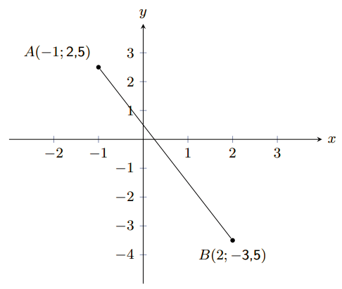

Calculate the equation of the line \(AB\).

**Solution:**
To calculate the equation of the straight line, we first calculate the gradient (\(m\)) of the line
                \(AB\):

\(\begin{aligned}
                m & = \frac{y_B - y_A}{x_B - x_A} \\
                m & = \frac{(-\text{3,5}) - (\text{2,5})}{(\text{2}) - (-\text{1})} \\
                m & = -\text{2} \\
                \end{aligned}\)

Secondly, we calculate the value of the \(y\)-intercept (\(c\)) of the line \(AB\). We do this by
                substituting either point \(A\) or \(B\) into the general form for a straight line. We will use point
                \(A\).

\(\begin{aligned}
                y & = mx + c \\
                (\text{2,5}) & = (-\text{2}) \times (-\text{1}) + c \\
                c & = \text{0,5} \\
                \end{aligned}\)

Therefore, the equation of the line \(AB\) is as follows:

\(\begin{aligned}
                y & = -\text{2} x + \text{0,5}
                \end{aligned}\)

**Problem:**
You are given the following diagram:

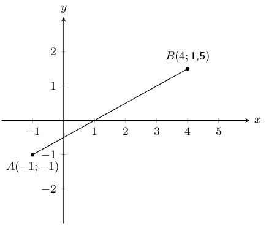

Calculate the equation of the line \(AB\).

**Solution:**
To calculate the equation of the straight line, we first calculate the gradient (\(m\)) of the line
                \(AB\):

\(\begin{aligned}
                m & = \frac{y_B - y_A}{x_B - x_A} \\
                m & = \frac{(\text{1,5}) - (-\text{1})}{(\text{4}) - (-\text{1})} \\
                m & = \text{0,5} \\
                \end{aligned}\)

Secondly, we calculate the value of the \(y\)-intercept (\(c\)) of the line \(AB\). We do this by
                substituting either point \(A\) or \(B\) into the general form for a straight line. We will use point
                \(A\).

\(\begin{aligned}
                y & = mx + c \\
                (-\text{1}) & = (\text{0,5}) \times (-\text{1}) + c \\
                c & = -\text{0,5} \\
                \end{aligned}\)

Therefore, the equation of the line \(AB\) is as follows:

\(\begin{aligned}
                y & = \text{0,5} x -\text{0,5}
                \end{aligned}\)

**Problem:**
Points \(P(-6;2)\), \(Q(2;-2)\) and \(R(-3;r)\) lie on a straight line. Find the value of \(r\).

**Solution:**
Since the three points lie on a straight line we can use the fact that the gradient of \(PQ\) is equal
                to the gradient of \(QR\) to find \(r\).

The gradient of \(PQ\) is:

              \begin{align*}
              m_{PQ} & = \frac{y_2 - y_1}{x_2 - x_1} \\
              & = \frac{-2 - 2}{2 - (-6)} \\
              & = \frac{-4}{8} \\
              & = -\frac{1}{2}
              \end{align*}

And the gradient of \(QR\) in terms of \(r\) is:

              \begin{align*}
              m_{QR} & = \frac{y_2 - y_1}{x_2 - x_1} \\
              & = \frac{r - (-2)}{-3 - 2} \\
              & = \frac{r + 2}{-5}
              \end{align*}

Now we let \(m_{PR} = m_{QR} = -\frac{1}{2}\) and solve for \(r\):

              \begin{align*}
              -\frac{1}{2} & = \frac{r + 2}{-5} \\
              (-1)\times(-5) & = 2(r + 2) \\
              5 & = 2r + 4 \\
              5 - 4 & = 2r \\
              1 & = 2r \\
              r & = \frac{1}{2}
              \end{align*}

**Problem:**
Line \(PQ\) with \(P(-1;-7)\) and \(Q(q;0)\) has a gradient of \(\text{1}\). Find \(q\).

**Solution:**
\begin{align*}
              m_{PQ} & = \frac{y_2 - y_1}{x_2 - x_1} \\
              1 & = \frac{0 - (-7)}{q - (-1)} \\
              q + 1 & = 7 \\
              q & = 6
              \end{align*}

**Problem:**
You are given the following diagram:

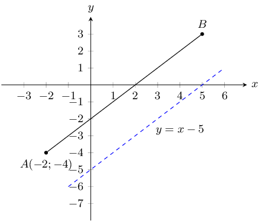

You are also told that line \(AB\) runs parallel to the following line: \(y = x - \text{5}\). Point
                \(A\) is at \(\left(-2 ; -4 \right)\).

Find the equation of the line \(AB\).

**Solution:**
We are told that line \(AB\) is parallel to \(y = x - 5\), so the gradient of line \(AB\) is equal to
                the gradient of \(y = x - 5\). The gradient of \(y = x - 5\) is 1.

Now we can use point \(A\) and the gradient of the line to find the \(y\)-intercept of the line:

              \(\begin{aligned}
              y & = mx + c \\
              (-\text{4}) & = (\text{1})(-\text{2}) + c \\
              c & = -\text{2} \\
              \end{aligned}\)

Therefore, the equation of the line \(AB\) is: \(y = x - 2\).

**Problem:**
You are given the following diagram:

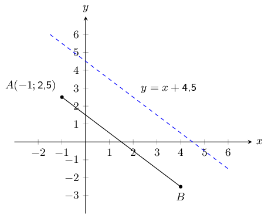

You are also told that line \(AB\) runs parallel to the following line: \(y = -x + \text{4,5}\). Point
                \(A\) is at \(\left(-1 ; \text{2,5}\right)\).

Find the equation of the line \(AB\).

**Solution:**
We are told that line \(AB\) is parallel to \(y = -x + \text{4,5}\), so the gradient of line \(AB\) is
                equal to the gradient of \(y = -x + \text{4,5}\). The gradient of \(y = -x + \text{4,5}\) is
                \(-\text{1}\).

Now we can use point \(A\) and the gradient of the line to find the \(y\)-intercept of the line:

              \(\begin{aligned}
              y & = mx + c \\
              (\text{2,5}) & = (-\text{1}) \times (-\text{1}) + c \\
              c & = \text{1,5} \\
              \end{aligned}\)

Therefore, the equation of the line \(AB\) is: \(y = -x + \text{1,5}\).

**Problem:**
Given line \(AB\) which runs parallel to \(y = \text{0,5}x - \text{6}\). Points \(A(-1;-\text{2,5})\)
                and \(B(x;0)\) are also given.

Calculate the missing co-ordinate of point \(B\).

**Solution:**
We are told that line \(AB\) is parallel to \(y = \text{0,5}x - 6\), so the gradient of line \(AB\) is
                equal to the gradient of \(y = \text{0,5}x - 6\). The gradient of \(y = \text{0,5}x - 6\) is
                \(\text{0,5}\).

Now we can use point \(A\) and the gradient of the line to find the \(y\)-intercept of the line:

              \begin{align*}
              y & = mx + c \\
              (-\text{2,5}) & = (\text{0,5})(-\text{1}) + c \\
              c & = -\text{2} \\
              \end{align*}

Therefore, the equation of the line \(AB\) is: \(y = \text{0,5}x - 2\).

Now we can substitute point \(B\) into the equation of line \(AB\) to solve for \(x\):

              \begin{align*}
              y & = \text{0,5}x - 2 \\
              0 & = \text{0,5}x - 2 \\
              4 & = x
              \end{align*}

Therefore the coordinates of point \(B\) are \((0;4)\).

**Problem:**
Given line \(AB\) which runs parallel to \(y = -\text{1,5} x + \text{4}\). Points
                \(A(-\text{2};\text{4})\) and \(B(2;y)\) are also given.

Calculate the missing co-ordinate of point \(B(2;y)\).

**Solution:**
We are told that line \(AB\) is parallel to \(y = -\text{1,5}x + 4\), so the gradient of line \(AB\) is
                equal to the gradient of \(y = -\text{1,5}x + 4\). The gradient of \(y = -\text{1,5}x + 4\) is
                \(-\text{1,5}\).

Now we can use point \(A\) and the gradient of the line to find the \(y\)-intercept of the line:

              \begin{align*}
              y & = mx + c \\
              (\text{4}) & = (-\text{1,5})(-\text{2}) + c \\
              c & = \text{1} \\
              \end{align*}

Therefore, the equation of the line \(AB\) is: \(y = -\text{1,5}x + 1\).

Now we can substitute point \(B\) into the equation of line \(AB\) to solve for \(x\):

              \begin{align*}
              y & = -\text{1,5}x + 1 \\
              y & = -\text{1,5}(2) + 1 \\
              y & = -2
              \end{align*}

Therefore the coordinates of point \(B\) are \((2;-2)\).

**Problem:**
The graph here shows line \(AB\). The blue dashed line is perpendicular to \(AB\).

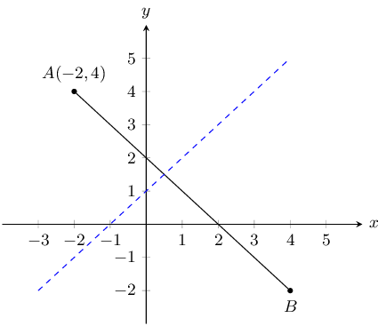

The equation of the blue dashed line is \(y = x + 1\). Point \(A\) is at \((-2; 4)\).

Determine the equation of line \(AB\).

**Solution:**
The general form of a straight line is: \(y = mx + c\).

Line \(AB\) is perpendicular to the blue dashed line and so \(m_{AB} = \dfrac{-1}{m_{\text{blue
                line}}}\).

              \begin{align*}
              y & = mx + c \\
              y & = \left( \frac{-1}{m_{\text{blue line}}} \right) x + c \\
              y & = \left( \frac{-1}{\text{1}} \right) x + c \\
              y & = -x + c
              \end{align*}

Now we can substitute in the coordinates of point \(A\) to find the \(y\)-intercept:

              \begin{align*}
              y & = mx + c \\
              (\text{4}) & = (-\text{1}) (-\text{2}) + c \\
              c & = \text{2} \\
              \end{align*}

Therefore, the equation of the line \(AB\) is: \(y = -x + 2\).

**Problem:**
The graph here shows line \(AB\). The blue dashed line is perpendicular to \(AB\).

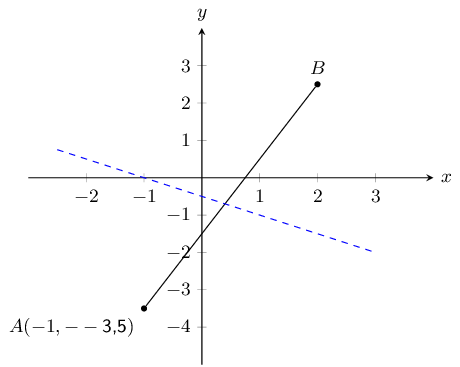

The equation of the blue dashed line is \(y = -\text{0,5} x - \text{0,5}\). Point \(A\) is at
                \((-\text{1}; -\text{3,5})\).

Determine the equation of line \(AB\).

**Solution:**
The general form of a straight line is: \(y = mx + c\).

Line \(AB\) is perpendicular to the blue dashed line and so \(m_{AB} = \dfrac{-1}{m_{\text{blue
                line}}}\).

              \begin{align*}
              y & = mx + c \\
              y & = \left( \frac{-1}{m_{\text{blue line}}} \right) x + c \\
              y & = \left( \frac{-1}{-\text{0,5}} \right) x + c \\
              y & = 2x + c
              \end{align*}

Now we can substitute in the coordinates of point \(A\) to find the \(y\)-intercept:

              \begin{align*}
              y & = mx + c \\
              (-\text{3,5}) & = (\text{2}) (-\text{1}) + c \\
              c & = -\text{1,5} \\
              \end{align*}

Therefore, the equation of the line \(AB\) is: \(y = 2x - \text{1,5}\).

**Problem:**
Given line \(AB\) which runs perpendicular to line \(CD\) with equation \(y = -2x + 1\). Points
                \(A(-5;-1)\) and \(B(3;a)\) are also given.

Calculate the missing co-ordinate of point \(B\).

**Solution:**
The general form of a straight line is: \(y = mx + c\).

Line \(AB\) is perpendicular to line \(CD\) and so \(m_{AB} = \dfrac{-1}{m_{CD}}\).

              \begin{align*}
              y & = mx + c \\
              y & = \left(\frac{-1}{m_{CD}}\right)x + c \\
              y & = \left(\frac{-1}{-\text{2}}\right)x + c \\
              y & = \text{0,5} x + c
              \end{align*}

Now we can substitute point \(A\) into the equation to find the \(y\)-intercept:

              \begin{align*}
              y & = \text{0,5}x + c \\
              -\text{1} & = (\text{0,5})(-\text{5}) + c \\
              c & = \text{1,5}
              \end{align*}

Next we can substitute in point \(B\) to find the missing coordinate:

              \begin{align*}
              y & = \text{0,5}x + \text{1,5} \\
              a & = (\text{0,5})(\text{3}) + \text{1,5} \\
              & = \text{3}
              \end{align*}

Therefore the missing coordinate is \(B(3;3)\).

**Problem:**
Given line \(AB\) which runs perpendicular to line \(CD\) with equation \(y = 2x - \text{0,75}\).
                Points \(A(-5;1)\) and \(B(a;-\text{2,5})\) are also given.

Calculate the missing co-ordinate of point \(B\).

**Solution:**
The general form of a straight line is: \(y = mx + c\).

Line \(AB\) is perpendicular to line \(CD\) and so \(m_{AB} = \dfrac{-1}{m_{CD}}\).

              \begin{align*}
              y & = mx + c \\
              y & = \left(\frac{-1}{m_{CD}}\right)x + c \\
              y & = \left(\frac{-1}{2}\right)x + c \\
              y & = -\text{0,5}x + c
              \end{align*}

Now we can substitute point \(A\) into the equation to find the \(y\)-intercept:

              \begin{align*}
              y & = -\text{0,5}x + c \\
              \text{1} & = (\text{0,5})(-\text{5}) + c \\
              c & = -\text{1,5}
              \end{align*}

Next we can substitute in point \(B\) to find the missing coordinate:

              \begin{align*}
              y & = \text{0,5}x - \text{1,5} \\
              -\text{2,5} & = \text{0,5}a - \text{1,5} \\
              a & = -\text{2}
              \end{align*}

Therefore the missing coordinate is \(B(-2;-\text{2,5})\).

**Problem:**
You are given the following diagram:

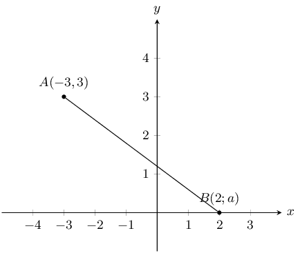

You are also told that line \(AB\) has the following equation: \(y = -\text{0,5} x + \text{1,5}\).

Calculate the missing co-ordinate of point \(B\).

**Solution:**
We substitute the known value for point \(B\) into the equation and solve for the unknown value:

\(\begin{aligned}
                y & = (-\text{0,5})x + \text{1,5} \\
                a & = (-\text{0,5})(\text{2}) + \text{1,5} \\
                & = \text{0,5}
                \end{aligned}\)

**Problem:**
You are given the following diagram:

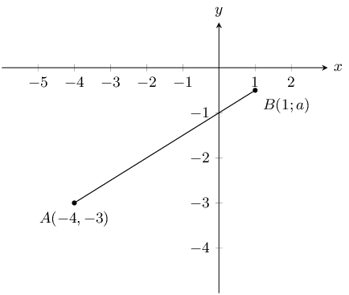

You are also told that line \(AB\) has the following equation: \(y = \text{0,5}x - \text{1}\).

Calculate the missing coordinate of point \(B\).

**Solution:**
We substitute the known value for point \(B\) into the equation and solve for the unknown value:

\(\begin{aligned}
                y & = (\text{0,5})x - \text{1} \\
                a & = (\text{0,5})(\text{1}) - \text{1} \\
                & = -\text{0,5}
                \end{aligned}\)

**Problem:**
\(A\) is the point \((-3;-5)\) and \(B\) is the point \((n;-11)\). \(AB\) is perpendicular to line
                \(CD\) with equation \(y = \frac{3}{2}x - 5\). Find the value of \(n\).

**Solution:**
Line \(AB\) is perpendicular to line \(CD\) and so \(m_{AB} = \dfrac{-1}{m_{CD}}\).

              \begin{align*}
              m_{AB} & = -1 \div \frac{3}{2} \\
              & = \frac{-2}{3}
              \end{align*}

Therefore:

              \begin{align*}
              \frac{-2}{3} & = \frac{-11 - (-5)}{n - (-3)} \\
              \frac{-2}{3} & = \frac{-6}{n + 3} \\
              \frac{-2}{3}(n + 3) & = -6 \\
              -2(n + 3) & = -18 \\
              n + 3 & = 9 \\
              n & = 6
              \end{align*}

**Problem:**
The points \(A(4;-3)\), \(B(-5;0)\) and \(C(-3;p)\) are given. Determine the value of \(p\) if \(A\),
                \(B\) and \(C\) are collinear.

**Solution:**
We are told that \(A\), \(B\) and \(C\) are collinear, therefore \(m_{AB} = m_{BC}\).

              \begin{align*}
              \frac{0 + 3}{-5 - 4} & = \frac{p}{-3 + 5} \\
              \frac{3}{-9} & = \frac{p}{2} \\
              \therefore p & = \frac{6}{-9} \\
              & = \frac{-2}{3}
              \end{align*}

Refer to the diagram below:

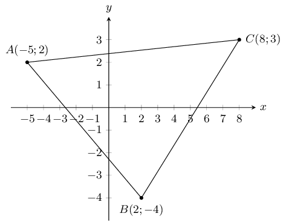

**Problem:**
Show that \(\triangle ABC\) is right-angled. Show your working.

**Solution:**
To show that \(\triangle ABC\) is right angled we need to show that \(AB \perp AC\) or that \(AC
                  \perp BC\) or \(AB \perp BC\). We can do this by calculating the gradients of \(AB\), \(AC\) and
                  \(BC\) and then seeing if any of these gradients is the negative inverse of any of the other two
                  gradients.

                \begin{align*}
                m_{AB} & = \frac{-4 - 2}{2 - (-5)} \\
                & = \frac{-6}{7} \\\\
                m_{BC} & = \frac{-4 - 3}{2 - 8} \\
                & = \frac{-7}{-6} \\
                & = \frac{7}{6} \\\\
                m_{AC} & = \frac{3 - 2}{8 - (-5)} \\
                & = \frac{1}{13}
                \end{align*}

Now we note that:

                \begin{align*}
                m_{AB} \times m_{BC} & = \frac{-6}{7} \times \frac{7}{6} = -1 \\
                \therefore AB \perp BC \\
                \therefore \triangle ABC \text{ is right-angled}
                \end{align*}

**Problem:**
Find the area of \(\triangle ABC\).

**Solution:**
This is a right-angled triangle (with right-angle \(A\hat{B}C\)) and so the perpendicular height is
                  the length of one of the sides. We will use side \(BC\) as the perpendicular height and side \(AB\) as
                  the base.

Note that we cannot use side \(AC\) for either the base or the height as we would then need to
                  construct a new perpendicular height from \(A\) to \(B\) and calculate the length of that line.

The length of \(BC\) is:

                \begin{align*}
                d & = \sqrt{(-5-2)^{2} + (2+4)^{2}} \\
                & = \sqrt{49 + 36} \\
                & = \sqrt{85}
                \end{align*}

The length of \(AB\) is:

                \begin{align*}
                d & = \sqrt{(8-2)^{2} + (3+4)^{2}} \\
                & = \sqrt{36 + 49} \\
                & = \sqrt{85}
                \end{align*}

Therefore the area of \(\triangle ABC\) is:

                \begin{align*}
                A & = \frac{1}{2}bh \\
                & = \frac{1}{2}(AB)(BC) \\
                & = \frac{1}{2}\left(\sqrt{85}\right)\left(\sqrt{85}\right) \\
                & = \frac{1}{2}\left(85\right) \\
                & = \text{42,5}
                \end{align*}

The points \(A(-3;1)\), \(B(3;-2)\) and \(C(9;10)\) are given.

**Problem:**
Prove that triangle \(ABC\) is a right-angled triangle.

**Solution:**
We first draw a sketch:

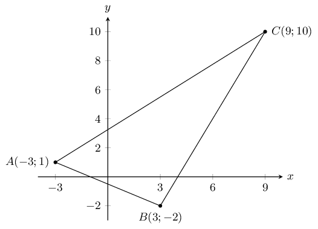

To show that \(\triangle ABC\) is right angled we need to show that \(AB \perp AC\) or that \(AC
                  \perp BC\) or \(AB \perp BC\). We can do this by calculating the gradients of \(AB\), \(AC\) and
                  \(BC\) and then seeing if any of these gradients is the negative inverse of any of the other two
                  gradients.

                \begin{align*}
                m_{AB} & = \frac{-2 - 1}{3 - (-3)} \\
                & = \frac{-3}{6} \\
                & = \frac{-1}{2} \\\\
                m_{BC} & = \frac{10 - (-2)}{9 - 3} \\
                & = \frac{12}{6} \\
                & = 2 \\\\
                m_{AC} & = \frac{10 - 1}{9 - (-3)} \\
                & = \frac{9}{12} \\
                & = \frac{3}{4}
                \end{align*}

Now we note that:

                \begin{align*}
                m_{AB} \times m_{BC} & = \frac{-1}{2} \times 2 = -1 \\
                \therefore AB \perp BC \\
                \therefore \triangle ABC \text{ is right-angled}
                \end{align*}

**Problem:**
Find the coordinates of \(D\), if \(ABCD\) is a parallelogram.

**Solution:**
A parallelogram has both sides equal in length and parallel. Therefore \(CD \parallel AB\) and \(AD
                  \parallel BC\). Also \(CD = AB\) and \(AD = BC\).

Let the coordinates of \(D\) be \((x;y)\).

Since \(AD \parallel BC\), \(m_{AD} = m_{BC}\).

From the previous question we know that \(m_{BC} = 2\). Therefore the gradient of \(AD\) is:

                \begin{align*}
                m_{AD} & = \frac{y_{2} - y_{1}}{x_{2} - x_{1}} \\
                2 & = \frac{y - 1}{x - (-3)} \\
                2(x + 3) & = y - 1 \\
                2x + 6 & = y - 1 \\
                2x + 7 & = y
                \end{align*}

Since \(CD \parallel AB\), \(m_{CD} = m_{AB}\).

From the previous question we know that \(m_{AB} = \frac{-1}{2}\). Therefore the gradient of \(CD\)
                  is:

                \begin{align*}
                m_{CD} & = \frac{y_{2} - y_{1}}{x_{2} - x_{1}} \\
                \frac{-1}{2} & = \frac{y - 10}{x - 9} \\
                \frac{-1}{2}(x - 9) & = y - 10 \\
                -x + 9 & = 2y - 20 \\
                -x + 29 & = 2y
                \end{align*}

Now we have two equations with two unknowns. We can equate the two equations and solve for \(x\):

                \begin{align*}
                4x + 14 & = -x + 29 \\
                5x & = 15 \\
                x & = 3
                \end{align*}

Now we can solve for \(y\):

                \begin{align*}
                2x + 7 & = y \\
                2(3) + 7 & = y \\
                13 & = y
                \end{align*}

Therefore the coordinates of \(D\) are \((3;13)\).

**Problem:**
Find the equation of a line parallel to the line \(BC\), which passes through the point \(A\).

**Solution:**
We know from the first question that the gradient of line \(BC\) is 2. We also know that point \(A\)
                  is at \((-3;1)\).

The line parallel to \(BC\) will have the same gradient as \(BC\) so we can write the equation of
                  this line as: \(y = 2x + c\).

Now we can use point \(A\) to find the \(y\)-intercept of the line:

                \begin{align*}
                2 & = 2(-5) + c \\
                2 & = -10 + c \\
                12 & = c
                \end{align*}

Therefore the equation of the line parallel to \(BC\) and passing through \(A\) is \(y = 2x + 12\).
