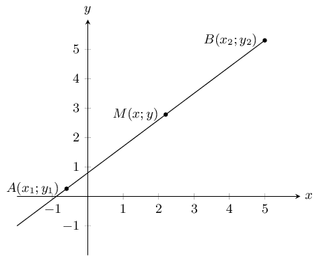
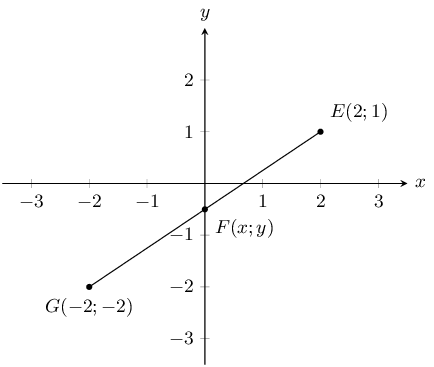
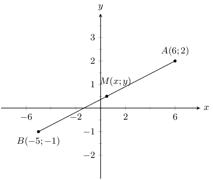
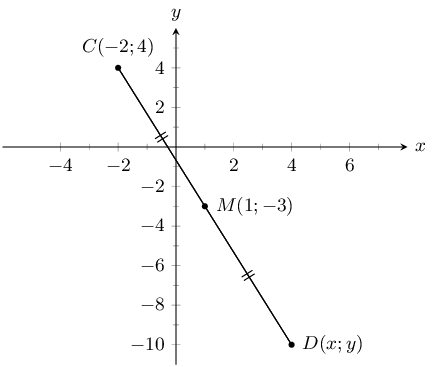
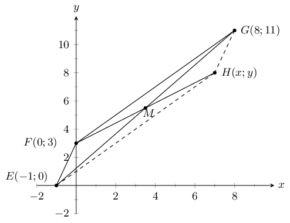
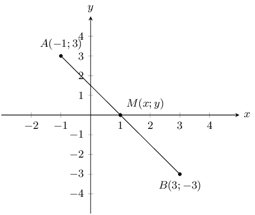
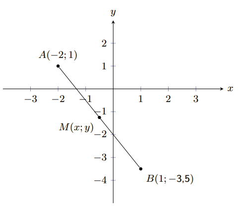
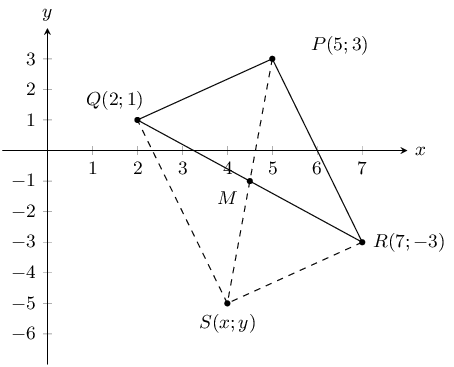

## 8.4 Mid-point of a line (EMA6H)

## Finding the mid-point of a line

On graph paper, accurately plot the points \(P\left(2;1\right)\) and \(Q\left(-2;2\right)\) and
                        draw the line \(PQ\).

- Fold the piece of paper so that point \(P\) is exactly on top of point \(Q\).
- Where the folded line intersects with line \(PQ\), label point \(S\)
- Count the blocks and find the exact position of \(S\).
- Write down the coordinates of \(S\).

To calculate the coordinates of the mid-point \(M\left(x;y\right)\) of any line between the points
                  \(A\left({x}_{1};{y}_{1}\right)\) and \(B\left({x}_{2};{y}_{2}\right)\), we use the following
                  formulae:

\begin{align*}
            x & = \frac{{x}_{1} + {x}_{2}}{2} \\
            y & = \frac{{y}_{1} + {y}_{2}}{2}
            \end{align*}

From this we obtain the mid-point of a line:

Mid-point \(M\left(x;y\right) = \left(\dfrac{{x}_{1}+{x}_{2}}{2} \; ; \;
                        \dfrac{{y}_{1}+{y}_{2}}{2}\right)\)

<Callout type="tip" title="Multimedia & Video">
This video shows some examples of finding the mid-point of a line.

<VideoPlayer src="https://www.youtube.com/embed/Ez_-RwV9WVo" title="Video: 2GDF" />
</Callout>

<Callout type="tip" title="Worked example 10: Calculating the mid-point">
**Question:**
Calculate the coordinates of the mid-point \(F\left(x;y\right)\) of the line between point
                              \(E\left(2;1\right)\) and point \(G\left(-2;-2\right)\).

**Draw a sketch:**

From the sketch, we can estimate that \(F\) will lie on the \(y\)-axis, with a negative
                              \(y\)-coordinate.

**Assign values to \(\left({x}_{1};{y}_{1}\right)\) and
                              \(\left({x}_{2};{y}_{2}\right)\):**
\[{x}_{1} = -2 \quad {y}_{1} = -2 \quad {x}_{1} = 2 \quad {y}_{2}=1\]

**Write down the mid-point formula:**
\[F\left(x;y\right) = \left(\frac{{x}_{1} + {x}_{2}}{2};\frac{{y}_{1} + {y}_{2}}{2}\right)\]

**Substitute values into the mid-point formula:**
\begin{align*}
                        x & = \frac{{x}_{1} + {x}_{2}}{2} \\
                        & = \frac{-2 + 2}{2} \\
                        & = 0 \\
                        y & = \frac{{y}_{1} + {y}_{2}}{2} \\
                        & = \frac{-2 + 1}{2} \\
                        & = -\frac{1}{2}
                        \end{align*}

**Write the answer:**
The mid-point is at \(F\left(0;-\frac{1}{2}\right)\).

Looking at the sketch we see that this is what we expect for the coordinates of \(F\).
</Callout>

For worked example 10 (calculating the mid-point) learners can check their answer using the
                        distance formula.

Using the distance formula, we can confirm that the distances from the mid-point to each end point
                        are equal:

                  \begin{align*}
                  PS & = \sqrt{{\left({x}_{1} - {x}_{2}\right)}^{2} + {\left({y}_{1} - {y}_{2}\right)}^{2}} \\
                  & = \sqrt{{\left(0 - 2\right)}^{2} + {\left(-\text{0,5} - 1\right)}^{2}} \\
                  & = \sqrt{{\left(-2\right)}^{2} + {\left(-\text{1,5}\right)}^{2}} \\
                  & = \sqrt{4 + \text{2,25}} \\
                  & = \sqrt{\text{6,25}}
                  \end{align*}

and

                  \begin{align*}
                  QS & = \sqrt{{\left({x}_{1}-{x}_{2}\right)}^{2}+{\left({y}_{1}-{y}_{2}\right)}^{2}} \\
                  & = \sqrt{{\left(0-\left(-2\right)\right)}^{2} + {\left(-\text{0,5}-\left(-2\right)\right)}^{2}}
                  \\
                  & = \sqrt{{\left(0 + 2\right)}^{2}{+\left(-\text{0,5} + 2\right)}^{2}} \\
                  & = \sqrt{{\left(2\right)}^{2}{+\left(-\text{1,5}\right)}^{2}} \\
                  & = \sqrt{4 + \text{2,25}} \\
                  & = \sqrt{\text{6,25}}
                  \end{align*}

As expected, \(PS=QS\), therefore \(F\) is the mid-point.

<Callout type="tip" title="Worked example 11: Calculating the mid-point">
**Question:**
Find the mid-point of line \(AB\), given \(A\left(6;2\right)\) and \(B\left(-5;-1\right)\).

**Draw a sketch:**

From the sketch, we can estimate that \(M\) will lie in quadrant I, with positive \(x\)- and
                              \(y\)-coordinates.

**Assign values to \(\left({x}_{1};{y}_{1}\right)\) and
                              \(\left({x}_{2};{y}_{2}\right)\):**
Let the mid-point be \(M\left(x;y\right)\)

                        \[{x}_{1} = 6 \quad {y}_{1} = 2 \quad {x}_{2} = -5 \quad {y}_{2} = -1\]

**Write down the mid-point formula:**
\[M\left(x;y\right) = \left(\frac{{x}_{1} + {x}_{2}}{2};\frac{{y}_{1} + {y}_{2}}{2}\right)\]

**Substitute values and simplify:**
\[M\left(x;y\right) = \left(\frac{6 - 5}{2};\frac{2 - 1}{2}\right) =
                        \left(\frac{1}{2};\frac{1}{2}\right)\]

**Write the final answer:**
\(M\left(\frac{1}{2};\frac{1}{2}\right)\) is the mid-point of line \(AB\).

We expected \(M\) to have a positive \(x\)- and \(y\)-coordinate and this is indeed what we
                              have found by calculation.
</Callout>

<QuizCard id="m10-08-04a" title="Interactive Exercise 8.12" question="The following diagram shows points \(A (-\text{4} \, ; -\text{2})\) and \(B (\text{2} \, ;\text{4})\) . Point \(M\) is the mid-point of \(A\) and \(B\) . Calculate the coordinates of the mid-point, \(M\) . INSTRUCTION: Enter coordinates as two numbers inside brackets, separated by a semicolon \";\". For example, your answer could be (3/2 ; -4) ." options=[] explanation="Refer to the section rules and worked examples to verify." />

<Callout type="tip" title="Worked example 12: Using the mid-point formula">
**Question:**
The line joining \(C\left(-2;4\right)\) and \(D\left(x;y\right)\) has the mid-point
                              \(M\left(1;-3\right)\). Find point \(D\).

**Draw a sketch:**

From the sketch, we can estimate that \(D\) will lie in Quadrant IV, with a positive \(x\)-
                              and negative \(y\)-coordinate.

**Assign values to \(\left({x}_{1};{y}_{1}\right)\) and
                              \(\left({x}_{2};{y}_{2}\right)\):**
Let the coordinates of \(C\) be \(\left({x}_{1};{y}_{1}\right)\) and the coordinates of \(D\)
                              be \(\left({x}_{2};{y}_{2}\right)\).

                        \[{x}_{1} = -2 \quad {y}_{1} = 4 \quad {x}_{2} = x \quad {y}_{2} = y\]

**Write down the mid-point formula:**
\[M\left(x;y\right) = \left(\frac{{x}_{1} + {x}_{2}}{2};\frac{{y}_{1} + {y}_{2}}{2}\right)\]

**Substitute values and solve for \({x}_{2}\) and \({y}_{2}\):**
\[\begin{array}{rlcrl}
                        1 & = \dfrac{-2 + {x}_{2}}{2} & \qquad\qquad & -3& = \dfrac{4 + {y}_{2}}{2} \\
                        1\times 2& = -2 + {x}_{2} & \qquad\qquad & -3 \times 2 & = 4 + {y}_{2} \\
                        2 & = -2 + {x}_{2} & \qquad\qquad & -6 & = 4 + {y}_{2} \\
                        {x}_{2} & = 2 + 2 & \qquad\qquad & {y}_{2} & = -6 - 4 \\
                        {x}_{2} & =4 & \qquad\qquad & {y}_{2} & = -10
                        \end{array}\]

**Write the final answer:**
The coordinates of point \(D\) are \(\left(4;-10\right)\).
</Callout>

<QuizCard id="m10-08-04b" title="Interactive Exercise 8.13" question="Consider two Points \( A \) and \( B \) . As shown on the diagram below, \( A \) is at \( \left( -3 \, ; 7 \right) \) and the mid-point of \( A \) and \( B \) is \(M \left( -2 \, ; 2 \right) \) . Determine the coordinates of \( B \) . INSTRUCTION: Give your answers as two separate coordinates, as indicated below." options=[] explanation="Refer to the section rules and worked examples to verify." />

<Callout type="tip" title="Worked example 13: Using the mid-point formula">
**Question:**
Points \(E\left(-1;0\right)\), \(F\left(0;3\right)\), \(G\left(8;11\right)\) and
                              \(H\left(x;y\right)\) are points on the Cartesian plane. Find \(H\left(x;y\right)\) if
                              \(EFGH\) is a parallelogram.

**Draw a sketch:**

Method: the diagonals of a parallelogram bisect each other, therefore the mid-point of \(EG\)
                              will be the same as the mid-point of \(FH\). We must first find the mid-point of \(EG\).
                              We can then use it to determine the coordinates of point \(H\).

**Assign values to \(\left({x}_{1};{y}_{1}\right)\) and
                              \(\left({x}_{2};{y}_{2}\right)\):**
Let the mid-point of \(EG\) be \(M\left(x;y\right)\)

                        \[{x}_{1} = -1 \quad {y}_{1} = 0 \quad {x}_{2} = 8 \quad {y}_{2} = 11\]

**Write down the mid-point formula:**
\[M\left(x;y\right) = \left(\frac{{x}_{1} + {x}_{2}}{2};\frac{{y}_{1} + {y}_{2}}{2}\right)\]

**Substitute values calculate the coordinates of \(M\):**
\[M\left(x;y\right) = \left(\frac{-1 + 8}{2};\frac{0 + 11}{2}\right) =
                        \left(\frac{7}{2};\frac{11}{2}\right)\]

**Use the coordinates of \(M\) to determine \(H\):**
\(M\) is also the mid-point of \(FH\) so we use \(M\left(\dfrac{7}{2};\dfrac{11}{2}\right)\)
                              and \(F\left(0;3\right)\) to solve for \(H\left(x;y\right)\).

**Substitute values and solve for \(x\) and \(y\):**
\[\begin{array}{rlcrl}
                        \dfrac{7}{2} & = \dfrac{0 + x}{2} & \qquad \qquad & \dfrac{11}{2} & =
                        \dfrac{3+y}{2} \\
                        7 & = x + 0 & \qquad \qquad & 11 & = 3 + y \\
                        x & = 7 & \qquad \qquad & y & = 8
                        \end{array}\]

**Write the final answer:**
The coordinates of \(H\) are \(\left(7;8\right)\).
</Callout>

### Textbook Exercise 8.5

**Problem:**
You are given the following diagram:

Calculate the coordinates of the mid-point (\(M\)) between point \(A
                                          (-\text{1};\text{3})\) and point \(B (\text{3};-\text{3})\).

**Solution:**
Let the coordinates of \(A\) be \(\left({x}_{1};{y}_{1}\right)\) and the
                                          coordinates of \(B\) be \(\left({x}_{2};{y}_{2}\right)\).

                                    \[{x}_{1} = -1 \quad {y}_{1} = 3 \quad {x}_{2} = 3 \quad {y}_{2} = -3\]

Substitute values into the mid-point formula:

                                    \begin{align*}
                                    M\left(x;y\right) & = \left(\frac{{x}_{1} + {x}_{2}}{2};\frac{{y}_{1} +
                                    {y}_{2}}{2}\right) \\
                                    x & = \frac{{x}_{1} + {x}_{2}}{2} \\
                                    & = \frac{-1 + 3}{2} \\
                                    & = 1 \\
                                    y & = \frac{{y}_{1} + {y}_{2}}{2} \\
                                    & = \frac{3 + (-3)}{2} \\
                                    & = 0
                                    \end{align*}

The mid-point is at \(M\left(1;0\right)\).

**Problem:**
You are given the following diagram:

Calculate the coordinates of the mid-point (\(M\)) between point \(A
                                          (-\text{2};\text{1})\) and point \(B (\text{1};-\text{3,5})\).

**Solution:**
Let the coordinates of \(A\) be \(\left({x}_{1};{y}_{1}\right)\) and the
                                          coordinates of \(B\) be \(\left({x}_{2};{y}_{2}\right)\).

                                    \[{x}_{1} = -2 \quad {y}_{1} = 1 \quad {x}_{2} = 1 \quad {y}_{2} = -\text{3,5}\]

Substitute values into the mid-point formula:

                                    \begin{align*}
                                    M\left(x;y\right) & = \left(\frac{{x}_{1} + {x}_{2}}{2};\frac{{y}_{1} +
                                    {y}_{2}}{2}\right) \\
                                    x & = \frac{{x}_{1} + {x}_{2}}{2} \\
                                    & = \frac{-2 + 1}{2} \\
                                    & = -\text{0,5} \\
                                    y & = \frac{{y}_{1} + {y}_{2}}{2} \\
                                    & = \frac{1 + (-\text{3,5})}{2} \\
                                    & = -\text{1,25}
                                    \end{align*}

The mid-point is at \(M\left(-\text{0,5};-\text{1,25}\right)\).

Find the mid-points of the following lines:

**Problem:**
\(A(2;5)\), \(B(-4;7)\)

**Solution:**
\begin{align*}
                                          M_{AB} &= \left(\frac{x_1 + x_2}{2};\frac{y_1 + y_2}{2}\right) \\
                                          &= \left(\frac{2 - 4}{2};\frac{5 + 7}{2}\right) \\
                                          &= \left(\frac{-2}{2};\frac{12}{2}\right) \\
                                          &= (-1;6)
                                          \end{align*}

**Problem:**
\(C(5;9)\), \(D(23;55)\)

**Solution:**
\begin{align*}
                                          M_{CD} &= \left(\frac{x_1 + x_2}{2};\frac{y_1 + y_2}{2}\right) \\
                                          &= \left(\frac{5 + 23}{2};\frac{9 + 55}{2}\right) \\
                                          &= \left(\frac{28}{2};\frac{64}{2}\right) \\
                                          &= (14;32)
                                          \end{align*}

**Problem:**
\(E(x + 2;y - 1)\), \(F(x - 5;y - 4)\)

**Solution:**
\begin{align*}
                                          M_{EF} &= \left(\frac{x_1 + x_2}{2};\frac{y_1 + y_2}{2}\right) \\
                                          &= \left(\frac{x + 2 + x - 5}{2};\frac{y - 1 + y - 4}{2}\right) \\
                                          &= \left(\frac{2x - 3}{2};\frac{2y - 5}{2}\right)
                                          \end{align*}

**Problem:**
The mid-point \(M\) of \(PQ\) is \((3;9)\). Find \(P\) if \(Q\) is \((-2;5)\).

**Solution:**
The mid-point formula is:

                                    \[M\left(x;y\right) = \left(\frac{{x}_{1} + {x}_{2}}{2};\frac{{y}_{1} +
                                    {y}_{2}}{2}\right)\]

Substituting values and solving for \({x}_{2}\) and \({y}_{2}\) gives:

                                    \[\begin{array}{rlcrl}
                                    3 & = \dfrac{-2 + {x}_{2}}{2} & \qquad\qquad & 9 & = \dfrac{5 +
                                    {y}_{2}}{2} \\
                                    6 & = -2 + {x}_{2} & \qquad\qquad & 18 & = 5 + {y}_{2} \\
                                    {x}_{2} & = 6 + 2 & \qquad\qquad & {y}_{2} & = 18 - 5 \\
                                    {x}_{2} & = 8 & \qquad\qquad & {y}_{2} & = 13
                                    \end{array}\]

The coordinates of point \(P\) are \(\left(8;13\right)\).

**Problem:**
\(PQRS\) is a parallelogram with the points \(P(5;3)\), \(Q(2;1)\) and
                                          \(R(7;-3)\). Find point \(S\).

**Solution:**
Draw a sketch:

The diagonals of a parallelogram bisect each other, therefore the mid-point of
                                          \(QR\) will be the same as the mid-point of \(PS\). We must first find the
                                          mid-point of \(QR\). We can then use it to determine the coordinates of point
                                          \(H\).

                                    \begin{align*}
                                    M_{QR} &= \left(\frac{x_1 + x_2}{2};\frac{y_1 + y_2}{2}\right)\\
                                    &= \left(\frac{2 + 7}{2};\frac{1 - 3}{2}\right) \\
                                    &= \left(\frac{9}{2};\frac{-2}{2}\right) \\
                                    &= \left(\frac{9}{2};-1\right)
                                    \end{align*}

Use mid-point \(M\) to find the coordinates of \(S\):

                                    \begin{align*}
                                    M_{QR} &= (\frac{x_1 + x_2}{2};\frac{y_1 + y_2}{2}) \\
                                    \left(\frac{9}{2};-1\right) &= \left(\frac{x + 5}{2};\frac{y + 3}{2}\right)
                                    \end{align*}

Solve for \(x\):

                                    \begin{align*}
                                    \frac{9}{2} &= \frac{x + 5}{2} \\
                                    9 &= x + 5 \\
                                    x &= 4
                                    \end{align*}

Solve for \(y\):

                                    \begin{align*}
                                    -1 &= \frac{y + 3}{2} \\
                                    -2 &= y + 3 \\
                                    y &= -5
                                    \end{align*}

Therefore \(S(4;-5)\).
