### Textbook Exercise 8.6

**Problem:**
You are given the following diagram, with various points shown:

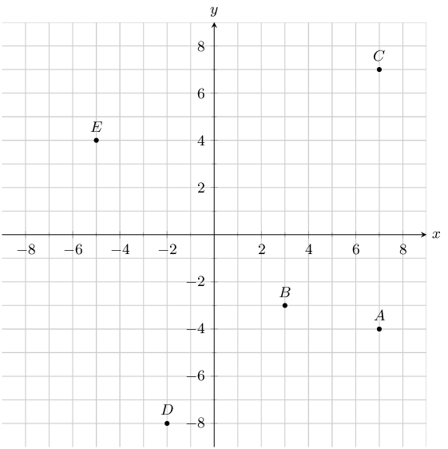

Find the coordinates of points \(A\), \(B\), \(C\), \(D\) and \(E\).

**Solution:**
From the graph we can read off the \(x\) and \(y\) values for each point.

\(A(7;-4)\), \(B(3;-3)\), \(C(7;7)\), \(D(-2;-8)\) and \(E(-5;4)\)

**Problem:**
You are given the following diagram, with various points shown:

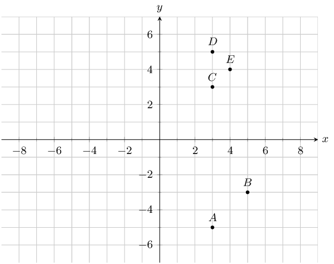

Which point lies at the coordinates \((3;-5)\)?

**Solution:**
For this question, we are must find point \((3;-5)\).

Therefore, on the graph we can trace the \(x\) and \(y\) values.

Therefore, point \(A\) lies at the coordinates: \((3;-5)\)

**Problem:**
You are given the following diagram, with 4 shapes drawn.

All the shapes are identical, but each shape uses a different naming convention:

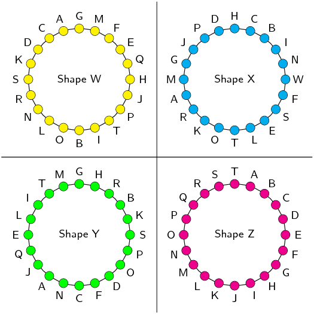

Which shape uses the correct naming convention?

**Solution:**
We recall that the correct naming convention for a shape is in alphabetical order, either
            clockwise or anti-clockwise around the shape.

From the diagram, we can see that only Shape Z sticks to this naming convention.

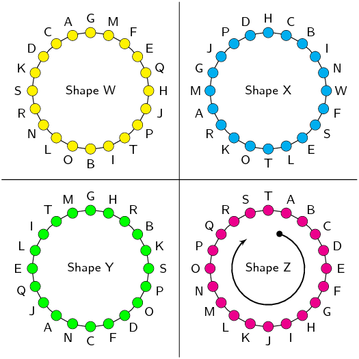

Represent the following figures in the Cartesian plane:

**Problem:**
Triangle \(DEF\) with \(D(1;2)\), \(E(3;2)\) and \(F(2;4)\).

**Solution:**
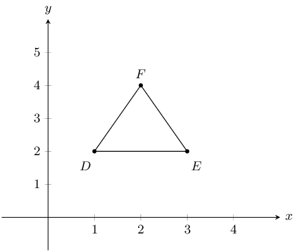

**Problem:**
Quadrilateral \(GHIJ\) with \(G(2;-1)\), \(H(0;2)\), \(I(-2;-2)\) and \(J(1;-3)\).

**Solution:**
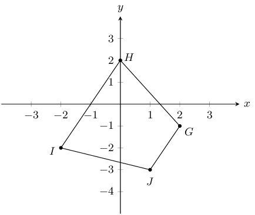

**Problem:**
Quadrilateral \(MNOP\) with \(M(1;1)\), \(N(-1;3)\), \(O(-2;3)\) and \(P(-4;1)\).

**Solution:**
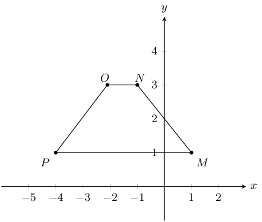

**Problem:**
Quadrilateral \(WXYZ\) with \(W(1;-2)\), \(X(-1;-3)\), \(Y(2;-4)\) and \(Z(3;-2)\).

**Solution:**
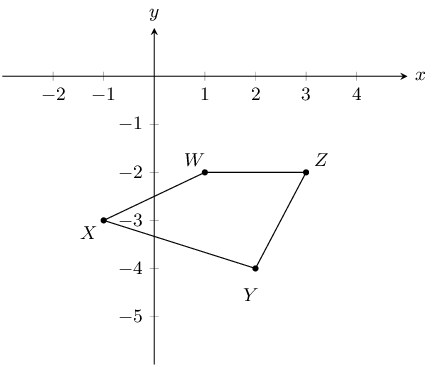

**Problem:**
You are given the following diagram:

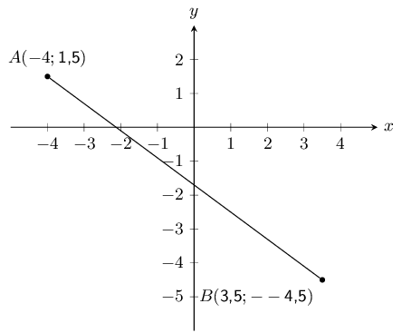

Calculate the length of line \(AB\), correct to 2 decimal places.

**Solution:**
The equation for distance is \(d_{AB} = \sqrt{(x_B - x_A)^2 + (y_B - y_A)^2}\). We substitute in
            \(A(-4;\text{1,5})\) and \(B(\text{3,5};-\text{4,5})\) and solve:

          \(\begin{aligned}
          d_{AB} & = \sqrt{(x_B - x_A)^2 + (y_B - y_A)^2}\\
          & = \sqrt{(\text{3,5} - (-\text{4}))^2 + (-\text{4,5} - (\text{1,5}))^2} \\
          & = \sqrt{(\text{3,5} + \text{4})^2 + (-\text{4,5} - \text{1,5})^2} \\
          & = \sqrt{(\text{7,5})^2 + (-\text{6})^2} \\
          & = \sqrt{(\text{56,25}) + (\text{36})} \\
          & = \sqrt{(\text{92,25})} \\
          & = \text{9,81}
          \end{aligned}\)

**Problem:**
The following picture shows two points on the Cartesian plane, \(A\) and \(B\).

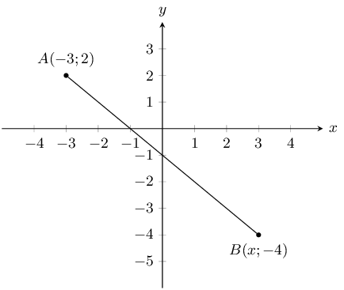

The distance between the points is \(\text{8,4853}\). Calculate the missing coordinate of point \(B\).

**Solution:**
The equation for distance is \(d_{AB} = \sqrt{(x_B - x_A)^2 + (y_B - y_A)^2}\). We substitute in
            \(A(-\text{3};\text{2})\) and \(B(x;-\text{4})\):

\(\begin{aligned}
            d_{AB} & = \sqrt{(x_B - x_A)^2 + (y_B - y_A)^2}\\
            \text{8,4853} & = \sqrt{(x - (-\text{3}))^2 + (-\text{4} - (\text{2}))^2} \\
            \text{8,4853} & = \sqrt{(x \text{+3})^2 + (-\text{4} -\text{2})^2} \\
            \end{aligned}\)

Now we re-arrange, and solve for the value of \(x\):

\(\begin{aligned}
            (\text{8,4853})^2 & = (x \text{+3})^2 + (-\text{4} -\text{2})^2 \\
            \text{72} & = (x \text{+3})^2 + (-\text{4} -\text{2})^2 \\
            \text{72} & = (x\text{+3})^2 \text{+36} \\
            (x+3)^2 & = \text{36} \\
            x \text{+3} & = \pm \sqrt{\text{36}} \\
            x & = \pm \text{6} -\text{3} \\
            x & = (\text{3}) \text{ or }(-\text{9}) \\
            \end{aligned}\)

We now have a choice between 2 values for \(x\). From the diagram we can see that the appropriate value for
            this question is \(\text{3}\).

**Problem:**
You are given the following diagram:

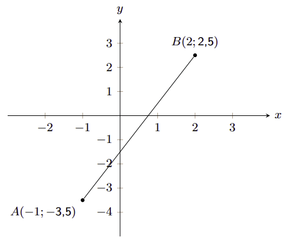

Calculate the gradient (\(m\)) of line \(AB\). The coordinates are \(A (-1;-\text{3,5})\) and \(B
            (2;\text{2,5})\) respectively.

**Solution:**
\(\begin{aligned}
            m & = \left( \frac{y_B - y_A}{x_B - x_A} \right) \\
            & = \left( \frac{(\text{2,5}) - (-\text{3,5})}{(\text{2}) - (-\text{1})} \right) \\
            & = \text{2}
            \end{aligned}\)

Therefore the gradient, \(m\), of the line \(AB\) is \(\text{2}\).

**Problem:**
You are given the following diagram:

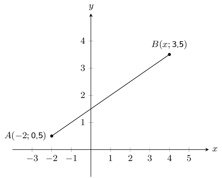

You are also told that line \(AB\) has a gradient, \(m\), of \(\text{0,5}\).

Calculate the missing co-ordinate of point \(B\).

**Solution:**
\begin{align*}
          m & = \left( \frac{y_B - y_A}{x_B - x_A} \right) \\
          \text{0,5} & = \left(\frac{(\text{3,5}) - (\text{0,5})}{x - (-\text{2})} \right) \\
          \text{0,5}(x + \text{2}) & = \text{3} \\
          x + \text{2} & = \text{6} \\
          x & = \text{4}
          \end{align*}

**Problem:**
You are given the following diagram:

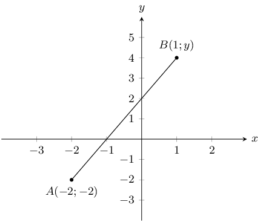

You are also told that line \(AB\) has a gradient, \(m\), of \(\text{2}\).

Calculate the missing co-ordinate of point \(B\).

**Solution:**
\begin{align*}
          m & = \left( \frac{y_B - y_A}{x_B - x_A} \right) \\
          \text{2} & = \left(\frac{y - (-\text{2})}{(\text{1}) - (-\text{2})} \right) \\
          \text{2}(\text{3}) & = y + \text{2} \\
          \text{6} & = y + \text{2} \\
          \text{4} & = y
          \end{align*}

In the diagram, \(A\) is the point \((-6;1)\) and \(B\) is the point \((0;3)\).

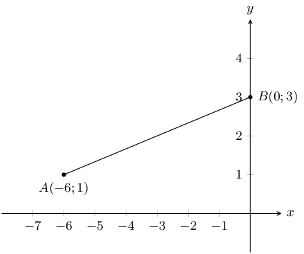

**Problem:**
Find the equation of line \(AB\).

**Solution:**
We first find the gradient of the line:

            \begin{align*}
            m_{AB} & = \frac{y_2-y_1}{x_2-x_1}\\
            & = \frac{1 - 3}{-6 - 0}\\
            & = \frac{-2}{-6}\\
            & = \frac{1}{3}
            \end{align*}

Next we note that point \(B\) lies on the \(y\)-axis and so is the \(y\)-intercept. Therefore \(c = 3\).

Therefore the equation of the line \(AB\) is: \(y = \frac{1}{3}x+3\).

**Problem:**
Calculate the length of \(AB\).

**Solution:**
\begin{align*}
            d_{AB} &= \sqrt{(x_1 - x_2)^2 + (y_1 - y_2)^2}\\
            &= \sqrt{(-6 + 0)^2 + (1 - 3)^2}\\
            &= \sqrt{(-6)^2 + (-2)^2}\\
            &= \sqrt{40}
            \end{align*}

**Problem:**
You are given the following diagram:

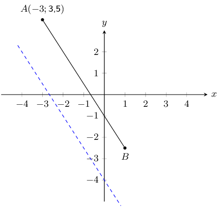

You are also told that line \(AB\) runs parallel to the following line: \(y = -\text{1,5}x - \text{4}\).
            Point \(A\) is at \(\left(-3 ; \text{3,5} \right)\).

Find the equation of the line \(AB\).

**Solution:**
Let \(y = -\text{1,5}x - \text{4}\) be line \(CD\).

Since line \(AB\) is parallel to line \(CD\), \(m_{AB} = m_{CD} = -\text{1,5}\).

Now we can substitute in the known point (\(A\)) and find the \(y\)-intercept of the line:

          \begin{align*}
          y & = -\text{1,5}x + c \\
          (\text{3,5}) & = (-\text{1,5})(-\text{3}) + c \\
          c & = -\text{1}
          \end{align*}

Therefore, the equation of the line \(AB\) is: \(y = -\text{1,5} x - \text{1}\)

**Problem:**
You are given the following diagram:

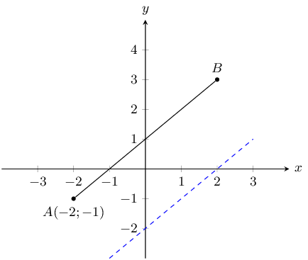

You are also told that line \(AB\) runs parallel to the following line: \(y = x - 2\).

Calculate the missing co-ordinate of point \(B(x;3)\).

**Solution:**
Let \(y = x - 2\) be line \(CD\).

Since line \(AB\) is parallel to line \(CD\), \(m_{AB} = m_{CD} = 1\).

Now we can substitute in the known point (\(A\)) and find the \(y\)-intercept of the line:

          \begin{align*}
          y & = x + c \\
          -1 & = -2 + c \\
          c & = 1
          \end{align*}

Therefore, the equation of the line \(AB\) is: \(y = x + 1\).

Finally, we substitute the known value for point \(B\) into the equation for line \(AB\):

          \begin{align*}
          y & = x + 1 \\
          3 & = x + 1 \\
          2 & = x
          \end{align*}

Therefore point \(B\) is at \((2;3)\).

**Problem:**
You are given the following diagram:

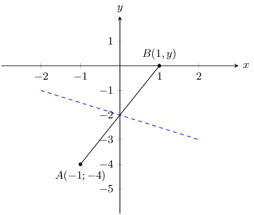

You are also told that line \(AB\) runs perpendicular to the following line: \(y = -\text{0,5}x -
            \text{2}\).

Calculate the missing co-ordinate of point \(B\).

**Solution:**
The general form of a straight line is: \(y = mx + c\).

Let line \(CD\) be \(y = -\text{0,5}x - 2\).

Line \(AB\) is perpendicular to line \(CD\) and so \(m_{AB} = \dfrac{-1}{m_{CD}}\).

          \begin{align*}
          y & = mx + c \\
          y & = \left(\frac{-1}{m_{CD}}\right)x + c \\
          y & = \left(\frac{-1}{-\text{0,5}}\right)x + c \\
          y & = 2x + c
          \end{align*}

Now we can substitute point \(A\) into the equation to find the \(y\)-intercept:

          \begin{align*}
          y & = \text{2}x + c \\
          -\text{4} & = (\text{2})(-\text{1}) + c \\
          c & = -\text{2}
          \end{align*}

Next we can substitute in point \(B\) to find the missing coordinate:

          \begin{align*}
          y & = \text{2}x - \text{2} \\
          y & = (\text{2})(\text{1}) - \text{2} \\
          y & = \text{0}
          \end{align*}

Therefore the missing coordinate is \(B(1;0)\).

**Problem:**
The graph here shows line, \(AB\). The blue dashed line is perpendicular to \(AB\).

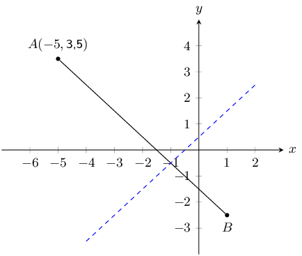

The equation of the blue dashed line is \(y = x + \text{0,5}\). Point \(A\) is at \((-\text{5};
            \text{3,5})\).

Determine the equation of line \(AB\).

**Solution:**
Let line \(CD\) be the blue dashed line.

Line \(AB\) is perpendicular to line \(CD\) and so \(m_{AB} = \dfrac{-1}{m_{CD}}\).

          \begin{align*}
          y & = mx + c \\
          y & = \left(\frac{-1}{m_{CD}}\right)x + c \\
          y & = \left(\frac{-1}{1}\right)x + c \\
          y & = -x + c
          \end{align*}

Now we can substitute point \(A\) into the equation to find the \(y\)-intercept:

          \begin{align*}
          y & = -x + c \\
          \text{3,5} & = (-\text{1})(-\text{5}) + c \\
          c & = -\text{1,5}
          \end{align*}

Therefore the equation of line \(AB\) is: \(y = -x - \text{1,5}\).

**Problem:**
You are given the following diagram:

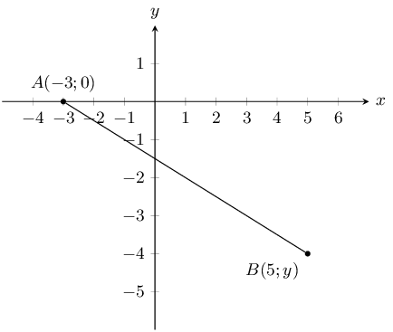

You are also told that line \(AB\) has the following equation: \(y = -\text{0,5} x - \text{1,5}\).

Calculate the missing co-ordinate of point \(B\).

**Solution:**
We can substitute the known value for point \(B\) into the given equation for line \(AB\):

          \begin{align*}
          y & = (-\text{0,5})x - \text{1,5} \\
          y & = (-\text{0,5})(\text{5}) - \text{1,5} \\
          y & = -\text{4}
          \end{align*}

**Problem:**
You are given the following diagram:

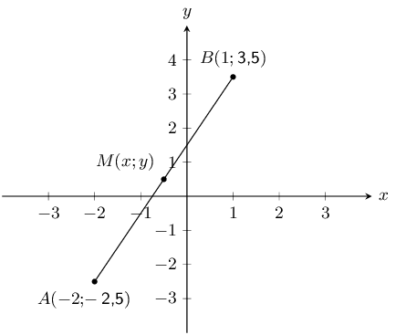

Calculate the coordinates of the mid-point (\(M\)) between point \(A (-\text{2};-\text{2,5})\) and point
            \(B (\text{1};\text{3,5})\) correct to 1 decimal place.

**Solution:**
\begin{align*}
            M(x;y) & = \left( \frac{x_A + x_B}{2} ; \frac{y_A + y_B}{2} \right) \\
            & = \left( \frac{(-\text{2}) + (\text{1})}{2} ; \frac{(-\text{2,5}) + (\text{3,5})}{2} \right) \\
            M(x;y) & = \left(-\text{0,5} ; \text{0,5} \right)
            \end{align*}

**Problem:**
\(A(-2;3)\)and \(B(2;6)\) are points in the Cartesian plane. \(C(a;b)\) is the mid-point of \(AB\). Find
            the values of \(a\) and \(b\).

**Solution:**
\begin{align*}
          M_{AB} &= \left(\frac{x_1+x_2}{2};\frac{y_1+y_2}{2}\right)\\
          &= \left(\frac{-2-2}{2};\frac{3+6}{2}\right)\\
          (a;b) &= \left(0;\frac{9}{2}\right)\\
          \therefore a=0 &\text{ and }b=\frac{9}{2}
          \end{align*}

Determine the equations of the following straight lines:

**Problem:**
passing through \(P(5; 5)\) and \(Q(-2; 12)\).

**Solution:**
\begin{align*}
            m &= \frac{y_2-y_1}{x_2-x_1} \\
            m_{PQ} &= \frac{12-5}{-2-5} \\
            &= \frac{7}{-7} \\
            m_{PQ} &= -1 \\ \\
            y &= mx + c \\
            (5) &= (-1)(5) + c \\
            c &= 5+5 \\
            c &= 10\\
            \therefore y &= -x + 10
            \end{align*}

**Problem:**
parallel to \(y = 3x +4\) and passing through \((4; 0)\).

**Solution:**
\begin{align*}
            m &= 3 \text{ (parallel lines)} \\
            y &= mx + c \\
            (0) &= (3)(4) + c \\
            c &= 12\\
            \therefore y &= 3x + 12
            \end{align*}

**Problem:**
passing through \(F(2; 1)\) and the mid-point of \(GH\) where \(G(-6; 3)\) and \(H(-2; -3)\).

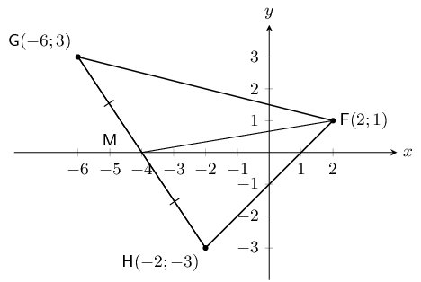

**Solution:**
\begin{align*}
            M(x;y) &= (\frac{x_1 + x_2}{2}; \frac{y_1 + y_2}{2}) \\
            M_{GH} &= (\frac{-6+(-2)}{2}; \frac{3 + (-3)}{2}) \\
            M_{GH} &= (-4; 0) \\ \\
            (y -y_1) &= m(x -x_1) \\
            m &= \frac{y_2-y_1}{x_2-x_1} \\ \\
            (y - 0) &= \frac{1-0}{2-(-4)}(x - (-4)) \\
            \therefore y &= \frac{1}{6}(x + 4) \\
            \therefore y &= \frac{1}{6}x + \frac{2}{3}
            \end{align*}

In the diagram below, the vertices of the quadrilateral are \(F(2;0)\), \(G(1;5)\), \(H(3;7)\) and
            \(I(7;2)\).

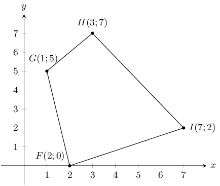

**Problem:**
Calculate the lengths of the sides of \(FGHI\).

**Solution:**
To calculate the lengths of the sides we need to use the distance formula. The four sides are \(FG\),
              \(GH\), \(HI\) and \(FI\)

            \begin{align*}
            d_{FG} &= \sqrt{(x_1 - x_2)^2 + (y_1 - y_2)^2}\\
            &= \sqrt{(1 - 2)^2 + (5 - 0)^2}\\
            &= \sqrt{(-1)^2 + (5)^2}\\
            &= \sqrt{26}\\\\
            d_{GH} &= \sqrt{(x_1 - x_2)^2 + (y_1 - y_2)^2}\\
            &= \sqrt{(3 - 1)^2+(7 - 5)^2}\\
            &= \sqrt{(2)^2 + (2)^2}\\
            &= \sqrt{8}\\\\
            d_{HI} &= \sqrt{(x_1 - x_2)^2 + (y_1 - y_2)^2}\\
            &= \sqrt{(7 - 3)^2 + (2 - 7)^2}\\
            &= \sqrt{(4)^2 + (-5)^2}\\
            &= \sqrt{41} \\\\
            d_{FI} &= \sqrt{(x_1 - x_2)^2 + (y_1 - y_2)^2}\\
            &= \sqrt{(2 - 7)^2 + (0 - 2)^2}\\
            &= \sqrt{(-5)^2 + (-2)^2}\\
            &= \sqrt{29}
            \end{align*}

**Problem:**
Are the opposite sides of \(FGHI\) parallel?

**Solution:**
We want to know if \(GH \parallel FI\) and \(FG \parallel HI\). We can calculate the gradient of each of
              the sides and then compare the gradients.

            \begin{align*}
            m_{FG} &= \dfrac{y_2 - y_1}{x_2 - x_1} \\
            &= \frac{0 - 5}{2 - 1} \\
            &= \frac{-5}{1} \\
            &= -5 \\\\
            m_{HI} &= \dfrac{y_2 - y_1}{x_2 - x_1} \\
            &= \frac{2 - 7}{7 - 3} \\
            &= \frac{-5}{4} \\
            &= -\frac{5}{4} \\\\
            m_{GH} &= \dfrac{y_2 - y_1}{x_2 - x_1} \\
            &= \dfrac{5 - 7}{1 - 3} \\
            &= \dfrac{-2}{-2} \\
            &= 1 \\\\
            m_{FI} &= \dfrac{y_2 - y_1}{x_2 - x_1} \\
            &= \frac{0 - 2}{2 - 7} \\
            &= \frac{-2}{-5} \\
            &= \frac{2}{5}
            \end{align*}

We note that \(m_{FG} \ne m_{HI}\) and \(m_{GH} \ne m_{FI}\) therefore the opposite sides are not
              parallel.

**Problem:**
Do the diagonals of \(FGHI\) bisect each other?

**Solution:**
To determine if the diagonals bisect each other we need to find the mid-point of \(FH\) and \(GI\).

            \begin{align*}
            M_{GI} &= \left(\frac{x_1 + x_2}{2} ; \frac{y_1 + y_2}{2}\right)\\
            &= \left(\frac{1 + 7}{2} ; \frac{5 + 2}{2}\right)\\
            &= \left(\frac{8}{2} ; \frac{7}{2}\right)\\
            &= \left(4 ; \frac{7}{2}\right)\\\\
            M_{FH} &= \left(\frac{x_1 + x_2}{2} ; \frac{y_1 + y_2}{2}\right)\\
            &= \left(\frac{3 + 2}{2} ; \frac{7 + 0}{2}\right)\\
            & = \left(\frac{5}{2} ; \frac{7}{2}\right)
            \end{align*}

Therefore \(M_{GI} \ne M_{FH}\) and the diagonals do not bisect each other.

**Problem:**
Can you state what type of quadrilateral \(FGHI\) is? Give reasons for your answer.

**Solution:**
This is an ordinary quadrilateral. The opposite sides are not parallel, the diagonals do not bisect each
              other and none of the sides are equal in length.

Consider a quadrilateral \(ABCD\) with vertices \(A(3;2)\), \(B(4;5)\), \(C(1;7)\) and \(D(1;3)\).

**Problem:**
Draw the quadrilateral.

**Solution:**
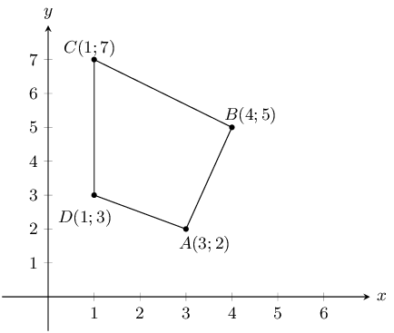

**Problem:**
Find the lengths of the sides of the quadrilateral.

**Solution:**
To calculate the lengths of the sides we need to use the distance formula. The four sides are \(AB\),
              \(BC\), \(CD\) and \(AD\)

            \begin{align*}
            d_{AB} &= \sqrt{(x_1 - x_2)^2 + (y_1 - y_2)^2} \\
            &= \sqrt{(3 - 4)^2 + (2 - 5)^2} \\
            &= \sqrt{(-1)^2 + (-3)^2} \\
            &= \sqrt{10} \\\\
            d_{BC} &= \sqrt{(x_1 - x_2)^2 + (y_1 - y_2)^2} \\
            &= \sqrt{(4 - 1)^2 + (5 - 7)^2} \\
            &= \sqrt{(3)^2 + (-2)^2} \\
            &= \sqrt{13} \\\\
            d_{CD} &= \sqrt{(x_1 - x_2)^2 + (y_1 - y_2)^2} \\
            &= \sqrt{(1 - 1)^2 + (7 - 3)^2} \\
            &= \sqrt{0 + (4)^2} \\
            &= \sqrt{16} \\
            &= 4 \\\\
            d_{AD} &= \sqrt{(x_1 - x_2)^2 + (y_1 - y_2)^2} \\
            &= \sqrt{(3 - 1)^2 + (2 - 3)^2} \\
            &= \sqrt{(2)^{2} + (-1)^2} \\
            &= \sqrt{5}
            \end{align*}

\(ABCD\) is a quadrilateral with vertices \(A(0;3)\), \(B(4;3)\), \(C(5;-1)\) and \(D(-1;-1)\).

Show by calculation that:

**Problem:**
\(AD = BC\)

**Solution:**
First draw a sketch of the quadrilateral:

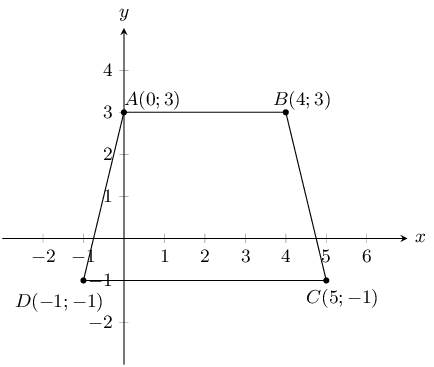

To show that \(AD = BC\) we need to use the distance formula to find the length of \(AD\) and \(BC\).

              \begin{align*}
              d_{AD} &= \sqrt{(x_1 - x_2)^2 + (y_1 - y_2)^2} \\
              &= \sqrt{(0-(-1))^2+(3-(-1))^2} \\
              &= \sqrt{(1)^2 + (4)^2} \\
              & = \sqrt{17} \\\\
              d_{BC} &= \sqrt{(x_1 - x_2)^2 + (y_1 - y_2)^2} \\
              &= \sqrt{(4 - 5)^2 + (3 - (-1))^2} \\
              &= \sqrt{(-1)^2 + (4)^2} \\
              &= \sqrt{17}
              \end{align*}

Therefore sides \(AD\) and \(BC\) are equal.

**Problem:**
\(AB \parallel DC\)

**Solution:**
To show that \(AB \parallel DC\) we need to show that \(m_{AB} = m_{DC}\).

              \begin{align*}
              m_{AB} &= \frac{y_2 - y_1}{x_2 - x_1} \\
              &= \frac{3 - 3}{0 - 4} \\
              &= \frac{0}{-4} \\
              &= 0 \\\\
              m_{DC} &= \frac{y_2 - y_1}{x_2 - x_1} \\
              &= \frac{-1 + 1}{-1 - 5} \\
              &= \frac{0}{-6} \\
              &= 0
              \end{align*}

The gradients are equal, therefore \(AB \parallel DC\).

**Problem:**
What type of quadrilateral is \(ABCD\)?

**Solution:**
An isosceles trapezium; one pair of opposite sides equal in length and one pair of opposite sides
              parallel.

**Problem:**
Show that the diagonals \(AC\) and \(BD\) do not bisect each other.

**Solution:**
To show this we need to find the mid-points of \(AC\) and \(BD\).

            \begin{align*}
            M_{AC} & = \left(\frac{x_1 + x_2}{2} ; \frac{y_1 + y_2}{2}\right) \\
            & = \left(\frac{0 + 5}{2} ; \frac{3 - 1}{2}\right) \\
            & = \left(\frac{5}{2} ; \frac{2}{2}\right) \\
            & = \left(\frac{5}{2} ; 1\right) \\\\
            M_{BD} &= \left(\frac{x_1 + x_2}{2} ; \frac{y_1 + y_2}{2}\right) \\
            & = \left(\frac{4 - 1}{2} ; \frac{3 - 1}{2}\right) \\
            & = \left(\frac{3}{2} ; \frac{2}{2}\right)\\
            & = \left(\frac{3}{2} ; 1\right)
            \end{align*}

\(M_{AC} \ne M_{BD}\), therefore the diagonals do not bisect each other.

\(P\), \(Q\), \(R\) and \(S\) are the points \((-2;0)\), \((2;3)\), \((5;3)\) and \((-3;-3)\) respectively.

Show that:

**Problem:**
\(SR = 2PQ\)

**Solution:**
First draw a sketch:

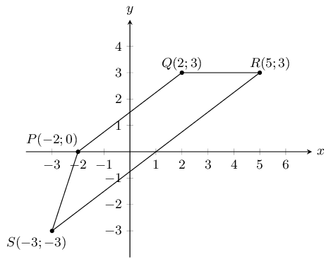

We can use the distance formula to show that \(SR = 2PQ\).

              \begin{align*}
              d_{PQ} &= \sqrt{(x_1 - x_2)^2 + (y_1 - y_2)^2} \\
              &= \sqrt{(-2 - 2)^2 + (0 - 3)^2} \\
              &= \sqrt{(-4)^2 + (-3)^2} \\
              &= \sqrt{25} \\
              &= 5 \\\\
              d_{SR} &= \sqrt{(x_1 - x_2)^2 + (y_1 - y_2)^2} \\
              &= \sqrt{(-3 - 5)^2 + (-3 - 3)^2} \\
              &= \sqrt{(-8)^2 + (-6)^2} \\
              &= \sqrt{100} \\
              &= 10 \\
              \therefore SR &= 2PQ
              \end{align*}

**Problem:**
\(SR \parallel PQ\)

**Solution:**
\begin{align*}
              m_{PQ} &= \frac{y_2 - y_1}{x_2 - x_1} \\
              & = \frac{3 - 0}{2 - (-2)} \\
              & = \frac{3}{4} \\\\
              m_{SR} &= \frac{y_2 - y_1}{x_2 - x_1} \\
              &= \frac{-3 - 3}{-3 - 5} \\
              &= \frac{-6}{-8} \\
              &= \frac{3}{4} \\
              \therefore m_{PQ} & = m_{SR}
              \end{align*}

Since the gradients are equal \(SR \parallel PQ\).

Calculate:

**Problem:**
\(PS\)

**Solution:**
We need to calculate the length of \(PS\):

              \begin{align*}
              d_{PS} &= \sqrt{(x_1 - x_2)^2 + (y_1 - y_2)^2} \\
              &= \sqrt{(-2 - (-3))^2 + (0 - (-3))^2} \\
              &= \sqrt{(1)^2 + (3)^2} \\
              &= \sqrt{10}
              \end{align*}

**Problem:**
\(QR\)

**Solution:**
We need to calculate the length of \(QR\):

              \begin{align*}
              d_{QR} &= \sqrt{(x_1 - x_2)^2 + (y_1 - y_2)^2} \\
              &= \sqrt{(2 - 5)^2 + (3 - 3)^2} \\
              & = \sqrt{(-3)^2 + 0} \\
              &= \sqrt{9} \\
              &= 3
              \end{align*}

**Problem:**
What kind of quadrilateral is \(PQRS\)? Give reasons for your answer.

**Solution:**
Trapezium. One pair of opposite sides parallel.

**Problem:**
\(EFGH\) is a parallelogram with vertices \(E(-1;2)\), \(F(-2;-1)\) and \(G(2;0)\). Find the coordinates of
            \(H\) by using the fact that the diagonals of a parallelogram bisect each other.

**Solution:**
Since the diagonal bisect each other the mid-point of \(EG\) is equal to the mid-point of \(FH\). We can
            first calculate the mid-point of \(EG\) since we have the co-ordinates of both \(E\) and \(G\). We can then
            use that mid-point to help us find the co-ordinates of \(H\).

          \begin{align*}
          M_{EG} &= \left(\frac{x_1 + x_2}{2} ; \frac{y_1 + y_2}{2}\right) \\
          &= \left(\frac{-1 + 2}{2} ; \frac{2 + 0}{2}\right) \\
          &= \left(\frac{1}{2} ; 1\right) \\\\
          M_{FH} &= \left(\frac{x_1 + x_2}{2} ; \frac{y_1 + y_2}{2}\right) \\
          &= \left(\frac{-2 + x}{2} ; \frac{-1 + y}{2}\right) \\
          \left(\frac{1}{2} ; 1\right) &= \left(\frac{-2 + x}{2} ; \frac{-1 + y}{2}\right)
          \end{align*}

Solve for \(x\):

          \begin{align*}
          \frac{1}{2} &= \frac{-2+x}{2} \\
          1 &= -2+x\\
          x &= 3
          \end{align*}

Solve for \(y\):

          \begin{align*}
          1 &= \frac{-1+y}{2} \\
          2 &= -1+y \\
          y &= 3
          \end{align*}

Therefore \(H(3;3)\).

\(PQRS\) is a quadrilateral with points \(P(0;-3)\), \(Q(-2;5)\), \(R(3;2)\) and \(S(3;-2)\) in the
            Cartesian plane.

**Problem:**
Find the length of \(QR\).

**Solution:**
First draw a sketch of the quadrilateral:

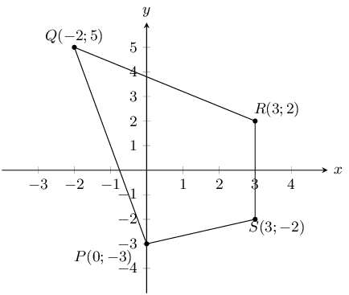

**Problem:**
Find the gradient of \(PS\).

**Solution:**
\begin{align*}
            m_{PS} &= \frac{y_2 - y_1}{x_2 - x_1}\\
            &= \frac{-3 + 2}{0 - 3} \\
            & = \frac{-1}{-3} \\
            &= \frac{1}{3}
            \end{align*}

**Problem:**
Find the mid-point of \(PR\).

**Solution:**
\begin{align*}
            M_{QR} & = \left(\frac{x_1 + x_2}{2} ; \frac{y_1 + y_2}{2}\right) \\
            & = \left(\frac{0 + 3}{2} ; \frac{-3 + 2}{2}\right) \\
            & = \left(\frac{3}{2} ; \frac{-1}{2}\right)
            \end{align*}

**Problem:**
Is \(PQRS\) a parallelogram? Give reasons for your answer.

**Solution:**
We need to calculate the gradients of each of the sides to see if opposite sides are parallel. We have
              calculated the gradient of \(PS\) so we only need to check the gradients of the other three sides.
              However, looking at our sketch \(PS\) is not parallel to \(QR\) (you can check this by calculating the
              gradient of \(QR\)).

            \begin{align*}
            m_{RS} &= \frac{y_2 - y_1}{x_2 - x_1} \\
            &= \frac{-2 - 2}{3 - 3} \\
            &= \frac{-4}{0} \\
            & = \text{undefined}
            \end{align*}

And,

            \begin{align*}
            m_{QR} &= \frac{y_2 - y_1}{x_2 - x_1} \\
            &= \frac{2 - 5}{3 - (-2)} \\
            & = \frac{-3}{5}
            \end{align*}

Therefore \(PQRS\) is not a parallelogram. Opposite sides are not parallel.

Consider triangle \(ABC\) with vertices \(A(1;3)\), \(B(4;1)\) and \(C(6;4)\).

**Problem:**
Sketch triangle \(ABC\) on the Cartesian plane.

**Solution:**
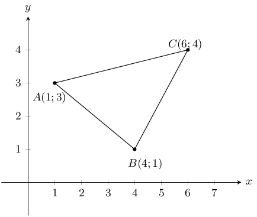

**Problem:**
Show that \(ABC\) is an isosceles triangle.

**Solution:**
We need to show that two sides are equal in length. We therefore calculate the length of each of the
              sides of the triangle.

            \begin{align*}
            d_{AB} &= \sqrt{(x_1 - x_2)^2 + (y_1 - y_2)^2} \\
            &= \sqrt{(1 - 4)^2 + (3 - 1)^2} \\
            & = \sqrt{(-3)^2 + (2)^2} \\
            & = \sqrt{13} \\\\
            d_{BC} &= \sqrt{(x_1 - x_2)^2 + (y_1 - y_2)^2} \\
            &= \sqrt{(4 - 6)^2 + (1 - 4)^2} \\
            &= \sqrt{(-2)^2 + (-3)^2} \\
            &= \sqrt{13} \\\\
            d_{AC} &= \sqrt{(x_1 - x_2)^2 + (y_1 - y_2)^2} \\
            &= \sqrt{(1 - 6)^2 + (3 - 4)^2} \\
            & = \sqrt{(-5)^2 + (-1)^2} \\
            &= \sqrt{26}
            \end{align*}

Two sides of the triangle are equal in length, therefore \(\triangle ABC\) is isosceles.

**Problem:**
Determine the coordinates of \(M\), the mid-point of \(AC\).

**Solution:**
\begin{align*}
            M_{AC} & = \left(\frac{x_1 + x_2}{2} ; \frac{y_1 + y_2}{2}\right)\\
            & = \left(\frac{1 + 6}{2} ; \frac{3 + 4}{2}\right)\\
            & = \left(\frac{7}{2} ; \frac{7}{2}\right)
            \end{align*}

**Problem:**
Determine the gradient of \(AB\).

**Solution:**
\begin{align*}
            m_{AB} &= \frac{y_2 - y_1}{x_2 - x_1}\\
            &= \frac{1 - 3}{4 - 1}\\
            & = \frac{-2}{3}
            \end{align*}

**Problem:**
Show that \(D(7;-1)\) lies on the line that goes through \(A\) and \(B\).

**Solution:**
We have just calculated the gradient of \(AB\): \(m_{AB} = \dfrac{-2}{3}\). We need to calculate the
              gradient of \(BD\) and \(AD\):

            \begin{align*}
            m_{BD}& = \frac{y_2 - y_1}{x_2 - x_1} \\
            &= \frac{-1 - 1}{7 - 4} \\
            & = \frac{-2}{3} \\\\
            m_{AD} &= \frac{y_2 - y_1}{x_2 - x_1} \\
            &= \frac{-1 - 3}{7 - 1} \\
            & = \frac{-2}{3} \\ \\
            m_{AB} & = m_{BD} = m_{AD}
            \end{align*}

Therefore \(A\), \(B\) and \(D\) are collinear.

Therefore \(D\) lies on line \(AB\).

**Problem:**
\(\triangle PQR\) has vertices \(P(1;8)\), \(Q(8;7)\) and \(R(7;0)\). Show through calculation that
            \(\triangle PQR\) is a right angled isosceles triangle.

**Solution:**
First draw a sketch:

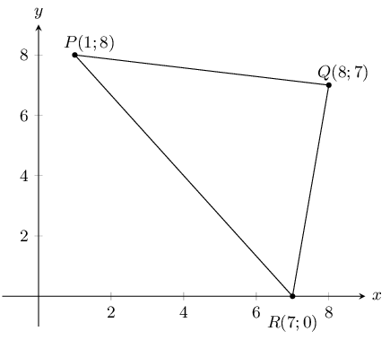

Next calculate the gradient of each of the three sides of the triangle:

          \begin{align*}
          m_{PQ} &= \frac{8 - 7}{1 - 8} \\
          &= -\frac{1}{7} \\\\
          m_{QR} &= \frac{7 - 0}{8 - 7} \\
          &= \frac{7}{1} \\\\
          m_{PR} &= \frac{8 - 0}{1 - 7} \\
          &= -\frac{4}{3}
          \end{align*}

Now we can check \(m_{PQ} \times m_{QR}\), \(m_{QR} \times m_{PR}\) and \(m_{PQ} \times m_{PR}\). As soon
            as we find one of these values is equal to \(-\text{1}\) then we have proved that the triangle is
            right-angled.

          \begin{align*}
          m_{PR} \times m_{QR} &= -\frac{1}{7} \times \frac{7}{1}\\
          &= -1
          \end{align*}

Therefore \(\triangle PQR\) is right-angled, \(PR \perp QR\). The right-angle is \(P\hat{Q}R\).

Finally we calculate the lengths of sides \(PQ\) and \(RQ\) to show that the triangle is isosceles. We do
            not need to calculate \(PR\) as this is the hypotenuse of the triangle and must be longer than \(PQ\) and
            \(RQ\).

          \begin{align*}
          PQ &= \sqrt{(1 - 8)^2 + (8 - 7)^2} \\
          &= \sqrt{49 + 1} \\
          &= \sqrt{50} \\\\
          RQ &= \sqrt{(8 - 7)^2 + (7 - 0)^2} \\
          &= \sqrt{1 + 49} \\
          &= \sqrt{50}
          \end{align*}

Therefore \(PQ = RQ\) and therefore \(\triangle PQR\) is a right-angled, isosceles triangle.

**Problem:**
\(\triangle ABC\) has vertices \(A(-3;4)\), \(B(3;-2)\) and \(C(-5;-2)\). \(M\) is the mid-point of \(AC\)
            and \(N\) is the mid-point of \(BC\). Use \(\triangle ABC\) to prove the mid-point theorem using analytical
            geometry methods.

**Solution:**
First draw a sketch:

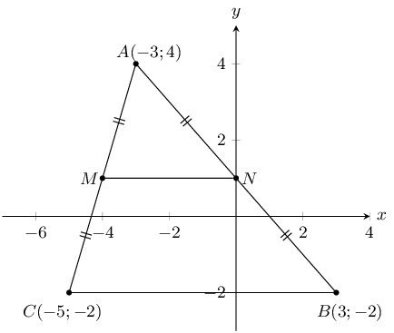

The mid-point theorem states that the line joining the mid-points of two sides of a triangle is parallel to
            the third side and equal to half the length of the third side. Therefore we need to show that \(MN \parallel
            BC\) and that \(MN = \frac{1}{2} BC\).

We need to calculate the co-ordinates of mid-points \(M\) and \(N\):

          \begin{align*}
          M &= \left(\frac{-3 - 5}{2} ; \frac{4 - 2}{2}\right)\\
          &= (-4;1)\\
          N &= \left(\frac{-3 + 3}{2} ; \frac{4 - 2}{2}\right)\\
          &= (0;1)
          \end{align*}

Now we can show that \(MN \parallel BC\):

          \begin{align*}
          m & = \frac{y_{2} - y_{1}}{x_{2} - x_{1}} \\\\
          m_{BC} &= \frac{-2 - (-2)}{3 - (-5)}\\
          & = 0 \\\\
          m_{MN} &= \frac{1 - 1}{-4 - 0}\\
          & = 0 \\\\
          \therefore MN & \parallel BC
          \end{align*}

Finally we can use the distance formula to show that \(MN = \frac{1}{2}BC\):

          \begin{align*}
          d & = \sqrt{(y_{2} - y_{1})^{2} + (x_{2} - x_{1})^{2}} \\
          d_{MN} & = \sqrt{(1 - 1)^{2} + (-4 - 0)^{2}} \\
          & = 4 \\
          d_{BC} & = \sqrt{(-2 - (-2))^{2} + (-5 - 3)^{2}} \\
          & = 8 \\
          \therefore MN &= \frac{1}{2}CB
          \end{align*}

**Problem:**
List two properties of a parallelogram.

**Solution:**
Any two of the following:

- Both pairs of opposite sides are parallel.
- Both pairs of opposite sides are equal in length.
- Both pairs of opposite angles are equal.
- Both diagonals bisect each other.

**Problem:**
The points \(A(-2;-4)\), \(B(-4;1)\), \(C(2;4)\) and \(D(4;-1)\) are the vertices of a quadrilateral.
              Show that the quadrilateral is a parallelogram.

**Solution:**
We need to show that both pairs of opposite sides are parallel. So we need to calculate the gradient of
              each of the sides:

            \begin{align*}
            m_{AB} & = \frac{1 + 4}{-4 + 2} \\
            & = \frac{5}{-2} \\
            m_{CD} & = \frac{-1 - 4}{4 - 2} \\
            & = \frac{-5}{2} \\
            \therefore AB \parallel CD \\\\
            m_{BC} & = \frac{4 - 1}{2 + 4} \\
            & = \frac{3}{6} = \frac{1}{2} \\
            m_{AD} & = \frac{-1 + 4}{4 + 2} \\
            & = \frac{3}{6} = \frac{1}{2} \\
            \therefore BC \parallel AD
            \end{align*}

Therefore \(ABCD\) is a parallelogram (2 pairs opp. sides \(\parallel\)).

The diagram shows a quadrilateral. The points \(B\) and \(D\) have the coordinates \((2;6)\) and \((4;2)\)
            respectively. The diagonals of \(ABCD\) bisect each other at right angles. \(F\) is the point of
            intersection of line \(AC\) with the \(y\)-axis.

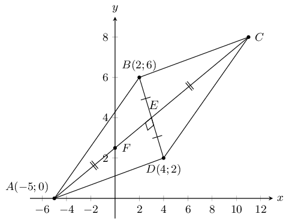

**Problem:**
Determine the gradient of \(AC\).

**Solution:**
Since the diagonals bisect each other we know that \(AC \perp BD\). Therefore:

            \begin{align*}
            m_{AC} \times m_{BD} & = -1 \\
            m_{AC} \times \frac{6 - 2}{2 - 4} & = -1 \\
            m_{AC} \times -2 & = -1 \\
            m_{AC} & = \frac{1}{2}
            \end{align*}

**Problem:**
Show that the equation of \(AC\) is given by \(2y = x + 5\).

**Solution:**
From above we have that \(m = \frac{1}{2}\).

Substitute point \(A\) into the equation:

            \begin{align*}
            (0) & = \frac{1}{2}(-5) + c \\
            0 & = \frac{-5}{2} + c \\
            \therefore c & = \frac{5}{2} \\
            \therefore y & = \frac{1}{2}x + \frac{5}{2} \\
            \therefore 2y & = x + 5
            \end{align*}

**Problem:**
Determine the coordinates of \(C\).

**Solution:**
We first calculate the coordinates of \(E\):

            \begin{align*}
            E(\frac{2 + 4}{2};\frac{6 + 2}{2}) \\
            E(3;4)
            \end{align*}

Now we can use the coordinates of \(E\) to find the coordinates of \(C\). Since \(E\) is the mid-point of
              \(AC\) we can use the mid-point formula to find \(C\):

            \begin{align*}
            \frac{-5 + x}{2} & = 3 \\
            -5 + x & = 6 \\
            x & = 11 \\\\
            \frac{0 + y}{2} & = 4 \\
            y & = 8
            \end{align*}

Therefore \(C(11;8)\).

\(A(4;-1)\), \(B(-6;-3)\) and \(C(-2;3)\) are the vertices of \(\triangle ABC\).

**Problem:**
Find the length of \(BC\), correct to 1 decimal place.

**Solution:**
\begin{align*}
            BC & = \sqrt{(-2+6)^{2} + (3+3)^{2}} \\
            & = \sqrt{4^2 + 9^2} \\
            & = \sqrt{16 + 81} \\
            & = \text{9,8}
            \end{align*}

**Problem:**
Calculate the gradient of \(AC\).

**Solution:**
\begin{align*}
            m_{AC} & = \frac{3 + 1}{-2 - 4} \\
            & = \frac{4}{-6} \\
            & = \frac{-2}{3}
            \end{align*}

**Problem:**
If \(P\) has coordinates \((-26;19)\), show that \(A\), \(C\) and \(P\) are collinear.

**Solution:**
\begin{align*}
            m_{AP} & = \frac{19 + 1}{-26 - 4} \\
            & = \frac{20}{-30} \\
            & = \frac{-2}{3}
            \end{align*}

From the previous question we have that \(m_{AC} = \frac{-2}{3}\), therefore \(m_{AC} = m_{AP}\).

Therefore \(A\), \(C\) and \(P\) are collinear.

**Problem:**
Determine the equation of line \(BC\).

**Solution:**
\begin{align*}
            m_{BC} & = \frac{3 + 3}{-2 + 6} \\
            & = \frac{6}{4} \\
            & = \frac{3}{2} \\
            \therefore y & = \frac{3}{2}x + c
            \end{align*}

Substitute \(B(-6;-3)\):

            \begin{align*}
            (-3) & = \frac{3}{2}(-6) + c \\
            -3 & = -9 + c \\
            \therefore c & = 6 \\
            \therefore y & = \frac{3}{2}x + 6
            \end{align*}

The equation of line \(BC\) is \(y = \dfrac{3}{2}x + 6\).

**Problem:**
Show that \(\triangle ABC\) is right-angled.

**Solution:**
For a triangle to be right-angled the gradients of two of the sides must be perpendicular. We need to
              calculate \(m_{AC}\), \(m_{BC}\) and \(m_{AB}\).

We will start with \(m_{AC}\) and \(m_{BC}\) since we have these values from previous questions: \(m_{AC}
              = \dfrac{-2}{3}\) and \(m_{BC} = \dfrac{3}{2}\).

We can check if these two gradients are perpendicular:

            \begin{align*}
            m_{AC} \times m_{BC} & = \frac{-2}{3} \times \frac{3}{2} \\
            & = \frac{-6}{6} \\
            & = -1
            \end{align*}

Since the product of these two gradients is \(-\text{1}\), \(AC \perp BC\).

Therefore \(\triangle ABC\) is right-angled.

Given the following diagram:

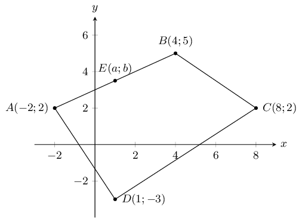

**Problem:**
If \(E\) is the mid-point of \(AB\), find the values of \(a\) and \(b\).

**Solution:**
\begin{align*}
            M_{AB} & = \left(\frac{-2 + 4}{2}; \frac{2 + 5}{2}\right) \\
            & = \left(1 ; \frac{7}{2}\right)
            \end{align*}

Therefore \(a = 1\) and \(b = \frac{7}{2}\).

**Problem:**
Find the equation of the line perpendicular to \(BC\), which passes through the origin.

**Solution:**
Let the line be \(FG\).

First calculate the gradient of \(BC\):

            \begin{align*}
            m_{BC} & = \frac{2 - 5}{8 - 4} \\
            m_{BC} & = \frac{-3}{4}
            \end{align*}

Now we can calculate the gradient of \(FG\):

            \begin{align*}
            -1 & = m_{BC} \times m_{FG} \\
            -1 & = \left(\frac{-3}{4}\right)m_{FG} \\
            m_{FG} & = \frac{4}{3}
            \end{align*}

Therefore we have \(y = \dfrac{4}{3}x - c\). Since the line passes through the origin the \(y\)-intercept
              is \(\text{0}\).

Therefore the equation of the line perpendicular to \(BC\), which passes through the origin is: \(y =
              \dfrac{4}{3}x\).

**Problem:**
Find the coordinates of the mid-point of diagonal \(BD\).

**Solution:**
\begin{align*}
            M_{BD} & = \left(\frac{4 + 1}{2}; \frac{5 - 3}{2}\right) \\
            & = \left(\frac{7}{2} ; 1\right)
            \end{align*}

**Problem:**
Hence show that \(ABCD\) is not a parallelogram.

**Solution:**
\begin{align*}
            M_{AC} & = \left(\frac{-2 + 8}{2}; \frac{2 + 2}{2}\right) \\
            & = \left(3 ; 2\right)
            \end{align*}

The mid-point of \(BD\) is not the mid-point of \(AC\). Therefore the diagonals of the quadrilateral do
              not bisect each other and \(ABCD\) is not a parallelogram.

**Problem:**
If \(C\) could be moved, give its new coordinates so that \(ABCD\) would be a parallelogram.

**Solution:**
We use the mid-point of \(BD\) to find the new \(x\) and \(y\) coordinates of \(C\):

            \begin{align*}
            \frac{5}{2} & = \frac{-2 + x}{2} \\
            \frac{10}{2} & = -2 + x \\
            x & = 7 \\\\
            1 & = \frac{2 + y}{2} \\
            2 & = 2 + y \\
            0 & = y
            \end{align*}

Therefore \(C(7;0)\) would make \(ABCD\) a parallelogram.

A triangle has vertices \(A(-1;7)\), \(B(8;4)\) and \(C(5;-5)\).

**Problem:**
Calculate the gradient of \(AB\).

**Solution:**
\begin{align*}
            m_{AB} & = \frac{4 - 7}{8 + 1} \\
            & = \frac{-3}{9} \\
            & = -\frac{1}{3}
            \end{align*}

**Problem:**
Prove that the triangle is right-angled at \(B\).

**Solution:**
First draw a sketch:

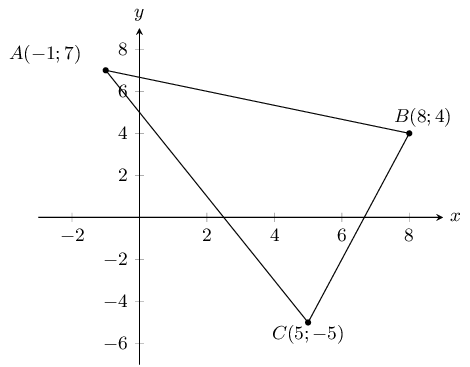

For the triangle to be right-angled at \(B\), \(m_{AB} \times m_{BC} = -1\). We have \(m_{AB}\) from the
              previous question.

            \begin{align*}
            m_{BC} & = \frac{-5 - 4}{5 - 8} \\
            & = \frac{-9}{-3} \\
            & = 3 \\\\
            \therefore m_{AB} \times m_{BC} & = 3 \times \frac{-1}{3} \\
            & = -1
            \end{align*}

Therefore \(BC \perp AB\) and \(\triangle ABC\) is right-angled at \(B\).

**Problem:**
Determine the length of \(AB\).

**Solution:**
\begin{align*}
            AB & = \sqrt{(8 - (-1))^{2} + (4 - 7)^{2}} \\
            & = \sqrt{90} \\
            & = \text{9,49}
            \end{align*}

**Problem:**
Determine the equation of the line from \(A\) to the mid-point of \(BC\).

**Solution:**
First find the mid-point of \(BC\):

            \begin{align*}
            M_{BC} & = \left(\frac{8 + 5}{2}; \frac{4 - 5}{2}\right) \\
            & = \left(\frac{13}{2}; \frac{-1}{2}\right)
            \end{align*}

Now we can calculate the gradient of the line:

            \begin{align*}
            m & = \frac{7 - \frac{-1}{2}}{-1 - \frac{13}{2}} \\
            & = -1 \\
            \therefore y & = -x + c
            \end{align*}

Substitute \(A(-2;2)\):

            \begin{align*}
            (2) & = -(-1) + c \\
            c & = 6 \\
            \therefore y & = -x + 6
            \end{align*}

The equation of the the line from \(A\) to the mid-point of \(BC\) is \(y = -x + 6\).

**Problem:**
Find the area of the triangle \(ABC\).

**Solution:**
First find the length of \(BC\):

            \begin{align*}
            BC & = \sqrt{(8-5)^{2} + (4+5)^{2}} \\
            & = 3\sqrt{10} \\
            & = \text{9,5}
            \end{align*}

Now we can find the area:

            \begin{align*}
            \text{Area } & = \frac{1}{2}bh \\
            & = \frac{1}{2}(AB)(BC) \\
            & = \frac{1}{2}(3\sqrt{10})(3\sqrt{10}) \\
            & = \text{45}
            \end{align*}

A quadrilateral has vertices \(A(0;5)\), \(B(-3;-4)\), \(C(0;-5)\) and \(D(4;k)\) where \(k \geq 0\).

**Problem:**
What should \(k\) be so that \(AD\) is parallel to \(CD\)?

**Solution:**
We first draw a sketch. We note that \(D\) lies somewhere on the line \(x = 4\).

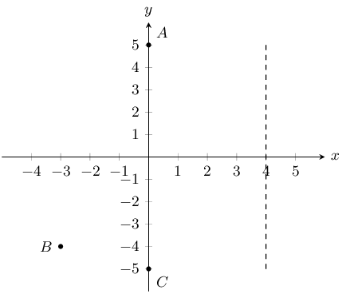

For parallel lines \(m_{AD} = m_{CD}\):

            \begin{align*}
            \frac{k - 5}{4 - 0} & = \frac{k + 5}{4 - 0} \\
            \frac{k - 5}{4} & = \frac{k + 5}{4} \\
            \therefore k - 5 & = k + 5 \\
            0 & = 10
            \end{align*}

Therefore there is no value of \(k\) such that \(AD\) will be parallel to \(DC\).

We can see that this must be true since \(D\) is a common point on lines \(AD\) and \(CD\) so \(AD\)
              cannot be parallel to \(CD\).

**Problem:**
What should \(k\) be so that \(CD = \sqrt{52}\)?

**Solution:**
\begin{align*}
            \sqrt{52} & = \sqrt{(4-0)^{2} + (k + 5)^{2}} \\
            \sqrt{52} & = \sqrt{16 + (k + 5)^{2}} \\
            \therefore 52 & = 16 + k^{2} + 10k + 25 \\
            0 & = k^{2} + 10k - 11 \\
            & = (k + 11)(k - 1) \\
            \therefore k = -11 & \text{ or } k = 1
            \end{align*}

But \(k \geq 0\), therefore \(k = 1\)

On the Cartesian plane, the three points \(P(-3;4)\), \(Q(7;-1)\) and \(R(3;b)\) are collinear.

**Problem:**
Find the length of \(PQ\).

**Solution:**
\begin{align*}
            PQ & = \sqrt{(-3 - 7)^{2} + (-1 - 4)^{2}} \\
            & = 5\sqrt{5}
            \end{align*}

**Problem:**
Find the gradient of \(PQ\).

**Solution:**
\begin{align*}
            m_{PQ} & = \frac{-1 - 4}{7 + 3} \\
            & = \frac{-5}{10} \\
            & = -\frac{1}{2}
            \end{align*}

**Problem:**
Find the equation of \(PQ\).

**Solution:**
\(y = -\frac{1}{2}x + c\). Substitute \(P(-3;4)\):

            \begin{align*}
            (4) & = -\frac{1}{2}(-3) + c \\
            c & = \frac{5}{2} \\
            \therefore y & = -\frac{1}{2}x + \frac{5}{2}
            \end{align*}

The equation of the \(PQ\) is \(y = -\frac{1}{2} + \frac{5}{2}\).

**Problem:**
Find the value of \(b\).

**Solution:**
\begin{align*}
            m_{QR} & = m_{PQ} \\
            \frac{b + 1}{3 - 7} & = -\frac{1}{2} \\
            b + 1 & = 2 \\
            b & = 1
            \end{align*}

Given \(A(4;9)\) and \(B(-2;-3)\).

**Problem:**
Find the mid-point \(M\) of \(AB\).

**Solution:**
\begin{align*}
            M\left(\frac{4 + (-2)}{2}; \frac{9-3}{2}\right) \\
            M(1;3)
            \end{align*}

**Problem:**
Find the gradient of \(AB\).

**Solution:**
\begin{align*}
            m_{AB} & = \frac{-3 - 9}{-2 -4} \\
            & = \frac{-12}{-6} \\
            & = 2
            \end{align*}

**Problem:**
Find the gradient of the line perpendicular to \(AB\).

**Solution:**
\begin{align*}
            m & = -1 \div m_{AB} \\
            & = -1 \div 2 \\
            & = -\frac{1}{2}
            \end{align*}

**Problem:**
Find the equation of the perpendicular bisector of \(AB\).

**Solution:**
From the previous question we have that \(y = -\frac{1}{2}x + c\). Substitute \(M\):

            \begin{align*}
            3 & = -\frac{1}{2}(1) + c \\
            c & = \frac{7}{2} \\
            \therefore y & = -\frac{1}{2}x + \frac{7}{2}
            \end{align*}

The equation of the perpendicular bisector of \(AB\) is \(y = -\frac{1}{2}x + \frac{7}{2}\)

**Problem:**
Find the equation of the line parallel to \(AB\), passing through \((0;6)\).

**Solution:**
Since the line is parallel to \(AB\) the gradient is the same and so we have: \(y = 2x + c\). Substitute:
              \((0;6)\):

            \begin{align*}
            (6) & = 2(0) + c \\
            c & = 6 \\
            \therefore y & = 2x + 6
            \end{align*}

The equation of the line parallel to \(AB\) and passing through \((0;6)\) is \(y = 2x + 6\).

\(L(-1;-1)\), \(M(-2;4)\), \(N(x;y)\) and \(P(4;0)\) are the vertices of parallelogram \(LMNP\).

**Problem:**
Determine the coordinates of \(N\).

**Solution:**
Since \(LMNP\) is a parallelogram we know that \(LM \parallel NP\). Therefore:

            \begin{align*}
            m_{LM} & = m_{NP} \\
            \frac{4 + 1}{-2 + 1} & = \frac{y - 0}{x -4} \\
            \frac{5}{-1} & = \frac{y}{x - 4} \\
            \therefore y & = 5 \\
            -1 & = x - 4 \\
            3 & = x
            \end{align*}

Therefore \(N(3;5)\).

We can now sketch the parallelogram:

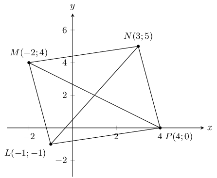

**Problem:**
Show that \(MP\) is perpendicular to \(LN\) and state what type of quadrilateral \(LMNP\) is, other than
              a parallelogram.

**Solution:**
\begin{align*}
            m_{MP} & = \frac{0 - 4}{4 + 2} \\
            & = \frac{-4}{6} \\
            & = \frac{-2}{3} \\\\
            m_{LN} & = \frac{5 + 1}{3 + 1} \\
            & = \frac{6}{4} \\
            & = \frac{3}{2} \\\\
            m_{MP} \times m_{LN} & = \frac{-2}{3} \times \frac{3}{2} \\
            & = -1 \\
            \therefore MP \perp LN
            \end{align*}

\(LMNP\) is a rhombus since the diagonals intersect at right-angles.

**Problem:**
Show that \(LMNP\) is a square.

**Solution:**
We can calculate the length of each side and show that all four lengths are the same:

            \begin{align*}
            MN & = \sqrt{(-2 - 3)^{2} + (4 - 5)^{2}} \\
            & = \sqrt{26} \\\\
            NP & = \sqrt{(3 - 4)^{2} + (5 - 0)^{2}} \\
            & = \sqrt{26} \\\\
            LP & = \sqrt{(-1 - 4)^{2} + (-1 - 0)^{2}} \\
            & = \sqrt{26} \\\\
            ML & = \sqrt{(-2 + 1)^{2} + (4 + 1)^{2}} \\
            & = \sqrt{26}
            \end{align*}

Therefore \(LMNP\) is a square, all the sides are equal in length.

\(A(-2;4)\), \(B(-4;-2)\) and \(C(4;0)\) are the vertices of \(\triangle ABC\). \(D\) and \(E(1;2)\) are
            the mid-points of \(AB\) and \(AC\) respectively.

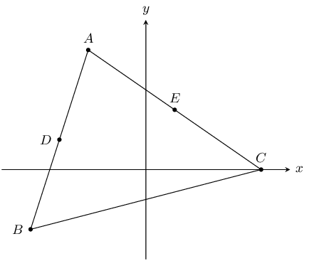

**Problem:**
Find the gradient of \(BC\).

**Solution:**
\begin{align*}
            m_{BC} & = \frac{0 + 2}{4 + 4} \\
            & = \frac{2}{8} \\
            & = \frac{1}{4}
            \end{align*}

**Problem:**
Show that the coordinates of \(D\), the mid-point of \(AB\) are \((-3;1)\).

**Solution:**
\begin{align*}
            D & = \left(\frac{-2 - 4}{2} ; \frac{-2 + 4}{2}\right) \\
            & = (-3;1)
            \end{align*}

**Problem:**
Find the length of \(DE\).

**Solution:**
\begin{align*}
            DE & = \sqrt{(1-(-3))^{2} + (2-1)^{2}} \\
            & = \sqrt{17} \\
            & = \text{4,1}
            \end{align*}

**Problem:**
Find the gradient of \(DE\). Make a conjecture regarding lines \(BC\) and \(DE\).

**Solution:**
\begin{align*}
            m_{DE} & = \frac{1 - 2}{-3 - 1} \\
            & = \frac{1}{4}
            \end{align*}

A conjecture regarding lines \(BC\) and \(DE\) is \(DE \parallel BC\).

**Problem:**
Determine the equation of \(BC\).

**Solution:**
From earlier we have the gradient of \(BC\), so the equation of \(BC\) is: \(y = \frac{1}{4}x + c\).
              Substitute \(B\):

            \begin{align*}
            (-2) & = \frac{1}{4}(-4) + c \\
            c & = -1 \\
            y & = \frac{1}{4}x - 1
            \end{align*}

The equation of \(BC\) is \(y = -\frac{1}{2}x - 4\).

In the diagram points \(P(-3;3)\), \(Q(1;-2)\), \(R(5;1)\) and \(S(x;y)\) are the vertices of a
            parallelogram.

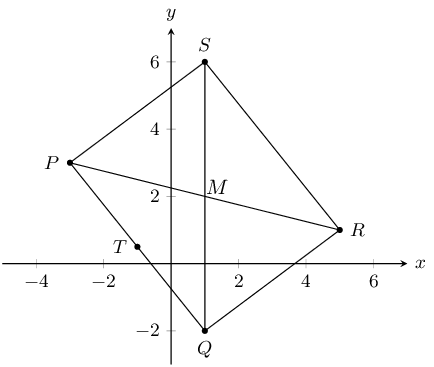

**Problem:**
Calculate the length of \(PQ\).

**Solution:**
\begin{align*}
            PQ & = \sqrt{(-3 - 1)^{2} + (3 + 2)^{2}} \\
            & = \sqrt{41}
            \end{align*}

**Problem:**
Find the coordinates of \(M\) where the diagonals meet.

**Solution:**
\(M\) is the mid-point of both \(PR\) and \(QS\) (\(PQRS\) is a parallelogram). Since we do not know the
              coordinates of \(S\) we will use \(PR\) to find \(M\).

            \begin{align*}
            M\left(\frac{-3 + 5}{2}; \frac{3 + 1}{2}\right) \\
            \therefore M(1;2)
            \end{align*}

**Problem:**
Find \(T\), the mid-point of \(PQ\).

**Solution:**
\begin{align*}
            T\left(\frac{-3 + 1}{2}; \frac{3 - 2}{2}\right) \\
            \therefore T\left(-1;\frac{1}{2}\right)
            \end{align*}

**Problem:**
Show that \(MT \parallel QR\).

**Solution:**
\begin{align*}
            m_{MT} & = \frac{2 - \frac{1}{2}}{1 + 1} \\
            & = \frac{3}{4} \\\\
            m_{QR} & = \frac{-2 - 1}{1 - 4} \\
            & = \frac{3}{4} \\\\
            \therefore m_{MT} & = m_{QR} \\
            \therefore MT \parallel QR
            \end{align*}

**Problem:**
Calculate the coordinates of \(S\).

**Solution:**
We can use the coordinates of \(M\) to find the coordinates of \(S\):

            \[M(1;2) = S\left(\frac{x + 1}{2}; \frac{y - 2}{2}\right)\]

Solve for \(x\):

            \begin{align*}
            1 & = \frac{x + 1}{2} \\
            2 & = x + 1 \\
            x & = 1
            \end{align*}

Solve for \(y\):

            \begin{align*}
            2 & = \frac{y - 2}{2} \\
            4 & = y - 2 \\
            y & = 6
            \end{align*}

Therefore \(S(1;6)\).

The coordinates of \(\triangle PQR\) are as follows: \(P(5;1)\), \(Q(1;3)\) and \(R(1;-2)\).

**Problem:**
Through calculation, determine whether the triangle is equilateral, isosceles or scalene. Be sure to show
              all your working.

**Solution:**
\begin{align*}
            PQ & = \sqrt{(5 - 1)^{2} + (1 - 3)^{2}} \\
            & = 2\sqrt{5} \\\\
            QR & = \sqrt{(1 - 1)^{2} + (3 + 2)^{2}} \\
            & = 5 \\\\
            PR & = \sqrt{(5 - 1)^{2} + (1 + 2)^{2}} \\
            & = 5 \\\\
            \therefore QR & = PR \text{ triangle is isosceles}
            \end{align*}

\(\triangle PQR\) is an isosceles triangle.

**Problem:**
Find the coordinates of points \(S\) and \(T\), the mid-points of \(PQ\) and \(QR\).

**Solution:**
\begin{align*}
            S\left(\frac{5+1}{2}; \frac{1+3}{2}\right) \\
            \therefore S(3;2) \\\\
            T\left(\frac{1+1}{2}; \frac{3-2}{2}\right) \\
            \therefore T\left(1;\frac{1}{2}\right)
            \end{align*}

**Problem:**
Determine the gradient of the line \(ST\).

**Solution:**
\begin{align*}
            m_{ST} & = \frac{2 - \frac{1}{2}}{3 - 1} \\
            & = \frac{\frac{3}{2}}{2} \\
            & = \frac{3}{4}
            \end{align*}

**Problem:**
Prove that \(ST \parallel PR\).

**Solution:**
\begin{align*}
            m_{PR} & = \frac{1 + 2}{5 - 1} \\
            & = \frac{3}{4} \\
            \therefore ST \parallel PR & \text{ (equal gradients)}
            \end{align*}

The following diagram shows \(\triangle PQR\) with \(P(-1;1)\). The equation of \(QR\) is \(x - 3y = -6\)
            and the equation of \(PR\) is \(x - y - 2 = 0\). \(R\hat{P}Q = \theta\).

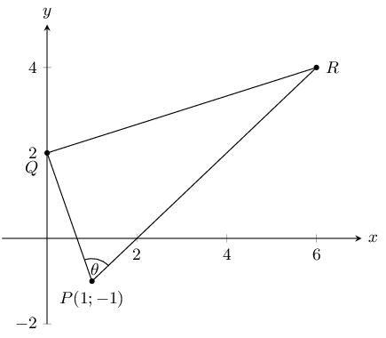

**Problem:**
Write down the coordinates of \(Q\).

**Solution:**
\(Q\) lies on the \(y\)-axis so we have \(Q(0;y)\). Using the equation of \(QR\) we get:

            \begin{align*}
            -3y & = -6 \\
            \therefore y & = 2 \\
            \therefore Q(0;2)
            \end{align*}

**Problem:**
Prove that \(PQ \perp QR\).

**Solution:**
\begin{align*}
            y & = \frac{1}{3}x + 2 \\
            \therefore m_{QR} & = \frac{1}{3} \\\\
            m_{QP} & = -3 \\\\
            m_{QP} \times m_{QR} & = \frac{1}{3} \times -3 \\
            & = -1
            \end{align*}

Therefore \(PQ \perp QR\).

**Problem:**
Write down the gradient of \(PR\).

**Solution:**
The equation of \(PR\) is \(x - y - 2 = 0\). In standard form this is \(y = x - 2\).

Therefore \(m_{PR} = 1\).

**Problem:**
If the \(y\)-coordinate of \(R\) is 4, calculate the \(x\)-coordinate.

**Solution:**
We use the equation of \(PR\) and substitute in \(y = 4\):

            \begin{align*}
            x - 4 - 2 & = 0 \\
            \therefore x & = 6
            \end{align*}

**Problem:**
Find the equation of the line from \(P\) to \(S\) (the mid-point of \(QR\)).

**Solution:**
We first calculate \(S\):

            \begin{align*}
            S\left(\frac{0 + 6}{2} ; \frac{2 + 4}{2}\right) \\
            S\left(3; 3\right)
            \end{align*}

Now we can find the equation of the line \(SP\):

            \begin{align*}
            m_{SP} & = \frac{-1 - 3}{1 - 3} \\
            & = \frac{-4}{-2} \\
            & = 2 \\
            \therefore y & = 2x + c \\
            -1 & = 2(1) + c \\
            y & = 2x - 3
            \end{align*}

The equation of the line from \(P\) to \(S\) is \(y = 2x - 3\).

The points \(E(-3;0)\), \(L(3;5)\) and \(S(t+1, \text{2,5})\) are collinear.

**Problem:**
Determine the value of \(t\).

**Solution:**
Since \(E\), \(L\) and \(S\) are collinear, \(m_{EL} = m_{LS}\). Therefore:

            \begin{align*}
            m_{EL} & = \frac{5}{6} \\
            \therefore \frac{5 - \text{2,5}}{3 - (t + 1)} & = \frac{5}{6} \\
            \frac{\text{2,5}}{2 - t} & = \frac{5}{6} \\
            6(\text{2,5}) & = 5(2 - t) \\
            15 & = 10 - 5t \\
            5t & = -5 \\
            t & = -1
            \end{align*}

**Problem:**
Determine the values of \(a\) and \(b\) if the equation of the line passing through \(E\), \(L\) and
              \(S\) is \(\frac{x}{a} + \frac{y}{b} = 1\).

**Solution:**
\begin{align*}
            y & = \frac{5}{6}x + c \\
            \therefore 0 & = \frac{5}{6}(-3) + c \\
            c & = \frac{5}{2} \\
            y & = \frac{5}{6}x + \frac{5}{2} \\
            \end{align*}

Now we can rearrange the equation:

            \begin{align*}
            \frac{5}{2} & = y - \frac{5}{6}x \\
            1 & = \frac{2}{5}y - \frac{1}{3}x \\
            & = \frac{2y}{5} - \frac{x}{3}
            \end{align*}

We have \(\dfrac{x}{a} = -\dfrac{x}{3}\), therefore \(a = -3\).

We have \(\dfrac{y}{b} = \frac{2y}{5}\), therefore \(b = \dfrac{5}{2}\).

Given: \(A(-3; -4), B(-1; -7), C(2; -5) \text{ and } D(0; -2)\).

**Problem:**
Calculate the distance \(AC\) and the distance \(BD\). Leave your answers in surd form.

**Solution:**
\begin{align*}
            d &= \sqrt{(x_1-x_2)^2 + (y_1-y_2)^2} \\
            AC &= \sqrt{(2-(-3))^2 + (-5-(-4))^2} \\
            &= \sqrt{5^2 (-1)^2} \\
            &= \sqrt{25+1} \\
            &= \sqrt{26} \\ \\
            d &= \sqrt{(x_1-x_2)^2 + (y_1-y_2)^2} \\
            BD &= \sqrt{(0-(-1))^2 + (-2-(-7))^2} \\
            &= \sqrt{1^2 + 5^2} \\
            &=\sqrt{26}
            \end{align*}

Therefore \(d_{AC} = d_{BD} =\sqrt{26}\).

**Problem:**
Determine the coordinates of \(M\), the mid-point of \(BD\).

**Solution:**
\begin{align*}
            M(x;y) & = \left(\frac{x_1 + x_2}{2}; \frac{y_1 + y_2}{2}\right) \\
            & = \left(\frac{-1 +0}{2}; \frac{-7 + (-2)}{2}\right) \\
            & = \left(\frac{-1}{2}; \frac{-9}{2}\right) \\
            M &= (-\text{0,5};-\text{4,5})
            \end{align*}

**Problem:**
Prove that \(AM \perp BD\).

**Solution:**
\begin{align*}
            m &= \frac{y_2 - y_1}{x_2 - x_1} \\
            m_{AM} &= \frac{-4 - (-\text{4,5})}{-3 - (-\text{0,5})} \\
            & = \frac{\text{0,5}}{-\text{2,5}} \\
            & = -\frac{1}{5} \\ \\
            m_{BD} & = \frac{-7 - (-2)}{-1 - (0)} \\
            &= \frac{-5}{-1} \\
            &= 5 \\ \\
            m_{BD} \times m_{AM} &= -\frac{1}{5} \times 5 \\
            &= -1
            \end{align*}

Therefore \(AM \perp BD\).

**Problem:**
Prove that \(A\), \(M\) and \(C\) are collinear.

**Solution:**
\begin{align*}
            m_{MC} &= \frac{-5 - (-\text{4,5})}{-2 - (-\text{0,5})} \\
            &= \frac{-\text{0,5}}{\text{2,5}} \\
            & = -\frac{1}{5}
            \end{align*}

From earlier we know that \(m_{AM} = -\dfrac{1}{5}\).

\(m_{MC} = m_{AM}\) and \(M\) is a common point.

Therefore \(A\), \(M\) and \(C\) are collinear.

**Problem:**
What type of quadrilateral is \(ABCD\)?

**Solution:**
First draw a sketch:

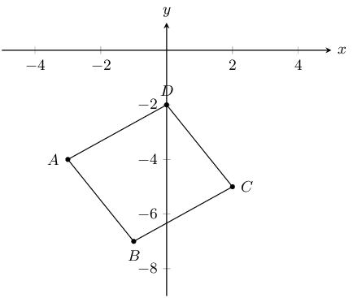

From earlier we found that \(d_{AC} = d_{BD} =\sqrt{26}\). Therefore the diagonals are equal in length.

Since the diagonals are equal in length we know that the quadrilateral must be a square.

We can confirm this by showing that all four sides are equal in length and that \(AB \perp BC\), \(BC
              \perp CD\), \(CD \perp AD\) and \(AD \perp AB\).

\(M(2; -2)\) is the mid-point of \(AB\) with point \(A(3; 1)\). Determine:

**Problem:**
the coordinates of \(B\).

**Solution:**
\begin{align*}
            M(x;y) &= (\frac{x_1 + x_2}{2}; \frac{y_1 + y_2}{2}) \\
            (2;-2)&= (\frac{3 + x_B}{2}; \frac{1 + y_B}{2}) \\ \\
            2 &= \frac{3 + x_B}{2} \\
            4 &= 3 + x_B \\
            x_B & = 1 \\ \\
            -2 &= \frac{1 + y_B}{2} \\
            -4 &= 1 + y_B \\
            y_B &= -5 \\ \\
            \therefore B(x;y) &= (1;-5)
            \end{align*}

**Problem:**
the gradient of \(AM\).

**Solution:**
\begin{align*}
            m &= \frac{y_2-y_1}{x_2-x_1} \\
            m_{AM} &= \frac{-2-1}{2-3} \\
            &= \frac{-3}{-1} \\
            &= 3
            \end{align*}

**Problem:**
the equation of the line \(AM\).

**Solution:**
\begin{align*}
            y &= mx + c \\
            (-2) &= (3)(2) + c \\
            c &= -2 - 6 \\
            c &= -8 \\ \\
            \therefore y &= 3x -8
            \end{align*}

**Problem:**
the perpendicular bisector of \(AB\).

**Solution:**
The perpendicular bisector of \(AB\) passes through \(M\) and has a gradient \(-\dfrac{1}{m_{AB}}\).

            \begin{align*}
            m &= -\frac{1}{m_{AB}} \\
            m &= -\frac{1}{3} \\ \\
            y &= mx + c \\
            (-2) &= (-\frac{1}{3})(2) + c \\
            c &= \frac{2}{3} -2 \\
            c &= -\frac{4}{3}\\
            \therefore y &= -\frac{1}{3}x -\frac{4}{3}
            \end{align*}

ABCD is a quadrilateral with \(A(-3; 6),~ B(5; 0),~ C(4; -9),~ D(-4; -3)\).

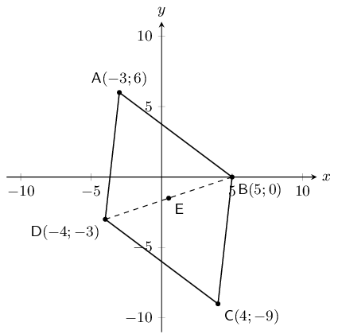

**Problem:**
Determine the coordinates of \(E\), the mid-point of \(BD\).

**Solution:**
\begin{align*}
            M(x;y) &= \left(\frac{x_1 + x_2}{2}; \frac{y_1 + y_2}{2}\right) \\
            E &= \left(\frac{5 + (-4)}{2}; \frac{0 + (-3)}{2}\right) \\
            \therefore E &= \left(\frac{1}{2}; -\frac{3}{2}\right)
            \end{align*}

**Problem:**
Prove that \(ABCD\) is a parallelogram.

**Solution:**
\begin{align*}
            M(x;y) &= \left(\frac{x_1 + x_2}{2}; \frac{y_1 + y_2}{2}\right) \\
            M_{AC} &= \left(\frac{-3 + 4}{2}; \frac{6 + (-9)}{2}\right) \\
            &= \left(\frac{1}{2}; -\frac{3}{2}\right) \\
            \therefore M_{AC} &= E
            \end{align*}

\(ABCD\) is a parallelogram (Diagonals bisect at \(E\)).

**Problem:**
Find the equation of diagonal \(BD\).

**Solution:**
\begin{align*}
            (y -y_1) &= m(x -x_1) \\
            m &= \frac{y_2-y_1}{x_2-x_1} \\ \\
            (y - 0) &= \frac{-3-0}{-4-(5)}(x - (5)) \\
            \therefore y &= \frac{-3}{-9}(x - 5) \\
            \therefore y &= \frac{1}{3}x - \frac{5}{3}
            \end{align*}

**Problem:**
Determine the equation of the perpendicular bisector of \(BD\).

**Solution:**
The perpendicular bisector of \(BD\) passes through \(E\) and has a gradient \(-\dfrac{1}{m_{BD}}\)

            \begin{align*}
            m &= -\frac{1}{m_{BD}} \\
            m &= \frac{1}{-\frac{1}{3}} \\
            m &= -3 \\ \\
            y &= mx + c \\
            - \frac{3}{2} &= (3)(\frac{1}{2}) + c \\
            c &= - \frac{3}{2} + \frac{3}{2} \\
            c &= 0\\
            \therefore y &= -3x
            \end{align*}

**Problem:**
Determine the gradient of \(AC\).

**Solution:**
\begin{align*}
            m &= \frac{y_2 - y_1}{x_2 - x_1} \\
            &= \frac{6 - (-9)}{-3 - 4} \\
            m_{AC} &= -\frac{15}{7}
            \end{align*}

**Problem:**
Is \(ABCD\) a rhombus? Explain why or why not.

**Solution:**
\begin{align*}
            m_{AC} \times m_{BD} &= -\frac{15}{7} \times \frac{1}{3} \\
            &= -\frac{15}{21} \neq -1
            \end{align*}

No, \(ABCD\) is not a rhombus because the diagonals do not intersect at right angles.

**Problem:**
Find the length of \(AB\).

**Solution:**
\begin{align*}
            d &= \sqrt{(x_1 - x_2)^2 + (y_1 - y_2)^2} \\
            AB &= \sqrt{(-3 - 5))^2 + (6 - 0)^2} \\
            &= \sqrt{8^2 + 6^2} \\
            &= \sqrt{64 + 36} \\
            &= \sqrt{100} \\
            &= 10
            \end{align*}

In the diagram below, \(f(x) = \frac{3}{2}x - 4\) is sketched with \(U(6;a)\) on \(f(x)\).

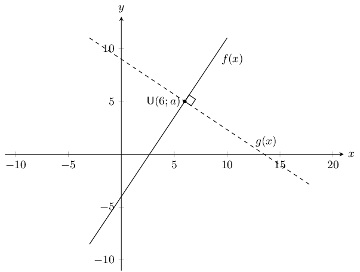

**Problem:**
Determine the value of a in \(U(6; a)\).

**Solution:**
We can substitute \(U\) into \(f(x)\) to find \(a\):

            \begin{align*}
            f(x) &= \frac{3}{2}x - 4 \\
            a &= \frac{3}{2}(6) - 4 \\
            &= 9 - 5 \\
            \therefore a &= 5
            \end{align*}

**Problem:**
A line, \(g(x)\), passing through \(U\), is perpendicular to \(f(x)\). \(V(b; 4)\) lies on \(g(x)\).
              Determine the value of \(b\).

**Solution:**
We know that \(m_{g(x)} \times m_{f(x)} = -1\), therefore \(m_{g(x)} = -\dfrac{2}{3}\).

            \begin{align*}
            g(x) &= -\frac{2}{3}x + c \\
            5 &= -\frac{2}{3}(6) + c \\
            c &= 5 + 4 \\
            c &= 9
            \end{align*}

Therefore \(g(x) = -\dfrac{2}{3}x + 9\). Substitute in \(V\) to solve for \(b\):

            \begin{align*}
            4 &= -\frac{2}{3}b + 9 \\
            -5 &= -\frac{2}{3}b \\
            b &= \frac{15}{2} \\
            \therefore b &= 7\frac{1}{2}
            \end{align*}

**Problem:**
If \(U (6; 5),~ V(7\frac{1}{2},4)\) and \(W (1; c)\) are collinear, determine the value of \(c\).

**Solution:**
\(U\), \(V\) and \(W\) are collinear and the equation for the line is \(g(x) = -\frac{2}{3}x + 9\). We
              can substitute \(W\) into the equation for the line to solve for \(c\):

            \begin{align*}
            c &= -\frac{2}{3}(1) + 9 \\
            \therefore c &= 8\frac{1}{3}
            \end{align*}

In the diagram below, \(M\) and \(N\) are the mid-points of \(OA\) and \(OB\) respectively.

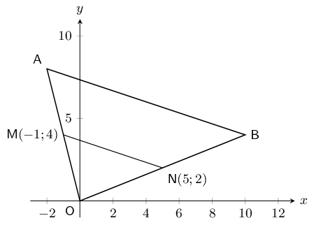

**Problem:**
Calculate the gradient of \(MN\).

**Solution:**
\begin{align*}
            m &= \frac{y_2 - y_1}{x_2 - x_1} \\
            &= \frac{4 - 2}{-1 - 5} \\
            m_{MN} &= \frac{2}{-6} \\
            m_{MN} &= -\frac{1}{3}
            \end{align*}

**Problem:**
Find the equation of the line through \(M\) and \(N\) in the form \(y = mx + c\).

**Solution:**
\begin{align*}
            y &= mx + c \\
            4 &= -\frac{1}{3}(-1) + c \\
            c &= 4 -\frac{1}{3} \\
            c &= 3\frac{2}{3} \\
            y &= -\frac{1}{3}x + 3\frac{2}{3}
            \end{align*}

**Problem:**
Show that \(AB \parallel MN\).

**Solution:**
First find the coordinates of \(A\):

            \begin{align*}
            M_{OA} &= \left(\frac{x_1 + x_2}{2}; \frac{y_1 + y_2}{2}\right) \\
            (-1,4) &= \left(\frac{x_A + 0}{2}; \frac{y_A + 0}{2}\right) \\ \\
            -1 &= \frac{x_A}{2} \\
            x_A &= -2 \\
            4 &= \frac{y_A}{2} \\
            y_A &= 8 \\
            \therefore A(x;y) &= (-2;8)
            \end{align*}

Next find the coordinates of \(B\):

            \begin{align*}
            M_{OB} &= \left(\frac{x_1 + x_2}{2}; \frac{y_1 + y_2}{2}\right) \\
            (5,2) &= \left(\frac{x_B }{2}; \frac{y_B}{2}\right) \\ \\
            5 &= \frac{x_B}{2} \\
            x_B &= 10 \\
            2 &= \frac{y_B}{2} \\
            y_B &= 4 \\
            \therefore B(x;y) &= (10;4)
            \end{align*}

Now we can calculate the gradient of \(AB\) and compare it to the gradient of \(MN\):

            \begin{align*}
            m &= \frac{y_2-y_1}{x_2-x_1} \\
            m_{AB} &= \frac{8-4}{-2-10} \\
            &= -\frac{4}{12} \\
            m_{AB} &= -\frac{1}{3} = m_{MN}\\
            &\therefore AB \parallel MN
            \end{align*}

**Problem:**
Write down the value of the ratio: \(\dfrac{\text{area } \triangle OAB}{\text{area } \triangle OMN}\).

**Solution:**
We note the following:

- \(OA = 2OM\) and \(OB = 2ON\) (Mid-points)
- \(AB = 2MN\) (Mid-point theorem)

From this we can see that \(\triangle OAB\) is twice the size of \(\triangle OMN\) (each side of
              \(\triangle OAB\) is twice the size of the same side in \(\triangle OMN\)). Therefore the area of
              \(\triangle OAB\) is twice the area of \(\triangle OMN\):

            \begin{align*}
            \frac{\text{area } \triangle OAB}{\text{area } \triangle OMN} & = \frac{2 \text{area } \triangle
            OMN}{\text{area } \triangle OMN} \\
            = 2
            \end{align*}

**Problem:**
Write down the coordinates of \(P\) such that \(OAPB\) is a parallelogram.

**Solution:**
We can use the fact that the diagonals of a parallelogram bisect each other to find \(P\). The mid-point
              of \(AB\) must be the same as the mid-point of \(OP\).

            \begin{align*}
            M_{AB} &= \left(\frac{x_1 + x_2}{2}; \frac{y_1 + y_2}{2}\right) \\
            M_{AB} &= \left(\frac{-2 + 10}{2}; \frac{8 + 4}{2}\right) \\
            M_{AB} &= (4;6) \\ \\
            (4;6) &= \left(\frac{x_p + 0}{2}; \frac{y_p + 0}{2}\right) \\
            (8;12) &= \left(\frac{x_p}{2}; \frac{y_p}{2}\right) \\
            \therefore P(x;y) &= (8;12)
            \end{align*}

\(A(6; -4), ~B(8; 2), ~C(3; a)\) and \(D(b; c)\) are points on the Cartesian plane. Determine the value of:

**Problem:**
\(a\) if \(A\), \(B\) and \(C\) are collinear.

**Solution:**
First find the gradient of \(AB\):

            \begin{align*}
            m &= \frac{y_2 - y_1}{x_2 - x_1} \\
            &= \frac{-4 - 2}{6 - 8}\\
            &= \frac{-6}{-2} \\
            & = 3
            \end{align*}

Therefore we have \(y = 3x + c\). Now substitute in \(A\):

            \begin{align*}
            -4 &= 3(6) + c \\
            c &= -22
            \end{align*}

Now we can substitute in \(C\) to solve for \(a\):

            \begin{align*}
            a &= 3(3) - 22 \\
            \therefore a &= -13
            \end{align*}

**Problem:**
\(b\) and \(c\) if \(B\) is the mid-point of \(A\) and \(D\).

**Solution:**
\begin{align*}
            M_{AD} &= \left(\frac{x_1 + x_2}{2}; \frac{y_1 + y_2}{2}\right) \\
            (8;2) &= \left(\frac{6 + b}{2}; \frac{-4 + c}{2}\right) \\ \\
            8 &= \frac{6 + b}{2} \\
            16 &= 6 + b \\
            b &= 10 \\ \\
            2 &= \frac{-4 + c}{2} \\
            4 &= -4 + c \\
            c &= 8 \\
            B(x;y) & = (8;12)
            \end{align*}
