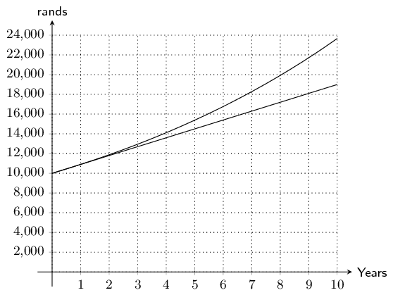
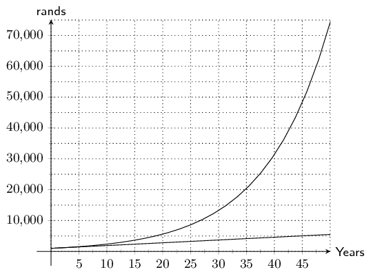

## 9.3 Compound interest (EMA6N)

Compound interest allows interest to be earned on interest. With simple interest, only the original
            investment earns interest, but with compound interest, the original investment and the interest earned on
            it, both earn interest.

Compound interest is advantageous for investing money but not for taking out a loan.

<Callout type="info" title="Definition: Compound interest">
Compound interest is the interest earned on the principal amount and on its accumulated interest.
</Callout>

Consider the example of \(\text{R}\,\text{1 000}\) invested for \(\text{3}\) years with a bank that pays
            \(\text{5}\%\) p.a. compound interest.

At the end of the first year, the accumulated amount is

        \begin{align*}
        {A}_{1} & = P\left(1 + i\right) \\
        & = \text{1 000}\left(1 + \text{0,05}\right) \\
        & = \text{1 050}
        \end{align*}

The amount \({A}_{1}\) becomes the new principal amount for calculating the accumulated amount at the end of
            the second year.

        \begin{align*}
        {A}_{2} & = P\left(1 + i\right) \\
        & = \text{1 050}\left(1 + \text{0,05}\right) \\
        & = \text{1 000}\left(1 + \text{0,05}\right)\left(1 + \text{0,05}\right) \\
        & = \text{1 000}{\left(1 + \text{0,05}\right)}^{2}
        \end{align*}

Similarly, we use the amount \({A}_{2}\) as the new principal amount for calculating the accumulated amount
            at the end of the third year.

        \begin{align*}
        {A}_{3} & = P\left(1 + i\right) \\
        & = \text{1 000}{\left(1 + \text{0,05}\right)}^{2}\left(1 + \text{0,05}\right) \\
        & = \text{1 000}{\left(1 + \text{0,05}\right)}^{3}
        \end{align*}

Do you see a pattern?

Using the formula for simple interest, we can develop a similar formula for compound interest.

With an opening balance \(P\) and an interest rate of \(i\), the closing balanced at the end of the first
            year is:

        \[\text{Closing balance after } 1 \text{ year } = P\left(1 + i\right)\]

This is the same as simple interest because it only covers a single year. This closing balance becomes the
            opening balance for the second year of investment.

        \begin{align*}
        \text{Closing balance after } 2 \text{ years } & = \left[P\left(1 + i\right)\right]\times \left(1 + i\right)
        \\
        & = P{\left(1 + i\right)}^{2}
        \end{align*}

And similarly, for the third year

        \begin{align*}
        \text{Closing balance after } 3 \text{ years } & = \left[P{\left(1 + i\right)}^{2}\right]\times \left(1 +
        i\right) \\
        & = P{\left(1 + i\right)}^{3}
        \end{align*}

We see that the power of the term \(\left(1+i\right)\) is the same as the number of years. Therefore the
            general formula for calculating compound interest is:

\begin{align*}
            A& = P{\left(1 + i\right)}^{n} \\
            \text{Where: } & \\
            A & = \text{ accumulated amount } \\
            P & = \text{ principal amount} \\
            i & = \text{ interest written as a decimal} \\
            n & = \text{ number of years }
            \end{align*}

<Callout type="tip" title="Worked example 5: Compound interest">
**Question:**
Mpho wants to invest \(\text{R}\,\text{30 000}\) into an account that offers a compound interest rate
                    of \(\text{6}\%\) p.a. How much money will be in the account at the end of \(\text{4}\) years?

**Write down the known variables:**
\begin{align*}
                P & = \text{30 000} \\
                i & = \text{0,06} \\
                n & = 4
                \end{align*}

**Write down the formula:**
\begin{align*}
                A & = P{\left(1 + i\right)}^{n}
                \end{align*}

**Substitute the values:**
\begin{align*}
                A & = \text{30 000}{\left(1 + \text{0,06}\right)}^{4} \\
                & = \text{37 874,31}
                \end{align*}

**Write the final answer:**
Mpho will have \(\text{R}\,\text{37 874,31}\) in the account at the end of \(\text{4}\) years.
</Callout>

<Callout type="tip" title="Worked example 6: Calculating the compound interest rate to achieve the desired growth">
**Question:**
Charlie has been given \(\text{R}\,\text{5 000}\) for his sixteenth birthday. Rather than spending
                    it, he has decided to invest it so that he can put down a deposit of \(\text{R}\,\text{10 000}\) on
                    a car on his eighteenth birthday. What compound interest rate does he need to achieve this growth?
                    Comment on your answer.

**Write down the known variables:**
\begin{align*}
                A & = \text{10 000} \\
                P & = \text{5 000} \\
                n & = 2
                \end{align*}

**Write down the formula:**
\[A = P{\left(1 + i\right)}^{n}\]

**Substitute the values and solve for \(i\):**
\begin{align*}
                \text{10 000}& = \text{5 000}{\left(1 + i\right)}^{2} \\
                \frac{\text{10 000}}{\text{5 000}} & ={\left(1 + i\right)}^{2} \\
                \sqrt{\frac{\text{10 000}}{\text{5 000}}}& =1 + i \\
                \sqrt{\frac{\text{10 000}}{\text{5 000}}}- 1 & = i \\
                i & = \text{0,4142}
                \end{align*}

**Write the final answer and comment:**
Charlie needs to find an account that offers a compound interest rate of \(\text{41,42}\%\) p.a. to
                    achieve the desired growth. A typical savings account gives a return of approximately \(\text{2}\%\)
                    p.a. and an aggressive investment portfolio gives a return of approximately \(\text{13}\%\) p.a. It
                    therefore seems unlikely that Charlie will be able to invest his money at an interest rate of
                    \(\text{41,42}\%\) p.a.
</Callout>

### The power of compound interest (EMA6P)

To illustrate how important “interest on interest” is, we compare the difference in closing
                balances for an investment earning simple interest and an investment earning compound interest. Consider
                an amount of \(\text{R}\,\text{10 000}\) invested for \(\text{10}\) years, at an interest rate of
                \(\text{9}\%\) p.a.

The closing balance for the investment earning simple interest is

            \begin{align*}
            A& = P\left(1 + in\right) \\
            & = \text{10 000}{\left(1 + \text{0,09}\times 10\right)} \\ & =\text{R}\,\text{19 000}
            \end{align*}

The closing balance for the investment earning compound interest is

            \begin{align*}
            A & = P{\left(1 + i\right)}^{n} \\
            & = \text{10 000}{\left(1 + \text{0,09}\right)}^{10} \\
            & =\text{R}\,\text{23 673,64}
            \end{align*}

We plot the growth of the two investments on the same set of axes and note the significant different in
                their rate of change: simple interest is a straight line graph and compound interest is an exponential
                graph.

It is easier to see the vast difference in growth if we extend the time period to \(\text{50}\) years:

Keep in mind that this is good news and bad news. When earning interest on money invested, compound
                interest helps that amount to grow exponentially. But if money is borrowed the accumulated amount of
                money owed will increase exponentially too.

<Callout type="tip" title="Multimedia & Video">
This video explains the difference between simple and compound interest. Note that the video uses
                    dollars but the calculation is the same for rands.

<VideoPlayer src="https://www.youtube.com/embed/wf91rEGw88Q" title="Video: 2GH3" />
</Callout>

### Textbook Exercise 9.2

**Problem:**
An amount of \(\text{R}\,\text{3 500}\) is invested in a savings account which pays a
                                compound interest rate of \(\text{7,5}\%\) p.a. Calculate the balance accumulated by the
                                end of \(\text{2}\) years.

**Solution:**
\begin{align*}
                            P & = \text{3 500} \\
                            i & = \text{0,075}\\
                            n & = 2 \\
                            A = ? \\\\
                            A & = P(1 + i)^{n} \\
                            & = \text{3 500}(1 + \text{0,075})^{2}\\
                            & = \text{R}\,\text{4 044,69}
                            \end{align*}

**Problem:**
An amount of \(\text{R}\,\text{3 070}\) is invested in a savings account which pays a
                                compound interest rate of \(\text{11,6}\%\) p.a.

Calculate the balance accumulated by the end of \(\text{6}\) years. As usual with
                                financial calculations, round your answer to two decimal places, but do not round off
                                until you have reached the solution.

**Solution:**
Read the question carefully and write down the given information:
                                \begin{align*}
                                P & = \text{3 070} \\
                                i & = \frac{\text{11,6}}{\text{100}} = \text{0,116}\\
                                n & = 6 \\
                                A & = ?
                                \end{align*}

The accumulated amount is:
                                \begin{align*}
                                A &= P (1+i)^n\\
                                &= \text{3 070} \left(1 + \text{0,116}\right)^{\text{6}} \\
                                &= \text{R}\,\text{5 930,94}
                                \end{align*}

**Problem:**
An amount of \(\text{R}\,\text{6 970}\) is invested in a savings account which pays a
                                compound interest rate of \(\text{10,2}\%\) p.a.

Calculate the balance accumulated by the end of \(\text{3}\) years. As usual with
                                financial calculations, round your answer to two decimal places, but do not round off
                                until you have reached the solution.

**Solution:**
Read the question carefully and write down the given information:
                                \begin{align*}
                                P & = \text{6 970} \\
                                i & = \frac{\text{10,2}}{\text{100}} = \text{0,102}\\
                                n & = 3 \\
                                A & = ?
                                \end{align*}

The accumulated amount is:
                                \begin{align*}
                                A &= P (1+i)^n\\
                                &= \text{6 970} \left(1 + \text{0,102}\right)^{\text{3}} \\
                                &= \text{R}\,\text{9 327,76}
                                \end{align*}

**Problem:**
Nicola wants to invest some money at a compound interest rate of \(\text{11}\%\) p.a. How
                                much money (to the nearest rand) should be invested if she wants to reach a sum of
                                \(\text{R}\,\text{100 000}\) in five years time?

**Solution:**
\begin{align*}
                            A & = \text{100 000} \\
                            P & = ? \\
                            i & = \text{0,11} \\
                            n & = 5 \\\\
                            A & = P(1 + i)^{n} \\
                            \text{100 000} & = P(1 + \text{0,11})^{5}\\
                            \frac{\text{100 000}}{(\text{1,11})^5} & = P \\
                            P & = \text{R}\,\text{59 345,13}
                            \end{align*}

**Problem:**
Thobeka wants to invest some money at a compound interest rate of \(\text{11,8}\%\) p.a.

How much money should be invested if she wants to reach a sum of \(\text{R}\,\text{30
                                000}\) in \(\text{2}\) years' time? Round up your answer to the nearest rand.

**Solution:**
Read the question carefully and write down the given information:

                            \begin{align*}
                            A & = \text{R}\,\text{30 000} \\
                            P & = ? \\
                            i & = \frac{\text{11,8}}{\text{100}} = \text{0,118}\\
                            n & = 2
                            \end{align*}

To determine the amount she must invest, we need to make \(P\) the subject of the
                                formula:

                            \begin{align*}
                            A &= P(1+i)^n\\
                            \frac{A}{(1+i)^n} &= P\\
                            \frac{\text{R}\,\text{30 000}}{(1+\text{0,118})^{\text{2}}} &= P\\
                            P = & \text{R}\,\text{24 001,46}
                            \end{align*}

She must invest \(\text{R}\,\text{24 002,00}\).

**Problem:**
Likengkeng wants to invest some money at a compound interest rate of \(\text{11,4}\%\)
                                p.a.

How much money should be invested if she wants to reach a sum of \(\text{R}\,\text{38
                                200}\) in \(\text{7}\) years' time? Round up your answer to the nearest rand.

**Solution:**
Read the question carefully and write down the given information:
                                \begin{align*}
                                A & = \text{38 200} \\
                                i & = \frac{\text{11,4}}{\text{100}} = \text{0,114}\\
                                n & = 7 \\
                                P & = ?
                                \end{align*}

To determine the amount she must invest, we need to make \(P\) the subject of the
                                formula:
                                \begin{align*}
                                A &= P(1+i)^n\\
                                \frac{A}{(1+i)^n} &= P\\
                                \frac{\text{}\,\text{38 200}}{(1+\frac{\text{11,4}}{100})^{\text{7}}} &= P\\
                                P = & \text{R}\,\text{17 941,84} \\
                                \text{Therefore, the answer is: } & \text{R}\,\text{17 942,00}
                                \end{align*}

**Problem:**
Morgan invests \(\text{R}\,\text{5 000}\) into an account which pays out a lump sum at
                                the end of \(\text{5}\) years. If he gets \(\text{R}\,\text{7 500}\) at the end of the
                                period, what compound interest rate did the bank offer him?

**Solution:**
\begin{align*}
                            A & = \text{7 500}\\
                            P & = \text{5 000}\\
                            i & = ?\\
                            n & = 5 \\\\
                            A & = P(1 + i)^{n} \\\\
                            \text{7 500} & = \text{5 000}(1 + i)^{5} \\
                            \frac{\text{7 500}}{\text{5 000}} & = (1 + i)^5 \\
                            \sqrt[5]{\frac{\text{7 500}}{\text{5 000}}} & = (1 + i) \\
                            \sqrt[5]{\frac{\text{7 500}}{\text{5 000}}} - 1 & = i\\
                            i & = \text{0,0844717712}
                            \end{align*}

The interest rate is \(\text{8,45}\%\) p.a

**Problem:**
Kabir invests \(\text{R}\,\text{1 790}\) into an account which pays out a lump sum at the
                                end of \(\text{9}\) years.

If he gets \(\text{R}\,\text{2 613,40}\) at the end of the period, what compound interest
                                rate did the bank offer him? Give the answer correct to one decimal place.

**Solution:**
Read the question carefully and write down the given information:
                                \begin{align*}
                                A & = \text{R}\,\text{2 613,40} \\
                                P & = \text{R}\,\text{1 790} \\
                                i & = ?\\
                                n & = 9
                                \end{align*}

To calculate the interest rate, we need to make \(i\) the
                                subject of the formula:
                                \begin{align*}
                                A &= P(1+i)^n\\
                                \frac{A}{P}&= (1+i)^n\\
                                \left(\frac{A}{P}\right)^{\frac{1}{n}} & = 1+i\\
                                \left(\frac{A}{P}\right)^{\frac{1}{n}}-1 & = i\\
                                \text{Therefore } i & = \left(\frac{\text{}\,
                                \text{2 613,40}}{\text{1 790}}\right)^{\frac{1}{\text{9}}}-1\\
                                & = \text{0,043}\\
                                & = \text{4,3}\% \text{ per annum}
                                \end{align*}

**Problem:**
Bongani invests \(\text{R}\,\text{6 110}\) into an account which pays out a lump sum at
                                the end of \(\text{7}\) years.

If he gets \(\text{R}\,\text{6 904,30}\) at the end of the period, what compound interest
                                rate did the bank offer him? Give the answer correct to one decimal place.

**Solution:**
Read the question carefully and write down the given information:
                                \begin{align*}
                                A & = \text{R}\,\text{6 904,30} \\
                                P & = \text{R}\,\text{6 110} \\
                                i & = ?\\
                                n & = 7
                                \end{align*}

To calculate the interest rate, we need to make \(i\) the
                                subject of the formula:
                                \begin{align*}
                                A &= P(1+i)^n\\
                                \frac{A}{P}&= (1+i)^n\\
                                \left(\frac{A}{P}\right)^{\frac{1}{n}} & = 1+i\\
                                \left(\frac{A}{P}\right)^{\frac{1}{n}}-1 & = i\\
                                \text{Therefore } i & = \left(\frac{\text{}\,
                                \text{6 904,30}}{\text{6 110}}\right)^{\frac{1}{\text{7}}}-1\\
                                & = \text{0,018}\\
                                & = \text{1,8}\% \text{ per annum}
                                \end{align*}
