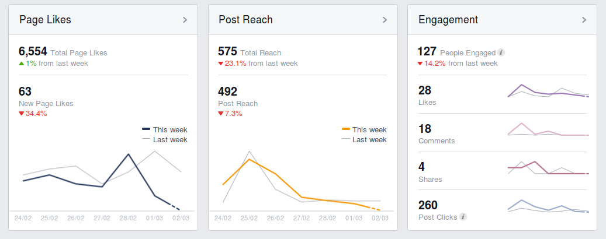

# Chapter 10: Statistics

- This chapter covers revision of central tendency in ungrouped data and then extends this to
                                measures of central tendency in grouped data. The range is revised and extended to
                                include percentiles, quartiles, interquartile and semi interquartile range. The five
                                number summary and box and whisker diagram is introduced here. Finally statistical
                                summaries are applied to data to make meaningful comments on the context associated with
                                the data.
- Intervals for grouped data should be given using inequalities (\(0 \le x < 20\)) rather
                                than 0 - 19.
- Discuss the misuse of statistics in the real world and encourage awareness.

You can find data sets and statistics relevant to South Africa from the statssa website.

When running an experiment or conducting a survey we can potentially end up with many hundreds, thousands or
                even millions of values in the resulting data set. Too much data can be overwhelming and we need to
                reduce them or represent them in a way that is easier to understand and communicate.

Statistics is about summarising data. The methods of statistics allow us to represent the essential
                information in a data set while disregarding the unimportant information. We have to be careful to make
                sure that we do not accidentally throw away some of the important aspects of a data set.

By applying statistics properly we can highlight the important aspects of data and make the data easier to
                interpret. By applying statistics poorly or dishonestly we can also hide important information and let
                people draw the wrong conclusions.

In this chapter we will look at a few numerical and graphical ways in which data sets can be represented, to
                make them easier to interpret.

Statistics is used by various websites to show users who is viewing their
                        content.

## 10.1 Collecting data (EMA6X)

<Callout type="info" title="Definition: Data">
Data refers to the pieces of information that have been observed and recorded, from
                                        an experiment or a survey.
</Callout>

<Callout type="note" title="Note">
The word data is the plural of the word datum, and
                                therefore one should say, “the data are” and not “the data is”.
</Callout>

We distinguish between two main types of data: quantitative and qualitative.

<Callout type="info" title="Definition: Quantitative data">
Quantitative data are data that can be written as numbers.
</Callout>

Quantitative data can be discrete or continuous. Discrete quantitative data can be represented by
                        integers and usually occur when we count things, for example, the number of learners in a class,
                        the number of molecules in a chemical solution, or the number of SMS messages sent in one day.

Continuous quantitative data can be represented by real numbers, for example, the height or mass of a
                        person, the distance travelled by a car, or the duration of a phone call.

<Callout type="info" title="Definition: Qualitative data">
Qualitative data are data that cannot be written as numbers.
</Callout>

Two common types of qualitative data are categorical and anecdotal data. Categorical data can come
                        from one of a limited number of possibilities, for example, your favourite cooldrink, the colour
                        of your cell phone, or the language that you learnt to speak at home.

Anecdotal data take the form of an interview or a story, for example, when you ask someone what their
                        personal experience was when using a product, or what they think of someone else's behaviour.

Categorical qualitative data are sometimes turned into quantitative data by counting the number of
                        times that each category appears. For example, in a class with \(\text{30}\) learners, we ask
                        everyone what the colours of their cell phones are and get the following responses:

| black | black | black | white | purple | red | red | black | black | black |
| --- | --- | --- | --- | --- | --- | --- | --- | --- | --- |
| white | white | black | black | black | black | purple | black | black | white |
| purple | black | red | red | white | black | orange | orange | black | white |

This is a categorical qualitative data set since each of the responses comes from one of a small
                        number of possible colours.

We can represent exactly the same data in a different way, by counting how many times each colour
                        appears.

| Colour | Count |
| --- | --- |
| black | \(\text{15}\) |
| white | \(\text{6}\) |
| red | \(\text{4}\) |
| purple | \(\text{3}\) |
| orange | \(\text{2}\) |

This is a discrete quantitative data set since each count is an integer.

<Callout type="tip" title="Worked example 1: Qualitative and quantitative data">
**Question:**
Thembisile is interested in becoming an airtime reseller to his classmates. He would
                                        like to know how much business he can expect from them. He asked each of his
                                        \(\text{20}\) classmates how many SMS messages they sent during the previous
                                        day. The results were:

| \(\text{20}\) | \(\text{3}\) | \(\text{0}\) | \(\text{14}\) | \(\text{30}\) | \(\text{9}\) | \(\text{11}\) | \(\text{13}\) | \(\text{13}\) | \(\text{15}\) |
| --- | --- | --- | --- | --- | --- | --- | --- | --- | --- |
| \(\text{9}\) | \(\text{13}\) | \(\text{16}\) | \(\text{12}\) | \(\text{13}\) | \(\text{7}\) | \(\text{17}\) | \(\text{14}\) | \(\text{9}\) | \(\text{13}\) |

Is this data set qualitative or quantitative? Explain your answer.

The number of SMS messages is a count represented by an integer, which means that it is
                                quantitative and discrete.
</Callout>

<Callout type="tip" title="Worked example 2: Qualitative and quantitative data">
**Question:**
Thembisile would like to know who the most popular cellular provider is among
                                        learners in his school. This time Thembisile randomly selects \(\text{20}\)
                                        learners from the entire school and asks them which cellular provider they
                                        currently use. The results were:

| Cell C | Vodacom | Vodacom | MTN | Vodacom |
| --- | --- | --- | --- | --- |
| MTN | MTN | Virgin Mobile | Cell C | 8-ta |
| Vodacom | MTN | Vodacom | Vodacom | MTN |
| Vodacom | Vodacom | Vodacom | Virgin Mobile | MTN |

Is this data set qualitative or quantitative? Explain your answer.

Since each response is not a number, but one of a small number of possibilities, these are
                                categorical qualitative data.
</Callout>

### Textbook Exercise 10.1

**Problem:**
The following data set of dreams that learners have was collected
                                                        from Grade 12 learners just after their final exams.

\(\{\text{"I want to build a bridge!"; "I want to help the sick."; "I
                                                        want running water!"}\}\)

Categorise the data set.

**Solution:**
This data set cannot be written as numbers and so must be
                                                        qualitative.

This data set is anecdotal since it takes the form of a story.

Therefore the data set is qualitative anecdotal.

**Problem:**
The following data set of sweets in a packet was collected from
                                                        visitors to a sweet shop.

\(\{23; 25; 22; 26; 27; 25; 21; 28\}\)

Categorise the data set.

**Solution:**
This data set is a set of numbers and so must be quantitative.

This data set is discrete since it can be represented by integers and
                                                        is a count of the number of sweets.

Therefore the data set is quantitative discrete.

**Problem:**
The following data set of questions answered correctly was collected
                                                        from a class of maths learners.

\(\{3; 5; 2; 6; 7; 5; 1; 2\}\)

Categorise the data set.

**Solution:**
This data set is a set of numbers and so must be quantitative.

This data set is discrete since it can be represented by integers and
                                                        is a count of the number of questions answered correctly.

Therefore the data set is quantitative discrete.
