## 10.3 Grouping data (EMA74)

A common way of handling continuous quantitative data is to subdivide the full range of values into a few
      sub-ranges. By assigning each continuous value to the sub-range or class within which it falls, the data set
      changes from continuous to discrete.

Grouping is done by defining a set of ranges and then counting how many of the data fall inside each range. The
      sub-ranges must not overlap and must cover the entire range of the data set.

One way of visualising grouped data is as a histogram. A histogram is a collection of rectangles, where the base
      of a rectangle (on the \(x\)-axis) covers the values in the range associated with it, and the height of a
      rectangle corresponds to the number of values in its range.

<Callout type="tip" title="Multimedia & Video">
The following video explains how to group data.

<VideoPlayer src="https://www.youtube.com/embed/ICpkjWCF0oI?list=PLOaNAKtW5HLTF8lvOYGy73-Xt3NBgwWhP" title="Video: 2GMP" />
</Callout>

<Callout type="tip" title="Worked example 9: Groups and histograms">
**Question:**
The heights in centimetres of \(\text{30}\) learners are given below.

| \(\text{142}\) | \(\text{163}\) | \(\text{169}\) | \(\text{132}\) | \(\text{139}\) | \(\text{140}\) | \(\text{152}\) | \(\text{168}\) | \(\text{139}\) | \(\text{150}\) |
| --- | --- | --- | --- | --- | --- | --- | --- | --- | --- |
| \(\text{161}\) | \(\text{132}\) | \(\text{162}\) | \(\text{172}\) | \(\text{146}\) | \(\text{152}\) | \(\text{150}\) | \(\text{132}\) | \(\text{157}\) | \(\text{133}\) |
| \(\text{141}\) | \(\text{170}\) | \(\text{156}\) | \(\text{155}\) | \(\text{169}\) | \(\text{138}\) | \(\text{142}\) | \(\text{160}\) | \(\text{164}\) | \(\text{168}\) |

Group the data into the following ranges and draw a histogram of the grouped data:

        \begin{align*}
        130 \le h < 140 \\
        140 \le h < 150 \\
        150 \le h < 160 \\
        160 \le h < 170 \\
        170 \le h < 180
        \end{align*}

(Note that the ranges do not overlap since each one starts where the previous one ended.)

**Count the number of values in each range:**
| Range | Count |
| --- | --- |
| \(130\le h<140\) | \(\text{7}\) |
| \(140\le h<150\) | \(\text{5}\) |
| \(150\le h<160\) | \(\text{7}\) |
| \(160\le h<170\) | \(\text{9}\) |
| \(170\le h<180\) | \(\text{2}\) |

**Draw the histogram:**
Since there are \(\text{5}\) ranges, the histogram will have \(\text{5}\) rectangles. The base of each
          rectangle is defined by its range. The height of each rectangle is determined by the count in its range.

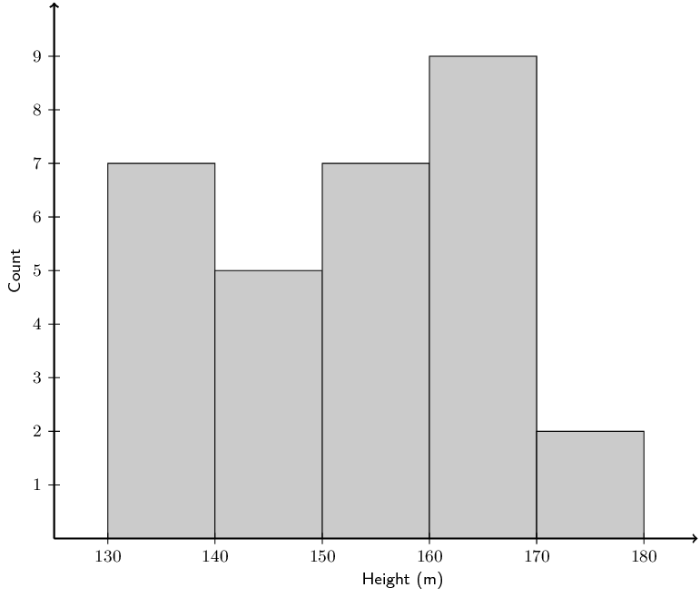

The histogram makes it easy to see in which range most of the heights are located and provides an overview of
          the distribution of the values in the data set.
</Callout>

### Textbook Exercise 10.3

**Problem:**
A group of \(\text{10}\) learners count the number of playing cards they each have. This is a histogram
              describing the data they collected:

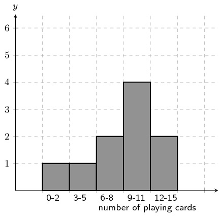

Count the number of playing cards in the following range: \(\text{0} \le \text{number of playing cards}
              \le \text{2}\)

**Solution:**
From the graph the answer is: 1

From the histogram, we arrive at our answer by reading the height of the specified interval from the
              histogram.

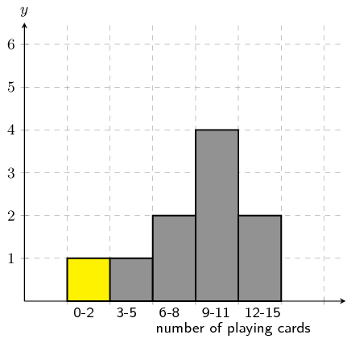

**Problem:**
A group of \(\text{15}\) learners count the number of stones they each have. This is a histogram
              describing the data they collected:

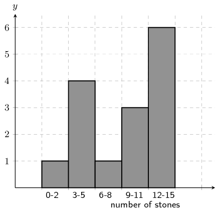

Count the number of stones in the following range: \(\text{0} \le \text{number of stones} \le \text{2}\)

**Solution:**
From the graph the answer is: 1

From the histogram, we arrive at our answer by reading the height of the specified interval from the
              histogram.

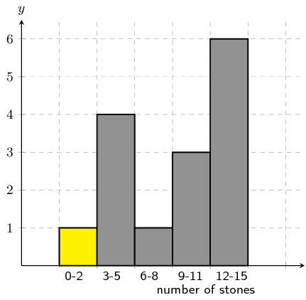

**Problem:**
A group of \(\text{20}\) learners count the number of playing cards they each have. This
              is the data they collect:

\[\begin{array}{c c c c c}
              14 & 9 & 11 & 8 & 13 \\
              2 & 3 & 4 & 16 & 17 \\
              9 & 19 & 10 & 14 & 4 \\
              16 & 16 & 11 & 2 & 17
              \end{array}\]

Count the number of learners who have from \(\text{12}\) up to \(\text{15}\) playing cards. In other
              words, how many learners have playing cards in the following range: \(\text{12} \le \text{number of
              playing cards} \le \text{15}\)? It may be helpful for you to draw a histogram in order to answer the
              question.

**Solution:**
Firstly we sort the table into sequential order, starting with the smallest value.

\[\begin{array}{c c c c c}
              2 & 2 & 3 & 4 & 4 \\
              8 & 9 & 9 & 10 & 11 \\
              11 & 13 & 14 & 14 & 16 \\
              16 & 16 & 17 & 17 & 19
              \end{array}\]

Secondly, we draw a histogram of the data:

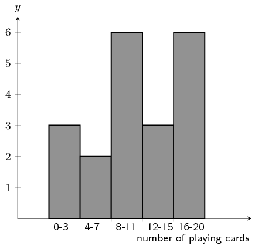

From the histogram you can see that the number of learners with playing cards in the range: \(\text{12}
              \le \text{number of playing cards} \le \text{15}\) is 3.

**Problem:**
A group of \(\text{20}\) learners count the number of stones they each have. This is the
              data they collect:

\[\begin{array}{c c c c c}
              16 & 6 & 11 & 19 & 20 \\
              17 & 13 & 1 & 5 & 12 \\
              5 & 2 & 16 & 11 & 16 \\
              6 & 10 & 13 & 6 & 17
              \end{array}\]

Count the number of learners who have from \(\text{4}\) up to \(\text{7}\) stones. In other words, how
              many learners have stones in the following range: \(\text{4} \le \text{number of stones} \le \text{7}\)?
              It may be helpful for you to draw a histogram in order to answer the question.

**Solution:**
Firstly we sort the table into sequential order, starting with the smallest value.

\[\begin{array}{c c c c c}
              1 & 2 & 5 & 5 & 6 \\
              6 & 6 & 10 & 11 & 11 \\
              12 & 13 & 13 & 16 & 16 \\
              16 & 17 & 17 & 19 & 20
              \end{array}\]

Secondly, we draw a histogram of the data:

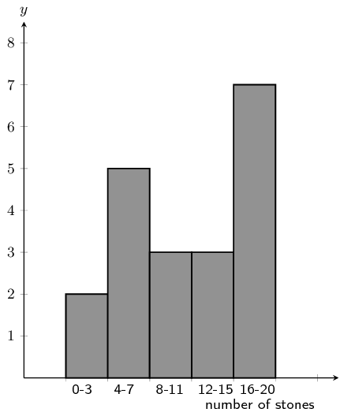

From the histogram you can see that the number of learners with stones in the range: \(\text{4} \le
              \text{number of stones} \le \text{7}\) is 5.

**Problem:**
A group of 20 learners count the number of stones they each have. The learners draw a histogram
              describing the data they collected. However, they have made a mistake in drawing the histogram.

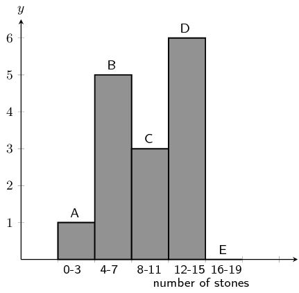

The data set below shows the correct information for the number of stones the learners have. Each value
              represents the number of stones for one learner.

            \[\{ 4 ; 12 ; 15 ; 14 ; 18 ; 12 ; 17 ; 15 ; 1 ; 6 ; 6 ; 12 ; 6 ; 8 ; 6 ; 8 ; 17 ; 19 ; 16 ; 8\}\]

Help them figure out which column in the histogram is incorrect.

**Solution:**
We first need to order the data:

            \[\{1 ; 4 ; 6 ; 6 ; 6 ; 6 ; 8 ; 8 ; 8 ; 12 ; 12 ; 12 ; 14 ; 15 ; 15 ; 16 ; 17 ; 17 ; 18 ; 19\}\]

Using the ordered data set we can group the data and draw the correct histogram:

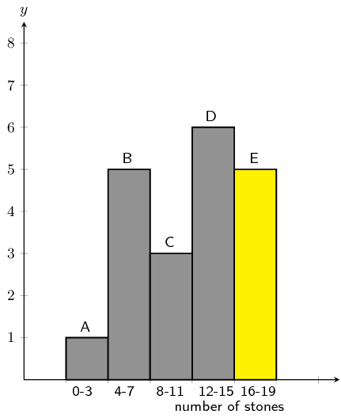

The column with the error in it was: E.

The learners used the incorrect value of 0, when the correct value is \(5\).

**Problem:**
A group of 20 learners count the number of stones they each have. The learners draw a histogram
              describing the data they collected. However, they have made a mistake in drawing the histogram.

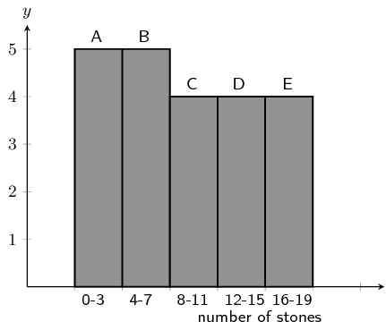

The data set below shows the correct information for the number of stones the learners have. Each value
              represents the number of stones for one learner.

            \[\{ 19 ; 11 ; 5 ; 2 ; 3 ; 4 ; 14 ; 2 ; 12 ; 19 ; 11 ; 14 ; 2 ; 19 ; 11 ; 5 ; 17 ; 10 ; 1 ; 12\}\]

Help them figure out which column in the histogram is incorrect.

**Solution:**
We first need to order the data:

            \[\{1 ; 2 ; 2 ; 2 ; 3 ; 4 ; 5 ; 5 ; 10 ; 11 ; 11 ; 11 ; 12 ; 12 ; 14 ; 14 ; 17 ; 19 ; 19 ; 19\}\]

Using the ordered data set we can group the data and draw the correct histogram:

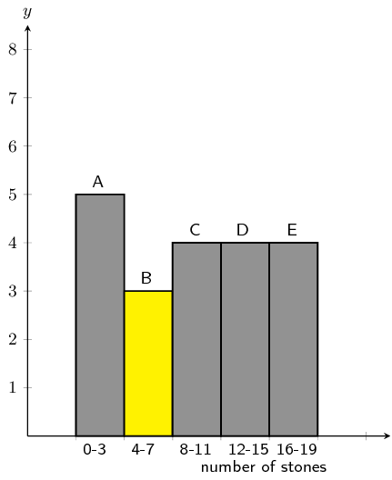

The column with the error in it was: B.

The learners used the incorrect value of 5, when the correct value is \(3\).

**Problem:**
A group of learners count the number of sweets they each have. This is a histogram describing the data
              they collected:

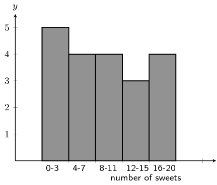

A cat jumps onto the table, and all their notes land on the floor, mixed up, by accident!

Help them find which of the following data sets match the above histogram:

Data Set A

            \[\begin{array}{c c c c c}
            2 & 1 & 20 & 10 & 5 \\
            3 & 10 & 2 & 6 & 1 \\
            2 & 2 & 17 & 3 & 18 \\
            3 & 7 & 10 & 8 & 18
            \end{array}\]

Data Set B

            \[\begin{array}{c c c c c}
            2 & 9 & 12 & 10 & 5 \\
            9 & 9 & 10 & 13 & 6 \\
            5 & 11 & 10 & 7 & 7
            \end{array}\]

Data Set C

            \[\begin{array}{c c c c c}
            3 & 12 & 16 & 10 & 15 \\
            17 & 18 & 2 & 3 & 7 \\
            11 & 12 & 8 & 2 & 7 \\
            17 & 3 & 11 & 4 & 4
            \end{array}\]

**Solution:**
The correct answer is: Data Set C

**Problem:**
A group of learners count the number of stones they each have. This is a histogram describing the data
              they collected:

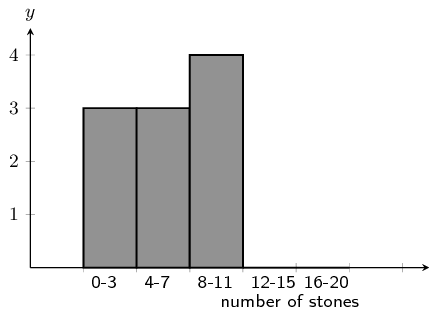

A cleaner knocks over their table, and all their notes land on the floor, mixed up, by accident!

Help them find which of the following data sets match the above histogram:

Data Set A

            \[\begin{array}{c c c c c}
            12 & 4 & 2 & 15 & 10 \\
            18 & 10 & 16 & 16 & 19 \\
            1 & 2 & 9 & 10 & 16 \\
            10 & 11 & 9 & 2 & 13
            \end{array}\]

Data Set B

            \[\begin{array}{c c c c c}
            7 & 10 & 4 & 5 & 8 \\
            7 & 12 & 10 & 14 & 5 \\
            1 & 9 & 2 & 13 & 3
            \end{array}\]

Data Set C

            \[\begin{array}{c c c c c}
            9 & 3 & 8 & 5 & 8 \\
            5 & 8 & 1 & 4 & 3
            \end{array}\]

**Solution:**
The correct answer is: Data Set C

A class experiment was conducted and \(\text{50}\) learners were asked to guess the number of sweets in a
              jar. The following guesses were recorded:

| \(\text{56}\) | \(\text{49}\) | \(\text{40}\) | \(\text{11}\) | \(\text{33}\) | \(\text{33}\) | \(\text{37}\) | \(\text{29}\) | \(\text{30}\) | \(\text{59}\) |
| --- | --- | --- | --- | --- | --- | --- | --- | --- | --- |
| \(\text{21}\) | \(\text{16}\) | \(\text{38}\) | \(\text{44}\) | \(\text{38}\) | \(\text{52}\) | \(\text{22}\) | \(\text{24}\) | \(\text{30}\) | \(\text{34}\) |
| \(\text{42}\) | \(\text{15}\) | \(\text{48}\) | \(\text{33}\) | \(\text{51}\) | \(\text{44}\) | \(\text{33}\) | \(\text{17}\) | \(\text{19}\) | \(\text{44}\) |
| \(\text{47}\) | \(\text{23}\) | \(\text{27}\) | \(\text{47}\) | \(\text{13}\) | \(\text{25}\) | \(\text{53}\) | \(\text{57}\) | \(\text{28}\) | \(\text{23}\) |
| \(\text{36}\) | \(\text{35}\) | \(\text{40}\) | \(\text{23}\) | \(\text{45}\) | \(\text{39}\) | \(\text{32}\) | \(\text{58}\) | \(\text{22}\) | \(\text{40}\) |

**Problem:**
Draw up a grouped frequency table using the intervals \(10 < x \le 20\), \(20 < x \le 30\), \(30
                < x \le 40\), \(40 < x \le 50\) and \(50 < x \le 60\).

**Solution:**
| Group | Frequency |
| --- | --- |
| \(10 < x \le 20\) | \(\text{6}\) |
| \(20 < x \le 30\) | \(\text{13}\) |
| \(30 < x \le 40\) | \(\text{15}\) |
| \(40 < x \le 50\) | \(\text{9}\) |
| \(50 < x \le 60\) | \(\text{7}\) |

**Problem:**
Draw the histogram corresponding to the frequency table of the grouped data.

**Solution:**
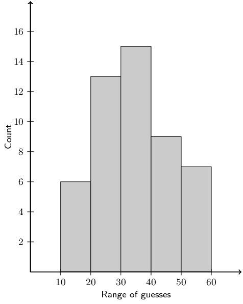

### Measures of central tendency (EMA75)

With grouped data our estimates of central tendency will change because we lose some information when we place
        each value in a range. If all we have to work with is the grouped data, we do not know the measured values to
        the same accuracy as before. The best we can do is to assume that values are grouped at the centre of each
        range.

Looking back to the previous worked example, we started with this data set of learners' heights.

      \begin{align*}
      \big\{132; 132; 132; 133; 138; 139; 139; 140; 141; 142; 142; 146; 150; 150; 152; \\
      152; 155; 156; 157; 160; 161; 162; 163; 164; 168; 168; 169; 169; 170; 172 \big\}
      \end{align*}

Note that the data are sorted.

The mean of these data is \(\text{151,8}\) and the median is \(\text{152}\). The mode is \(\text{132}\), but
        remember that there are problems with computing the mode of continuous quantitative data.

After grouping the data, we now have the data set shown below. Note that each value is placed at the centre of
        its range and that the number of times that each value is repeated corresponds exactly to the counts in each
        range.

      \begin{align*}
      \big\{ 135; 135; 135; 135; 135; 135; 135; 145; 145; 145; 145; 145; 155; 155; 155; \\
      155; 155; 155; 155; 165; 165; 165; 165; 165; 165; 165; 165; 165; 175; 175 \big\}
      \end{align*}

The grouping changes the measures of central tendency since each datum is treated as if it occurred at the
        centre of the range in which it was placed.

The mean is now \(\text{153}\), the median \(\text{155}\) and the mode is \(\text{165}\). This is actually a
        better estimate of the mode, since the grouping showed in which range the learners' heights were clustered.

<Callout type="note" title="Note">
We can also just give the modal group and the median group for grouped data. The modal group is the group
          that has the highest number of data values. The median group is the central group when the groups are arranged
          in order.
</Callout>

### Textbook Exercise 10.4

**Problem:**
Consider the following grouped data and calculate the mean, the modal group and the median group.

| Mass (\(\text{kg}\)) | Count |
| --- | --- |
| \(40 < m \le 45\) | \(\text{7}\) |
| \(45 < m \le 50\) | \(\text{10}\) |
| \(50 < m \le 55\) | \(\text{15}\) |
| \(55 < m \le 60\) | \(\text{12}\) |
| \(60 < m \le 65\) | \(\text{6}\) |

**Solution:**
To find the mean we use the middle value for each group. The count then tells us how many times that
                value occurs in the data set. Therefore the mean is:

              \begin{align*}
              \text{mean } & = \frac{7(43) + 10(48) + 15(53) + 12(58) + 6(63)}{7 + 10 + 15 + 12 + 6} \\
              & = \frac{2650}{50} \\
              & = 53
              \end{align*}

The modal group is the group with the highest number of data values. This is \(50 <m \le 55\) with
                15 data values.

The median group is the central group. There are 5 groups and so the central group is the third one:
                \(50 <m \le 55\).

Mean: \(\text{52}\); Modal group: \(50 <m \le 55\); Median group: \(50 < m \le 55\).

**Problem:**
Find the mean, the modal group and the median group in this data set of how much time people needed to
                complete a game.

| Time (s) | Count |
| --- | --- |
| \(35 < t \le 45\) | \(\text{5}\) |
| \(45 < t \le 55\) | \(\text{11}\) |
| \(55 < t \le 65\) | \(\text{15}\) |
| \(65 < t \le 75\) | \(\text{26}\) |
| \(75 < t \le 85\) | \(\text{19}\) |
| \(85 < t \le 95\) | \(\text{13}\) |
| \(95 < t \le 105\) | \(\text{6}\) |

**Solution:**
To find the mean we use the middle value for each group. The count then tells us how many times that
                value occurs in the data set. Therefore the mean is:

              \begin{align*}
              \text{mean } & = \frac{5(\text{40,5}) + 11(\text{50,5}) + 15(\text{60,5}) + 26(\text{70,5}) +
              19(\text{80,5}) + 13(\text{90,5}) + 6(\text{100,5})}{5 + 11 + 15 + 26 + 19 + 13 + 6} \\
              & = \frac{\text{6 807,5}}{95} \\
              & = \text{71,66}
              \end{align*}

The modal group is the group with the highest number of data values. This is \(65 <m \le 75\) with
                26 data values.

The median group is the central group. There are 7 groups and so the central group is the fourth one:
                \(65 <m \le 75\).

Mean: \(\text{70,66}\); Modal group: \(65 < t \le 75\); Median group: \(65 < t \le 75\).

The histogram below shows the number of passengers that travel in Alfred's minibus taxi per week.

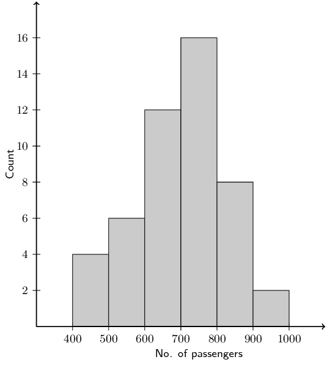

Calculate:

**Problem:**
the modal interval

**Solution:**
The modal interval is the interval with the highest number of data values. For this data set it is:
                  \(700 < x\le 800\) with 16 values.

**Problem:**
the total number of passengers to travel in Alfred's taxi

**Solution:**
We add up the counts in each group and then multiply these counts with the central value for each
                  group: \(4(450) + 6(550) + 12(650) + 16(750) + 8(850) + 2(950) = \text{33 600}\).

**Problem:**
an estimate of the mean

**Solution:**
There are 48 values in the data set. Therefore the mean is \(\dfrac{\text{33 600}}{48} =
                  \text{700}\).

**Problem:**
an estimate of the median

**Solution:**
We are looking for an estimate of the median rather than the median group here. In this case we note
                  that there are 48 data values in the data set. Therefore the median will lie between the
                  \(24^{\text{th}}\) and \(25^{\text{th}}\) values.

We note that 22 values in the first 3 groups and 38 values in the first four groups so the median
                  must lie in the fourth group. Therefore we can estimate the median as the middle value of the fourth
                  group: \(\text{750}\).

**Problem:**
if it is estimated that every passenger travelled an average distance of \(\text{5}\) \(\text{km}\),
                  how much money would Alfred have made if he charged \(\text{R}\,\text{3,50}\) per km?

**Solution:**
\(\text{3,50} \times 5 \times \text{33 600} = \text{R}\,\text{588 000}\).
