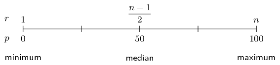

## 10.4 Measures of dispersion (EMA76)

The central tendency is not the only interesting or useful information about a data set. The two data
                  sets illustrated below have the same mean (\(\text{0}\)), but have different spreads around the mean.
                  Each circle represents one value from the data set (or one datum).

Dispersion is a general term for different statistics that describe how values are distributed around the
                  centre. In this section we will look at measures of dispersion.

### Range (EMA77)

<Callout type="info" title="Definition: Range">
The range of a data set is the difference between the maximum and minimum values in the
                                    set.
</Callout>

The most straightforward measure of dispersion is the range. The range simply tells us how far
                        apart the largest and smallest values in a data set are. The range is very sensitive to
                        outliers.

<Callout type="tip" title="Worked example 10: Range">
**Question:**
Find the range of the following data set:

                              \[\left\{1; 4; 5; 8; 6; 7; 5; 6; 7; 4; 10; 9; 10\right\}\]

What would happen if we removed the first value from the set?

**Determine the range:**
The smallest value in the data set is \(\text{1}\) and the largest value is
                                    \(\text{10}\).

The range is \(10 - 1 = 9\)

**Remove the first value:**
If the first value, \(\text{1}\), were to be removed from the set, the minimum value
                                    would be \(\text{4}\). This means that the range would change to \(10 - 4 = 6\).
                                    \(\text{1}\) is not typical of the other values. It is an outlier and has a big
                                    influence on the range.
</Callout>

### Percentiles (EMA78)

<Callout type="info" title="Definition: Percentile">
The \(p^{\text{th}}\) percentile is the value, \(v\), that divides a data set into two
                                    parts, such that \(p\) percent of the values in the data set are less than \(v\) and
                                    \(100 - p\) percent of the values are greater than \(v\). Percentiles can lie in the
                                    range \(0\le p\le 100\).
</Callout>

To understand percentiles properly, we need to distinguish between \(\text{3}\) different aspects
                        of a datum: its value, its rank and its percentile:

- The value of a datum is what we measured and recorded during an experiment or survey.
- The rank of a datum is its position in the sorted data set (for example, first, second,
                                    third, and so on).
- The percentile at which a particular datum is, tells us what percentage of the values
                                    in the full data set are less than this datum.

The table below summarises the value, rank and percentile of the data set:

                  \[\left\{\text{14,2}; \text{13,9}; \text{19,8}; \text{10,3}; \text{13,0}; \text{11,1}\right\}\]

| Value | Rank | Percentile |
| --- | --- | --- |
| \(\text{10,3}\) | \(\text{1}\) | \(\text{0}\) |
| \(\text{11,1}\) | \(\text{2}\) | \(\text{20}\) |
| \(\text{13,0}\) | \(\text{3}\) | \(\text{40}\) |
| \(\text{13,9}\) | \(\text{4}\) | \(\text{60}\) |
| \(\text{14,2}\) | \(\text{5}\) | \(\text{80}\) |
| \(\text{19,8}\) | \(\text{6}\) | \(\text{100}\) |

As an example, \(\text{13,0}\) is at the \(40^{\text{th}}\) percentile since there are \(\text{2}\)
                        values less than \(\text{13,0}\) and \(\text{3}\) values greater than \(\text{13,0}\).

                  \[\frac{2}{2+3} = \text{0,4} = \text{40}\%\]

In general, the formula for finding the \(p^{\text{th}}\) percentile in an ordered data set with
                        \(n\) values is

                  \[r = \frac{p}{100}\left(n - 1\right) + 1\]

This gives us the rank, \(r\), of the \(p^{\text{th}}\) percentile. To find the value of the
                        \(p^{\text{th}}\) percentile, we have to count from the first value in the ordered data set up
                        to the \(r^{\text{th}}\) value.

Sometimes the rank will not be an integer. This means that the percentile lies between two values
                        in the data set. The convention is to take the value halfway between the two values indicated by
                        the rank.

The figure below shows the relationship between rank and percentile graphically. We have already
                        encountered three percentiles in this chapter: the median (\(50^{\text{th}}\) percentile), the
                        minimum (\(0^{\text{th}}\) percentile) and the maximum (\(100^{\text{th}}\)). The median is
                        defined as the value halfway in a sorted data set.

<Callout type="tip" title="Worked example 11: Using the percentile formula">
**Question:**
Determine the minimum, maximum and median values of the following data set using the
                                    percentile formula.

                              \[\left\{14; 17; 45; 20; 19; 36; 7; 30; 8\right\}\]

**Sort the values in the data set:**
Before we can use the rank to find values in the data set, we always have to order the
                                    values from the smallest to the largest. The sorted data set is

                              \[\left\{7; 8; 14; 17; 19; 20; 30; 36; 45\right\}\]

**Find the minimum:**
We already know that the minimum value is the first value in the ordered data set. We
                                    will now confirm that the percentile formula gives the same answer. The minimum is
                                    equivalent to the \(0^{\text{th}}\) percentile. According to the percentile formula
                                    the rank, \(r\), of the \(p = 0^{\text{th}}\) percentile in a data set with \(n =
                                    9\) values is:

                              \begin{align*}
                              r & = \frac{p}{100}\left(n - 1\right) + 1 \\
                              & = \frac{0}{100}\left(9 - 1\right) + 1 \\
                              & = 1
                              \end{align*}

This confirms that the minimum value is the first value in the list, namely
                                    \(\text{7}\).

**Find the maximum:**
We already know that the maximum value is the last value in the ordered data set. The
                                    maximum is also equivalent to the \(100^{\text{th}}\) percentile. Using the
                                    percentile formula with \(p = 100\) and \(n = 9\), we find the rank of the maximum
                                    value is:

                              \begin{align*}
                              r& = \frac{p}{100}\left(n - 1\right) + 1 \\
                              & = \frac{100}{100}\left(9 - 1\right) + 1 \\
                              & = 9
                              \end{align*}

This confirms that the maximum value is the last (the ninth) value in the list, namely
                                    \(\text{45}\).

**Find the median:**
The median is equivalent to the \(50^{\text{th}}\) percentile. Using the percentile
                                    formula with \(p = 50\) and \(n = 9\), we find the rank of the median value is:

                              \begin{align*}
                              r & =\frac{50}{100}\left(n - 1\right) + 1 \\
                              & = \frac{50}{100}\left(9 - 1\right) + 1 \\
                              & = \frac{1}{2}\left(8\right) + 1 \\
                              & = 5
                              \end{align*}

This shows that the median is in the middle (at the fifth position) of the ordered data
                                    set. Therefore the median value is \(\text{19}\).
</Callout>

<Callout type="info" title="Definition: Quartiles">
The quartiles are the three data values that divide an ordered data set into four
                                    groups, where each group contains an equal number of data values. The median
                                    (\(50^{\text{th}}\) percentile) is the second quartile (\(Q2\)). The
                                    \(25^{\text{th}}\) percentile is also called the first or lower quartile (\(Q1\)).
                                    The \(75^{\text{th}}\) percentile is also called the third or upper quartile
                                    (\(Q3\)).
</Callout>

<Callout type="tip" title="Worked example 12: Quartiles">
**Question:**
Determine the quartiles of the following data set:

                              \[\left\{7; 45; 11; 3; 9; 35; 31; 7; 16; 40; 12; 6\right\}\]

**Sort the data set:**
\[\left\{3; 6; 7; 7; 9; 11; 12; 16; 31; 35; 40; 45\right\}\]

**Find the ranks of the quartiles:**
Using the percentile formula with \(n = 12\), we can find the rank of the
                                    \(25^{\text{th}}\), \(50^{\text{th}}\) and \(75^{\text{th}}\) percentiles:

                              \begin{align*}
                              {r}_{25} & = \frac{25}{100}\left(12 - 1\right) + 1 \\
                              & = \text{3,75} \\
                              {r}_{50} & = \frac{50}{100}\left(12 - 1\right) + 1 \\
                              & = \text{6,5} \\
                              {r}_{75} & = \frac{75}{100}\left(12 - 1\right) + 1 \\
                              & = \text{9,25}
                              \end{align*}

**Find the values of the quartiles:**
Note that each of these ranks is a fraction, meaning that the value for each percentile
                                    is somewhere in between two values from the data set.

For the \(25^{\text{th}}\) percentile the rank is \(\text{3,75}\), which is between the
                                    third and fourth values. Since both these values are equal to \(\text{7}\), the
                                    \(25^{\text{th}}\) percentile is \(\text{7}\).

For the \(50^{\text{th}}\) percentile (the median) the rank is \(\text{6,5}\), meaning
                                    halfway between the sixth and seventh values. The sixth value is \(\text{11}\) and
                                    the seventh value is \(\text{12}\), which means that the median is \(\frac{11 +
                                    12}{2} = \text{11,5}\). For the \(75^{\text{th}}\) percentile the rank is
                                    \(\text{9,25}\), meaning between the ninth and tenth values. Therefore the
                                    \(75^{\text{th}}\) percentile is \(\frac{31 + 35}{2} = 33\).
</Callout>

#### Deciles

The deciles are the nine data values that divide an ordered data set into ten groups, where
                              each group contains an equal number of data values.

For example, consider the ordered data set:

                        \begin{align*}
                        28; 33; 35; 45; 57; 59; 61; 68; 69; 72; 75; 78; 80; 83; 86; 91; \\
                        92; 95; 101; 105; 111; 117; 118; 125; 127; 131; 137; 139; 141
                        \end{align*}

The nine deciles are: \(35; 59; 69; 78; 86; 95; 111; 125; 137\).

### Percentiles for grouped data (EMA79)

In grouped data, the percentiles will lie somewhere inside a range, rather than at a specific
                        value. To find the range in which a percentile lies, we still use the percentile formula to
                        determine the rank of the percentile and then find the range within which that rank is.

<Callout type="tip" title="Worked example 13: Percentiles in grouped data">
**Question:**
The mathematics marks of \(\text{100}\) grade \(\text{10}\) learners at a school have
                                    been collected. The data are presented in the following table:

| Percentage mark | Number of learners |
| --- | --- |
| \(0 \le x < 20\) | 2 |
| \(20 \le x < 30\) | 5 |
| \(30 \le x < 40\) | 18 |
| \(40 \le x < 50\) | 22 |
| \(50 \le x < 60\) | 18 |
| \(60 \le x < 70\) | 13 |
| \(70 \le x < 80\) | 12 |
| \(80 \le x < 100\) | 10 |

1. Calculate the mean of this grouped data set.
2. In which intervals are the quartiles of the data set?
3. In which interval is the \(30^{\text{th}}\) percentile of the data set?

**Calculate the mean:**
Since we are given grouped data rather than the original ungrouped data, the best we
                                    can do is approximate the mean as if all the learners in each interval were located
                                    at the central value of the interval.

                              \begin{align*}
                              \text{Mean } & = \frac{2(10) + 5(25) + 18(35) + 22(45) + 18(55) + 13(65) + 12(75) +
                              10(90)}{100} \\
                              & = \text{54}\%
                              \end{align*}

**Find the quartiles:**
Since the data have been grouped, they have also already been sorted. Using the
                                    percentile formula and the fact that there are \(\text{100}\) learners, we can find
                                    the rank of the \(25^{\text{th}}\), \(50^{\text{th}}\) and \(75^{\text{th}}\)
                                    percentiles as

                              \begin{align*}
                              {r}_{25} & =\frac{25}{100}\left(100 - 1\right) + 1 \\
                              & = \text{24,75} \\
                              {r}_{50}& = \frac{50}{100}\left(100 - 1\right) + 1 \\
                              & = \text{50,5} \\
                              {r}_{75} & = \frac{75}{100}\left(100 - 1\right) + 1 \\
                              & = \text{75,25}
                              \end{align*}

Now we need to find in which ranges each of these ranks lie.

- For the lower quartile, we have that there are \(2 + 5 = 7\) learners in
                                                the first two ranges combined and \(2 + 5 + 18 = 25\) learners in the
                                                first three ranges combined. Since \(7 < {r}_{25} < 25\), this
                                                means the lower quartile lies somewhere in the third range: \(30 \le x
                                                < 40\).
- For the second quartile (the median), we have that there are \(2 + 5 + 18 +
                                                22 = 47\) learners in the first four ranges combined. Since \(47 <
                                                {r}_{50} < 65\), this means that the median lies somewhere in the
                                                fifth range: \(50 \le x < 60\).
- For the upper quartile, we have that there are \(\text{65}\) learners in
                                                the first five ranges combined and \(65 + 13 = 78\) learners in the
                                                first six ranges combined. Since \(65 < {r}_{75} < 78\), this
                                                means that the upper quartile lies somewhere in the sixth range: \(60
                                                \le x < 70\).

**Find the \(30^{\text{th}}\) percentile:**
Using the same method as for the quartiles, we first find the rank of the
                                    \(30^{\text{th}}\) percentile.

                              \begin{align*}
                              r & = \frac{30}{100}\left(100 - 1\right) + 1 \\
                              & = \text{30,7}
                              \end{align*}

Now we have to find the range in which this rank lies. Since there are \(\text{25}\)
                                    learners in the first \(\text{3}\) ranges combined and \(\text{47}\) learners in the
                                    first \(\text{4}\) ranges combined, the \(30^{\text{th}}\) percentile lies in the
                                    fourth range: \(40 \le x < 50\)
</Callout>

### Ranges (EMA7B)

We define data ranges in terms of percentiles. We have already encountered the full data range,
                        which is simply the difference between the \(100^{\text{th}}\) and the \(0^{\text{th}}\)
                        percentile (that is, between the maximum and minimum values in the data set).

<Callout type="info" title="Definition: Interquartile range">
The interquartile range is a measure of dispersion, which is calculated by subtracting
                                    the first quartile (\(Q1\)) from the third quartile (\(Q3\)). This gives the range
                                    of the middle half of the data set.
</Callout>

<Callout type="info" title="Definition: Semi interquartile range">
The semi interquartile range is half of the interquartile range.
</Callout>

### Textbook Exercise 10.5

**Problem:**
A group of \(\text{15}\) learners count the number of
                                                sweets they each have. This is the data they collect:

                                          \[\begin{array}{c c c c c}
                                          4 & 11 & 14 & 7 & 14 \\
                                          5 & 8 & 7 & 12 & 12 \\
                                          5 & 13 & 10 & 6 & 7
                                          \end{array}\]

Calculate the range of values in the data set.

**Solution:**
We first need to order the data set:

                                          \[\{4; 5; 5; 6; 7; 7; 7; 8; 10; 11; 12; 12; 13; 14; 14\}\]

Next we find the maximum value in the data set:

                                          \[\text{maximum value } = \text{14}\]

Then we find the minimum value in the data set:

                                          \[\text{minimum value } = \text{4}\]

Finally, we calculate the range of the data set:

                                          \begin{align*}
                                          \text{range } & = \text{(maximum value) } - \text{ (minimum value)}\\
                                          & = (\text{14}) - (\text{4}) \\
                                          & = \text{10}
                                          \end{align*}

**Problem:**
A group of \(\text{10}\) learners count the number of
                                                playing cards they each have. This is the data they collect:

                                          \[\begin{array}{c c c c c}
                                          5 & 1 & 3 & 1 & 4 \\
                                          10 & 1 & 3 & 3 & 4
                                          \end{array}\]

Calculate the range of values in the data set.

**Solution:**
We first need to order the data set:

                                          \[\{1; 1; 1; 3; 3; 3; 4; 4; 5; 10\}\]

Next we find the maximum value in the data set:

                                          \[\text{maximum value } = \text{10}\]

Then we find the minimum value in the data set:

                                          \[\text{minimum value } = \text{1}\]

Finally, we calculate the range of the data set:

                                          \begin{align*}
                                          \text{range} & = \text{(maximum value) } - \text{ (minimum value)}\\
                                          & = \text{10} - \text{1} \\
                                          & = \text{9}
                                          \end{align*}

**Problem:**
Find the range of the data set

                                          \[\left\{1; 2; 3; 4; 4; 4; 5; 6; 7; 8; 8; 9; 10; 10\right\}\]

**Solution:**
The data set is already ordered.

Firstly, we find the maximum value in the data set:

                                          \[\text{maximum value } = \text{10}\]

Secondly, we find the minimum value in the data set:

                                          \[\text{minimum value } = \text{1}\]

Finally, we calculate the range of the data set:

                                          \begin{align*}
                                          \text{range} & = \text{(maximum value) } - \text{ (minimum value)}\\
                                          & = \text{10} - \text{1} \\
                                          & = \text{9}
                                          \end{align*}

**Problem:**
What are the quartiles of this data set?

                                          \[\left\{3; 5; 1; 8; 9; 12; 25; 28; 24; 30; 41; 50\right\}\]

**Solution:**
We first order the data set.

                                          \[\left\{1; 3; 5; 8; 9; 12; 24; 25; 28; 30; 41; 50\right\}\]

Next we find the ranks of the quartiles. Using the percentile formula with
                                                \(n = 12\), we can find the rank of the \(25^{\text{th}}\),
                                                \(50^{\text{th}}\) and \(75^{\text{th}}\) percentiles:

                                          \begin{align*}
                                          {r}_{25} & = \frac{25}{100}\left(12 - 1\right) + 1 \\
                                          & = \text{3,75} \\
                                          {r}_{50} & = \frac{50}{100}\left(12 - 1\right) + 1 \\
                                          & = \text{6,5} \\
                                          {r}_{75} & = \frac{75}{100}\left(12 - 1\right) + 1 \\
                                          & = \text{9,25}
                                          \end{align*}

Find the values of the quartiles. Note that each of these ranks is a
                                                fraction, meaning that the value for each percentile is somewhere in
                                                between two values from the data set.

For the \(25^{\text{th}}\) percentile the rank is \(\text{3,75}\), which is
                                                between the third and fourth values. Therefore the \(25^{\text{th}}\)
                                                percentile is \(\frac{5 + 8}{2} = \text{6,5}\).

For the \(50^{\text{th}}\) percentile (the median) the rank is
                                                \(\text{6,5}\), meaning halfway between the sixth and seventh values.
                                                Therefore the median is \(\frac{12 + 24}{2} = \text{18}\). For the
                                                \(75^{\text{th}}\) percentile the rank is \(\text{9,25}\), meaning
                                                between the ninth and tenth values. Therefore the \(75^{\text{th}}\)
                                                percentile is \(\frac{28 + 30}{2} = 29\).

Therefore we get the following values for the quartiles: \(Q_1 =
                                                \text{6,5}\); \(Q_2 = 18\); \(Q_3 = 29\).

**Problem:**
A class of \(\text{12}\) learners writes a test and the results are as
                                                follows:

                                          \[\left\{20; 39; 40; 43; 43; 46; 53; 58; 63; 70; 75; 91\right\}\]

Find the range, quartiles and the interquartile range.

**Solution:**
The data set is ordered.

The range is:

                                          \begin{align*}
                                          \text{range} & = \text{(maximum value) } - \text{ (minimum value)}\\
                                          & = (\text{91}) - (\text{20}) \\
                                          & = \text{71}
                                          \end{align*}

To find the quartiles we start by finding the ranks of the quartiles. Using
                                                the percentile formula with \(n = 12\), we can find the rank of the
                                                \(25^{\text{th}}\), \(50^{\text{th}}\) and \(75^{\text{th}}\)
                                                percentiles:

                                          \begin{align*}
                                          {r}_{25} & = \frac{25}{100}\left(12 - 1\right) + 1 \\
                                          & = \text{3,75} \\
                                          {r}_{50} & = \frac{50}{100}\left(12 - 1\right) + 1 \\
                                          & = \text{6,5} \\
                                          {r}_{75} & = \frac{75}{100}\left(12 - 1\right) + 1 \\
                                          & = \text{9,25}
                                          \end{align*}

Find the values of the quartiles. Note that each of these ranks is a
                                                fraction, meaning that the value for each percentile is somewhere in
                                                between two values from the data set.

For the \(25^{\text{th}}\) percentile the rank is \(\text{3,75}\), which is
                                                between the third and fourth values. Therefore the \(25^{\text{th}}\)
                                                percentile is \(\frac{40 + 43}{2} = \text{41,5}\).

For the \(50^{\text{th}}\) percentile (the median) the rank is
                                                \(\text{6,5}\), meaning halfway between the sixth and seventh values.
                                                Therefore the median is \(\frac{46 + 53}{2} = \text{49,5}\). For the
                                                \(75^{\text{th}}\) percentile the rank is \(\text{9,25}\), meaning
                                                between the ninth and tenth values. Therefore the \(75^{\text{th}}\)
                                                percentile is \(\frac{63 + 70}{2} = \text{66,5}\).

Therefore we get the following values for the quartiles: \(Q_1 =
                                                \text{41,5}\); \(Q_2 = \text{49,5}\); \(Q_3 = \text{66,5}\).

Interquartile range:

                                          \begin{align*}
                                          \text{interquartile range } & = \text{quartile 3 } - \text{ quartile 1} \\
                                          & = \text{66,5} - \text{41,5} \\
                                          & = 25
                                          \end{align*}

Three sets of data are given:

                                          \begin{align*}
                                          \textbf{Data set 1: } & \left\{9; 12; 12; 14; 16; 22; 24\right\} \\
                                          \textbf{Data set 2: } & \left\{7; 7; 8; 11; 13; 15; 16\right\} \\
                                          \textbf{Data set 3: } & \left\{11; 15; 16; 17; 19; 22; 24\right\}
                                          \end{align*}

For each data set find:

**Problem:**
the range

**Solution:**
All three data sets are ordered. To find the range we subtract the
                                                      minimum value from the maximum value. Doing so for each data set
                                                      gives the following values for the range.

Data set 1: \(24 - 9 = 15\)

Data set 2: \(16 - 7 = 9\)

Data set 3: \(24 - 11 = 13\)

**Problem:**
the lower quartile

**Solution:**
For each data set \(n = 7\). Therefore the rank of the
                                                      \(25^{\text{th}}\) percentile is the same for each data set:
                                                      \({r}_{25} = \frac{25}{100}\left(7 - 1\right) + 1 = \text{2,5}\).
                                                      Therefore for each data set the lower quartile lies between the
                                                      second and third values.

The lower quartile for each data set is:

Data set 1: \(\text{12}\)

Data set 2: \(\text{7,5}\)

Data set 3: \(\text{15,5}\)

**Problem:**
the median

**Solution:**
For each data set \(n = 7\). Therefore the rank of the
                                                      \(50^{\text{th}}\) percentile is the same for each data set:
                                                      \({r}_{50} = \frac{50}{100}\left(7 - 1\right) + 1 = \text{4}\).
                                                      Therefore for each data set the median is the fourth value.

The median for each data set is:

Data set 1: \(\text{14}\)

Data set 2: \(\text{11}\)

Data set 3: \(\text{17}\)

**Problem:**
the upper quartile

**Solution:**
For each data set \(n = 7\). Therefore the rank of the
                                                      \(75^{\text{th}}\) percentile is the same for each data set:
                                                      \({r}_{75} = \frac{75}{100}\left(7 - 1\right) + 1 = \text{5,5}\).
                                                      Therefore for each data set the lower quartile lies between the
                                                      fifth and sixth values.

The upper quartile for each data set is:

Data set 1: \(\text{19}\)

Data set 2: \(\text{14}\)

Data set 3: \(\text{20,5}\)

**Problem:**
the interquartile range

**Solution:**
The interquartile range is calculated by subtracting the lower
                                                      quartile from the upper quartile.

Data set 1: \(19 - 12 = \text{7}\)

Data set 2: \(14 - \text{7,5} = \text{6,5}\)

Data set 3: \(\text{20,5} - \text{15,5} = \text{5}\)

**Problem:**
the semi-interquartile range

**Solution:**
The semi-interquartile range is half the interquartile range.

Data set 1: \(\frac{7}{2} = \text{3,5}\)

Data set 2: \(\frac{\text{6,5}}{2} = \text{3,25}\)

Data set 3: \(\frac{5}{2} = \text{2,5}\)
