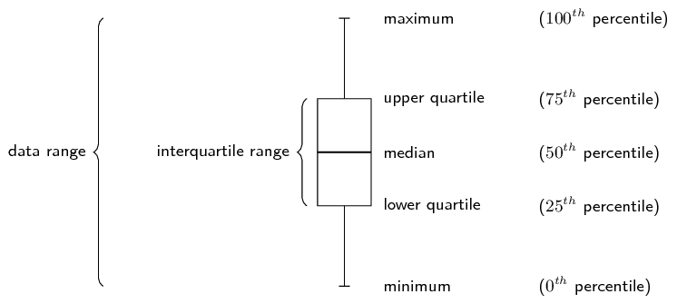
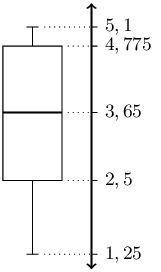
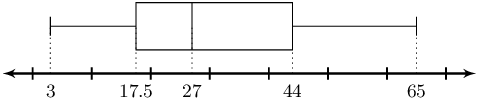
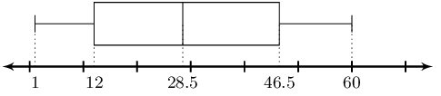
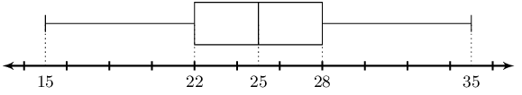
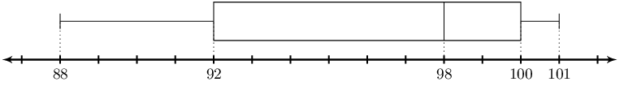

## 10.5 Five number summary (EMA7C)

A common way of summarising the overall data set is with the five number summary and the box-and-whisker
                  plot. These two represent exactly the same information, numerically in the case of the five number
                  summary and graphically in the case of the box-and-whisker plot.

The five number summary consists of the minimum value, the maximum value and the three quartiles. Another
                  way of saying this is that the five number summary consists of the following percentiles:
                  \(0^{\text{th}}\), \(25^{\text{th}}\), \(50^{\text{th}}\), \(75^{\text{th}}\), \(100^{\text{th}}\).

The box-and-whisker plot shows these five percentiles as in the figure below. The box shows the
                  interquartile range (the distance between \(Q_1\) and \(Q_3\)). A line inside the box shows the
                  median. The lines extending outside the box (the whiskers) show where the minimum and maximum values
                  lie. This graph can also be drawn horizontally.

<Callout type="tip" title="Multimedia & Video">
This video explains how to draw a box-and-whisker plot for a data set.

<VideoPlayer src="https://www.youtube.com/embed/BXq5TFLvsVw" title="Video: 2GNC" />
</Callout>

Wikihow shows
                        a summary with short animations of how to make a box and whisker plot.

<Callout type="tip" title="Worked example 14: Five number summary">
**Question:**
Draw a box and whisker diagram for the following data set:

                        \[\left\{\text{1,25}; \text{1,5}; \text{2,5}; \text{2,5}; \text{3,1}; \text{3,2}; \text{4,1};
                        \text{4,25}; \text{4,75}; \text{4,8}; \text{4,95}; \text{5,1}\right\}\]

**Determine the minimum and maximum:**
Since the data set is already sorted, we can read off the minimum as the first value
                              (\(\text{1,25}\)) and the maximum as the last value (\(\text{5,1}\)).

**Determine the quartiles:**
There are \(\text{12}\) values in the data set. Using the percentile formula, we can
                              determine that the median lies between the sixth and seventh values, making it:

                        \[\frac{\text{3,2} + \text{4,1}}{2} = \text{3,65}\]

The first quartile lies between the third and fourth values, making it:

                        \[\frac{\text{2,5} + \text{2,5}}{2} = \text{2,5}\]

The third quartile lies between the ninth and tenth values, making it:

                        \[\frac{\text{4,75} + \text{4,8}}{2} = \text{4,775}\]

This provides the five number summary of the data set and allows us to draw the following
                              box-and-whisker plot.

</Callout>

### Textbook Exercise 10.6

**Problem:**
Lisa is working in a computer store. She sells the following number of computers
                                          each month:

                                    \[\left\{27; 39; 3; 15; 43; 27; 19; 54; 65; 23; 45; 16\right\}\]

Give the five number summary and box-and-whisker plot of Lisa's sales.

**Solution:**
We first order the data set.

                                    \[\left\{3; 15; 16; 19; 23; 27; 27; 39; 43; 45; 54; 65\right\}\]

Now we can read off the minimum as the first value (\(\text{3}\)) and the maximum
                                          as the last value (\(\text{65}\)).

Next we need to determine the quartiles.

There are \(\text{12}\) values in the data set. Using the percentile formula, we
                                          can determine that the median lies between the sixth and seventh values,
                                          making it:

                                    \[\frac{\text{27} + \text{27}}{2} = \text{27}\]

The first quartile lies between the third and fourth values, making it:

                                    \[\frac{\text{16} + \text{19}}{2} = \text{17,5}\]

The third quartile lies between the ninth and tenth values, making it:

                                    \[\frac{\text{43} + \text{45}}{2} = \text{44}\]

This provides the five number summary of the data set and allows us to draw the
                                          following box-and-whisker plot.

Five number summary:

Minimum: \(3\)

\(Q_1\): \(\text{17,5}\)

Median: \(27\)

\(Q_3\): \(44\)

Maximum: \(65\)

Box-and-whisker plot:

**Problem:**
Zithulele works as a telesales person. He keeps a record of the number of sales
                                          he makes each month. The data below show how much he sells each month.

                                    \[\left\{49; 12; 22; 35; 2; 45; 60; 48; 19; 1; 43; 12\right\}\]

Give the five number summary and box-and-whisker plot of Zithulele's sales.

**Solution:**
We first order the data set.

                                    \[\left\{1; 2; 12; 12; 19; 22; 35; 43; 45; 48; 49; 60\right\}\]

Now we can read off the minimum as the first value (\(\text{1}\)) and the maximum
                                          as the last value (\(\text{60}\)).

Next we need to determine the quartiles.

There are \(\text{12}\) values in the data set. Using the percentile formula, we
                                          can determine that the median lies between the sixth and seventh values,
                                          making it:

                                    \[\frac{\text{22} + \text{35}}{2} = \text{28,5}\]

The first quartile lies between the third and fourth values, making it:

                                    \[\frac{\text{12} + \text{12}}{2} = \text{12}\]

The third quartile lies between the ninth and tenth values, making it:

                                    \[\frac{\text{45} + \text{48}}{2} = \text{46,5}\]

The five number summary is:

Minimum: \(1\)

\(Q_1\): \(12\)

Median: \(\text{28,5}\)

\(Q_3\): \(\text{46,5}\)

Maximum: \(60\)

The box and whisker plot is:

**Problem:**
Nombusa has worked as a florist for nine months. She sold the following number of
                                          wedding bouquets:

                                    \[\left\{16; 14; 8; 12; 6; 5; 3; 5; 7\right\}\]

Give the five number summary of Nombusa's sales.

**Solution:**
We first order the data set.

                                    \[\left\{3; 5; 5; 6; 7; 8; 12; 14; 16\right\}\]

Now we can read off the minimum as the first value (\(\text{3}\)) and the maximum
                                          as the last value (\(\text{16}\)).

Next we need to determine the quartiles.

There are \(\text{9}\) values in the data set. Using the percentile formula, we
                                          can determine that the median lies at the fifth value, making it \(\text{7}\).

The first quartile lies at the third value, making it \(\text{5}\).

The third quartile lies at the seventh values, making it \(\text{12}\).

The five number summary is:

Minimum: \(3\)

\(Q_1\): \(5\)

Median: \(7\)

\(Q_3\): \(12\)

Maximum: \(16\)

Determine the five number summary for each of the box-and-whisker plots below.

**Problem:**

**Solution:**
The box shows the interquartile range (the distance between \(Q1\) and
                                                \(Q3\)). A line inside the box shows the median. The lines extending
                                                outside the box (the whiskers) show where the minimum and maximum values
                                                lie. Reading off the graph we obtain the following five number summary:

Minimum: \(15\)

\(Q_1\): \(22\)

Median: \(25\)

\(Q_3\): \(28\)

Maximum: \(35\)

**Problem:**

**Solution:**
The box shows the interquartile range (the distance between \(Q1\) and
                                                \(Q3\)). A line inside the box shows the median. The lines extending
                                                outside the box (the whiskers) show where the minimum and maximum values
                                                lie. Reading off the graph we obtain the following five number summary:

Minimum: \(88\)

\(Q_1\): \(92\)

Median: \(98\)

\(Q_3\): \(100\)

Maximum: \(101\)
