### Textbook Exercise 10.7

**Problem:**
The following data set of heights was collected from a class of learners.

\(\{\text{1,70}\text{ m}; \text{1,41}\text{ m}; \text{1,60}\text{ m}; \text{1,32}\text{ m};
            \text{1,80}\text{ m}; \text{1,40}\text{ m}\}\)

Categorise the data set.

**Solution:**
This data set is a set of numbers and so must be quantitative.

This data set is continuous since it cannot be represented by integers.

Therefore the data set is quantitative continuous.

**Problem:**
The following data set of sandwich spreads was collected from learners at lunch.

\(\{\text{cheese; peanut butter; jam; cheese; honey}\}\)

Categorise the data set.

**Solution:**
This data set cannot be written as numbers and so must be qualitative.

This data set is categorical since it comes from a limited set of possibilities.

Therefore the data set is qualitative categorical.

          para>

**Problem:**
Calculate the mode of the following data set:

\(\{10 ; 10 ; 10 ; 18 ; 7 ; 10 ; 3 ; 10 ; 7 ; 10 ; 7\}\)

**Solution:**
We first sort the data set: \(\{3 ; 7 ; 7 ; 7 ; 10 ; 10 ; 10 ; 10 ; 10 ; 10 ; 18\}\). The mode is the value
            that occurs most often in the data set.

Therefore the mode is: 10.

**Problem:**
Calculate the median of the following data set:

\(\{5 ; 5 ; 10 ; 7 ; 10 ; 2 ; 16 ; 10 ; 10 ; 10 ; 7\}\)

**Solution:**
We first need to order the data set:

\(\{2 ; 5 ; 5 ; 7 ; 7 ; 10 ; 10 ; 10 ; 10 ; 10 ; 16\}\).

Since there are an odd number of values in this data set (11) the median lies at the sixth place.

The median is: 10.

**Problem:**
In a park, the tallest \(\text{7}\) trees have heights (in metres):

          \[\{41; 60; 47; 42; 44; 42; 47\}\]

Find the median of their heights.

**Solution:**
We first need to order the data set:

\(\{41; 42; 42; 44; 47; 47; 60\}\).

Since there are an odd number of values in this data set (7) the median lies at the fourth place.

The median is: 44.

**Problem:**
The learners in Ndeme's class have the following ages:

          \[\{5; 6; 7; 5; 4; 6; 6; 6; 7; 4 \}\]

Find the mode of their ages.

**Solution:**
We first sort the data set: \(\{4; 4; 5; 5; 6; 6; 6; 6; 7; 7 \}\). The mode is the value that occurs most
            often in the data set.

Therefore the mode is: 6.

**Problem:**
A group of 7 friends each have some sweets. They work out that the mean number of sweets
            they have is 6. Then 4 friends leave with an unknown number (\(x\)) of sweets. The remaining 3 friends work
            out that the mean number of sweets they have left is \(\text{10,67}\).

When the 4 friends left, how many sweets did they take with them?

**Solution:**
If the mean number of sweets the group originally had was 6 then the
            total number of sweets must have been:

          \begin{align*}
          \text{mean} & = \frac{\text{number of sweets (before)}}{\text{group size}} \\
          \text{number of sweets (before)} & = \text{mean} \times \text{group size} \\
          \text{number of sweets (before)} & = (6) \times (7) \\
          \text{number of sweets (before)} & = 42
          \end{align*}

We are then told that 4 friends leave and thereafter the mean number of
            sweets left is \(\text{10,67}\). Let us work out the remaining number of sweets.

          \begin{align*}
          \text{mean} & = \frac {\text{number of sweets (after)}}{\text{group size}} \\
          \text{number of sweets (after)} & = \text{mean} \times \text{group size} \\
          \text{number of sweets (after)} & = (\text{10,67}) \times (3) \\
          \text{number of sweets (after)} & = 32
          \end{align*}

Now we can calculate how many sweets were taken by the 4 friends who left the group.

          \begin{align*}
          \text{number of sweets removed } (x) & = \text{items before} - \text{items after} \\
          \text{number of sweets removed } (x) & = (42) - (32) \\
          \text{number of sweets removed } (x) & = 10
          \end{align*}

**Problem:**
A group of 10 friends each have some sweets. They work out that the mean number of sweets
            they have is 3. Then 5 friends leave with an unknown number (\(x\)) of sweets. The remaining 5 friends work
            out that the mean number of sweets they have left is 3.

When the 5 friends left, how many sweets did they take with them?

**Solution:**
If the mean number of sweets the group originally had was 3 then the
            total number of sweets must have been:

          \begin{align*}
          \text{mean} & = \frac {\text{number of sweets (before)}}{\text{group size}} \\
          \text{number of sweets (before)} & = \text{mean} \times \text{group size} \\
          \text{number of sweets (before)} & = (3) \times (10) \\
          \text{number of sweets (before)} & = 30
          \end{align*}

We are then told that 5 friends leave and thereafter the mean number of
            sweets left is 3. Let us work out the remaining number of sweets.

          \begin{align*}
          \text{mean} & = \frac {\text{number of sweets (after)}}{\text{group size}} \\
          \text{number of sweets (after)} & = \text{mean} \times \text{group size} \\
          \text{number of sweets (after)} & = (3) \times (5) \\
          \text{number of sweets (after)} & = 15
          \end{align*}

Now we can calculate how many sweets were taken by the 5 friends who left the group.

          \begin{align*}
          \text{number of sweets removed } (x) & = \text{items before} - \text{items after} \\
          \text{number of sweets removed } (x) & = (30) - (15) \\
          \text{number of sweets removed } (x) & = 15
          \end{align*}

**Problem:**
Five data values are represented as follows: \(3x ; x + 2 ; x − 3 ; x + 4 ; 2x − 5\), with a
            mean of \(\text{30}\). Solve for \(x\).

**Solution:**
\begin{align*}
          \bar{x} &= \frac{x_1 + x_2 + ... x_{n}}{N} \\
          30 &= \frac{3x + x + 2 + x − 3 + x + 4 + 2x − 5}{5} \\
          150 &= 8x - 2 \\
          152 &= 8x \\
          x &= \frac{152}{8} \\
          \therefore x &= 19
          \end{align*}

**Problem:**
Five data values are represented as follows: \(p + 1 ; p + 2 ; p + 9\). Find the mean in terms of \(p\).

**Solution:**
\begin{align*}
          \bar{x} &= \frac{x_1 + x_2 + ... x_{n}}{N} \\
          &= \frac{p + 1 + p + 2 + p + 9}{3} \\
          &= \frac{3p + 12}{3} \\
          \therefore \bar{x} &= p + 4
          \end{align*}

**Problem:**
A group of \(\text{10}\) learners count the number of marbles they each have. This is a histogram
            describing the data they collected:

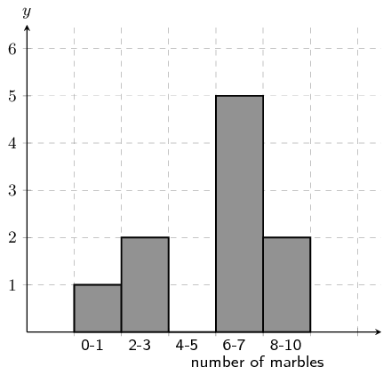

Count the number of marbles in the following range: \(\text{0} \le \text{number of marbles} \le \text{1}\)

**Solution:**
From the graph the answer is: 1

From the histogram, we arrive at our answer by reading the height of the specified interval from the
            histogram.

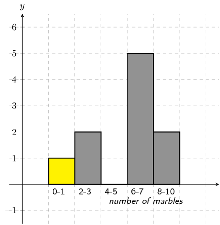

**Problem:**
A group of \(\text{20}\) learners count the number of playing cards they each have. This
            is the data they collect:

\[\begin{array}{c c c c c}
            12 & 1 & 5 & 4 & 17 \\
            14 & 7 & 5 & 1 & 3 \\
            9 & 4 & 12 & 17 & 5 \\
            19 & 1 & 19 & 7 & 15
            \end{array}\]

Count the number of learners who have from \(\text{0}\) up to \(\text{3}\) playing cards. In other words,
            how many learners have playing cards in the following range: \(\text{0} \le \text{number of playing cards}
            \le \text{3}\)? It may be helpful for you to draw a histogram in order to answer the question.

**Solution:**
Firstly we sort the table into sequential order, starting with the smallest value.

\[\begin{array}{c c c c c}
            1 & 1 & 1 & 3 & 4 \\
            4 & 5 & 5 & 5 & 7 \\
            7 & 9 & 12 & 12 & 14 \\
            15 & 17 & 17 & 19 & 19
            \end{array}\]

Secondly, we draw a histogram of the data:

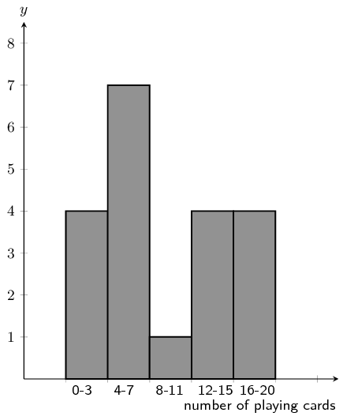

From the histogram you can see that the number of learners with playing cards in the range: \(\text{0} \le
            \text{number of playing cards} \le \text{3}\) is 4.

**Problem:**
A group of \(\text{20}\) learners count the number of coins they each have. This is the
            data they collect:

\[\begin{array}{c c c c c}
            17 & 11 & 1 & 15 & 14 \\
            3 & 4 & 18 & 5 & 14 \\
            18 & 19 & 4 & 18 & 15 \\
            16 & 13 & 20 & 8 & 18
            \end{array}\]

Count the number of learners who have from \(\text{4}\) up to \(\text{7}\) coins. In other words, how many
            learners have coins in the following range: \(\text{4} \le \text{number of coins} \le \text{7}\)? It may be
            helpful for you to draw a histogram in order to answer the question.

**Solution:**
Firstly we sort the table into sequential order, starting with the smallest value.

\[\begin{array}{c c c c c}
            1 & 3 & 4 & 4 & 5 \\
            8 & 11 & 13 & 14 & 14 \\
            15 & 15 & 16 & 17 & 18 \\
            18 & 18 & 18 & 19 & 20
            \end{array}\]

Secondly, we draw a histogram of the data:

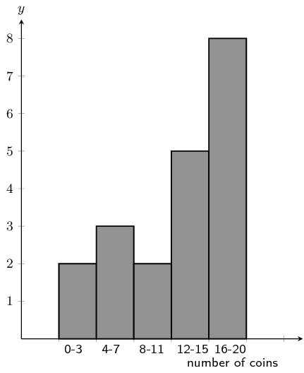

From the histogram you can see that the number of learners with coins in the range: \(\text{4} \le
            \text{number of coins} \le \text{7}\) is 3.

**Problem:**
A group of 20 learners count the number of playing cards they each have. The learners draw a histogram
            describing the data they collected. However, they have made a mistake in drawing the histogram.

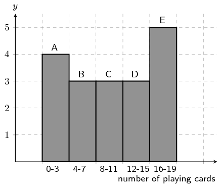

The data set below shows the correct information for the number of playing cards the learners have. Each
            value represents the number of playing cards for one learner.

          \[\{ 18 ; 10 ; 3 ; 2 ; 19 ; 15 ; 2 ; 13 ; 11 ; 14 ; 10 ; 3 ; 5 ; 9 ; 4 ; 18 ; 11 ; 18 ; 16 ; 5\}\]

Help them figure out which column in the histogram is incorrect.

**Solution:**
We first need to order the data:

          \[\{ 2 ; 2 ; 3 ; 3 ; 4 ; 5 ; 5 ; 9 ; 10 ; 10 ; 11 ; 11 ; 13 ; 14 ; 15 ; 16 ; 18 ; 18 ; 18 ; 19\}\]

Using the ordered data set we can group the data and draw the correct histogram:

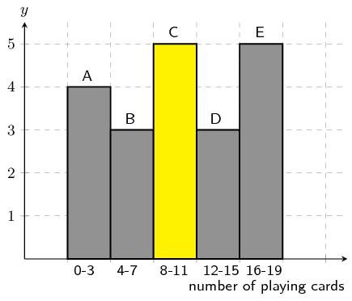

The column with the error in it was: C.

The learners used the incorrect value of 3, when the correct value is \(5\).

**Problem:**
A group of 10 learners count the number of sweets they each have. The learners draw a histogram describing
            the data they collected. However, they have made a mistake in drawing the histogram.

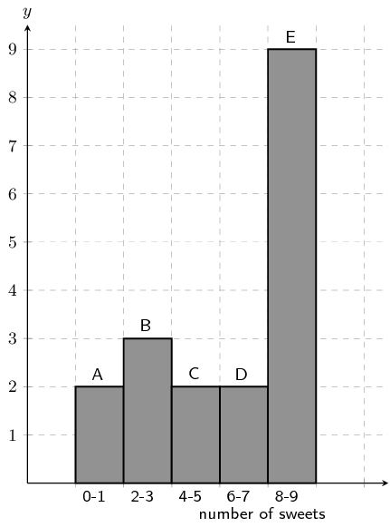

The data set below shows the correct information for the number of sweets the learners have. Each value
            represents the number of sweets for one learner.

          \[\{ 1 ; 3 ; 7 ; 4 ; 5 ; 8 ; 2 ; 2 ; 1 ; 7\}\]

Help them figure out which column in the histogram is incorrect.

**Solution:**
We first need to order the data:

          \[\{ 1 ; 1 ; 2 ; 2 ; 3 ; 4 ; 5 ; 7 ; 7 ; 8\}\]

Using the ordered data set we can group the data and draw the correct histogram:

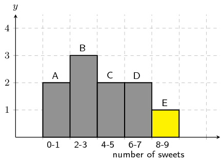

The column with the error in it was: E.

The learners used the incorrect value of 9, when the correct value is \(1\).

**Problem:**
A group of learners count the number of sweets they each have. This is a histogram describing the data they
            collected:

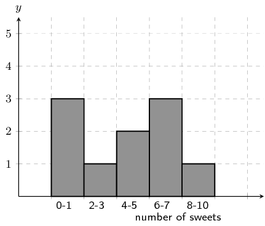

A cleaner knocks over their table, and all their notes land on the floor, mixed up, by accident!

Help them find which of the following data sets match the above histogram:

Data set A

          \[\begin{array}{c c c c c}
          1 & 8 & 4 & 8 & 8 \\
          6 & 1 & 5 & 7 & 5
          \end{array}\]

Data set B

          \[\begin{array}{c c c c c}
          5 & 6 & 9 & 2 & 1 \\
          6 & 6 & 4 & 4 & 6
          \end{array}\]

Data set C

          \[\begin{array}{c c c c c}
          7 & 2 & 4 & 1 & 5 \\
          1 & 1 & 7 & 8 & 6
          \end{array}\]

**Solution:**
In order to determine which data set is correct we need to order each data set:

Data set A

          \[\begin{array}{c c c c c}
          1 & 1 & 4 & 5 & 5 \\
          6 & 7 & 8 & 8 & 8
          \end{array}\]

Data set B

          \[\begin{array}{c c c c c}
          1 & 2 & 4 & 4 & 5 \\
          6 & 6 & 6 & 6 & 9
          \end{array}\]

Data set C

          \[\begin{array}{c c c c c}
          1 & 1 & 1 & 2 & 4 \\
          5 & 6 & 7 & 7 & 8
          \end{array}\]

Now we can group the data for each data set and compare the grouped data to the histogram. Doing so we find
            that data set C is the correct data set.

**Problem:**
A group of learners count the number of marbles they each have. This is a histogram describing the data
            they collected:

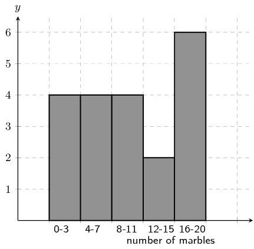

A cat jumps onto the table, and all their notes land on the floor, mixed up, by accident!

Help them find which of the following data sets match the above histogram:

Data set A

          \[\begin{array}{c c c c c}
          7 & 13 & 15 & 13 & 12 \\
          13 & 8 & 14 & 3 & 15 \\
          1 & 7 & 4 & 11 & 1
          \end{array}\]

Data set B

          \[\begin{array}{c c c c c}
          17 & 1 & 5 & 4 & 11 \\
          13 & 6 & 19 & 6 & 20 \\
          19 & 1 & 14 & 9 & 17 \\
          3 & 16 & 3 & 10 & 10
          \end{array}\]

Data set C

          \[\begin{array}{c c c c c}
          10 & 3 & 5 & 5 & 6 \\
          5 & 2 & 1 & 4 & 3
          \end{array}\]

**Solution:**
In order to determine which data set is correct we need to order each data set:

Data set A

          \[\begin{array}{c c c c c}
          1 & 1 & 3 & 4 & 7 \\
          7 & 8 & 11 & 12 & 13 \\
          13 & 13 & 14 & 15 & 15
          \end{array}\]

Data set B

          \[\begin{array}{c c c c c}
          1 & 1 & 3 & 3 & 4 \\
          5 & 6 & 6 & 9 & 10 \\
          10 & 11 & 13 & 14 & 16 \\
          17 & 17 & 19 & 19 & 20
          \end{array}\]

Data set C

          \[\begin{array}{c c c c c}
          1 & 2 & 3 & 3 & 4 \\
          5 & 5 & 5 & 6 & 10
          \end{array}\]

Now we can group the data for each data set and compare the grouped data to the histogram. Doing so we find
            that data set B is the correct data set.

**Problem:**
A group of \(\text{20}\) learners count the number of marbles they each have. This is the
            data they collect:

          \[\begin{array}{c c c c c}
          11 & 8 & 17 & 13 & 9 \\
          12 & 2 & 6 & 15 & 7 \\
          14 & 15 & 1 & 6 & 6 \\
          13 & 19 & 9 & 6 & 19
          \end{array}\]

Calculate the range of values in the data set.

**Solution:**
We need to order the data set:

          \[\begin{array}{c c c c c}
          1 & 2 & 6 & 6 & 6 \\
          6 & 7 & 8 & 9 & 9 \\
          11 & 12 & 13 & 13 & 14 \\
          15 & 15 & 17 & 19 & 19
          \end{array}\]

Now we find the maximum value in the data set:

          \[\text{maximum value} = \text{19}\]

Next we find the minimum value in the data set:

          \[\text{minimum value} = \text{1}\]

Finally, we calculate the range of the data set.

          \begin{align*}
          \text{range} & = \text{(maximum value)} - \text{(minimum value)}\\
          & = \text{19} - \text{1} \\
          & = \text{18}
          \end{align*}

**Problem:**
A group of \(\text{15}\) learners count the number of sweets they each have. This is the
            data they collect:

          \[\begin{array}{c c c c c}
          5 & 13 & 4 & 15 & 5 \\
          6 & 1 & 3 & 13 & 13 \\
          15 & 14 & 7 & 2 & 4
          \end{array}\]

Calculate the range of values in the data set.

**Solution:**
We first need to order the data set:

          \[\begin{array}{c c c c c}
          1 & 2 & 3 & 4 & 4 \\
          5 & 5 & 6 & 7 & 13 \\
          13 & 13 & 14 & 15 & 15
          \end{array}\]

Next we find the maximum value in the data set.

          \[\text{maximum value} = \text{15}\]

Then we find the minimum value in the data set.

          \[\text{minimum value} = \text{1}\]

Finally, we calculate the range of the data set.

          \begin{align*}
          \text{range} & = \text{(maximum value)} - \text{(minimum value)}\\
          & = \text{15} - \text{1} \\
          & = \text{14}
          \end{align*}

An engineering company has designed two different types of engines for motorbikes. The two different
            motorbikes are tested for the time (in seconds) it takes for them to accelerate from \(\text{0}\)
            \(\text{km·h$^{-1}$}\) to \(\text{60}\) \(\text{km·h$^{-1}$}\).

| Test | 1 | 2 | 3 | 4 | 5 | 6 | 7 | 8 | 9 | 10 |
| --- | --- | --- | --- | --- | --- | --- | --- | --- | --- | --- |
| Bike 1 | \(\text{1,55}\) | \(\text{1,00}\) | \(\text{0,92}\) | \(\text{0,80}\) | \(\text{1,49}\) | \(\text{0,71}\) | \(\text{1,06}\) | \(\text{0,68}\) | \(\text{0,87}\) | \(\text{1,09}\) |
| Bike 2 | \(\text{0,9}\) | \(\text{1,0}\) | \(\text{1,1}\) | \(\text{1,0}\) | \(\text{1,0}\) | \(\text{0,9}\) | \(\text{0,9}\) | \(\text{1,0}\) | \(\text{0,9}\) | \(\text{1,1}\) |

**Problem:**
Which measure of central tendency should be used for this information?

**Solution:**
Mean and mode. The mean will give us the average acceleration time, while the mode will give us the time
              that is most often obtained.

If we used the median we would not get any useful information as all the median tells us is what the
              central value is. The mean and mode provide more information about the data set as a whole.

**Problem:**
Calculate the measure of central tendency that you chose in the previous question, for each motorbike.

**Solution:**
We first sort the data.

Bike 1: \(\{\text{0,68}; \text{0,71}; \text{0,80}; \text{0,87}; \text{0,92}; \text{1,00}; \text{1,06};
              \text{1,09}; \text{1,49}; \text{1,55}\}\).

Bike 2: \(\{\text{0,9}; \text{0,9}; \text{0,9}; \text{0,9}; \text{1,0}; \text{1,0}; \text{1,0};
              \text{1,0}; \text{1,1}; \text{1,1}\}\).

Next we can calculate the mean for each bike:

            \begin{align*}
            \text{mean bike 1 } & = \frac{\text{0,68} + \text{0,71} + \text{0,80} + \text{0,87} + \text{0,92} +
            \text{1,00} + \text{1,06} + \text{1,09} + \text{1,49} + \text{1,55}}{10} \\
            & = \text{1,02} \\\\
            \text{mean bike 2 } & = \frac{\text{0,9} + \text{0,9} + \text{0,9} + \text{0,9} + \text{1,0} +
            \text{1,0} + \text{1,0} + \text{1,0} + \text{1,1} + \text{1,1}}{10} \\
            & = \text{1,0}
            \end{align*}

For bike 1 the mean is \(\text{1,02}\) \(\text{s}\) and there is no mode, because there is no value that
              occurs more than once.

For bike 2 the mean is \(\text{1,0}\) \(\text{s}\) and there are two modes, \(\text{1,0}\) and
              \(\text{0,9}\).

**Problem:**
Which motorbike would you choose based on this information? Take note of the accuracy of the numbers from
              each set of tests.

**Solution:**
It would be difficult to choose. Although bike 1 appears to do better than bike 2 from the mean, the data
              for bike 2 is less accurate than that for bike 1 (it only has 1 decimal place). If we were to calculate
              the mean for bike 1 using only 1 decimal place we would get \(\text{0,9}\) \(\text{s}\). This would make
              bike 2 better. Also bike 2 produces more consistent numbers. So bike 2 would likely be a good choice, but
              more information or more accurate information should be obtained.

In a traffic survey, a random sample of \(\text{50}\) motorists were asked the distance they drove to work
            daily. This information is shown in the table below.

| Distance (\(\text{km}\)) | Count |
| --- | --- |
| \(0 < d \le 5\) | \(\text{4}\) |
| \(5 < d \le 10\) | \(\text{5}\) |
| \(10 < d \le 15\) | \(\text{9}\) |
| \(15 < d \le 20\) | \(\text{10}\) |
| \(20 < d \le 25\) | \(\text{7}\) |
| \(25 < d \le 30\) | \(\text{8}\) |
| \(30 < d \le 35\) | \(\text{3}\) |
| \(35 < d \le 40\) | \(\text{2}\) |
| \(40 < d \le 45\) | \(\text{2}\) |

**Problem:**
Find the approximate mean of the data.

**Solution:**
To find the approximate mean we need to use the central value from each group. We are told that 50
              motorists were surveyed and so the total number of data values is 50.

            \begin{align*}
            \text{mean } & = \frac{4(3) + 5(8) + 9(13) + 10(18) + 7(23) + 8(28) + 3(33) + 2(38) + 2(43)}{50}\\
            & = \text{19,9}
            \end{align*}

**Problem:**
What percentage of drivers had a distance of

1. less than or equal to \(\text{15}\) \(\text{km}\)?
2. more than \(\text{30}\) \(\text{km}\)?
3. between \(\text{16}\) \(\text{km}\) and \(\text{30}\) \(\text{km}\)?

**Solution:**
1. The first three groups all drive less than or equal to \(\text{15}\) \(\text{km}\). We can add up the
                  number of drivers in these three groups and then divide this by the total number of drivers to find
                  the percentage of drivers: \(\dfrac{18}{50}\times 100 = \text{38}\%\).
2. The last three groups all drive more than \(\text{30}\) \(\text{km}\). We can add up the number of
                  drivers in these three groups and then divide this by the total number of drivers to find the
                  percentage of drivers: \(\dfrac{6}{50}\times 100 = \text{12}\%\).
3. The middle three groups fall into this range. We can add up the number of drivers in these three
                  groups and then divide this by the total number of drivers to find the percentage of drivers:
                  \(\dfrac{25}{50}\times 100 = \text{50}\%\).

Note that the three percentages we have just calculated all add up to \(\text{100}\%\).

**Problem:**
Draw a histogram to represent the data.

**Solution:**
We are given the groupings and the counts for each group. So we can draw the following histogram to
              represent the data:

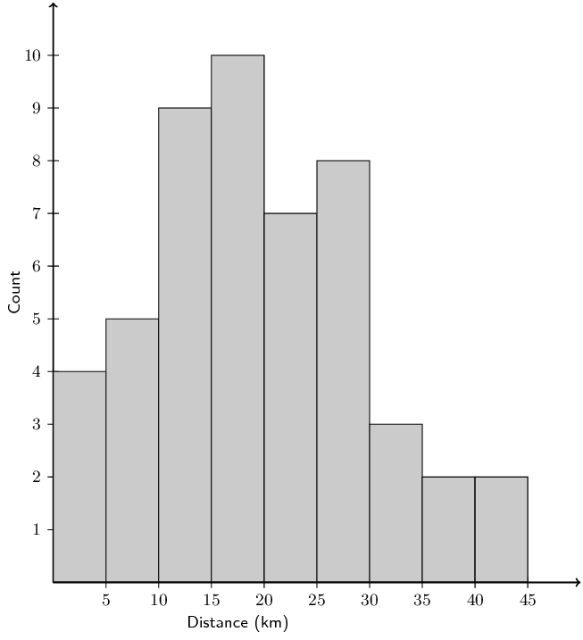

A company wanted to evaluate the training programme in its factory. They gave the same task to trained and
            untrained employees and timed each one in seconds.

| Trained | \(\text{121}\) | \(\text{137}\) | \(\text{131}\) | \(\text{135}\) | \(\text{130}\) |
| --- | --- | --- | --- | --- | --- |
|  | \(\text{128}\) | \(\text{130}\) | \(\text{126}\) | \(\text{132}\) | \(\text{127}\) |
|  | \(\text{129}\) | \(\text{120}\) | \(\text{118}\) | \(\text{125}\) | \(\text{134}\) |
| Untrained | \(\text{135}\) | \(\text{142}\) | \(\text{126}\) | \(\text{148}\) | \(\text{145}\) |
|  | \(\text{156}\) | \(\text{152}\) | \(\text{153}\) | \(\text{149}\) | \(\text{145}\) |
|  | \(\text{144}\) | \(\text{134}\) | \(\text{139}\) | \(\text{140}\) | \(\text{142}\) |

**Problem:**
Find the medians and quartiles for both sets of data.

**Solution:**
First order the data sets for both trained and untrained employees.

Trained: \(118, 120, 121, 125, 126, 127, 128, 129, 130, 130, 131, 132, 134, 135, 137\).

Untrained: \(126, 134, 135, 139, 140, 142, 142, 144, 145, 145, 148, 149, 152, 153, 156\).

There are \(\text{15}\) values in each data set.

Using the percentile formula with \(n = 15\), we can find the rank of the \(25^{\text{th}}\),
              \(50^{\text{th}}\) and \(75^{\text{th}}\) percentiles:

            \begin{align*}
            {r}_{25} & = \frac{25}{100}\left(15 - 1\right) + 1 \\
            & = \text{4,5} \\
            {r}_{50} & = \frac{50}{100}\left(15 - 1\right) + 1 \\
            & = \text{8} \\
            {r}_{75} & = \frac{75}{100}\left(15 - 1\right) + 1 \\
            & = \text{11,5}
            \end{align*}

For the \(25^{\text{th}}\) percentile the rank is \(\text{4,5}\), which is between the fourth and fifth
              values. For the \(50^{\text{th}}\) percentile (the median) the rank is \(\text{8}\). Therefore the median
              lies at the eighth value. For the \(75^{\text{th}}\) percentile the rank is \(\text{11,5}\), meaning
              between the eleventh and \(12^{\text{th}}\) values.

For the trained employees we get:

\(25^{\text{th}}\) percentile: \(\text{125,5}\); median: 129; \(75^{\text{th}}\) percentile:
              \(\text{131,5}\).

For the untrained employees we get:

\(25^{\text{th}}\) percentile: \(\text{139,5}\); median: 144; \(75^{\text{th}}\) percentile:
              \(\text{148,5}\).

**Problem:**
Find the interquartile range for both sets of data.

**Solution:**
Interquartile range for the trained employees: \(Q_3 - Q_1 = 6\).

Interquartile range for the untrained employees: \(Q_3 - Q_1 = 9\).

**Problem:**
Comment on the results.

**Solution:**
The median of the untrained employees is higher than that of the trained employees. Also the untrained
              employees have a larger interquartile range than the trained employees. There is some evidence to suggest
              that the training programme may be working.

**Problem:**
Draw a box-and-whisker diagram for each data set to illustrate the five number summary.

**Solution:**
A box-and-whisker plot shows the five number summary. The box shows the interquartile range (the distance
              between \(Q1\) and \(Q3\)). A line inside the box shows the median. The lines extending outside the box
              (the whiskers) show where the minimum and maximum values lie.

Trained employees:

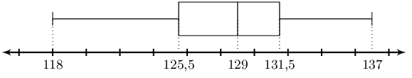

Untrained employees:

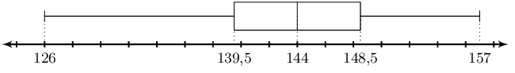

A small firm employs \(\text{9}\) people. The annual salaries of the employees are:

| \(\text{R}\,\text{600 000}\) | \(\text{R}\,\text{250 000}\) | \(\text{R}\,\text{200 000}\) |
| --- | --- | --- |
| \(\text{R}\,\text{120 000}\) | \(\text{R}\,\text{100 000}\) | \(\text{R}\,\text{100 000}\) |
| \(\text{R}\,\text{100 000}\) | \(\text{R}\,\text{90 000}\) | \(\text{R}\,\text{80 000}\) |

**Problem:**
Find the mean of these salaries.

**Solution:**
\begin{align*}
            \text{mean } & = \frac{\text{600 000} + \text{250 000} + \text{200 000} +
            \text{120 000} + 3(\text{100 000}) + \text{90 000} + \text{80 000}}{9} \\
            & = \frac{\text{1 640 000}}{9} \\
            & = \text{R}\,\text{182 222,22}
            \end{align*}

**Problem:**
Find the mode.

**Solution:**
The mode is \(\text{R}\,\text{100 000}\) (this value occurs 3 times in the data set).

**Problem:**
Find the median.

**Solution:**
First order the data. To make the numbers easier to work with we will divide each one by
              \(\text{100 000}\).

The ordered set is \(\{80; 90; 100; 100; 100; 120; 200; 250; 600\}\).

The median is at position 5 and is \(\text{R}\,\text{100 000}\).

**Problem:**
Of these three figures, which would you use for negotiating salary increases if you were a trade union
              official? Why?

**Solution:**
Either the mode or the median.The mean is skewed (shifted) by the one salary of \(\text{R}\,\text{600
              000}\). The mode gives us a better estimate of what the employees are actually earning. The median also
              gives us a fairly accurate representation of what the employees are earning.

The stem-and-leaf diagram below indicates the pulse rate per minute of ten Grade 10 learners.

          \[\begin{array}{l c|*5c}
          & 7 & 8 \\
          & 8 & 1 & 3 & 5 & 5 \\
          & 9 & 0 & 1 & 1 \\
          & 10 & 3 & 5
          \end{array}\]

Key: \(7|8 = 78\).

**Problem:**
Determine the mean and the range of the data.

**Solution:**
The data set is \(\{78; 81; 83; 85; 85; 90; 91; 91; 103; 105\}\).

            \begin{align*}
            \bar{x} &= \frac{x_1 + x_2 + ... x_{n}}{N} \\
            &= \frac{892}{10} \\
            \bar{x} &= \text{89,2} \\ \\
            \text{range} &= \text{maximum} - \text{minimum} \\
            &= 105 - 78 \\
            \text{range} &= 27
            \end{align*}

The mean and range are \(\text{89,2}\) and 27 respectively.

**Problem:**
Give the five-number summary and create a box-and-whiskers plot for the data.

**Solution:**
\begin{align*}
            r &= \frac{p}{100}(n - 1) + 1 \\
            r_{25} &= \frac{25}{100}(10 - 1) + 1 \\
            &= \text{3,25} \\ \\
            \therefore Q_1 &= \frac{83 + 85}{2} \\
            &= 84 \\ \\
            r_{50} &= \frac{50}{100}(10 - 1) + 1 \\
            &= \text{5,5} \\ \\
            \therefore Q_2 &= \frac{85 + 90}{2} \\
            &= \text{87,5} \\ \\
            r_{75} &= \frac{75}{100}(10 - 1) + 1 \\
            &= \text{7,75} \\
            \therefore Q_3 &= \frac{91 + 91}{2} \\
            &= 91
            \end{align*}

The five-number summary is: \(\text{78}; \text{84}; \text{87,5}; \text{91}; \text{105}\).

Using this we can draw the box-and-whisker plot.

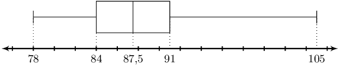

The following is a list of data: \(3; 8; 8; 5; 9; 1; 4; x\)

In each separate case, determine the value of \(x\) if the:

**Problem:**
range = \(\text{16}\)

**Solution:**
The set is: \(\{1; 3 ; 4 ; 5 ; 8 ; 8; 9; x\}\). We have ordered all the numbers and then added \(x\) on
              the end as we do not know the value of \(x\).

We are told that the range must be equal to 16. If \(x < 9\) the range would be \(9 - 1 = 8\).
              Therefore \(x > 9\) and so \(x\) must be the maximum value.

            \begin{align*}
            \text{range} &= \text{maximum} - \text{minimum} \\
            16 &= x - 1 \\
            \therefore x &= 17
            \end{align*}

**Problem:**
mode = \(\text{8}\)

**Solution:**
\(\text{8}\) is already the mode if we exclude \(x\), to maintain this \(x\) is any integer with \(x \neq
              \{1; 3; 4; 5; 9\}\).

**Problem:**
median = \(\text{6}\)

**Solution:**
First consider the set without \(x\): \(\{1; 3 ; 4 ; 5 ; 8 ; 8; 9\}\). The median in this set is 5 (there
              is an odd number of values in the set and the median lies at position 4).

Next we consider the full set: \(\{1; 3 ; 4 ; 5 ; 8 ; 8; 9; x\}\) There is an even number of values (8)
              in the full set. Therefore the median must lie between the fourth and fifth values.

Now we need to think about where \(x\) could fit into the set. \(x\) could be the fourth value, the fifth
              value or somewhere else in the set. If \(x\) is either the fourth or fifth value we will get the same
              median.

First try the case where \(x\) is the fourth or fifth value:

            \begin{align*}
            6 &= \frac{5 + x}{2} \\
            x + 5 &= 12 \\
            \therefore x &= 7
            \end{align*}

Next we check the case where \(x\) is not the fourth or fifth value. In this case the median is \(\frac{5
              + 8}{2} = \text{6,5}\). Therefore we can say that \(x = 7\).

**Problem:**
mean = \(\text{6}\)

**Solution:**
\begin{align*}
            \bar{x} &= \frac{x_1 + x_2 + ... x_{n}}{N} \\
            6 &= \frac{x + 38}{8} \\
            x + 38 &= 48 \\
            \therefore x &= 10
            \end{align*}

**Problem:**
box-and whiskers plot

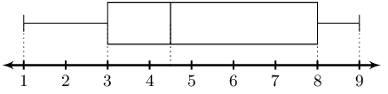

**Solution:**
In part a we found that if the range is 8, then \(x < 9\). The range here is 8, therefore \(x <
              9\).

Therefore we will use the median to help us find \(x\). The median on the box-and-whiskers plot is
              \(\text{4,5}\). From our reasoning in part c we know that this means \(x\) is either the fourth or fifth
              value. So we can calculate \(x\) as follows:

            \begin{align*}
            \text{4,5} &= \frac{5 + x}{2} \\
            x + 5 &= 9 \\
            \therefore x &= 4
            \end{align*}

**Problem:**
Write down one list of numbers that satisfies the box-and-whisker plot below:

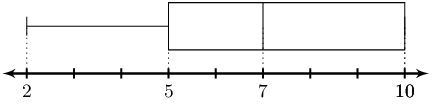

**Solution:**
From the box-and-whisker plot we get the five number summary: \(2; 5; 7; 10; 10\). Note that the third
            quartile is also the maximum value in this case.

From this we can state that the data set must have a minimum value of 2 and a maximum value of 10.

The data set can contain any numbers in the range \(2 \le x \le 10\) such that the first quartile is 5, the
            median is 7 and the third quartile is 10. There is also no restriction on how many values are in the data
            set.

One possible set that satisfies this set of numbers is \(\{2; 5; 7; 10; 10\}\). You can check that this set
            works by calculating the quartiles.

Given \(\phi\) (which represents the golden ratio) to 20 decimal places: \(\text{1,61803398874989484820}\)

**Problem:**
For the first 20 decimal digits of \((\Phi)\), determine the:

1. median
2. mode
3. mean

**Solution:**
1. The ordered set is: \(\{0; 0; 1; 2; 3; 3; 4; 4; 4; 6; 7; 8; 8; 8; 8; 8; 8; 9; 9; 9\}\)

                \begin{align*}
                r_{50} &= \frac{50}{100}(20 - 1) + 1 \\
                &= \text{10,5} \\ \\
                \text{median} &= \frac{6 + 7}{2} \\
                &= \text{6,5}
                \end{align*}
2. The mode is \(\text{8}\).
3. \begin{align*}
                \bar{x} &= \frac{x_1 + x_2 + ... x_{n}}{N} \\
                &= \frac{109}{20} \\
                \bar{x} &= \text{5,45}
                \end{align*}

**Problem:**
If the mean of the first 21 decimal digits of \((\Phi)\) is \(\text{5,38095}\) determine the
              \(21^{\text{st}}\) decimal digit.

**Solution:**
\begin{align*}
            \bar{x} &= \frac{x_1 + x_2 + ... x_{n}}{N} \\
            \text{5,38095} &= \frac{109+\phi_{21}}{21} \\
            \phi_{21} &= 21(\text{5,38095}) - 109 \\
            \phi_{21} &= 4
            \end{align*}

**Problem:**
Below is a box-and-whisker plot of the \(21^{\text{st}}\) - \(27^{\text{th}}\) decimal digits. Write down
              one list of numbers that satisfies this box-and-whisker plot.

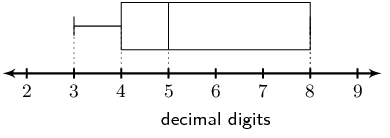

**Solution:**
From the box-and-whisker plot we get the five number summary: \(3; 4; 5; 8; 8\). Note that the third
              quartile is also the maximum value in this case.

From this we can state that the data set must have a minimum value of 3 and a maximum value of 8.

The data set can contain any numbers in the range \(3 \le x \le 8\) such that the first quartile is 4,
              the median is 5 and the third quartile is 8. However, we know that the data set consists of the
              \(21^{\text{st}}\) - \(27^{\text{th}}\) decimal digits of \(\Phi\) and so the data set must contain 7
              values.

The median will be at the fourth position and so the fourth number in the set is 5. The first quartile
              will lie between the second and third values while the third quartile will lie between the fifth and sixth
              values.

Let the data set be: \(\{3; x; y; 5; a; b; 8\}\)

The first quartile is:

            \begin{align*}
            4 & = \frac{x + y}{2} \\
            8 & = x + y
            \end{align*}

\(x\) and \(y\) can be any integers that add up to 8. However \(x\) and \(y\) must be greater than or
              equal to 3 and less than or equal to 5. Therefore the possible values are: 3 and 5 or 4 and 4.

The third quartile is:

            \begin{align*}
            8 & = \frac{a + b}{2} \\
            16 & = a + b
            \end{align*}

\(a\) and \(b\) can be any integers that add up to 16. However \(a\) and \(b\) must be greater than or
              equal to 5 and less than or equal to 8. Therefore the only possible values are: 8 and 8.

There are two possible sets: \(\{3; 3; 5; 5; 8; 8; 8\}\) or \(\{3; 4; 4; 5; 8; 8; 8\}\).

There are 14 men working in a factory. Their ages are :

          \(22; 25; 33; 35; 38; 48; 53; 55; 55; 55; 55; 56; 59; 64\)

**Problem:**
Write down the five number summary.

**Solution:**
\begin{align*}
            r &= \frac{p}{100}(n - 1) + 1 \\
            r_{25} &= \frac{25}{100}(14 - 1) + 1 \\
            &= \text{4,25} \\ \\
            \therefore Q_1 &= \frac{35 + 38}{2} \\
            &= \text{36,5}\\ \\
            r_{50} &= \frac{50}{100}(14 - 1) + 1 \\
            &= \text{7,5} \\ \\
            \therefore Q_2 &= \frac{53 + 55}{2} \\
            &= 54\\ \\
            r_{75} &= \frac{75}{100}(14 - 1) + 1 \\
            &= \text{10,75} \\ \\
            \therefore Q_3 &= \frac{55 + 55}{2} \\
            &= 55
            \end{align*}

The five number summary is: \(\text{22}; \text{36,5}; \text{50}; \text{55}; \text{64}\)

**Problem:**
If 3 men had to be retrenched, but the median had to stay the same, show the ages of the \(\text{3}\) men
              you would retrench.

**Solution:**
Retrenching \(\text{3}\) men will leave \(\text{11}\) men. For an odd numbered set the median must be the
              same as one of the ages. None of the men are \(\text{54}\) years.

Therefore no men can be retrenched to keep the median the same.

**Problem:**
Find the mean age of the men in the factory using the original data.

**Solution:**
\begin{align*}
            \bar{x} &= \frac{x_1 + x_2 + ... x_{n}}{N} \\
            &= \frac{597}{14} \\
            \therefore \bar{x} &= \text{42,643}
            \end{align*}

The example below shows a comparison of the amount of dirt removed by four brands of detergents (brands
            \(A\) to \(D\)).

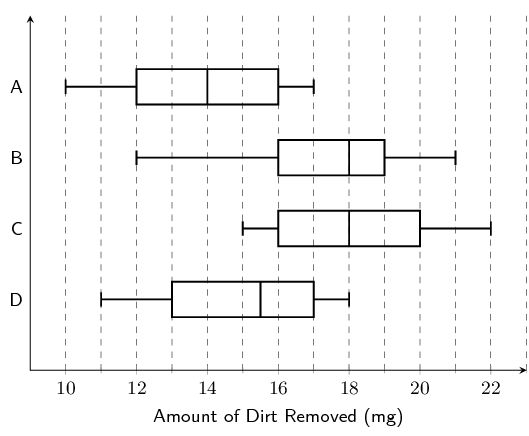

**Problem:**
Which brand has the biggest range, and what is this range?

**Solution:**
A: \(\text{range} = 17 - 10 = 7\)

B: \(\text{range} = 21 - 12 = 9\)

C: \(\text{range} = 22 - 15 = 7\)

D: \(\text{range} = 18 - 11 = 7\)

B has the biggest range. The range is 9.

**Problem:**
For brand \(C\), what does the number \(\text{18}\) \(\text{mg}\) represent?

**Solution:**
\(\text{18}\) \(\text{mg}\) represents the median.

**Problem:**
Give the interquartile range for brand \(B\).

**Solution:**
\begin{align*}
            \text{interquartile range} &= Q_3 - Q_1 \\
            &= 19 - 16 \\
            &= 3
            \end{align*}

**Problem:**
Which brand of detergent would you buy? Explain your answer.

**Solution:**
We need to compare several values to help us decide. These values are shown in the table below.

| Brand | Minimum value | Maximum value | Range | Interquartile range |
| --- | --- | --- | --- | --- |
| A | 10 | 17 | 7 | 4 |
| B | 12 | 21 | 9 | 3 |
| C | 15 | 22 | 7 | 4 |
| D | 11 | 18 | 7 | 4 |

From this we see that brand C has the highest minimum value. Brand B has the smallest interquartile range
              but the largest range. It is possible that the minimum value for brand B is an outlier which would make
              brand B a better choice than brand C.

Considering all the data available it would be hard to choose between brand C and brand B. We can however
              say that brands A and D are not very good choices as they both have low minimum and maximum values.

Since brand C does not have a potential outlier this might be the best brand to choose.
