# Chapter 11: Trigonometry

- This chapter covers solving problems in two-dimensions using trigonometry.
- Emphasise the value and importance of making sketches, where appropriate.
- Prior to starting this chapter it may be appropriate to quickly revise the earlier content on trigonometry.

Trigonometry was developed in ancient civilisations to solve practical problems such as building construction and
    navigating by the stars. We will show that trigonometry can also be used to solve some other practical problems. We
    can use the trigonometric ratios to solve problems in two dimensions that involve right-angled triangles.

As revision the three trigonometric ratios can be defined for right-angled triangles as:

  \begin{align*}
  \sin \theta & = \frac{\text{opposite}}{\text{hypotenuse}} \\
  \cos \theta & = \frac{\text{adjacent}}{\text{hypotenuse}} \\
  \tan \theta & = \frac{\text{opposite}}{\text{adjacent}}
  \end{align*}

We will use these three ratios and the theorem of Pythagoras to help us solve two-dimensional problems.

## 11.1 Two-dimensional problems (EMA7F)

In two-dimensional problems we will often refer to the angle of elevation and the angle of depression. To
      understand these two angles let us consider a person sailing alongside some cliffs. The person looks up and sees
      the top of the cliffs as shown below:

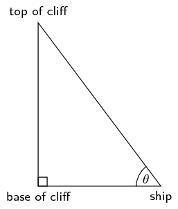

In this diagram \(\theta\) is the angle of elevation.

<Callout type="info" title="Definition: Angle of elevation">
The angle of elevation is the angle formed by the line of sight and the horizontal plane for an object above
        the horizontal plane.
</Callout>

In our diagram the line of sight is from the ship to the top of the cliffs. The horizontal plane is from the ship
      to the base of the cliffs. Also note the we can consider the cliffs to be a straight vertical line and so we have
      a right-angled triangle.

To understand the angle of depression let us now consider the same situation as above but instead our observer is
      standing on top of the cliffs looking down at the ship.

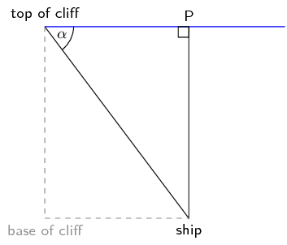

In this diagram \(\alpha\) is the angle of depression.

<Callout type="info" title="Definition: Angle of depression">
The angle of depression is the angle formed by the line of sight and the horizontal plane for an object below
        the horizontal plane.
</Callout>

In our diagram the line of sight is from the top of the cliffs to the ship. The horizontal plane is from the top
      of the cliffs through \(P\). Note that this is parallel to the line between the base of the cliffs and the ship.
      \(P\) lies directly above the ship. We can construct a vertical, perpendicular line to the horizontal plane at the
      point \(P\).

Finally we can compare the angle of elevation and the angle of depression. In the following diagram the line from
      the base of the cliffs to the ship is parallel to the line from the top of the cliffs to \(P\). The angle of
      elevation and the angle of depression are indicated. Notice that \(\alpha = \theta\).

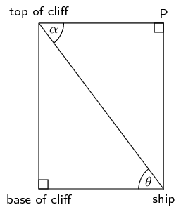

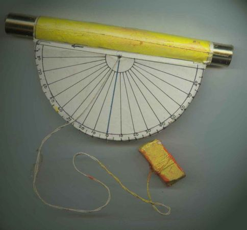

An inclinometer. Inclinometers can be used to measure angles of inclination and so can
        be used to determine the height of an object.

<Callout type="tip" title="Multimedia & Video">
You can make an inclinometer to
        measure the angle of inclination of a tall building or tree. Once you have the angle of inclination you can
        determine the height of the building or tree.
</Callout>

<Callout type="note" title="Note">
In trigonometry the angle of inclination is the same as the angle of elevation.
</Callout>

<QuizCard id="m10-11-01a" title="Interactive Exercise 11.1" question="A person stands at Point A , looking up at a bird sitting on the top of a building, Point B . The height of the building is \(x\) meters, Point A is \(\text{5,77}\) meters away from the foot of the building, and the angle of incline (from the horizontal) the the top of the                 building is \(\text{60}\text{°}\) . Calculate the height of the building ( \(x\) ) as shown in the diagram below. INSTRUCTION: Round your answer to two decimal places ." options=[] answer="
                    ['9.99', '9.99e+0']
                " hint="You should enter a number here. If you want to, you can use a space to separate thousands.                Example: 12 800,25 For scientific notation you need to use the multiply symbol                ( ∗ ) and the exponent symbol ( ^ ). For example 6,673 × 10 −11 should be written as: 6,673 ∗ 10^−11" explanation="Use the tangent trigonometric ratio to solve for \(x\) First identify the opposite, adjacent and hypotenuse sides. Then use the appropriate trigonometric ratio to solve for \(x\) . In this example, the correct trig ratio to use is the tangent function. \[                     \begin{aligned}                     \tan (\theta) &= \frac{\text{opposite}}{\text{adjacent}} \\                     \tan (\text{60}\text{°}) &= \frac{x}{\text{5,77}} \\                     \therefore x &= \text{5,77} \cdot \tan(\text{60}\text{°}) \\                     &= \text{9,99393...} \\ & \approx \text{9,99}\ \text{m}                     \end{aligned}                 \] Therefore \(x\) is \(\text{9,99}\ \text{m}\) . Submit your answer as:" />

<QuizCard id="m10-11-01a" title="Interactive Exercise 11.1" question="A person stands at Point A , looking up at a bird sitting on the top of a tree, Point B . The height of the tree is \(\text{10}\) meters, Point A is \(x\) meters away from the foot of the tree, and the angle of incline (from the horizontal) the the top of the                 tree is \(\text{35}\text{°}\) . Calculate the distance away from the foot of the  tree ( \(x\) ) as shown in the diagram below. INSTRUCTION: Round your answer to two decimal places ." options=[] answer="" hint="You should enter a number here. If you want to, you can use a space to separate thousands.                Example: 12 800,25 For scientific notation you need to use the multiply symbol                ( ∗ ) and the exponent symbol ( ^ ). For example 6,673 × 10 −11 should be written as: 6,673 ∗ 10^−11" explanation="Use the tangent trigonometric ratio to solve for \(x\) First identify the opposite, adjacent and hypotenuse sides. Then use the appropriate trigonometric ratio to solve for \(x\) . In this example, the correct trig ratio to use is the tangent function. \[                     \begin{aligned}                     \tan (\theta) &= \frac{\text{opposite}}{\text{adjacent}} \\                     \tan (\text{35}\text{°}) &= \frac{\text{10}}{x} \\                     \therefore x &= \frac{\text{10}}{\tan(\text{35}\text{°})} \\                     &= \text{14,28148...} \\ & \approx \text{14,28}\ \text{m}                     \end{aligned}                 \] Therefore \(x\) is \(\text{14,28}\ \text{m}\) . Submit your answer as:" />

<QuizCard id="m10-11-01a" title="Interactive Exercise 11.1" question="Calculate the length of side \(\overline{SN}\) . INSTRUCTION: Round your answer to two decimal places." options=[] answer="" hint="You should enter a number here. If you want to, you can use a space to separate thousands.                Example: 12 800,25 For scientific notation you need to use the multiply symbol                ( ∗ ) and the exponent symbol ( ^ ). For example 6,673 × 10 −11 should be written as: 6,673 ∗ 10^−11" explanation="Find the correct trigonometric ratio to solve for the unknown Looking at the diagram we can see that the figure (which is a composite shape) is made up of two right-triangles connected by the common side \( \overline{NQ} \) . If we focus on the \( \Delta NSQ \) we notice that this looks similar to questions we have solved before. This is just a right-angled triangle with either a side or an angle missing. 		            Applying one of the trigonometric ratios, setting up a trigonometric equation and solving the unknown edge or angle will help us solve this problem. We are given one side and one angle \(\overline{SQ} = \text{7,04}\) and \( \angle  NSQ =  \text{44,68}\text{°}\) . We need to think of a trigonometric ratio that not only includes this information, but also to place the unknown in the simplest calculation position. An example of a trigonometric equation looks like this:  \begin{aligned} \cos \theta &= \frac{\text{adjacent}}{\text{hypotenuse}} \end{aligned} The simplest calculation in this case will be to solve for the side in the numerator position on the right of the equation. Cosine of given \( \angle  NSQ\) takes adjacent edge \(\overline{SN}\) , let's call it \(x\) because this is the unknown edge, and  hypotenuse edge \(\overline{SQ}\) in to reference. This is the equation: \[ 	                   \begin{aligned} \cos (\text{44,68}\text{°}) &= \frac{\overline{SN}}{\overline{SQ}} \\ \cos (\text{44,68}\text{°}) &= \frac{x}{\overline{SQ}}  \end{aligned} 		           \] Solve the trigonometric equation Multiplying both sides of the equation by the denominator will give us the easiets solution as explained in the previous step. \[                                            \begin{aligned}                        \cos (\text{44,68}\text{°}) &= \frac{x}{\text{7,04}}\\                        \text{7,04} \cdot \cos (\text{44,68}\text{°}) &= x\\                        x &= \text{7,04} \cdot \cos (\text{44,68}\text{°}) \\                        x &= \text{5,0057...}\\ x &\approx \text{5,01}                    \end{aligned}                     \] Remember that the instructions say to round the answer to the second decimal place, as shown in the last step above. The length of \(\overline{SN}\) is \(\text{5,01}\) . Submit your answer as:" />

<Callout type="tip" title="Worked example 1: Flying a kite">
**Question:**
Mandla flies a kite on a \(\text{17}\) \(\text{m}\) string at an inclination of \(\text{63}\)°.

1. What is the height, \(h\), of the kite above the ground?
2. If Mandla's friend Sipho stands directly below the kite, calculate the distance, \(d\), between the two friends.

**Make a sketch and identify the opposite and adjacent sides and the hypotenuse:**
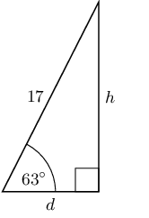

**Use given information and appropriate ratio to solve for \(h\) and \(d\):**
1. \begin{align*} \sin 63° & = \frac{\text{opposite}}{\text{hypotenuse}} \\ \sin 63° & = \frac{h}{17} \\ \therefore h & = 17 \sin 63° \\ & = \text{15,14711...} \\ & \approx \text{15,15}\text{ m} \end{align*}
2. \begin{align*} \cos 63° & = \frac{\text{adjacent}}{\text{hypotenuse}} \\ \cos 63° & = \frac{d}{17} \\ \therefore d & = 17 \cos 63° \\ & = \text{7,7178...} \\ & \approx \text{7,72}\text{ m} \end{align*}

Note that the third side of the triangle can also be calculated using the theorem of Pythagoras: \({d}^{2} =
          {17}^{2} - {h}^{2}\).

**Write the final answers:**
1. The kite is \(\text{15,15}\) \(\text{m}\) above the ground.
2. Mandla and Sipho are \(\text{7,72}\) \(\text{m}\) apart.
</Callout>

<Callout type="tip" title="Worked example 2: Calculating angles">
**Question:**
\(ABCD\) is a trapezium with \(AB=\text{4}\text{ cm}\), \(CD=\text{6}\text{ cm}\), \(BC=\text{5}\text{ cm}\)
          and \(AD=\text{5}\text{ cm}\). Point \(E\) on diagonal \(AC\) divides the diagonal such that
          \(AE=\text{3}\text{ cm}\). \(B\hat{E}C = 90°\). Find \(A\hat{B}C\).

**Draw trapezium and label all given lengths on diagram. Indicate that \(B\hat{E}C = 90°\):**
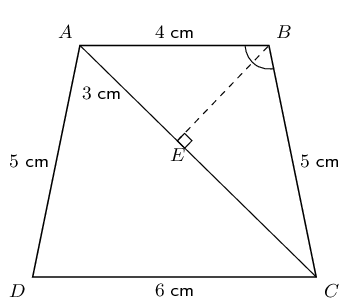

We will use \(\triangle ABE\) and \(\triangle CBE\) to find \(A\hat{B}E\) and \(C\hat{B}E\). We can then add
          these two angles together to find \(A\hat{B}C\).

**Find the first angle, \(A\hat{B}E\):**
The hypotenuse and opposite side are given for both triangles, therefore use the \(\sin\) function.

In \(\triangle ABE\):

        \begin{align*}
        \sin A\hat{B}E & = \frac{\text{opposite}}{\text{hypotenuse}} \\
        & = \frac{3}{4} \\
        A\hat{B}E & = \text{48,5903...} \\
        & \approx \text{48,6}°
        \end{align*}

**Use the theorem of Pythagoras to determine \(BE\):**
In \(\triangle ABE\):

        \begin{align*}
        BE^{2} & = AB^{2} - AE^{2} \\
        & = {4}^{2} - {3}^{2} \\
        & = 7 \\
        \therefore BE & = \sqrt{7}\text{cm}
        \end{align*}

**Find the second angle \(C\hat{B}E\):**
In \(\triangle CBE\):

        \begin{align*}
        \cos C\hat{B}E & = \frac{\text{adjacent}}{\text{hypotenuse}} \\
        & = \frac{\sqrt{7}}{5} \\
        & = \text{0,52915...} \\
        C\hat{B}E & = \text{58,0519...} \\
        & \approx \text{58,1}°
        \end{align*}

**Calculate the sum of the angles:**
\[A\hat{B}C = \text{48,6}° + \text{58,1}° = \text{106,7}°\]
</Callout>

Another application is using trigonometry to find the height of a building. We could use a tape measure lowered
      from the roof, but this is impractical (and dangerous) for tall buildings. It is much more sensible to use
      trigonometry.

<Callout type="tip" title="Worked example 3: Finding the height of a building">
**Question:**
The given diagram shows a building of unknown height \(h\). We start at point \(B\) and walk \(\text{100}\)
          \(\text{m}\) away from the building to point \(Q\). Next we measure the angle of elevation from the ground to
          the top of the building, \(T\), and find that the angle is \(\text{38,7}°\). Calculate the height of the
          building, correct to the nearest metre.

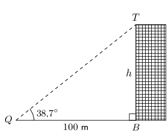

**Identify the opposite and adjacent sides and the hypotenuse:**
We have a right-angled triangle and know the length of one side and an angle. We can therefore calculate the
          height of the building.

**:**
In \(\triangle QTB\):

        \begin{align*}
        \tan \text{38,7}° & = \frac{\text{opposite}}{\text{adjacent}} \\
        & = \frac{h}{100}
        \end{align*}

**Rearrange and solve for \(h\):**
\begin{align*}
        h & = 100 \times \tan \text{38,7}° \\
        & = \text{80,1151...} \\
        & \approx \text{80}
        \end{align*}

**Write final answer:**
The height of the building is \(\text{80}\) \(\text{m}\).
</Callout>

<Callout type="tip" title="Worked example 4: Angles of elevation and depression">
**Question:**
A block of flats is \(\text{200}\) \(\text{m}\) away from a cellphone tower. Someone stands at \(B\). They
          measure the angle from \(B\) to the top of the tower (\(E\)) to be \(\text{34}\)\(\text{°}\) (the angle
          of elevation). They then measure the angle from \(B\) to the bottom of the tower (\(C\)) to be
          \(\text{62}\)\(\text{°}\) (the angle of depression).

What is the height of the cellphone tower (correct to the nearest metre)?

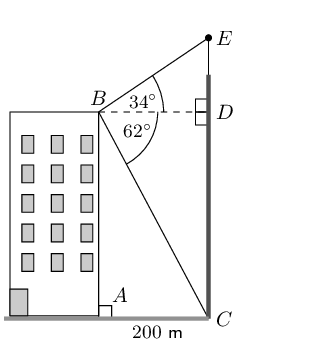

Note: diagram not drawn to scale

**To determine height \(CE\), first calculate lengths \(DE\) and \(CD\):**
\(\triangle BDE\) and \(\triangle BDC\) are both right-angled triangles. In each of the triangles, the length
          \(BD\) is known. Therefore we can calculate the sides of the triangles.

**Calculate \(CD\):**
The length \(AC\) is given. \(CABD\) is a rectangle so \(BD = AC = \text{200}\text{ m}\).

In \(\triangle CBD\):

        \begin{align*}
        \tan C\hat{B}D & = \frac{CD}{BD} \\
        \therefore CD & = BD \times \tan C\hat{B}D \\
        & = 200 \times \tan 62° \\
        & = \text{376,1452...} \\
        & \approx \text{376}\text{ m}
        \end{align*}

**Calculate \(DE\):**
In \(\triangle DBE\):

        \begin{align*}
        \tan D\hat{B}E & = \frac{DE}{BD} \\
        \therefore DE & = BD \times \tan D\hat{B}E \\
        & = 200 \times \tan 34° \\
        & = \text{134,9017...} \\
        & \approx \text{135}\text{ m}
        \end{align*}

**Add the two heights to get the final answer:**
The height of the tower is: \(CE = CD + DE = \text{135}\text{ m} + \text{376}\text{ m} = \text{511}\text{
          m}\).
</Callout>

<QuizCard id="m10-11-01b" title="Interactive Exercise 11.2" question="A person stands at Point A , looking up at a bird sitting on the top of a tree, Point B . The height of the tree is \(\text{10}\ \text{m}\) , Point A is \(\text{7,0}\ \text{m}\) away from the foot of the tree, and the line-of-sight distance from Point A to the top of the tree is \(\text{x}\ \text{}\) . Calculate the line-of-sight distance to the top of the tree ( \(x\) ) as shown in the diagram below: INSTRUCTION: Round your answer to two decimal places." options=[] answer="12.21" hint="You should enter a number here. If you want to, you can use a space to separate thousands.                Example: 12 800,25 For scientific notation you need to use the multiply symbol                ( ∗ ) and the exponent symbol ( ^ ). For example 6,673 × 10 −11 should be written as: 6,673 ∗ 10^−11" explanation="Use the theorem of Pythagoras to calculate the line-of-sight distance to the top of the tree The question gives us two sides of a right-angled triangle, and we need to find the third side: we can use the theorem of Pythagoras. \[                     \begin{aligned}                         c^2 & = a^2 + b^2\\                         x^2 & = \left( 10 \right)^2 + \left( 7,0 \right)^2\\                         \text{Solving: }x & = \text{12,20655...} \\ & \approx  \text{12,21}\ \text{m}                     \end{aligned}                 \] Therefore, the line-of-sight distance to the top of the tree is \(\text{12,21}\ \text{m}\) . Submit your answer as:" />

<QuizCard id="m10-11-01b" title="Interactive Exercise 11.2" question="A person stands at Point \(A\) , looking up at a bird sitting on the top of a tree, at Point \(B\) . The height of the tree is \(\text{9}\ \text{m}\) , the line-of-sight distance from Point \(A\) to the top of the  tree (Point \(B\) ) is \(\text{10,39}\ \text{m}\) , and the angle of inclination (from the horizontal) to the top of the tree is \(x\) . Calculate the angle of inclination (from the horizontal) to the top of the tree ( \(x\) ) as shown in the diagram below: INSTRUCTION: Round your answer to two decimal places ." options=[] answer="" hint="You should enter a number here. If you want to, you can use a space to separate thousands.                Example: 12 800,25 For scientific notation you need to use the multiply symbol                ( ∗ ) and the exponent symbol ( ^ ). For example 6,673 × 10 −11 should be written as: 6,673 ∗ 10^−11" explanation="Use the sine trigonometric ratio to solve for \(x\) First identify the opposite, adjacent and hypotenuse sides. Then use the appropriate trigonometric ratio to solve for \(x\) . In this example, the trig ratio to use is \(\sin\) . \[                     \begin{aligned}                         \sin \theta & = \frac{\text{opposite}}{\text{hypotenuse}}\\                         \sin x & = \frac{\text{9}}{\text{10,39}} \\                         x & = \sin^{-1} \left(\frac{\text{9}}{\text{10,39}}\right)\\                         x & = \text{60,02202...}\\ & \approx \text{60,02}\ \text{m}                     \end{aligned}                 \] The angle of inclination (from the horizontal) to the top of the tree is \(\text{60,02}\ \text{m}\) . Submit your answer as:" />

<QuizCard id="m10-11-01b" title="Interactive Exercise 11.2" question="A person stands at Point \(A\) , looking up at a bird sitting on the top of a tree,                 Point \(B\) . Point \(A\) is \(\text{2,33}\) meters away from the foot of the                 tree, the line-of-sight distance from Point \(A\) to the top of the                 tree (Point \(B\) ) is \(x\) meters, and the angle                 of incline (from the horizontal) the the top of the tree is \(\text{65}\text{°}\) . Calculate the line-of-sight distance to the top of the tree ( \(x\) ) as shown in the diagram below: INSTRUCTION: Round your answer to two decimal places ." options=[] answer="" hint="You should enter a number here. If you want to, you can use a space to separate thousands.                Example: 12 800,25 For scientific notation you need to use the multiply symbol                ( ∗ ) and the exponent symbol ( ^ ). For example 6,673 × 10 −11 should be written as: 6,673 ∗ 10^−11" explanation="Use the cosine trigonometric ratio to solve for \(x\) First identify the opposite, adjacent and hypotenuse sides. Then use the appropriate trigonometric ratio to solve for \(x\) . In this example, the trig ratio to use is \(\cos\) . \[                     \begin{aligned}                     \cos \theta & = \frac{\text{adjacent}}{\text{hypotenuse}}\\                     \cos \text{65}\text{°} & = \frac{\text{2,33}}                     {x} \\                     \therefore x & = \text{5,51324...} \\ & \approx \text{5,51}\ \text{m}                     \end{aligned}                 \] Therefore \(x\) is \(\text{5,51}\ \text{m}\) . Submit your answer as:" />

<Callout type="tip" title="Worked example 5: Building plan">
**Question:**
Mr Nkosi has a garage at his house and he decides to add a corrugated iron roof to the side of the garage.
          The garage is \(\text{4}\) \(\text{m}\) high, and his sheet for the roof is \(\text{5}\) \(\text{m}\) long. If
          the angle of the roof is \(\text{5}\)°, how high must he build the wall \(BD\)? Give the answer correct
          to \(\text{1}\) decimal place.

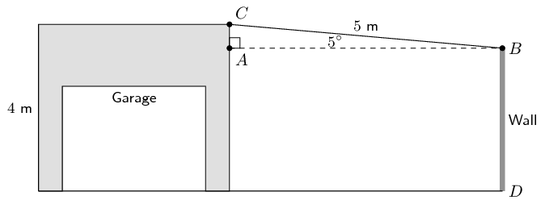

**Identify opposite and adjacent sides and hypotenuse:**
\(\triangle ABC\) is right-angled. The hypotenuse and an angle are known therefore we can calculate \(AC\).
          The height of the wall \(BD\) is then the height of the garage minus \(AC\).

        \begin{align*}
        \sin A\hat{B}C & = \frac{AC}{BC} \\
        \therefore AC & = BC \times \sin A\hat{B}C \\
        & = 5 \sin 5° \\
        & = \text{0,43577...} \\
        & \approx \text{0,4}\text{ m} \\ \\
        \therefore BD& = \text{4}\text{ m} - \text{0,4}\text{ m} \\
        & = \text{3,6}\text{ m}
        \end{align*}

**Write the final answer:**
Mr Nkosi must build his wall to be \(\text{3,6}\) \(\text{m}\) high.
</Callout>

### Textbook Exercise 11.1

**Problem:**
A person stands at point \(A\), looking up at a bird sitting on the top of a building, point \(B\).

The height of the building is \(x\) meters, the line of sight distance from point \(A\) to the top of the
              building (point \(B\)) is \(\text{5,32}\) meters, and the angle of elevation to the top of the building is
              \(70^\circ\).

Calculate the height of the building (\(x\)) as shown in the diagram below:

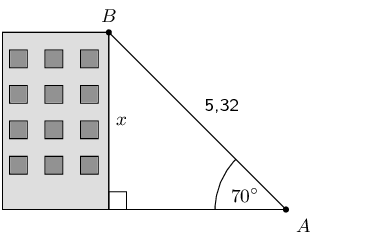

**Solution:**
\begin{align*}
            \sin \theta & = \frac{\text{opposite}}{\text{hypotenuse}}\\
            \sin \text{70}^\circ & = \frac{x}{\text{5,32}} \\
            x & = \text{4,99916...} \\
            & \approx \text{5}
            \end{align*}

The height of the building is \(\text{5}\) \(\text{m}\).

**Problem:**
A person stands at point \(A\), looking up at a bird sitting on the top of a pole (point \(B\)).

The height of the pole is \(x\) meters, point A is \(\text{4,2}\) meters away from the foot of the pole,
              and the angle of elevation to the top of the pole is \(65^\circ\).

Calculate the height of the pole (\(x\)), to the nearest metre.

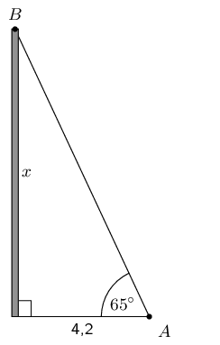

**Solution:**
\begin{align*}
            \tan{\theta} & = \frac{\text{opposite}}{\text{adjacent}}\\
            \tan{\text{65}^\circ} & = \frac{x}{\text{4,2}} \\
            x & = \text{9,0069...} \\
            & \approx \text{9}
            \end{align*}

The height of the pole is \(\text{9}\) \(\text{m}\).

**Problem:**
A boy flying a kite is standing \(\text{30}\) \(\text{m}\) from a point directly under the kite. If the
              kite's string is \(\text{50}\) \(\text{m}\) long, find the angle of elevation of the kite.

**Solution:**
First draw a sketch:

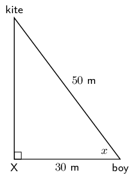

We can use the cosine ratio to find the angle of elevation (\(x\)):

            \begin{align*}
            \cos x & = \frac{30}{50} \\
            x & = \text{53,1301...} \\
            & \approx \text{53,13}°
            \end{align*}

The angle of elevation of the kite is \(\text{53,13}\)°.

**Problem:**
What is the angle of elevation of the sun when a tree \(\text{7,15}\) \(\text{m}\) tall casts a shadow
              \(\text{10,1}\) \(\text{m}\) long?

**Solution:**
First draw a sketch:

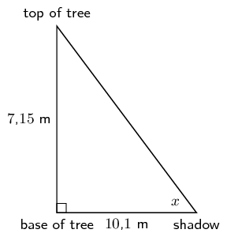

We can use the tangent ratio to find the angle of elevation (\(x\)):

            \begin{align*}
            \tan x & = \frac{\text{7,15}}{\text{10,1}} \\
            x & = \text{35,2954...} \\
            & \approx \text{35,30}°
            \end{align*}

The angle of elevation of the sun is \(\text{35,30}\)°.

**Problem:**
From a distance of \(\text{300}\) \(\text{m}\), Susan looks up at the top of a lighthouse. The angle of
              elevation is \(\text{5}\)°. Determine the height of the lighthouse to the nearest metre.

**Solution:**
First draw a sketch:

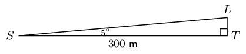

We need to find \(LT\). We can use the tangent ratio:

            \begin{align*}
            \tan \hat{S} & = \frac{LT}{ST} \\
            LT & = 300 \tan 5° \\
            & = \text{26,2465...} \\
            & \approx \text{26}\text{ m}
            \end{align*}

The height of the lighthouse is \(\text{26}\) \(\text{m}\).

**Problem:**
A ladder of length \(\text{25}\) \(\text{m}\) is resting against a wall, the ladder makes an angle
              \(\text{37}\)° to the wall. Find the distance between the wall and the base of the ladder to the
              nearest metre.

**Solution:**
First draw a sketch:

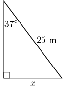

Notice that we are given the angle that the ladder makes with the wall, not the angle that the ladder
              makes with the ground.

Now we can use the sine function to find \(x\):

            \begin{align*}
            \sin 37° & = \frac{x}{25} \\
            x & = 25 \sin 37° \\
            & = \text{15,04537...} \\
            & \approx \text{15}\text{ m}
            \end{align*}

The base of the ladder is \(\text{15}\) \(\text{m}\) away from the wall.
