### Textbook Exercise 11.2

**Problem:**
A ladder of length \(\text{15}\) \(\text{m}\) is resting against a wall, the
                                                base of the ladder is \(\text{5}\) \(\text{m}\) from the wall. Find the
                                                angle between the wall and the ladder.

**Solution:**
First draw a sketch:

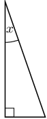

Notice that we want to find the angle that the ladder makes with the wall,
                                                not the angle that the ladder makes with the ground.

Now we use \(\sin x = \frac{\text{opposite}}{\text{hypotenuse}}\):

                                        \begin{align*}
                                        \sin x & = \frac{5}{15} \\
                                        & = \text{0,3333...} \\
                                        x & = \text{19,4712...} \\
                                        & \approx \text{19,47}°
                                        \end{align*}

The angle between the ladder and the wall is \(\text{19,47}\)°.

Captain Jack is sailing towards a cliff with a height of \(\text{10}\)
                                                \(\text{m}\).

**Problem:**
The distance from the boat to the bottom of the cliff is
                                                        \(\text{30}\) \(\text{m}\). Calculate the angle of elevation
                                                        from the boat to the top of the cliff (correct to the nearest
                                                        degree).

**Solution:**
First draw a sketch:

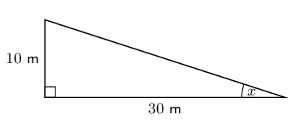

The angle of elevation is \(\text{18}\)°.

**Problem:**
If the boat sails \(\text{7}\) \(\text{m}\) closer to the cliff, what
                                                        is the new angle of elevation from the boat to the top of the
                                                        cliff?

**Solution:**
We redraw the sketch with the new information:

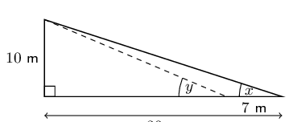

The new distance from the boat to the cliffs is \(\text{30}\text{ m}
                                                        - \text{7}\text{ m} = \text{23}\text{ m}\). The height of the
                                                        cliffs has not changed.

                                                \begin{align*}
                                                \tan y & = \frac{\text{opposite}}{\text{adjacent}} \\
                                                & = \frac{10}{23} \\
                                                y & = \text{23,49856...}° \\
                                                & = \text{23}°
                                                \end{align*}

The new angle of elevation is \(\text{23}\)°.

**Problem:**
Jim stands at point \(A\) at the base of a telephone pole, looking up at a
                                                bird sitting on the top of another telephone pole (point \(B\)).

The height of each of the telephone poles is \(\text{8}\) meters, and the
                                                angle of elevation from \(A\) to the top of \(B\) is \(45^\circ\).

Calculate the distance between the telephone poles (\(x\)) as shown in the
                                                diagram below:

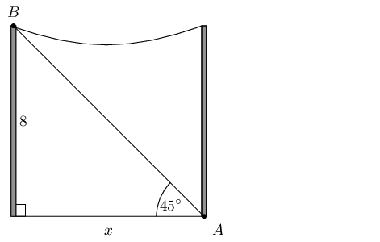

**Solution:**
\begin{align*}
                                        \tan{x} & = \frac{\text{opposite}}{\text{adjacent}}\\
                                        \tan{\text{45}^\circ} & = \frac{\text{8}}{x} \\
                                        x & = \frac{8}{\tan{45^\circ}} \\
                                        & = 8
                                        \end{align*}

The distance between the telephone poles is \(\text{8}\) \(\text{m}\).

**Problem:**
Alfred stands at point \(A\), looking up at a flag on a pole (point \(B\)).

Point \(A\) is \(\text{5,0}\) meters away from the bottom of the flag pole,
                                                the line of sight distance from point \(A\) to the top of the flag pole
                                                (point \(B\)) is \(\text{7,07}\) meters, and the angle of elevation to
                                                the top of the flag pole is \(x^\circ\).

Calculate the angle of elevation to the top of the flag pole (\(x\)) as shown
                                                in the diagram below:

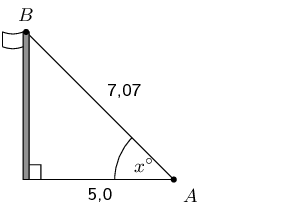

**Solution:**
\begin{align*}
                                        \cos{x} & = \frac{\text{adjacent}}{\text{hypotenuse}}\\
                                        \cos{x^\circ} & = \frac{\text{5,0}}{\text{7,07}} \\
                                        x & = \text{44,9913...} \\
                                        & \approx \text{44,99}^\circ
                                        \end{align*}

The angle of elevation is \(\text{44,99}^\circ\).

**Problem:**
A rugby player is trying to kick a ball through the poles. The rugby crossbar
                                                is \(\text{3,4}\) \(\text{m}\) high. The ball is placed \(\text{24}\)
                                                \(\text{m}\) from the poles. What is the minimum angle he needs to
                                                launch the ball to get it over the bar?

**Solution:**
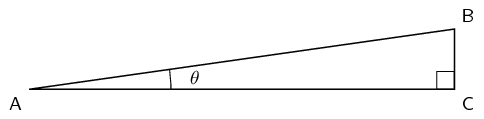

\(CA\) is the distance from the poles, \(\text{24}\) \(\text{m}\); BC is the
                                                crossbar height \(\text{3,4}\) \(\text{m}\). The minimum angle is the
                                                angle of elevation.

                                        \begin{align*}
                                        \tan{\theta} &= \frac{BC}{CA} \\
                                        &= \frac{\text{3,4}}{24} \\
                                        \theta & = \text{8,0632...} \\
                                        & \approx \text{8}^{\circ}
                                        \end{align*}

Therefore he needs to kick the ball with a minimum angle of
                                                \(\text{8}^{\circ}\).

**Problem:**
The escalator at a mall slopes at an angle of 30° and is \(\text{20}\)
                                                \(\text{m}\) long.

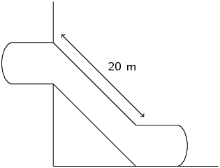

Through what height would a person be lifted by travelling on the escalator?

**Solution:**
We note that we have the following right-angled triangle:

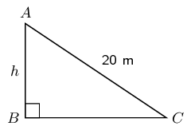

We can use the sine ratio to find the height:

                                        \begin{align*}
                                        \sin 30° & = \frac{h}{20} \\
                                        h & = 20 \sin 30° \\
                                        & = \text{10}\text{ m}
                                        \end{align*}

A person travelling on the escalator would be lifted through a height of
                                                \(\text{10}\) \(\text{m}\).

A ladder is \(\text{8}\) metres long. It is leaning against the wall of a
                                                house and reaches \(\text{6}\) metres up the wall.

**Problem:**
Draw a sketch of the situation.

**Solution:**
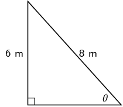

**Problem:**
Calculate the angle which the ladder makes with the flat (level)
                                                        ground.

**Solution:**
\begin{align*}
                                                \sin \theta & = \frac{6}{8} \\
                                                \theta & = \text{48,5903...} \\
                                                \theta & \approx \text{48,59}°
                                                \end{align*}

The ladder makes an angle of \(\text{48,59}\)° with the ground.

Nandi is standing on level ground \(\text{70}\) metres away from a tall
                                                tower. From her position, the angle of elevation of the top of the tower
                                                is \(\text{38}\)°.

**Problem:**
Draw a sketch of the situation.

**Solution:**
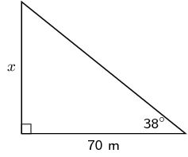

**Problem:**
What is the height of the tower?

**Solution:**
We can use the tangent ratio to find the height of the tower.

                                                \begin{align*}
                                                \tan 38 & = \frac{x}{70} \\
                                                x & = 70 \tan 38 \\
                                                & = \text{54,6899...} \\
                                                & \approx \text{54,69}\text{ m}
                                                \end{align*}

The height of the tower is \(\text{54,69}\) \(\text{m}\).

**Problem:**
The top of a pole is anchored by a \(\text{12}\) \(\text{m}\) cable which
                                                makes an angle of \(\text{40}\) degrees with the horizontal. What is the
                                                height of the pole?

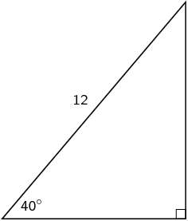

**Solution:**
\begin{align*}
                                        \sin 40 & = \frac{h}{12} \\
                                        h & = 12 \sin 40 \\
                                        & = \text{7,713...} \\
                                        & \approx \text{7,71}\text{ m}
                                        \end{align*}

The height of the pole is \(\text{7,71}\) \(\text{m}\).

**Problem:**
A ship's navigator observes a lighthouse on a cliff. According to the
                                                navigational charts the top of the lighthouse is 35 metres above sea
                                                level. She measures the angle of elevation of the top of the lighthouse
                                                to be \(\text{0,7}\)°.

Ships have been advised to stay at least \(\text{4}\) \(\text{km}\) away from
                                                the shore. Is the ship safe?

**Solution:**
First draw a diagram:

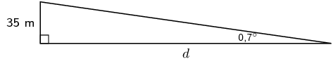

Therefore the ship is not safe.

**Problem:**
Determine the perimeter of rectangle \(PQRS\):

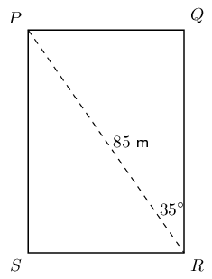

**Solution:**
Using trigonometric ratios we can calculate \(QR\) and \(PQ\).

                                        \begin{align*}
                                        QR &= 85\cos{35} \\
                                        PQ &= 85\sin{35} \\ \\
                                        P &= 2 \times (h + b) \\
                                        &= 2(85 \cos{35} + 85\sin{35}) \\
                                        &= 2(85(\cos{35} + \sin{35})) \\
                                        &= 2(\text{236,76}\text{ m}) \\
                                        & = \text{473,52}\text{ m}
                                        \end{align*}

Therefore the perimeter is \(\text{473,52}\) \(\text{m}\).

**Problem:**
A rhombus has diagonals of lengths \(\text{6}\) \(\text{cm}\) and
                                                \(\text{9}\) \(\text{cm}\). Calculate the sizes of its interior vertex
                                                angles.

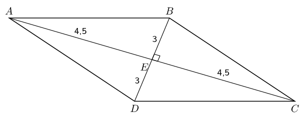

**Solution:**
There are four small right-angled triangles in the rhombus: \(\triangle
                                                ABE\), \(\triangle BEC\), \(\triangle CED\) and \(\triangle DEA\). Since
                                                the diagonals bisect each other and we are given the lengths of the
                                                diagonals, we know the lengths of the sides of the triangles:

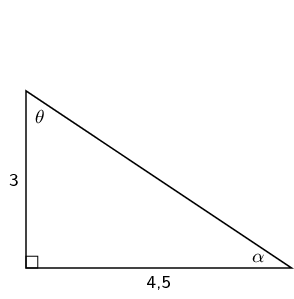

We can calculate the two angles:

                                        \begin{align*}
                                        \tan \theta & = \frac{\text{4,5}}{\text{3}} \\
                                        & = \text{41,9872...} \\
                                        \theta & \approx \text{53,31}° \\\\
                                        \tan \alpha & = \frac{\text{3}}{\text{4,5}} \\
                                        & = \text{33,6900...} \\
                                        \alpha & \approx \text{33,69}°
                                        \end{align*}

Now we note that there are two different interior angles. One of these angles
                                                is \(2\alpha\) and the other is \(2\theta\).

Therefore the two angles are \(\text{106,62}\)° and
                                                \(\text{67,38}\)°

**Problem:**
A rhombus has edge lengths of \(\text{7}\) \(\text{cm}\). Its acute interior
                                                vertex angles are both 70°. Calculate the lengths of both of its
                                                diagonals.

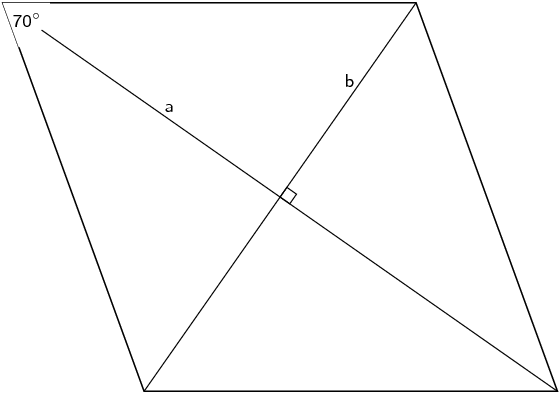

**Solution:**
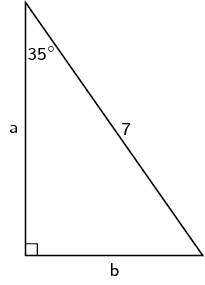

Therefore the two diagonals are \(\text{11,47}\) \(\text{cm}\) and
                                                \(\text{8,03}\) \(\text{cm}\)

**Problem:**
A parallelogram has edge-lengths of \(\text{5}\) \(\text{cm}\) and
                                                \(\text{9}\) \(\text{cm}\) respectively, and an angle of 58°
                                                between them. Calculate the perpendicular distance between the two
                                                longer edges.

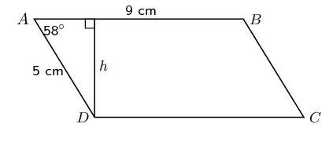

**Solution:**
\begin{align*}
                                        \sin 58° & = \frac{h}{5} \\
                                        h & = 5 \sin 58° \\
                                        & = \text{4,24}\text{ cm}
                                        \end{align*}

One of the angles of a rhombus with perimeter \(\text{20}\) \(\text{cm}\) is
                                                \(\text{30}\)°.

**Problem:**
Find the lengths of the sides of the rhombus.

**Solution:**
First draw a sketch:

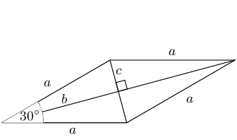

The perimeter is found by adding each side together. All the sides
                                                        are equal in length, therefore the perimeter \(= 4a\).

                                                \begin{align*}
                                                20 & = 4a \\
                                                a & = 5
                                                \end{align*}

Therefore the sides are all \(\text{5}\) \(\text{cm}\) in length.

**Problem:**
Find the length of both diagonals.

**Solution:**
The diagonals of a rhombus bisect the angle, so working in one of the
                                                        small triangles we can use trigonometric ratios to find \(b\):

                                                \begin{align*}
                                                \cos 15° & = \frac{b}{5} \\
                                                b & = 5 \cos 15° \\
                                                & = \text{4,83}
                                                \end{align*}

By Pythagoras \(c^{2} = a^{2} - b^{2}\):

                                                \begin{align*}
                                                c^{2} & = (5)^{2} - (\text{4,83})^{2} \\
                                                & = \text{25} - \text{23,33} \\
                                                & = \text{1,67} \\
                                                c & = \text{1,29}
                                                \end{align*}

Since the diagonals bisect each other we know that the total length
                                                        of each diagonal is either \(2b\) or \(2c\), depending on which
                                                        diagonal we examine.

The one diagonal is \(2(\text{4,83}) = \text{9,66}\text{ cm}\) and
                                                        the other diagonal is \(2(\text{1,29}) = \text{2,58}\text{
                                                        cm}\).

Upright sticks and the shadows they cast can be used to judge the sun's
                                                altitude in the sky (the angle the sun makes with the horizontal) and
                                                the heights of objects.

**Problem:**
An upright stick, 1 metre tall, casts a shadow which is
                                                        \(\text{1,35}\) metres long. What is the altitude of the sun?

**Solution:**
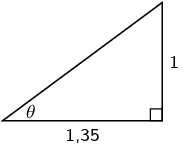

**Problem:**
At the same time, the shadow of a building is found to be 47 metres
                                                        long. What is the height of the building?

**Solution:**
We know the angle that the sun makes with the horizontal and now we
                                                        can use that to find the height of the building.

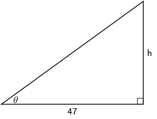

In the figure above \(\theta\) is the angle that the sun makes with
                                                        the horizontal.

                                                \begin{align*}
                                                \tan \text{36,53}° & = \frac{h}{47} \\
                                                h & = 47 \tan \text{36,53}° \\
                                                & = \text{34,82}\text{ m}
                                                \end{align*}

The angle of elevation of a hot air balloon, climbing vertically, changes
                                                from 25 degrees at 11:00 am to 60 degrees at 11:02 am. The point of
                                                observation of the angle of elevation is situated 300 metres away from
                                                the take off point.

**Problem:**
Draw a sketch of the situation.

**Solution:**
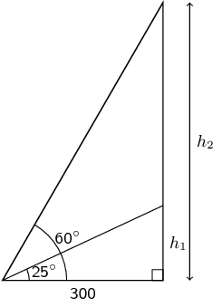

**Problem:**
Calculate the increase in height between 11:00 am and 11:02 am.

**Solution:**
\begin{align*}
                                                \tan 25° & = \frac{h_{1}}{300} \\
                                                h_{1} & = 300 \tan 25° \\
                                                & = \text{139,89}\text{ m} \\\\
                                                \tan 60° & = \frac{h_{2}}{300} \\
                                                h_{2} & = 300 \tan 60° \\
                                                & = \text{519,62}\text{ m}
                                                \end{align*}

The difference is:

                                                \[\text{519,62}\text{ m} - \text{129,89}\text{ m} = \text{379,73}\text{
                                                m}\]

**Problem:**
When the top, \(T\), of a mountain is viewed from point \(A\),
                                                \(\text{2 000}\) \(\text{m}\) from the ground, the angle of
                                                depression (\(a\)) is equal to 15°. When it is viewed from point
                                                \(B\) on the ground, the angle of elevation (\(b\)) is equal to
                                                10°. If the points \(A\) and \(B\) are on the same vertical line,
                                                find the height, \(h\), of the mountain. Round your answer to one
                                                decimal place.

**Solution:**
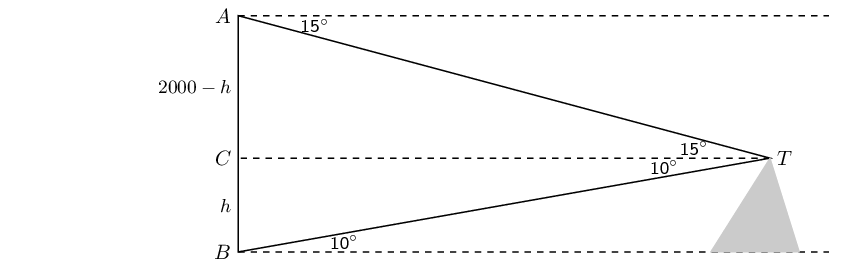

The diagram below shows quadrilateral \(PQRS\), with \(PQ = \text{7,5}\text{
                                                cm}\), \(PS = \text{6,2}\text{ cm}\), \(\text{angle } R = 42°\) and
                                                angles \(S\) and \(Q\) are right angles.

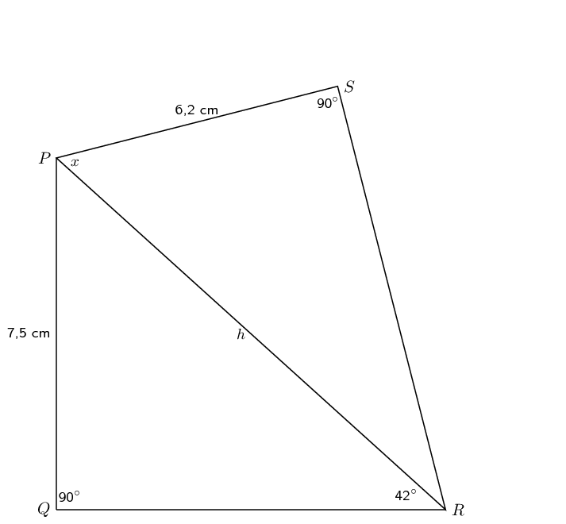

**Problem:**
Find \(PR\), correct to 2 decimal places.

**Solution:**
\begin{align*}
                                                \frac{\text{7,5}}{PR} & = \sin 42° \\
                                                \frac{\text{7,5}}{\sin 42°} & = PR \\
                                                \therefore PR & = \text{11,21}\text{ cm}
                                                \end{align*}

**Problem:**
Find the size of the angle marked \(x\), correct to one decimal
                                                        place.

**Solution:**
\begin{align*}
                                                \cos x & = \frac{\text{6,2}}{\text{11,21}} \\
                                                \therefore x & = \text{56,4}°
                                                \end{align*}

**Problem:**
From a boat at sea (\(S\)), the angle of elevation of the top of a lighthouse
                                                \(PQ\), on a cliff \(QR\), is 27°.

The lighthouse is \(\text{10}\) \(\text{m}\) high and the cliff top is
                                                \(\text{75}\) \(\text{m}\) above sea level.

How far is the boat from the base of the cliff, to the nearest metre?

**Solution:**
First draw a sketch:

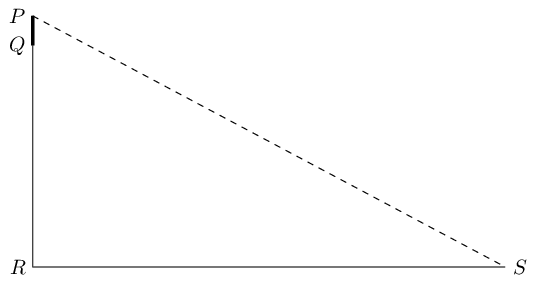

The distance \(PR\) is equal to the height of the lighthouse, \(PQ\), plus
                                                the height of the cliffs, \(QR\).

                                        \begin{align*}
                                        \frac{85}{RS} & = \tan 27° \\
                                        \frac{85}{\tan 27°} & = RS \\
                                        \therefore RS & = \text{167}\text{ m}
                                        \end{align*}
