# Chapter 12: Euclidean geometry

- This chapter focuses on solving problems in Euclidean geometry and proving riders.
- It must be explained that a single counter example can disprove a conjecture but numerous specific examples supporting a conjecture do not constitute a general proof.
- To prove that a quadrilateral is one of the special quadrilaterals learners need to show that a unique property of that quadrilateral is true. For example to prove a quadrilateral is a parallelogram it is not enough to show that both pairs of sides are parallel, learners will also need to show that either the opposite angles are equal or both pairs of opposite sides are equal in length.

Geometry (from the Greek “geo” = earth and “metria” = measure) arose as the field of
    knowledge dealing with spatial relationships. Geometry can be split into Euclidean geometry and analytical geometry.
    Analytical geometry deals with space and shape using algebra and a coordinate system. Euclidean geometry deals with
    space and shape using a system of logical deductions.

## 12.1 Proofs and conjectures (EMA7H)

We will now apply what we have learnt about geometry and the properties of polygons (in particular triangles and
      quadrilaterals) to prove some of these properties. We will also look at how we can prove a particular
      quadrilateral is one of the special quadrilaterals.

<Callout type="tip" title="Multimedia & Video">
This video shows how to prove that the the diagonals of a rhombus are perpendicular.

<VideoPlayer src="https://www.youtube.com/embed/GDcVdBAnBdU?list=PL26812DF9846578C3" title="Video:
          2GQM" />
</Callout>

<Callout type="tip" title="Worked example 1: Proving a quadrilateral is a parallelogram">
**Question:**
In parallelogram \(ABCD\), the bisectors of the angles (\(AW\), \(BX\), \(CY\) and \(DZ\)) have been
          constructed. You are also given \(AB=CD\), \(AD=BC\), \(AB\parallel CD\), \(AD\parallel BC\),
          \(\hat{A}=\hat{C}\), \(\hat{B}=\hat{D}\). Prove that \(MNOP\) is a parallelogram.

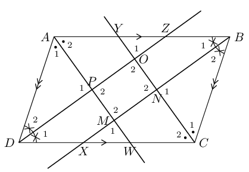

**Use properties of the parallelogram \(ABCD\) to fill in on the diagram all equal sides and
          angles.:**

**Prove that \({\hat{M}}_{2}={\hat{O}}_{2}\):**
In \(\triangle CDZ\) and \(\triangle ABX\),

        \[\begin{array}{rll}
        D\hat{C}Z& = B\hat{A}X & \text{ (given)}\\
        {\hat{D}}_{1} & = {\hat{B}}_{1} & \text{ (given)} \\
        DC & = AB & \text{ (given)} \\
        \therefore \triangle CDZ & \equiv \triangle ABX & \text{ (AAS)} \\
        \therefore CZ & = AX & \\
        \text{and } C\hat{Z}D & = A\hat{X}B &
        \end{array}\]

In \(\triangle XAM\) and \(\triangle ZCO\)

        \[\begin{array}{rll}
        X\hat{A}M & = Z\hat{C}O & \text{(given: } \triangle CDZ\equiv \triangle ABX\text{)} \\
        A\hat{X}M & = C\hat{Z}O & \text{ (proved above)} \\
        AX & = CZ & \text{(proved above)} \\
        \therefore \triangle XAM & \equiv \triangle ZCO & \text{ (AAS)} \\
        \therefore {\hat{M}}_{1} & = {\hat{O}}_{1} & \\
        \text{but }{\hat{M}}_{1} & = {\hat{M}}_{2} & \text{(vert opp }\angle \text{s } = \text{)}\\
        \text{and }{\hat{O}}_{1} & = {\hat{O}}_{2} & \text{(vert opp } \angle \text{s } = \text{)}\\
        \therefore {\hat{M}}_{2} & ={\hat{O}}_{2}
        \end{array}\]

**Similarly, we can show that \({\hat{N}}_{2}={\hat{P}}_{2}\):**
First show \(\triangle ADW\equiv \triangle CBY\). Then show \(\triangle PDW\equiv \triangle NBY\).

**Conclusion:**
Both pairs of opposite angles of \(MNOP\) are equal. Therefore \(MNOP\) is a parallelogram.
</Callout>

<Callout type="tip" title="Multimedia & Video">
This video shows how to prove that the opposite angles of a parallelogram are equal.

<VideoPlayer src="https://www.youtube.com/embed/oIV1zM8qlpk?list=PL26812DF9846578C3" title="Video:
          2GQN" />
</Callout>

### Textbook Exercise 12.1

In the diagram below, \(AC\) and \(EF\) bisect each other at \(G\). \(E\) is the midpoint of \(AD\), and
              \(F\) is the midpoint of \(BC\).

**Problem:**
Prove \(AECF\) is a parallelogram.

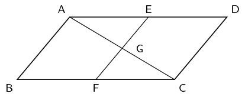

**Solution:**
\(AC\) and \(EF\) bisect each other (given).

\(AECF\) is a parallelogram (diagonals bisect each other).

**Problem:**
Prove \(ABCD\) is a parallelogram.

**Solution:**
\(AD \parallel BC (AE \parallel CF, ~ AECF\) is a parallelogram)

\(AD = 2AE\) (mid-point, given)

\(CF = AE\) (\(AECF\) is a parallelogram)

\(\therefore AD = 2AE = 2CF = BC\)

\(ABCD\) is a parallelogram (two sides are parallel and equal)

**Problem:**
Parallelogram \(ABCD\) and \(BEFC\) are shown below. Prove \(AD = EF\).

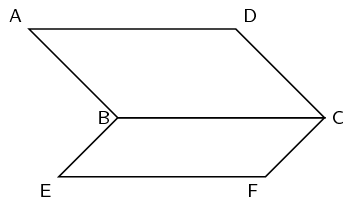

**Solution:**
\begin{align*}
            AD &= BC \text{ (opp sides of } \parallel \text{m)}\\
            BC &= EF \text{ (opp sides of } \parallel \text{m)}\\
            \therefore AD &= EF
            \end{align*}

**Problem:**
\(PQRS\) is a parallelogram. \(PQ=TQ\). Prove \(\hat{Q_1} = \hat{R}\)

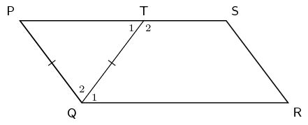

**Solution:**
\begin{align*}
            \hat{P} &= \hat{T_1} \quad \text{(}\angle \text{s opp equal sides)} \\
            \hat{T_1} &= \hat{Q_1}\quad \text{ (alt } \angle \text{s; } (PS \parallel QR)\text{)} \\
            \hat{P} &= \hat{Q_1} \\ \\
            \hat{P} &= \hat{R} ~(\text{ opp} \angle\text{s of } \parallel\text{m)} \\
            \therefore \hat{Q_1} &= \hat{R}
            \end{align*}

**Problem:**
Study the quadrilateral \(ABCD\) with opposite angles \(\hat{A} = \hat{C} = 108^{\circ}\) and angles
              \(\hat{B} = \hat{D} = 72^{\circ}\) carefully. Fill in the missing reasons and steps to prove that the
              quadrilateral \(ABCD\) is a parallelogram.

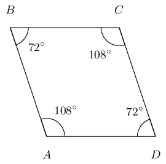

**Solution:**
Here is the completed proof with the correct steps and reasons.

            \[\begin{array}{|l |l|}
            \hline
            \text{Steps} & \text{Reasons} \\
            \hline
            B\hat{A}D = B\hat{C}D & \text{given both } \angle\text{'s } = 108^\circ \\
            A\hat{B}C = A\hat{D}C & \text{given both } \angle\text{'s } = 72^\circ \\
            \hat{A} + \hat{B} + \hat{C} + \hat{D} = 360 ^\circ & \text{sum of } \angle \text{s in quad} \\
            B\hat{A}D + A\hat{D}C = 180 ^\circ & \text{given } 108^\circ + 72^\circ = 180^\circ \\
            \therefore AB \parallel DC & \text{co-int } \angle \text{s; } AB \parallel DC \\
            \therefore BC \parallel AD & \text{co-int } \angle \text{s; } BC \parallel AD \\
            \therefore ABCD \text{ is a parallelogram}
            & \text{opp sides of quad } \parallel \\
            \hline
            \end{array}\]

**Problem:**
Study the quadrilateral \(QRST\) with opposite angles \(Q = S = 124^{\circ}\) and angles \(R = T =
              56^{\circ}\) carefully. Fill in the missing reasons and steps to prove that the quadrilateral \(QRST\) is
              a parallelogram.

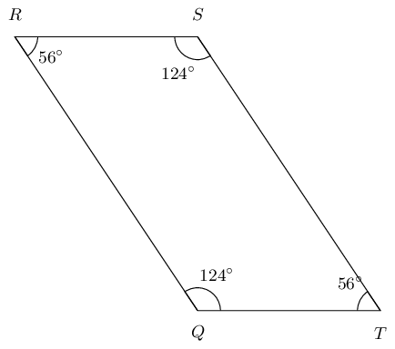

**Solution:**
Here is the completed proof with the correct steps and reasons.

            \[\begin{array}{|l |l|}
            \hline
            \text{Steps} & \text{Reasons} \\
            \hline
            R\hat{Q}T = R\hat{S}T & \text{given both } \angle\text{s } = 124^\circ \\
            Q\hat{R}S = Q\hat{T}S & \text{given both } \angle\text{s } = 56^\circ \\
            \hat{Q} + \hat{R} + \hat{S} + \hat{T} = 360 ^\circ & \text{sum of } \angle \text{s in quad} \\
            R\hat{Q}T + Q\hat{T}S = 180 ^\circ & \text{given } 124^\circ + 56^\circ = 180^\circ \\
            \therefore QR \parallel TS & \text{co-int } \angle \text{s; } QR \parallel TS \\
            \therefore RS \parallel QT & \text{co-int } \angle \text{s; } RS \parallel QT \\
            \therefore QRST \text{ is a parallelogram}
            & \text{opp sides of quad } \parallel \\
            \hline
            \end{array}\]

**Problem:**
Quadrilateral \(QRST\) with sides \(QR \parallel TS\) and \(QT \parallel RS\) is given. You are also
                given that: \(\hat{Q} = y\) and \(\hat{S} = 34^{\circ}\); \(Q\hat{T}R = x\) and \(R\hat{T}S =
                41^{\circ}\). Prove that \(QRST\) is a parallelogram.

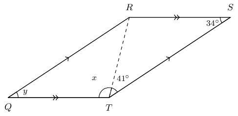

**Solution:**
\[\begin{array}{|l | l|}
              \hline
              \text{Steps} & \text{Reasons} \\
              \hline
              Q\hat{T}R = T\hat{R}S & \text{alt } \angle \text{s } QT \parallel RS \\
              S\hat{T}R = Q\hat{R}T & \text{alt } \angle \text{s } QR \parallel TS \\
              \text{In} \triangle QRT \text{ and } \triangle RST \text{ side } RT = RT &\text{common side} \\
              \therefore \triangle QRT \equiv \triangle STR &\text{congruent (AAS)} \\
              \hat{Q} = \hat{S} & \text{congruent triangles (AAS)} \\
              QR = TS \text{ and } RS = QT & \text{congruent triangles (AAS)} \\
              \therefore QRST \text{ is a parallelogram } & \text{ opp. sides of quad are } = \\
              \hline
              \end{array}\]

**Problem:**
Find the value of \(y\).

**Solution:**
\(QRST\) is a parallelogram (proved above).

\(\hat{Q} = \hat{S}\) and \(\hat{R} = \hat{T}\) (opp \(\angle\)s of \(\parallel\)m).

Therefore, \(y = 34^{\circ}\).

**Problem:**
Find the value of \(x\).

**Solution:**
We can solve this problem in two ways: using the sum of angles in a triangle or using the sum of the
                interior angles in a quadrilateral.

Option 1: sum of angles in a triangle.

\(\hat{Q} + Q\hat{R}T + Q\hat{T}R = 180 ^{\circ}\) (sum of \(\angle\)s in \(\triangle\)).

We know that \(\hat{Q} = \hat{S} = 34^{\circ}\) and that \(R\hat{T}S = 41^{\circ}\).

\(\therefore x = 180^{\circ} - 34^{\circ} - 41^{\circ} = 105^{\circ}\).

Option 2: sum of angles in a quadrilateral.

The sum of the interior \(\angle\)'s in a quadrilateral is \(360 ^{\circ}\).

              \begin{align*}
              \therefore \hat{Q} + \hat{R} + \hat{S} + \hat{T} & = 360 ^{\circ} \quad \text{(sum of }\angle \text{s
              in quad}\\
              34^{\circ} + 34^{\circ} + \hat{R} + \hat{T} & = 360^{\circ} \\
              \hat{R} & = \hat{T} \quad \text{ opp } \angle \text{s of }\parallel\text{m)} \\
              68^{\circ} + 2\hat{R} & = 360^{\circ} \\
              \hat{R} & = \frac{292}{2} \\
              & = 146^{\circ} \\
              x & = 146^{\circ} - 41^{\circ} = 105^{\circ}
              \end{align*}

**Problem:**
Quadrilateral \(XWVU\) with sides \(XW \parallel UV\) and \(XU \parallel WV\) is given. Also given is
                \(\hat{X} = y\) and \(\hat{V} = 36^{\circ}\); \(X\hat{U}W = 102^{\circ}\) and \(W\hat{U}V = x\). Prove
                that \(XWVU\) is a parallelogram.

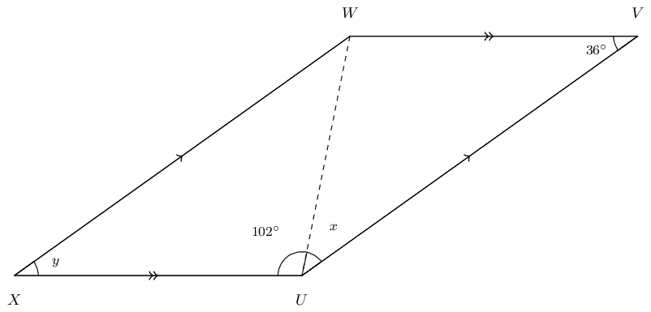

**Solution:**
\[\begin{array}{|l | l|}
              \hline
              \text{Steps} & \text{Reasons} \\
              \hline
              X\hat{U}W = U\hat{W}V & \text{alt } \angle \text{s; } XU \parallel WV \\
              V\hat{U}W = X\hat{W}U & \text{alt } \angle \text{s; } XW \parallel UV \\
              \text{In} \triangle XWU \text{ and } \triangle WVU \text{ side } WU = WU &\text{common side} \\
              \therefore \triangle XWU \equiv \triangle VUW & \text{congruent (AAS)} \\
              \therefore XW = UV and XU = WV & \text{congruent triangles (AAS)} \\
              \hat{X} = \hat{V} & \text{congruent triangles (AAS)} \\
              \therefore XWVU \text{is a parallelogram } & \text{opp sides of quad are } =
              \\ \hline
              \end{array}\]

**Problem:**
Determine the value of \(y\).

**Solution:**
\(XWVU\) is a parallelogram, \(\therefore \hat{X} = \hat{V}\).

Opposite \(\angle\)'s of a parallelogram are equal: \(\hat{X} = \hat{V}\) and \(\hat{W} = \hat{U}\).

Therefore, \(y = 36^{\circ}\).

**Problem:**
Determine the value of \(x\).

**Solution:**
We can solve this problem in two ways: using the sum of angles in a triangle or using the sum of
                interior angles in a quadrilateral.

Option 1: sum of angles in a triangle.

\(\angle\)'s in a \(\triangle = 180 ^{\circ}\)

\(\therefore \hat{X} + X\hat{W}U + X\hat{U}W = 180 ^{\circ}\)

Now we know that \(\hat{X} = \hat{V} = 36^{\circ}\) and that \(X\hat{U}W = 42^{\circ}\).

\(\therefore \hat{x} = 180^{\circ} - 36^{\circ} - 102^{\circ} = 42^{\circ}\).

Option 2: sum of interior angles in a quadrilateral.

The sum of the interior \(\angle\)'s in a quadrilateral is \(360^{\circ}\).

              \begin{align*}
              \therefore \hat{X} + \hat{W} + \hat{V} + \hat{U} & = 360 ^{\circ} \quad \text{(sum of }\angle \text{s
              in quad}\\
              36^{\circ} + 36^{\circ} + \hat{U} + \hat{W} & = 360^{\circ} \\
              \hat{U} = \hat{W} & \quad \text{ opp } \angle \text{s of }\parallel\text{m)} \\
              72^{\circ} + 2\hat{U} & = 360^{\circ} \\
              \hat{U} & = \frac{298}{2} \\
              & = 149^{\circ} \\
              x & = 149^{\circ} - 102^{\circ} = 42^{\circ}
              \end{align*}

**Problem:**
In parallelogram \(ADBC\), the bisectors of the angles \((A, D, B, C)\) have been constructed, indicated
              with the red lines below. You are also given \(AD = CB\), \(DB = AC\), \(AD \parallel CB\), \(DB \parallel
              AC\), \(\hat{A} = \hat{B}\) and \(\hat{D} = \hat{C}\).

Prove that the quadrilateral \(MNOP\) is a parallelogram.

Note the diagram is drawn to scale.

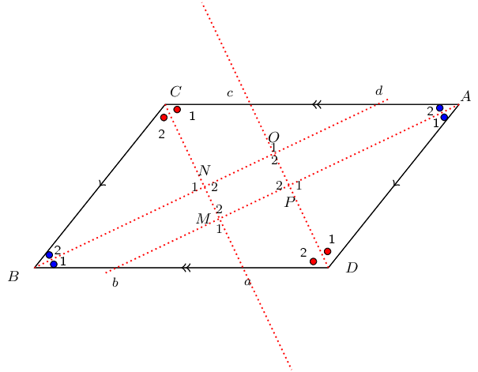

**Solution:**
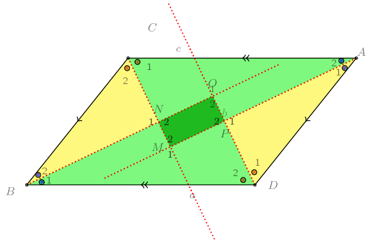

**Problem:**
Study the diagram below; it is not necessarily drawn to scale. Two triangles in the figure are congruent:
              \(\triangle QRS \equiv \triangle QPT\). Additionally, \(SN = SR\). You need to prove that \(NPTS\) is a
              parallelogram.

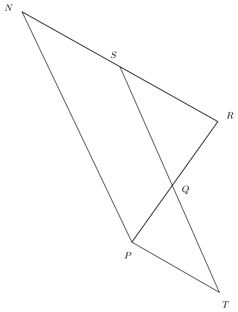

**Solution:**
Redraw the diagram and mark all given and known information:

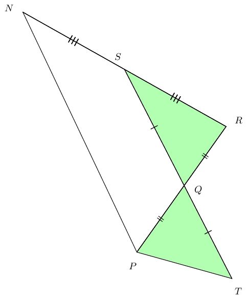

**Problem:**
Study the diagram below; it is not necessarily drawn to scale. Quadrilateral \(XWST\) is a parallelogram
              and \(TV\) and \(XW\) have lengths \(b\) and \(2b\), respectively, as shown. You need to prove that
              \(\triangle TVU \equiv \triangle SVW\).

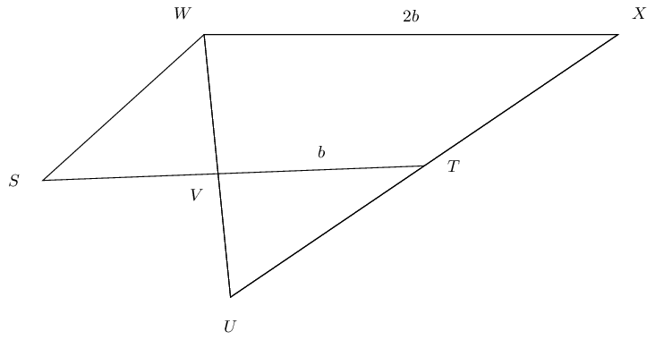

**Solution:**
Redraw the diagram and fill in all given and known information.

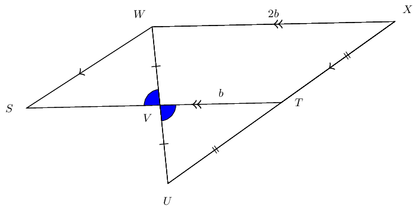

\(T \text{ and } V \text{ are mid-points}\)

            \[\begin{array}{|l | l|}
            \hline
            \text{Steps} & \text{Reasons} \\
            \hline
            WV = VU & \text{definition of mid-point} \\
            T\hat{V}U = S\hat{V}W & \text{vert opp } \angle \text{s} = \\
            TV + VS = XW & \text{opp sides parm are equal} \\
            b + VS = 2b & \text{substitute given values: } TV = b \text{ and } XW = 2 b \\
            VS = b = VT & \text{solve for } VS; \text{ note that it is equal to } VT \\
            \triangle TVU \equiv \triangle SVW & \text{SAS} \\
            \hline
            \end{array}\]
