### Textbook Exercise 12.2

**Problem:**
\(ABCD\) is a rhombus with \(AM = MO\) and \(AN = NO\). Prove \(ANOM\) is also a rhombus.

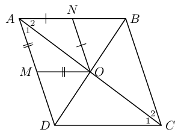

**Solution:**
In \(\triangle AMO\) and \(\triangle ANO\)

\(\hat{A}_1 = \hat{A}_2\) (given rhombus \(ABCD\), diagonal \(AC\) bisects \(\hat{A}\))

\(\therefore \hat{A_1} = A\hat{O}M\) (\(\angle\)s opp equal sides)

similarly \(\hat{A}_2 = A\hat{O}N\)

\(\therefore \hat{A}_2 = A\hat{O}M\) and \(\hat{A}_1 = A\hat{O}N\)

but these are alternate interior \(\angle\)s

\(\therefore AN \parallel MO\) and \(AM \parallel NO\)

\(\therefore ANOM\) is a parallelogram

\(\therefore AM = NO\) (opp sides of \(\parallel\)m)

\(\therefore AM = MO = ON = NO\)

\(\therefore ANOM\) is a rhombus (all sides equal and two pairs of sides parallel)

\(ABCD\) is a parallelogram with diagonal \(AC\). Given that \(AF = HC\), show that:

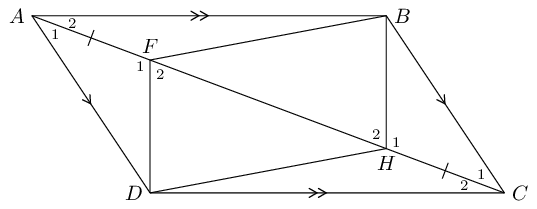

**Problem:**
\(\triangle AFD \equiv \triangle CHB\)

**Solution:**
\begin{align*}
            \hat{A}_1 & = \hat{C}_1 \qquad \text{(alt }\angle \text{s; }AD \parallel BC \text{)}\\
            AD & = BC \qquad \text{(opp sides } \parallel \text{m)}\\
            AF& = HC \qquad \text{(given)}\\
            \therefore \triangle AFD &\equiv \triangle CHB \qquad \text{(SAS)}
            \end{align*}

**Problem:**
\(DF \parallel HB\)

**Solution:**
\begin{align*}
            \hat{F}_1 &= \hat{H}_1 \qquad (\triangle AFD \equiv \triangle CHB)\\
            \therefore \hat{F}_1 +\hat{F}_2 &= 180° \qquad \text{(}\angle\text{s on str line)}\\
            \text{and } \hat{H}_1 +\hat{H}_2 &= 180° \qquad \text{(}\angle \text{s on str line)}\\
            \therefore \hat{F}_1 &= 180° - \hat{F}_2 \\
            \text{and } \hat{H}_1 &= 180° - \hat{H}_2 \\
            \therefore 180° - \hat{F}_2 & = 180° - \hat{H}_2 \\
            \therefore \hat{F}_2 & = \hat{H}_2 \\
            \therefore DF &\parallel HB \qquad \text{(corresp } \angle \text{s equal)}
            \end{align*}

**Problem:**
\(DFBH\) is a parallelogram

**Solution:**
\begin{align*}
            FD & = HB \qquad (\triangle AFD \equiv \triangle CHB)\\
            \text{and }DF &\parallel HB \qquad \text{ (proved above)}\\
            \therefore DFBH & \text{ is a parallelogram (one pair opp sides equal and parallel)}
            \end{align*}

Given parallelogram \(ABCD\) with \(AE\) bisecting \(\hat{A}\) and \(FC\) bisecting \(\hat{C}\).

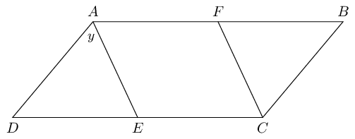

**Problem:**
Write all interior angles in terms of \(y\).

**Solution:**
First number the angles:

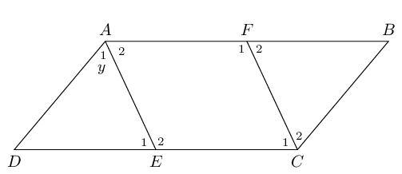

**Problem:**
Prove that \(AFCE\) is a parallelogram.

**Solution:**
\begin{align*}
            AF &\parallel EC \qquad \text{(opp sides of} \parallel \text{m)}\\
            \text {and }\hat{C_1} + \hat{E_2} & = y + (180° - y)\\
            \therefore & \text{ the sum of the co-interior angles is } 180°\\
            \therefore AE & \parallel FC \\
            \therefore AFCE & \text{ is a parallelogram (both pairs opp. sides parallel)}
            \end{align*}

Given that \(WZ = ZY = YX\), \(\hat{W} = \hat{X}\) and \(WX \parallel ZY\), prove that:

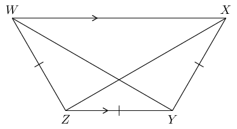

**Problem:**
\(XZ\) bisects \(\hat{X}\)

**Solution:**
First label the angles:

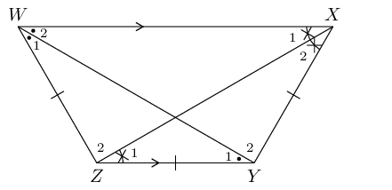

**Problem:**
\(WY = XZ\)

**Solution:**
\begin{align*}
            \text{Similarly, }WY &\text{ bisects }\hat{W}\\
            \therefore \hat{W_1} &= \hat{W_2}\\
            \text{and }\hat{W} &= \hat{X} \text{ (given)}\\
            \therefore \hat{W_1} &= \hat{W_2} = \hat{X_1} = \hat{X_2}\\
            \text{ and }\hat{W_1} &= \hat{Y_1} ~(\angle \text{s opp equal sides)}\\
            \text{In }\triangle WZY&\text{ and }\triangle XYZ\\
            WZ&=XY \text{ (given)}\\
            ZY &\text{ is a common side}\\
            \hat{Z} &= \hat{Y} \text{(third }\angle \text{ in }\triangle \text{)}\\
            \therefore \triangle WZY &\equiv \triangle XYZ \text{ (SAS)} \\
            \therefore WY & = XZ
            \end{align*}

\(D\) is a point on \(BC\), in \(\triangle ABC\). \(N\) is the mid-point of \(AD\). \(O\) is the mid-point
            of \(AB\) and \(M\) is the mid-point of \(BD\). \(NR \parallel AC\).

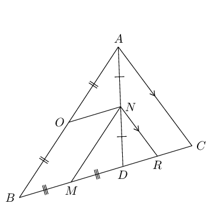

**Problem:**
Prove that \(OBMN\) is a parallelogram.

**Solution:**
\(AO = OB\) (given)

\(AN = ND\) (given)

\(\therefore ON \parallel BD\) (Midpt Theorem)

\(BM = MD\) (given)

\(AN = ND\) (given)

\(\therefore MN \parallel AB\) (Midpt Theorem)

\(\therefore OBMN\) is a parallelogram (both pairs opp. sides parallel)

**Problem:**
Prove that \(BC = 2MR\).

**Solution:**
\(AN = NC\) (given)

\(NR \parallel AC\) (given)

\(\therefore DR = RC\) (Midpt Theorem)

\(\therefore DR = \frac{1}{2} DC\)

\(MD = \frac{1}{2}BD\) (given)

\(\therefore MD + DR = \frac{1}{2} (BD + DC)\)

\(MR = \frac{1}{2}BC\)

\(\therefore BC = 2MR\)

In \(\triangle MNP\), \(\hat{M} = 90°\), \(S\) is the mid-point of \(MN\) and \(T\) is the mid-point
            of \(NR\).

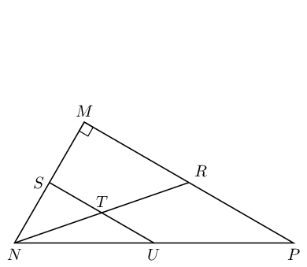

**Problem:**
Prove \(U\) is the mid-point of \(NP\).

**Solution:**
\begin{align*}
            NS&=SM \text{ (given)}\\
            NT&=TR \text{ (given)}\\
            \therefore ST &\parallel MR \text{ (Midpt Theorem)} \\
            \therefore U & \text{ is the mid-point of } NP \text{ (converse of Midpt Theorem)}
            \end{align*}

**Problem:**
If \(ST = \text{4}\text{ cm}\) and the area of \(\triangle SNT\) is \(\text{6}\) \(\text{cm$^{2}$}\),
              calculate the area of \(\triangle MNR\).

**Solution:**
\begin{align*}
            N\hat{S}T & = 90° \text{ (corresp }\angle \text{s; } ST \parallel MR)\\
            \therefore \text{ area }\triangle SNT &=\frac{1}{2} ST \times SN \\
            6 &= \frac{1}{2}(4)SN\\
            \therefore SN &= \text{3}\text{ cm}\\
            \therefore MN &= \text{6}\text{ cm} \\
            MR &= 2ST = \text{8}\text{ cm}\\
            \text{area }\triangle MNR &= \frac{1}{2} MR \times MN\\
            &=\frac{1}{2} (8)(6)\\
            &= \text{24}\text{ cm$^{2}$}
            \end{align*}

**Problem:**
Prove that the area of \(\triangle MNR\) will always be four times the area of \(\triangle SNT\), let
              \(ST = x \text{ units}\) and \(SN = y \text{ units}\).

**Solution:**
\begin{align*}
            \text{Let }ST \text{ be } & x \text{ units}\\
            \therefore MR \text{ will be } & 2x\\
            \text{Let }SN \text{ be } & y \text{ units}\\
            \therefore MN \text{ will be } & 2y\\
            \text{area }\triangle SNT & = \frac{1}{2}xy \\
            \text{area }\triangle MNR & = \frac{1}{2} (2x)(2y) \\
            & = 2xy\\
            \therefore \text{ area } \triangle MNR &= 4\left(\frac{1}{2}xy\right) \\
            & = 4(\text{area }\triangle SNT)
            \end{align*}

**Problem:**
Given quadrilateral \(QRST\) with sides \(QR \parallel TS\) and \(QT \parallel RS\). Also given:
              \(\hat{Q} = y\) and \(\hat{S} = 63^{\circ}\); \(Q\hat{T}R = 38^{\circ}\) and \(R\hat{T}S = x\). Complete
              the proof below to prove that \(QRST\) is a parallelogram.

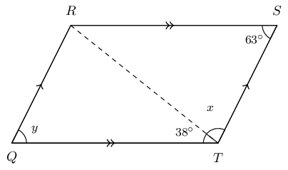

**Solution:**
The completed proof looks like this:

            \[\begin{array}{|l | l|}
            \hline
            \text{Steps} & \text{Reasons} \\
            \hline
            Q\hat{T}R = T\hat{R}S & \text{alt } \angle \text{s; } QT \parallel RS \\
            S\hat{T}R = Q\hat{R}T & \text{alt } \angle \text{s; } QR \parallel TS \\
            \text{In } \triangle QRT \text{ and } \triangle RST \text{ side } RT = RT & \text{ common side } \\
            \therefore \triangle QRT \equiv \triangle STR &\text{congruent (AAS)} \\
            \therefore QR = TS \text{ and } QT = RS & \text{congruent triangles} \\
            \hat{Q} = \hat{S} & \text{congruent triangles} \\
            \therefore QRST \text{ is a parallelogram} &\text{opp sides of quad are } = \\
            \hline
            \end{array}\]

**Problem:**
Calculate the value of \(y\).

**Solution:**
\(QRST\) is a parallelogram, \(\therefore \hat{Q} = \hat{S}\).

Opposite \(\angle\)s of parallelogram are equal. \(\hat{Q} = \hat{S}\) and \(\hat{R} = \hat{T}\).

Therefore, \(y = 63^{\circ}\).

**Problem:**
Calculate the value of \(x\).

**Solution:**
\(\angle\)s in a \(\triangle = 180 ^{\circ}\)

\(\therefore \hat{Q} + Q\hat{R}T + Q\hat{T}R = 180 ^{\circ}\)

Now we know that \(\hat{Q} = \hat{S} = 63^{\circ}\) and that \(R\hat{T}S = 79^{\circ}\).

\(\therefore \hat{x} = 180^{\circ} - 63^{\circ} - 79^{\circ} = 79^{\circ}\).

**Problem:**
Study the quadrilateral \(QRST\) with opposite angles \(\hat{Q} = \hat{S} = 117^{\circ}\) and angles
            \(\hat{R} = \hat{T} = 63^{\circ}\) carefully. Fill in the correct reasons or steps to prove that the
            quadrilateral \(QRST\) is a parallelogram.

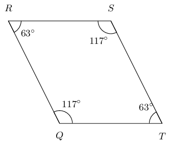

**Solution:**
\[\begin{array}{|l |l|}
          \hline
          \text{Steps} & \text{Reasons} \\
          \hline
          R\hat{Q}T = R\hat{S}T & \text{given both } \angle \text{s } = 117^\circ \\
          Q\hat{R}S = Q\hat{T}S & \text{given both } \angle \text{s } = 63^\circ \\
          \hat{Q} + \hat{R} + \hat{S} + \hat{T} = 360 ^\circ & \text{sum of } \angle \text{s in quad} \\
          R\hat{Q}T + Q\hat{T}S = 180 ^\circ & 117^\circ + 63^\circ = 180^\circ \\
          \therefore QR \parallel TS & \text{co-int } \angle \text{s; } QR \parallel TS \\
          \therefore RS \parallel QT & \text{co-int } \angle \text{s; } RS \parallel QT \\
          \therefore QRST \text{ is a parallelogram} & \text{opp. sides parallel} \\
          \hline
          \end{array}\]

**Problem:**
Study the quadrilateral \(QRST\) with \(\hat{Q} = \hat{S} = 149^{\circ}\) and \(\hat{R} = \hat{T} =
            31^{\circ}\) carefully. Fill in the correct reasons or steps to prove that the quadrilateral \(QRST\) is a
            parallelogram.

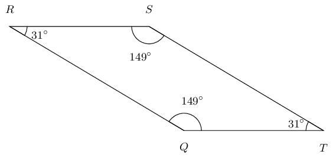

**Solution:**
\[\begin{array}{|l |l|}
          \hline
          \text{Steps} & \text{Reasons} \\
          \hline
          R\hat{Q}T = R\hat{S}T & \text{given both } \angle \text{s} = 149^{\circ} \\
          Q\hat{R}S = Q\hat{T}S & \text{given both } \angle \text{s} = 31^{\circ} \\
          \hat{Q} + \hat{R} + \hat{S} + \hat{T} = 360 ^{\circ} & \text{sum of } \angle \text{s in quad} \\
          R\hat{Q}T + Q\hat{T}S = 180 ^{\circ} & 149^{\circ} + 31^{\circ} = 180^{\circ} \\
          \therefore QR \parallel TS & \text{co-int } \angle \text{s; } QR \parallel TS \\
          \therefore RS \parallel QT & \text{co-int } \angle \text{s; } RS \parallel QT \\
          \therefore QRST \text{ is a parallelogram} & \text{opp. sides parallel} \\
          \hline
          \end{array}\]

**Problem:**
In parallelogram \(QTRS\), the bisectors of the angles have been constructed, indicated with the red lines
            below. You are also given \(QT = SR\), \(TR = QS\), \(QT \parallel SR\), \(TR \parallel QS\), \(\hat{Q} =
            \hat{R}\) and \(\hat{T} = \hat{S}\).

Prove that the quadrilateral \(JKLM\) is a parallelogram.

Note the diagram is drawn to scale.

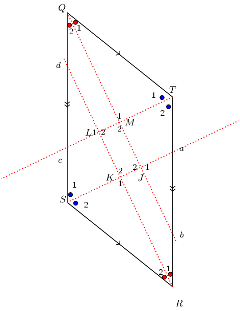

**Solution:**
Redraw the diagram and mark all the known information:

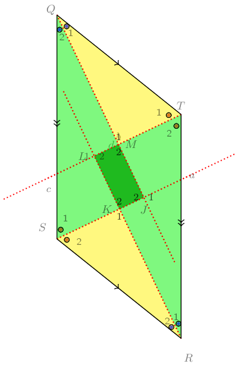

**Problem:**
Study the diagram below; it is not necessarily drawn to scale. Two triangles in the figure are congruent:
            \(\triangle CDE \equiv \triangle CBF\). Additionally, \(EA = ED\). You need to prove that \(ABFE\) is a
            parallelogram.

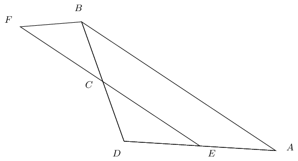

**Solution:**
Redraw the diagram and mark all known and given information:

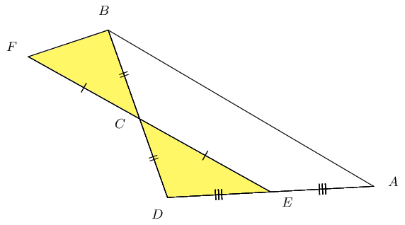

Given the following diagram:

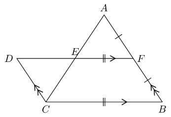

**Problem:**
Show that \(BCDF\) is a parallelogram.

**Solution:**
\begin{align*}
            DF & \parallel CB \text{ (given)} \\
            DC & \parallel FB \text{ (given)} \\
            \therefore BCDF & \text{ is a parallelogram (both pairs opp. sides } \parallel \text{)}
            \end{align*}

**Problem:**
Show that \(ADCF\) is a parallelogram.

**Solution:**
\begin{align*}
            \text{In } \triangle DEC & \text{ and } \triangle FEA \\
            C\hat{A}F & = A\hat{C}D \text{ (alt } \angle\text{s; } AB \parallel DC \text{)} \\
            A\hat{F}D & = C\hat{D}F \text{ (alt } \angle\text{s; } AB \parallel DC \text{)} \\
            DC & = FB \text{ (opp sides parm eq)} \\
            \therefore DC & = FA = FB \\
            \therefore \triangle DEC & \equiv \triangle FEA \text{ (ASA)} \\
            \therefore DE = EF & \text{ and } CE = EA
            \end{align*}

But \(AE\) and \(DF\) are diagonals of \(ADCF\), \(\therefore ADCF\) is a parallelogram (diagonals bisect
              each other).

**Problem:**
Prove that \(AE = EC\).

**Solution:**
\(AE = EC\) (proved above).

**Problem:**
\(ABCD\) is a parallelogram. \(BEFC\) is a parallelogram. \(ADEF\) is a straight line. Prove that \(AE =
            DF\).

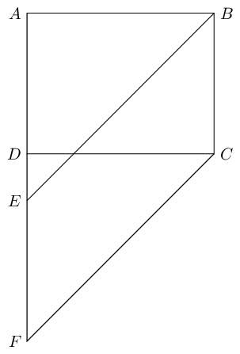

**Solution:**
\begin{align*}
          BC & = EF \text{ (opp sides of } \parallel \text{m)} \\
          BC & = AD \text{ (opp sides of } \parallel \text{m)} \\
          \therefore EF & = ED \\
          AD + DE & = AE \\
          EF + DE & = DF \\
          \text{ but } DE & \text{ is common} \\
          \therefore AE & = DF
          \end{align*}

**Problem:**
In the figure below \(AB = BF\), \(AD = DE\). \(ABCD\) is a parallelogram. Prove \(EF\) is a straight line.

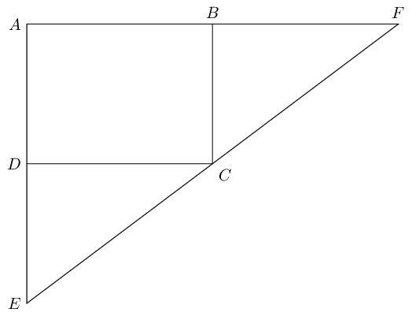

**Solution:**
We note that:

          \begin{align*}
          B\hat{A}D & = B\hat{C}D \text{ (opp } \angle\text{s } \parallel \text{m)} \\
          C\hat{D}E & = B\hat{C}D \text{ (alt } \angle\text{s; } AE \parallel BC \text{)} \\
          F\hat{B}C & = B\hat{C}D \text{ (alt } \angle\text{s; } AF \parallel DC \text{)} \\
          \therefore C\hat{D}E & = F\hat{B}C
          \end{align*}

We also note that:

          \begin{align*}
          AD & = BC \text{ (opp sides parm eq)} \\
          AB & = DC \text{ (opp sides parm eq)}
          \end{align*}

Now we can show that \(\triangle DEC\) is congruent to \(\triangle BCF\):

          \begin{align*}
          \text{in } \triangle DEC & \text{ and } \triangle BCF\\
          C\hat{D}E & = F\hat{B}C \qquad \text{(proven above)} \\
          DC = AB & = BF \qquad \text{(given)} \\
          DE = AD & = BC \qquad \text{(given)} \\
          \therefore \triangle DEC & \equiv \triangle BCF \text{ (SAS)}
          \end{align*}

Finally we can show that \(ECF\) is a straight line:

          \begin{align*}
          \therefore B\hat{F}C & = D\hat{C}E \text{ (}\triangle DEC \equiv \triangle BCF \text{)} \\
          B\hat{C}F & = D\hat{E}C \text{ (}\triangle DEC \equiv \triangle BCF \text{)} \\
          \text{but } F\hat{B}C + B\hat{F}C + B\hat{C}F & = 180° \text{(sum of }\angle\text{s in } \triangle
          \text{)} \\
          \therefore D\hat{C}E + B\hat{C}F + B\hat{C}D & = 180° \\
          \therefore ECF & \text{ is a str line}
          \end{align*}
