# Chapter 13: Measurements

- Content covered in this chapter includes revision of volume and surface area for right-prisms and
                        cylinders. This work is then extended to spheres, right pyramids and cones. Finally learners
                        investigate the effects of multiplying any dimension by a constant factor \(k\).
- Restrict pyramids to those with square or equilateral triangles as bases.
- Composite figures must be included e.g. a square pyramids on top of a cube or two cones stuck
                        together.

For revision of earlier grades content on surface area and perimeter you can have learners look up the
                  regulations for the size of different sports fields and calculate the perimeter and surface area for
                  different parts of the field.

Knowing how to calculate the surface area and volume of an object can be useful in many contexts, particularly
            when we need to know how much a task is going to cost or how much material is needed to create an object.
            Some examples of this are calculating the surface area of a container, to help us work out the cost of the
            material, or calculating the volume of a dam, so we know how much water the dam can hold.

This chapter examines the surface areas and volumes of three dimensional objects, otherwise known as solids. In
            order to work with these objects, you need to know how to calculate the surface area and perimeter of two
            dimensional shapes.

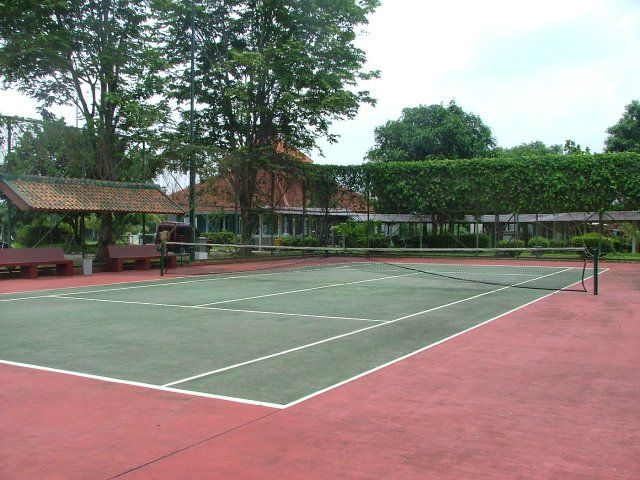

A tennis court. The position of each of the lines is carefully calculated to
                  ensure that the area of the rectangles is the same anywhere in the world.

<Callout type="tip" title="Multimedia & Video">
To revise how to calculate the area and perimeter of squares and rectangles you can watch the video
                  below.

<VideoPlayer src="https://www.youtube.com/embed/kqqmJiJez6o" title="Video: 2GRM" />
</Callout>

## 13.1 Area of a polygon (EMA7K)

<Callout type="info" title="Definition: Area">
Area is the two dimensional space inside the boundary of a flat object. It is measured in
                              square units.
</Callout>

<Callout type="note" title="Note">
The acre and the hectare are two common measurements used for the area of land. One hectare is
                        about \(\text{0,01}\) square kilometres and one acre is about \(\text{0,004}\) square
                        kilometres.
</Callout>

| Name | Shape | Formula |
| --- | --- | --- |
| Square |  | \(\text{area (A)} = s^{2}\) |
| Rectangle |  | \(\text{area (A)} = b \times h\) |
| Triangle |  | \(\text{area (A)} = \frac{1}{2} b \times h\) |
| Trapezium |  | \(\text{area (A)} = \frac{1}{2} \left(a + b\right) \times h\) |
| Parallelogram |  | \(\text{area (A)} = b \times h\) |
| Circle |  | \(\text{area (A)} = \pi r^{2}\)
                                    \(\left(\text{circumference} = 2\pi r\right)\) |

<Callout type="tip" title="Multimedia & Video">
The video below shows some examples of calculations involving the area of a circle.

<VideoPlayer src="https://www.youtube.com/embed/tCrDyJsSFok" title="Video: 2GRN" />
</Callout>

<Callout type="tip" title="Worked example 1: Finding the area of a polygon">
**Question:**
Find the area of the following parallelogram:

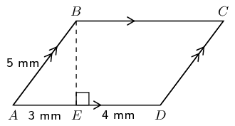

**Find the height \(BE\):**
\begin{align*}
                        AB^{2} & = BE^{2} + AE^{2} \quad \text{ (Pythagoras)} \\
                        \therefore BE^{2} & = AB^{2} - AE^{2} \\
                        & = 5^{2} - 3^{2} \\
                        & = 16 \\
                        \therefore BE & = \text{4}\text{ mm}
                        \end{align*}

**Find the area using the formula for a parallelogram:**
\begin{align*}
                        \text{area} & = b \times h \\
                        & = AD \times BE \\
                        & = 7 \times 4 \\
                        & = \text{28}\text{ mm$^{2}$}
                        \end{align*}
</Callout>

<Callout type="tip" title="Multimedia & Video">
The following Phet simulation allows you to build different shapes and calculate the area and
                        perimeter for the shapes: Phet:
                              area builder.
</Callout>

### Textbook Exercise 13.1

Find the area of each of the polygons below:

**Problem:**
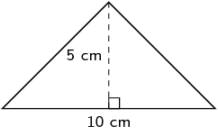

**Solution:**
\begin{align*}
                                                A &= \frac{1}{2} b \times h \\
                                                & = \frac{1}{2}(10)(5) \\
                                                & = \text{25}\text{ cm$^{2}$}
                                                \end{align*}

**Problem:**
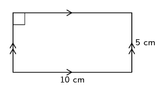

**Solution:**
\begin{align*}
                                                A & = b \times h \\
                                                & = (10)(5) \\
                                                & = \text{50}\text{ cm$^{2}$}
                                                \end{align*}

**Problem:**
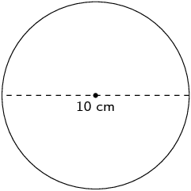

**Solution:**
The radius is half the diameter, therefore the radius is \(\text{5}\)
                                                \(\text{cm}\).

\begin{align*}
                                                A &= \pi r^{2}\\
                                                & = \pi (5)^{2}\\
                                                & = \text{78,5398...} \\
                                                & \approx \text{78,54}\text{ cm$^{2}$}
                                                \end{align*}

**Problem:**
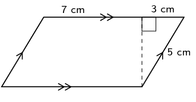

**Solution:**
We first need to work out the height using the theorem of Pythagoras:

                                          \begin{align*}
                                          h^{2} & = 5^{2} - 3^{2} \\
                                          & = 16 \\
                                          \therefore h & = \text{4}\text{ cm}
                                          \end{align*}

Now we can calculate the area:

                                          \begin{align*}
                                          A &= b \times h\\
                                          &= (10)(4) \\
                                          & = \text{40}\text{ cm$^{2}$}
                                          \end{align*}

**Problem:**
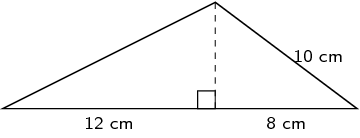

**Solution:**
We first need to work out the height using the theorem of Pythagoras:

                                          \begin{align*}
                                          h^{2} & = 10^{2} - 8^{2} \\
                                          & = 36 \\
                                          \therefore h & = \text{6}\text{ cm}
                                          \end{align*}

Now we can calculate the area:

                                          \begin{align*}
                                          A & = \frac{1}{2} b \times h \\
                                          &= \frac{1}{2}(6)(20) \\
                                          & = \text{60}\text{ cm$^{2}$}
                                          \end{align*}

**Problem:**
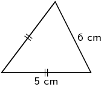

**Solution:**
We first need to construct the vertical (or perpendicular) height. For an
                                                isosceles triangle if we construct the perpendicular height between the
                                                two equal sides then this line will bisect the third side.

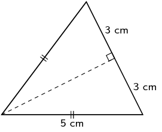

Now we can calculate the height using the theorem of Pythagoras:

                                          \begin{align*}
                                          h^{2} & = 5^{2} - 3^{2} \\
                                          & = 16 \\
                                          \therefore h & = \text{4}\text{ cm}
                                          \end{align*}

Now we can calculate the area:

                                          \begin{align*}
                                          A &= \frac{1}{2}b \times h \\
                                          &= \frac{1}{2}(6)(4) \\
                                          &= \text{12}\text{ cm$^{2}$}
                                          \end{align*}

**Problem:**
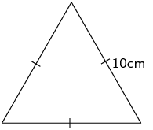

**Solution:**
We first construct the vertical (perpendicular) height. For an equilateral
                                                triangle the perpendicular height will bisect the third side.

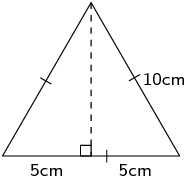

Now we can calculate the height using the theorem of Pythagoras:

                                          \begin{align*}
                                          h^{2} & = 10^{2} - 5^{2} \\
                                          & = 75 \\
                                          \therefore h & = \sqrt{75}~\text{cm}
                                          \end{align*}

Now we can calculate the area:

                                          \begin{align*}
                                          A& = \frac{1}{2}\text{base} \times \text{height}\\
                                          A &= \frac{1}{2}(10)(\sqrt{75})\\
                                          A &= \text{43,30}\text{ cm$^{2}$}
                                          \end{align*}

**Problem:**
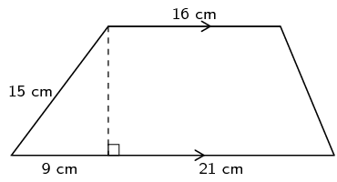

**Solution:**
We first find the height using the theorem of Pythagoras:

                                          \begin{align*}
                                          h^{2} & = 15^{2} - 9^{2} \\
                                          & = 144 \\
                                          h & = 12
                                          \end{align*}

Now we can calculate the area:

                                          \begin{align*}
                                          A &= \frac{1}{2}(a + b)h \\
                                          &= \frac{1}{2}(16 + (21 + 9))(12)\\
                                          & = \frac{1}{2}(46)(12) \\
                                          A &= \text{276}\text{ cm$^{2}$}
                                          \end{align*}

**Problem:**
Find an expression for the area of this figure in terms of \(z\) and
                                                \(\pi\). The circle has a radius of \(-3z - 2\). Write your answer in
                                                expanded form (not factorised).

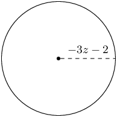

**Solution:**
\begin{align*}
                                          A & = \pi r^{2} \\
                                          & = \pi (- 3 z - 2)^{2} \\
                                          & = 9 \pi z^{2} + 12 \pi z + 4 \pi
                                          \end{align*}

**Problem:**
Find an expression for the area of this figure in terms of \(z\) and \(h\).
                                                The height of the figure is \(h\), and two sides are labelled as \(-3z -
                                                2\) and \(-z\). Write your answer in expanded form (not factorised).

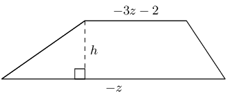

**Solution:**
\begin{align*}
                                          A & = \frac{h}{2} \left(a + b\right) \\
                                          & = \frac{h}{2} \left((-3z - 2)+ (-z)\right) \\
                                          & = -2hz - h
                                          \end{align*}

**Problem:**
Find an expression for the area of this figure in terms of \(x\) and
                                                \(\pi\). The circle has a radius of \(x + 4\). Write your answer in
                                                expanded form (not factorised).

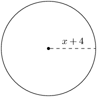

**Solution:**
\begin{align*}
                                          A & = \pi r^{2} \\
                                          & = \pi (x + 4)^{2} \\
                                          & = \pi x^{2} + 8 \pi x + 16 \pi
                                          \end{align*}

**Problem:**
Find an expression for the area of this figure in terms of \(x\) and \(h\).
                                                The height of the figure is \(h\), and two sides are labelled as \(x +
                                                4\) and \(-3x\). Write your answer in expanded form (not factorised).

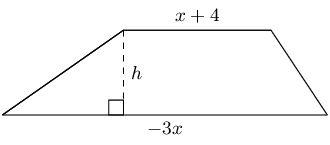

**Solution:**
\begin{align*}
                                          A & = \frac{h}{2} \left(a + b\right) \\
                                          & = \frac{h}{2} \left((x + 4) + (-3x)\right) \\
                                          & = -hx + 2 h
                                          \end{align*}
