## 13.2 Right prisms and cylinders (EMA7M)

<Callout type="info" title="Definition: Right prism">
A right prism is a geometric solid that has a polygon as its base and vertical faces perpendicular to the
          base. The base and top surface are the same shape and size. It is called a “right” prism because
          the angles between the base and faces are right angles.
</Callout>

A triangular prism has a triangle as its base, a rectangular prism has a rectangle as its base, and a cube is a
      rectangular prism with all its sides of equal length. A cylinder has a circle as its base. Examples of right
      prisms and a cylinder are given below: a rectangular prism, a cube and a triangular prism.

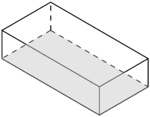

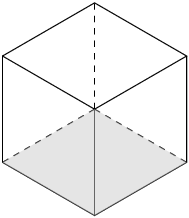

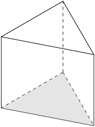

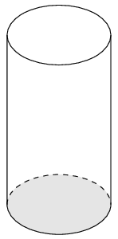

### Surface area of prisms and cylinders (EMA7N)

<Callout type="info" title="Definition: Surface area">
Surface area is the total area of the
            exposed or outer surfaces of a prism.
</Callout>

This is easier to understand if we imagine the prism to be a cardboard box that we can unfold. A solid that is
        unfolded like this is called a net. When a prism is unfolded into a net, we can clearly see each of its faces.
        In order to calculate the surface area of the prism, we can then simply calculate the area of each face, and add
        them all together.

For example, when a triangular prism is unfolded into a net, we can see that it has two faces that are
        triangles and three faces that are rectangles. To calculate the surface area of the prism, we find the area of
        each triangle and each rectangle, and add them together.

In the case of a cylinder the top and bottom faces are circles and the curved surface flattens into a rectangle
        with a length that is equal to the circumference of the circular base. To calculate the surface area we
        therefore find the area of the two circles and the rectangle and add them together.

Below are examples of right prisms and a cylinder that have been unfolded into nets:

Rectangular prism

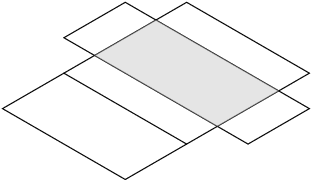

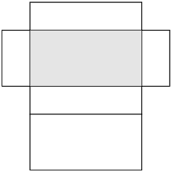

Rectangular prism

A rectangular prism unfolded into a net is made up of six rectangles.

Cube

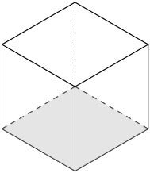

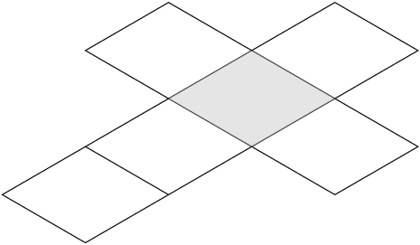

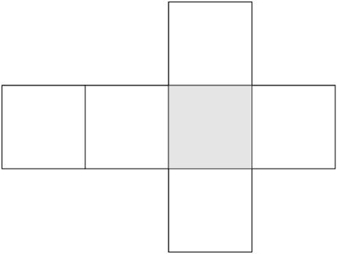

Cube

A cube unfolded into a net is made up of six identical squares.

Triangular prism

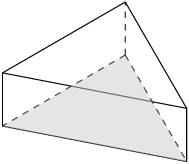

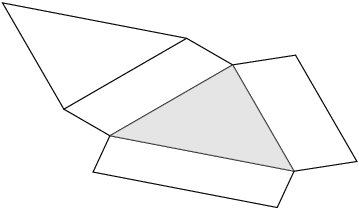

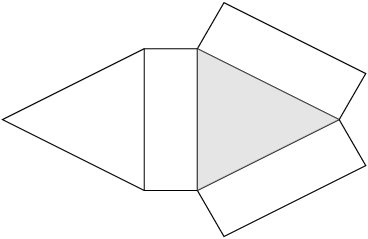

Triangular prism

A triangular prism unfolded into a net is made up of two triangles and three rectangles. The sum of the lengths
        of the rectangles is equal to the perimeter of the triangles.

Cylinder

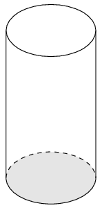

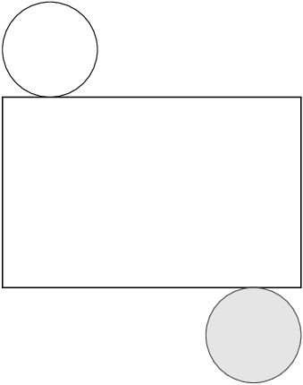

Cylinder

A cylinder unfolded into a net is made up of two identical circles and a rectangle with a length equal to the
        circumference of the circles.

<Callout type="tip" title="Multimedia & Video">
This video explains how we can unfold solids into nets.

<VideoPlayer src="https://www.youtube.com/embed/kqqmJiJez6o" title="Video: 2GS2" />
</Callout>

It may be useful to have some nets of the different polyhedra available for learners to see how they fold up
          to form the polyhedra.

You can download and print out nets of various polyhedra from senteacher to use in your classroom.

<Callout type="tip" title="Worked example 2: Finding the surface area of a rectangular prism">
**Question:**
Find the surface area of the following rectangular prism:

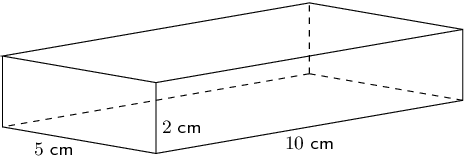

**Sketch and label the net of the prism:**
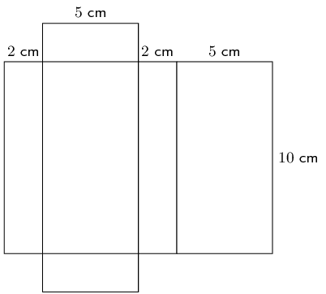

**Find the areas of the different shapes in the net:**
\begin{align*}
          \text{large rectangle}& =\text{perimeter of small rectangle}\times \text{length} \\
          & = \left(2 + 5 + 2 + 5\right)\times 10 \\
          & = 14\times 10 \\
          & = \text{140}\text{ cm$^{2}$} \\
          \\
          2\times \text{small rectangle}& = 2\left(5\times 2\right) \\
          & = 2\left(10\right) \\
          & = \text{20}\text{ cm$^{2}$}
          \end{align*}

**Find the sum of the areas of the faces:**
\(\text{large rectangle} + 2\times \text{small rectangle} = 140 + 20 = 160\)

**Write the final answer:**
The surface area of the rectangular prism is \(\text{160}\) \(\text{cm$^{2}$}\).
</Callout>

<QuizCard id="m10-13-02a" title="Interactive Exercise 13.3" question="The figure here is a rectangular prism.  The height of the prism is \(\text{12}\) units; the other dimensions of the prism are \(\text{4}\) and \(\text{9}\) units. Determine the surface area of the figure.  (NOTE: The diagram is not necessarily drawn to scale.)" options=[] answer=" 384 " hint="You should enter a number here. If you want to, you can use a space to separate thousands.                Example: 12 800,25 For scientific notation you need to use the multiply symbol                ( ∗ ) and the exponent symbol ( ^ ). For example 6,673 × 10 −11 should be written as: 6,673 ∗ 10^−11" explanation="Identify what shapes make the surface of the prism The surface area of an object is the outside surface of the shape which you can cover or paint (like covering a table with a cloth or painting the outside of a building).  We need to look at the 'net' of the prism to see all of its surfaces.  Imagine 'unfolding' the shape and letting it open up... it would look something like this: You can see that the surface is made of six rectangles.  Notice that each of the rectangles has a partner which is the same size (i.e., the two gray rectangles are the same size).  We need to calculate the area of each of these shapes, and then add them together: \[\begin{array}{c}A_{\text{rectangular prism}} = \text{6 rectangles}\end{array}\] Add together the areas of all of the shapes which make the surface The area of a rectangle can be found by \( A = bh\) , the product of the base and the height of the rectangle.  The blue rectangles have a base of \(\text{9}\) units and a height of \(\text{4}\) units.  The gray rectangles have a base and a height of \(\text{4}\) and \(\text{12}\) units \[                     \begin{aligned}                     A_{\text{rectangular prism}} & = \text{6 rectangles}	\\                     & = 2 (b_{1}h_{1}) + 2(b_{2}h_{2}) + 2(b_{3}h_{3})	\\                     & = 2 (\text{9})(\text{4}) + 2 (\text{4})(\text{12}) + 2 (\text{9})(\text{12})	\\                     & = 2 (\text{36})  + 2(\text{48}) + 2(\text{108}) 	\\                     & = \text{384}                     \end{aligned}                 \] The total surface area for the prism is \(\text{384}\) square units. Submit your answer as:" />

<Callout type="tip" title="Worked example 3: Finding the surface area of a triangular prism">
**Question:**
Find the surface area of the following triangular prism:

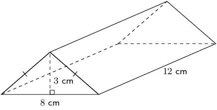

**Sketch and label the net of the prism:**
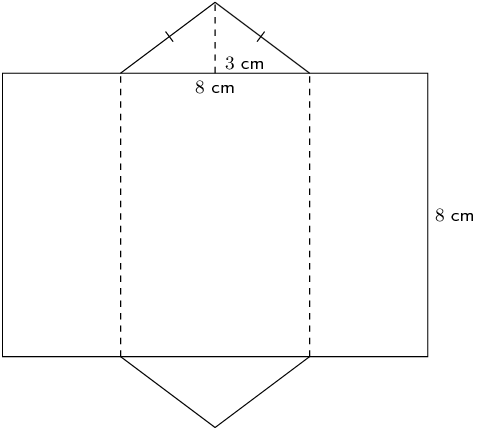

**Find the area of the different shapes in the net:**
To find the area of the rectangle, we need to calculate its length, which is equal to the perimeter of the
            triangles.

To find the perimeter of the triangle, we have to first find the length of its sides using the theorem of
            Pythagoras:

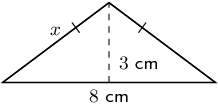

**Find the sum of the areas of the faces:**
\begin{align*}
          \text{surface area}& = \text{area large rectangle} + \left(2\times \text{area of triangle}\right) \\
          & = 216 + 2\left(12\right) \\
          & = \text{240}\text{ cm$^{2}$}
          \end{align*}

**Write the final answer:**
The surface area of the triangular prism is \(\text{240}\) \(\text{cm$^{2}$}\).
</Callout>

<QuizCard id="m10-13-02b" title="Interactive Exercise 13.4" question="The figure here is a triangular prism.  The height of the prism is \(\text{8}\) units; the triangles, which are both right triangles, have sides which are \(\text{3}\) , \(\text{4}\) and \(\text{5}\) units long. Find the surface area of the figure.  Round to two decimal places if necessary.  (NOTE: The diagram is not necessarily drawn to scale.)" options=[] answer=" 108 " hint="You should enter a number here. If you want to, you can use a space to separate thousands.                Example: 12 800,25 For scientific notation you need to use the multiply symbol                ( ∗ ) and the exponent symbol ( ^ ). For example 6,673 × 10 −11 should be written as: 6,673 ∗ 10^−11" explanation="The surface area of an object is the outside surface of the shape which you can cover or paint (like covering a table with a cloth or painting the outside of a building).  We need to look at the 'net' of the prism to see all of its surfaces.  Imagine 'unfolding' the shape and letting it open up... it would look something like this: Notice that some sides have equal lengths! You can see that the surface is made of two triangles (which are the same size!) and three rectangles.  We need to calculate the area of each of these shapes, and then add them together: \[\begin{array}{c}A_{\Delta \text{ prism}} = \text{2 triangles} + \text{3 rectangles}\end{array}\] The triangles both have a base of \(\text{3}\) units and a height of \(\text{4}\) units.  The rectangle all have the same height, which is \(\text{8}\) units; but the widths of the rectangles are not all equal.  For example, the green rectangle above is \(\text{8}\) units tall and \(\text{5}\) units wide - the green rectangle has an area equal to \( \text{5} \times \text{8} \) . Putting it all together, we get: \[                     \begin{aligned}                     A_{\Delta prism} & = \text{2 triangles} + \text{3 rectangles}	\\                     & = 2 \left[\frac{1}{2}b_{\Delta}h_{\Delta}  \right] + b_{1}h_{1} + b_{2}h_{2} + b_{3}h_{3}	\\                     & = 2 \left[\frac{1}{2}(\text{3})(\text{4})  \right] + (\text{4})(\text{8}) + (\text{3})(\text{8}) + (\text{5})(\text{8})	\\                     & = \text{12}  + \text{32} + \text{24} + \text{40}	\\                     & = \text{108}                     \end{aligned}                 \] The total surface area for the prism is \(\text{108}\) square units. Submit your answer as:" />

<Callout type="tip" title="Worked example 4: Finding the surface area of a cylinder">
**Question:**
Find the surface area of the following cylinder (correct to 1 decimal place):

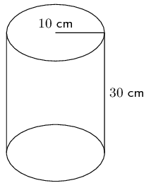

**Sketch and label the net of the cylinder:**
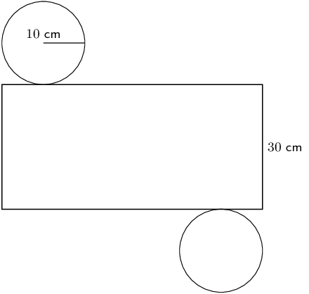

**Find the area of the different shapes in the net:**
\begin{align*}
          \text{area of large rectangle} & = \text{circumference of circle}\times \text{length} \\
          & = 2 \pi r \times l \\
          & = 2 \pi \left(10\right)\times 30 \\
          & = \text{1 884,9555...}\text{ cm$^{2}$} \\
          \text{area of circle} & = \pi {r}^{2} \\
          & = \pi {(10)}^{2} \\
          & = \text{314,1592...}\text{ cm$^{2}$}
          \end{align*}\begin{align*}
          \text{surface area}& =\text{area large rectangle}+\left(2\times \text{area of circle}\right) \\
          & =\text{1 884,9555...} + 2\left(\text{314,1592...}\right) \\
          & = \text{2 513,3}\text{ cm$^{2}$}
          \end{align*}

**Write the final answer:**
The surface area of the cylinder is \(\text{2 513,3}\) \(\text{cm$^{2}$}\).
</Callout>

<QuizCard id="m10-13-02c" title="Interactive Exercise 13.5" question="A cylinder is shown below.  The height of the cylinder is \(\text{10}\ \text{units}\) ; the radius of the cylinder is \( r =  \text{6}\ \text{units}\) , as shown. The diagram is not necessarily drawn to scale. Find the surface area of the figure. INSTRUCTION: Round your answer to two decimal places." options=[] answer=" ['603.19', '6.03e+2', '602.88', '603.43'] " hint="You should enter a number here. If you want to, you can use a space to separate thousands.                Example: 12 800,25 For scientific notation you need to use the multiply symbol                ( ∗ ) and the exponent symbol ( ^ ). For example 6,673 × 10 −11 should be written as: 6,673 ∗ 10^−11" explanation="Identify the components of the cylinder The surface area of an object is the outside surface of the shape which you can cover or paint (like covering a table with a cloth or painting the outside of a building).  We need to look at the 'net' of the cylinder to see all of its surfaces.  Imagine 'unfolding' the shape and letting it open up... it would look something like this: You can see that the cylinder is made of two circles (one from the top and one from the bottom) and a large rectangle.  The total surface area of the cylinder is the sum of these three areas. \[\begin{array}{c}A_{\text{cylinder}} = \text{2 circles} + \text{1 rectangle}\end{array}\] Find the surface area of the cylinder The area of each circle comes from the formula \( A = \pi r^{2}\) , and the radius of the circle is shown in the diagram.  However, the area of the rectangle is not as straightforward!  The rectangle is definitely \(\text{10}\) units high, but how wide is it?  The key is to see that the rectangle is wide enough to wrap around the circles exactly one time.  That means that the width of the rectangle is equal to the circumference of the circles!  To summarize, the height of the rectangle is \(\text{10}\) units, and the width of the rectangle is \( 2\pi r\) units. \[     	           \begin{aligned} 	                    A_{\text{cylinder}} & = \text{2 circles} + \text{1 rectangle}	\\ 	                    & = 2 (\pi r^{2}) + b(2\pi r) \\ 		                & = 2 \left(\pi (\text{6})^{2}\right) +  (\text{10})(2\pi  (\text{6}))	\\ 		                & = 2 \left(\pi (\text{36})\right) +  \text{120}\pi \quad  \longleftarrow \text{Use your calculator's value of } \pi \text{ here.}\\ 	                    & = \text{226,19467...} + \text{376,99111...}	\\ 		                & = \text{603,18578...} \\ & \approx \text{603,19}\ \text{units$^{2}$}    	                \end{aligned}   	            \] Therefore, the total surface area of the cylinder is \(\text{603,19}\ \text{units$^{2}$}\) . Submit your answer as:" />

### Textbook Exercise 13.2

Calculate the surface area of the following prisms:

**Problem:**
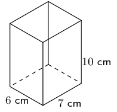

**Solution:**
\begin{align*}
                \text{Area of large rectangle} &= \text{perimeter of small rectangle} \times \text{length} \\
                &= (10 + 7 + 10 + 7) \times 6 \\
                &= 34 \times 6 \\
                &= \text{204}\text{ cm$^{2}$} \\
                \text{Area of } 2 \times \text{ small rectangle} &= 2(7 \times 10) \\
                &= 2(70) \\
                &= \text{140}\text{ cm$^{2}$} \\
                \text{Area of large rectangle} + 2 \times \text{(small rectangle)} &= 204 + 140 = \text{344}\text{
                cm$^{2}$}
                \end{align*}

**Problem:**
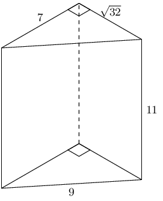

**Solution:**
There are three different sized rectangles that make up the sides of this triangular prism. We need
                  to find the area of each one of them. All of the rectangles have a height of 11 but each rectangle has
                  a different base.

                \begin{align*}
                \text{area of } 2 \times \text{ triangle} &= 2\left(\frac{1}{2}b \times h\right) \\
                &= (\sqrt{32})(7) \\
                & = \text{39,5979...} \\
                \text{area of rectangle 1} &= b \times h \\
                &= (7)(11) \\
                & = 77 \\
                \text{area of rectangle 2} &= b \times h \\
                &= (9)(11) \\
                & = 99 \\
                \text{area of rectangle 3} &= b \times h \\
                &= (\sqrt{32})(11) \\
                & = \text{62,2253...} \\
                A_{\text{triangular prism}} & = \text{39,5979...} + 77 + 99 + \text{62,2253...} \\
                & = \text{277,82}\text{ cm$^{2}$}
                \end{align*}

**Problem:**
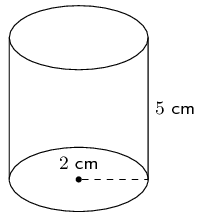

**Solution:**
\begin{align*}
                \text{Area of large rectangle} &= \text{circumference of circle} \times \text{length}\\
                &= 2 \pi \times r \times l \\
                &= 2 \pi \times (2) \times 5 \\
                &= 20 \pi \\
                \text{Area of circle}&= \pi r^{2}\\
                &= \pi (2)^{2}\\
                &= 4 \pi \\
                \text{Surface area} &= \text{area large rectangle} + 2(\text{area of circle})\\
                & = 20 \pi + 2(4 \pi)\\
                & = 28 \pi \\
                & \approx \text{87,96}\text{ cm$^{2}$}
                \end{align*}

**Problem:**
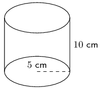

**Solution:**
\begin{align*}
                \text{Area of large rectangle} &= \text{circumference of circle} \times \text{length}\\
                &= 2 \pi \times r \times l \\
                &= 2 \pi \times (5) \times 10 \\
                &= 100 \pi \\
                \text{Area of circle}&= \pi r^{2}\\
                &= \pi (5)^{2}\\
                &= 25 \pi \\
                \text{Surface area} &= \text{area large rectangle} + 2(\text{area of circle})\\
                & = 100 \pi + 2(25 \pi)\\
                & = 150 \pi \\
                & \approx \text{471,24}\text{ cm$^{2}$}
                \end{align*}

**Problem:**
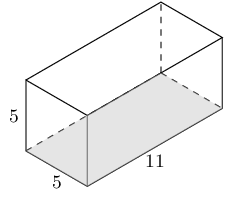

**Solution:**
There are 4 rectangles and 2 squares that make up this rectangular prism. The square has a side
                  length of 5. The rectangles have a base of 5 and a height of 11.

                \begin{align*}
                A_{\text{rectangular prism}} & = 4 \times \text{area rectangle} + 2 \times \text{area square} \\
                & = 4(b \times h) + 2(s^{2}) \\
                & = 4(11 \times 5) + 2(5^{2}) \\
                & = 4(55) + 2(25) \\
                & = \text{270}
                \end{align*}

**Problem:**
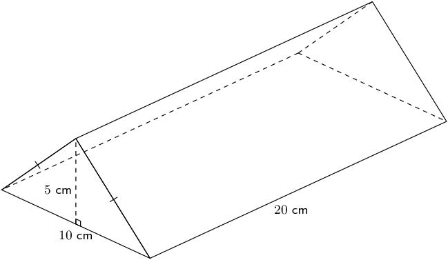

**Solution:**
We first need to find the missing side of the triangle. We can do this using the theorem of
                  Pythagoras.

                \begin{align*}
                x^2 &= 5^2 + \left(\frac{10}{2}\right)^2\\
                x^2& = 5^2 + 5^2 \\
                & = 25 + 25 \\
                x &= \sqrt{50}
                \end{align*}

Now we can find the area of the triangular prism:

                \begin{align*}
                \text{perimeter of triangle} &= 10 + \sqrt{50} + \sqrt{50} \\
                &= \text{24,1421...} \\
                \text{area of large rectangle} &= \text{perimeter of triangle} \times \text{length}\\
                &= \text{24,1421...} \times 20 \\
                & = \text{482,8427...} \\
                \text{area of triangle} &= \frac{1}{2} b \times h \\
                &= \frac{1}{2} \times 5 \times 10 \\
                &= \text{25} \\
                \text{surface area} &= \text{area large rectangle} + 2(\text{area of triangle})\\
                &= \text{482,8427...} + 2(25)\\
                &= \text{532,84}\text{ cm$^{2}$}
                \end{align*}

If a litre of paint covers an area of \(\text{2}\) \(\text{m$^{2}$}\), how much paint does a painter
                need to cover:

**Problem:**
a rectangular swimming pool with dimensions \(\text{4}\text{ m} \times \text{3}\text{ m} \times
                  \text{2,5}\text{ m}\) (the inside walls and floor only);

**Solution:**
We need to find the surface area of the pool. In this case we have a rectangular prism but with one
                  rectangle missing (which would be the top of the pool).

                \begin{align*}
                \text{surface area} &= \text{area of bottom of pool} + 2\text{(area of long sides)}\\
                & + 2\text{(area of short sides)}\\
                &= (4 \times 3) + 2(4 \times \text{2,5}) + 2(3 \times \text{2,5})\\
                &= 12 + 20 + 15\\
                &= \text{47}\text{ m$^{2}$}
                \end{align*}

The painter needs one litre of paint for every \(\text{2}\) \(\text{m$^{2}$}\) of area. So we must
                  divide the surface area by 2 to find the total amount of paint needed. Therefore, the painter will
                  need \(\frac{47}{2} = \text{24}\text{ l}\) of paint (rounded up to the nearest litre).

**Problem:**
the inside walls and floor of a circular reservoir with diameter \(\text{4}\) \(\text{m}\) and height
                  \(\text{2,5}\) \(\text{m}\).

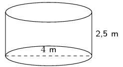

**Solution:**
We need to find the surface area of the reservoir. In this case we have a cylinder but with one
                  circle missing (which would be the top of the reservoir).

We are given the diameter of the reservoir. The radius is half the diameter and so \(r =
                  \text{2}\text{ m}\).

                \begin{align*}
                \text{surface area} &= \text{area of bottom of reservoir} + \text{area of inside of reservoir}\\
                & = (\pi r^2) + (\text{circumference of base} \times \text{height of reservoir})\\
                & = (\pi (2)^2) + (2 (\pi) (2) \times \text{2,5})\\
                & = 14 \pi \\
                & \approx \text{44}\text{ m$^{2}$}
                \end{align*}

The painter needs one litre of paint for every \(\text{2}\) \(\text{m$^{2}$}\) of area. So we must
                  divide the surface area by 2 to find the total amount of paint needed. Therefore, the painter will
                  need \(\frac{44}{2} = \text{22}\text{ l}\) of paint (rounded up to the nearest litre).

### Volume of prisms and cylinders (EMA7P)

<Callout type="info" title="Definition: Volume">
Volume is the three dimensional space occupied by an object, or the contents of an object. It is measured
            in cubic units.
</Callout>

The volume of right prisms and cylinders is simply calculated by multiplying the area of the base of the solid
        by the height of the solid.

<Callout type="tip" title="Multimedia & Video">
The video below shows several examples of calculating the volume of a right prism.

<VideoPlayer src="https://www.youtube.com/embed/ZqzAOZ9pP9Q" title="Video: 2GSB" />
</Callout>

| Rectangular prism |  | \(\begin{array}{rl} \text{Volume}& =\text{area of base}\times \text{height} \\ & =\text{area of
              rectangle}\times \text{height} \\ & =l\times b\times h
              \end{array}\) |
| --- | --- | --- |
| Triangular prism |  | \(\begin{array}{rl} \text{Volume}& =\text{area of base}\times \text{height} \\ & =\text{area of
              triangle}\times \text{height} \\ & =\left(\frac{1}{2}b\times h\right)\times H
              \end{array}\) |
| Cylinder |  | \(\begin{array}{rl} \text{Volume}& =\text{area of base}\times \text{height} \\ & =\text{area of
              circle}\times \text{height} \\ & =\pi {r}^{2}\times h
              \end{array}\) |

<Callout type="tip" title="Worked example 5: Finding the volume of a cube">
**Question:**
Find the volume of the following cube:

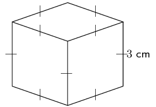

**Find the area of the base:**
\begin{align*}
          \text{area of square} & = {s}^{2} \\
          & = {3}^{2} \\
          & = \text{9}\text{ cm$^{2}$}
          \end{align*}

**Multiply the area of the base by the height of the solid to find the volume:**
\begin{align*}
          \text{volume} & = \text{area of base}\times \text{height} \\
          & = 9\times 3 \\
          & = \text{27}\text{ cm$^{3}$}
          \end{align*}

**Write the final answer:**
The volume of the cube is \(\text{27}\) \(\text{cm$^{3}$}\).
</Callout>

<QuizCard id="m10-13-02e" title="Interactive Exercise 13.7" question="The figure here is a rectangular prism.  The height of the prism is \(\text{5}\) units; the other dimensions of the prism are \(\text{11}\) and \(\text{5}\) units. Calculate the volume of the figure.  (NOTE: The diagram is not necessarily drawn to scale.)" options=[] answer=" 275 " hint="You should enter a number here. If you want to, you can use a space to separate thousands.                Example: 12 800,25 For scientific notation you need to use the multiply symbol                ( ∗ ) and the exponent symbol ( ^ ). For example 6,673 × 10 −11 should be written as: 6,673 ∗ 10^−11" explanation="The volume of an object is the amount of space inside the object.  For example, when you eat lunch, the food goes into the volume of your body.  In fact, the volume of your body is filled with muscles, bones, and organs like your heart and so on. The formula for the volume of an object is: \(V = \text{area of base} \times \text{height}\) . Begin by finding the area of the base of the prism, which is the blue rectangle at the bottom of the prism (the blue rectangle is the same size as the rectangle on the top!).  Then multiply by the height of the prism. \[                     \begin{aligned}                     V_{\text{rectangular prism}} & =  \text{area of base} \times \text{height}		\\                     & = (b_{\text{blue rectangle}}h_{\text{blue rectangle}})(H)				\\                     & = (\text{5} \times \text{11})(\text{5})		\\                     & = \text{275}                     \end{aligned}                 \] The volume for the prism is \(\text{275}\) cubic units. Submit your answer as:" />

<Callout type="tip" title="Worked example 6: Finding the volume of a triangular prism">
**Question:**
Find the volume of the triangular prism:

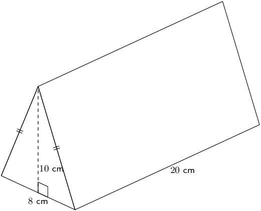

**Find the area of the base:**
\begin{align*}
          \text{area of triangle} & = \frac{1}{2}b\times h \\
          & = \left(\frac{1}{2}\times 8\right)\times 10 \\
          & = \text{40}\text{ cm$^{2}$}
          \end{align*}

**Multiply the area of the base by the height of the solid to find the volume:**
\begin{align*}
          \text{volume}& =\text{area of base}\times \text{height} \\
          & = \frac{1}{2}b\times h\times H \\
          & = 40\times 20 \\
          & = \text{800}\text{ cm$^{3}$}
          \end{align*}

**Write the final answer:**
The volume of the triangular prism is \(\text{800}\) \(\text{cm$^{3}$}\).
</Callout>

<QuizCard id="m10-13-02f" title="Interactive Exercise 13.8" question="The figure here is a triangular prism.  The height of the prism is \(\text{12} \ \text{units}\) . The triangles both contain right angles, and have a side of length \(\text{3}\) , a side of length \(\text{4}\) and a side of length \(\text{5} \ \text{units}\) . Determine the volume of the figure. NOTE: The diagram is not necessarily drawn to scale. INSTRUCTION: Round to two decimal places if necessary." options=[] answer=" ['72.00', '7.20e+1'] " hint="You should enter a number here. If you want to, you can use a space to separate thousands.                Example: 12 800,25 For scientific notation you need to use the multiply symbol                ( ∗ ) and the exponent symbol ( ^ ). For example 6,673 × 10 −11 should be written as: 6,673 ∗ 10^−11" explanation="Determine the volume of the prism Volume is the space occupied by an object.  It is the space inside of the object.  For example, when you get into a bus, you are climbing into the volume of the bus. To calculate the volume of this triangular prism, you multiply the area of the base by the height of the prism: \(V = \text{area of base} \times \text{height}\) . In this case, the base is the blue triangle in the figure.  Remember that when you calculate the area of a triangle with the formula \(A_{\Delta} = \frac{1}{2}bh\) the base and the height must be perpendicular.  In this case, that means you must use the numbers \(\text{3}\) and \(\text{4}\) to calculate the area of the triangle.  (The hypotenuse of the triangle, \(\text{5}\) , is just a useless number in this question.)  Then you must also multiply by the height of the prism, \(H = \text{12}\) . \[                     \begin{aligned}                     V_{\Delta \text{ prism}} & = \text{area of base} \times \text{height}	\\                     & = \left[\frac{1}{2}b_{\Delta}h_{\Delta}  \right] (H)		\\                     & = \left[\frac{1}{2}(\text{3})(\text{4})  \right](\text{12})	\\                     & = (\text{6})(\text{12}) 	\\                     & = \text{72}\ \text{units$^{3}$}                     \end{aligned}                 \] The volume for the prism is \(\text{72}\ \text{units$^{3}$}\) . Submit your answer as:" />

<Callout type="tip" title="Worked example 7: Finding the volume of a cylinder">
**Question:**
Find the volume of the following cylinder (correct to 1 decimal place):

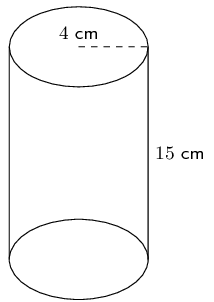

**Find the area of the base:**
\begin{align*}
          \text{area of circle}& =\pi {r}^{2} \\
          & =\pi {\left(4\right)}^{2} \\
          & = 16\pi ~\text{cm$^{2}$}
          \end{align*}

**Multiply the area of the base by the height of the solid to find the volume:**
\begin{align*}
          \text{volume}& =\text{area of base}\times \text{height} \\
          & =\pi {r}^{2}\times h \\
          & =16\pi \times 15 \\
          & \approx \text{754,0}\text{ cm$^{3}$}
          \end{align*}

**Write the final answer:**
The volume of the cylinder is \(\text{754,0}\) \(\text{cm$^{3}$}\).
</Callout>

<QuizCard id="m10-13-02g" title="Interactive Exercise 13.9" question="The picture below shows a cylinder.  The height of the cylinder is \(\text{12}\ \text{units}\) ; the radius of the cylinder is \( r =  \text{5}\ \text{units}\) . The diagram is not necessarily drawn to scale. Find the volume of the figure. INSTRUCTION: Round your answer to two decimal places." options=[] answer=" ['942.48', '9.42e+2', '942.00', '942.86', '9.43e+2'] " hint="You should enter a number here. If you want to, you can use a space to separate thousands.                Example: 12 800,25 For scientific notation you need to use the multiply symbol                ( ∗ ) and the exponent symbol ( ^ ). For example 6,673 × 10 −11 should be written as: 6,673 ∗ 10^−11" explanation="Find the volume of the cylinder The volume of an object is the amount of space inside the object.  For example, when you pour water from a bottle into a cup, you are putting the water into the cup's volume... and you are taking the water out of the bottle's volume! The volume of any prism or cylinder is: \(V = \text{area of base} \times \text{height}\) . Begin by finding the area of the base of the cylinder, which is the circle.  Then multiply by the height fo the cylinder. \[                     \begin{aligned}                         V_{\text{cylinder}} & = (\text{area of circle})(H)	\\                         & = \left[\pi r^{2}\right](H) \\                         & = \left[\pi (\text{5})^{2}\right](\text{12})			\\                         & = \left[\pi (\text{25})\right](\text{12})			\\                         & = \text{942,47779...} \\ & \approx \text{942,48}\ \text{units$^{3}$}                     \end{aligned}                 \] Therefore, the volume of the cylinder is \(\text{942,48}\ \text{units$^{3}$}\) . Submit your answer as:" />

### Textbook Exercise 13.3

Calculate the volumes of the following prisms (correct to \(\text{1}\) decimal place):

**Problem:**

**Solution:**
\begin{align*}
              V &= l \times b \times h \\
              &= 6 \times 7 \times 10 \\
              &= \text{420}\text{ cm$^{3}$}
              \end{align*}

**Problem:**
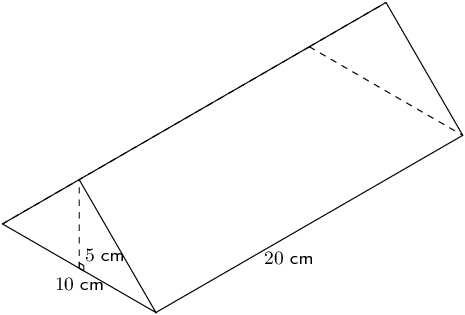

**Solution:**
\begin{align*}
                V & = \frac{1}{2} \times b \times h \times H\\
                & = \frac{1}{2} \times 10 \times 5 \times 20 \\
                & = \text{500}\text{ cm$^{3}$}
                \end{align*}

**Problem:**
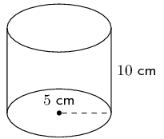

**Solution:**
\begin{align*}
                V & = \pi r^2 h \\
                & = \pi(5)^2(10)\\
                & = 250 \pi\\
                & \approx \text{785,4}\text{ cm$^{3}$}
                \end{align*}

**Problem:**
The figure here is a triangular prism. The height of the prism is \(\text{7}\) units; the triangles,
                which both contain right angles, have sides which are \(\text{2}\), \(\sqrt{21}\) and \(\text{5}\) units
                long. Calculate the volume of the figure. Round to two decimal places if necessary.

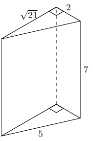

**Solution:**
\begin{align*}
              V & = \text{area of base} \times \text{height} \\
              & = \left[\frac{1}{2}b_{\triangle}h_{\triangle} \right] (H) \\
              & = \left[\frac{1}{2}(\text{2})(\sqrt{21}) \right](\text{7}) \\
              & = (\sqrt{21})(\text{7}) \\
              & \approx \text{32,06}
              \end{align*}

**Problem:**
The figure here is a rectangular prism. The height of the prism is \(\text{12}\) units; the other
                dimensions of the prism are \(\text{11}\) and \(\text{8}\) units. Find the volume of the figure.

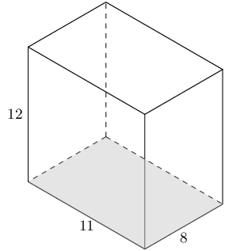

**Solution:**
\begin{align*}
              V_{\text{rectangular prism}} & = \text{area of base} \times \text{height} \\
              & = (bh)(H) \\
              & = (\text{8} \times \text{11})(\text{12}) \\
              & = \text{1 056}
              \end{align*}

**Problem:**
The picture below shows a cylinder. The height of the cylinder is \(\text{11}\) units; the radius of
                the cylinder is \(r = \text{4}\) units. Determine the volume of the figure. Round your answer to two
                decimal places.

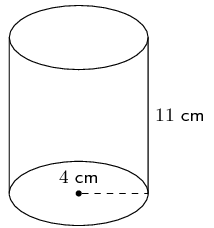

**Solution:**
\begin{align*}
              V_{cylinder} & = (\text{area of circle})(H) \\
              & = \left[\pi r^{2}\right](H) \\
              & = \left[\pi (\text{4})^{2}\right](\text{11}) \\
              & = \left[\text{16}\pi\right](\text{11}) \\
              & = 176 \pi \\
              & \approx \text{552,92}
              \end{align*}
